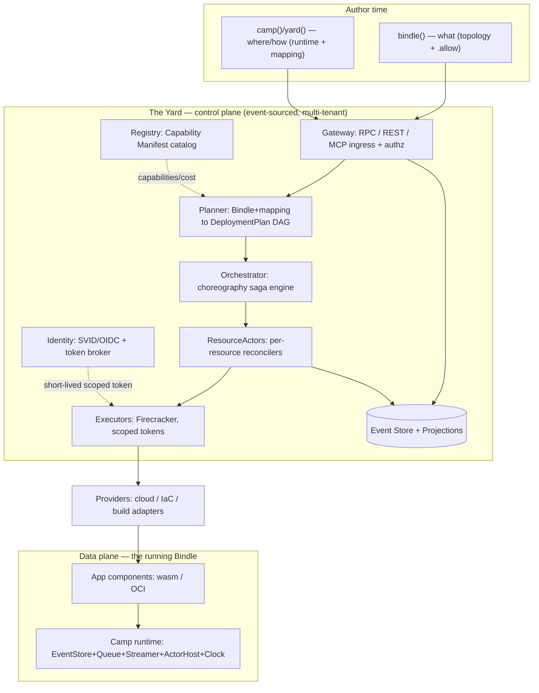

# HoBo — Requirements

> The **requirements layer** over the [HoBo Design Plan Suite](../../design/index.md). Where the design docs (`docs/design/0–36`) explain *how* HoBo works, this document states *why* (business), *what* (product), and *how — in requirements terms* (technical) — with stable IDs and end-to-end traceability so business intent, product scope, and engineering work cannot silently drift apart. It **cites** the design suite rather than restating it; the design docs remain the source of design truth.
>
> Three sections own three ID families: **[Business Requirements](#business-requirements)** (`BR-NNN`), **[Product Requirements](#product-requirements)** (`FR-NNN`/`NFR-NNN`), **[Technical Requirements](#technical-requirements)** (`TR-NNN`). The authoritative **[Traceability matrix](#traceability-matrix)** at the end links `BR → FR/NFR → TR → design doc`.
>
> **Archive note:** this suite was moved under docs/archive/ and its links remapped — design paths resolve via ../../design/, the roadmap lives beside this suite at ../roadmap.md, forge-generated-stack.md is now generated-stack.md, and the former ADR theme docs 04/05/06/08 were consolidated into the four current theme docs (see ../../design/adr/index.md).

## Document control

| Field | Value |
|---|---|
| Title | HoBo Requirements (Business · Product · Technical) |
| Version | 0.1 (Draft for review) |
| Date | 2026-06-20 |
| Status | Draft |
| Owner (Accountable) | Founders / Business lead (business), Product lead (product), Engineering lead (technical) |
| Authors | Business + Product + Design + Engineering + Platform + SRE |
| Reviewers | Founders, Engineering, Platform, UX, Security, SRE, GTM |
| Related design | [00 Vision](../../design/vision.md#plan-00), [02 SDK](../../design/sdk-api.md#plan-02), [04 Control plane](../../design/control-plane.md#plan-04), [06 AI/agent](../../design/ai-native-agent-auth.md#plan-06), [07 UI](../../design/developer-experience.md#plan-07), [08 Roadmap](../roadmap.md#plan-08), [09 Verification](../../design/generated-stack.md#plan-09), [10 Architecture](../../design/architecture.md#plan-10), [11 Event model](../../design/data-plane.md#plan-11), [16 Cost/FinOps](../../design/reliability-observability-cost.md#plan-05), [17 Positioning](../../design/vision.md#plan-17), [19 Worked example](../../design/worked-example.md#plan-19), [18 ADR log](../../design/adr/index.md) |

### Traceability model
Decided in [ADR-0018](../../design/adr/07-portability-extensibility.md#adr-0018):

```
Business need ──BR──▶ Product capability ──FR / NFR──▶ Technical requirement ──TR──▶ design doc + conformance/verification
```

- Every **BR** maps to ≥1 **FR**/**NFR**; every **FR**/**NFR** maps to ≥1 **TR**; every **TR** cites the governing `docs/design/*` doc and how it's verified ([09](../../design/generated-stack.md#plan-09)). The authoritative matrix is the [Traceability matrix](#traceability-matrix) at the end.
- Everything is **v1** ([ADR-0063](../../design/adr/07-portability-extensibility.md#adr-0063)); **MoSCoW** (Must / Should / Could) now expresses **build priority/order within v1** — which to nail first, mapped to the build stages in the [per-stage build detail](../roadmap.md#per-stage-build-detail-stages-06) — **not** a release boundary. There is no "Won't-v1" bucket.

### RACI
Three decision lanes — business, product, technical.

**Business decisions**
| Activity | Founders | Product | Eng | Platform | GTM |
|---|---|---|---|---|---|
| Business objectives & KPIs | **A** | R | C | C | C |
| ICP / persona priority ([ADR-0019](../../design/adr/07-portability-extensibility.md#adr-0019)) | A | **R** | C | C | C |
| Scope (in/out) & roadmap | A | **R** | C | C | I |
| Risk acceptance | **A** | R | C | C | C |

**Product decisions**
| Activity | Product | Founders | Eng | UX | Security |
|---|---|---|---|---|---|
| Persona/journey definition | **A/R** | C | C | C | I |
| Functional scope & priority | **A/R** | C | C | C | C |
| NFR baselines ([ADR-0021](../../design/adr/07-portability-extensibility.md#adr-0021)) | A | C | **R** | C | C |
| UX requirements | A | I | C | **R** | I |
| Release criteria per stage | **A/R** | C | C | I | C |

**Technical decisions**
| Activity | Eng | Platform | Security | SRE | Product |
|---|---|---|---|---|---|
| Architecture & subsystem TRs | **A/R** | C | C | C | I |
| Interfaces (WIT/CLI/MCP/API) | **A/R** | C | C | I | C |
| Security/multi-tenancy TRs | A | C | **R** | C | I |
| Reliability/SLO TRs | A | C | C | **R** | C |
| Verification strategy | **A/R** | C | C | C | I |

*(R = Responsible, A = Accountable, C = Consulted, I = Informed.)*

### Sign-off
| Role | Name | Decision | Date |
|---|---|---|---|
| Founder / Business | _TBD_ | ☐ Approve ☐ Changes | |
| Product lead | _TBD_ | ☐ Approve ☐ Changes | |
| Engineering lead | _TBD_ | ☐ Approve ☐ Changes | |
| Platform lead | _TBD_ | ☐ Approve ☐ Changes | |
| UX lead | _TBD_ | ☐ Approve ☐ Changes | |
| Security lead | _TBD_ | ☐ Approve ☐ Changes | |
| SRE lead | _TBD_ | ☐ Approve ☐ Changes | |

### Vision & shared context
Shipping software still forces application developers to become part-time platform engineers — picking clouds, wiring IaC, designing for HA, and operating infrastructure ([design README §Context](../../design/index.md)). Today's tools force a bad trade: an opinionated closed PaaS (simple but locked-in) **or** raw multi-cloud IaC (powerful but heavy). Neither is built for the emerging world where **AI agents are primary builders and deployers**.

**HoBo** is an **AI-native meta-cloud** — a cloud-agnostic **control plane** plus a TypeScript SDK: *"Write your app once in TypeScript. HoBo decides how to host it — and gets out of the way when you want control. Built for humans and the agents that work for them."* ([vision.md#plan-00](../../design/vision.md#plan-00)). It is **not** a single PaaS, **not** "just IaC," and **not** Kubernetes-only ([positioning.md#plan-17](../../design/vision.md#plan-17)). The product realizes six principles: agnostic by default / optimizable on demand; everything replayable; agents are users; ports over platforms; self-host = hosted; conformance is the contract.

The bet: own the intersection no incumbent occupies — cloud-agnostic ports/adapters (as WIT interfaces) + a durable, event-sourced runtime + inline `.allow()` infrastructure-from-code + agents-as-first-class + **AI-generated providers** + a self-hostable control plane ([17](../../design/vision.md#plan-17)).

### Scope (single v1)
**In scope (the whole designed surface, [ADR-0063](../../design/adr/07-portability-extensibility.md#adr-0063)):** agnostic authoring + runtime; the Yard control plane; ≥2 providers; keyless agent identity + MCP; Capability Manifest + Registry; conformance trust boundary; cross-provider connectivity; **the Forge; cloud-cost FinOps (estimates/budgets/showback); multi-region HA; the complete dashboard; platform-engineer Resource Definitions/Matching/Packs at depth; the Operator Crew, the generated stack (infrastructure + app/UI), patchability, SRE/incident management; and the governance planes (compliance & data governance, AI safety/model governance).** Delivered in dependency-ordered build stages ([per-stage build detail](../roadmap.md#per-stage-build-detail-stages-06)) — there is no deferred release.

**Out of scope (positioning anti-goals, not deferrals)** ([ADR-0064](../../design/adr/07-portability-extensibility.md#adr-0064) + [00 non-goals](../../design/vision.md#plan-00)): **SaaS-business functions** (billing/subscriptions/invoicing/tax/chargeback/monetization). HoBo **composes** Terraform/Pulumi/OpenTofu via the IaC port rather than replacing them; it is not a standalone secret-management product or a generic application framework. Broad cloud coverage is delivered **on demand via the Forge** rather than pre-enumerating every cloud.

### Glossary
These sections reuse the canonical vocabulary verbatim — the nested scopes **`Junction ⊃ Yard ⊃ Camp ⊃ Bindle`** (Junction = cross-cloud / hybrid, connects Yards; Yard = provider-specific cross-Camp scope — one provider's cross-Camp policy + that provider's control plane; Camp = provider-specific target that provides the durable **runtime ports**; Bindle = app config), Port, Provider, Forge, Grain, Planner, ResourceActor, Executor, SVID, Capability Manifest/Signs, IfC, `.allow()`, `.with(...)`, Manifest IR, Stub, Resource Definition/Matching, Deployment Set/Delta, Gatekeeper, the four-lens taxonomy. Definitions: [design suite glossary](../../design/index.md#glossary--naming-thematic-all-tunable).

---

## Business Requirements

> **Why** we are building HoBo: the business problem, market, objectives, and the business-level requirements (`BR-NNN`) that the [Product](#product-requirements) and [Technical](#technical-requirements) sections must satisfy. Shared context, scope, and the vision/value proposition are stated once in [Document control](#document-control).

### 1 Business context & problem statement
- **Developer pain:** cloud-specific APIs, IaC sprawl, and operational burden block application developers from shipping; switching clouds means rewrites.
- **Lock-in vs. complexity dilemma:** closed PaaS (e.g. Lakebed) trades control for simplicity; multi-cloud IaC trades simplicity for control. No mainstream option is both simple *and* portable.
- **Agent readiness gap:** existing platforms treat AI agents as bolt-on API clients, not first-class authenticated principals with scoped credentials and audit — so autonomous deploy/operate is unsafe or impossible.
- **Provider-breadth bottleneck:** agnostic platforms depend on communities to write provider adapters; coverage lags demand.

### 2 Business objectives (SMART)
All objectives are part of the single v1 ([ADR-0063](../../design/adr/07-portability-extensibility.md#adr-0063)); the milestone column names the **v1 build stage** ([per-stage build detail](../roadmap.md#per-stage-build-detail-stages-06)) by which each is demonstrable, not a separate release.
| ID | Objective | Measure | v1 build milestone |
|---|---|---|---|
| OBJ-1 | Prove agnostic deploy is tractable | A single unedited Bindle deploys to ≥2 clouds | stage 4 |
| OBJ-2 | Prove AI-native operation is safe | An agent completes deploy/operate via MCP using only brokered tokens, fully audited | stage 3 |
| OBJ-3 | Break the provider-breadth bottleneck | `hobo forge <url>` yields a conformance-passing provider | stage 5 |
| OBJ-5 | Earn developer trust via openness | OSS core self-hostable; "self-host = hosted" demonstrated | stage 2 |

### 3 Market opportunity & positioning
**Positioning statement** ([17](../../design/vision.md#plan-17)): *HoBo is an AI-native meta-cloud — a cloud-agnostic control plane (WIT/WASM surface; TypeScript the first reference implementation) that maps one app description onto any mix of real providers — agnostic by default, optimizable on demand, and operable by agents end to end.*

**The gap HoBo fills:** *"No one combines cloud-agnostic ports/adapters (as WIT interfaces) + a wasm-default polyglot runtime + a Vercel-grade durable runtime + Nitric-style IfC/`.allow()` + Aspire-style wiring + agents-as-first-class + AI-generated providers AND implementations + a self-hostable control plane. That intersection is HoBo."* ([17](../../design/vision.md#plan-17)).

### 4 Competitive analysis
From [positioning.md#plan-17](../../design/vision.md#plan-17) and the [`docs/competitors/`](../../competitors/index.md) captures:

| Competitor | Their position | HoBo's edge |
|---|---|---|
| **Convex** | Reactive TypeScript backend-as-a-service | + multi-cloud portability, durable event-sourced runtime, agents-first, Forge ([docs/competitors/convex](../../competitors/convex.md)) |
| **Nitric** | Cloud-agnostic Infrastructure-from-Code | + durable workflows, agents-first, Forge, event-sourced replay, wasm-first ([docs/competitors/nitric](../../competitors/nitric.md)) |
| **Lakebed** | Agent-native closed PaaS | Single closed runtime; HoBo is multi-cloud, multi-runtime, self-hostable |
| **.NET Aspire** | Code-first composition + local orchestration | + cloud-agnostic multi-provider, Resource Definitions/Matching, event sourcing, agent ops ([docs/competitors/aspire](../../competitors/aspire.md)) |
| **Humanitec** | Platform Orchestrator for IDPs (K8s-centric) | + wasm/OCI runtime, event-sourced audit, OSS core, Forge-generated definitions ([docs/competitors/humanitec](../../competitors/humanitec.md)) |
| **shoo.dev** | Zero-config Google-sign-in broker | Adjacent (identity); HoBo adds workload/agent identity + token brokering ([docs/competitors/shoo](../../competitors/shoo.md)) |
| **Vercel + Workflow SDK** | PaaS + durable execution | HoBo provides its own HoBo-native durable runtime (per Camp) for portability; adds multi-provider + IfC + self-host |

**Defensible differentiators** ([17](../../design/vision.md#plan-17)): AI-native operations; the Capability Manifest standard + Registry + Forge (no community bottleneck); event-sourced everything; genuine agnostic + typed escape hatch in one model; contracts/policy/evals as native graph artifacts.

**Who HoBo is *not* for:** single-cloud teams happy with native tooling; pure-Kubernetes shops on Crossplane/KubeVela; bare-metal/extreme-perf workloads where any abstraction is a liability.

### 5 Stakeholders
| Stakeholder | Role | Interest |
|---|---|---|
| **Application developer** (primary ICP) | Writes the Bindle in TypeScript | Write-once, deploy-anywhere; minutes-to-deploy; no cloud lock-in |
| **AI agent** (co-primary; agent-as-user) | Deploys/operates via MCP | First-class identity, scoped credentials, audit, self-service capability discovery |
| **Platform engineer** (secondary) | Authors Resource Definitions, mapping rules, policy/cost guardrails | Governance, standardization, least-privilege, cost control |
| **Operator / SRE** | Runs (or self-hosts) the Yard | Reliability, observability, DR, incident response |
| **Hosted-tenant operator** | Runs (or uses) a managed Yard | Managed HA, SSO/RBAC, audit retention, support SLA |
Persona priority is fixed by [ADR-0019](../../design/adr/07-portability-extensibility.md#adr-0019).

### 6 Business requirements (`BR-NNN`)
> All BRs are **v1** ([ADR-0063](../../design/adr/07-portability-extensibility.md#adr-0063)). Priority **M**ust / **S**hould / **C**ould now expresses **build order within v1** (which to nail first), not a release boundary — there is no "Won't-v1" bucket. Each maps forward to `FR`/`NFR` (see [Traceability matrix](#traceability-matrix)).

| ID | Business requirement | Priority | Rationale / source |
|---|---|---|---|
| **BR-001** | A developer authors an app **once** in TypeScript and deploys it to real cloud infrastructure without cloud-specific code. | M | Core value prop ([00](../../design/vision.md#plan-00)) |
| **BR-002** | The **same** unedited app description deploys to **multiple** providers; switching/splitting clouds touches config only. | M | OBJ-1; agnostic thesis ([03](../../design/control-plane.md#plan-04)) |
| **BR-003** | Developers can **optimize per-provider on demand** without losing portability (typed escape hatch). | M | "optimizable on demand" ([ADR-0007](../../design/adr/index.md)) |
| **BR-004** | **AI agents are first-class users**: every capability is reachable via SDK, CLI, **and** MCP with first-class agent identity. | M | OBJ-2; agents-as-users ([06](../../design/ai-native-agent-auth.md#plan-06)) |
| **BR-005** | Provider access uses **brokered/federated short-lived credentials**, not static secrets (zero-secret default). | M | Trust/security; OBJ-2 ([06](../../design/ai-native-agent-auth.md#plan-06)/[12](../../design/security-networking.md#plan-12)) |
| **BR-006** | Every business-relevant action (deploy, token grant/use/revoke, spend approval, policy decision) is **auditable and replayable**. | M | Compliance, trust ([11](../../design/data-plane.md#plan-11)/[12](../../design/security-networking.md#plan-12)) |
| **BR-007** | HoBo is **self-hostable**; the hosted offering runs the same code ("self-host = hosted"). | M | OBJ-5; openness ([00](../../design/vision.md#plan-00)/[04](../../design/control-plane.md#plan-04)) |
| **BR-008** | Missing provider coverage can be filled **without waiting on a community** (AI-generated, conformance-gated). | S | OBJ-3; Forge moat ([06](../../design/ai-native-agent-auth.md#plan-06)/[23](../../design/generated-stack.md#plan-23)) |
| **BR-009** | **Cost is a first-class input**: plan-time estimates, budgets/caps, and showback per tenant/Bindle/Camp. | S→C | FinOps ([16](../../design/reliability-observability-cost.md#plan-05)) |
| **BR-010** | The platform supports **governance** (policy, approvals, data-residency/region constraints) suitable for regulated adopters. | C | Platform-engineer persona ([12](../../design/security-networking.md#plan-12)/[30](../../design/contracts-policy-flags.md#plan-29)) |
| **BR-011** | The platform must be **safe to operate autonomously**: high-risk agent/automation actions are gated (approval, spend caps). | M | Trust; risk control ([06](../../design/ai-native-agent-auth.md#plan-06)/[30](../../design/contracts-policy-flags.md#plan-29)) |

### 7 Business model
HoBo is **open-source**. Commercialization of the product surface (a `billing` port, app-facing invoicing/tax/rev-share) is **out of design scope** ([ADR-0064](../../design/adr/07-portability-extensibility.md#adr-0064)); commercial-launch policies for HoBo-the-hosted-business (plans, credits, invoices, tax posture, entitlements) are design-scope productization records ([ADR-0107](../../design/adr/07-portability-extensibility.md#adr-0107)). An optional managed/hosted Yard may exist operationally (managed HA, org SSO/RBAC, audit retention, support), but it ships the **same code** as self-host and **never gates portability** ([ADR-0024](../../design/adr/07-portability-extensibility.md#adr-0024)); HoBo never marks up the customer's cloud spend.

### 10 Success metrics & KPIs
North-star signals from [roadmap.md#plan-08](../roadmap.md#plan-08), made measurable in [ADR-0021](../../design/adr/07-portability-extensibility.md#adr-0021). The product instruments these from the event log (no separate telemetry path required for control-plane KPIs).
| KPI | Target | Tied to |
|---|---|---|
| Time-to-first-deploy | minutes, not hours (≤10 min p50) | BR-001 |
| "Same Bindle, N clouds" | ≥2 at v1, design target N | BR-002 |
| Zero-secret rate | ~100% (≥99%) | BR-005 |
| Agent-completable lifecycle | % of deploy/operate tasks an agent does unaided via MCP | BR-004 |
| Forge yield | % of requested providers auto-generated that pass conformance | BR-008 |
| Recovery (resume after node loss / rebuild) | <30 s resume / <15 min rebuild | BR-006/BR-007 |

### 12 Assumptions
- AI agents (via MCP) are a growing, real channel for software delivery — central to the bet.
- Providers will (eventually) publish, or accept Forge-generated, machine-readable Capability Manifest; v1 ships first-party signs for launch providers.

### 13 Constraints
- **Agnostic constraint:** no design choice may make the core un-runnable off our cloud (would break BR-002/BR-007).
- **Security constraint:** the conformance suite is the trust boundary for all (esp. AI-generated) adapters; nothing ships uncertified ([09](../../design/generated-stack.md#plan-09)/[12](../../design/security-networking.md#plan-12)).
- **Resourcing:** v1 is one large scope delivered in dependency-ordered build stages; risky bets (Forge, multi-region HA) deliberately follow a proven core, but all of it is v1 ([08](../roadmap.md#plan-08)).

### 14 Dependencies
- Upstream ecosystems: WASI/Component Model + WIT, Pulumi Automation API, SPIFFE/OIDC, MCP. Churn in these (esp. `wasi:*` drafts) is a tracked risk ([09](../../design/generated-stack.md#plan-09)).
- Cloud provider federation/STS capabilities for keyless tokens (per-provider trust setup).

### 15 Risk register
| ID | Risk | Likelihood | Impact | Mitigation | Owner |
|---|---|---|---|---|---|
| R-1 | **Forge yields insecure/low-quality providers** | Med | High | Conformance + sandbox-no-egress + signing/provenance + human gate for high-trust ([12](../../design/security-networking.md#plan-12)/[23](../../design/generated-stack.md#plan-23)) | Eng |
| R-2 | **Agent autonomy causes runaway spend/destroy** | Med | High | Scoped SVIDs, policy gates, spend caps, full replay ([06](../../design/ai-native-agent-auth.md#plan-06)/[30](../../design/contracts-policy-flags.md#plan-29)) | Eng/Platform |
| R-3 | **Scope/complexity overwhelms the team** (large single-v1 surface) | High | High | Dependency-ordered build stages, each independently demoable + keeping prior acceptance gates green; "powerful but unusable" guardrail ([ADR-0063](../../design/adr/07-portability-extensibility.md#adr-0063)) | Product |
| R-5 | **Upstream churn** (`wasi:*`, Pulumi, MCP) breaks assumptions | Med | Med | Ports/adapters isolate churn; pin + conformance ([24](../../design/wasm-runtime-wit.md#plan-20)) | Eng |
| R-6 | **Multi-cloud networking** harder/costlier than modeled | Med | Med | Tiered connectivity + egress feedback to Planner ([13](../../design/security-networking.md#plan-12)/[16](../../design/reliability-observability-cost.md#plan-05)) | Eng |
| R-7 | **Incumbents add agnostic/agent features** | Med | Med | Move fast on the unique intersection; OSS + Forge moat ([17](../../design/vision.md#plan-17)) | Founders/GTM |

### 16 v1 build milestones
All of v1; the stages are a dependency-ordered build sequence ([08 v1 delivery plan](../roadmap.md#plan-08), [per-stage build detail](../roadmap.md#per-stage-build-detail-stages-06)), **not** separate releases. v1 GA = every milestone below met.
| v1 build stage | Business milestone | Acceptance |
|---|---|---|
| 0–1 | Developer SDK works locally (agnostic authoring) | hello-bindle runs offline; replay == live state |
| 2 | First cloud + Yard, governance-gated | deploys to a real cloud + survives Yard restart; an unsafe change is blocked |
| 3 | **Agent autonomy:** keyless agent deploy | agent deploys via MCP using only brokered tokens |
| 4 | **Multi-cloud thesis proved:** one Bindle, ≥2 clouds | multi-cloud example runs; cross-cloud mTLS works |
| 5 | **Extensibility moat:** Forge | `hobo forge <url>` yields a certified provider |
| 6 | **Production hardened + breadth:** HA + FinOps + UX + the governance planes | canary auto-rollback; cost within tolerance; DR < RTO; compliance/AI-safety usable |

---

## Product Requirements

> **What** we are building: personas, journeys, functional requirements (`FR-NNN`) and non-functional requirements (`NFR-NNN`). Each requirement traces back to a [`BR`](#6-business-requirements-br-nnn) and forward to a `TR` (see [Traceability matrix](#traceability-matrix)). Goals/non-goals and the value proposition are stated once in [Document control](#document-control) and the [Business](#business-requirements) section.

### Goals & non-goals
**Goals:** minutes-to-first-deploy; one Bindle to many clouds, unedited; safe autonomous agent operation; openness/self-host; AI-generated providers without a community bottleneck.
**Non-goals (positioning, not deferrals)** ([vision.md#plan-00](../../design/vision.md#plan-00)): HoBo **composes** Terraform/Pulumi/OpenTofu rather than replacing them; it is not a generic app framework or a standalone secrets product. Broad cloud coverage comes **on demand via the Forge** rather than pre-enumerating every cloud. The full dashboard / UI generation and the hosted multi-tenant operator are part of v1, not out of scope ([ADR-0063](../../design/adr/07-portability-extensibility.md#adr-0063)). The complete in/out scope statement lives in [Scope (single v1)](#scope-single-v1).

### Personas & roles
Priority per [ADR-0019](../../design/adr/07-portability-extensibility.md#adr-0019).

| Persona | Goals | Pain today | Success looks like |
|---|---|---|---|
| **Dana — indie/startup developer** (primary) | Ship a TS app fast; not learn N cloud APIs; avoid lock-in | IaC sprawl, cloud-specific rewrites | `hobo deploy` lands on a real cloud in minutes; swapping clouds is a config edit |
| **Atlas — AI agent** (co-primary) | Deploy/operate apps on a user's behalf, safely | Treated as a bolt-on API client; static keys; no audit | Obtains scoped tokens, deploys via MCP, self-corrects from logs; every action audited |
| **Priya — platform engineer** (secondary) | Standardize how resources are realized; enforce policy/cost | Bespoke golden paths, drift | Authors Resource Definitions + policy packs; dev teams self-serve within guardrails |
| **Omar — operator/SRE** | Keep the Yard healthy; recover fast | Opaque deploys, manual DR | Event-sourced timeline, drift heal, replay-based DR |
| **The Crew — built-in Operator Agents** (SRE/Endpoint Monitor/GitOps/Platform Engineer) | Run the platform autonomously within guardrails | Ops is manual or a DIY agent kit; no audit | Built-in, audited, policy-gated Yard services that diagnose/promote/generate; humans approve high-risk writes ([40](../../design/operators-sre.md#plan-40)) |

### Primary user journeys
**J1 — Human developer (happy path)** ([developer-experience.md#plan-07](../../design/developer-experience.md#plan-07)):
```bash
npx hobo new my-app -t fullstack && cd my-app && hobo dev   # runs locally, no cloud
# edit app code
hobo login && hobo plan --camp prod                         # dry-run: plan + cost + warnings
hobo deploy --camp prod --strategy canary                   # provision + shift traffic
```
**J2 — Agent via MCP** ([ai-native-agent-auth.md#plan-06](../../design/ai-native-agent-auth.md#plan-06)): `list_templates → new → plan → deploy (brokered tokens) → inspect_run/tail_logs → self-correct`.
**J3 — Optimize a boundary** ([worked-example.md#plan-19](../../design/worked-example.md#plan-19)): split one resource onto a different provider by changing the `camp()` mapping only — no app-code or Bindle change.
**J4 — Platform engineer governs** ([25](../../design/platform-engineering.md#plan-25)/[30](../../design/contracts-policy-flags.md#plan-29)): author a Resource Definition + policy pack; matching selects it per environment; high-risk actions require approval.
**J5 — Missing provider** ([06](../../design/ai-native-agent-auth.md#plan-06)): `hobo forge <url>` generates + sandbox-certifies a provider, then it's usable like any other.

### Functional requirements (`FR-NNN`)
> All FRs are **v1** ([ADR-0063](../../design/adr/07-portability-extensibility.md#adr-0063)). The M/S/C label is **build priority within v1** (which to nail first), not a release gate — there is no "Won't" tier. Each has acceptance criteria (AC) and a back-trace to `BR`.

#### Authoring & SDK ([02](../../design/sdk-api.md#plan-02), [21](../../design/authoring-resources-wiring.md#plan-21), [22](../../design/authoring-resources-wiring.md#plan-21))
| ID | Requirement | Pri | AC | BR |
|---|---|---|---|---|
| **FR-001** | Declare app topology in a provider-agnostic `bindle()` (resources + bindings). | M | A `bindle()` with ≥2 resources + a `bind` compiles and runs on the local Camp (`runtime-local`). | BR-001 |
| **FR-002** | Resource catalog with inline `.allow()` permissions (IfC), collected at build. | M | `hobo collect` emits a manifest matching a fixture; `.allow()` yields the expected IAM + link + token-scope triple ([09](../../design/generated-stack.md#plan-09)). | BR-001/BR-005 |
| **FR-003** | Runtime primitives: `step`, `workflow`, `actor`, `saga`, `agent`, `sleep`/`cron`, hooks, streams. | M | hello-bindle runs a workflow + actor + saga; replay == live state. | BR-001/BR-006 |
| **FR-004** | Separate provider-specific `camp()`/`yard()` scope objects (where/how) from the provider-agnostic `bindle()` (what). | M | Swapping the mapped provider edits only the Camp object, not the Bindle ([ADR-0011](../../design/adr/index.md)). | BR-002 |
| **FR-005** | Typed provider-specific options via `.with(...)`, inert for non-resolved providers; `require`/`prefer`. | M | The same Bindle resolves to ≥2 providers; `.with()` affects only the resolved one ([09](../../design/generated-stack.md#plan-09)). | BR-002/BR-003 |
| **FR-006** | Mapping styles: whole-app default, per-tier, per-boundary. | M | Each style deploys the reference app. | BR-002 |
| **FR-015** | Config & secrets load via `ctx.config` (`config()`/`secretRef()`/`env()`), resolved to **references per Camp**, **secretless-first** (bound resource via brokered token → provider secret store at use-time → bounded static fallback). | M | A secret resolves via a brokered token with **no value at rest**; `config.Resolved`/`secret.Accessed` events present; value redacted **at capture** from logs/spans/trajectories ([Plan 21](../../design/authoring-resources-wiring.md#plan-21), [ADR-0027](../../design/adr/02-identity-security.md#adr-0027)). | BR-005 |

#### CLI & DX ([15](../../design/developer-experience.md#plan-07))
| ID | Requirement | Pri | AC | BR |
|---|---|---|---|---|
| **FR-010** | Core CLI: `new`, `dev`, `build`, `collect`, `plan`, `deploy`, `promote`, `rollback`, `destroy`, `inspect`, `logs`, `drift`, `login`, `registry`, `doctor`. | M | Each command runs on the reference app; `plan` shows plan + cost + warnings. | BR-001 |
| **FR-011** | `hobo dev` runs the full app locally on the local Camp (`runtime-local`) with **zero cloud**. | M | Cold `hobo dev` ≤60 s, no credentials required (NFR-002). | BR-001 |
| **FR-012** | Deployment strategies (`recreate`/`blue-green`/`canary`/`progressive`) selectable per service. | S | Canary regression auto-rolls-back ([05](../../design/reliability-observability-cost.md#plan-05)). | BR-006 |
| **FR-013** | Verification CLI: `verify`, `can-deploy`, `explain-failure`, `fix --dry-run`. | S | A producer/consumer skew is blocked with a precise reason ([29](../../design/contracts-policy-flags.md#plan-29)); `explain-failure` output meets the error-UX bar in NFR-017. | BR-010 |
| **FR-014** | `hobo doctor` runs a **portability + security lint**: warns (non-blocking, explained) on provider lock-in (provider-specific `.with()` for only one provider) and on static-key use where federation is available. | S | doctor flags a single-provider `.with()` resource and a static-key binding with an actionable message ([ADR-0024](../../design/adr/07-portability-extensibility.md#adr-0024)/[ADR-0023](../../design/adr/02-identity-security.md#adr-0023)). | BR-002/BR-003/BR-005 |

#### AI-native & agent operation ([06](../../design/ai-native-agent-auth.md#plan-06))
| ID | Requirement | Pri | AC | BR |
|---|---|---|---|---|
| **FR-020** | Every CLI/SDK capability has an **MCP** equivalent with the same identity model. | M | An agent drives `plan→deploy→inspect_run` via `@hobo/mcp` ([09](../../design/generated-stack.md#plan-09)). | BR-004 |
| **FR-021** | Durable `agent()` with tools-as-steps; `ctx.identity` (SVID) + `ctx.token(...)` brokered tokens injected. | M | An agent run is replayable; `token.*` events present. | BR-004/BR-006 |
| **FR-022** | Agent guardrails: `require-approval`/`auto-allow`/`deny`, `spendCapUsd`, destroy protection. | M | A high-risk action blocks on a policy gate; spend over cap requires approval. | BR-011 |
| **FR-023** | Keyless credentials: agents obtain short-lived, resource-scoped provider tokens via OIDC federation (no static keys). | M | A deploy completes with zero static secrets; full grant/use/revoke audit. | BR-005 |

#### Providers, Registry & Capability Manifest ([03](../../design/control-plane.md#plan-04), [06](../../design/ai-native-agent-auth.md#plan-06))
| ID | Requirement | Pri | AC | BR |
|---|---|---|---|---|
| **FR-030** | ≥2 cloud providers (e.g. AWS + Azure) implement the capability ports via IaC adapters. | M | The reference app deploys to both; conformance green. | BR-002 |
| **FR-031** | Providers publish machine-readable **Capability Manifest** (`capabilities/auth/cost.json`) at a well-known path; the **Registry** indexes it. | M | An agent discovers a capability + auth flow from the Registry. | BR-004/BR-008 |
| **FR-032** | Capability/region/cost-aware **Planner** turns Bindle + mapping into a DeploymentPlan; records rationale. | M | Planner rejects an unsatisfiable `require` with a precise reason; rationale on `deployment.Planned`. | BR-002/BR-009 |

#### Forge, stubbable & trainable implementations ([06](../../design/ai-native-agent-auth.md#plan-06), [23](../../design/generated-stack.md#plan-23))
| ID | Requirement | Pri | AC | BR |
|---|---|---|---|---|
| **FR-040** | `stub()` behind any WIT port records calls and returns typed responses so an app runs before impls exist. | S | The reference app runs end-to-end with a stubbed port; calls recorded as events. | BR-008 |
| **FR-041** | **Forge** generates a candidate provider from docs/OpenAPI/Terraform, sandbox-tests against conformance, signs + publishes on pass. | S | `hobo forge <url>` yields a certified provider passing conformance ([09](../../design/generated-stack.md#plan-09)). | BR-008 |
| **FR-042** | AI implement/evolve/**live-fix**, gated: low-risk auto-canary w/ auto-rollback; prod/high-risk requires approval. | S→C | A simulated SLO regression drives a gated live-fix that auto-rolls-back on failure. | BR-008/BR-011 |
| **FR-043** | **`"use training"`** directive (peer to `"use workflow"`/`"use step"`) marks a method an AI-rewritable semantic function; it carries **intent + contract + rubric** (semantic grounding) and HoBo continuously optimizes it via an **internal `training-engine`** (built-in default; Microsoft Agent Lightning/Trace optional, **not SDK-exposed**). | S | A `"use training"` method missing intent/rubric is linted; a trained candidate promotes only through conformance + eval + policy ([23](../../design/generated-stack.md#plan-23), [ADR-0025](../../design/adr/03-data-plane.md#adr-0025)). | BR-008 |

#### Governance: contracts, policy, evals, Gatekeeper ([29](../../design/contracts-policy-flags.md#plan-29), [30](../../design/contracts-policy-flags.md#plan-29))
| ID | Requirement | Pri | AC | BR |
|---|---|---|---|---|
| **FR-050** | `can-deploy` compatibility gate checks a change against versions running per environment. | S | A producer/consumer skew emits `compat.GateFailed`. | BR-010 |
| **FR-051** | Unified policy decisions (`allow/deny/warn/mutate/require-approval`) with **obligations** as durable effects. | S | A "allow but require canary" obligation is tracked `ObligationCreated→Satisfied`. | BR-010/BR-011 |
| **FR-052** | A single **Gatekeeper** (`hobo verify`) composes contracts + policy + evals + conformance + cost. | S | One explainable, event-sourced decision blocks/permits promote. | BR-006/BR-010 |

#### Platform-engineering surface ([25](../../design/platform-engineering.md#plan-25)–[27](../../design/platform-engineering.md#plan-25))
| ID | Requirement | Pri | AC | BR |
|---|---|---|---|---|
| **FR-060** | Resource Definitions + Matching select *how* a port is realized per context; decision recorded as `match.Decided`. | C | A matching test asserts the expected definition wins with its score ([09](../../design/generated-stack.md#plan-09)). | BR-010 |
| **FR-061** | Environments via Deployment Sets + Deltas (draft→promote); incremental reconcile of changed nodes. | C | A delta applied yields the expected immutable Set. | BR-010 |
| **FR-062** | Resource Packs (shareable bundles of definitions) installable from the marketplace. | C | A pack installs and its definitions participate in matching. | BR-012 |

#### Observability & cost ([07](../../design/developer-experience.md#plan-07), [14](../../design/reliability-observability-cost.md#plan-05), [16](../../design/reliability-observability-cost.md#plan-05))
| ID | Requirement | Pri | AC | BR |
|---|---|---|---|---|
| **FR-070** | `hobo plan` returns a projected cost before provisioning; budgets/caps as policy gates; showback per tenant/Bindle/Camp. | S→C | Plan estimate within ±20% of a fixture; a budget breach blocks or requires approval. | BR-009 |
| **FR-071** | Dashboard: deployments timeline (replay/time-travel), topology graph (+ connectivity/cost), run inspector (replay-diff), credential audit, drift. | C | Each view renders for the reference app from projections only. | BR-006/BR-009 |

#### Operator Agents, the generated infrastructure stack & patchability ([40](../../design/operators-sre.md#plan-40)–[43](../../design/generated-stack.md#plan-23))
| ID | Requirement | Pri | AC | BR |
|---|---|---|---|---|
| **FR-080** | A built-in roster of **Operator Agents** (SRE / Endpoint Monitor / GitOps / Platform Engineer / UX Designer / SWE) runs as Yard services — each a principal (SVID + per-agent policy), event-sourced, MCP-surfaced; reads autonomous, writes policy-gated; reasoning engine behind a port; all run sandboxed under enforced AI governance ([ADR-0061](../../design/adr/02-identity-security.md#adr-0061)). | S→C | A simulated SLO breach dispatches SRE; a prod fix requires approval, a low-risk fix auto-canaries + auto-rolls-back; every action audited ([40](../../design/operators-sre.md#plan-40)). | BR-004 |
| **FR-081** | HoBo generates / self-heals / persists the app across the **generated stack** (data·business·message·intelligence·UI) via one loop + one trust boundary + one persistence mechanism. | C | A WIT-record change propagates per-layer as gated, reviewable diffs; `hobo codegen --check` flags hand-edited drift ([41](../../design/generated-stack.md#plan-23)). | BR-004/BR-008 |
| **FR-082** | **App/UI generation**: HoBo generates the developer's app UI from intent + `design.md` via the `ui-render` port (OpenUI / json-render / mcp-apps), owned by the UX Designer operator, typed from the domain and reactive to materializations. | C | A view generated from intent + `design.md` renders, passes the design.md gate, and updates reactively from a materialization ([41](../../design/generated-stack.md#plan-23)/[ADR-0056](../../design/adr/03-data-plane.md#adr-0056)). | BR-004 |
| **FR-083** | **Patchability**: any engine/adapter is swappable behind its port, the Yard is forkable, and AI/human patches persist (region-scoped AST + provenance) — all conformance-gated. | C | A custom engine shipped as a signed plugin passes conformance + is Matching-selected with no core edit; a persisted patch survives regeneration ([43](../../design/generated-stack.md#plan-23)). | BR-002 |
| **FR-084** | **Continuous/live security scanning + remediation**: vuln/SBOM/drift scans re-run on running Sets; findings ride the policy plane; remediation is the gated live-fix loop; findings export as OCSF. | S→C | A newly-disclosed CVE in a running Set raises a policy decision; a low-risk dep-bump auto-remediates, a prod one requires approval ([12](../../design/security-networking.md#plan-12)/[40](../../design/operators-sre.md#plan-40)). | BR-005/BR-008 |

### Non-functional requirements (`NFR-NNN`)
> The three review lenses — **security, ease-of-use, portability** — are first-class and tagged. Baselines from [ADR-0021](../../design/adr/07-portability-extensibility.md#adr-0021).

| ID | Category | Requirement | Target / method | BR |
|---|---|---|---|---|
| **NFR-001** | Portability | One **unedited** Bindle deploys to multiple providers; provider details never leak into the agnostic core. "Unedited" = the `bindle()` definition + app `src/` byte-identical across targets; only the `camp()`/`yard()` mapping/env vary. | ≥2 providers at v1; `multi-cloud-shop` E2E asserts identical topology ([ADR-0024](../../design/adr/07-portability-extensibility.md#adr-0024), [03](../../design/control-plane.md#plan-04)) | BR-002 |
| **NFR-002** | Ease-of-use | Local dev with zero cloud/credentials. | `hobo dev` ≤60 s cold | BR-001 |
| **NFR-003** | Ease-of-use | Time-to-first-deploy on the happy path. | ≤10 min p50 (E2E timing) | BR-001 |
| **NFR-004** | Ease-of-use | Parity across surfaces: anything in the CLI/SDK is also in MCP. | Surface-parity test ([09](../../design/generated-stack.md#plan-09)) | BR-004 |
| **NFR-005** | Security | Zero static secrets by default; provider access via short-lived scoped tokens. The legacy static-key escape hatch is **bounded** (max TTL, enforced rotation, fully audited, opt-in). | ≥99% brokered; audit of `token.*`; a key past TTL is rejected ([ADR-0023](../../design/adr/02-identity-security.md#adr-0023)) | BR-005 |
| **NFR-006** | Security | Tenant isolation across data/compute/credentials/network/wasm-capability. | Cross-tenant read fails at Gateway + store ([12](../../design/security-networking.md#plan-12)) | BR-006 |
| **NFR-007** | Security | AI-generated code is sandboxed (Firecracker + wasm capability, no egress in conformance) and only runs if signed + conformance-passing. | Executor egress test; unsigned plugin refused ([12](../../design/security-networking.md#plan-12)) | BR-008 |
| **NFR-008** | Auditability | Every state transition is an append-only event; replayable/time-travelable. | Projection rebuild == live ([11](../../design/data-plane.md#plan-11)) | BR-006 |
| **NFR-009** | Reliability | Control-plane availability; crash-resume; saga compensation. | 99.9%/99.95%; resume <30 s ([05](../../design/reliability-observability-cost.md#plan-05)) | BR-007 |
| **NFR-010** | Recoverability | DR is replay from the log. | RPO ~0/≤5 s; RTO <15 min ([05](../../design/reliability-observability-cost.md#plan-05)) | BR-007 |
| **NFR-011** | Determinism | Durable runs replay to identical state. | `replay == live` (hard invariant) | BR-006 |
| **NFR-012** | Cost | Plan-time cost accuracy. | within ±20% of fixture ([16](../../design/reliability-observability-cost.md#plan-05)) | BR-009 |
| **NFR-013** | Portability | The product is self-hostable on the same code as hosted. | `hobo yard up` bootstraps a working Yard ([04](../../design/control-plane.md#plan-04)) | BR-007 |
| **NFR-014** | Observability | OTel logs/traces/metrics for control + data planes. | Traces present for a deploy + a run ([14](../../design/reliability-observability-cost.md#plan-05)) | BR-006 |
| **NFR-015** | Usability/Docs | Machine-readable docs (`llms.txt`) + instant `npx` onboarding so agents and humans self-serve. | Onboarding test; docs present | BR-001/BR-004 |
| **NFR-016** | Accessibility/i18n | CLI/runtime error output is screen-reader-friendly and an **i18n framework is integrated from build stage 3**; the dashboard meets **WCAG 2.1 AA** and ships a pseudo-localization-passing i18n layer at build stage 6. | automated WCAG audit + manual review (stage-6 dashboard); pseudo-loc test (200% string length, RTL) passes | BR-001 |
| **NFR-017** | Ease-of-use | Failure output is **actionable**: every blocked gate / failed deploy states root cause + 1–2 remediation steps, machine-readable for agent self-correction. | `explain-failure` on a seeded failure yields cause + fix steps; agent self-corrects in the MCP E2E | BR-001/BR-004 |
| **NFR-018** | Security/Audit | Compliance audit streams (`token.*`/`resource.*`/policy decisions) are retained for a defined minimum and **never compacted**. | retention test: stream older than the floor still present ([ADR-0023](../../design/adr/02-identity-security.md#adr-0023)) | BR-006/BR-010 |
| **NFR-019** | Security/Availability | The Gateway and MCP surface enforce **per-principal and per-tenant rate limits + quotas** with backpressure. | a flooding agent is throttled (typed error); legitimate volume unaffected ([ADR-0023](../../design/adr/02-identity-security.md#adr-0023)) | BR-007/BR-011 |
| **NFR-020** | Portability | The **agnostic core never imports a provider/adapter package**; enforced at build time. | CI dependency-graph lint fails on a core→provider import ([ADR-0024](../../design/adr/07-portability-extensibility.md#adr-0024)) | BR-002 |
| **NFR-021** | Observability/AI | Trainable-method execution is captured as **OTel/OpenInference trajectories** and scored by **live-evals** (the training signal + performance telemetry), with no backend-lock-in telemetry path. | OpenInference spans present per call; live-eval reward attached; exports to the tenant's OTLP backend ([14](../../design/reliability-observability-cost.md#plan-05), [ADR-0025](../../design/adr/03-data-plane.md#adr-0025)) | BR-006/BR-008 |

### UX / UI requirements ([developer-experience.md#plan-07](../../design/developer-experience.md#plan-07))
Core views (built at stage 6): **Deployments timeline** (event-sourced, replay/time-travel scrubber, rollback on DAG); **Topology graph** (resources→providers, bind edges w/ connectivity + cost); **Run inspector** (step/actor/saga trace, per-step I/O, replay-diff vs current code); **Registry browser** (capabilities, signs, Forge provenance); **Agent activity & credential audit** (token grant/use/revoke, approvals); **Cost & FinOps** (plan vs actuals, budgets, showback); **Drift** (heal/propose). Key interactions: plan preview, approve policy gates, promote/rollback, live tail.

### Release criteria (single v1 definition of done)
v1 ships the whole designed surface ([ADR-0063](../../design/adr/07-portability-extensibility.md#adr-0063)); **v1 GA = every build-stage acceptance gate below is green** ([08 v1 delivery plan](../roadmap.md#plan-08), [per-stage build detail](../roadmap.md#per-stage-build-detail-stages-06)). The stages are a build sequence, not separate releases.
- **Stage 0/1:** the local Camp (`runtime-local`) passes runtime-port conformance; hello-bindle runs offline; replay == live.
- **Stage 2:** reference Bindle deploys to a real cloud and survives a Yard restart mid-deploy; the Gatekeeper blocks an unsafe change with an explainable reason (policy gates + approval obligations + `can-deploy`, FR-050/051/052).
- **Stage 3:** an agent deploys via MCP using only brokered tokens; credential audit present.
- **Stage 4:** one Bindle deploys to ≥2 clouds; cross-cloud mTLS works; switching a resource's provider touches only config; resource-driven Resource Definitions/Matching + Packs (FR-060/061/062) participate in resolution.
- **Stage 5:** `hobo forge <url>` produces a certified provider passing conformance; a stubbed port gets an AI-generated, conformance-passing implementation promoted through the eval gate.
- **Stage 6:** canary auto-rollback; plan-time cost within tolerance; DR rebuild < RTO; full dashboard + accessibility (NFR-016); and the governance planes usable — a `notify` send is event-sourced + consent-gated, a classified field drives an enforced residency/retention obligation with crypto-shred erasure, a guardrail blocks a flagged model output, and a certified Registry listing installs via Matching (uncertified stays unlisted).

### Risks & open questions
Inherits the [risk register](#15-risk-register). Open product questions (from [09](../../design/generated-stack.md#plan-09)): compiler-magic depth for `"use workflow"`; default Planner objective; "low-risk auto live-fix" threshold; first-deploy provider (build stage 2); IfC fidelity for non-TS languages. Tracked as ADR-P items in [18-adr-log](../../design/adr/index.md).

---

## Technical Requirements

> **How — in requirements terms:** the architecture, per-subsystem technical requirements (`TR-NNN`), interfaces, cross-cutting NFR realization, verification strategy, and the authoritative [Traceability matrix](#traceability-matrix) linking `BR` → `FR`/`NFR` → `TR` → design doc. This section states *requirements on the implementation*; design depth lives in [`docs/design`](../../design/index.md).

### System context
HoBo comprises (a) an **SDK** (author + runtime) compiled to portable components, (b) **the Yard** — an event-sourced, actor-based control plane and the **provider-specific cross-Camp scope** (one provider's Camps + that provider's control plane), with the **Junction** connecting Yards across clouds for the cross-cloud / hybrid case, and (c) **adapters** (runtime backends, Providers, IaC, Build) behind ports. The **control plane** decides what infra should exist and makes it exist; the **data plane** is the running Bindle in a **Camp** (which provides the durable runtime), never on the Yard's critical path ([architecture.md#plan-10](../../design/architecture.md#plan-10)). Scopes nest `Junction ⊃ Yard ⊃ Camp ⊃ Bindle` ([ADR-0026](../../design/adr/01-architecture-core.md#adr-0026)). This section specifies technical requirements on these subsystems and how they satisfy the product requirements.

### Architecture overview
Control plane vs data plane, author→deploy→run ([10](../../design/architecture.md#plan-10)/[04](../../design/control-plane.md#plan-04)):



**Layering invariant** ([architecture.md#plan-10](../../design/architecture.md#plan-10)): dependencies point **inward only** — `apps → adapters → sdk/runtime → core`; adapters depend only on `@hobo/core` port interfaces, so the agnostic core never leaks provider detail (enforces NFR-001).

### Component breakdown (`@hobo/*`)
From [architecture.md#plan-10](../../design/architecture.md#plan-10): **core** (`@hobo/core`, `@hobo/wit`, `@hobo/sdk`, `@hobo/runtime`); **control plane** (`@hobo/cli`, `@hobo/cloud` = the Yard, `@hobo/registry`, `@hobo/identity`, `@hobo/mcp`); **runtime backends** (`runtime-local` built-in, `runtime-postgres`/`-temporal`/`-restate`/`-cloudflare`); **Providers** (`provider-aws`/`-azure`/`-gcp`/`-cloudflare`/`-fly`/`-kubernetes`); **IaC** (`iac-pulumi` primary, `-cdktf`/`-crossplane`/`-opentofu`); **Build** (`build-wasm`, `-dagger`/`-packer`/`-firecracker`); **governance** (`@hobo/conformance`, `@hobo/contracts`, `@hobo/policy`, `@hobo/evals`, `@hobo/training`, optional `provider-pact`/`-opa`/`-cedar`).

### Technical requirements (`TR-NNN`)

#### SDK & compile (IfC) ([02](../../design/sdk-api.md#plan-02), [20](../../design/wasm-runtime-wit.md#plan-20), [21](../../design/authoring-resources-wiring.md#plan-21), [22](../../design/authoring-resources-wiring.md#plan-21))
| ID | Requirement | Verified by |
|---|---|---|
| **TR-001** | `@hobo/sdk` exposes the resource catalog + `bindle()`; resources declare `.allow()` verbs inline (IfC). | IfC-collection test ([09](../../design/generated-stack.md#plan-09)) |
| **TR-002** | `hobo collect` runs the component to emit a **Manifest IR** (resources + links + endpoints + env). | Manifest matches fixture ([09](../../design/generated-stack.md#plan-09)) |
| **TR-003** | Services compile to **wasm components** (jco/componentize) with **OCI-container fallback**. | Build test; component runs on the local Camp (`runtime-local`) ([20](../../design/wasm-runtime-wit.md#plan-20)) |
| **TR-004** | `.allow(v)` produces exactly one **{IAM scope + wasm capability link + brokered-token scope}** triple; a missing verb is denied on all three. | `.allow()` triple test ([09](../../design/generated-stack.md#plan-09)) |
| **TR-005** | `.with(provider.option(...))` is per-provider-typed and inert for non-resolved providers. | Multi-provider resolve test ([09](../../design/generated-stack.md#plan-09)) |
| **TR-006** | The build enforces the **layering invariant** via a dependency-graph lint (e.g. `depcheck`/`madge`): no agnostic package imports a provider/iac/build package and no adapter imports another adapter; CI blocks on violation. | dep-graph lint gate ([ADR-0024](../../design/adr/07-portability-extensibility.md#adr-0024), [01](../../design/architecture.md#plan-10)) |

> **"Unedited" (portability definition, [ADR-0024](../../design/adr/07-portability-extensibility.md#adr-0024)):** across cloud targets, the **`bindle()` definition** and application `src/` are **byte-identical**; only the **`camp()`/`yard()` mapping** and CLI/env parameters may change. The `multi-cloud-shop` E2E proves it by deploying an unchanged Bindle to ≥2 providers and asserting identical resolved topology + bindings.

#### Camp runtime — durable runtime ports ([02](../../design/sdk-api.md#plan-02), [24](../../design/wasm-runtime-wit.md#plan-20))
| ID | Requirement | Verified by |
|---|---|---|
| **TR-010** | Define the **runtime ports** — EventStore, Queue, Streamer, ActorHost, Clock — as WIT interfaces; ship a built-in engine (`runtime-local`, SQLite/fs). | Per-runtime-port conformance ([09](../../design/generated-stack.md#plan-09)) |
| **TR-011** | Runtime primitives `step`/`workflow`/`actor`/`saga`/`agent`/`sleep`/`cron`/hooks/streams with memoized steps + auto idempotency keys. | hello-bindle exercises all; replay==live |
| **TR-012** | Runtime backends are swappable per Camp (`runtime-postgres`/`-temporal`/`-restate`/`-cloudflare`) with no app-code change. | An example runs unchanged on **≥2 runtime backends** (e.g. `runtime-local` + `runtime-postgres`) with only a runtime override; lifecycle identical (replay==live) ([24](../../design/wasm-runtime-wit.md#plan-20)) |
| **TR-013** | **Version policy:** Pulumi Automation API / WASI-WIT / MCP are pinned to exact versions; runtime-port versions are recorded in the Manifest IR and immutable for a Bindle version; upgrades go through a gated `hobo upgrade` path with a compat/upgrade test; a version mismatch fails planning with a precise reason. | upstream-upgrade compat test; version-mismatch reject test ([ADR-0024](../../design/adr/07-portability-extensibility.md#adr-0024); open ADR-P/Q11 [09](../../design/generated-stack.md#plan-09)) |

#### The Yard control plane ([04](../../design/control-plane.md#plan-04))
| ID | Requirement | Verified by |
|---|---|---|
| **TR-020** | **Gateway** authenticates principal (human OIDC / agent SVID), authorizes ABAC `(principal,tenant,port,resource,action)`, turns requests into **commands**; reads served from projections only. | Authz tests ([12](../../design/security-networking.md#plan-12)) |
| **TR-021** | **Planner** is a **pure function** Bindle+mapping → DeploymentPlan DAG; records selection rationale on `deployment.Planned`. | Unit-testable without cloud ([09](../../design/generated-stack.md#plan-09)) |
| **TR-022** | **Orchestrator** runs choreography sagas; one **ResourceActor** grain per resource reconciles desired↔actual via the resolved IaC adapter; cross-resource ordering by dependency DAG + events (no central coordinator). | Crash-resume + compensation tests ([05](../../design/reliability-observability-cost.md#plan-05)) |
| **TR-023** | **Executors** run IaC/builds in **Firecracker microVMs** with **no ambient creds** and a single injected scoped token; output streams as `exec.*` events. | Executor egress test ([12](../../design/security-networking.md#plan-12)) |
| **TR-024** | The Yard is **itself a Bindle**; `hobo yard up [--restore <log>]` bootstraps/rebuilds it (self-host = hosted). | Bootstrap + DR replay test ([04](../../design/control-plane.md#plan-04)/[05](../../design/reliability-observability-cost.md#plan-05)) |

#### Event model & CQRS ([11](../../design/data-plane.md#plan-11))
| ID | Requirement | Verified by |
|---|---|---|
| **TR-030** | A single **append-only event log** is the source of truth for both planes; reads are projections (CQRS). | Projection rebuild==live ([09](../../design/generated-stack.md#plan-09)) |
| **TR-031** | Appends are **conditional on expected `seq`** (OCC) and **dedup on `idempotencyKey`** → exactly-once *effects* over at-least-once delivery. | Idempotent-dedup conformance ([05](../../design/reliability-observability-cost.md#plan-05)) |
| **TR-032** | Schema evolution via **upcasters**; old events replay through them. | Upcaster replay test ([11](../../design/data-plane.md#plan-11)) |
| **TR-033** | Every durable run satisfies **`replay == live state`** (hard invariant, NFR-011). | Determinism test ([09](../../design/generated-stack.md#plan-09)) |

#### Providers / IaC / Build ([03](../../design/control-plane.md#plan-04))
| ID | Requirement | Verified by |
|---|---|---|
| **TR-040** | `CloudProvider`/`IacProvider`/`BuildProvider` are swappable ports; a cloud provider composes IaC + build. | Per-capability conformance ([09](../../design/generated-stack.md#plan-09)) |
| **TR-041** | **Pulumi Automation API** is the primary IaC mechanism (embedded, no CLI shell-out); Crossplane/OpenTofu/CDKTF are alternates. | Provider deploy test ([ADR-0006](../../design/adr/index.md)) |
| **TR-042** | **Per-resource IaC stacks** by default (blast-radius isolation + clean compensation). | Compensation rollback test ([05](../../design/reliability-observability-cost.md#plan-05)) |
| **TR-043** | ≥2 cloud providers implement the capability ports for the reference app at v1. | `multi-cloud-shop` E2E (NFR-001) |

#### Identity, credentials & token broker ([06](../../design/ai-native-agent-auth.md#plan-06), [12](../../design/security-networking.md#plan-12))
| ID | Requirement | Verified by |
|---|---|---|
| **TR-050** | **Identity** issues short-lived **SVIDs** (SPIFFE-style) to agents/workloads and acts as an OIDC provider. | Token issuance test ([09](../../design/generated-stack.md#plan-09)) |
| **TR-051** | **Token broker** exchanges an SVID for a resource-scoped provider token (OIDC federation preferred; OAuth-OBO for human delegation). The **API-key legacy escape hatch** is opt-in, carries a **max TTL with enforced rotation**, and is fully audited. | Zero-secret deploy test (NFR-005); key-past-TTL-rejected test ([ADR-0023](../../design/adr/02-identity-security.md#adr-0023)) |
| **TR-052** | Every credential event (`token.Granted/Used/Revoked`) is logged and replayable; audit streams are retained for a defined minimum and never compacted. | Credential-audit + retention-floor test ([06](../../design/ai-native-agent-auth.md#plan-06), NFR-018) |
| **TR-053** | **Confused-deputy default-deny:** before issuing any scoped token, the policy engine checks `{principal, tenant, resource, action}`; cross-tenant issuance is denied unless explicitly delegated. | Agent-with-tenant-1-SVID requests tenant-2 token → denied before `token.Granted` ([ADR-0023](../../design/adr/02-identity-security.md#adr-0023)) |
| **TR-054** | **Config/secret resolution (secretless-first):** `config()`/`secretRef()`/`env()` declarations resolve to **references per Camp** at use-time via the ladder — bound resource (brokered token, no secret) → provider secret store (brokered token) → bounded static fallback (TTL ≤7d, [ADR-0023](../../design/adr/02-identity-security.md#adr-0023)). Values never persist in the Bindle/Camp config/event log; reads emit `config.Resolved`(ref+Camp)/`secret.Accessed`/`secret.Unavailable` and are redacted **at capture** (incl. training trajectories). `hobo doctor` checks cross-Camp ref parity. | secretless-resolve + redaction + drift test ([Plan 21](../../design/authoring-resources-wiring.md#plan-21)/[ADR-0027](../../design/adr/02-identity-security.md#adr-0027)) |

#### Registry & Capability Manifest ([06](../../design/ai-native-agent-auth.md#plan-06))
| ID | Requirement | Verified by |
|---|---|---|
| **TR-060** | Providers publish **Capability Manifest** (`index/signs/capabilities/auth/cost.json`) at `/.well-known/capability-manifest/`; the **Registry** indexes + serves capability search. | Discovery test (FR-031) |
| **TR-061** | The Registry **refuses unsigned/unverified plugins**; consumers pin versions + require a trust level. | Unsigned-plugin-refused test ([12](../../design/security-networking.md#plan-12)) |

#### MCP control surface ([06](../../design/ai-native-agent-auth.md#plan-06), [15](../../design/developer-experience.md#plan-07))
| ID | Requirement | Verified by |
|---|---|---|
| **TR-070** | `@hobo/mcp` exposes every CLI/SDK capability as an MCP tool (`plan`/`deploy`/`promote`/`rollback`/`inspect_run`/`tail_logs`/`request_token`/`get_drift`/`heal`/…) with the same identity/authz model. | Surface-parity + agent E2E (NFR-004) |
| **TR-071** | The Gateway and MCP surface enforce **per-principal (SVID/OIDC) and per-tenant rate limits + quotas** with backpressure; excess returns a typed throttle error. | Flooding-agent-throttled test (NFR-019, [ADR-0023](../../design/adr/02-identity-security.md#adr-0023)) |

#### Forge & conformance trust boundary ([06](../../design/ai-native-agent-auth.md#plan-06), [09](../../design/generated-stack.md#plan-09), [23](../../design/generated-stack.md#plan-23))
| ID | Requirement | Verified by |
|---|---|---|
| **TR-080** | `@hobo/conformance` provides an executable contract suite **per WIT interface**; an adapter may only claim a port it passes; CI blocks otherwise. | Conformance gate in CI ([09](../../design/generated-stack.md#plan-09)) |
| **TR-081** | **Forge** generates a candidate provider/impl, runs conformance **sandboxed with no egress**, signs + attaches SLSA-style provenance, publishes on pass. | `hobo forge` certification test ([06](../../design/ai-native-agent-auth.md#plan-06)) |
| **TR-082** | `stub()` records calls as events; AI implement-to-trace asserts conformance-green **and** reproduces recorded traces; **live-fix** routes through the gated canary/auto-rollback saga. | Stub/replay + gated live-fix test ([09](../../design/generated-stack.md#plan-09)) |
| **TR-083** | **Forge generation is injection-hardened:** source docs/OpenAPI are scanned/sanitized before generation; the signed provenance includes a scrub report; conformance runs with **no egress** (hard requirement, not default). | Seeded-malicious-docs test produces a scrub report; egress attempt during conformance fails ([ADR-0023](../../design/adr/02-identity-security.md#adr-0023), [12](../../design/security-networking.md#plan-12)) |
| **TR-084** | **`"use training"` methods** are optimized by a `training-engine` **WIT port** (built-in OPTO default; **Microsoft Agent Lightning / Trace optional INTERNAL providers, not on the SDK surface**). Runtime emits OTel/**OpenInference** trajectories; **live-evals** attach the reward; trained candidates pass the **same** conformance + eval + policy gate as Forge impls. | Training-loop test: trajectory captured → candidate proposed → promoted only via the gate; swapping the engine is config-only ([ADR-0025](../../design/adr/03-data-plane.md#adr-0025), [23](../../design/generated-stack.md#plan-23)) |

#### Contracts, policy, evals & Gatekeeper ([29](../../design/contracts-policy-flags.md#plan-29), [30](../../design/contracts-policy-flags.md#plan-29))
| ID | Requirement | Verified by |
|---|---|---|
| **TR-090** | `contract-engine` + `policy-engine` are **WIT ports** with built-in defaults (typed TS); Pact/OPA/Cedar are optional providers. | Per-engine conformance ([ADR-0015](../../design/adr/index.md)) |
| **TR-091** | **`can-deploy`** checks producer/consumer version skew against what the event log says runs per environment; emits `compat.GatePassed/Failed`. | Compatibility test ([09](../../design/generated-stack.md#plan-09)) |
| **TR-092** | Policy decisions carry **obligations** realized as durable effects/sagas, tracked `ObligationCreated→Satisfied`; an unmet obligation blocks. | Policy-decision + obligation test ([30](../../design/contracts-policy-flags.md#plan-29)) |
| **TR-093** | A single **Gatekeeper** (`hobo verify`) composes contracts + policy + evals + conformance + cost into one event-sourced decision at Delta→Set/promote. | `hobo verify` composite test ([ADR-0015](../../design/adr/index.md)) |

#### Platform-engineering: definitions, matching, deltas, packs ([25](../../design/platform-engineering.md#plan-25)–[27](../../design/platform-engineering.md#plan-25))
| ID | Requirement | Verified by |
|---|---|---|
| **TR-100** | **Resource Definitions + Matching** select how a port is realized per context; the winning definition + score recorded as `match.Decided`. | Matching test ([09](../../design/generated-stack.md#plan-09)) |
| **TR-101** | Environments are **Deployment Sets** with mutable **Deltas** (draft→promote); reconcile is **incremental** (only changed nodes). | Delta→Set test ([26](../../design/platform-engineering.md#plan-25)) |
| **TR-102** | **Resource Packs** bundle definitions and are installable (marketplace); Drivers (`terraform`/`template`/`container`/`custom-webhook`) have conformance suites. | Pack + Driver conformance ([27](../../design/platform-engineering.md#plan-25)) |

#### Cross-cutting: security & multi-tenancy ([12](../../design/security-networking.md#plan-12))
| ID | Requirement | Verified by |
|---|---|---|
| **TR-110** | Tenant is the hard isolation boundary across **five** dimensions: data (namespaced/encrypted streams), compute (partitioned Executor pools), credentials (tenant-scoped SVIDs/tokens), network (tenant-scoped mTLS domains), and **wasm capability** (deny-by-default unforgeable handles). | Cross-tenant tests incl. an **explicit denial scenario**: a component linked only to tenant A's resource calling tenant B's resource fails with a *capability-denied* (not generic-auth) error ([09](../../design/generated-stack.md#plan-09)) |
| **TR-111** | **No static secrets:** bindings resolve to secret refs; per-run sensitive payloads encrypted with a per-run key. **Envelope encryption at rest** for event streams is available across **all** runtime backends (default for new tenants; opt-in where a backend lacks native support, gap documented). Decryption requires log-read **and** explicit authorization (run-owner / `decrypt:run`); log access ≠ payload access. | Encryption-across-runtimes + unauthorized-decrypt-denied test ([ADR-0023](../../design/adr/02-identity-security.md#adr-0023), [12](../../design/security-networking.md#plan-12)) |
| **TR-112** | **Supply chain:** plugins signed w/ SLSA-style provenance + conformance report; images by digest + scanned; all published artifacts (SDK, CLI, providers, implementations, base images) carry **CycloneDX SBOMs**; CI **blocks publishing on CVSS ≥ 7.0** (documented waiver path). | Signing + SBOM-present + vuln-gate test ([12](../../design/security-networking.md#plan-12)) |
| **TR-113** | **Data residency:** a tenant can constrain regions; the Planner rejects residency violations at plan time. | Residency rejection test ([03](../../design/control-plane.md#plan-04)) |

#### Cross-cutting: networking ([13](../../design/security-networking.md#plan-12))
| ID | Requirement | Verified by |
|---|---|---|
| **TR-120** | Connectivity is derived from `bind` edges; the Planner selects a **tier** (same-region private → cross-region → cross-provider private → overlay mesh → public+mTLS) and may be overridden via `.with(...)`. | Connectivity-tier test ([09](../../design/generated-stack.md#plan-09)) |
| **TR-121** | **mTLS-by-default** between services, keyed by workload SVIDs; certs issued/rotated by Identity (zero-trust); apps don't manage them. | Cross-provider mTLS test (build stage 4) |
| **TR-122** | The **HoBo Relay** provides an outbound-only (no inbound) reverse tunnel for private-network targets. | Private-target deploy test ([28](../../design/platform-engineering.md#plan-25)) |

#### Cross-cutting: observability ([14](../../design/reliability-observability-cost.md#plan-05))
| ID | Requirement | Verified by |
|---|---|---|
| **TR-130** | OTel logs/traces/metrics emitted for control + data planes; the event log backs the audit/timeline; dashboard reads projections only. | Trace-present test ([14](../../design/reliability-observability-cost.md#plan-05)) |

#### Cross-cutting: reliability/HA ([05](../../design/reliability-observability-cost.md#plan-05))
| ID | Requirement | Verified by |
|---|---|---|
| **TR-140** | Single-writer **leases + fencing tokens** per grain; stale-owner appends rejected; failover = lease TTL + tail replay (<30 s). | Partition/fencing test ([05](../../design/reliability-observability-cost.md#plan-05)) |
| **TR-141** | Saga **compensation** in reverse-topological order past a configurable no-go threshold; compensations idempotent; escalate to `needs-human` rather than loop. | Compensation test |
| **TR-142** | Control-plane HA: quorum/replicated log (built-in engine ships a small Raft; `runtime-*` backends delegate to their store); stateless tier scales horizontally; bounded-staleness reads labeled. | HA/availability test (99.9%/99.95%) |
| **TR-143** | DR = replay: `hobo yard up --restore` rebuilds projections + actors; RPO ~0/≤5 s, RTO <15 min. | DR replay test (NFR-010) |
| **TR-144** | Deployment strategies (`recreate`/`blue-green`/`canary`/`progressive`) are parameterized sagas with event-sourced gates + auto-rollback. | Canary auto-rollback test |

#### Cross-cutting: cost ([16](../../design/reliability-observability-cost.md#plan-05))
| ID | Requirement | Verified by |
|---|---|---|
| **TR-150** | Providers publish `cost.json`; the Planner estimates plan-time cost (incl. egress per connectivity tier); estimate within ±20% of a fixture. | Cost fixture test (NFR-012) |
| **TR-151** | Budgets/caps are policy gates; spend over cap → obligation/approval; showback attributable per tenant/Bindle/Camp/resource from the log. | Budget-breach test |

#### Operator Agents, the generated infrastructure stack & patchability ([40](../../design/operators-sre.md#plan-40)–[43](../../design/generated-stack.md#plan-23))
| ID | Requirement | Verified by |
|---|---|---|
| **TR-160** | Operator Agents are Yard services on the agent-principal model (SVID + per-agent policy + spend caps), event-sourced runs, MCP tools; writes ride `policy.Decided` (auto / canary / require-approval); reasoning engine behind a port (optional externals e.g. HolmesGPT). *(Roster: SRE/Endpoint Monitor/GitOps/Platform Engineer/UX Designer/SWE; all sandboxed under enforced AI governance, [ADR-0061](../../design/adr/02-identity-security.md#adr-0061).)* | Crew dispatch + gated-remediation test ([40](../../design/operators-sre.md#plan-40)/FR-080) |
| **TR-161** | The generated stack shares one generation loop, one conformance/policy/eval trust boundary, and one persistence mechanism (region-scoped AST + provenance, ADR-0048) across data/business/message/intelligence/UI; drift-gated by `hobo codegen --check`. | Cross-layer regeneration + drift-gate test ([41](../../design/generated-stack.md#plan-23)/FR-081) |
| **TR-162** | App/UI generation: the `ui-render` port (OpenUI / json-render / mcp-apps adapters) generates the app UI from intent + `design.md` (the enforced design-system spec); typed from the WIT-record domain schema, reactive to materializations, owned by the UX Designer operator, landed via the persisted-mutation + policy gate. | UI-from-intent + design.md-gate + reactive-render test ([41](../../design/generated-stack.md#plan-23)/[ADR-0056](../../design/adr/03-data-plane.md#adr-0056)) |
| **TR-163** | Patchability: every engine/adapter behind a WIT port is swappable; derivatives ship as signed, conformance-certified Packs/plugins, Matching-selected; persisted patches are round-trippable + provenance-pinned; conformance is the trust bridge (shared with portability). | Custom-engine plugin + persisted-patch round-trip test ([43](../../design/generated-stack.md#plan-23)/FR-083) |
| **TR-164** | Continuous security scanning re-runs vuln/SBOM/drift on running Sets; findings raise `policy.Decided`, remediation is the gated live-fix loop, findings export as OCSF ([ADR-0046](../../design/adr/02-identity-security.md#adr-0046)). | Live-CVE → policy-decision + gated-remediation test ([12](../../design/security-networking.md#plan-12)/FR-084) |

### Interfaces & APIs
- **WIT ports** ([24](../../design/wasm-runtime-wit.md#plan-20)): the canonical contracts (runtime ports + provider capability ports + `contract-engine`/`policy-engine`/`training-engine`). `hobo:*` WIT interfaces reuse `wasi:*` where possible; versioning tracked as an open item ([09](../../design/generated-stack.md#plan-09) Q11).
- **CLI** ([15](../../design/developer-experience.md#plan-07)): the `hobo …` command set (FR-010/013).
- **MCP** ([06](../../design/ai-native-agent-auth.md#plan-06)): tool-per-capability surface (TR-070).
- **Gateway command/event API** ([04](../../design/control-plane.md#plan-04)): commands (`Deploy`/`Promote`/`Rollback`/`Destroy`/`RegisterProvider`/`RequestToken`/…); the only side effect is appending events.

### Technology stack & dependencies
TypeScript/Node (core + Yard); WASI/Component Model + WIT + jco (components); Pulumi Automation API (IaC); SPIFFE/OIDC (identity); Firecracker (executor isolation); SQLite (built-in runtime) / Postgres / Temporal / Restate / Cloudflare DO (runtime backends); MCP (agent surface). Upstream churn is isolated behind ports ([R-5](#15-risk-register)).

### Deployment & self-host topology
Self-host = single-tenant (whole Yard = one trust domain); hosted = multi-tenant on the same code ([04](../../design/control-plane.md#plan-04)/[12](../../design/security-networking.md#plan-12)). Bootstrapping: local seed (the local Camp, `runtime-local`) → self-deploy `@hobo/cloud` to a real target Camp → handover imports the seed's log for provenance (TR-024).

### Test & verification strategy ([09](../../design/generated-stack.md#plan-09))
Pyramid: **unit** (pure Planner/upcasters) → **conformance** per port (the trust boundary, `@hobo/conformance`) → **integration** (SDK + built-in runtime + local provider) → **E2E** (Yard + one real cloud, gated) → **determinism/replay** (`replay == live`). New gate tests: matching, Delta→Set, compatibility (`can-deploy`), policy-decision, eval-gate, stub/replay, IfC-collection. `hobo verify` composes contracts + policy + evals + conformance + cost (TR-093).

### Technical risks & open decisions
Inherits the [risk register](#15-risk-register). The requirements review/hardening pass closed several gaps via [ADR-0023](../../design/adr/02-identity-security.md#adr-0023) (security posture) and [ADR-0024](../../design/adr/07-portability-extensibility.md#adr-0024) (portability guarantee) — including a v1 version-pinning default (TR-013) for the otherwise-open `hobo:*` versioning question. Open ADR-P items ([18-adr-log](../../design/adr/index.md)) this section must eventually close:
- **ADR-P1** built-in-engine consensus (own Raft vs delegate) — affects TR-142.
- **ADR-P2** overlay-mesh tech — affects TR-120.
- **ADR-P4** default Planner objective (cost vs latency) — affects TR-021/TR-150; **stance:** ship a documented default (cost-aware with colocation) that is **per-tenant configurable**, decision deferred to ADR-P4 ratification.
- **ADR-P5** `"use workflow"` transform depth — affects TR-011.
Plus [09](../../design/generated-stack.md#plan-09) open questions (wasm host of record, `hobo:*` versioning, IfC fidelity for non-TS, live-fix auto threshold, first-deploy provider at build stage 2).

---

## Traceability matrix
Authoritative **BR → FR/NFR → TR** mapping ([ADR-0018](../../design/adr/07-portability-extensibility.md#adr-0018)). Every BR has ≥1 FR/NFR; every FR/NFR has ≥1 TR.

| BR | FR / NFR | TR | Proven by (design + test) |
|---|---|---|---|
| BR-001 author once | FR-001, FR-002, FR-003, FR-010, FR-011; NFR-002, NFR-003, NFR-015, NFR-016, NFR-017 | TR-001..003, TR-011 | hello-bindle; IfC-collection; `hobo dev` timing; explain-failure UX; WCAG audit |
| BR-002 N clouds, unedited | FR-004, FR-005, FR-006, FR-014, FR-030, FR-032; NFR-001, NFR-020 | TR-005, TR-006, TR-012, TR-040, TR-043, TR-021 | `multi-cloud-shop` E2E; resolve test; dep-graph lint |
| BR-003 optimize on demand | FR-005, FR-014 | TR-005 | provider-options + lock-in-lint test |
| BR-004 agents first-class | FR-020, FR-021, FR-031, FR-080, FR-081, FR-082; NFR-004, NFR-017 | TR-070, TR-050, TR-060, TR-160, TR-161, TR-162 | MCP surface-parity; agent E2E; registry discovery; Crew dispatch; generated-stack regeneration; UI-gen |
| BR (patchability) | FR-083 | TR-163 | custom-engine plugin + persisted-patch round-trip (conformance-bridged; sibling to BR-002 portability) |
| BR-005 zero secrets | FR-002, FR-014, FR-015, FR-023, FR-084; NFR-005 | TR-004, TR-051, TR-052, TR-054, TR-164 | zero-secret deploy; `token.*` audit; key-TTL; secretless config resolution; live security scan + gated remediation |
| BR-006 auditable/replayable | FR-003, FR-071; NFR-008, NFR-011, NFR-014, NFR-018, NFR-021 | TR-030..033, TR-052, TR-130 | projection-rebuild; determinism; OTel/OpenInference; retention floor |
| BR-007 self-hostable + reliable | FR-010, FR-012; NFR-009, NFR-010, NFR-013, NFR-019 | TR-024, TR-071, TR-140..144 | bootstrap; DR replay; fencing; rate-limit; canary auto-rollback |
| BR-008 no community bottleneck | FR-040, FR-041, FR-042, FR-043; NFR-007, NFR-021 | TR-080..084 | `hobo forge`; stub/replay; sandbox no-egress; injection scrub; `use training` loop |
| BR-009 cost first-class | FR-070; NFR-012 | TR-150, TR-151 | cost fixture; budget-breach |
| BR-010 governance | FR-013, FR-050, FR-051, FR-052, FR-060, FR-061, FR-062 | TR-090..093, TR-100, TR-101, TR-102, TR-113 | can-deploy; policy/obligation; matching; pack install; residency |
| BR-011 safe autonomy | FR-022, FR-042, FR-051; NFR-019 | TR-053, TR-071, TR-082, TR-092 | confused-deputy deny; rate-limit; policy-gate; spend-cap; gated live-fix |
| (security spine) | NFR-006, NFR-007, NFR-018, NFR-019, NFR-020 | TR-006, TR-013, TR-023, TR-053, TR-071, TR-083, TR-110, TR-111, TR-112, TR-121 | tenant isolation; executor egress; mTLS; layering lint; version pin; rate-limit |

> The matrix shows **representative** TRs per BR; every `TR-NNN` carries its own verification in [Technical requirements (`TR-NNN`)](#technical-requirements-tr-nnn). Rows for BR-001/002/004/006/007/008/011 and the security spine were extended in the requirements hardening pass ([ADR-0023](../design/adr/02-identity-security.md#adr-0023)/[ADR-0024](../design/adr/07-portability-extensibility.md#adr-0024); see [`docs/plans/0000-requirements-suite-review.md`](../../plans/0000-requirements-suite-review.md)).

## References
[00 Vision](../../design/vision.md#plan-00) · [02 SDK](../../design/sdk-api.md#plan-02) · [04 Control plane](../../design/control-plane.md#plan-04) · [06 AI/agent](../../design/ai-native-agent-auth.md#plan-06) · [07 UI](../../design/developer-experience.md#plan-07) · [08 Roadmap](../roadmap.md#plan-08) · [09 Verification](../../design/generated-stack.md#plan-09) · [10 Architecture](../../design/architecture.md#plan-10) · [11 Event model](../../design/data-plane.md#plan-11) · [05 Reliability](../../design/reliability-observability-cost.md#plan-05) · [12 Security](../../design/security-networking.md#plan-12) · [16 Cost/FinOps](../../design/reliability-observability-cost.md#plan-05) · [17 Positioning](../../design/vision.md#plan-17) · [19 Worked example](../../design/worked-example.md#plan-19) · [24 WIT interfaces](../../design/wasm-runtime-wit.md#plan-20) · [`docs/competitors/`](../../competitors/index.md) · [ADR index](../../design/adr/index.md) · ADRs [0018](../../design/adr/07-portability-extensibility.md#adr-0018)/[0019](../../design/adr/07-portability-extensibility.md#adr-0019)/[0021](../../design/adr/07-portability-extensibility.md#adr-0021)/[0063](../../design/adr/07-portability-extensibility.md#adr-0063)/[0064](../../design/adr/07-portability-extensibility.md#adr-0064).
