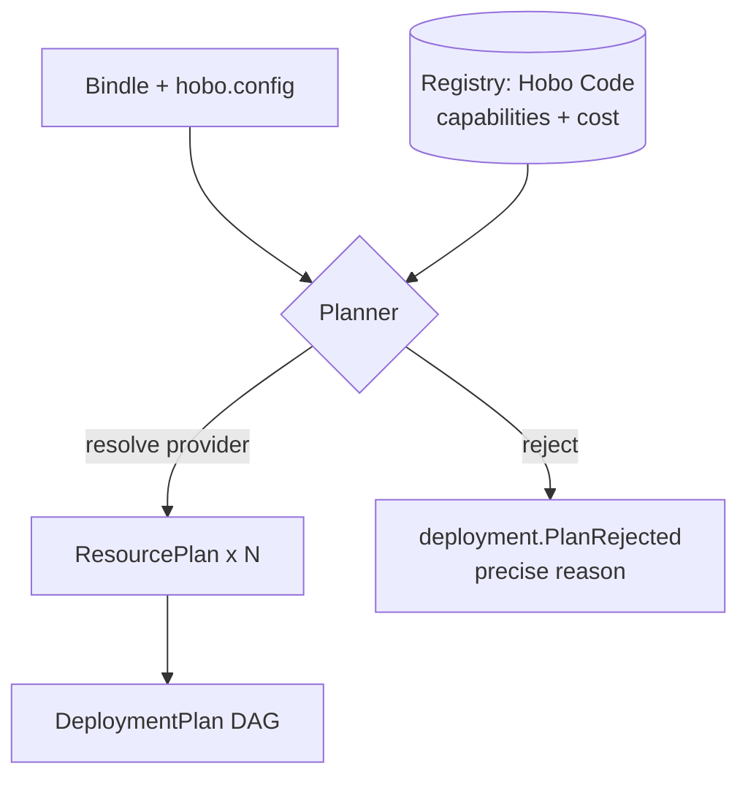

# Plan 3 — Providers, IaC & build/VM adapters

> Part of the [HoBo Design Plan Suite](./README.md). The ports/adapters layer that turns agnostic Bindles into real infra. See [Plan 2 §Layer 2](./02-sdk-api.md) and [Plan 4](./04-control-plane.md).

> **v2 update (WASM/WASI iteration).** Ports are now **WIT worlds** and a CloudProvider is a **capability provider** that implements a world's exports for a backend; **binding a resource = creating a link** (wasmCloud model) from a component's import to a provider's export, late-bound at deploy/runtime ([Plan 20](./20-wasm-wasi-runtime.md)). The deploy layer below (realize → IaC) is unchanged and now also wires links + emits the **manifest IR** ([Plan 22](./22-wiring-manifest.md)). Custom providers can be authored in any wasm language (not just Go like Nitric) and AI-generated via the Forge ([Plan 23](./23-stubbable-ai-implementations.md)).

> **v3 update (Humanitec iteration).** The Planner no longer resolves providers by static mapping — it resolves a **Resource Definition** per resource via **context-matching** ([Plan 25](./25-resource-definitions-matching.md)); the `hobo.config.ts` mapping is sugar over default definitions. The `IacProvider` here is one **Driver** in a taxonomy (terraform/template/echo/container/custom-webhook, [Plan 27](./27-drivers-packs-profiles.md)); a capability provider picks a driver to realize a resource.

> **v4 update (gates).** Before Apply, the Planner runs the **Gatekeeper** — a composite decision requiring contracts-compatible (`can-deploy`, [Plan 29](./29-contracts-compatibility.md)) AND policy-allows/approves (incl. obligations, [Plan 30](./30-policy-plane.md)) AND eval gates ([Plan 23](./23-stubbable-ai-implementations.md)) AND conformance ([Plan 9](./09-verification-open-questions.md)) AND within cost ([Plan 16](./16-cost-finops.md)). `contract-engine` and `policy-engine` are WIT ports with built-in defaults (Pact/OPA/Cedar optional providers). A blocked gate emits a precise reason (like `deployment.PlanRejected`) an agent can self-correct.

## The three adapter families (one shape)
Everything that touches the outside world is a port with swappable adapters:
- **CloudProvider** — implements capability ports (now **WIT worlds**: `wasi:keyvalue`, `wasi:blobstore`, `wasi:sql`, …, plus `hobo:*`) for a backend (AWS/Azure/GCP/Cloudflare/Fly/K8s).
- **IacProvider** — the *mechanism* a CloudProvider uses to realize resources (Pulumi/CDKTF/Crossplane/OpenTofu).
- **BuildProvider** — produces images/rootfs/**wasm components** (Dagger/Packer/Firecracker/Vagrant/jco+componentize).

A CloudProvider composes the other two: it declares *what* a resource is, then emits an `IacProgram` (and optionally a `BuildSpec`) for the chosen IaC/Build adapters to execute, plus the **links** that bind components to it at runtime.

## Port & provider interfaces
```ts
// A capability port (one of many): the agnostic contract apps depend on
export interface DatabasePort {
  kind: "database";
  engine: "postgres" | "mysql" | "sqlite" | "mongo" | "kv";
  // requested features the provider must satisfy/negotiate
  features?: { managed?: boolean; ha?: boolean; vector?: boolean; serverless?: boolean };
}

export interface Capability {
  port: PortKind;                       // "database" | "compute" | "objectStore" | ...
  satisfies(req: PortRequest): Match;   // full | partial(missing[]) | none — capability negotiation
  estimateCost(req: PortRequest): CostSignal;
}

export interface CloudProvider {
  id: string;                                   // "aws"
  regions: string[];
  capabilities: Capability[];
  realize(plan: ResourcePlan): { iac: IacProgram; build?: BuildSpec };
  code(): HoboCode;                             // machine-readable signs (Plan 6)
  client(port: PortKind, outputs: Outputs): unknown; // the runtime client for ctx.bindings
}

export interface IacProvider {
  id: "pulumi" | "cdktf" | "crossplane" | "opentofu";
  preview(program: IacProgram): Promise<Diff>;
  apply(program: IacProgram): Promise<Outputs>;
  destroy(program: IacProgram): Promise<void>;
  refresh(program: IacProgram): Promise<DriftReport>;
}

export interface BuildProvider {
  id: "dagger" | "packer" | "firecracker" | "vagrant";
  build(spec: BuildSpec): Promise<ImageRef>;
}
```

## The Planner: Bindle + mapping → DeploymentPlan
The Planner is a pure function (easy to test, replayable): `plan(bindle, config, registry) → DeploymentPlan`. Steps:

1. **Collect resources** from the Bindle into nodes; collect `bind` edges into a dependency DAG.
2. **Resolve a Resource Definition per resource** via **context-matching** ([Plan 25](./25-resource-definitions-matching.md)): gather definitions of the resource's `type`, keep those whose criteria match the deploy context `{envType, app, env, tenant, resourceClass, resourceId}`, score by specificity, pick the highest, and record a **`match.Decided`** event (auditable "why this infra"). The simple `hobo.config.ts` mapping (`bindings`→`tiers`→`defaultProvider`) is **sugar that compiles to default definitions**, so it still works and is naturally outscored by explicit platform definitions.
3. **Capability negotiation** — for the resolved definition's provider, call `Capability.satisfies(request)`:
   - `full` → accept.
   - `partial(missing)` → if the request used `prefer`, accept with a `PlanWarning` (degrade, e.g. emulate `vector` via an extension or fall back to a container); if `require`, reject the candidate.
   - `none` → reject.
   - If no definition can satisfy a `require`, emit `deployment.PlanRejected` with a precise reason (good for agents to self-correct).
4. **Region & colocation** — honor explicit regions; otherwise pick a region satisfying all colocated resources' constraints (latency edges from `bind`), minimizing cross-provider/cross-region egress.
5. **Objective ranking** ([Plan 25](./25-resource-definitions-matching.md)/[ADR-0033](./adr/ADR-0033-deterministic-matching-and-planner-selection.md)) — when multiple candidates satisfy `full` and tie on specificity + explicit `priority`, rank by the **configurable objective** (`cost`|`latency`|`single-provider`|`carbon`, **default = min-cost within constraints**), then a **stable tiebreak** (definition id). Deterministic, not a solver/LLM; rationale recorded in `match.Decided` + as `meta` on `deployment.Planned`.
6. **Emit `DeploymentPlan`** — DAG of `ResourcePlan{ name, port, provider, options, deps, strategy }`, each tagged with its resolved provider + merged `.with(...)` options (only the resolved provider's block survives).

The plan is content-addressed and stored via `deployment.Planned`, so the exact decisions are auditable and re-runnable.



## Resolution pipeline (plan → real infra)
1. **Plan** — as above.
2. **Realize** — each CloudProvider turns its `ResourcePlan`s into an `IacProgram` for the chosen IaC adapter (default `@hobo/iac-pulumi` via the **Pulumi Automation API** — embeddable, TS-native, no CLI shell-out).
3. **Build** — image/VM resources call BuildProviders (`@hobo/build-dagger` for container images; `build-packer`/`build-firecracker` for VM/microVM images). Output `ImageRef`s feed back into the IaC program.
4. **Apply** — IaC adapter runs `preview` then `apply` inside a Firecracker Executor with scoped creds ([Plan 12](./12-security-multitenancy.md)); `Outputs` (URLs, conn strings) become resource bindings and flow back as events.

## IaC backends
- **Pulumi Automation API** = primary (programmatic, multi-cloud, TS-native, real language for compositions).
- **Crossplane** = the adapter used when a Camp's substrate is Kubernetes (compositions + managed resources; reconciliation delegated to k8s controllers).
- **OpenTofu** = open-source HCL path (wrap the binary; state via supported backends).
- **CDKTF** = **import-only** (HashiCorp sunset) — read existing stacks, don't author new.
- Provider-specific IaC config is passed via `.with(...)` too (e.g. Pulumi stack settings, OpenTofu backend, Crossplane composition selectors).

## IaC state model
- **Per-resource stacks by default:** each resource owns an isolated IaC stack (Pulumi stack / TF workspace) keyed by `tenant/deployment/resource`. Benefits: blast-radius isolation, independent reconcile/lock, clean compensation (destroy one slice). Cost: more state objects — acceptable.
- **State backend:** pluggable; default to the Yard's own object store; locking via the resource's ActorHost lease (single-writer already guaranteed, so IaC-level locks are belt-and-suspenders).
- **Outputs → bindings:** stack outputs are captured into `resource.Provisioned` and resolved into the dependent resources' env/secret refs.
- **Drift:** `refresh()` feeds the drift loop in [Plan 5](./05-reliability-ha.md).
- **Adopt-in-place (migration, [ADR-0041](./adr/ADR-0041-migration-onboarding.md)):** `hobo import` reads an existing estate's IaC state (CDKTF import-only / Pulumi Automation API) into the graph as **`adopted`** nodes — managed by id/state, **never destroyed/recreated on import** (drift-detect only). An **`external` resource kind** references infra HoBo doesn't manage yet, so a HoBo-managed resource can `bind` across the boundary during an incremental (strangler-fig) migration. Adoption emits `resource.Adopted` ([Plan 11](./11-event-model.md)).

## Cross-cloud equivalence classes
Agnostic ports map to provider services via curated equivalence classes (extensible, and what the [Forge](./06-ai-native-agent-auth.md) targets):
| Port (request) | AWS | Azure | GCP | Cloudflare | Fly |
|---|---|---|---|---|---|
| `database{postgres,managed}` | RDS/Aurora PG | Flexible Server | Cloud SQL PG | (Neon/Hyperdrive) | Fly Postgres |
| `objectStore` | S3 | Blob | GCS | R2 | Tigris |
| `compute{container}` | Fargate/App Runner | Container Apps | Cloud Run | Workers/Containers | Machines |
| `queue` | SQS | Service Bus | Pub/Sub | Queues | (NATS) |
| `cache` | ElastiCache | Cache for Redis | Memorystore | KV | Upstash |

## Build / VM adapters
- **Dagger** — reproducible container build pipelines, defined in TS, run in containers; primary image path for `compute`/`containerService`.
- **Packer** — baked VM images (AMI/Azure image) for `vm`.
- **Firecracker** — microVM rootfs for `microVm` and the Executor sandbox itself.
- **Vagrant** — local VM parity for `hobo dev` when a resource truly needs a VM.

## Authoring a provider (human or Forge)
A provider package exports: (1) a factory (`aws({...})`) returning a `CloudProvider`, (2) typed `.with(...)` option builders per port (`aws.rds`, `aws.fargate`), (3) capability declarations + equivalence mappings, (4) `realize()` emitting IaC, (5) a runtime `client()` per port, and (6) a `code()` Hobo Code manifest. It must pass `@hobo/conformance` for every port it claims — that suite is the contract that lets AI-generated providers be trusted ([Plan 6](./06-ai-native-agent-auth.md), [Plan 9](./09-verification-open-questions.md)).

## Iteration hooks
- ~~Planner objective function when several providers fully satisfy~~ — **decided ([ADR-0033](./adr/ADR-0033-deterministic-matching-and-planner-selection.md), resolves ADR-P4):** configurable `cost`|`latency`|`single-provider`|`carbon`, default **min-cost within constraints**, applied deterministically (no solver/LLM on-path).
- Per-resource vs grouped IaC stacks (isolation vs state sprawl).
- How `prefer` degradation is surfaced/approved (silent warning vs require ack).
- Maintaining equivalence classes by hand vs Forge-generated + curated.
- Crossplane substrate: delegate reconciliation to k8s vs keep ResourceActors authoritative.
