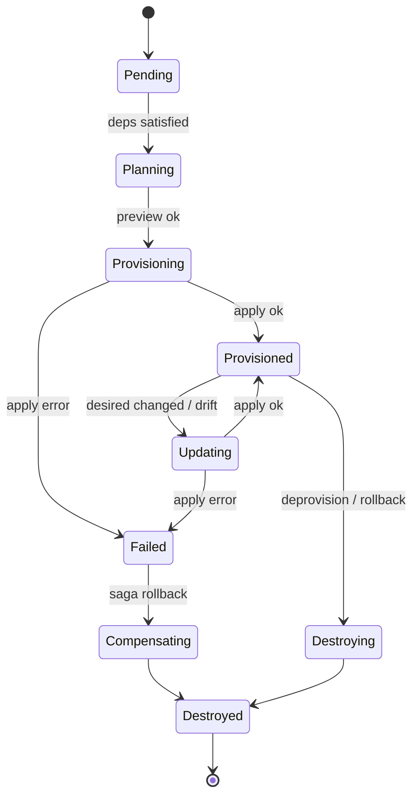
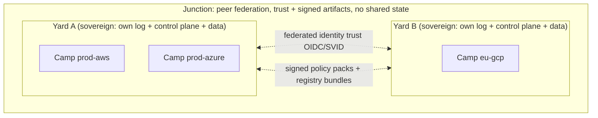

# Plan 4 — The Yard (hobo-cloud control plane)

> Part of the [HoBo Design Plan Suite](./README.md). See also the [reference architecture](./10-architecture-overview.md) and [event model](./11-event-model.md).

> **v2 update.** The Planner now consumes the **manifest IR** produced by IfC resource-collection ([Plan 22](./22-wiring-manifest.md)); ResourceActors additionally manage **links** binding components to capability providers ([Plan 20](./20-wasm-wasi-runtime.md)). The reconciliation FSM and choreography below are unchanged.

> **v3 update (Humanitec iteration).** The Planner resolves each resource via **Resource Definitions + Matching** ([Plan 25](./25-resource-definitions-matching.md)); the lifecycle works in **Deltas → Sets** with **incremental** reconcile (only changed nodes) ([Plan 26](./26-environments-deltas.md)); Executors can run behind a **HoBo Agent** for private-network targets and a **GitOps publisher** is an alternate apply path ([Plan 28](./28-agent-gitops-pipelines.md)); **Pipelines** drive *when* deploys happen.

> **v4 update (gates).** New grains back the two governance planes: a **contract-engine** ([Plan 29](./29-contracts-compatibility.md)) and a **policy-engine** ([Plan 30](./30-policy-plane.md)), each a WIT port with a built-in default. The Orchestrator invokes the **Gatekeeper** at Delta→Set/promote (contracts + policy + evals + conformance + cost); **obligations** from a policy decision (e.g. require-canary) shape the rollout; every gate result is an event.

The Yard is the orchestrator that maps Bindle deployments to real hosting. It is **itself a HoBo Bindle** (dogfood) and runs on the TS-native core; Kubernetes/Crossplane is an optional execution substrate adapter, never a requirement.

## Services (each a grain-based module)
- **Gateway** — SDK RPC + REST + **MCP** ingress; authenticates the principal (human or agent SVID), authorizes against tenant + scope, turns requests into commands, and serves read models. Stateless; horizontally scalable.
- **Identity** — issues agent/workload identities (SPIFFE-style SVIDs), acts as OIDC provider + token broker ([Plan 6](./06-ai-native-agent-auth.md)).
- **Registry** — Provider + Capability Manifest catalog; capability search; plugin certification records from the Forge.
- **Planner** — Bindle + mapping → `DeploymentPlan` DAG; capability/region/cost solving (algorithm in [Plan 3](./03-providers-iac.md)).
- **Orchestrator** — **choreography saga engine** over the event store. One **ResourceActor** (a controller-style grain) per resource owns its lifecycle and reconciles desired↔actual via the resolved IaC adapter. Resource actors coordinate by emitting/observing events (e.g. `resource.Provisioned(db)` → unblocks `api`), not via a central coordinator.
- **Executors** — sandboxed (Firecracker) runners that execute IaC applies + Dagger builds with short-lived scoped creds.
- **Event Store + Projections** — source of truth + read models ([Plan 11](./11-event-model.md)).

## The ResourceActor reconciliation FSM
Each resource in a plan gets a durable virtual actor keyed `resource:<deployment>:<name>`. Its job is to converge **observed** state to **desired** state, idempotently, surviving crashes by replaying its own event stream.

**Reconcile loop (idempotent core):**
1. Load desired (`ResourcePlan`) + observed (last `resource.*` + IaC `refresh()`).
2. Compute a **diff** (`IacProvider.preview`).
3. If empty → emit nothing (converged). If non-empty → emit `resource.Provisioning`/`UpdateRequested`, dispatch an `IacProgram` to an Executor.
4. On `exec.Succeeded` → record outputs, emit `resource.Provisioned`. On `exec.Failed` → emit `resource.Failed` with classified error (retryable vs fatal, see [Plan 5](./05-reliability-ha.md)).
5. The actor is **edge-triggered** by events and **level-triggered** by a periodic resync (drift). Both paths run the same loop → reconciliation is convergent and safe to repeat (the controller pattern, Kubernetes-style, but event-sourced).

**Why actors, not a monolithic engine:** per-resource isolation means one stuck provider call can't block the whole deploy; single-writer leases ([Plan 5](./05-reliability-ha.md)) prevent two reconciles racing on the same resource; and each actor's stream is an independent audit/replay unit.

## Choreography over orchestration (and why)
Cross-resource ordering (DB before API, network before VM) is expressed as a **dependency DAG** in the plan and realized by **choreography**: a ResourceActor subscribes to the `resource.Provisioned` events of its dependencies and self-activates when they're all present. There is no central coordinator issuing step-by-step commands.

- **Pro:** resilient (no coordinator SPOF), naturally parallel (independent subtrees provision concurrently), and each actor is autonomous/replayable.
- **Con:** harder to see "the whole flow" — we mitigate with a **DeploymentView** projection that reconstructs the saga graph from events for the dashboard, and with explicit `correlationId` on every event.
- **Compensation** is also choreographed: a `resource.Failed` past the no-go threshold emits `deployment.RolledBack`, which each already-`Provisioned` actor observes and reacts to by `Destroying` itself in reverse-dependency order (tracked via the DAG).

## Executor sandbox model
IaC apply and image builds run untrusted-ish provider code, so they are isolated:
- Each exec runs in a **Firecracker microVM** (fast boot, hardware isolation), with no ambient cloud creds.
- The Orchestrator requests a **short-lived, capability-scoped token** from Identity *for that specific resource + provider + action*, injected into the microVM at start, expired at end ([Plan 12](./12-security-multitenancy.md)).
- Stdout/diff/state stream back as `exec.Output` events (live in the dashboard) and IaC state is persisted to the resource's own backend (per-resource Pulumi stack by default — see [Plan 3](./03-providers-iac.md)).
- Executors are pooled and pre-warmed; concurrency is bounded per tenant and per provider (backpressure, [Plan 5](./05-reliability-ha.md)).

## Command / event API surface
The Gateway accepts **commands** (imperative, validated, authorized) and the only side effect is appending **events** ([Plan 11](./11-event-model.md)). Representative commands:
`RegisterBindle` · `PublishBindleVersion` · `CreateCamp` · `Deploy` · `Promote` · `Rollback` · `Destroy` · `RegisterProvider` · `RequestToken`. Reads go to projections, never to live providers.

## Bootstrapping (chicken-and-egg)
The Yard runs itself, so first existence is special:
1. **Local seed:** `hobo yard up` runs a single-node Yard on a **local Camp** (`@hobo/runtime-local`, SQLite event store) — enough to deploy the Yard Bindle to a real provider.
2. **Self-deploy:** that seed deploys `@hobo/cloud` (the Yard Bindle) to the target Camp (e.g. a managed Postgres runtime + container provider), producing a "real" Yard.
3. **Handover:** the real Yard imports the seed's event log (the deployment that created it) so its own provenance is auditable, then the seed is discarded.
This makes self-hosting a first-class, reproducible path, not a bespoke install script.
- **Air-gapped profile:** the same self-deploy runs **fully in-boundary with zero egress** ([ADR-0036](./adr/ADR-0036-air-gapped-sovereign-mode.md)) — artifacts arrive via signed offline bundle import, trust roots (Identity/CA/KMS) and any AI models stay in-boundary, and the deterministic core needs no network. A single in-boundary Yard; multi-Yard federation is deferred ([Q20](./09-verification-open-questions.md)).

## Multi-tenancy
Tenant = isolation boundary for event streams, actor placement, credential scope, and executor pools. Self-host runs single-tenant; hosted runs multi-tenant on the same code. Full model in [Plan 12](./12-security-multitenancy.md).

## Yard scope & multi-Yard (the Junction) ([ADR-0043](./adr/ADR-0043-multi-yard-federation-junction.md))
The Yard is the central **cross-cloud / cross-region orchestrator**, and **one Yard per app/org is the norm** — a multi-cloud `production` is several **Camps** under *one* Yard ([ADR-0026](./adr/ADR-0026-scope-model-yard-camp-bindle.md)/[ADR-0028](./adr/ADR-0028-multi-camp-deployment-model.md)); **multi-region needs no second Yard.** A *second* Yard is warranted only for **extreme isolation** — a tenant/boundary requiring a wholly separate control plane (sovereign/regulated, air-gapped [ADR-0036](./adr/ADR-0036-air-gapped-sovereign-mode.md), or isolation beyond per-tenant streams). When such sovereign Yards must interoperate, an optional **`Junction`** federates them as **peers** — sharing **identity trust + signed policy packs + signed registry bundles**, never shared state and never a controller; each Yard keeps its own log/control-plane/data (residency preserved). **v1 ships single-Yard, federation-ready; the Junction is post-v1.**

## Iteration hooks
- ResourceActor resync interval & jitter; how aggressive drift auto-heal should be (auto vs propose).
- Plan-level vs resource-level compensation thresholds (when does one failure roll back the whole deploy vs just retry locally?).
- Whether the Planner is a Yard service or a library invoked at the edge.
- Executor isolation tier (Firecracker vs gVisor vs container) per trust level.
