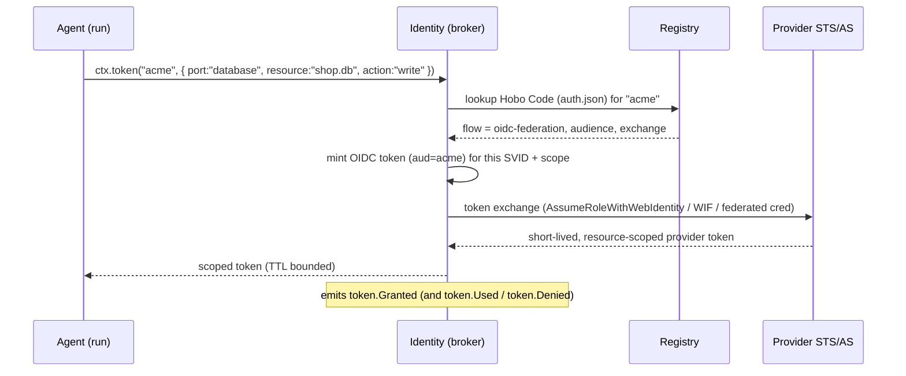

# Plan 6 — AI-native & agent auth ⭐ (deep)

> Part of the [HoBo Design Plan Suite](./README.md). The other deepest plan. HoBo's biggest differentiation vs Lakebed. **Goal: an agent can discover providers and self-provision credentials with zero developer involvement, and every action is durable + auditable.**

## Design stance: agents are principals, not scripts
Most platforms bolt agent support on as "an API key in a script." HoBo treats an agent as a **first-class authenticated principal** with its own identity, scoped capabilities, a full audit trail, and durable execution. Three pillars: **Hobo Code** (the capability/auth standard), **Identity** (issuance + brokering), and the **Forge** (AI-generated providers). All three are reachable over **MCP** so agents drive HoBo natively.

---

## 6.1 Hobo Code / Signs — the `auth.md` standard
A machine-readable standard each Provider publishes so any agent can understand *what it offers* and *how to authenticate* — with no human reading docs or pasting keys. Markdown for humans + strict JSON companions for machines, at a well-known location.

```
/.well-known/hobo-code/
  index.json          # version, links, signature, issuer
  signs.md            # human/LLM-readable overview (also emitted as llms.txt)
  capabilities.json   # which ports + service models, regions, equivalence classes
  auth.json           # supported auth flows, scopes, token lifetimes, resource indicators
  cost.json           # optional cost/region signals for the Planner (Plan 16)
```

**`capabilities.json`**
```jsonc
{
  "provider": "acme-cloud",
  "ports": [
    { "port": "database", "engines": ["postgres","mysql"], "features": ["managed","ha","vector"], "regions": ["us-east","eu-west"] },
    { "port": "objectStore", "regions": ["us-east","eu-west","ap-south"] },
    { "port": "compute", "kinds": ["container","function"] }
  ],
  "equivalence": { "database{postgres,managed}": "acme.pg.flex", "objectStore": "acme.blobs" }
}
```

**`auth.json`** — the heart of the standard
```jsonc
{
  "issuer": "https://acme-cloud.example.com",
  "flows": [
    { "type": "oidc-federation", "audience": "hobo",
      "exchange": "sts:AssumeRoleWithWebIdentity",
      "trust": { "oidcDiscovery": "https://yard.example.com/.well-known/openid-configuration" } },
    { "type": "oauth2-obo", "authorizationServer": "https://acme.example.com/oauth",
      "scopes": ["db:write","compute:deploy","objstore:rw"] },
    { "type": "device-code" },
    { "type": "api-key", "header": "X-Api-Key", "rotation": "manual" }
  ],
  "scopeModel": "least-privilege-per-resource",
  "resourceIndicators": ["urn:acme:db", "urn:acme:compute", "urn:acme:objstore"],
  "tokenLifetimeSec": 3600,
  "audit": { "events": ["token.Granted","token.Used","token.Revoked"] }
}
```

- **Discovery:** the Registry crawls/accepts `index.json`, verifies its signature, and indexes capabilities + auth for the Planner and agents.
- **Preference order:** HoBo prefers **keyless** flows (`oidc-federation` > `oauth2-obo` > `device-code` > `api-key`) so static secrets are a last resort.
- **Thematic anchor:** real hobo "signs" were a shared symbol language for finding resources & safe passage — `signs.md` is exactly that, for agents. This is the "standard like auth.md" the project calls for, and the Registry is the centralized place providers register it.

---

## 6.2 Agent identity & the token broker
Every actor/agent gets a **workload identity** (SPIFFE-style SVID / short-lived OIDC token) issued by the Yard's **Identity** service. No static secrets live in agent code.

**Identity lifecycle:**
1. **Attest** — an agent run starts; the runtime attests it to Identity (run id, tenant, parent principal, code version).
2. **Issue** — Identity mints a short-lived SVID (JWT-SVID with `spiffe://yard/<tenant>/agent/<name>`), recorded as `identity.Issued`.
3. **Rotate** — SVIDs auto-rotate well within TTL (`identity.Rotated`); long agent runs never hold a stale credential.
4. **Scope** — the SVID encodes the agent's allowed ports/resources (least privilege), derived from the Bindle + tenant policy.

**Token brokering (agent → provider), keyless by default:**

- **OIDC federation** (AWS `AssumeRoleWithWebIdentity`, GCP Workload Identity Federation, Azure federated credentials) is the default — no secret ever stored.
- **OAuth On-Behalf-Of** when the agent acts for a specific human (carries the user's delegated consent + scope).
- **MCP/OAuth2.1** for SaaS tools that speak it.
- **Every issuance is an event** (`token.Granted` → `token.Used` → `token.Revoked`) → a fully replayable credential audit (the `CredentialAudit` projection, [Plan 11](./11-event-model.md)). This directly answers the industry gap where agent actions can't be audited.

**Least privilege & guardrails:**
- Tokens are scoped to `(port, resource, action)` and the minimal provider permission for that equivalence class — never "admin."
- **High-risk actions** (destroy, spend above a budget, touch prod) require a policy gate: auto-allowed, require human approval (a `createHook` the dashboard/Slack resolves), or denied. Policy is per-tenant, versioned, and itself event-sourced.

---

## 6.3 Durable AI agents (the `agent()` primitive)
A DurableAgent analog backed by the World: replayable, resumable, tools-as-steps, identity + scoped tokens injected via `ctx`.
```ts
import { agent, step } from "@hobo/runtime";

const deployTool = step(async ({ bindle }: { bindle: string }, ctx) => {
  // ctx.identity is the agent's SVID; ctx.token() brokers a scoped token via Hobo Code
  const token = await ctx.token("acme", { port: "compute", resource: `${bindle}.api`, action: "deploy" });
  return ctx.hobo.deploy(bindle, { token });
});

export const opsAgent = agent("ops", {
  model: "anthropic/claude-haiku-4.5",
  instructions: "You operate HoBo deployments on the user's behalf.",
  policy: { destroy: "require-approval", spendCapUsd: 50 },     // guardrails
  tools: { deploy: { input: z.object({ bindle: z.string() }), execute: deployTool } },
});
```
Because tools are steps and runs are event-sourced, an agent can be interrupted and resumed without losing state — and its entire decision + tool-call + credential history is replayable for debugging, audit, and post-incident review.

---

## 6.4 MCP control surface
The Yard exposes an **MCP server** (`@hobo/mcp`) so any agent (Claude, etc.) can drive HoBo natively. Initial tool surface:
| MCP tool | Purpose |
|---|---|
| `list_bindles` / `get_bindle` | discover apps + topology |
| `plan` | dry-run a deploy → returns the DeploymentPlan + cost + warnings |
| `deploy` / `promote` / `rollback` / `destroy` | lifecycle (guardrail-gated) |
| `inspect_run` / `tail_logs` | observability over projections + streams |
| `search_registry` | find providers by capability (reads Hobo Code) |
| `request_token` | broker a scoped provider token (audited) |
| `get_drift` / `heal` | drift status + reconcile |

MCP auth uses the same Identity/SVID model; tools are capability-scoped. HoBo also publishes `llms.txt` / `llms-full.txt` / `docs.json` (matching Lakebed's machine-readable ethos) — but for *operations*, not just app contracts.

---

## 6.5 The Forge — AI-generated provider plugins
Instead of relying on a community to write adapters, the **Forge** generates and certifies them.
```mermaid
flowchart LR
  SRC[Provider docs / OpenAPI /<br/>TF provider / existing Hobo Code] --> GEN[LLM generate<br/>@hobo/provider-x]
  GEN --> SBX[Firecracker sandbox<br/>scoped creds, no egress]
  SBX --> CONF{@hobo/conformance<br/>port contract tests}
  CONF -- pass --> SIGN[sign + publish to Registry<br/>forge.PluginCertified]
  CONF -- fail --> FIX[feed failures back] --> GEN
```
1. **Generate** a candidate provider (port impls + IaC mappings + equivalence classes + a Hobo Code manifest) from the backend's docs/OpenAPI/Terraform provider/Hobo Code.
2. **Sandbox-test** it in a Firecracker microVM with capability-scoped tokens and no outbound egress (can't exfiltrate) against `@hobo/conformance` ([Plan 9](./09-verification-open-questions.md)).
3. **Certify** on pass: sign and publish to the Registry (`forge.PluginCertified` with the test report + provenance); on fail, feed errors back for repair.

**Conformance tests are the trust boundary** that makes AI-generated extensibility safe — a plugin is only as trusted as the contract tests it passed, and the signed report is part of its Registry record.

---

## 6.6 How this all reduces to "zero developer effort"
The end state the project asks for: a developer (or their agent) writes a Bindle, points it at "acme-cloud," and the agent — using its SVID, the Registry's Hobo Code, and the broker — obtains exactly the scoped tokens it needs, deploys, and leaves an auditable trail. The developer never created an IAM role, pasted a key, or wrote an adapter. If acme-cloud isn't supported yet, the Forge generates and certifies the provider on demand.

## Iteration hooks
- Exact Hobo Code schema + whether to publish it as an open spec aligned with MCP-auth / OAuth-OBO draft / SPIFFE federation / the emerging Agent Identity Protocol.
- Delegation chains (agent → sub-agent) — adopt AIP when it matures, or interim OBO chaining.
- Policy language for guardrails (CEL/Rego-style vs typed TS policy).
- Forge model + eval design; human-in-the-loop certification for high-trust providers.
- Plugin signing, provenance (SLSA), and supply-chain trust for Registry plugins ([Plan 12](./12-security-multitenancy.md)).
