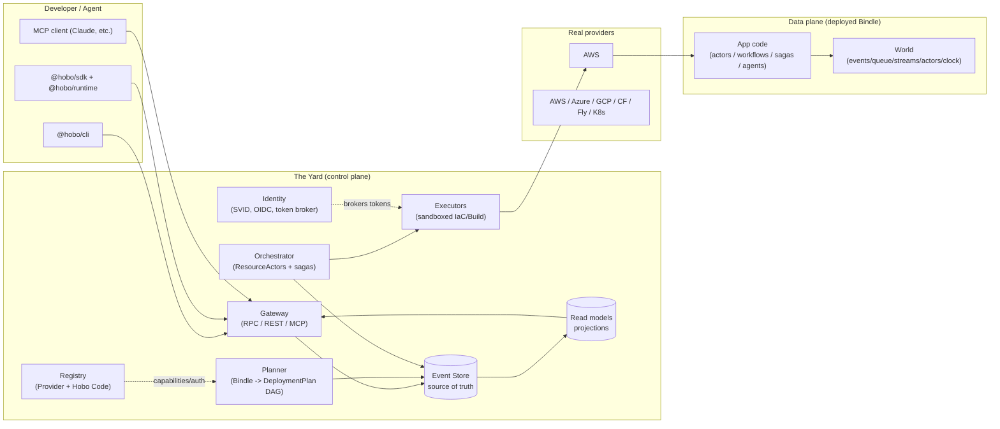

# Plan 10 — Reference architecture overview

> Part of the [HoBo Design Plan Suite](./README.md). This is the load-bearing map; most other plans refine a box on it.

## The one-paragraph model
A developer (or agent) writes a **Bindle** (app topology, [Plan 2](./02-sdk-api.md)) and a `hobo.config.ts` mapping ports to **Providers** ([Plan 3](./03-providers-iac.md)). The **Yard** ([Plan 4](./04-control-plane.md)) — HoBo's control plane — receives a deploy request, the **Planner** turns the Bindle + mapping into a **DeploymentPlan** (a DAG of `ResourcePlan`s), and the **Orchestrator** drives each resource to reality through **ResourceActors** that call **IaC/Build adapters** inside sandboxed **Executors**, brokering short-lived credentials from **Identity**. Every state transition is an **event** ([Plan 11](./11-event-model.md)) in an append-only log, so the whole system is replayable, auditable, and recoverable. The deployed app itself runs against a **World** — the durable runtime ([Plan 2 §Layer 1](./02-sdk-api.md)) — which provides its event store, queue, streams, actor host, and clock.

## Control plane vs data plane
HoBo has two distinct planes; keeping them separate is a core architectural commitment.

- **Control plane (the Yard).** Decides *what infra should exist* and makes it exist. Event-sourced, actor-based, multi-tenant. Never on the critical path of a running app's request. If the Yard is down, deployed apps keep serving.
- **Data plane (the running Bindle).** The developer's actual app + its World runtime. Uses HoBo's runtime SDK primitives (actors, workflows, sagas, agents) but does not depend on the Yard at request time. The World it runs against is selected per **Camp** and can be fully self-managed.

## Component responsibilities (C4 "container" level)
| Component | Responsibility | Key inputs | Key outputs (events) |
|---|---|---|---|
| **Gateway** | Authn/z; expose SDK RPC + REST + MCP; accept commands; serve read models | Commands, identity tokens | `DeployRequested`, `BindleRegistered`, … |
| **Identity** | Issue workload identities (SVIDs); act as OIDC IdP; broker provider tokens via Hobo Code | SVID requests, provider Hobo Code | `IdentityIssued`, `TokenGranted`, `TokenRevoked` |
| **Registry** | Catalog providers + their Hobo Code (capabilities, auth, cost) | Provider manifests | `ProviderRegistered`, `HoboCodeUpdated` |
| **Planner** | Resolve mapping rules → `DeploymentPlan` DAG; solve capability/region/cost constraints | Bindle, config, Registry | `Planned`, `PlanRejected` |
| **Orchestrator** | Drive the plan; one **ResourceActor** per resource reconciling desired↔actual; choreography sagas for cross-resource ordering & compensation | `DeploymentPlan`, observed state | `Provisioning`, `Provisioned`, `Failed`, `Compensating`, `Deployed` |
| **Executors** | Run IaC apply/preview/destroy + image/VM builds in Firecracker sandboxes with scoped creds | `IacProgram`, `BuildSpec`, brokered token | `ExecStarted`, `ExecOutput`, `ExecSucceeded`, `ExecFailed` |
| **Event Store** | Append-only source of truth; subscriptions; snapshots | Events | (is the log) |
| **Read models** | Materialized projections for queries/UI | Event stream | (query API) |

## Request lifecycles (two canonical paths)
**Deploy (command path):**
`hobo deploy` → Gateway authenticates the principal → emits `DeployRequested` → Planner consumes it, emits `Planned` → Orchestrator spawns ResourceActors → each emits `Provisioning`→`Provisioned` (or `Failed`→`Compensating`) → on DAG completion, `Deployed`. A crash anywhere is recovered by replaying the deployment's event stream.

**Run inspection (query path):**
`hobo inspect run <id>` / dashboard → Gateway → read model projection of the run's events (workflow/step/actor/saga timeline). Never touches the providers.

## Key boundaries & invariants
1. **Commands mutate only via events.** No component writes resource state except by appending an event (CQRS/ES). This is what makes everything replayable.
2. **Executors are the only thing that touches a cloud**, always sandboxed, always with a short-lived scoped token (never a long-lived secret). See [Plan 12](./12-security-multitenancy.md).
3. **The Yard is itself a Bindle** deployed by an earlier Yard (or bootstrapped locally) — see [Plan 4 §Bootstrapping](./04-control-plane.md).
4. **Same code, many Worlds.** Swapping the World changes durability backing, never app logic. See [Plan 2 §Layer 1](./02-sdk-api.md).

## Iteration hooks
- Whether read models live in the same store (projections) or a separate query DB.
- Gateway protocol details (gRPC vs tRPC-style vs plain HTTP+JSON for the SDK RPC).
- How far the control/data-plane split goes for HoBo's own managed Worlds.
