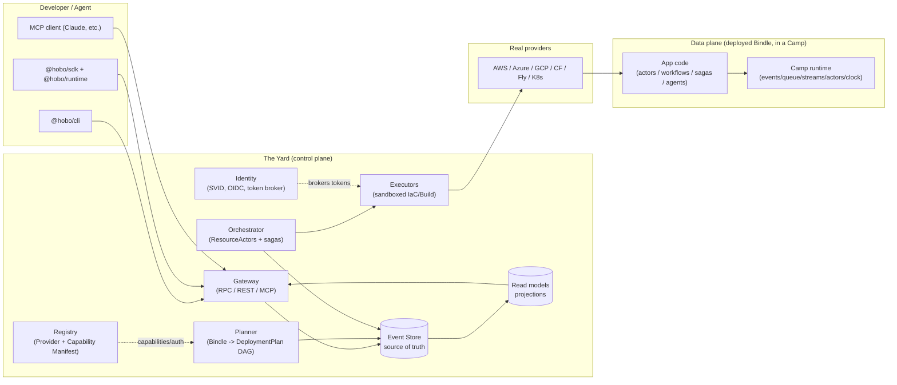

# Plan 10 — Reference architecture overview

> Part of the [HoBo Design Plan Suite](./README.md). This is the load-bearing map; most other plans refine a box on it.

> **Resource Definitions & Matching (Humanitec parity):** the Planner box resolves resources via **Resource Definitions + Matching** ([Plan 25](./25-resource-definitions-matching.md)); Executors can run behind a **HoBo Relay** inside a private network ([Plan 28](./28-relay-gitops-pipelines.md)); a **GitOps publisher** is an alternate path from Set → cluster. Control/data-plane split and event-sourced invariants are unchanged.

> **Contracts & policy (gates):** two governance planes sit at the deploy decision point as **WIT ports with built-in engines** — a **contract plane** (compatibility/`can-deploy`, [Plan 29](./29-contracts-compatibility.md)) and a **policy plane** (decisions + obligations, [Plan 30](./30-policy-plane.md)) — composed by the **Gatekeeper** alongside conformance/evals/cost. The organizing lens across the suite: **Contract = must never break · Eval = should improve · Policy = may/may not be allowed · Trace = what actually happened.**

> **Runtime/IfC integration.** Deployed services are **wasm components** (OCI-container fallback) running on a wasm host that links each component's imported WIT ports to **capability providers** ([Plan 20](./20-wasm-wasi-runtime.md)). The deploy path gains a **resource-collection (IfC)** step that emits the **manifest IR** the Planner consumes ([Plan 21](./21-resources-catalog.md)/[Plan 22](./22-wiring-manifest.md)). The control/data-plane split and event-sourced invariants below are unchanged.

> **Data plane + the Operator Crew.** App **domain data is event-sourced by default** — the "Read models" box generalizes to developer-authored **projections** the architect maps onto any backend (a **projection sink**, [Plan 39](./39-data-plane-projections.md)). A roster of built-in **Operator Agents (the Crew)** runs inside the Yard — SRE · Endpoint Monitor · GitOps · Platform Engineer ([Plan 40](./40-operator-agents.md)) — each a principal on the same identity/policy/event model; the **SRE operator** drives **incidents + self-healing** ([Plan 44](./44-sre-incident-management.md)). HoBo **generates / self-heals / persists infrastructure across data · business · message · intelligence** ([Plan 41](./41-generated-stack.md)) — Forge-generated adapters + self-optimizing runtime functions, not the developer's product UI ([ADR-0064](./adr/08-scope-and-requirements.md#adr-0064)). Beyond portability, every box is **patchable** — engines/adapters swap behind ports, certified by conformance ([Plan 43](./43-patchability-extensibility.md)). The control/data-plane split + event-sourced invariants below are unchanged.

## The one-paragraph model
A developer (or agent) writes a **Bindle** (app topology, [Plan 2](./02-sdk-api.md)) and a `hobo.config.ts` mapping ports to **Providers** ([Plan 3](./03-providers-iac.md)). The **Yard** ([Plan 4](./04-control-plane.md)) — HoBo's control plane **and the broad cross-provider / cross-cloud / hybrid scope** — receives a deploy request, the **Planner** turns the Bindle + mapping into a **DeploymentPlan** (a DAG of `ResourcePlan`s), and the **Orchestrator** drives each resource to reality through **ResourceActors** that call **IaC/Build adapters** inside sandboxed **Executors**, brokering short-lived credentials from **Identity**. Every state transition is an **event** ([Plan 11](./11-event-model.md)) in an append-only log, so the whole system is replayable, auditable, and recoverable. The app deploys into a **Camp** — a **provider-specific** target that supplies the **durable runtime** ([Plan 2 §Layer 1](./02-sdk-api.md)): event store, queue, streams, actor host, and clock. The scopes nest **`Yard ⊃ Camp ⊃ Bindle`**; a multi-cloud `production` is several Camps under one Yard.

## Control plane vs data plane
HoBo has two distinct planes; keeping them separate is a core architectural commitment.

- **Control plane (the Yard).** Decides *what infra should exist* and makes it exist. Event-sourced, actor-based, multi-tenant. It is also the **broadest scope** — it governs many provider-specific **Camps** and holds cross-provider / cross-cloud / hybrid policy + topology. Never on the critical path of a running app's request. If the Yard is down, deployed apps keep serving.
- **Data plane (the running Bindle).** The developer's actual app + the **Camp's durable runtime**. Uses HoBo's runtime SDK primitives (actors, workflows, sagas, agents) but does not depend on the Yard at request time. The runtime it runs against is **provided by the Camp** (provider-specific) and can be fully self-managed.

## Component responsibilities (C4 "container" level)
| Component | Responsibility | Key inputs | Key outputs (events) |
|---|---|---|---|
| **Gateway** | Authn/z; expose SDK RPC + REST + MCP; accept commands; serve read models | Commands, identity tokens | `DeployRequested`, `BindleRegistered`, … |
| **Identity** | Issue workload identities (SVIDs); act as OIDC IdP; broker provider tokens via Capability Manifest | SVID requests, provider Capability Manifest | `IdentityIssued`, `TokenGranted`, `TokenRevoked` |
| **Registry** | Catalog providers + their Capability Manifest (capabilities, auth, cost) | Provider manifests | `ProviderRegistered`, `CapabilityManifestUpdated` |
| **Planner** | Resolve mapping rules → `DeploymentPlan` DAG; solve capability/region/cost constraints | Bindle, config, Registry | `Planned`, `PlanRejected` |
| **Orchestrator** | Drive the plan; one **ResourceActor** per resource reconciling desired↔actual; choreography sagas for cross-resource ordering & compensation | `DeploymentPlan`, observed state | `Provisioning`, `Provisioned`, `Failed`, `Compensating`, `Deployed` |
| **Executors** | Run IaC apply/preview/destroy + image/VM builds in Firecracker sandboxes with scoped creds | `IacProgram`, `BuildSpec`, brokered token | `ExecStarted`, `ExecOutput`, `ExecSucceeded`, `ExecFailed` |
| **Event Store** | Append-only source of truth; subscriptions; snapshots | Events | (is the log) |
| **Read models** | Materialized projections for queries/UI | Event stream | (query API) |

## Request lifecycles (two canonical paths)
**Deploy (command path):**
`hobo deploy` → Gateway authenticates the principal → emits `DeployRequested` → Planner consumes it, emits `Planned` → Orchestrator spawns ResourceActors → each emits `Provisioning`→`Provisioned` (or `Failed`→`Compensating`) → on DAG completion, `Deployed`. A crash anywhere is recovered by replaying the deployment's event stream.

**Run inspection (query path):**
`hobo inspect run <id>` / dashboard → Gateway → read model projection of the run's events (workflow/step/actor/saga timeline). Never touches the providers.

## Key boundaries & invariants
1. **Commands mutate only via events.** No component writes resource state except by appending an event (CQRS/ES). This is what makes everything replayable.
2. **Executors are the only thing that touches a cloud**, always sandboxed, always with a short-lived scoped token (never a long-lived secret). See [Plan 12](./12-security-multitenancy.md).
3. **The Yard is itself a Bindle** deployed by an earlier Yard (or bootstrapped locally) — see [Plan 4 §Bootstrapping](./04-control-plane.md).
4. **Same code, many Camps.** Swapping a Camp's runtime backend changes the durability backing, never app logic. See [Plan 2 §Layer 1](./02-sdk-api.md).

## Runtime/IfC components (integrated)
Two boxes the runtime/IfC model adds to the map above:
| Component | Responsibility | Key events |
|---|---|---|
| **Wasm host** (per provider target) | run service **components**; hold the **link table** binding each import → a capability provider ([Plan 20](./20-wasm-wasi-runtime.md)) | `link.Established`, `link.Called` |
| **Collector** (IfC) | run components in resource-collection mode → the **manifest IR** the Planner consumes ([Plan 21](./21-resources-catalog.md)/[Plan 22](./22-wiring-manifest.md)) | `bindle.ResourcesCollected`, `bindle.ManifestProduced` |

**Invariant addendum.** A deployed component reaches a backend **only via a link the manifest declared** — deny-by-default capability security extends invariant #2 from the executor to the running data plane ([Plan 12](./12-security-multitenancy.md)).

## Iteration hooks
- ~~Whether read models live in the same store (projections) or a separate query DB.~~ **Resolved ([Plan 39](./39-data-plane-projections.md)/[ADR-0050](./adr/03-data-plane.md#adr-0050)):** architect-selected per context via Matching — default is a native standing projection over the log; a projection may be materialized into a separate query backend (a **projection sink**) when wanted.
- Gateway protocol details (gRPC vs tRPC-style vs plain HTTP+JSON for the SDK RPC).
- How far the control/data-plane split goes for HoBo's own managed Camps/runtimes.
