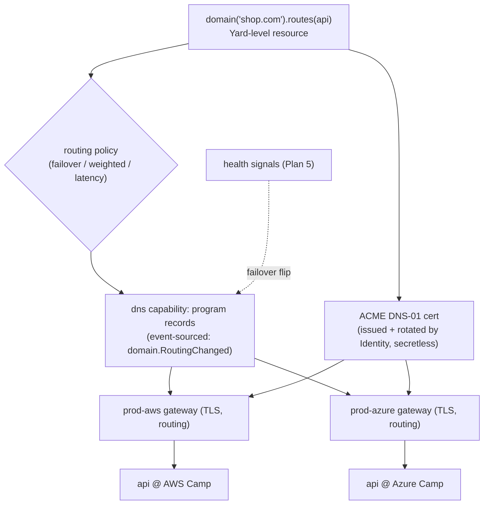
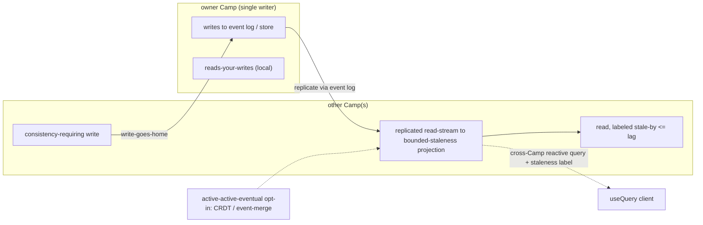

# Plan 13 — Networking & connectivity

> Part of the [HoBo Design Plan Suite](./README.md). The hardest part of being genuinely multi-provider: making resources that live on different clouds/regions talk securely and cheaply.

> **The Relay (Humanitec parity):** the **HoBo Relay** ([Plan 28](./28-relay-gitops-pipelines.md)) is the control-plane→private-network path (outbound reverse tunnel, no inbound), distinct from the data-plane connectivity tiers below. Multi-cluster routing is by target id; one Relay can serve several private targets.

## The problem
When one Bindle's `api` is on AWS and its `db` is on Azure (or its edge is on Cloudflare), HoBo must wire secure, low-latency, identity-aware connectivity across trust domains — without the developer thinking about VPCs, peering, or certificates. The agnostic path must "just connect."

## Logical connectivity from `bind`
A `bind: { db }` edge is the only thing the developer writes; HoBo derives the network wiring from it:
- **Service identity:** every service/resource gets a workload identity (SVID, [Plan 6](./06-ai-native-agent-auth.md)) — `spiffe://<tenant>/<bindle>/<resource>`. This is the unit of authn/authz, independent of IP/DNS.
- **Endpoint resolution:** `ctx.bindings.db` resolves to a logical endpoint; the actual address is injected from the resolved provider's outputs at deploy time and can change without app edits.
- **Authorization:** the dependent is granted least-privilege access to exactly its bound dependency (security-group/firewall rules or mesh policy generated by the provider's `realize()`).

## Connectivity tiers (Planner-selected, override via `.with(...)`)
1. **Same provider + region (preferred):** native private networking (VPC/VNet, security groups). Cheapest, lowest latency. The Planner colocates bound resources here by default ([Plan 3](./03-providers-iac.md)).
2. **Same provider, cross-region:** provider backbone + private peering where available.
3. **Cross-provider, private:** provider interconnects (PrivateLink/Private Service Connect/Private Link) provisioned via IaC where the equivalence class supports it; otherwise an **encrypted overlay**.
4. **Cross-provider, overlay mesh:** a HoBo-managed WireGuard/eBPF overlay (Tailscale/Cilium-ClusterMesh-style) joining resources into one logical network with mesh policy. Default fallback when native private peering isn't available.
5. **Public + mTLS:** last resort — public endpoints with **mutual TLS keyed by the workload SVIDs**, so even on the public internet only authorized identities connect.

**mTLS-by-default between services:** regardless of tier, service-to-service traffic authenticates with SVIDs (zero-trust). Certificates are issued/rotated by Identity; apps don't manage them.

## Ingress / the `gateway` port
- The `gateway()` capability provides TLS termination, routing, and traffic-splitting. It's what blue/green and canary rollouts flip ([Plan 5](./05-reliability-ha.md)).
- Custom domains + managed certs are a provider capability; `web()`/`service()` attach to a gateway by binding.
- WAF/rate-limit/DDoS are provider-specific `.with(...)` options on the gateway.

## Custom domains & multi-cloud ingress ([ADR-0035](./adr/07-portability-extensibility.md#adr-0035))
A custom domain is a **first-class, Yard-level resource** — declared IfC-style, owned at the Yard (which holds cross-provider topology, [ADR-0026](./adr/01-architecture-core.md#adr-0026)) so **one domain fronts the member Camps** of an environment group ([ADR-0028](./adr/05-config-matching-environments.md#adr-0028)):
```ts
import { domain } from "@hobo/sdk";
export const site = domain("shop.com")
  .routes(api)                          // bind to a service/gateway
  .routing("failover");                 // failover | weighted | latency | geo
```
- **Routing across Camps is policy-driven DNS**, programmed via a provider-agnostic **`dns` capability**: `failover` (active-passive, health-checked), `weighted` (canary/split), `latency`/`geo` (nearest Camp). It reuses the env-group saga ([ADR-0028](./adr/05-config-matching-environments.md#adr-0028)) + the blue/green gateway flip + health signals ([Plan 5](./05-reliability-ha.md)); each routing decision is an event (`domain.RoutingChanged` → auditable "why traffic went to `prod-aws`"). HoBo does **not** operate a global data-plane LB in v1 (it's a deferred opt-in adapter).
- **Certs are ACME DNS-01 by default**, issued + auto-rotated by Identity ([Plan 6](./06-ai-native-agent-auth.md)/[Plan 31](./31-config-secretless-secrets.md)) with **no static secret** — DNS-01 works cross-cloud + wildcard because HoBo controls the zone. **Provider-managed certs** (ACM / App Service / Google-managed) are an opt-in per-Camp adapter.
- The `gateway` keeps doing TLS termination + routing + traffic-split + provider `.with()` WAF/rate-limit; the `domain` sits **above** it, routing across Camps.



## Cross-Camp state consistency ([ADR-0040](./adr/05-config-matching-environments.md#adr-0040))
When a Bindle spans Camps ([ADR-0028](./adr/05-config-matching-environments.md#adr-0028)), HoBo does **not** silently make state strongly consistent across clouds (CAP). Each piece of cross-Camp state declares a **replication topology** (resolved config, [Plan 26](./26-environments-deltas.md)): **single-writer-Camp** (default), **active-active-eventual** (CRDT/event-merge, opt-in), or **pinned-single-Camp**.
- **Replication backbone = the event log.** The owning Camp writes; other Camps consume a replicated read-stream into **bounded-staleness projections** ([Plan 11](./11-event-model.md)/[Plan 5](./05-reliability-ha.md)). Provider-backed stores default to single-writer + cross-Camp read over the connectivity tiers above (active-active CDC deferred).
- **Honest surface:** non-owner reads are **labeled** stale-by ≤ replication lag; **reads-your-writes** holds in the writer Camp; **consistency-requiring writes "go home"** to the owner; cross-Camp reactive queries ([Plan 32](./32-reactive-live-queries.md)) carry the staleness label.



## DNS & naming
- Each Camp gets a namespace; resources have stable logical names (`shop.api`). HoBo manages records on the resolved provider's DNS (or a HoBo-managed zone), abstracted behind logical endpoints so app code never hardcodes hosts.
- Internal service discovery uses the SVID/identity layer, not DNS round-robin, so it works across providers.

## Egress, cost & latency feedback to the Planner
- Cross-provider/cross-region data paths incur egress $ and latency; the connectivity tier chosen feeds back into the Planner's colocation objective and the cost model ([Plan 16](./16-cost-finops.md)).
- The dashboard's topology graph annotates each `bind` edge with its connectivity tier + estimated egress, so a developer can *see* when a mapping choice created an expensive cross-cloud hop.

## Data-plane vs control-plane traffic
- **Control-plane** (Yard ↔ Executors ↔ providers) is separate from **data-plane** (app ↔ app, app ↔ db). The Yard is never on the app's request path ([Plan 10](./10-architecture-overview.md)).
- Executors reach providers over the scoped-token path only; they are not part of any tenant's data-plane network.

## Iteration hooks
- Overlay mesh technology choice (WireGuard userspace vs eBPF/Cilium vs a SaaS like Tailscale) and who operates it in self-host.
- How aggressively to auto-colocate vs honor explicit cross-cloud intent.
- Service-mesh depth (do we ship a sidecar/mesh, or rely on provider-native + mTLS libraries?).
- Private-interconnect coverage per provider equivalence class.
