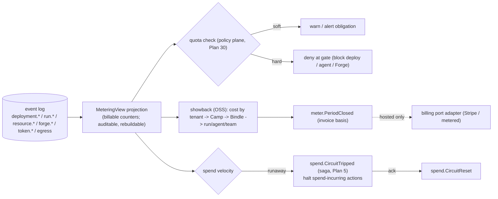

# Plan 16 — Cost & FinOps

> Part of the [HoBo Design Plan Suite](./README.md). Multi-provider only pays off if HoBo can reason about cost — otherwise "ship anywhere" quietly becomes "overpay everywhere."

> **v3 (Humanitec):** **Matching by environment type** ([Plan 25](./25-resource-definitions-matching.md)/[Plan 26](./26-environments-deltas.md)) is a primary cost lever — platform engineers map cheap variants (in-cluster DB, scale-to-zero wasm, shared cluster) to `ephemeral`/`development` and managed-HA to `production`, so previews are cheap by construction.

> **v4 (gates):** the **cost estimate is a gate dimension** in the Gatekeeper ([Plan 29](./29-contracts-compatibility.md)) — a policy ([Plan 30](./30-policy-plane.md)) can deny over-budget plans or *allow with an obligation* ("within budget X", "require approval above $Y"), with the decision recorded as an event.

> **v2 update.** Wasm components' tiny footprint + ms cold starts ([Plan 20](./20-wasm-wasi-runtime.md)) change the cost model (higher density, scale-to-zero friendliness) — a Planner input alongside the `cost.json` signals below. AI auto-evolution can also optimize for cost as an objective ([Plan 23](./23-stubbable-ai-implementations.md)).

## Cost is a first-class input, not a report
HoBo treats cost as a signal that flows through planning, deployment, runtime, and governance:
- **Plan-time estimate** — `hobo plan` returns a projected cost for the DeploymentPlan before anything is provisioned (the agent/dev sees the bill first).
- **Provider selection** — when multiple providers fully satisfy a port, the Planner can optimize for cost (or latency, or "stay on one provider") per a tenant objective ([Plan 3](./03-providers-iac.md)).
- **Runtime observability** — live cost/egress annotations on the topology graph and run inspector ([Plan 14](./14-observability.md)).
- **Governance** — budgets + spend caps as policy gates, including for agents ([Plan 6](./06-ai-native-agent-auth.md)).

## Cost signals (`cost.json` in Hobo Code)
Each provider publishes machine-readable price/region signals as part of its Hobo Code ([Plan 6](./06-ai-native-agent-auth.md)):
```jsonc
{
  "currency": "USD",
  "unitPrices": {
    "compute.container.vcpu_hour": 0.04,
    "compute.container.gb_hour": 0.004,
    "database.pg.flex.instance_hour": { "small": 0.06, "medium": 0.12 },
    "objectStore.gb_month": 0.021,
    "egress.gb": { "same_region": 0.0, "cross_region": 0.02, "internet": 0.09 }
  },
  "freeTier": { "objectStore.gb_month": 5 },
  "regions": ["us-east","eu-west"]
}
```
These are estimates (real bills vary); HoBo reconciles estimates against actual provider billing where an API exists, and records the delta.

## The Planner cost model
- For a candidate plan, sum each resource's projected cost from `cost.json` × an expected-usage profile (defaults per port, overridable in the Bindle), plus **egress** across each `bind` edge given its connectivity tier ([Plan 13](./13-networking-connectivity.md)).
- Objective is configurable per Yard/Camp: `cost` | `latency` | `single-provider` | `carbon`, **default = min-cost within constraints** ([ADR-0033](./adr/ADR-0033-deterministic-matching-and-planner-selection.md), resolves ADR-P4). It is the **soft tiebreak** in the deterministic Matching rank (specificity → explicit `priority` → objective → stable tiebreak, [Plan 25](./25-resource-definitions-matching.md)) — applied lexicographically, not as an on-path solver; a weighted multi-objective blend is a deferred hook. The chosen rationale is recorded in `match.Decided` + on `deployment.Planned` (auditable "why this provider").
- Cross-cloud hops are penalized by their egress cost so the Planner naturally colocates bound resources unless explicitly told otherwise.

## Budgets, caps & guardrails
- **Camp/tenant budgets** — soft (alert) and hard (block deploys that would exceed) thresholds; breaches raise alerts and can require human approval.
- **Agent spend caps** — `agent({ policy: { spendCapUsd } })` bounds what an autonomous agent can provision; exceeding it triggers a policy gate (approve/deny) rather than silent spend ([Plan 6](./06-ai-native-agent-auth.md)).
- All budget/cap decisions are events → the audit trail shows who approved which spend.

## Metering, quota & chargeback ([ADR-0039](./adr/ADR-0039-billing-quota-cost-attribution.md))
This is the hosted Yard's commercial substrate — and it reuses the event log + policy plane rather than adding a billing system.
- **Metering = an event-sourced projection.** A **`MeteringView`** folds **billable counters** from the log HoBo already keeps (`deployment.*`, `run.*`, `resource.*`, `forge.*`, `token.*`, egress) across a small dimension set — **control-plane operations · runtime-compute-seconds · storage-GB · egress-GB · Forge-runs · seats**. No new instrumentation; auditable, replayable, rebuildable from zero ([Plan 11](./11-event-model.md)) so **every bill traces to facts**.
- **Quotas + runaway-spend circuit-breaker run through the policy plane** ([Plan 30](./30-policy-plane.md)). A counter crossing a plan-tier threshold → `policy.Decided`: **soft** = warn/alert obligation; **hard** = deny at the gate (block deploy / agent provisioning / Forge run). Excess spend **velocity** trips a **durable spend circuit-breaker** — a saga obligation reusing the resilience-breaker pattern ([Plan 5](./05-reliability-ha.md)) — halting spend-incurring actions until acknowledged (`spend.CircuitTripped`/`spend.CircuitReset`). **Agent spend-caps** (above, [Plan 6](./06-ai-native-agent-auth.md)) generalize to **tenant / Camp / plan** quotas.
- **OSS↔hosted boundary.** **Metering + quota + showback** (cost attributed **tenant → Camp → Bindle → run/agent/team**, from the owning principal on every event) are **OSS core**, self-hostable. **Chargeback** (moving money — metered billing / invoicing) is an adapter behind a **`billing` port** the hosted Yard wires; the billing-period basis is an immutable `meter.PeriodClosed` snapshot. This realizes [ADR-0020](./adr/ADR-0020-monetization-model.md) and the **never-gate-portability** rule — self-host runs a no-op/showback-only billing provider.



## Optional dimensions
- **Carbon/sustainability** — providers may publish region carbon intensity alongside cost; the Planner objective can include a carbon term.
- **Commitment optimization** — surface savings-plan/reserved-capacity opportunities from observed steady-state usage (advisory, never auto-purchased without approval).

## v2 cost inputs (integrated)
- **Wasm economics.** Ms cold starts + tiny footprint enable higher instance **density** and **scale-to-zero**, materially changing per-workload cost — a Planner input alongside the `cost.json` signals above. The OCI-container fallback keeps the existing per-resource pricing ([Plan 20](./20-wasm-wasi-runtime.md)).
- **Cross-link egress.** `link.Called` paths that cross providers/regions feed the egress term of the cost model exactly like `bind` edges ([Plan 13](./13-networking-connectivity.md)).
- **AI cost optimization.** Auto-evolution can take **cost** as an objective, proposing cheaper implementations/providers validated against recorded traces before a gated promotion ([Plan 23](./23-stubbable-ai-implementations.md)).

## Iteration hooks
- Estimate fidelity vs simplicity (static `cost.json` vs live pricing APIs vs learned usage profiles).
- ~~The default Planner objective~~ — **decided ([ADR-0033](./adr/ADR-0033-deterministic-matching-and-planner-selection.md)):** min-cost within constraints, configurable; weighted multi-objective blending remains the open part.
- How aggressively to act on commitment/savings recommendations.
- Reconciling estimates with real billing per provider (which expose usable billing APIs?).
