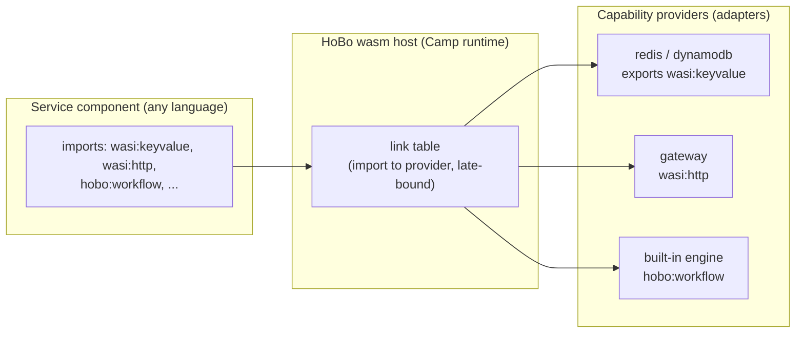

# Plan 20 — WASM/WASI runtime (the polyglot spine)

> Part of the [HoBo Design Plan Suite](./README.md). **Decision: wasm-first, OCI-container fallback; WASI/WIT as canonical port contracts.** This doc defines HoBo's runtime substrate; it reframes ports ([Plan 3](./03-providers-iac.md)) as WIT interfaces and providers as capability providers.

> **Contracts & policy (gates):** each **Camp** (via its runtime + wasm host) **declares the contract/policy enforcement modes it supports** — e.g. `record-and-verify` (local), `strict`/`enforce` (prod), `verify-at-build-observe-at-runtime` (edge) — so the Gatekeeper ([Plan 29](./29-contracts-compatibility.md)/[Plan 30](./30-policy-plane.md)) knows what a target can enforce, just as a WIT interface announces its capabilities.

## Why wasm/wasi is the default
- **Any language, one artifact.** Anything that compiles to a WASI component (Rust, TinyGo, TS via jco, Python via componentize-py, C# via componentize-dotnet) is a first-class HoBo service. The SDK is TypeScript, but the *runtime contract* is language-neutral.
- **Capability security by construction.** WASI is deny-by-default with unforgeable resource handles — a component can only touch what it's been linked to. This is the runtime enforcement of `.allow()` ([Plan 21](./21-resources-catalog.md)) and complements SVIDs/token scoping ([Plan 6](./06-ai-native-agent-auth.md), [Plan 12](./12-security-multitenancy.md)).
- **Tiny, portable, OCI-native.** Components are small, start in ms, and distribute as **OCI artifacts** — the same registry/signing/scanning pipeline as containers.
- **Standards = ecosystem.** Because ports are WIT interfaces, HoBo can reuse existing **wasmCloud capability providers** and the broader Bytecode Alliance toolchain.

## The model: components, interfaces, providers, links
- **Service = component (default).** A HoBo service compiles to a WASI **component**. Fallback: workloads that can't compile to wasm yet (GPU/native deps) run as plain **OCI containers** through the identical OCI + wiring pipeline ([Plan 22](./22-wiring-manifest.md)).
- **Port = WIT interface.** A capability port is a WIT interface. Reuse the standard cloud interfaces; author `hobo:*` interfaces for what WASI doesn't cover yet:
  - **Reused:** `wasi:http`, `wasi:keyvalue`, `wasi:blobstore`, `wasi:messaging`, `wasi:sql`, `wasi:config`, `wasi:logging`, `wasi:filesystem/sockets/clocks/random`.
  - **HoBo interfaces:** `hobo:workflow` (durable workflow/step), `hobo:actor` (grains), `hobo:saga`, `hobo:agent`, and control-plane `hobo:scheduler`/`provisioning`/`observability`/`config`.
- **Provider = capability provider.** A Provider implements a WIT interface's *exports* for a backend (e.g. an S3 adapter exports `wasi:blobstore`). It has the same deploy + runtime split HoBo already uses ([Plan 3](./03-providers-iac.md)): `realize()` provisions infra; the runtime impl serves the interface.
- **Bind = link.** Binding a component's *import* of an interface to a provider's *export* is a **link**, late-bound at deploy/runtime (the wasmCloud model). Swapping Redis→Vault behind `wasi:keyvalue` is a link change, no recompile. Links are the concrete form of HoBo's ports/adapters escape hatch.



## WIT as the contract (example)
```wit
// hobo:workflow interface (illustrative) — HoBo-authored where WASI has no equivalent
package hobo:runtime@0.1.0;
interface workflow {
  record step-opts { retries: u32, timeout-ms: u64 }
  run-step: func(name: string, input: list<u8>, opts: step-opts) -> result<list<u8>, string>;
  sleep: func(ms: u64);
  emit: func(event-type: string, data: list<u8>) -> result<_, string>;
}
// a service component's interface contract (illustrative)
//   imports = dependencies → links; export = capability
import wasi:keyvalue/store@0.2.0;
import wasi:http/outgoing-handler@0.2.0;
import hobo:runtime/workflow@0.1.0;
export wasi:http/incoming-handler@0.2.0;     // an HTTP service
```
The TS SDK's typed clients (`ctx.bindings.db`, `step`, `workflow`) are **generated from these interfaces** (jco `guest-types`), so app code never hand-writes WIT — it gets typed TS, and the contract is standards-based underneath.

## Build pipeline (per language)
| Language | Toolchain → component |
|---|---|
| TypeScript/JS | `jco` + `componentize-js` (StarlingMonkey) |
| Rust | `cargo-component` / `wit-bindgen` |
| Go | TinyGo |
| Python | `componentize-py` |
| C#/.NET | `componentize-dotnet` (NativeAOT-LLVM) |
`@hobo/componentize` wraps these; output is a component pushed as an **OCI artifact** (`wash push`-style). `build-wasm`/`build-dagger` ([Plan 1](./01-monorepo.md)) produce both wasm components and the container fallback.

## Hosts & where it runs — the `component-host` port ([ADR-0031](./adr/ADR-0031-wasm-host-of-record-and-runtime-substrate.md))
The thing that *executes* a component — the WASI interface impls + the link table + the component lifecycle — is itself a **`component-host` port**, and **the host is a property of a Camp** ([ADR-0026](./adr/ADR-0026-scope-model-yard-camp-bindle.md)): a Camp selects its host the same way it selects its runtime backend and infra Provider, and Camps stay heterogeneous ([ADR-0028](./adr/ADR-0028-multi-camp-deployment-model.md)).
- **Local/built-in runtime (`runtime-local`): Wasmtime.** The canonical Component-Model engine provides the WASI impls + link table; `hobo dev` runs everything locally with capability emulation. (jco-in-Node was rejected — a second wasm semantics surface would break dev/prod parity.)
- **v1 prod default: wasm-in-container.** The portable default runs the host (Wasmtime) **inside an OCI container**, reusing the existing OCI/container pipeline ([Plan 22](./22-wiring-manifest.md)) — so "runs anywhere a container runs" holds with **zero new mandatory infra**, and local semantics match prod. The OCI-container *fallback* (non-wasm workloads) still runs as a normal container alongside it.
- **Opt-in host adapters (per Camp), same port + same conformance gate:** **SpinKube / containerd-wasm** (k8s-native, shim-level density), **wasmCloud lattice** (cross-host late-bound links + multi-region link migration), and **provider-native wasm targets**. Each is certified against the `component-host` conformance suite ([Plan 9](./09-verification-open-questions.md)) before a Camp may select it. Either way the **manifest IR** ([Plan 22](./22-wiring-manifest.md)) carries endpoints/links/config.
- **Async:** WASI Preview 3 brings native async; HoBo workflows/agents map onto it where available, falling back to the host's executor otherwise.

## Component-host portability ([ADR-0067](./adr/ADR-0067-component-host-portability.md))
A component proven on Wasmtime locally must behave **identically** on wasm-in-container in prod — so the `component-host` is a **conformance-gated, version-pinned portability boundary**, exactly like a provider port ([ADR-0024](./adr/ADR-0024-portability-conformance-guarantee.md)).
- **`@hobo/conformance/component-host` suite** ([Plan 9](./09-verification-open-questions.md)). Any host claiming conformance must pass: **deterministic-clock trace replay** (same run → identical state across hosts, [Plan 11](./11-event-model.md)), **`wasi:*` interface round-trip** (vendored/pinned interfaces behave identically), **link semantics** (imported-interface → provider-export late-binding resolves the same), and **capability-handle isolation** (deny-by-default; an un-linked capability call fails). A host may only be selected for a Camp if it passes.
- **Host version pinned in the manifest IR** ([Plan 22](./22-wiring-manifest.md)). A Bindle records the `component-host` kind + version it was built/certified against; a Camp whose host is incompatible fails planning with a precise reason (mirrors the `wasi:*`/runtime version policy in [ADR-0024](./adr/ADR-0024-portability-conformance-guarantee.md) §5). Host upgrades go through an explicit, gated path with an **upcaster** where semantics change — no silent rewrite of component behavior.
- **Cross-host E2E** folded into `multi-cloud-shop` ([ADR-0024](./adr/ADR-0024-portability-conformance-guarantee.md)): the same component runs on **Wasmtime local → wasm-in-container → (opt-in) SpinKube** with identical behavior under trace replay. Host-specific capabilities (e.g. wasmCloud lattice link-migration) are typed as **host-`.with()`** options, inert on hosts that don't offer them, and flagged by **`hobo doctor`** as host lock-in (same model as provider `.with()`).

## Security substrate
- Deny-by-default: a component gets *only* the links its `.allow()` declarations grant.
- Unforgeable handles: capabilities are passed in, never fabricated — strong multi-tenant isolation in-process, layered under the tenant/SVID model ([Plan 12](./12-security-multitenancy.md)).
- Forge-generated components/providers run in this sandbox during conformance ([Plan 23](./23-stubbable-ai-implementations.md)).

## Iteration hooks
- ~~Wasm host of record~~ — **decided ([ADR-0031](./adr/ADR-0031-wasm-host-of-record-and-runtime-substrate.md)):** Wasmtime locally + a `component-host` port whose v1 prod default is wasm-in-container, with SpinKube / wasmCloud-lattice / provider-native as opt-in per-Camp adapters. Remaining: the host **conformance-suite** assertions and the wasmCloud-lattice adapter's cross-host link semantics. **Grounding/refinements** (from [`competitors/wasm-hosts`](../../competitors/wasm-hosts/README.md)): pin **`runwasi`/containerd-shim** as the mechanism for the wasm-in-container default + SpinKube adapter; pin **`wRPC` (WIT-over-RPC) over the lattice (NATS)** as the wasmCloud adapter's cross-host link transport.
- `hobo:*` WIT interface naming/versioning; how aggressively to track upstream `wasi:*` draft churn.
- Component-to-component composition (`wac`) vs runtime links for intra-app calls.
- Container-fallback runtime + when the Planner chooses it automatically (GPU/native detection).
