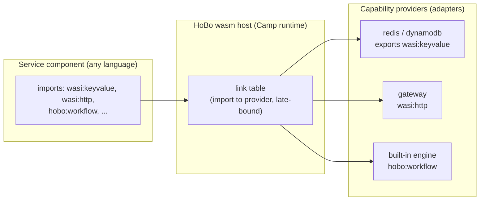

# Plan 20 — WASM/WASI runtime (the polyglot spine)

> Part of the [HoBo Design Plan Suite](./README.md). **Decision: wasm-first, OCI-container fallback; WASI/WIT as canonical port contracts.** This doc defines HoBo's runtime substrate; it reframes ports ([Plan 3](./03-providers-iac.md)) as WIT worlds and providers as capability providers.

> **v4 (gates):** each **Camp** (via its runtime + wasm host) **declares the contract/policy enforcement modes it supports** — e.g. `record-and-verify` (local), `strict`/`enforce` (prod), `verify-at-build-observe-at-runtime` (edge) — so the Gatekeeper ([Plan 29](./29-contracts-compatibility.md)/[Plan 30](./30-policy-plane.md)) knows what a target can enforce, just as a WIT world announces its capabilities.

## Why wasm/wasi is the default
- **Any language, one artifact.** Anything that compiles to a WASI component (Rust, TinyGo, TS via jco, Python via componentize-py, C# via componentize-dotnet) is a first-class HoBo service. The SDK is TypeScript, but the *runtime contract* is language-neutral.
- **Capability security by construction.** WASI is deny-by-default with unforgeable resource handles — a component can only touch what it's been linked to. This is the runtime enforcement of `.allow()` ([Plan 21](./21-resources-catalog.md)) and complements SVIDs/token scoping ([Plan 6](./06-ai-native-agent-auth.md), [Plan 12](./12-security-multitenancy.md)).
- **Tiny, portable, OCI-native.** Components are small, start in ms, and distribute as **OCI artifacts** — the same registry/signing/scanning pipeline as containers.
- **Standards = ecosystem.** Because ports are WIT worlds, HoBo can reuse existing **wasmCloud capability providers** and the broader Bytecode Alliance toolchain.

## The model: components, worlds, providers, links
- **Service = component (default).** A HoBo service compiles to a WASI **component**. Fallback: workloads that can't compile to wasm yet (GPU/native deps) run as plain **OCI containers** through the identical OCI + wiring pipeline ([Plan 22](./22-wiring-manifest.md)).
- **Port = WIT world.** A capability port is a WIT interface/world. Reuse the standard cloud interfaces; author `hobo:*` worlds for what WASI doesn't cover yet:
  - **Reused:** `wasi:http`, `wasi:keyvalue`, `wasi:blobstore`, `wasi:messaging`, `wasi:sql`, `wasi:config`, `wasi:logging`, `wasi:filesystem/sockets/clocks/random`.
  - **HoBo worlds:** `hobo:workflow` (durable workflow/step), `hobo:actor` (grains), `hobo:saga`, `hobo:agent`, and control-plane `hobo:scheduler`/`provisioning`/`observability`/`config`.
- **Provider = capability provider.** A Provider implements a WIT world's *exports* for a backend (e.g. an S3 adapter exports `wasi:blobstore`). It has the same deploy + runtime split HoBo already uses ([Plan 3](./03-providers-iac.md)): `realize()` provisions infra; the runtime impl serves the interface.
- **Bind = link.** Binding a component's *import* of a world to a provider's *export* is a **link**, late-bound at deploy/runtime (the wasmCloud model). Swapping Redis→Vault behind `wasi:keyvalue` is a link change, no recompile. Links are the concrete form of HoBo's ports/adapters escape hatch.



## WIT as the contract (example)
```wit
// hobo:workflow world (illustrative) — HoBo-authored where WASI has no equivalent
package hobo:runtime@0.1.0;
interface workflow {
  record step-opts { retries: u32, timeout-ms: u64 }
  run-step: func(name: string, input: list<u8>, opts: step-opts) -> result<list<u8>, string>;
  sleep: func(ms: u64);
  emit: func(event-type: string, data: list<u8>) -> result<_, string>;
}
world service {
  import wasi:keyvalue/store@0.2.0;
  import wasi:http/outgoing-handler@0.2.0;
  import hobo:runtime/workflow@0.1.0;
  export wasi:http/incoming-handler@0.2.0;   // an HTTP service
}
```
The TS SDK's typed clients (`ctx.bindings.db`, `step`, `workflow`) are **generated from these worlds** (jco `guest-types`), so app code never hand-writes WIT — it gets typed TS, and the contract is standards-based underneath.

## Build pipeline (per language)
| Language | Toolchain → component |
|---|---|
| TypeScript/JS | `jco` + `componentize-js` (StarlingMonkey) |
| Rust | `cargo-component` / `wit-bindgen` |
| Go | TinyGo |
| Python | `componentize-py` |
| C#/.NET | `componentize-dotnet` (NativeAOT-LLVM) |
`@hobo/componentize` wraps these; output is a component pushed as an **OCI artifact** (`wash push`-style). `build-wasm`/`build-dagger` ([Plan 1](./01-monorepo.md)) produce both wasm components and the container fallback.

## Hosts & where it runs
- **Local/built-in runtime:** a wasm host (Wasmtime or jco-in-Node — TBD, iteration hook) provides WASI interface implementations and the link table; `hobo dev` runs everything locally with capability emulation.
- **Deployed:** components run on a provider's wasm-capable target (e.g. SpinKube/containerd-wasm, a wasmCloud lattice, or a wasm host inside a container); the OCI-container fallback runs as a normal container. Either way the **manifest IR** ([Plan 22](./22-wiring-manifest.md)) carries endpoints/links/config.
- **Async:** WASI Preview 3 brings native async; HoBo workflows/agents map onto it where available, falling back to the host's executor otherwise.

## Security substrate
- Deny-by-default: a component gets *only* the links its `.allow()` declarations grant.
- Unforgeable handles: capabilities are passed in, never fabricated — strong multi-tenant isolation in-process, layered under the tenant/SVID model ([Plan 12](./12-security-multitenancy.md)).
- Forge-generated components/providers run in this sandbox during conformance ([Plan 23](./23-stubbable-ai-implementations.md)).

## Iteration hooks
- Wasm host of record for the built-in/local runtime (Wasmtime vs jco-in-Node) and the deployed host (SpinKube/containerd-wasm vs wasmCloud lattice vs wasm-in-container).
- `hobo:*` WIT world naming/versioning; how aggressively to track upstream `wasi:*` draft churn.
- Component-to-component composition (`wac`) vs runtime links for intra-app calls.
- Container-fallback runtime + when the Planner chooses it automatically (GPU/native detection).
