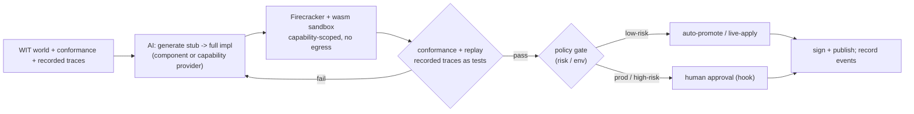
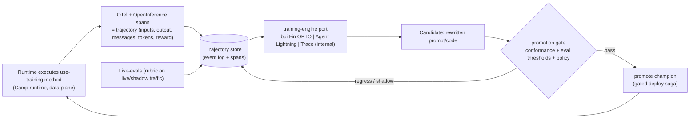

# Plan 23 — Stubbable & trainable (`use training`) implementations: AI implement / train / auto-evolve / live-fix

> Part of the [HoBo Design Plan Suite](./README.md). **Decision: gated by default.** Because every port is a WIT world ([Plan 20](./20-wasm-wasi-runtime.md)) with a conformance suite ([Plan 9](./09-verification-open-questions.md)) and every cross-port call is an event ([Plan 11](./11-event-model.md)), HoBo can let AI fill, trace, evolve, and live-fix implementations safely. This extends the Forge ([Plan 6](./06-ai-native-agent-auth.md)) from *provider* generation to *implementation* generation.

> **v5 (trainable methods).** A method the developer marks **`"use training"`** ([Plan 2](./02-sdk-api.md)) is an **AI-rewritable semantic function**: HoBo continuously optimizes its prompt/code against a rubric. The optimizer is an **engine behind a WIT port** (`training-engine`, built-in default; **Microsoft [Agent Lightning](https://microsoft.github.io/agent-lightning/stable/) / [Trace](https://microsoft.github.io/Trace/) are optional *internal* providers, never exposed to SDK users** — same engines-behind-ports rule as [ADR-0015](./adr/README.md), see [ADR-0025](./adr/ADR-0025-use-training-directive-and-training-engine.md)). Runtime execution is captured as **OTel + [OpenInference](https://github.com/Arize-ai/openinference)** spans (the training data), and **live-evals** supply the reward/feedback signal and gate promotion.

> **v3 (Humanitec):** the same Forge loop also generates **Resource Definitions** and **Resource Packs** ([Plan 25](./25-resource-definitions-matching.md)/[Plan 27](./27-drivers-packs-profiles.md)) — given a backend's Hobo Code + a target context, propose a definition, validate it sandboxed against conformance, and certify it into the Registry.

> **v4 (contracts/policy/evals):** a stubbed-then-AI-implemented port is a **semantic function**, governed by the four-lens taxonomy — **Contract = must never break · Eval = should improve · Policy = may/may not be allowed · Trace = what actually happened** ([Plan 29](./29-contracts-compatibility.md)/[Plan 30](./30-policy-plane.md)). The promotion gate below is now explicit: **conformance(contract) green AND eval thresholds met AND policy allows**.

## Contract vs eval vs policy (for a semantic function)
A semantic function carries three independent things, not one:
- **Contract** (must never break): I/O schema + invariants + forbidden outputs + negative cases. Verified by conformance + replayed traces; a failure **blocks**. *e.g. "summary must not contain PII"; "`critical` urgency requires explicit security/outage/production impact".*
- **Eval** (should improve): a **rubric** scored on quality/faithfulness/calibration/cost/latency, with **promotion thresholds**, **champion/challenger**, **shadow traffic**, and a **min-samples** floor. A candidate that regresses an eval **stays in shadow**, it doesn't block the champion.
- **Policy** (may/may not): whether *this* promotion is allowed here ([Plan 30](./30-policy-plane.md)) — e.g. prod promotions require human approval.
```ts
classifyTicket.promotionGate({
  requireConformance: true,                 // contract — hard gate
  evalThresholds: { categoryCorrect: 0.92, urgencyCalibrated: 0.90, piiSafe: 1.0 },
  shadowTraffic: "10%", minSamples: 1000,   // observe before promote
  policy: "promote.semantic.prod",          // Plan 30 decision (may require approval)
});
```
Promotion = **all three** pass. Each `eval.Ran`/`eval.GatePassed|Failed` and the final promotion is an event ([Plan 11](./11-event-model.md)).

**How a promotion is persisted to source ([ADR-0048](./adr/ADR-0048-persisted-code-mutation-mechanism.md)).** A promoted candidate is written back via **AST-aware, region-scoped** edits (a format-preserving codemod) confined to the `"use training"` method's **marked generated region** — never blind string patching, never touching hand-written code (the same generated-vs-authored boundary as `_generated/`, [ADR-0037](./adr/ADR-0037-sdk-codegen-surface.md)). The mutation carries **signed provenance** (model/prompt/seed/eval+conformance report) and lands as a **gated change**: low-risk → auto-apply to the region; prod/high-trust → **a PR/Delta for approval** (GitOps publisher + approval hook, [Plan 28](./28-agent-gitops-pipelines.md)/[Plan 6](./06-ai-native-agent-auth.md)). It's idempotent + round-trippable (prior candidates live in the event log), so a promotion is reversible.

## `use training` — marking a method AI-rewritable
The SDK surface for "this method is owned by the training loop" mirrors the Vercel-style directives `"use workflow"` / `"use step"` ([Plan 2 §Layer 4](./02-sdk-api.md)). A developer writes a **directive** (or the equivalent `training()` wrapper); the body is the **baseline** (which may be a `stub()` — see below), and HoBo's optimizer may rewrite the prompt/code to improve it:

```ts
import { training } from "@hobo/runtime";

/**
 * Classify a support ticket into a category + urgency.
 * @intent  Route tickets to the right queue; `critical` is ONLY for security,
 *          outage, or production-impact tickets — never billing or how-to.
 * @invariant output.category ∈ KnownCategories; `rationale` must not contain PII.
 */
export async function classifyTicket(t: Ticket): Promise<Classification> {
  "use training";                       // ← method is AI-rewritable (a semantic function)
  return llm.classify(t);               // baseline; the optimizer may rewrite this + its prompt
}

// Wrapper form (same semantics) — carries the metadata the optimizer needs:
export const classifyTicket = training(
  async (t: Ticket): Promise<Classification> => llm.classify(t),
  {
    intent: "Route tickets; `critical` only for security/outage/production impact.",
    contract: ClassificationContract,   // Zod I/O + invariants + forbidden outputs (Plan 29)
    rubric: { categoryCorrect: 0.92, urgencyCalibrated: 0.90, piiSafe: 1.0 }, // Plan 23 eval
  },
);
```

**Rewritability requires semantic grounding.** The optimizer rewrites *toward an intent*, so a `"use training"` method MUST carry, and HoBo lints for, the descriptions that make it optimizable (this is the input the engines below consume):
- **Intent / docstring** — what the method is for and the decision rules in prose (`@intent`, JSDoc). Captured into the trainable graph as the editable instruction.
- **Contract** — typed I/O + invariants + forbidden outputs + negative cases ([Plan 29](./29-contracts-compatibility.md)). The hard boundary the optimizer may never cross.
- **Rubric** — the scored quality signal ([eval](#contract-vs-eval-vs-policy-for-a-semantic-function) above) the optimizer climbs.
- **Examples / traces** — recorded executions (below) the optimizer learns from and regresses against.

A `"use training"` method **is** a semantic function: everything in [Contract vs eval vs policy](#contract-vs-eval-vs-policy-for-a-semantic-function) and the gated promotion applies unchanged. `"use training"` is just the marker that hands a method to the continuous-optimization loop instead of leaving it hand-maintained.

## Stubs: run before anything is implemented
Any WIT port can be backed by a **stub** the host links in place of a real provider/component:
- **Record** every call (args) and **return** typed/canned responses derived from the WIT types (and optionally an LLM given the interface + intent).
- Stubs satisfy the type system + the link table, so a whole app runs end-to-end with unimplemented pieces — the design-time analog of Lakebed's instant feel, but for *implementations*.
- Stub calls are events, so they double as a **specification by example**: the recorded traces become the inputs the real implementation must satisfy. A stub is also the natural **baseline of a `"use training"` method** — start stubbed, then let the training loop (below) grow it into a real implementation against those recorded traces.
```ts
service("payments").stub();        // links a stub for everything it exports/imports
service("payments").stub({ charge: () => ({ status: "ok" }) }); // partial canned behavior
```

## The Forge implementation loop (gated)
> **Generation vs evolution — same engine, two entry points.** The loop below is the *evolution / continuous-training* path for a live `"use training"` method. The **cold-start generation** of a brand-new artifact — and the generalization of this loop to **providers and Resource Definitions/Packs**, not just implementations — is specified in [Plan 33 — Forge generation pipeline](./33-forge-generation-pipeline.md) ([ADR-0030](./adr/ADR-0030-forge-generation-inputs-and-algorithm.md)). Both share the `training-engine` optimizer ([ADR-0025](./adr/ADR-0025-use-training-directive-and-training-engine.md)), the conformance/sandbox trust boundary, and signed provenance.


1. **Generate** an implementation for a WIT world from its interface + conformance + recorded traces (an entire service component or a backend capability provider).
2. **Validate** sandboxed (wasm capability sandbox + Firecracker, no egress, [Plan 12](./12-security-multitenancy.md)) against `@hobo/conformance` **and** by **replaying recorded traces** as regression tests.
3. **Gate** promotion by policy (below).
4. **Publish** signed with provenance; every step is an event ([Plan 11](./11-event-model.md)).

## Trace → implement → evolve
- **Trace:** each call across a WIT boundary is an event with inputs/outputs (encrypted per-run where sensitive). Replay reconstructs exact behavior — the ground truth for both implementing and detecting regressions.
- **Implement-to-trace:** AI implements against the recorded traces of a stub; "done" = passes conformance + reproduces observed outputs.
- **Auto-evolve:** on new traces (new inputs, perf data, error patterns), AI proposes an improved implementation; the old traces guard against regressions; SLO/cost signals ([Plan 14](./14-observability.md), [Plan 16](./16-cost-finops.md)) drive optimization.

## The training pipeline (engines behind a `training-engine` port)
Implementing/evolving a `"use training"` method is a **continuous optimization loop**, modeled on two Microsoft frameworks but wrapped so SDK users never see them:

- **From [Microsoft Trace](https://microsoft.github.io/Trace/):** treat the graph of `"use training"` methods + their calls as an **optimizable computational graph**. Each method's instruction/prompt/code is a *trainable parameter*; feedback (eval scores, natural-language critiques, errors, SLO/cost signals) propagates back through the recorded execution graph and an LLM-based optimizer (OptoPrime/TextGrad/OPRO-style) rewrites the parameters *in place* — "backprop for prompts and code." HoBo's built-in `training-engine` is this OPTO-style optimizer.
- **From [Agent Lightning](https://microsoft.github.io/agent-lightning/stable/):** **decouple execution from training.** The running app (the agent/method) just executes and emits trajectories; a separate **trajectory store + trainer** consumes them and produces candidate improvements via RL (GRPO/PPO), automatic prompt optimization (APO), or SFT. This is exactly HoBo's control-plane/data-plane split — the Camp's runtime runs the method, the Yard's training-engine optimizes it offline/async. **HoBo may use Agent Lightning itself as the provider behind the port** to run the trainer.

**Engines behind a port (the load-bearing rule).** Following [ADR-0015](./adr/README.md), `training-engine` is a **WIT port** ([Plan 24](./24-wit-worlds-reference.md)) with a **built-in default**; **Agent Lightning** (`@hobo/provider-agent-lightning`) and **Trace** (`@hobo/provider-trace`) are **optional adapters selected per tenant/Camp and are NOT part of the SDK surface**. SDK users write `"use training"` + intent + rubric; they never import, configure, or even need to know which optimizer ran. Swapping optimizers is a config change, never an app-code change ([ADR-0025](./adr/ADR-0025-use-training-directive-and-training-engine.md)).



The candidate **reuses the existing gated promotion verbatim** — conformance (contract) green **AND** eval thresholds met **AND** policy allows, with champion/challenger + shadow traffic + min-samples ([above](#contract-vs-eval-vs-policy-for-a-semantic-function)). Training adds *no new trust path*: every candidate still passes the same sandbox + conformance + policy gates as a Forge-generated impl, and every step (`training.*`, `eval.*`, `impl.Promoted`) is an event ([Plan 11](./11-event-model.md)).

## Runtime capture: OTel + OpenInference (the training data)
Training data is **real recorded execution, not synthetic** — the same principle as replay-as-test-oracle:
- Every `"use training"` invocation emits **OpenTelemetry spans following the [OpenInference](https://github.com/Arize-ai/openinference) semantic conventions** (LLM/chain/tool/agent/retriever spans with inputs, outputs, messages, token counts) layered on HoBo's existing OTel tracing ([Plan 14](./14-observability.md)). OpenInference is transport-agnostic and OTel-native, so it exports to the tenant's own backend *and* feeds HoBo's trajectory store — no separate, lock-in telemetry path.
- A **trajectory** = the OpenInference span tree for one invocation + its inputs/outputs + the **reward** attached by live-evals (below) + correlation to the run/agent. Sensitive payloads are per-run encrypted ([Plan 12](./12-security-multitenancy.md)); trajectories inherit trace retention/sampling policy.
- Trajectories are the units the `training-engine` consumes (Trace's "trace feedback", Agent Lightning's "transitions"). Because they ride the event log, training is **replayable and auditable**: you can reconstruct exactly which trajectories produced which candidate.

## Live-evals as the training signal
Evals don't only run at promotion time — they run **continuously on live and shadow traffic** to (a) attach the **reward/feedback** each trajectory needs and (b) detect drift:
- A rubric ([Contract vs eval vs policy](#contract-vs-eval-vs-policy-for-a-semantic-function)) is scored online (LLM-judge / programmatic / human-label sampling) and written as `eval.Ran` + a reward on the trajectory. This *is* the optimizer's objective — the live-eval score is what Trace propagates and what Agent Lightning's RL maximizes.
- Live-evals double as **performance telemetry**: champion vs challenger quality/cost/latency/calibration land in the observability stream ([Plan 14](./14-observability.md)) and the dashboard, so a regression in production triggers an `eval.GateFailed` (challenger stays in shadow) or, for the champion, a drift alert that can open a [live-fix](#live-fix-gated-by-default).
- The same min-samples / shadow-traffic floors prevent the optimizer from chasing noise.

## Live-fix (gated by default)
On a failing trace or SLO/health breach in a running deployment:
1. AI captures the failing trace, forms a hypothesis, generates a fix.
2. Validates sandboxed + **replays the failing trace as a new test** (and the full conformance suite).
3. **Policy gate** decides application:
   - **low-risk** (e.g. non-prod, within budget, reversible, conformance-green) → **auto-apply** as a canary with auto-rollback on regression ([Plan 5](./05-reliability-ha.md)).
   - **prod / high-risk / spend / destructive** → **human approval** via a `createHook` surfaced in the dashboard/Slack ([Plan 6](./06-ai-native-agent-auth.md)).
4. Apply as a normal gated deployment saga (blue/green or canary), fully event-sourced and reversible. The failing trace is retained as a permanent regression test.

```ts
// policy lives with the agent / tenant; example knobs
agent("ops", {
  policy: {
    liveFix: { auto: "low-risk", requireApprovalIn: ["prod"], maxBlastRadius: "1 resource" },
    spendCapUsd: 50,
  },
});
```

## Why this is safe(ish)
- **Conformance is the contract** — generated code can't claim a port it doesn't pass.
- **Capability sandbox** — generated/evolving code is deny-by-default; it can't reach anything it isn't linked to, and Forge runs have no egress.
- **Replay is the test oracle** — real recorded behavior, not synthetic guesses, gates changes.
- **Everything is an event** — generation, validation, gate decisions, and applies are an immutable, replayable audit trail.

## Iteration hooks
- Precise definition of "low-risk" for auto live-fix (shared with [Plan 5](./05-reliability-ha.md)/[Plan 12](./12-security-multitenancy.md) policy).
- Trace retention/sampling + per-run encryption for sensitive payloads.
- Whether evolution targets the component, the linked provider, or both; and rollback granularity.
- Forge model/eval design; human-certification threshold for high-trust ports.
- Default `training-engine` method (OPTO/prompt-rewrite vs RL/GRPO vs APO) per method class, and when to delegate to Agent Lightning vs Trace vs the built-in optimizer.
- Online-eval cost control (LLM-judge sampling rate) and how reward is attached for methods without a cheap programmatic rubric.
- Trajectory schema + how much of OpenInference's span attributes to persist as authoritative training data vs sample.
- Whether a tenant can bring their own training-engine provider, and the trust/conformance bar for it (it can rewrite production behavior).
