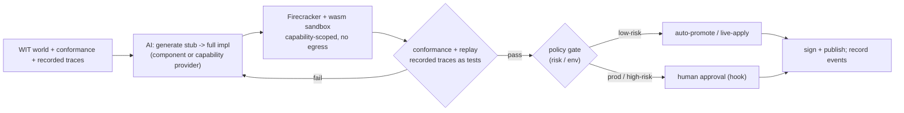

# Plan 23 — Stubbable implementations & AI implement/trace/auto-evolve/live-fix

> Part of the [HoBo Design Plan Suite](./README.md). **Decision: gated by default.** Because every port is a WIT world ([Plan 20](./20-wasm-wasi-runtime.md)) with a conformance suite ([Plan 9](./09-verification-open-questions.md)) and every cross-port call is an event ([Plan 11](./11-event-model.md)), HoBo can let AI fill, trace, evolve, and live-fix implementations safely. This extends the Forge ([Plan 6](./06-ai-native-agent-auth.md)) from *provider* generation to *implementation* generation.

> **v3 (Humanitec):** the same Forge loop also generates **Resource Definitions** and **Resource Packs** ([Plan 25](./25-resource-definitions-matching.md)/[Plan 27](./27-drivers-packs-profiles.md)) — given a backend's Hobo Code + a target context, propose a definition, validate it sandboxed against conformance, and certify it into the Registry.

> **v4 (contracts/policy/evals):** a stubbed-then-AI-implemented port is a **semantic function**, governed by the four-lens taxonomy — **Contract = must never break · Eval = should improve · Policy = may/may not be allowed · Trace = what actually happened** ([Plan 29](./29-contracts-compatibility.md)/[Plan 30](./30-policy-plane.md)). The promotion gate below is now explicit: **conformance(contract) green AND eval thresholds met AND policy allows**.

## Contract vs eval vs policy (for a semantic function)
A semantic function carries three independent things, not one:
- **Contract** (must never break): I/O schema + invariants + forbidden outputs + negative cases. Verified by conformance + replayed traces; a failure **blocks**. *e.g. "summary must not contain PII"; "`critical` urgency requires explicit security/outage/production impact".*
- **Eval** (should improve): a **rubric** scored on quality/faithfulness/calibration/cost/latency, with **promotion thresholds**, **champion/challenger**, **shadow traffic**, and a **min-samples** floor. A candidate that regresses an eval **stays in shadow**, it doesn't block the champion.
- **Policy** (may/may not): whether *this* promotion is allowed here ([Plan 30](./30-policy-plane.md)) — e.g. prod promotions require human approval.
```ts
classifyTicket.promotionGate({
  requireConformance: true,                 // contract — hard gate
  evalThresholds: { categoryCorrect: 0.92, urgencyCalibrated: 0.90, piiSafe: 1.0 },
  shadowTraffic: "10%", minSamples: 1000,   // observe before promote
  policy: "promote.semantic.prod",          // Plan 30 decision (may require approval)
});
```
Promotion = **all three** pass. Each `eval.Ran`/`eval.GatePassed|Failed` and the final promotion is an event ([Plan 11](./11-event-model.md)).

## Stubs: run before anything is implemented
Any WIT port can be backed by a **stub** the host links in place of a real provider/component:
- **Record** every call (args) and **return** typed/canned responses derived from the WIT types (and optionally an LLM given the interface + intent).
- Stubs satisfy the type system + the link table, so a whole app runs end-to-end with unimplemented pieces — the design-time analog of Lakebed's instant feel, but for *implementations*.
- Stub calls are events, so they double as a **specification by example**: the recorded traces become the inputs the real implementation must satisfy.
```ts
service("payments").stub();        // links a stub for everything it exports/imports
service("payments").stub({ charge: () => ({ status: "ok" }) }); // partial canned behavior
```

## The Forge implementation loop (gated)

1. **Generate** an implementation for a WIT world from its interface + conformance + recorded traces (an entire service component or a backend capability provider).
2. **Validate** sandboxed (wasm capability sandbox + Firecracker, no egress, [Plan 12](./12-security-multitenancy.md)) against `@hobo/conformance` **and** by **replaying recorded traces** as regression tests.
3. **Gate** promotion by policy (below).
4. **Publish** signed with provenance; every step is an event ([Plan 11](./11-event-model.md)).

## Trace → implement → evolve
- **Trace:** each call across a WIT boundary is an event with inputs/outputs (encrypted per-run where sensitive). Replay reconstructs exact behavior — the ground truth for both implementing and detecting regressions.
- **Implement-to-trace:** AI implements against the recorded traces of a stub; "done" = passes conformance + reproduces observed outputs.
- **Auto-evolve:** on new traces (new inputs, perf data, error patterns), AI proposes an improved implementation; the old traces guard against regressions; SLO/cost signals ([Plan 14](./14-observability.md), [Plan 16](./16-cost-finops.md)) drive optimization.

## Live-fix (gated by default)
On a failing trace or SLO/health breach in a running deployment:
1. AI captures the failing trace, forms a hypothesis, generates a fix.
2. Validates sandboxed + **replays the failing trace as a new test** (and the full conformance suite).
3. **Policy gate** decides application:
   - **low-risk** (e.g. non-prod, within budget, reversible, conformance-green) → **auto-apply** as a canary with auto-rollback on regression ([Plan 5](./05-reliability-ha.md)).
   - **prod / high-risk / spend / destructive** → **human approval** via a `createHook` surfaced in the dashboard/Slack ([Plan 6](./06-ai-native-agent-auth.md)).
4. Apply as a normal gated deployment saga (blue/green or canary), fully event-sourced and reversible. The failing trace is retained as a permanent regression test.

```ts
// policy lives with the agent / tenant; example knobs
agent("ops", {
  policy: {
    liveFix: { auto: "low-risk", requireApprovalIn: ["prod"], maxBlastRadius: "1 resource" },
    spendCapUsd: 50,
  },
});
```

## Why this is safe(ish)
- **Conformance is the contract** — generated code can't claim a port it doesn't pass.
- **Capability sandbox** — generated/evolving code is deny-by-default; it can't reach anything it isn't linked to, and Forge runs have no egress.
- **Replay is the test oracle** — real recorded behavior, not synthetic guesses, gates changes.
- **Everything is an event** — generation, validation, gate decisions, and applies are an immutable, replayable audit trail.

## Iteration hooks
- Precise definition of "low-risk" for auto live-fix (shared with [Plan 5](./05-reliability-ha.md)/[Plan 12](./12-security-multitenancy.md) policy).
- Trace retention/sampling + per-run encryption for sensitive payloads.
- Whether evolution targets the component, the linked provider, or both; and rollback granularity.
- Forge model/eval design; human-certification threshold for high-trust ports.
