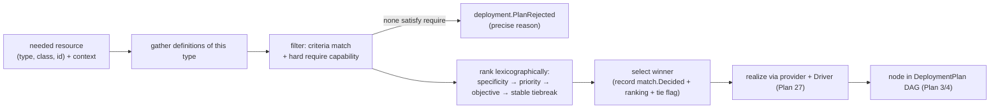

# Plan 25 — Resource Definitions & Matching (dynamic configuration management)

> Part of the [HoBo Design Plan Suite](./README.md). The platform-rules layer the Planner uses to turn an abstract port into concrete infra **per context** — HoBo's adoption of Humanitec's standout idea ([competitor capture](../../competitors/humanitec/orchestration-model.md)). **Decision: this subsumes the old static mapping** ([Plan 2](./02-sdk-api.md)/[Plan 3](./03-providers-iac.md)); `hobo.config.ts` becomes sugar over default definitions.

## Why this exists
Developers declare *what* they need (a `database`, IfC-style with `.allow()`, [Plan 21](./21-resources-catalog.md)). Platform engineers declare *how* it's realized — and crucially, **differently per environment**: managed-HA Postgres in prod, a cheap in-cluster Postgres in an ephemeral preview. A **Resource Definition** is that rule; **Matching** picks the right one for the deploy context. This is **dynamic configuration management**: the *same Bindle* resolves to different infra without app edits.

## A Resource Definition
For an abstract port (`type` + optional `class`), a definition says which **provider + driver + options + co-provisioned resources** realize it, plus the **matching criteria** that select it. Definitions are **WIT-interface-typed** ([Plan 24](./24-wit-interfaces-reference.md)) and may be **Forge-generated** ([Plan 23](./23-stubbable-ai-implementations.md)).
```ts
// platform/resource-defs.ts — authored by platform engineers (TS; YAML form also supported)
import { defineResource } from "@hobo/sdk/platform";
import { aws } from "@hobo/provider-aws";

export const postgresProdHa = defineResource({
  type: "database", engine: "postgres", class: "ha",   // the port it satisfies
  provider: aws,
  driver: "terraform",                                   // Plan 27 driver taxonomy
  with: aws.rds({ instanceClass: "db.r6g.large", multiAz: true }),
  match: { envType: "production", resourceClass: "ha" }, // criteria (Plan: specificity below)
});

export const postgresEphemeral = defineResource({
  type: "database", engine: "postgres",
  driver: "container",                                   // in-cluster Postgres for cheap previews
  with: { image: "postgres:16" },
  match: { envType: "ephemeral" },
});

// projection sinks are definitions too — this is the data-architect-autonomy knob (Plan 39)
export const ticketsSinkProd = defineResource({
  type: "projection-sink", paradigm: "relational",       // SQL / document / kv / graph / vector / lake / olap
  provider: aws, driver: "terraform",
  with: aws.rds({ instanceClass: "db.r6g.large" }),
  mapping: "./projections/tickets.mapping",              // WIT-record fields → backend columns (Plan 39/ADR-0050)
  match: { envType: "production", resourceId: "tickets" },
});
```
A **`projection-sink`** definition is how a data architect places a developer's read model on a backend **without touching app code** ([Plan 39](./39-data-plane-projections.md)/[ADR-0050](./adr/ADR-0050-event-sourced-domain-data-projection-sinks.md)): the `paradigm` is a matching dimension, and the `mapping` declares how the read-model WIT record lands in that backend. The developer owns the logical record + queries; the architect owns the mapping + sink — the autonomy split *is* this Matching boundary.

## Matching (specificity-scored selection)
For a needed resource in context `{ envType, app, env, tenant, resourceType, resourceClass, resourceId }`, the Planner gathers all definitions of that `type`, keeps those whose criteria fully match, **scores by specificity**, and selects the highest (ties → next-most-specific). Criteria dimensions: `envType` · `app` · `env` · `resourceClass` · `resourceId` (+ `tenant`).
```
match: {}                                              # score 0  (catch-all)
match: { envType: "production" }                       # score 1
match: { envType: "production", resourceClass: "ha" }  # score 2
match: { envType: "production", app: "shop", resourceClass: "ha" }  # score 3  (wins)
```
**HoBo twist — auditable matching.** The winning definition, its score, and the rejected candidates are recorded as a **`match.Decided`** event ([Plan 11](./11-event-model.md)) → a replayable answer to "*why did this resource land on this infra?*" (a gap in Humanitec's opaque selection). The dashboard renders it ([Plan 7](./07-ui-dashboard.md)).



## The selection algorithm — deterministic, on-path ([ADR-0033](./adr/ADR-0033-deterministic-matching-and-planner-selection.md))
Selection is a **pure function** of `(catalog snapshot, deploy context, objective setting)` — no clock, RNG, network, or model — so it is unit-testable without a cloud and **identical on replay** (the determinism property [Plan 9](./09-verification-open-questions.md) asserts of the Planner). The pipeline:
1. **Gather** all definitions of the requested `type`.
2. **Filter** to candidates whose criteria match the context **and** whose provider satisfies the resource's hard **`require`** capabilities (`Capability.satisfies` ([Plan 3](./03-providers-iac.md)) = `full` → accept; `prefer` may degrade with a `PlanWarning`; `require` miss → reject). If none satisfy `require` → **`deployment.PlanRejected`** with a precise, agent-correctable reason.
3. **Rank lexicographically:** (a) **specificity score** (above) → (b) an **explicit `priority`** (optional integer on a definition, for deliberate platform override) → (c) the **default objective** (soft; configurable `cost`|`latency`|`single-provider`|`carbon` per Yard/Camp, **default = min-cost within constraints** — [Plan 16](./16-cost-finops.md)) → (d) a **stable deterministic tiebreak** (definition id, lexicographic).
4. **Record** the winner + full ranking + rejected candidates + the objective used + a **tie flag** in `match.Decided`.

**True ties never block.** If candidates are equal on specificity, `priority`, *and* objective, the stable tiebreak still yields a deterministic winner, and a `PlanWarning` + tie flag is recorded so a platform engineer can add an explicit `priority` to disambiguate.

**AI/solvers are advisory, off the deploy path.** `hobo plan` may *surface* a cheaper alternative; the **Forge** may *generate* candidate definitions ([Plan 33](./33-forge-generation-pipeline.md)); an LLM may *suggest* definitions at authoring time — none select at deploy time, so replay + `match.Decided` stay honest. (A constraint solver / LLM selector on-path was rejected — [ADR-0033](./adr/ADR-0033-deterministic-matching-and-planner-selection.md).)

## Mapping is sugar over default definitions
The simple `hobo.config.ts` ([Plan 2](./02-sdk-api.md)) is **not** a separate system — it **compiles to default Resource Definitions**:
- `defaultProvider: azure` → a `match: {}` definition per port on Azure.
- `tiers: { saas: azure, edge: cloudflare }` → definitions matched by service model.
- `bindings: { "shop.db": azure.cosmos({...}) }` → a definition matched by `resourceId: "shop.db"`.
So a solo dev writes the one-liner and never sees definitions; a platform team adds explicit definitions (with classes + env-type matching) that win by specificity. **Precedence** = pure matching score (explicit definitions naturally outscore the `{}` defaults).

## Resource classes
`class` (`standard`/`ha`/`encrypted`/…) is declared on the resource ([Plan 21](./21-resources-catalog.md)) and is a first-class matching dimension, so one logical port can have several platform realizations.

## Co-provisioning & the graph
A definition may declare co-provisioned resources (e.g. a bucket + its IAM policy); these become extra nodes/edges in the DeploymentPlan DAG with output flow via placeholders ([Plan 22](./22-wiring-manifest.md)). The Planner ([Plan 3](./03-providers-iac.md)) consumes definitions; the Orchestrator ([Plan 4](./04-control-plane.md)) executes the graph.

## Forge-generated definitions
Given a backend's Capability Manifest + a target context, the **Forge** ([Plan 6](./06-ai-native-agent-auth.md)/[Plan 23](./23-stubbable-ai-implementations.md)) can generate candidate Resource Definitions (and bundle them as **Resource Packs**, [Plan 27](./27-drivers-packs-profiles.md)), validated sandboxed against conformance — so platform breadth isn't human-bottlenecked.

## Iteration hooks
- Authoring surface: TS (typed, shown) vs YAML (Humanitec-parity) vs both.
- ~~Scoring exactly like Humanitec vs a HoBo refinement~~ — **decided ([ADR-0033](./adr/ADR-0033-deterministic-matching-and-planner-selection.md)):** deterministic lexicographic rank (specificity → explicit `priority` → configurable objective, default min-cost → stable tiebreak); weighted multi-objective blending + carbon-signal sourcing remain hooks.
- ~~Conflict resolution when two definitions tie on score~~ — **decided ([ADR-0033](./adr/ADR-0033-deterministic-matching-and-planner-selection.md)):** stable tiebreak (definition id) + `PlanWarning`, never a block.
- How `match.Decided` is surfaced for agents to self-correct an unsatisfiable request (now carries the full ranking + reasons).
