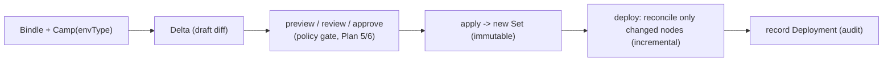

# Plan 26 — Environments, Deployment Sets & Deltas

> Part of the [HoBo Design Plan Suite](./README.md). Upgrades Camps with environment **types**, **cloning**, and **ephemeral/preview** environments, and formalizes deployments as immutable **Sets** + mutable **Deltas** — HoBo's adoption of Humanitec's environment & deployment model ([capture](../../competitors/humanitec/orchestration-model.md)), expressed event-sourced.

## Camps gain an environment type
A **Camp** ([Plan 2](./02-sdk-api.md)) is a **provider-specific deployment target** (an environment on one provider/cloud) that also provides the durable runtime. It carries an **environment type** (`development`/`staging`/`production`/`ephemeral`/custom) — the **primary matching dimension** for Resource Definitions ([Plan 25](./25-resource-definitions-matching.md)). The same Bindle deployed to a `production` Camp vs an `ephemeral` Camp resolves to different infra purely via matching; a multi-cloud `production` is **several Camps under one Yard** ([Plan 4](./04-control-plane.md)), which holds the cross-provider policy.
```ts
// hobo.config.ts
camps: {
  prod:    { envType: "production" },
  staging: { envType: "staging" },
  preview: { envType: "ephemeral", ttl: "72h" },   // ephemeral defaults
}
```

## Cloning
A Camp can be **cloned** from another that has a prior successful deployment (`clone-from`), producing a draft **Delta** (below) you can tweak then deploy — e.g. stand up `staging` from `production` config in one step (`hobo env clone`). Recorded as `env.Cloned` ([Plan 11](./11-event-model.md)).

## Ephemeral / preview environments
Per-PR/feature environments, created and torn down automatically:
- Created by CI / a Pipeline ([Plan 28](./28-agent-gitops-pipelines.md)) on PR open; **auto-TTL** reaps them.
- Platform engineers map **cheap variants** to `envType: ephemeral` via matching (in-cluster DB, scale-to-zero wasm, shared cluster) — so previews are cheap by construction ([Plan 16](./16-cost-finops.md)).
- Each gets its own Camp + isolated event streams ([Plan 12](./12-security-multitenancy.md)).

## Deployment Sets (immutable) + Deltas (mutable)
HoBo already produces a **manifest IR** per deploy ([Plan 22](./22-wiring-manifest.md)); we name and formalize the two halves of Humanitec's model on top of the event log ([Plan 11](./11-event-model.md)):
- **Deployment Set** = the immutable, complete resolved configuration of a Camp at a point in time (the manifest IR, content-addressed). Recorded as `set.Created`. *(A stateful resource's **cross-Camp replication topology** — single-writer/active-active-eventual/pinned, [ADR-0040](./adr/ADR-0040-cross-camp-stateful-consistency.md) — is part of this resolved config, selected like any other Resource-Definition dimension, [Plan 25](./25-resource-definitions-matching.md).)*
- **Deployment Delta** = a mutable, reviewable **diff** (add/update/remove resources or workloads) proposed against the current Set. Deltas can be combined, previewed, approved, then **applied** to produce a new Set. Recorded as `delta.Opened` / `delta.Updated` / `delta.Applied`.



## The `can-deploy` gate (at Delta → Set / promote)
Applying a Delta or promoting a Set runs the **Gatekeeper** ([Plan 29](./29-contracts-compatibility.md)/[Plan 30](./30-policy-plane.md)) against the **versions already running in the target Camp** (read from the event log): contracts-compatible (`compat.GatePassed/Failed`) AND policy-allows (with **obligations** that can *reshape* the rollout — e.g. an "allow but require canary" obligation forces a canary below) AND evals/conformance/cost. Incompatible producer/consumer skew blocks the promote with a precise reason + suggested fixes (shim, deploy-order, migration window).

**App-data schema migrations compose here.** When a Delta changes a `sql` resource's schema, its **expand/backfill/contract** phases ([Plan 34](./34-app-data-migrations.md)) are gated saga steps in *this* flow: each phase passes through the same `can-deploy` check, and a **destructive contract phase that would break a still-running version is blocked** (`compat.GateFailed`) — schema migration and code rollout are gated together, not in separate pipelines.

## Promote, rollback, incremental
- **Promote** = apply the Set that's running in one Camp as a Delta against another (e.g. staging → prod), gated.
- **Rollback** = re-apply a previous Set; stateful resources keep state ([Plan 5](./05-reliability-ha.md)).
- **Incremental deploy** = the Orchestrator's ResourceActors diff the new Set vs observed and reconcile **only changed nodes** ([Plan 4](./04-control-plane.md)) — fast, low-blast-radius.
- All of the above are sequences of events → time-travel, audit, and DR-as-replay for free.

## How this differs from Humanitec
Sets/Deltas are not bespoke tables — they're **projections over the event log**, so promote/rollback/preview inherit replay + audit; ephemeral environments are first-class Camps; and `match.Decided` ([Plan 25](./25-resource-definitions-matching.md)) makes "why did preview get the cheap DB?" answerable.

## Iteration hooks
- Delta merge/conflict semantics when multiple Deltas target one Set.
- Default ephemeral TTLs + reaping policy; preview URL scheme.
- Whether promote copies the resolved Set or re-resolves matching in the target Camp (re-resolve is more correct; copy is more predictable).
