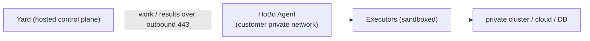

# Plan 28 — The HoBo Agent, GitOps publisher & Pipelines

> Part of the [HoBo Design Plan Suite](./README.md). The operational surface for private-network deploys, Git-driven delivery, and rule-based automation — HoBo's adoption of Humanitec's Agent/GitOps/Pipelines ([capture](../../competitors/humanitec/platform-ops.md)).

## The HoBo Agent (deploy into private / air-gapped networks)
A hosted Yard can't reach a customer's private cluster/cloud. The **HoBo Agent** is a lightweight proxy inside that network:
- **Outbound-only reverse tunnel:** the Agent dials the Yard over **TCP 443** (no inbound ports, no exposed endpoints); TLS + authenticated with an SVID ([Plan 6](./06-ai-native-agent-auth.md)).
- **Executors run behind the Agent:** IaC/build/driver execution ([Plan 27](./27-drivers-packs-profiles.md)) happens inside the private network; **credentials never leave it**; the Yard sends work + receives `exec.*`/outputs over the tunnel.
- One Agent can serve multiple clusters/targets; routing by target id. Enables regulated/air-gapped/sovereign deploys ([Plan 12](./12-security-multitenancy.md)) and self-hosted parity.


## GitOps publisher mode
Beyond direct apply, a Camp can use a **GitOps publisher**: the Yard writes the resolved **Deployment Set** ([Plan 26](./26-environments-deltas.md)) as manifests/CRs to a Git repo/branch, and **Argo CD / Flux** sync it to the cluster. It's just another **publisher** target ([Plan 22](./22-wiring-manifest.md)) — the resolution/matching/event-sourcing pipeline is unchanged; only the final apply step differs. Supports standalone, GitOps, or hybrid; the Agent can supply runtime data back.

## Pipelines (rule-based automation + approval gates)
**Pipelines** sit above the deployment sagas ([Plan 5](./05-reliability-ha.md)) and policy gates ([Plan 6](./06-ai-native-agent-auth.md)) to automate *when* deploys happen:
- **Triggers:** **artifact** (a new image/component version matching a rule), **deploy-request** (a Delta opened), **schedule/cron**, and **API/MCP**.
- **Rules (if-then):** e.g. *"new component from `main` → deploy to `staging`"*; *"tag `v*` → open a prod Delta requiring approval"*. Flexible match/exclude on artifact + branch.
- **Steps/jobs:** run in order (`needs`) or parallel; can run tests, wait for health, call external CI, notify Slack/Teams, and **gate on approval** (a `createHook` resolved in the dashboard).
- **Concurrency:** per-pipeline locks; bounded concurrent runs.
- Every trigger/step/gate is an event (`pipeline.Triggered`/`pipeline.StepCompleted`/`pipeline.GateApproved`, [Plan 11](./11-event-model.md)) → replayable, auditable automation.
```ts
// platform/pipelines.ts (illustrative)
definePipeline("promote-staging", {
  on: { artifact: { component: "api", branch: "main" } },
  steps: [
    { run: "deploy", camp: "staging" },
    { gate: "approval", to: "production" },     // resolves via dashboard hook
    { run: "deploy", camp: "prod", strategy: "canary" },
  ],
});
```

## Iteration hooks
- Agent transport details (gRPC-over-443 vs WebSocket) + multi-cluster routing + HA (multiple agents).
- GitOps repo layout/branching convention; drift between Git and observed state.
- Pipeline language (typed TS vs YAML) + reuse of the policy-gate engine ([Plan 12](./12-security-multitenancy.md)).
