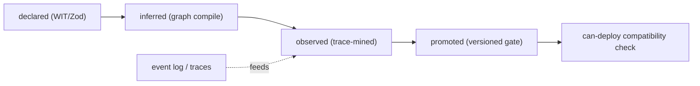

# Plan 29 — Contracts & compatibility (the `can-deploy` gate)

> Part of the [HoBo Design Plan Suite](./README.md). The **contract dimension** of the wiring graph and the **compatibility gate** that decides whether a change is safe to deploy. Built entirely from HoBo primitives — no new dependency.

## Why this exists (conformance ≠ compatibility)
HoBo already has **conformance** ([Plan 9](./09-verification-open-questions.md)/[Plan 24](./24-wit-interfaces-reference.md)): proof that *one implementation satisfies its WIT port*. That is necessary but not sufficient. It does **not** answer the version-skew question:

> *Will `api@v3` (which removed `tenantId` from `order.created`) still work with `worker@v2` that's already running in prod?*

That's a **contract** between a **producer and its consumers**, evaluated against **what's actually deployed**. This doc adds that missing dimension and a `can-deploy` gate. The organizing lens (shared across [Plan 30](./30-policy-plane.md)/[Plan 23](./23-stubbable-ai-implementations.md)):

> **Contract = must never break · Eval = should improve · Policy = may/may not be allowed · Trace = what actually happened.**

## Contracts are a dimension of the graph (not test files)
Every **edge** in the manifest graph ([Plan 22](./22-wiring-manifest.md)) carries a typed contract; HoBo covers more than HTTP:

| Edge | Contract checks |
|---|---|
| HTTP API | request/response shape + status compatibility |
| Event / message / topic | payload shape, required fields, envelope/ordering/idempotency |
| Resource binding | the behavior app code expects of a `database`/`blobstore`/… port |
| Service / actor / workflow | command/query I/O, step inputs/outputs, compensation expectations |
| **Capability (`.allow()`)** | **required scope ⊆ granted scope** ([Plan 21](./21-resources-catalog.md)) |
| **Runtime / SLO** | latency, availability, idempotency, ordering ([Plan 14](./14-observability.md)) |
| **Semantic function** | I/O schema + invariants + forbidden outputs ([Plan 23](./23-stubbable-ai-implementations.md)) |
| **Agent tool** | tool I/O, auth scope, allowed side effects ([Plan 6](./06-ai-native-agent-auth.md)) |
| Provider / interface | conformance to the port it claims ([Plan 24](./24-wit-interfaces-reference.md)) |

## Four contract modes (IfC-inferred, then refined by reality)
Developers don't hand-write contracts (IfC-default, [Plan 21](./21-resources-catalog.md)); they're derived and refined:
1. **Declared** — from WIT types + Zod/validators on resources.
2. **Inferred** — from graph compilation (who publishes/consumes what, which `.allow()` scopes).
3. **Observed** — **trace-mined** from the event log ([Plan 11](./11-event-model.md)): "99.8% of 42k `order.created` had `tenantId`; the 0.2% without came from `worker@v1`."
4. **Promoted** — an observed shape is promoted to a **versioned compatibility gate** with a migration window.



## The `can-deploy` gate (compatibility matrix)
At **Delta → Set / promote** time ([Plan 26](./26-environments-deltas.md)) the Planner ([Plan 3](./03-providers-iac.md)/[Plan 4](./04-control-plane.md)) builds a compatibility matrix: the proposed Set's producer/consumer **versions** vs the versions the event log says are **running in the target environment**. Incompatible skew → block with a precise, machine-readable reason (an agent can self-correct, like `deployment.PlanRejected`). Recorded as `compat.GatePassed` / `compat.GateFailed`.
```text
$ hobo can-deploy --target prod
blocked: api@1.8.0 publishes order-events/order.created v3 (removed tenantId),
         but worker@1.4.2 (running in prod) consumes v2 which requires tenantId.
fixes:   1) dual-publish tenantId during a 14d migration window
         2) deploy worker@1.5.0 first  3) add a compatibility shim
```
This is HoBo's generalization of consumer-driven contract testing's `can-i-deploy`, but driven by HoBo's own graph + event log (not an external broker).

## The unified Gatekeeper — `hobo verify`
`can-deploy` is one input to a single composite decision. The **Gatekeeper** (a step in the Planner/Orchestrator) requires **all** gates:
```text
deployable =
  contracts compatible            (this doc)
  AND policy allows / approves     (Plan 30 — incl. obligations)
  AND eval gates pass              (Plan 23 — for AI/semantic impls)
  AND conformance satisfied        (Plan 9/24)
  AND within cost budget           (Plan 16)
  AND artifact signed + attested   (Plan 12)
  AND the deployment plan is valid (Plan 3)
```
`hobo verify --target prod` returns a structured decision (per-gate results + suggested fixes); every gate result is an event, so "why did this deploy block?" is replayable ([Plan 11](./11-event-model.md)). On failure, the **Forge/live-fix** remediation loop ([Plan 23](./23-stubbable-ai-implementations.md)) classifies the failure (producer-broke-consumer, consumer-over-specified, semantic drift) and proposes safe fixes (shim, deploy-order, migration window, loosen an over-strict matcher) — all themselves gated.

## Engine behind a port (no dependency)
The contract engine is a **WIT port** (`contract-engine`) with a **built-in HoBo implementation** as the default (it already has the graph, traces, and event log it needs). **Pact** is an *optional capability provider* (`@hobo/provider-pact`) that can export HoBo contracts to Pact interactions/message pacts, run Pact provider verification, and mirror a Pact Broker's `can-i-deploy` — for teams already invested in that ecosystem. HoBo owns the source of truth (the **HoBo Contract IR**); Pact/OpenAPI/AsyncAPI/Protobuf are import/export targets, never the model.

## Camps declare enforcement modes
Each **Camp** (via its runtime + wasm host, [Plan 20](./20-wasm-wasi-runtime.md)/[Plan 24](./24-wit-interfaces-reference.md)) announces the contract modes it supports — `record-and-verify` (local), `strict` (prod), `verify-at-build-observe-at-runtime` (edge) — like an Aspire component announcing capabilities.

## Iteration hooks
- Authoring surface when devs *want* explicit contracts (TS DSL vs annotations) vs pure inference.
- Default compatibility policy (backward/forward) + migration-window defaults per edge kind.
- Sampling/retention for observed→promoted mining; promotion thresholds.
- Where the running-version-per-env projection lives (the matrix's source of truth).
