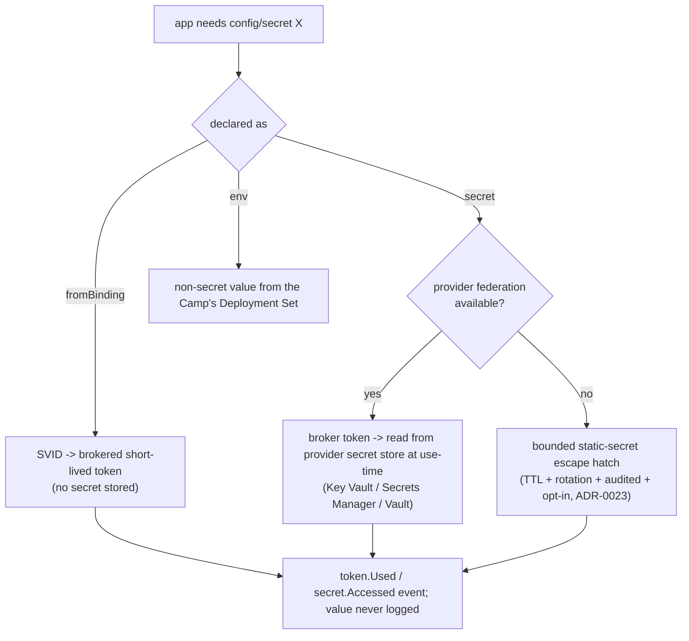

# Plan 31 — Configuration & secretless secrets

> Part of the [HoBo Design Plan Suite](./README.md). How an app loads **configuration** and **secrets** without scattering static credentials. Stance: **secretless-first** — prefer workload identity + brokered, short-lived tokens over any stored secret; when a secret is unavoidable, store a *reference*, never a value. Builds directly on agent/workload identity ([Plan 6](./06-ai-native-agent-auth.md)) and the security model ([Plan 12](./12-security-multitenancy.md)); resolved **per Camp** (the provider-specific layer, [README glossary](./README.md#glossary--naming-thematic-all-tunable)).

## The problem
Apps need configuration (URLs, flags, tuning) and credentials (DB access, third-party API keys). The antipattern everyone falls into: static secrets baked into env files, images, IaC, or — worst — the event log. HoBo already issues **keyless workload identities** and brokers short-lived provider tokens ([Plan 6](./06-ai-native-agent-auth.md)); this plan makes that the *default* path for app config/secrets too, and defines the SDK surface for loading them.

## Principles
1. **Secretless-first.** The best secret is no secret: a bound resource is reached via the app's **SVID → brokered short-lived token**, so there is nothing to store or leak ([ADR-0008](./adr/README.md)).
2. **References, not values.** Config/secret declarations resolve to **refs** (a pointer to a provider secret store path, a binding, or a federation trust), resolved **at use-time, per Camp**. A value never lives in the `Bindle`, the Camp config, or the event log.
3. **Provider-specific resolution belongs to the Camp.** Because a Camp is the provider-specific layer, *where* a secret/config actually comes from (Key Vault vs Secrets Manager vs Vault; which region) is a Camp concern; the Bindle only declares *what it needs*.
4. **Every access is audited; values are never telemetry.** Secret reads are `token.Used` / `secret.Accessed` events; OTel/OpenInference spans and `ctx.log` redact values ([Plan 14](./14-observability.md)).

## SDK surface
Declared inline (IfC, [Plan 21](./21-resources-catalog.md)) alongside resources; typed; read via `ctx.config`.
```ts
import { config, secret, env, fromBinding } from "@hobo/sdk";

export const cfg = config({
  DB:        fromBinding("db"),          // secretless: brokered client/token via the bind (Plan 13)
  STRIPE:    secret("stripe/api-key"),   // a real secret → resolved from the Camp's secret store at use-time
  LOG_LEVEL: env("info"),                // non-secret typed config (per-Camp overridable)
});

export const charge = step(async (o: Order) => {
  const stripe = await ctx.config.STRIPE();   // fetched now via a brokered token; in-memory only
  // ...
});
```
- `fromBinding(name)` — **preferred**: no secret at all; the bound resource is reached with the app's SVID-brokered token (the `bind` edge already wires identity-aware connectivity, [Plan 13](./13-networking-connectivity.md)).
- `secret(ref)` — a genuine third-party secret; `ref` is a logical name resolved per-Camp to the provider's `secrets` port path; the value is fetched at use-time and held in memory, never persisted.
- `env(default)` — non-secret configuration; lives in the Camp's Deployment Set ([Plan 26](./26-environments-deltas.md)) and is overridable per Camp/Delta.

## The resolution ladder (secretless-first)

1. **Bound resource** → SVID-brokered token (zero stored secret). Default for `database`/`queue`/`objectStore`/etc.
2. **Secret with provider federation** → broker a scoped token, read the value from the provider's secret store at use-time.
3. **Non-secret config** → typed value from the Camp's Deployment Set (no broker needed).
4. **Static-secret escape hatch** → only when a provider offers no federation/secret-store path; bounded by max TTL + enforced rotation + full audit + explicit opt-in ([ADR-0023](./adr/ADR-0023-security-posture-commitments.md)). `hobo doctor` warns when this path is used where federation exists ([Plan 15](./15-cli-dx.md), FR-014).

## Per-Camp binding (where values actually come from)
The Bindle declares *needs*; each Camp supplies the *source* (provider-specific), e.g.:
```ts
// hobo.config.ts — Camp "prod-aws"
camp("prod-aws").config({
  STRIPE: fromSecretStore("aws:secretsmanager", "prod/stripe"),   // resolved via brokered token
  LOG_LEVEL: "warn",
});
```
The same Bindle on `prod-azure` resolves `STRIPE` from Key Vault — **no app-code change** (the portability promise, [ADR-0024](./adr/ADR-0024-portability-conformance-guarantee.md)). Resolution decisions are recorded as `config.Resolved` (ref → source, never the value).

## Events & audit
- `config.Resolved` — a declared key bound to a source (binding / secret-store path / federation trust); carries the *ref*, never the value.
- `secret.Accessed` — a use-time fetch, joined to the run/agent + the brokered `token.Used` (the [CredentialAudit](./11-event-model.md) projection answers "who read which secret, when, with which token").
- Sensitive values that must transit a step's I/O are encrypted per-run ([TR-111](../requirements/TRD.md)); redaction strips them from logs/traces.

## Why this is safe
- **Nothing to steal by default** — the common case (bound resources) uses brokered tokens, so there is no secret at rest ([ADR-0008](./adr/README.md)).
- **Blast radius is bounded** — tokens are short-lived + resource-scoped; the static fallback is TTL'd, rotated, and audited ([ADR-0023](./adr/ADR-0023-security-posture-commitments.md)).
- **Portable** — the Bindle declares needs, the Camp supplies sources; swapping clouds is a Camp change, never an app edit.

## Iteration hooks
- The exact `config()`/`secret()` DSL vs a thinner `ctx.env`-style accessor.
- Caching/TTL of fetched secrets in-process (re-fetch cadence vs latency).
- Whether non-secret config supports live reload (push from the Camp's Deployment Set) or is deploy-time only.
- Per-Camp secret-store adapter coverage (which providers expose a `secrets` port natively vs need a shim).
