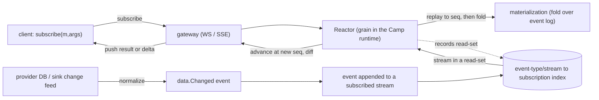

# Plan 32 — Reactive streams & subscriptions (RX materializations)

> Part of the [HoBo Design Plan Suite](./README.md). HoBo's SDK is **event-based with actor models**, so the default read surface is a **subscription to a stream**, not a query against a database. You **subscribe** to a materialization (an RX-style observable folded from event-type streams); it replays history to the current `seq`, then **pushes live updates** — real-time by default. Instead of querying a DB the way Convex/Lakebed do, HoBo produces **subscribable materializations** over the event log. Decision records: [ADR-0065](./adr/03-data-plane.md#adr-0065) (streaming-first surface) · [ADR-0029](./adr/03-data-plane.md#adr-0029) (the reactor engine). Authored via brainstorming + grill-with-docs ([agent tooling](../agent-tooling.md)).

> **Why streams, not queries.** Convex/Lakebed *store-then-query*: you write a query function over a built-in DB and the platform re-runs it on change. HoBo is **event-sourced** (the log already *is* a change stream; actors and projections already fold it — [Plan 11](./11-event-model.md)) and **multi-cloud**. So the natural primitive is **subscribe to an event-type stream and fold it into a materialization you observe** — RX (reactive-extensions) semantics over the log. The store becomes an *optional cache* of a materialization ([Plan 39](./39-data-plane-projections.md)), not the thing you query.

## The model in one paragraph
A **materialization** is a deterministic **fold over subscribed event types** (a projection — [Plan 39](./39-data-plane-projections.md)), exposed as a **subscribable observable**. **Registering interest in event types *is* the subscription** (the read-set). When you `subscribe`, the runtime replays the stream to the current **log position (`seq`)** to give you the current value, then a **Reactor** keeps the subscription live: when any stream in the read-set appends, it recomputes/advances the materialization at the new monotonic `seq`, diffs, and **pushes** the result (or a delta) to the client over the **gateway** (WebSocket/SSE) backed by the **`Streamer`** runtime port. Monotonic `seq` ⇒ a client never sees state regress; **reads-your-writes** holds because a command returns its `seq` and the client's subscriptions advance to ≥ that `seq` before the write acks.

## The default surface: `subscribe` + RX materializations
A materialization is declared as a **fold over subscribed event types** and composed with RX-style operators. The fold/operators are **deterministic and read-only** (no `step`, no writes — the same determinism rules as `workflow`/`actor` folds, [Plan 2](./02-sdk-api.md)).
```ts
import { subscribe, from } from "@hobo/runtime";

// a materialization: subscribe to event types -> RX pipeline (filter/scan/map) -> observable<Ticket[]>
export const openTickets = from("Ticket.Opened", "Ticket.Assigned", "Ticket.Closed")
  .scan(foldTicketList)                 // deterministic fold (state, event) -> state
  .map(list => list.filter(t => t.status === "open"));
// equivalently authored as a named projection (Plan 39 `projection(...)`) — same artifact, observable surface.

// client (typed, generated from the WIT interface — Plan 24): the DEFAULT
const tickets$ = subscribe(openTickets, { team: "infra" });     // an Observable<Ticket[]>
const { data, seq } = useSubscription(openTickets, { team: "infra" }); // React: re-renders on push
```
- **Registration = subscription.** Declaring the materialization over event types creates its read-set; subscribing attaches a client. No separate "register then query" step.
- **Replay-then-live** (RX `ReplaySubject`/`scan`): a new subscriber gets the current materialized value (folded to `seq`) immediately, then the live tail — "current value + updates" for free from event sourcing.
- **RX operator vocabulary:** `map` · `filter` · `scan`/`fold` · `distinctUntilChanged` · `combineLatest`/`join` · `window`/`buffer` · `debounce`/`coalesce` — composed over event-type streams; deterministic + replayable.

## Query is the escape hatch (snapshot / point / search / analytics)
When a stream subscription is the wrong shape — a one-shot read, a point lookup, full-text/vector **search**, pagination, or analytics — you reach for the **query escape hatches**, served from a materialization's **sink cache** ([Plan 39](./39-data-plane-projections.md)):
```ts
const now   = await snapshot(openTickets, { team: "infra" }); // one-shot current value @ seq (was runQuery)
const t     = await repo<Ticket>("tickets").get(id);          // point lookup (sink cache)
const found = await view("tickets").search({ text: "disk full" }); // full-text/vector (Plan 35)
```
- `useQuery()` is **retained as sugar** for `useSubscription()` over a materialization (Convex familiarity), not the primary surface.
- Point/search/OLAP read from the **sink cache** (a durable, indexed materialization), so they carry that sink's reactivity/consistency caveats ([Plan 39](./39-data-plane-projections.md) honest-limits). `hobo doctor` nudges toward `subscribe` for live views.

## The Reactor (the engine, unchanged)

- A **`Reactor`** grain (one per Camp, sharded by subscription) holds, per active subscription: `{ materialization, args, readSet, lastSeq, client }`.
- An **inverted index** `stream/event-type → subscriptions` means an append wakes **only** affected subscriptions (no full re-scan).
- **Consistency = per-subscription consistent snapshot @ `seq`** ([ADR-0029](./adr/03-data-plane.md#adr-0029)): each push is computed at a single monotonic log position; pushes are delivered in `seq` order; the client never regresses; reads-your-writes as above.
- **Coalescing + backpressure** ([Plan 5](./05-reliability-ha.md)): bursts collapse to the latest `seq`; slow clients get coalesced snapshots, not an unbounded backlog (RX backpressure).
- **Auth-state is part of the read-set.** A subscription runs as a principal (`ctx.user`, [Plan 36](./36-end-user-auth.md)); its authorization inputs (session + claims) are tracked like any dependency, so **`session.Revoked`** recomputes affected subscriptions — denying/re-scoping the push — without a client poll.
- **Feature-flag state is part of the read-set too.** A materialization that reads a flag tracks the ruleset; **`flag.Changed`** re-pushes affected results live ([Plan 37](./37-feature-flags-progressive-delivery.md)) — a kill-switch/`%` bump takes effect without redeploy or poll.

## Source of truth: native log (default) + sink change-feed (opt-in)
- **Native (default).** Materializations fold the **event log** directly. The log *is* the change stream — zero extra infrastructure, works on **any** Camp runtime backend (`runtime-local` … `runtime-cloudflare`), inherits replay/audit. The portable, recommended path; **always reactive**.
- **Sink change-feed (opt-in capability).** A materialization may be **cached** in a provider store ([Plan 39](./39-data-plane-projections.md)); if that store advertises a **`change-feed`** capability ([Plan 21](./21-resources-catalog.md)/[Plan 24](./24-wit-interfaces-reference.md)) — Postgres logical replication, DynamoDB Streams, Mongo change streams — the adapter **normalizes** changes into `data.Changed{ resource, key, op }` so the **same Reactor** keeps the cached materialization live. v1 ships the capability interface + **one reference adapter (Postgres)**.
- **No change feed?** A query over that sink cache is typed **non-reactive** (`reactive: false`) — `snapshot`/`repo.get` still work but won't live-update; `hobo doctor` warns when a *live view* depends on a non-reactive cache ([Plan 15](./15-cli-dx.md)). The native materialization is always available as the reactive default.

## Client SDK
- **Default:** `subscribe(m, args) → Observable` (framework-agnostic; async-iterator + callback forms); React `useSubscription(m, args) → { data, seq, stale }`.
- **Escape hatches:** `snapshot(m, args)` (one-shot @ `seq`); `useQuery` (sugar over `useSubscription`); `repo.get`/`view().search` ([Plan 35](./35-search-vector-surface.md)).
- **Optimistic updates:** a command may declare a local optimistic patch, applied client-side until the authoritative push at ≥ its `seq`.
- **Typed end-to-end** from the WIT-generated client ([Plan 24](./24-wit-interfaces-reference.md)). Subscriptions authenticate with the workload/agent **SVID**, are **tenant + Camp scoped** ([Plan 6](./06-ai-native-agent-auth.md)/[Plan 12](./12-security-multitenancy.md)); `.allow()` read scopes gate what a materialization may touch ([Plan 21](./21-resources-catalog.md)).

## Transport
Long-lived subscriptions multiplex over **one** gateway connection per client (WebSocket primary, SSE fallback), backed by the `Streamer` port — the same mechanism run-streams already use ([Plan 2 §Layer 1](./02-sdk-api.md)/[Plan 14](./14-observability.md)). The Yard is **not** on this path; the Reactor runs in the data-plane Camp runtime.

## Events ([Plan 11](./11-event-model.md))
`subscription.Opened` · `subscription.Recomputed` (new `seq` + read-set hash) · `subscription.Pushed` · `subscription.Closed` · **`data.Changed`** (normalized sink change-feed event). *(Legacy aliases `query.Subscribed`/`Recomputed`/`Pushed`/`Unsubscribed` map onto these.)* Pushed *results* are ephemeral (not persisted); *subscriptions* are a projection so they rebuild on Reactor failover.

## Verification ([Plan 9](./09-verification-open-questions.md))
- **Subscription test:** `subscribe` → append an event in the read-set → assert a push at the new `seq` with the correct materialized value; assert monotonicity (no regression) and reads-your-writes (a client's command is visible to its own subscription before/at ack).
- **Replay-then-live:** a new subscriber receives the current value (folded to `seq`) before any live push.
- **Change-feed conformance:** the `change-feed` capability suite (a sink that claims it must emit ordered `data.Changed` for insert/update/delete) — same trust-boundary model as other ports.
- **Determinism:** a materialization replays to the identical value at the same `seq` (deterministic + read-only).

## Scope / YAGNI
**In v1:** native event-sourced subscribable materializations **within a Camp**; `subscribe`/`from`+RX operators; `useSubscription` (default) + `snapshot`/`useQuery` (escape hatch); **cursor-based pagination** (`usePaginatedQuery` — page windows stable over the consistent-snapshot@`seq`, [Plan 39](./39-data-plane-projections.md)); consistent-snapshot@`seq` + reads-your-writes; optimistic updates; the `change-feed` capability interface **+ one reference adapter (Postgres)**.
**Deferred:** cross-Camp subscriptions — specified by [ADR-0040](./adr/05-config-matching-environments.md#adr-0040) (subscribe to the owner Camp's Reactor or a replicated-stream Reactor carrying the bounded-staleness label); full DB-CDC coverage for every provider; global serializable snapshots. *(Full-text/filtered **search** is a reactive materialization via `data.Changed`; vector search is a step — [Plan 35](./35-search-vector-surface.md).)*

## Iteration hooks
- Read-set granularity (per-event-type vs per-stream vs per-key vs predicate-indexed) and recompute-vs-incremental-maintenance for expensive folds (incremental view maintenance later).
- Delta encoding for pushes (full snapshot vs diff vs operation log) and client cache/merge strategy.
- Subscription fan-out limits + Reactor sharding for very hot streams.
- Promoting a hot materialization to a standing cached projection automatically (sink auto-binding).
