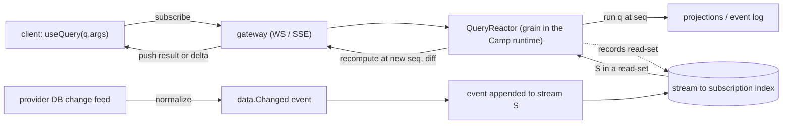

# Plan 32 — Reactive / live queries (the reactor)

> Part of the [HoBo Design Plan Suite](./README.md). Closes the one competitor-DX blind spot the [gap analysis](../../competitors/gap-analysis.md) found (**G1**, open question [#21](./09-verification-open-questions.md)): a **reactive query** whose results push to clients on change, with consistent snapshots — Convex's headline DX, rebuilt on HoBo's **event log + `Streamer`** so it's portable across Camps and works multi-cloud. Decision record: [ADR-0029](./adr/ADR-0029-reactive-live-query-model.md). Authored via brainstorming + grill-with-docs ([agent tooling](../agent-tooling.md)).

> **Why HoBo can't just copy Convex.** Convex's reactor works because queries are deterministic functions over **one built-in database**, with read-set tracking + consistent snapshots. HoBo is **event-sourced** (the log is already a change stream; projections already exist — [Plan 11](./11-event-model.md)) and **multi-cloud** (app data lives in *provider* databases that vary — there is no single DB to reactor over). So HoBo's reactor is built on the **log**, not a DB, with provider databases joining via an opt-in change-feed capability.

## The model in one paragraph
A developer marks a read-only function `"use query"`. The runtime runs it, records its **read-set** (which streams / projections / change-feed topics it touched), and remembers the **log position (`seq`)** it was computed at. A **QueryReactor** subscribes that query to its read-set; when any stream in the read-set appends, the reactor recomputes the query at the new monotonic `seq`, diffs, and pushes the result (or a delta) to the client over the **gateway** (WebSocket/SSE) backed by the **`Streamer`** runtime port. Monotonic `seq` ⇒ a client never sees state regress; **reads-your-writes** is guaranteed because a mutation returns its `seq` and the client's subscriptions are advanced to ≥ that `seq` before the write acks.

## The `query()` primitive + `"use query"` directive
A new Layer-4 runtime primitive (sibling to `step`/`workflow`/`actor`/`saga`/`agent`/`"use training"`, [Plan 2](./02-sdk-api.md)). **Deterministic and read-only** — no `step`, no writes, no `.with` side effects (enforced the same way workflow determinism is). Reads only from **reactive sources** via `ctx`.
```ts
import { query } from "@hobo/runtime";

// directive form — reactive, read-only; runtime tracks the read-set
export async function openTickets(team: string): Promise<Ticket[]> {
  "use query";
  return view("tickets").where({ team, status: "open" }).order("createdAt");
}
// `view(...)` / `repo(...)` query a PROJECTION by logical name — concretized in Plan 39.
// Projections are developer-authorable read models over event streams, materialized into an
// architect-chosen backend (the projection sink); the predicate DSL is Plan 35's (eq/in/range).

// client (typed, generated from the WIT interface — Plan 24)
const { data, seq, stale } = useQuery(openTickets, { team: "infra" }); // re-renders on change
```
- **Read-set:** recorded per execution (stream ids / projection keys / change-feed topic + predicate) and **re-tracked on every recompute**, so dependencies are dynamic (a query that branches reads different things and the subscription follows).
- **Return:** typed data **+ the `seq`** it was computed at. A one-shot non-reactive read is `runQuery(q, args)`.

## The reactor (recompute + push)

- A **`QueryReactor`** grain (one per Camp, sharded by subscription) holds, per active subscription: `{ query, args, readSet, lastSeq, client }`.
- An **inverted index** `stream → subscriptions` means an append wakes **only** affected subscriptions (no full re-scan).
- **Consistency = per-query consistent snapshot @ `seq`** ([ADR-0029](./adr/ADR-0029-reactive-live-query-model.md)): each push is computed at a single monotonic log position; pushes are delivered in `seq` order; the client never regresses; reads-your-writes as above. This matches Convex's "consistent snapshot" feel without global serializability.
- **Coalescing + backpressure** ([Plan 5](./05-reliability-ha.md)): bursts of appends collapse to the latest `seq`; slow clients get coalesced snapshots, not an unbounded backlog.
- **Auth-state is part of the read-set.** A reactive query runs as a principal (`ctx.user`, [Plan 36](./36-end-user-auth.md)); its authorization inputs (the user's session + claims) are tracked like any other dependency, so a **`session.Revoked`** (sign-out / revoke) recomputes the affected queries — denying or re-scoping the push — without a client poll.
- **Feature-flag state is part of the read-set too.** A query (or `useFlag`) that reads a flag tracks the flag ruleset; a **`flag.Changed`** recomputes/re-pushes affected results live ([Plan 37](./37-feature-flags-progressive-delivery.md)/[ADR-0044](./adr/ADR-0044-feature-flags-progressive-delivery.md)) — a kill-switch or `%` bump takes effect without a redeploy or client poll.

## Hybrid source (native default + DB opt-in)
- **Native (default).** Queries over the **event log / projections**. The log *is* the change stream — zero extra infrastructure, works on **any** Camp runtime backend (`runtime-local` … `runtime-cloudflare`), inherits replay/audit. This is the portable path and the recommended one.
- **DB change-feed (opt-in capability).** A provider's `database` port may advertise a **`change-feed`** capability ([Plan 21](./21-resources-catalog.md)/[Plan 24](./24-wit-interfaces-reference.md)) — Postgres logical replication, DynamoDB Streams, Mongo change streams, etc. The adapter **normalizes** changes into `data.Changed{ resource, key, op }` events on the runtime log, so the **same reactor** drives DB-backed reactive queries. v1 ships the capability interface + **one reference adapter (Postgres)**.
- **No change feed?** The query is typed **non-reactive** (`reactive: false`) — `useQuery` still works but won't live-update (or polls at a documented interval if opted in). `hobo doctor` warns when a query depends on a non-reactive source ([Plan 15](./15-cli-dx.md)).

## Client SDK
- `useQuery(q, args) → { data, seq, stale }` (React); framework-agnostic `subscribe(q, args, cb)` / async iterator; `runQuery(q, args)` one-shot.
- **Optimistic updates:** a mutation may declare a local optimistic patch, applied client-side until the authoritative push at ≥ its `seq` (Convex-parity).
- **Typed end-to-end** from the WIT-generated client ([Plan 24](./24-wit-interfaces-reference.md)). Subscriptions authenticate with the workload/agent **SVID** and are **tenant + Camp scoped** ([Plan 6](./06-ai-native-agent-auth.md)/[Plan 12](./12-security-multitenancy.md)); `.allow()` read scopes gate what a query may touch ([Plan 21](./21-resources-catalog.md)).

## Transport
Long-lived subscriptions are multiplexed over **one** gateway connection per client (WebSocket primary, SSE fallback), backed by the `Streamer` port — the same mechanism `getWritable`/run-streams already use ([Plan 2 §Layer 1](./02-sdk-api.md)/[Plan 14](./14-observability.md)). The Yard is **not** on this path; the reactor runs in the data-plane Camp runtime.

## Events ([Plan 11](./11-event-model.md))
`query.Subscribed` · `query.Recomputed` (new `seq` + read-set hash) · `query.Pushed` · `query.Unsubscribed` · **`data.Changed`** (normalized provider change-feed event). Reactive *results* are ephemeral pushes (not persisted); *subscriptions* are a projection so they rebuild on reactor failover.

## Verification ([Plan 9](./09-verification-open-questions.md))
- **Reactivity test:** subscribe → append an event in the read-set → assert a push at the new `seq` with the correct snapshot; assert monotonicity (no regression) and reads-your-writes (a client's mutation is visible to its own subscription before/at ack).
- **Change-feed conformance:** the `change-feed` capability suite (a provider that claims it must emit ordered `data.Changed` for insert/update/delete) — same trust-boundary model as other ports.
- **Determinism:** a `query` replays to the identical result at the same `seq` (it's deterministic + read-only).

## Scope / YAGNI
**In v1:** native event-sourced reactive queries **within a Camp**; `query()`/`"use query"`; `useQuery`/`subscribe`/`runQuery`; consistent-snapshot@`seq` + reads-your-writes; optimistic updates; the `change-feed` capability interface **+ one reference adapter (Postgres)**.
**Deferred:** ~~cross-Camp reactive queries~~ — **now specified by [ADR-0040](./adr/ADR-0040-cross-camp-stateful-consistency.md)** (a cross-Camp reactive query subscribes to the owner Camp's reactor or a replicated-stream reactor carrying the bounded-staleness label); full DB-CDC coverage for every provider; global serializable snapshots. *(Reactive **search** results — once deferred here — are now specified in [Plan 35](./35-search-vector-surface.md)/[ADR-0034](./adr/ADR-0034-search-vector-surface.md): full-text/filtered search is a reactive `query()` citizen via `data.Changed`; vector search is a step.)*

## Iteration hooks
- Read-set granularity (per-stream vs per-key vs predicate-indexed) and the recompute-vs-incremental-maintenance tradeoff for expensive queries (incremental view maintenance later).
- Delta encoding for pushes (full snapshot vs diff vs operation log) and client cache/merge strategy.
- Subscription fan-out limits + sharding of the `QueryReactor` for very hot streams.
- Whether `query()` results can themselves be cached as materialized projections (promote a hot query to a standing projection).
