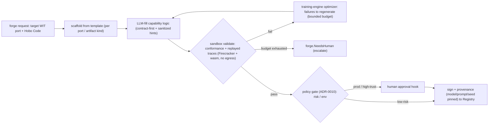

# Plan 33 — Forge generation pipeline

> Part of the [HoBo Design Plan Suite](./README.md). Deepens the **unique differentiator** the [gap analysis](../../competitors/gap-analysis.md) flagged as the least-specified (**G3**): the Forge's *candidate-generation* loop. Plans [6](./06-ai-native-agent-auth.md)/[23](./23-stubbable-ai-implementations.md) and [Plan 9](./09-verification-open-questions.md) already specify the **conformance gate** and the impl `training-engine` ([ADR-0025](./adr/ADR-0025-use-training-directive-and-training-engine.md)); this plan specifies how artifacts are **synthesized and repaired** to *reach* that gate. Decision record: [ADR-0030](./adr/ADR-0030-forge-generation-inputs-and-algorithm.md). Designed via brainstorming + grill-with-docs.

> **What the Forge generates.** One pipeline, three artifact kinds, all behind existing WIT ports and gated by `@hobo/conformance` (the trust boundary): **providers** (a backend's capability adapter), **implementations** (service components / semantic functions — the live-training half is [Plan 23](./23-stubbable-ai-implementations.md)), and **Resource Definitions / Packs** (platform-engineer config — [Plan 25](./25-resource-definitions-matching.md)/[Plan 27](./27-drivers-packs-profiles.md)). "Generate a provider" is no longer hand-wave: it is this loop.

## Inputs — contract-first
The generator separates **authoritative** spec (what the artifact must satisfy) from **material** (hints + behavioral oracle):
- **Authoritative:** the target **WIT port** ([Plan 24](./24-wit-worlds-reference.md)) + its **`@hobo/conformance` suite** + the backend's **Hobo Code** (`capabilities/auth/cost.json`, [Plan 6](./06-ai-native-agent-auth.md)). Generation succeeds only by satisfying these — the *same* gate that certifies it.
- **Material (hints/oracle):** provider docs / OpenAPI / Terraform (treated as **untrusted data**, sanitized + scrubbed per the prompt-injection rule, [ADR-0023](./adr/ADR-0023-security-posture-commitments.md)) and recorded **stub/live traces** ([Plan 11](./11-event-model.md)/[Plan 23](./23-stubbable-ai-implementations.md)) as the behavioral oracle to reproduce.

This is why HoBo can "generate providers without a community": the contract (WIT + conformance) bounds and validates the synthesis, so a wrong guess can't be certified.

## The loop — generate → validate → repair → certify

1. **Scaffold** — start from a template for the artifact kind + target port (a provider skeleton, a component skeleton, a Resource-Definition skeleton, or a **migration importer** skeleton for [ADR-0041](./adr/ADR-0041-migration-onboarding.md)), so structure/boilerplate is deterministic and only capability-specific logic is synthesized.
2. **LLM-fill** — synthesize the capability-specific logic from the **authoritative** spec, using **material** as hints. Inputs are sanitized; nothing in `material` can override the contract.
3. **Validate (sandboxed)** — run `@hobo/conformance` for the claimed port **and** replay recorded traces as regression tests, inside a **Firecracker + wasm sandbox with no egress** ([ADR-0012](./adr/README.md)/[ADR-0023](./adr/ADR-0023-security-posture-commitments.md)).
4. **Repair (bounded)** — conformance assertion failures + trace diffs are the **feedback signal** fed to the **`training-engine`** optimizer (OPTO/Trace, [ADR-0025](./adr/ADR-0025-use-training-directive-and-training-engine.md)), which regenerates. A **repair budget** caps iterations; on exhaustion the run emits **`forge.NeedsHuman`** rather than looping forever.
5. **Certify** — on green: **sign** + attach **SLSA-style provenance** (the model, the frozen prompt, the seed, and the conformance report are pinned for reproducibility) → publish to the **Registry**. **Promotion reuses the existing policy gate** ([ADR-0010](./adr/README.md)): low-risk → auto-certify; prod / high-trust → human approval via a `createHook` ([Plan 6](./06-ai-native-agent-auth.md)).

## One engine, two entry points
The repair loop **is** the `training-engine` ([ADR-0025](./adr/ADR-0025-use-training-directive-and-training-engine.md)) — so the Forge and live `"use training"` impls share one optimizer:
- **Plan 33 (cold start):** synthesize a brand-new artifact to first-pass conformance + traces.
- **Plan 23 (continuous):** keep a live `"use training"` implementation improving against rubrics/live-evals.
Same optimizer, same gate, same provenance — generation and evolution are the front and back halves of the same machine.

## Events ([Plan 11](./11-event-model.md))
`forge.Requested` · `forge.CandidateGenerated` · `forge.Validated` / `forge.ValidationFailed` · `forge.Repaired` (iteration n, with the failing-assertion set) · `forge.NeedsHuman` · `forge.Certified` (extends the existing `forge.PluginCertified` / `impl.*`). Every generation, validation, repair, and certification is an immutable, replayable fact → "why did the Forge produce this, and is it trustworthy?" is answerable from the log.

## Trust & reproducibility
- **Conformance is the boundary** — a generated artifact may only claim a port it passes; identical assertion to human-written adapters ([Plan 9](./09-verification-open-questions.md)).
- **No-egress synthesis** — generation + validation run sandboxed with no network ([ADR-0023](./adr/ADR-0023-security-posture-commitments.md)); `material` (docs/OpenAPI) is sanitized against prompt injection.
- **Pinned provenance** — model + frozen prompt + seed + conformance report are signed and recorded, so a certification is reproducible and auditable ([Plan 12](./12-security-multitenancy.md)).

## Verification ([Plan 9](./09-verification-open-questions.md))
A **Forge-generation test:** seed a known WIT port + its conformance suite + a backend's Hobo Code → assert the loop produces a **certified** artifact that passes conformance **and** reproduces recorded traces; assert the repair loop **converges or escalates** within the budget (no infinite loop); assert the certification carries complete provenance.

## Scope / YAGNI
**In v1:** the loop for **providers** and **implementations**, plus **Resource-Definition** generation via the same loop with a definition template; **one reference run** end-to-end (generate a `database` provider for a known backend from its Hobo Code + conformance). **Deferred:** fully autonomous **cold-start from docs/OpenAPI only** with no Hobo Code (riskiest input path); marketplace economics ([ADR-0020](./adr/ADR-0020-monetization-model.md)); generating whole Resource **Packs** (vs single definitions).

## Iteration hooks
- Template library shape (per-port vs per-driver scaffolds) and how much is fixed vs synthesized.
- Repair-budget defaults + the cost/quality tradeoff of more iterations ([Plan 16](./16-cost-finops.md)); whether the budget is policy-configurable per tenant.
- How aggressively `material` (docs/OpenAPI) is trusted vs ignored when it conflicts with the contract.
- Whether the Forge can *propose* a new WIT port / Hobo Code when none exists (vs only implementing an existing one).
