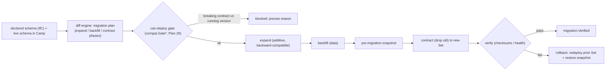

# Plan 34 — App-data migrations & cross-cloud portability

> Part of the [HoBo Design Plan Suite](./README.md). Closes the [gap analysis](../../competitors/gap-analysis.md)'s **"data, not just infra"** risk (**G5**) and open question **[Q15](./09-verification-open-questions.md)**: HoBo can provision a database on AWS *or* Azure, but until now had no story for *who migrates the schema and the data* — or how that's gated. Decision record: [ADR-0032](./adr/03-data-plane.md#adr-0032). Designed via brainstorming + grill-with-docs.

> **Two different "schema evolutions" — don't conflate them.** HoBo's **own** event log evolves by **forward-only upcasters that never rewrite history** ([Plan 11](./11-event-model.md)) — that is *control-plane* data. **This plan is about the developer's *application* database** (the `sql` resource, [Plan 21](./21-resources-catalog.md)/[Plan 24](./24-wit-interfaces-reference.md)) — a provider-backed store (RDS / Azure DB / Cloud SQL / Neon) whose schema and data the app owns. Different layer, different mechanism.

## Scope (v1)
Relational **`sql`** resources, **Postgres** as the reference adapter. Deferred (iteration hooks): key-value/blob/document migrations, cross-*engine* moves (e.g. Postgres→MySQL), CDC/dual-write cutover, and multi-region active-active data.

## 1. Authoring — declarative schema + auto-diff
A developer **declares the desired schema** alongside the `sql` resource (IfC — the same run-to-collect model as the rest of the Bindle, [Plan 21](./21-resources-catalog.md)/[Plan 22](./22-wiring-manifest.md)). HoBo's **diff engine** compares it to the schema **currently live in the target Camp** and computes a **reviewable migration plan** — a sequence of typed phases, not hand-written step files.
- **Escape hatch:** raw per-dialect SQL steps for operations the diff engine can't express (data transforms, non-trivial constraints, vendor features). Raw steps are still gated + snapshotted like any other.
- **Why declarative, not `.up/.down.sql`:** the declared target is portable across SQL dialects by construction, HoBo can *reason* about intent (is this phase additive or destructive?), and the plan reviews like a [Delta](./26-environments-deltas.md). ([ADR-0032](./adr/03-data-plane.md#adr-0032) records the rejected alternatives.)

## 2. Apply — expand → backfill → contract, gated
The diff engine decomposes every change into **backward-compatible phases**, each applied as a **gated saga step** at **Delta → Set / promote** ([Plan 26](./26-environments-deltas.md)):

- **Expand** — additive only (add column/table/index, nullable or defaulted). The *old* app version keeps working against the new schema.
- **Backfill** — populate/transform data into the expanded shape, chunked + idempotent (an interrupted backfill resumes — exactly-once *effects*, [Plan 5](./05-reliability-ha.md)/[Plan 11](./11-event-model.md)).
- **Contract** — the **only destructive** phase (drop the old column/table). A **pre-migration snapshot** is taken first.
- **Gating composes with the contract plane.** `can-deploy` ([Plan 26](./26-environments-deltas.md)/[Plan 29](./29-contracts-compatibility.md)) checks a contract phase against the app/consumer versions **still running per Camp**: a drop that would break a running version emits `compat.GateFailed` and is **blocked** with a precise reason an agent can self-correct against — exactly like `deployment.PlanRejected`.

## 3. Rollback — no `.down` scripts
Because expand phases are additive, the **prior app version still runs against the migrated schema**, so:
- **App rollback** = re-apply the previous immutable **Set** ([Plan 26](./26-environments-deltas.md) already preserves stateful-resource state on rollback).
- **Data rollback** = **restore the pre-migration snapshot** taken before the contract phase.

There are no inverse (`.down`) migrations — they give false safety (a dropped column's data is already gone) and would force hand-written inverses against the declarative model. Forward-fix or snapshot-restore are the two honest paths.

## 4. Cross-cloud move — export → import within an equivalence class
Moving a `sql` resource to a **different Camp/provider within the same provider equivalence class** (the *managed-Postgres* class — RDS / Azure DB for Postgres / Cloud SQL / Neon, [Plan 21](./21-resources-catalog.md)/[Plan 25](./25-resource-definitions-matching.md)) is a **gated, event-sourced saga**:
1. **Export** — snapshot / logical dump on the source (`migration.Exported`).
2. **Import** — restore into the freshly provisioned target (`migration.Imported`).
3. **Cutover** — flip traffic via the existing **blue/green + `gateway` flip** machinery ([Plan 5](./05-reliability-ha.md)); the source stays hot for fast rollback (`migration.CutOver`).
4. **Verify** — row counts / checksums / health gate; on pass, **reap** the source after a soak window.

**Cross-*engine* moves (Postgres→MySQL) are out of scope for v1** — they are lossy/semantic, not mechanical. **CDC / dual-write replication cutover** (near-zero-downtime for large/live DBs) is noted as a **future opt-in adapter capability**, not the v1 default.

## Events ([Plan 11](./11-event-model.md))
`migration.Planned` · `migration.SnapshotTaken` · `migration.PhaseApplied` (phase = `expand`/`backfill`/`contract`, with the diff) · `migration.Verified` · `migration.RolledBack` · `migration.Failed` · (cross-cloud move) `migration.Exported` · `migration.Imported` · `migration.CutOver`. Every phase, snapshot, and cutover is an immutable, replayable fact → "what changed the schema, when, and could it be rolled back?" is answerable from the log.

## Verification ([Plan 9](./09-verification-open-questions.md))
- **Migration test:** declare schema vN→vN+1 → assert the diff engine produces the expected **expand/backfill/contract** phases; assert a **destructive contract phase that breaks a still-running version is blocked** by `can-deploy` (`compat.GateFailed`); assert **snapshot + restore** rollback returns the prior state.
- **Cross-cloud move test:** export→import a fixture DB **within the Postgres equivalence class** to a second Camp → assert row counts/checksums match and cutover/rollback both work.

## Projection sinks: rebuild-from-zero vs in-place migration
A **projection sink** ([Plan 39](./39-data-plane-projections.md)/[ADR-0050](./adr/03-data-plane.md#adr-0050)) is a *derived* backend whose schema is **declarative** (the read-model WIT record + mapping), so it has a second evolution path that an authoritative store does not:
- **Rebuild-from-zero (the default for derived sinks; paradigm-agnostic).** Change the read-model record/fold → **replay the event streams into the new shape** (Plan 11's "rebuildable from zero" *is* a backfill). This needs **no relational diff engine**, so it works for **document / KV / vector** sinks too — which is why a v1 document projection sink is fine even though *in-place* kv/blob/document migration is deferred below. Cut over old→new sink with the blue/green machinery (§4).
- **In-place expand→backfill→contract (this doc's gated machinery).** The *optimization* for **large relational** sinks where a full rebuild is too expensive, and the *required* path for **authoritative-external** (adopted, [ADR-0041](./adr/07-portability-extensibility.md#adr-0041)) stores — which are the source of truth and **cannot** be rebuilt from the log. Same pre-contract snapshot + `can-deploy` gate.

Cross-cloud sink moves use the export→import path (§4) within an equivalence class.

## Scope / YAGNI
**In v1:** declarative-diff authoring + raw escape hatch; expand/backfill/contract apply gated by `can-deploy`; pre-contract snapshot + restore rollback; intra-equivalence-class (managed-Postgres) cross-cloud move. **Deferred:** cross-engine moves, CDC/dual-write cutover, **in-place** kv/blob/document & cross-model migration (derived projection sinks of those paradigms still evolve by **rebuild-from-zero**, see §Projection sinks), multi-region active-active data ([Q16](./09-verification-open-questions.md)).

## Iteration hooks
- Diff-engine reference (build vs adopt Atlas/Prisma-style) and how much DDL it covers before falling to the raw escape hatch.
- Backfill throughput/throttling defaults + how online backfill interacts with live traffic and SLOs ([Plan 14](./14-observability.md)).
- Snapshot mechanism per provider (native DB snapshot vs logical dump) and retention/cost ([Plan 16](./16-cost-finops.md)).
- Whether cross-Camp data consistency during a move is a HoBo guarantee or app-owned ([Q16](./09-verification-open-questions.md)).
