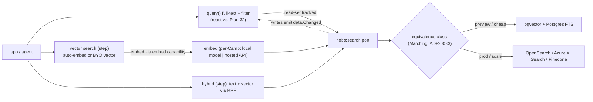

# Plan 35 — Search & vector surface

> Part of the [HoBo Design Plan Suite](./README.md). Closes the [gap analysis](../../competitors/gap-analysis.md)'s **G2** and open question **[Q22](./09-verification-open-questions.md)**: HoBo named `vector()`/`search()` as SaaS primitives ([Plan 2](./02-sdk-api.md)) but never specified the **indexing, similarity operators, filter syntax, or reactivity** — the one mainstream data capability a Convex-style audience expects first-class ([Convex capture](../../competitors/convex/scheduling-search-storage.md)). Decision record: [ADR-0034](./adr/ADR-0034-search-vector-surface.md). Designed via brainstorming + grill-with-docs.

## The `search` port — one interface, three modes
A **`search(name)`** resource backed by a `hobo:search` WIT interface ([Plan 24](./24-wit-interfaces-reference.md)) unifies **full-text**, **vector**, and **hybrid** retrieval in a single interface — *not* three bolt-ons. It is a first-class port realized by a provider **equivalence class** ([Plan 3](./03-providers-iac.md)/[Plan 25](./25-resource-definitions-matching.md)): **pgvector + Postgres FTS** (cheap, colocated with the DB) at one end, **managed engines** (OpenSearch / Azure AI Search / Pinecone / Turbopuffer) at the other. **Matching** ([ADR-0033](./adr/ADR-0033-deterministic-matching-and-planner-selection.md)) picks the realization per context — pgvector in a preview Camp, a managed index in prod — exactly the Resource-Definitions value, applied to retrieval.

`.allow()` verbs: **`index`** (write/maintain indexed docs), **`query`** (search), **`admin`** (manage indexes) — same triple-effect IAM + wasm link + token scope as every resource ([Plan 21](./21-resources-catalog.md)).

## Index declaration — declarative (consistent with [Plan 34](./34-app-data-migrations.md))
Indexes are **declared on the resource**, IfC-style, not imperatively built:
- **Text index** — fields + analyzer/tokenizer + optional **prefix** matching (typeahead).
- **Vector index** — field + **`dimensions`** + the **filter fields** allowed in queries.

An index *is* schema, so creating/changing one flows through the **same gated expand→backfill→contract migration machinery** as a `sql` schema change ([Plan 34](./34-app-data-migrations.md)/[ADR-0032](./adr/ADR-0032-data-portability-schema-versioning.md)) — building a large index is a backfill phase; dropping one is a (snapshotted) contract phase; `can-deploy` gates it.

## Query surface & reactivity — split by determinism
The boundary follows HoBo's determinism rules ([ADR-0029](./adr/ADR-0029-reactive-live-query-model.md)/[ADR-0033](./adr/ADR-0033-deterministic-matching-and-planner-selection.md)):
- **Full-text + filtered search is reactive.** It is deterministic, so it is a `query()` / `"use query"` citizen ([Plan 32](./32-reactive-live-queries.md)): the runtime tracks its read-set and **re-pushes results to clients on `data.Changed`** (a write to the indexed data). Client surface: `useQuery()`. This is the live-search DX Plan 32 teed up.
- **Vector search is a `step`/action.** A text query is auto-embedded (below) or a precomputed vector is passed in; it returns ranked **`{ id, score }`** by cosine / inner-product with a typed **filter** predicate. Because embedding is external/non-deterministic, vector search is **off the reactive path** (mirrors Convex's "vector search in actions only").
- **Hybrid is a `step`** that fuses a reactive text query + a vector step via **reciprocal rank fusion (RRF)**.
- **Filter syntax** is the same typed predicate DSL used elsewhere (`eq`/`in`/`range`/…), so search filters compose with `.allow()`/tenant scoping rather than being a separate query language.

## Embeddings — the `embed` capability
The `search` port can **auto-embed** indexed rows and text queries via an **`embed` capability** (`hobo:embed`), brokered secretlessly ([Plan 6](./06-ai-native-agent-auth.md)/[Plan 31](./31-config-secretless-secrets.md)) so developers don't hand-wire an embedding API. The embedder is itself a capability **realized per Camp** and selected by Matching:
- **Local / in-boundary model** — for `hobo dev` and **air-gapped** Camps (no egress; relates to [Q20](./09-verification-open-questions.md) / the air-gap gap).
- **Hosted embedding API** — for prod scale/quality.

**BYO precomputed vectors** is the escape hatch (compute embeddings in your own step, pass the vector in).

> **Egress caveat.** A *hosted* embedder sends query/row text to a third-party model provider (data egress + recurring cost) — the same class of concern as the optional `gbrain` agent tool ([`docs/agent-tooling.md`](../../docs/agent-tooling.md)). HoBo surfaces this as a cost/policy signal ([Plan 16](./16-cost-finops.md)/[Plan 30](./30-policy-plane.md)); the **local-model adapter** is the in-boundary answer. Never gate portability behind a paid embedder — the pgvector + local-model path is a complete default.

## Events ([Plan 11](./11-event-model.md))
**No new event types.** Reactive full-text search reuses `query.Subscribed`/`query.Recomputed`/`query.Pushed` + **`data.Changed`** ([Plan 32](./32-reactive-live-queries.md)); index create/change rides **`migration.*`** ([Plan 34](./34-app-data-migrations.md)); a vector/hybrid search is a step (`run.StepCompleted`). The retrieval surface adds capability, not catalog bloat.

## Verification ([Plan 9](./09-verification-open-questions.md))
A **search test**: index a fixture corpus, then assert (a) a full-text query returns the expected ranked hits **and is reactive** (a write emits `data.Changed` → the subscribed result re-pushes); (b) vector search returns cosine-ranked ids with a **filter** applied; (c) **hybrid** RRF fuses text + vector; (d) the **same `search` Bindle resolves to pgvector in a preview Camp and a managed engine in prod** (portability/equivalence — [ADR-0024](./adr/ADR-0024-portability-conformance-guarantee.md)); (e) the `embed` capability is realized by a **local model in an air-gapped Camp** (no egress).

## Scope / YAGNI
**In v1:** the unified `search` port (text + vector + hybrid/RRF), declarative text+vector indexes, reactive full-text + vector-as-step, the `embed` capability (local + hosted adapters) with BYO vectors as the escape hatch, and pgvector + one managed engine as reference adapters. **Deferred:** faceting/aggregations, learned/semantic re-ranking, multi-vector & late-interaction (ColBERT-style), and cross-Camp federated search ([Q16](./09-verification-open-questions.md)).

## Iteration hooks
- Reference adapters beyond pgvector + one managed engine; how much FTS analyzer config is portable vs provider-specific.
- Default embedding model(s) for the local adapter + dimension/version pinning (an embedding model change is itself an index migration).
- RRF weighting defaults + whether to expose a re-ranker hook.
- Whether vector search can ever be made reactive cheaply (cache embedding at subscribe time) without breaking determinism.
