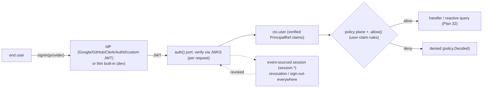

# Plan 36 — End-user / application auth

> Part of the [HoBo Design Plan Suite](./README.md). Closes the re-survey gap **G8** ([gap analysis](../../competitors/gap-analysis.md)): `auth()` is a listed SaaS primitive ([Plan 2](./02-sdk-api.md) §53) but only **agent/workload** auth was specified ([Plan 6](./06-ai-native-agent-auth.md)). This plan specifies **end-user / application auth** — how an app authenticates the *humans* using it — **unified with** HoBo's existing principal model. Decision record: [ADR-0038](./adr/ADR-0038-end-user-application-auth.md). Designed via brainstorming + grill-with-docs.

> **Two auths, one principal model.** [Plan 6](./06-ai-native-agent-auth.md) is **agent/workload** auth (SVIDs, the token broker, Hobo Code). This plan is **end-user** auth (app users signing in). They are *not* separate systems: an end-user is just another **`PrincipalRef`** (the event envelope's `actor` already admits `user`, [Plan 11](./11-event-model.md)), and the agent **OBO** flow ([Plan 6](./06-ai-native-agent-auth.md) §6.2) is the *same* human principal acting through an agent.

## The `auth()` port — federate + verify
HoBo does **not** reinvent a full identity provider (a deep, security-critical domain). Instead `auth()` is a **federation + verification** port (`hobo:auth`):
- **Verify any IdP.** It validates an OIDC/JWT from any provider — Google / GitHub / Clerk / Auth0 / **custom JWT** (the shoo + Convex-`customJwt` pattern, [competitors/shoo](../../competitors/shoo/README.md)/[convex](../../competitors/convex/integrations-ops.md)) — reusing HoBo's existing **OIDC + JWKS + secretless** machinery (Identity already does OIDC/JWKS for agents, [Plan 6](./06-ai-native-agent-auth.md)/[Plan 31](./31-config-secretless-secrets.md)). Providers are declared IfC-style (issuer / JWKS URL / algorithm).
- **Thin built-in for zero-config dev.** An optional built-in (passkey / email magic-link) lets `hobo dev` and small apps work with no external IdP — and runs **offline / in air-gap** ([ADR-0036](./adr/ADR-0036-air-gapped-sovereign-mode.md)).

```ts
import { auth } from "@hobo/sdk";
export const appAuth = auth({
  providers: [
    auth.oidc({ issuer: "https://accounts.google.com" }),
    auth.customJwt({ issuer: "https://shoo.example", jwks: "…/jwks.json", alg: "ES256" }),
    auth.builtin(),   // optional thin passkey/email for dev
  ],
});
```



## Unified principal model
An authenticated end-user is a **`PrincipalRef`**, exposed in handlers as **`ctx.user`** (typed, verified claims) alongside `ctx.identity` (the SVID, [Plan 6](./06-ai-native-agent-auth.md)). This means one identity/authz/audit path for **users + agents + services**:
- **Authorization** is the **same policy plane** ([Plan 30](./30-policy-plane.md)) + **`.allow()`-style declarative rules** ([Plan 21](./21-resources-catalog.md)) keyed on user claims (record/row-level), so "this user may read only their own orders" is a policy decision, not ad-hoc handler code (imperative checks on `ctx.user` remain available).
- **Audit** rides the existing event `actor` ([Plan 11](./11-event-model.md)) — every user action is already an attributable, replayable fact, identical to agent/service actions. No parallel audit trail.
- **Delegation** — an agent acting **on behalf of** a user (OBO, [Plan 6](./06-ai-native-agent-auth.md) §6.2) carries that same user `PrincipalRef`, so user → agent → resource chains are one coherent identity story.

## Sessions & token model
- **Stateless verify by default.** The IdP's JWT is verified via **JWKS on each request** (edge-friendly, matches `customJwt` + HoBo's existing JWKS), producing `ctx.user`. No central session read on the hot path.
- **Event-sourced sessions for revocation.** Optional **`session.*`** records make revocation / "sign out everywhere" + session audit first-class; reactive queries/mutations ([Plan 32](./32-reactive-live-queries.md)) **re-evaluate when auth state changes** (a revoked session re-pushes/denies affected live queries), reusing the reactor's `data.Changed` path.

## Client & server surface
- **Client:** `useAuth()` (current user + status), `signIn(provider)`, `signOut()` — a peer to `useQuery()` ([Plan 32](./32-reactive-live-queries.md)); generated typed against the configured providers ([ADR-0037](./adr/ADR-0037-sdk-codegen-surface.md)).
- **Server:** `ctx.user` (verified claims, typed) gates handlers and reactive queries; combine with policy/`.allow()` for record-level authorization.

## Events ([Plan 11](./11-event-model.md))
`user.Authenticated` (verification result + principal claims) · `session.Started` · `session.Refreshed` · `session.Revoked`. User authorization decisions ride the existing **`policy.Decided`** ([Plan 30](./30-policy-plane.md)) — no duplicate authz events.

## Verification ([Plan 9](./09-verification-open-questions.md))
An **end-user-auth test**: a JWT from a fixture IdP is verified via JWKS → `ctx.user` carries the claims; an **expired / wrong-issuer / tampered** token is rejected; a **policy/`.allow()` rule keyed on user claims** gates a query/mutation (allow + deny cases); **revocation** (`session.Revoked`) blocks subsequent requests **and re-pushes affected reactive queries**; the **thin built-in dev provider works offline** (air-gap tie, [ADR-0036](./adr/ADR-0036-air-gapped-sovereign-mode.md)).

## Scope / YAGNI
**In v1:** the `auth()` federate+verify port (OIDC + `customJwt`, reference adapters: Google/GitHub/Clerk/Auth0) + a thin built-in (passkey/email) for dev; `ctx.user` as a unified `PrincipalRef`; policy/`.allow()` authorization on user claims; stateless JWKS verify + event-sourced sessions/revocation; `useAuth()`/`signIn`/`signOut`. **Deferred:** a full hosted IdP (accounts/passwords/MFA at scale), B2B org/role hierarchies beyond claims, SCIM provisioning, and step-up/MFA orchestration.

## Iteration hooks
- Reference IdP adapters beyond the first few; how much of the built-in (passkey vs email vs both) ships in v1.
- Claims→policy mapping conventions (roles/groups/tenants) and how `.allow()` expresses record-level rules on `ctx.user`.
- Cookie/storage strategy for the client session + CSRF posture across the `gateway` ([Plan 13](./13-networking-connectivity.md)).
- Whether the thin built-in graduates into a fuller optional IdP, or stays dev-only.
