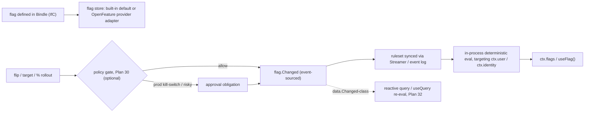

# Plan 37 — Feature flags & progressive delivery

> Part of the [HoBo Design Plan Suite](./README.md). Closes ecosystem gap **[#24](./09-verification-open-questions.md)**: HoBo had deploy-time gates + canary/progressive rollout ([Plan 5](./05-reliability-ha.md)/[Plan 26](./26-environments-deltas.md)) but **no runtime feature-flag capability** to decouple *release* from *deploy*. Decision record: [ADR-0044](./adr/ADR-0044-feature-flags-progressive-delivery.md). Standard: [OpenFeature](../../standards/openfeature.md). Designed via brainstorming + grill-with-docs.

> **Deploy ≠ release.** A canary ([Plan 5](./05-reliability-ha.md)) shifts traffic between *deployed versions*; a feature flag toggles *behavior within a running version* — kill-switches, gradual `%` rollout, per-segment targeting, experiments — without a redeploy. HoBo needs both, and flags compose with the gates/audit/reactive planes it already has.

## The `feature-flag` port — OpenFeature-compatible
A first-class **`feature-flag` capability** (`hobo:feature-flag`) that **speaks the [OpenFeature](../../standards/openfeature.md) evaluation API** — the same "speak the standard, engine behind a port" stance HoBo uses for policy (OPA/Cedar, [Plan 30](./30-policy-plane.md)) and contracts (Pact, [Plan 29](./29-contracts-compatibility.md)):
- **Built-in flag store is the default** (zero-dep, self-host/air-gap friendly, [ADR-0036](./adr/ADR-0036-air-gapped-sovereign-mode.md)); **OpenFeature providers** (flagd / LaunchDarkly / etc.) are **opt-in adapters** selected per Camp by Matching ([ADR-0033](./adr/ADR-0033-deterministic-matching-and-planner-selection.md)).
- **Flag types:** boolean, string, number, object (the OpenFeature set).
- **Definitions are IfC** — flags are declared in the Bindle (name, type, default, targeting rules); flag *values/targeting* are runtime state (below).

```ts
import { flag } from "@hobo/sdk";
export const newCheckout = flag.boolean("new-checkout", { default: false });
// server: const on = await ctx.flags.eval(newCheckout);   // typed, deterministic
// client: const on = useFlag(newCheckout);                // reactive (Plan 32)
```



## Change governance — event-sourced, optionally gated, reactive
- **Event-sourced.** Every value/targeting change is a `flag.*` event ([Plan 11](./11-event-model.md)) → a replayable "who flipped what, when, for whom" audit (the trail standalone flag tools lack).
- **Optionally policy-gated.** A flip can pass through the policy plane ([Plan 30](./30-policy-plane.md)): a **prod kill-switch** or a risky `%` bump can require approval / carry an obligation (e.g. "auto-revert if error-rate SLO burns", tying to [#25](./09-verification-open-questions.md)). Low-risk dev flips are ungated.
- **Reactive.** A flag change is a `data.Changed`-class signal, so reactive queries + clients (`useFlag`/`useQuery`, [Plan 32](./32-reactive-live-queries.md)) re-evaluate **live, no redeploy** — the reactor re-pushes affected results.

## Evaluation — in-process, deterministic, identity-aware
- **In-process evaluation** against a ruleset **synced via the Streamer / event log** (edge-friendly, low-latency, the OpenFeature in-process/flagd model) — no per-eval network hop or SPOF.
- **Targeting context** is the unified **`PrincipalRef`** — `ctx.user` (end-user claims/segments, [ADR-0038](./adr/ADR-0038-end-user-application-auth.md)) and `ctx.identity` (SVID/tenant) — so flag targeting reuses HoBo's one identity model.
- **Deterministic:** evaluation is a pure function of `(ruleset@seq, context)`, so it's **replayable** and safe to call inside a reactive `query()` ([ADR-0029](./adr/ADR-0029-reactive-live-query-model.md)).

## Progressive delivery — flags + deploy gates compose
- A **gradual rollout** flag (`%` by segment) is the *release* dial; a **canary** ([Plan 5](./05-reliability-ha.md)) is the *deploy* dial — used together, you deploy dark, then ramp the flag, with the same health signals able to **auto-revert** the flag (a policy obligation) on SLO burn ([#25](./09-verification-open-questions.md)).
- **Experiments**: a multivariate flag + the eval/metrics surface ([Plan 14](./14-observability.md)) supports A/B without bespoke infra.

## Events ([Plan 11](./11-event-model.md))
`flag.Defined` · `flag.Changed` (value/targeting diff + actor) · `flag.Evaluated` (sampled, optional — for experiment analytics) · `flag.Archived`. Flip-gate decisions ride the existing `policy.Decided`.

## Verification ([Plan 9](./09-verification-open-questions.md))
A **feature-flag test**: define a flag → assert in-process eval is deterministic for a fixed `(ruleset@seq, ctx.user)`; a targeting rule selects the right segment; a flip emits `flag.Changed` and **re-pushes an affected reactive query** ([Plan 32](./32-reactive-live-queries.md)); a **prod kill-switch flip requires the policy gate** ([Plan 30](./30-policy-plane.md)); the built-in store works **offline/air-gap**; an OpenFeature provider adapter passes the same conformance.

## Scope / YAGNI
**In v1:** the `feature-flag` port (OpenFeature-compatible) + built-in store + boolean/string/number/object flags + IfC definitions + in-process deterministic eval (targeting via `ctx.user`/`ctx.identity`) + event-sourced `flag.*` + optional policy-gated flips + reactive re-eval + one reference OpenFeature provider adapter. **Deferred:** built-in experiment/stats engine (emit events, analyze in the observability backend), flag-debt auto-cleanup tooling, and cross-Camp flag-state consistency (rides [ADR-0040](./adr/ADR-0040-cross-camp-stateful-consistency.md)).

## Iteration hooks
- Targeting-rule DSL (typed TS predicate vs OpenFeature JSONLogic-style) and how it reuses the policy/`.allow()` predicate language.
- Flag-lifecycle/debt management (stale-flag detection, archival workflow).
- Whether experiments get a first-class stats surface or stay event-emit + external analysis.
