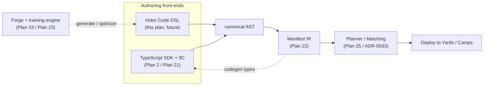

# Plan 38 — Hobo Code (the configuration + code DSL)

> Part of the [HoBo Design Plan Suite](./README.md). **Status: reserved / forward-looking — a DSL we will create; design TBD.** This plan *charters* the language and reserves the name; it does not finalize a grammar. Decision record: [ADR-0049](./adr/ADR-0049-hobo-code-dsl-reservation.md). (The name "Hobo Code" previously labelled the auth+capability standard, now the **[Capability Manifest](./06-ai-native-agent-auth.md)**.)

> **One surface for config *and* code.** Hobo Code is the planned human-readable DSL to declare **Yards, Camps, Bindles** and their resources/wiring **and** the workflow/step/agent code that runs in them — designed from the ground up to be **optimal for AI generation, training, and optimization**, not just human authoring. It is a *sibling* authoring front-end to the TypeScript SDK, not a replacement: both lower to the same **Manifest IR** ([Plan 22](./22-wiring-manifest.md)) + runtime constructs.

## Why a DSL (and why now reserve it)
HoBo's v1 authoring surface is **TypeScript + IfC** ([Plan 2](./02-sdk-api.md)/[Plan 21](./21-resources-catalog.md)) — excellent for humans with an editor and a type-checker. But HoBo is **AI-native** ([Plan 6](./06-ai-native-agent-auth.md)): agents generate, repair, and optimize HoBo artifacts (the Forge, [Plan 33](./33-forge-generation-pipeline.md); `"use training"`, [Plan 23](./23-stubbable-ai-implementations.md)). A general-purpose language is a noisy target for that: large grammar, many ways to say the same thing, host-language imports, side-effects at collection time, and an AST that is hard to diff/score. A purpose-built DSL can be **small, regular, declarative-first, and low-ambiguity**, which is exactly what makes a surface cheap to generate correctly, cheap to *train on*, and cheap to *optimize* against a reward signal.

This plan **reserves the name and the intent now** so the rest of the suite can refer to it coherently; the concrete grammar/toolchain is deferred.

## Design goals (the charter)
- **One file, two halves — config + code.** Declare scope/topology (`Yard`/`Camp`/`Bindle`, resources, `.allow()`, wiring) *and* the behavior (`workflow`/`step`/`actor`/`saga`/`agent`, `"use query"`/`"use training"` methods) in one coherent, human-readable surface.
- **AI-optimal by construction:**
  - **Small, regular grammar** with a **stable, canonical AST** — one obvious way to express a thing, so generated programs are diffable and scoreable.
  - **Declarative-first + deterministic** — no host imports or collection-time side-effects; the same source always lowers to the same IR (replay-safe, [Plan 11](./11-event-model.md)).
  - **Schema-aware & self-describing** — the grammar carries enough structure that a model (and a linter) can complete/repair it locally; errors are machine-actionable (like `deployment.PlanRejected`).
  - **Token-efficient** — terse but readable, so generation/training context stays small.
- **Lowers to the existing model, adds nothing semantically new.** Hobo Code compiles to the **Manifest IR** ([Plan 22](./22-wiring-manifest.md)) and the same SDK constructs the TS surface produces; the scope model is unchanged (`Yard ⊃ Camp ⊃ Bindle`, [ADR-0026](./adr/ADR-0026-scope-model-yard-camp-bindle.md)). It is a front-end, not a new runtime.
- **Round-trippable with TypeScript.** TS↔Hobo Code should be mechanically convertible (both are views over the same IR/AST), so teams mix surfaces and the Forge can emit either.
- **First-class for agents *and* humans.** Generated by the Forge/agents, edited by people; the same codegen + conformance discipline as everything else ([ADR-0037](./adr/ADR-0037-sdk-codegen-surface.md)).

## Where it sits (front-end over the shared IR)

## Relationship to existing concepts
- **Manifest IR ([Plan 22](./22-wiring-manifest.md))** — the lowering target; Hobo Code is one more way to produce it. The IR stays the single source of truth.
- **TypeScript SDK ([Plan 2](./02-sdk-api.md))** — the peer front-end; identical semantics, different ergonomics. Codegen ([ADR-0037](./adr/ADR-0037-sdk-codegen-surface.md)) and conformance ([Plan 9](./09-verification-open-questions.md)) apply to both.
- **The Forge, the Crew & `"use training"` ([Plan 33](./33-forge-generation-pipeline.md)/[Plan 40](./40-operator-agents.md)/[Plan 23](./23-stubbable-ai-implementations.md))** — the primary *consumers/producers* of Hobo Code: it is the **token-efficient IR for codegen + platform config** that the generated stack ([Plan 41](./41-generated-stack.md)) emits and the **Platform Engineer operator** ([Plan 40](./40-operator-agents.md)) authors. A compact, regular, low-ambiguity target is what makes generation/repair/optimization tractable and cheap in tokens.
- **Capability Manifest ([Plan 6](./06-ai-native-agent-auth.md))** — unrelated and **not** to be confused with this DSL; it is the machine-readable auth+capability standard that previously bore the "Hobo Code" name.
- **Data plane / projections ([Plan 39](./39-data-plane-projections.md))** — a natural future target for Hobo Code's config-half: declaring **projections + schema mappings** (and the WIT-record domain schema, [ADR-0051](./adr/ADR-0051-wit-record-canonical-domain-schema.md)) is exactly the kind of regular, declarative surface the DSL is for. Forward-looking only — nothing in the data plane's v1 depends on Hobo Code.

## Open questions (deferred — this plan is a charter, not a spec)
- Surface syntax family (HCL/CUE-like declarative + an embedded expression/code grammar? a typed superset? a projectional/AST-first editor?).
- Toolchain: parser, formatter (canonicalizer), LSP, and the TS↔Hobo Code transpiler — and whether the canonical artifact is text or AST.
- How embedded *code* (workflow/step bodies) is expressed and compiled to wasm components ([Plan 20](./20-wasm-wasi-runtime.md)) vs delegating to host languages.
- The training/optimization interface: how a generated program's AST is scored and mutated by the `training-engine` ([ADR-0025](./adr/ADR-0025-use-training-directive-and-training-engine.md)).
- Versioning/evolution of the grammar and migration of existing Bindles.

## Iteration hooks
- Prototype the **config half first** (Yards/Camps/Bindles + resources + `.allow()` + wiring) as a thin declarative surface over the Manifest IR; defer the embedded-code half until the IR + codegen are stable.
- Keep this plan a **reservation**: nothing else in the suite should depend on Hobo Code existing in v1.
