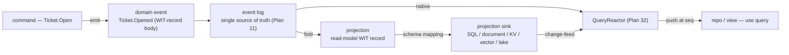

# Plan 39 — The data plane: projections & persistence-agnostic data access

> Part of the [HoBo Design Plan Suite](./README.md). Makes HoBo's data plane **persistence-agnostic for developers** and **fully configurable for data architects**. App **domain data is event-sourced by default** ([Plan 11](./11-event-model.md)); every database is a **derived projection sink** the architect selects via Matching ([Plan 25](./25-resource-definitions-matching.md)). Decision records: [ADR-0050](./adr/ADR-0050-event-sourced-domain-data-projection-sinks.md) (event-sourced-by-default + sinks) · [ADR-0051](./adr/ADR-0051-wit-record-canonical-domain-schema.md) (WIT-record domain schema) · [ADR-0052](./adr/ADR-0052-projection-sink-paradigm-taxonomy.md) (paradigm taxonomy + reactivity boundary).

> **The bet, finished.** Plan 11 already makes the event log the single source of truth and folds it into **rebuildable projections** — but only for HoBo's *own* control-plane state (`DeploymentView`/`RunView`). This plan extends the same machinery to **application domain data**: a developer declares a logical record + queries; a data architect maps it onto SQL / NoSQL / KV / graph / vector / object-lake / OLAP — and neither has to know about the other. *Developers don't know or care how data is persisted or queried; architects have full autonomy over how it is.*

## Why this exists (the gaps it closes)
HoBo had the ingredients but not the dish:
- **No persistence-agnostic data-access layer.** App access was raw `ctx.bindings.db.query("select 1")` (dialect-leaky); the `ctx.view(...)` in [Plan 32](./32-reactive-live-queries.md) was pseudocode with no spec.
- **No canonical domain-schema/DTO layer.** Zod (I/O), WIT (ports), and the declarative SQL schema ([Plan 34](./34-app-data-migrations.md)) were disjoint.
- **App domain data was not event-sourced by default** and there was no first-class *"project this event stream into this backend via this mapping"* artifact.
- **Paradigm coverage was narrow** — relational was deep; document/graph/OLAP/data-lake were absent.

## The Projection (materialized into a projection sink)
A **projection** (the word [Plan 11](./11-event-model.md) already uses) is, at the application layer, a **developer-authored, sink-targeted, mapped** read model. Five parts:

1. **Subscription** — the event stream(s) it folds, keyed by **WIT-record event types** (`Ticket.Opened`, `Ticket.Assigned`). This is its read-set on the write log.
2. **Fold (reducer)** — a deterministic, read-only `(state, event) → state` (the same determinism rules as `query()`/`workflow`: no `step`, no writes, seeded clock — [Plan 2](./02-sdk-api.md)/[ADR-0029](./adr/ADR-0029-reactive-live-query-model.md)).
3. **Read-model record** — the canonical logical shape, a **WIT record** (the DTO; §WIT-record domain schema).
4. **Schema mapping** — WIT-record fields → backend representation (columns / document fields / key+value / nodes+edges / vector field+filters / lake partitions). **Architect-owned.**
5. **Sink binding** — the concrete backend, chosen by **Resource Definitions + Matching** ([Plan 25](./25-resource-definitions-matching.md)/[ADR-0033](./adr/ADR-0033-deterministic-matching-and-planner-selection.md)), never by app code.

What you can understand and depend on in isolation: a projection has a **stable logical contract** (a named read-model WIT record + the event types it folds); it is **rebuildable from zero** (drop the sink, replay the streams — the test that the *log*, not the sink, is authoritative); and it declares a **reactivity class** and a **consistency label** (bounded-staleness, [ADR-0040](./adr/ADR-0040-cross-camp-stateful-consistency.md)) as part of that contract, so callers know their guarantees.

**Two modes, named explicitly:**
- **Projected** *(default, event-sourced)* — the sink is derived from the log; writes never touch it directly.
- **Authoritative-external** *(adopted, [ADR-0041](./adr/ADR-0041-migration-onboarding.md))* — an existing DB declared the source of truth via `hobo import` (`external` kind + `echo` driver). Its `change-feed` (if any) runs it *backwards* into `data.Changed` so reactive reads still work; `hobo doctor` flags long-lived authoritative-external stores as migration debt.

**Resolves a Plan 11 open question.** "Whether read models live in the same store or a separate query DB" is no longer a global fork: a projection's sink is **architect-selected per context** via Matching (default = a native standing projection over the log; opt a projection into Postgres/Mongo/… when a purpose-built query backend is wanted), recorded in `match.Decided`.



## Developer surface — the persistence-agnostic data access (the "pseudo-ORM")
Both an **entity repository** (ergonomic 80%) and a **query DSL** (the composable, reactive surface), over **one logical model**.

### Write path — command → event (no direct sink writes)
The developer never writes to a sink. They emit a domain event; a projection folds it.
```ts
import { command } from "@hobo/runtime";

export const openTicket = command("Ticket.Open", async (input: OpenTicket, ctx) => {
  // input validated against the WIT-record-generated type
  ctx.emit("Ticket.Opened", { id: input.id, team: input.team, title: input.title });
  // returns the seq the event landed at → drives reads-your-writes (Plan 32)
});
```
- `ctx.emit` appends a typed domain event (body = protobuf-encoded WIT record) to the stream `ticket:<id>` via the existing `EventStore.append` with optimistic `expectedSeq` ([Plan 11](./11-event-model.md)).
- A command handler is a **`step`-class** unit (side-effecting, retried, memoized — [Plan 2](./02-sdk-api.md)), so command idempotency rides the existing idempotency-key machinery.
- **Reads-your-writes:** the command returns its `seq`; the client advances subscriptions to ≥ that `seq` before ack ([Plan 32](./32-reactive-live-queries.md)).

### Read path — logical repository + query DSL
```ts
import { view, repo } from "@hobo/runtime";

const tickets = repo<Ticket>("tickets");              // entity form, typed by the read-model record
const t    = await tickets.get(id);                   // by key
const open = await tickets.find({ team, status: "open" });

export async function openTickets(team: string): Promise<Ticket[]> {
  "use query";                                         // reactive, read-only (Plan 32)
  return view("tickets").where({ team, status: "open" }).order("createdAt").limit(50);
}
```
- Both forms target a **projection by logical name** (`"tickets"`), never a table; the resolved sink + driver come from Matching, so the same query runs over Postgres or Mongo unchanged.
- The predicate DSL is the **one already specified in [Plan 35](./35-search-vector-surface.md)** (`eq`/`in`/`range`/…) — domain queries, search filters, and `.allow()`/tenant scoping compose in one predicate language, no second grammar.
- `view(...)` inside `"use query"` is reactive (read-set tracked, re-pushed on change); `repo.get/find` outside a query is the one-shot `runQuery` analog. Same primitive, two ergonomics.
- Typed end-to-end from the WIT-generated client + the projection's read-model record ([ADR-0037](./adr/ADR-0037-sdk-codegen-surface.md)). Tenant + `.allow()` read scopes are enforced at the projection boundary ([Plan 21](./21-resources-catalog.md)/[Plan 12](./12-security-multitenancy.md)) exactly as Plan 32 already scopes reactive queries.

### The raw escape hatch (kept honest)
```ts
// explicitly non-portable; only compiles when the resolved driver advertises raw access
const rows = await view("tickets").raw(pg => pg.query("select … for update"));
```
- **Provider-namespaced + typed to the resolved driver** (`pg`, `mongo`, …) — a dialect leak fails to compile against a *different* resolved backend instead of breaking silently at runtime (the fix for the old `ctx.bindings.db.query("select 1")` leak).
- **Flagged** as a non-portable edge in the manifest IR; surfaced by `hobo doctor`/`can-deploy` ([Plan 29](./29-contracts-compatibility.md)) and counted as a `PlanWarning` against the portability guarantee ([ADR-0024](./adr/ADR-0024-portability-conformance-guarantee.md)) — the Bindle is no longer "same Bindle, N clouds" for that edge, and HoBo says so.
- **Read-only on projected sinks** (a derived sink must not diverge from the log); raw **writes** are permitted only on **authoritative-external** (adopted) stores.

## The WIT-record domain-schema layer
**WIT records are the canonical domain schema** ([ADR-0051](./adr/ADR-0051-wit-record-canonical-domain-schema.md)). One record family is the single upstream for event payloads, projection/read-model shapes, and backend mappings.
```wit
// domain.wit — authored by the developer (the canonical contract, Plan 24)
package app:shop@0.1.0;
interface domain {
  record ticket {                       // the read-model / DTO record
    id: string,
    team: string,
    title: string,
    status: ticket-status,
    created-at: timestamp,
  }
  enum ticket-status { open, assigned, closed }
  record ticket-opened   { id: string, team: string, title: string }   // event-body records
  record ticket-assigned { id: string, assignee: string }
  record ticket-closed   { id: string }
}
```
- **Events reference domain records.** `Ticket.Opened` carries a `ticket-opened` record as its `data` payload in the `EventEnvelope` ([Plan 11](./11-event-model.md)); the envelope is unchanged, only the typed body is WIT-record-derived.
- **Generation ([ADR-0037](./adr/ADR-0037-sdk-codegen-surface.md), four-source codegen + two new emitters):** **TS types** via `jco guest-types` (existing); **protobuf** wire encodings for event bodies (new emitter — protobuf is the *encoding*, never the authoring language); **Zod validators** generated from the record (new emitter). All deterministic, checked into `_generated/`.
- **WIT-first, Zod-generated for domain data.** Hand-written Zod stays valid for ad-hoc step I/O, but **domain DTOs are WIT-first** with Zod as a generated runtime-validation view — so the WIT record is the single upstream for TS type, protobuf encoding, Zod validator, projection shape, and Plan 29's "Declared" contract.
- **Evolution, two mechanisms wired together:** **event bodies** evolve by [Plan 11](./11-event-model.md) upcasters (forward-only `vN→vN+1`, never rewrite history); the **sink schema** evolves by [Plan 34](./34-app-data-migrations.md) expand→backfill→contract. A domain change does both — upcast the body, gate-migrate the sink.

## Paradigm taxonomy for projection sinks
Each paradigm is a **projection-sink kind** behind a WIT port, a Matching dimension (`type: "projection-sink", paradigm: …`). Modeled now; a subset ships v1.

| Paradigm | v1? | Maps WIT record → | Reactive read? | Honest limit |
|---|---|---|---|---|
| **Native** (log / standing projection) | **v1 (default)** | in-runtime read model over the log | **Yes** (the log *is* the change stream) | recompute-not-incremental in v1; bounded by fold cost |
| **Relational** (Postgres ref) | **v1** | fields → columns; record → table; enums → enum/check | **Yes** via `change-feed` (Postgres ref adapter, [Plan 32](./32-reactive-live-queries.md)) | dialect features behind the raw escape hatch |
| **Document** (Mongo ref; Cosmos/Firestore) | **v1 (one ref)** | record → document; nested records → embedded | **Yes** if change-feed (change streams) | no cross-document joins in the portable DSL |
| **KV / wide-column** (Dynamo/Cosmos/Cassandra) | roadmap | record → key (PK rule) + value; secondary fields → GSIs | partial (Dynamo Streams) | DSL limited to key/range; rich predicates → escape hatch |
| **Graph** (Neptune/Neo4j) | roadmap | record → node; relations → edges (mapping declares which) | mostly non-reactive | traversal not in the portable predicate DSL v1 |
| **Vector** (via [Plan 35](./35-search-vector-surface.md) `search`) | **v1** | record → indexed doc + vector field + filter fields | text/filter reactive; **vector search is a step** | vector queries off the reactive path by construction |
| **Object / data-lake** (S3/Parquet) | roadmap | record → partitioned files (partition keys from fields) | **non-reactive** (batch) | append/compaction latency; query via an OLAP engine |
| **OLAP / columnar** (ClickHouse/BigQuery/DuckDB) | roadmap | record → columnar table; fields → typed columns | **non-reactive** (analytical) | bounded-staleness batch; not for reads-your-writes UI |

**Honest reactivity rule (one sentence):** a projection is reactive **iff** its sink advertises the `change-feed` capability **or** it is the native log-backed projection; everything else is typed `reactive: false` and `hobo doctor` warns when a `"use query"` depends on it (Plan 32's existing check). Each sink kind ships a `@hobo/conformance` suite ([Plan 24](./24-wit-interfaces-reference.md)/[Plan 9](./09-verification-open-questions.md)): claim a paradigm → round-trip a fixture record set and (if reactive) emit ordered `data.Changed`.

## Composition (reuse, not reinvent)
- **Matching ([Plan 25](./25-resource-definitions-matching.md)/[ADR-0033](./adr/ADR-0033-deterministic-matching-and-planner-selection.md)).** The architect declares a `projection-sink` Resource Definition (`defineResource({ type: "projection-sink", paradigm, provider, driver, with, match })`); the Planner selects per context — native projection in a preview Camp, managed Postgres in prod — recorded in `match.Decided`. **Developer owns the logical record + query; architect owns the mapping + sink** — the autonomy split *is* the Matching boundary.
- **Migrations ([Plan 34](./34-app-data-migrations.md)).** A sink's schema is declarative; changing the read-model record or mapping flows through gated **expand→backfill→contract** + snapshot rollback. **Rebuilding a projection from zero is a backfill phase** — Plan 11 "rebuildable" ≡ Plan 34 "backfill". Cross-cloud sink moves use export→import within an equivalence class.
- **Reactivity ([Plan 32](./32-reactive-live-queries.md)/[ADR-0029](./adr/ADR-0029-reactive-live-query-model.md)).** Projections **are** the read models the reactor already runs over; this plan just makes them developer-authored and sink-targeted. `data.Changed`, read-set tracking, consistent-snapshot@`seq`, and reads-your-writes are reused verbatim — **no new reactor**.
- **Cross-Camp ([ADR-0040](./adr/ADR-0040-cross-camp-stateful-consistency.md)).** A projection declares a replication topology (single-writer-Camp default); a non-owner Camp builds a bounded-staleness projection from the owner's replicated read-stream; reads carry the staleness label; consistency-requiring writes "go home."
- **Adopt-in-place ([ADR-0041](./adr/ADR-0041-migration-onboarding.md)).** The escape hatch from the event-sourced default: `external`/adopted authoritative stores answer the same `repo`/`view` surface, so a half-migrated app coexists (strangler-fig) — some entities projected, some authoritative-external, one data surface.

## Events & ports
- **New `projection.*`:** `projection.Declared` (logical record + event-type read-set + reactivity class), `projection.Lagged` (staleness/lag exceeded a bound → policy input, [Plan 30](./30-policy-plane.md)/[ADR-0040](./adr/ADR-0040-cross-camp-stateful-consistency.md)), `projection.SinkRebound` (Matching reselected a sink; links the `match.Decided`). **Reused, not new:** `data.Changed` ([Plan 32](./32-reactive-live-queries.md)), `match.Decided` ([Plan 25](./25-resource-definitions-matching.md)), `migration.*` ([Plan 34](./34-app-data-migrations.md)), `resource.Adopted` ([ADR-0041](./adr/ADR-0041-migration-onboarding.md)).
- **New port `hobo:projection`:** `declare(spec)`, `fold(state, event) → state` (guest reducer), `materialize`, `rebuild`, `read(query)`, `read-raw(driver-call)`. Its query surface is the predicate DSL shared with `hobo:search`.
- **Generalize the `change-feed` capability** (today on the `database` port, [Plan 32](./32-reactive-live-queries.md)) to a **sink capability** any projection-sink provider may advertise — the gate for whether a projection is reactive, under the same conformance trust boundary. Sink drivers realize their mapping over existing `wasi:sql`/`wasi:keyvalue`/`wasi:blobstore`/`hobo:search`.

## Honest limits (stated, not hidden)
- **Eventual consistency is the normal case.** CQRS means a projection lags the log by its fold/replication latency; a fresh write isn't instantly visible in every external sink (reads-your-writes holds within the owning Camp, observable via `seq`). This is [ADR-0003](./18-adr-log.md)'s "read-after-write needs projections" made explicit at the app layer.
- **Portability is equivalence-class-bounded.** "Same Bindle, N backends" holds *within* a paradigm's class; cross-*paradigm* portability (relational ↔ document) is not automatic — the mapping is paradigm-specific. Cross-engine within a class follows [Plan 34](./34-app-data-migrations.md)'s export→import.
- **Leak-free query is impossible; leaks are made visible instead** (the raw escape hatch fails to compile against a different backend and is flagged).
- **Reactivity is not universal** — only native + change-feed-advertising sinks are reactive; vector/object-lake/OLAP are off the reactive path by construction.
- **Single-writer-Camp is a cross-Camp bottleneck** ([ADR-0040](./adr/ADR-0040-cross-camp-stateful-consistency.md)); active-active-eventual (CRDT) is opt-in and pushes merge semantics onto the developer.

## Verification
- **Projection round-trip:** declare a projection over a fixture event stream → assert the read model materializes; **drop the sink + replay → identical state** (rebuildable-from-zero test).
- **Persistence-agnostic read:** the same `repo`/`view` query resolves to the native sink in a preview Camp and to managed Postgres in prod (Matching), byte-identical app code.
- **Reactivity class honesty:** a `"use query"` over a non-change-feed sink is typed `reactive: false` and `hobo doctor` warns; a change-feed sink re-pushes on `data.Changed`.
- **Escape-hatch honesty:** `.raw(pg => …)` fails to type-check when the resolved driver is `mongo`; the edge is flagged as portability debt in `can-deploy`.
- **Schema evolution:** a domain-record change produces a Plan 11 upcaster (event body) **and** a Plan 34 expand→backfill→contract plan (sink); a contract phase that breaks a running consumer is blocked by `can-deploy`.

## Scope (v1) & YAGNI
- **v1:** the `projection` concept + `hobo:projection` port; `command`/`repo`/`view` surface + raw escape hatch; WIT-record domain schema + TS/protobuf/Zod codegen; sink adapters for **native, relational (Postgres), one document (Mongo), and vector (via Plan 35)**; `projection.*` events; `change-feed` generalized.
- **Deferred (modeled, not built):** KV/wide-column, graph, object/data-lake, OLAP sink adapters; cross-paradigm auto-migration; active-active CRDT sinks; the [Hobo Code](./38-hobo-code-dsl.md) authoring surface for declaring projections/mappings.

## Iteration hooks
- Whether `projection.Materialized`/`Rebuilt` should be modeled as `migration.PhaseApplied` backfill phases rather than new event types (minimize catalog bloat, per the [Plan 35](./35-search-vector-surface.md) precedent).
- PK/edge derivation rules for KV/graph mappings (how a WIT record's fields name a key or an edge).
- Incremental view maintenance for expensive folds (deferred; today recompute-not-incremental).
- Whether the repository `find()` predicate and the `view()` DSL should share a single compiled query AST end-to-end.
