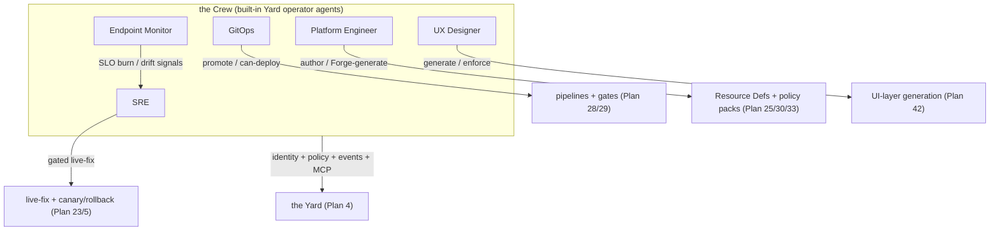

# Plan 40 — Operator Agents (the Crew)

> Part of the [HoBo Design Plan Suite](./README.md). HoBo ships a roster of **built-in autonomous operator agents** — collectively **the Crew** — that run the platform day-to-day: **SRE · Endpoint Monitor · GitOps · Platform Engineer · UX Designer**. Each is a **first-class Yard service** and a named **principal** ([Plan 6](./06-ai-native-agent-auth.md)) with its own identity, policy gates, event-sourced runs, and MCP surface. Decision record: [ADR-0054](./adr/ADR-0054-operator-agent-roster.md).

> **Disambiguation (one word, four meanings — now resolved):** **Operator Agent** = an autonomous principal in the Crew (this plan). **Agents-as-users** = *external/customer* agents acting on a developer's behalf ([Plan 6](./06-ai-native-agent-auth.md)). The **`agent()` primitive** = the SDK runtime building block both use ([Plan 2](./02-sdk-api.md)). The **[Relay](./28-relay-gitops-pipelines.md)** = the outbound network proxy (formerly mis-named "the HoBo Agent"), *not* an agent at all. The **[Forge](./33-forge-generation-pipeline.md)** = a generation *pipeline*, not a principal.

## Why built-in (batteries-included), not just skills
HoBo is AI-native: the operations a platform team does — triage incidents, watch endpoints, drive delivery, author platform rules, design UIs — are exactly what an agent can do against HoBo's event-sourced, MCP-complete surface. Rather than leave each team to wire its own, HoBo **ships the Crew as built-in Yard services** ([ADR-0054](./adr/ADR-0054-operator-agent-roster.md)): opinionated, audited, policy-gated out of the box, while still **pluggable** — each agent's "brain" is an **engine behind a port** (built-in default; optional externals like HolmesGPT), and each is disableable / overridable per Yard. They are the AI-native realization of goals "AI SRE / AI GitOps / AI policy enforcement."

## The shared model (every Crew member)
- **Principal identity.** Each agent is a named workload with an **SVID** and **per-agent policy** ([Plan 6](./06-ai-native-agent-auth.md)/[Plan 30](./30-policy-plane.md)): scoped capabilities, **spend caps**, and **high-risk → require-approval** gates (destroy/prod/over-budget resolve via a dashboard/Slack hook). Least-privilege by `.allow()` ([Plan 21](./21-resources-catalog.md)).
- **Event-sourced runs.** Every observation, decision, tool call, token grant, and approval is an event ([Plan 11](./11-event-model.md)) → replayable, auditable ("why did the SRE agent roll back at 02:14?"), and resumable.
- **MCP-surfaced.** Each agent exposes its actions as MCP tools ([Plan 6 §MCP](./06-ai-native-agent-auth.md)) so a human or an external agent can invoke, inspect, or override it — same identity/token model.
- **Engines behind ports.** The reasoning engine is a `*-engine` port with a built-in default and optional external providers (never on the SDK surface) — consistent with `training-engine`/`policy-engine`/`contract-engine` ([ADR-0025](./adr/ADR-0025-use-training-directive-and-training-engine.md)/[Plan 30](./30-policy-plane.md)/[Plan 29](./29-contracts-compatibility.md)).
- **Human-in-the-loop by default for write actions.** Read/diagnose is autonomous; mutations ride the policy plane's effects/obligations (auto / canary-with-auto-rollback / require-approval), keyed by blast radius + environment ([Plan 5](./05-reliability-ha.md)/[Plan 30](./30-policy-plane.md)).

## The roster
| Operator Agent | Owns | Composes (existing) | Optional external engine | Surfaces / events |
|---|---|---|---|---|
| **SRE** | incident detection → root-cause → **gated remediation** | live-fix ([Plan 23](./23-stubbable-ai-implementations.md)), observability ([Plan 14](./14-observability.md)), drift + canary/auto-rollback ([Plan 5](./05-reliability-ha.md)), chaos findings ([ADR-0047](./adr/ADR-0047-chaos-resilience-verification-tier.md)) | **HolmesGPT** behind a port ([technologies/holmesgpt-sre-agent.md](../../technologies/holmesgpt-sre-agent.md)) | MCP `diagnose`/`heal`; rides `incident.*`/live-fix + `policy.Decided` |
| **Endpoint Monitor** | synthetic probes, health/SLO watch, drift surfacing | SLO/alerting ([ADR-0045](./adr/ADR-0045-slo-as-code-and-alerting.md)), observability ([Plan 14](./14-observability.md)), drift ([Plan 5](./05-reliability-ha.md)) | external synthetic-check provider behind a port | emits `slo.BudgetBurned`/`alert.*`/drift → **feeds SRE** |
| **GitOps** | drive *when/what* deploys; promotion across env-groups | pipelines + publishers ([Plan 28](./28-relay-gitops-pipelines.md)), `can-deploy` ([Plan 29](./29-contracts-compatibility.md)), env-group saga ([ADR-0028](./adr/ADR-0028-multi-camp-deployment-model.md)) | external GitOps controller (Argo/Flux) as publisher | MCP `promote`/`rollback`; rides `pipeline.*`/`deployment.*` |
| **Platform Engineer** | author + **Forge-generate** Resource Definitions/Packs + policy packs | Matching ([Plan 25](./25-resource-definitions-matching.md)), packs ([Plan 27](./27-drivers-packs-profiles.md)), policy ([Plan 30](./30-policy-plane.md)), Forge ([Plan 33](./33-forge-generation-pipeline.md)) | — (Forge is the engine) | MCP `propose-definition`/`propose-pack`; AI counterpart to the human persona ([ADR-0019](./adr/ADR-0019-persona-prioritization-icp.md)) |
| **UX Designer** | generate + maintain the app's UI within design-system constraints | UI-layer generation ([Plan 42](./42-ui-layer-generation.md)), reactive `view()`s ([Plan 32](./32-reactive-live-queries.md)) | **OpenUI** / **json-render** behind the `ui-render` port ([Plan 42](./42-ui-layer-generation.md)) | MCP `generate-ui`/`apply-design`; rides `ui.*` |

> **The SRE operator has a deep-dive.** Its full model — the **Incident** aggregate + `incident.*` events, the diagnose → classify → **auto-fix / propose / escalate** decision tree, the runtime+contract **failure-taxonomy → safe-fix** map, declarative **runbooks**, MTTD/MTTR SLOs, on-call escalation, and postmortem-as-replay — is **[Plan 44](./44-sre-incident-management.md)** ([ADR-0058](./adr/ADR-0058-sre-incident-management-and-runbooks.md)).

## Events
Crew run lifecycle reuses the durable-agent run model ([Plan 11](./11-event-model.md) `run.*`); add a thin **`crew.*`** family for roster-level facts: `crew.AgentDispatched` (which operator, why — the triggering signal), `crew.ActionProposed` (action + blast radius + policy decision ref), `crew.ActionApplied`/`crew.ActionDenied` (ride `policy.Decided`), `crew.HandoffRequested` (one operator escalates to another or to a human). Domain remediation/promotion/UI facts ride the existing `incident.*`/live-fix, `pipeline.*`/`deployment.*`, and `ui.*` families — **no per-agent event silos**.

## Verification
- A simulated SLO breach → **Endpoint Monitor** emits burn → **SRE** is dispatched (`crew.AgentDispatched`), diagnoses from projections, proposes a fix; a **prod** fix requires approval (`policy.Decided` → `crew.ActionApplied` only after approve), a **low-risk** fix auto-applies as a canary and auto-rolls-back on regression — all replayable.
- **GitOps** promotes staging→prod only when `can-deploy` is green; a skew blocks with a precise reason ([Plan 29](./29-contracts-compatibility.md)).
- Each agent's `CredentialAudit` ([Plan 14](./14-observability.md)) answers "what did this operator access, with which token, when?".
- Swapping the SRE engine to HolmesGPT (or disabling an operator) is a per-Yard config change; the deterministic core is unaffected.

## Scope (v1) & YAGNI
- **v1:** the five operators as built-in Yard services on the shared model (identity/policy/events/MCP/engine-behind-port); read/diagnose autonomous, writes gated; built-in engines + the HolmesGPT (SRE) and OpenUI/json-render (UX) reference adapters.
- **Deferred:** multi-agent planning/negotiation beyond `crew.HandoffRequested`; agent-authored *new* operators; a marketplace of third-party operators (rides `@hobo/agent-skills`, [Plan 1](./01-monorepo.md)).

## Iteration hooks
- Whether operators are always-on services vs dispatched-on-signal (cost vs latency); per-operator concurrency/lease model (an operator is itself a single-writer [actor](./02-sdk-api.md)).
- The collective-name "Crew" is a proposal (glossary convention); the formal term is "Operator Agents."
- How much the **Platform Engineer** operator may auto-merge vs always-propose (ties [ADR-0048](./adr/ADR-0048-persisted-code-mutation-mechanism.md) persisted-patch gating).
