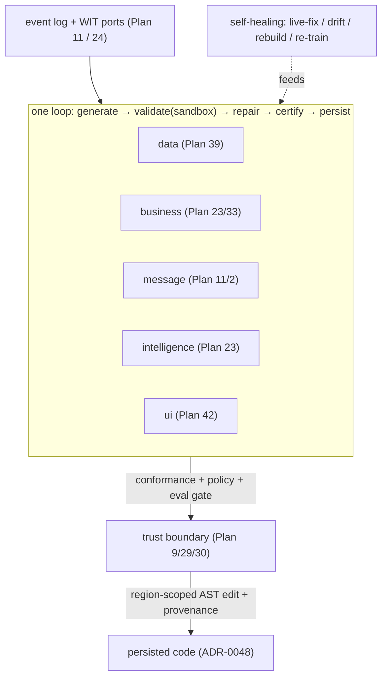

# Plan 41 — The generated stack (AI-generated, self-healing, persisted code across layers)

> Part of the [HoBo Design Plan Suite](./README.md). The unifying model for HoBo's AI-native promise: HoBo **generates, self-heals, and persists** code across five layers — **data · business · message · intelligence · ui** — all over **one event log** + **WIT ports**, all under **one conformance/policy/eval trust boundary**, all persisted by **one mechanism** (region-scoped AST mutation, [ADR-0048](./adr/ADR-0048-persisted-code-mutation-mechanism.md)). Decision record: [ADR-0055](./adr/ADR-0055-generated-stack-layered-model.md). This plan is the *map*; each layer's mechanics live in its own plan.

> **The thesis.** The pieces already exist, scattered. Naming them as one stack makes the promise legible and the gaps obvious: *the same generate→validate→repair→certify→persist loop, the same self-healing reflexes, and the same audit/replay apply to every layer of an app.* The operator **[UX Designer / Platform Engineer / SRE](./40-operator-agents.md)** agents are the ones that drive it.

## The five layers
| Layer | What HoBo generates | Owned by | Self-heals via | Persisted by |
|---|---|---|---|---|
| **Data** | WIT-record schemas, projections + sink mappings, migrations | [Plan 39](./39-data-plane-projections.md)/[Plan 34](./34-app-data-migrations.md)/[ADR-0051](./adr/ADR-0051-wit-record-canonical-domain-schema.md) | rebuild-from-zero (replay), gated migration | migration machinery + codegen |
| **Business** | service components + **semantic functions** (`"use training"`), providers, Resource Definitions | [Plan 23](./23-stubbable-ai-implementations.md)/[Plan 33](./33-forge-generation-pipeline.md) | live-fix (trace-replay → gated canary) | [ADR-0048](./adr/ADR-0048-persisted-code-mutation-mechanism.md) region-scoped edits |
| **Message** | event/command/saga handlers + choreography from the WIT-record event types | [Plan 11](./11-event-model.md)/[Plan 2](./02-sdk-api.md)/[Plan 21](./21-resources-catalog.md) | compensation + replay; contract gate ([Plan 29](./29-contracts-compatibility.md)) | codegen + [ADR-0048](./adr/ADR-0048-persisted-code-mutation-mechanism.md) |
| **Intelligence** | prompts/policies/weights of trainable methods, continuously optimized | [Plan 23](./23-stubbable-ai-implementations.md)/[ADR-0025](./adr/ADR-0025-use-training-directive-and-training-engine.md) | training-engine (trajectory + live-eval → re-optimize) | [ADR-0048](./adr/ADR-0048-persisted-code-mutation-mechanism.md) + signed provenance |
| **UI** | the app front-end (components/screens) within design-system constraints | [Plan 42](./42-ui-layer-generation.md) | regenerate on `view()`/Design.md change; visual-eval gate | checked-in generated region + [ADR-0048](./adr/ADR-0048-persisted-code-mutation-mechanism.md) |

## What makes it one stack (not five features)
- **One source of truth.** Every layer reads/writes the **event log** ([Plan 11](./11-event-model.md)); generated code targets **WIT ports** ([Plan 24](./24-wit-interfaces-reference.md)) and is typed from **WIT records** ([ADR-0051](./adr/ADR-0051-wit-record-canonical-domain-schema.md)).
- **One generation loop.** The Forge loop — **scaffold → LLM-fill → validate (sandboxed, no-egress) → repair → certify (sign + provenance)** ([Plan 33](./33-forge-generation-pipeline.md)) — is the same shape for a provider, a projection, a saga handler, a trained prompt, or a UI screen; only the inputs/oracles differ.
- **One trust boundary.** Nothing is generated *and trusted* without passing **conformance + policy + eval** ([Plan 9](./09-verification-open-questions.md)/[Plan 29](./29-contracts-compatibility.md)/[Plan 30](./30-policy-plane.md)) — for UI, the oracle is **Design.md** + visual evals ([Plan 42](./42-ui-layer-generation.md)).
- **One persistence mechanism.** Promoted code lands via **region-scoped, format-preserving AST edits with provenance** ([ADR-0048](./adr/ADR-0048-persisted-code-mutation-mechanism.md)) — generated regions are demarcated, hand-written code is never clobbered, and every change is round-trippable + gated (`hobo codegen --check`, [ADR-0037](./adr/ADR-0037-sdk-codegen-surface.md)).
- **One self-healing reflex.** A failing trace / SLO burn / drift / contract break triggers the same classify → propose-fix → validate → gated-apply loop ([Plan 23](./23-stubbable-ai-implementations.md) live-fix, [Plan 5](./05-reliability-ha.md) drift/auto-rollback), driven by the **SRE** operator ([Plan 40](./40-operator-agents.md)).

## Self-healing & persistence, per layer (honest)
- **Generated ≠ unowned.** Hand-written intent (the WIT record, the `@intent`/`@invariant`, Design.md) is authoritative; AI fills/optimizes the generated region against it. The intent is the thing a human edits.
- **Determinism gates persistence.** Deterministic codegen (data/message types, [ADR-0037](./adr/ADR-0037-sdk-codegen-surface.md)) is reproducible and safe to regenerate; *non-deterministic* promotions (trained methods, generated UI) need stronger region-isolation, signed provenance, and (in prod) a human-gated PR/Delta ([ADR-0048](./adr/ADR-0048-persisted-code-mutation-mechanism.md)).
- **Not every layer self-heals equally.** Data heals by rebuild; business/intelligence by live-fix/re-train; message by compensation + contract gate; UI by regeneration against Design.md. Where a layer can't auto-heal safely, it degrades to *propose* (human approval), never silent mutation.

## Verification
- A change to a WIT domain record propagates through the stack: data (migration + projection), message (regenerated handlers + contract gate), business/intelligence (impl re-validated), ui (regenerated screens) — each gated, each persisted as a reviewable diff.
- A prod failure triggers one self-healing loop (classify → fix → sandbox-validate → policy-gate → canary/auto-rollback), fully event-sourced, driven by the SRE operator.
- `hobo codegen --check` fails on hand-edited drift in any layer's generated region.

## Scope (v1) & YAGNI
- **v1:** the *map* + the shared loop/trust-boundary/persistence model; data/business/intelligence are already specified; **message-handler generation** and **ui generation** ([Plan 42](./42-ui-layer-generation.md)) are the newly-framed layers.
- **Deferred:** fully autonomous cross-layer regeneration from a single intent edit (the long arc); whole-app generation from a one-line prompt (a [Hobo Code](./38-hobo-code-dsl.md) + Crew future).

## Iteration hooks
- How aggressively message-layer choreography is generated vs hand-authored sagas.
- The single-intent-edit → multi-layer-regeneration workflow (today each layer regenerates independently).
- Cross-layer eval: a rubric that scores a *whole feature* (data+message+business+ui) not just one function.
