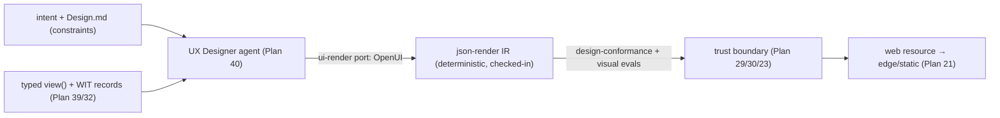

# Plan 42 — UI-layer generation (the app front-end)

> Part of the [HoBo Design Plan Suite](./README.md). The **ui layer** of the generated stack ([Plan 41](./41-generated-stack.md)): HoBo AI-generates the **user's application front-end** from intent + the typed data plane, within enforced **design-system constraints**, owned by the **UX Designer** operator agent ([Plan 40](./40-operator-agents.md)). Engines behind a **`ui-render` port** — **OpenUI** (UI-from-intent) and **json-render** (declarative render IR) are the reference adapters. Decision record: [ADR-0056](./adr/ADR-0056-ui-generation-and-design-system.md).

> **Not the dashboard.** [Plan 7](./07-ui-dashboard.md) is HoBo's *own* control-plane dashboard. This plan is about generating *the developer's app UI* — the missing top of the stack, the visible counterpart to the data plane.

## The `ui-render` port (engines behind a port)
A first-class **`ui-render` capability** (`hobo:ui-render`, [Plan 24](./24-wit-interfaces-reference.md)) with a built-in default and pluggable adapters — HoBo's recurring "speak a standard / engine behind a port" stance:
- **OpenUI** ([openui.com](https://openui.com/)) — generate UI from intent/description; the *generative* adapter.
- **json-render** — a declarative **render IR** (a JSON description of the view tree) the runtime renders to a framework target; the *deterministic, portable* artifact the generator emits and the app ships.
- **Custom adapters** (a design-system's own renderer, a different gen model) selected per Camp by Matching ([Plan 25](./25-resource-definitions-matching.md)).
Generation emits the **json-render IR** (deterministic, diffable, checked-in — [ADR-0037](./adr/ADR-0037-sdk-codegen-surface.md)); OpenUI is the non-deterministic *author* of that IR, gated like any generated artifact.

## Design.md — the enforced design system
A **`Design.md`** at the repo root is the design-system spec the platform **generates and enforces** — the design analog of the conformance trust boundary and of `CLAUDE.md`/`AGENTS.md`:
- Declares **tokens** (color/spacing/type scale), **components** (allowed primitives + variants), **layout/interaction constraints**, accessibility + i18n requirements, and brand voice.
- Is **authoritative**: generated UI is validated against `Design.md` (a **design-conformance** gate) — off-system colors, ad-hoc components, or a11y violations **fail the gate**, exactly as a contract/eval failure blocks a deploy ([Plan 29](./29-contracts-compatibility.md)/[Plan 30](./30-policy-plane.md)). The **visual/eval rubric** ([Plan 23](./23-stubbable-ai-implementations.md) evals) is the oracle: layout sanity, token adherence, a11y (axe-style), and screenshot/visual-regression checks.
- Is itself **generatable + evolvable** by the UX Designer agent (propose tokens/components), but changes ride the policy gate like any platform-rule change.

## How it composes
- **Typed from the data plane.** Generated views bind to reactive **`view()`** queries + WIT-record read models ([Plan 39](./39-data-plane-projections.md)/[Plan 32](./32-reactive-live-queries.md)/[ADR-0051](./adr/ADR-0051-wit-record-canonical-domain-schema.md)) and to **commands** for writes ([Plan 39](./39-data-plane-projections.md)) — so a generated screen is **reactive by construction** (re-renders on `data.Changed`) and **type-safe end-to-end** (codegen, [ADR-0037](./adr/ADR-0037-sdk-codegen-surface.md)).
- **End-user auth aware.** Views respect `ctx.user`/`.allow()` ([Plan 36](./36-end-user-auth.md)/[Plan 21](./21-resources-catalog.md)) — generated UI shows only what the principal may see.
- **Shipped as a `web` resource.** The rendered front-end deploys via the existing `web` port ([Plan 21](./21-resources-catalog.md)) to edge/static hosts — no new deploy path.
- **Owned by the UX Designer operator** ([Plan 40](./40-operator-agents.md)): generates from intent, regenerates on `view()`/schema/`Design.md` change, and self-heals visual regressions (propose → gated apply).

## Events
`ui.Generated` (intent + Design.md version + IR hash), `ui.DesignViolation` (failed design-conformance — which constraint), `ui.Published` (rendered to a `web` Set), `ui.Regenerated` (trigger: `view()`/schema/`Design.md` change). Promotions of generated UI ride `policy.Decided` + persist via [ADR-0048](./adr/ADR-0048-persisted-code-mutation-mechanism.md) (the IR is the generated region).

## Verification
- From a WIT read-model record + a `view()` + `Design.md`, the UX Designer generates a screen whose IR **type-checks** against the query, **renders reactively** (a `data.Changed` re-renders), and **passes design-conformance** (tokens/components/a11y); an off-system color **fails the gate** with a precise reason.
- Editing `Design.md` (new token) triggers `ui.Regenerated`; the diff is a reviewable change to the checked-in IR region; `hobo codegen --check` flags hand-edited drift.
- Swapping the `ui-render` engine (OpenUI → custom) leaves app intent + Design.md unchanged (portability).

## Scope (v1) & YAGNI
- **v1:** the `ui-render` port + json-render IR + OpenUI reference adapter; `Design.md` schema + the design-conformance/visual-eval gate; binding to `view()`/commands/`ctx.user`; ship via `web`; UX Designer ownership.
- **Deferred:** rich interaction/state-machine generation beyond data-bound screens; native/mobile targets; a component marketplace; full visual-regression infra (start with token/a11y/structural checks).

## Iteration hooks
- json-render IR shape + the set of renderable framework targets (React first?).
- How `Design.md` relates to imported design-system libraries (shadcn/Radix/MUI) — adapter or constraints-only.
- Whether generated UI is checked-in IR (default, reviewable) vs build-time-rendered (revisit per [ADR-0037](./adr/ADR-0037-sdk-codegen-surface.md)'s checked-in stance).
- The boundary between "generate the whole screen" and "fill a hand-authored layout's slots."
