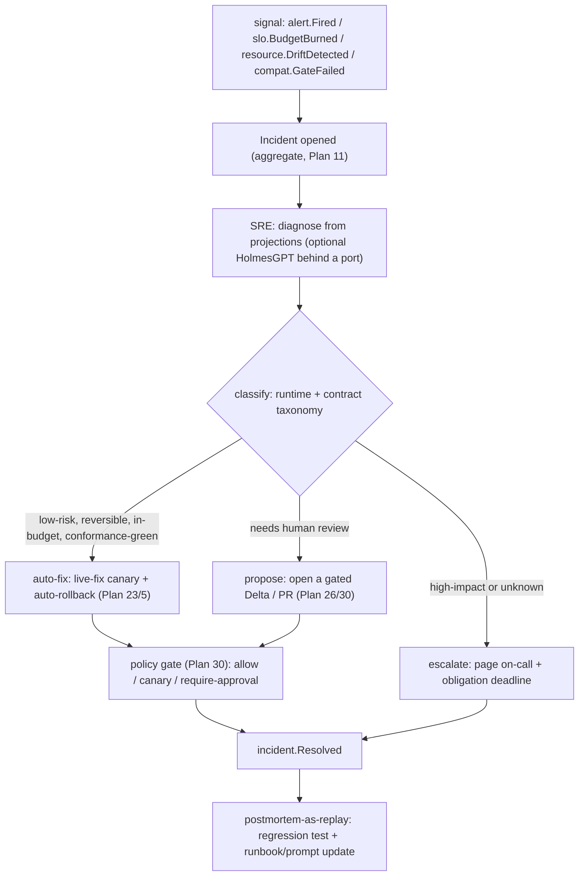

# Plan 44 — SRE: incident management, runbooks & self-healing

> Part of the [HoBo Design Plan Suite](./README.md). The **SRE operator's** full model ([Plan 40](./40-operator-agents.md)) — incident *management*, not just response. An **Incident** is a first-class aggregate; the SRE operator follows a documented **decision tree**; a unified **runtime failure-taxonomy → safe-fix** map drives remediation; **declarative runbooks** codify response; **MTTD/MTTR** are SLOs; and the event log makes every incident a **blameless postmortem by replay**. Built entirely on existing planes (events, policy, sagas, observability) — no new runtime. Decision record: [ADR-0058](./adr/ADR-0058-sre-incident-management-and-runbooks.md).

> **Why this exists.** HoBo had the pieces — alerting/SLO ([ADR-0045](./adr/ADR-0045-slo-as-code-and-alerting.md)), pipelines ([Plan 28](./28-relay-gitops-pipelines.md)), live-fix ([Plan 23](./23-stubbable-ai-implementations.md)), drift + auto-rollback ([Plan 5](./05-reliability-ha.md)), chaos ([ADR-0047](./adr/ADR-0047-chaos-resilience-verification-tier.md)) — but no incident model (`incident.*` was a dangling reference), no enumerated runtime failure→fix playbook, an opaque SRE operator, and no first-class runbook. This plan closes those gaps.

## The Incident aggregate
An **Incident** is an [aggregate](./02-sdk-api.md) (an actor; [ADR-0053](./adr/ADR-0053-write-side-aggregates-and-commands.md)) on stream `incident:<id>` — single-writer, **rebuildable from the log**. It is the **command point** that correlates the loose signals (`alert.Fired`, `slo.BudgetBurned`, `resource.DriftDetected`, `compat.GateFailed`, `spend.CircuitTripped`) into one governed object: `{ id, severity, impact, status, timeline, causedBy (causation/correlation chain), owner }`. Lifecycle events ([Plan 11](./11-event-model.md)): `Opened → Triaged → RootCauseIdentified → RemediationProposed → RemediationApplied|Failed → Resolved → PostmortemFiled`, plus `SLABreached` on MTTD/MTTR overrun. Correlation uses the envelope's existing `correlationId`/`causationId` ([Plan 11](./11-event-model.md)) — multiple alerts fold into **one** incident, not N pages.

## The SRE operator decision tree
The SRE operator ([Plan 40](./40-operator-agents.md)) is no longer opaque. On a signal it runs: **diagnose** (read projections; optional **HolmesGPT** engine behind a port, [technologies/holmesgpt-sre-agent.md](../../technologies/holmesgpt-sre-agent.md)) → **classify** (the taxonomy below) → **decide** one of three branches, each policy-gated + event-sourced:

- **auto-fix** when the fix is **low-risk, reversible, within blast-radius + spend budget, and conformance-green** → applied as a live-fix canary with auto-rollback ([Plan 23](./23-stubbable-ai-implementations.md)/[Plan 5](./05-reliability-ha.md)).
- **propose** when ambiguous or prod → open a gated **Delta/PR** ([Plan 26](./26-environments-deltas.md)/[Plan 30](./30-policy-plane.md)); a human approves.
- **escalate** when high-impact or unclassifiable → page **on-call** (below). Each decision is `crew.ActionProposed`/`crew.ActionApplied` + `policy.Decided` + the `incident.*` fact — fully replayable ("why did SRE auto-fix at 02:14?").

## Runtime failure-taxonomy → safe-fix map
One table unifies the scattered taxonomies (Plan 5 runtime classes + Plan 23/29 contract classes). **Live-fix is the *applier*; this is the *classifier*.**
| Failure class | Signal | Canonical safe-fix strategy |
|---|---|---|
| **Transient** (429/503, blip) | error-rate spike, retries | retry w/ backoff; circuit-break the dep ([Plan 5](./05-reliability-ha.md)) |
| **Provider-degraded / region** | provider error-rate, latency | fail over Camp/region; widen canary hold ([ADR-0035](./adr/ADR-0035-custom-domains-and-multi-cloud-ingress.md)) |
| **Capacity-exhausted** | saturation, queue depth | scale (Workload Profile); shed load; backpressure |
| **Durable-but-recoverable** (node crash) | run interrupted | replay-resume the saga ([Plan 11](./11-event-model.md)/[Plan 5](./05-reliability-ha.md)) |
| **Partial failure** (mid-saga) | step failed | compensate in reverse-dep order ([Plan 5](./05-reliability-ha.md)) |
| **Poison message** | repeated consumer failure | dead-letter + quarantine; loosen/repair handler |
| **Drift** (out-of-band change) | `resource.DriftDetected` | resync to desired Set; or propose ([Plan 5](./05-reliability-ha.md)) |
| **Split-brain / state divergence** | lease/fencing conflict | fence + reconcile from owner ([ADR-0040](./adr/ADR-0040-cross-camp-stateful-consistency.md)) |
| **Contract skew** (producer broke consumer) | `compat.GateFailed` | dual-publish window / deploy-order / shim ([Plan 29](./29-contracts-compatibility.md)) |
| **Semantic drift** (trained method) | eval regression | revert to champion; keep candidate in shadow ([Plan 23](./23-stubbable-ai-implementations.md)) |
| **Security anomaly** | live-scan finding ([Plan 12](./12-security-multitenancy.md)) | rotate credential; tighten `.allow()`; bump dep |
| **Runaway spend** | `spend.CircuitTripped` | halt spend-incurring actions; require approval ([ADR-0039](./adr/ADR-0039-billing-quota-cost-attribution.md)) |
| **Cost-induced degradation** | `spend.DegradationRequired` | shed QoS by priority through `costAvailabilityProfile` tiers; SRE proposes cost-efficient remediation, gated ([ADR-0066](./adr/ADR-0066-cost-driven-graceful-degradation.md)) |
Each strategy is reversible + gated; an unclassifiable failure → escalate (never silent action). Cost-induced degradation is a first-class incident class: the SRE operator handles it by *proposing* cost-efficient remediation (e.g. *"hold 99% to stay under budget while the leak is fixed"*) as a gated obligation, and **postmortem-by-replay shows exactly which load was shed and when** ([ADR-0066](./adr/ADR-0066-cost-driven-graceful-degradation.md)).

## Declarative runbooks
The missing first-class concept. A **runbook** codifies response: **trigger** (alert / SLO-burn / drift / incident-severity) → **diagnosis steps** (MCP queries the SRE runs) → **gated fix actions** (each blast-radius-bounded). Runbooks are **event-sourced** (`runbook.*`), **versioned + signed** like Resource Packs ([Plan 27](./27-drivers-packs-profiles.md)), and **built on the Pipelines engine** ([Plan 28](./28-relay-gitops-pipelines.md)) — the incident-response sibling of deploy pipelines (same triggers/rules/gated-steps model, different triggers + actions). HolmesGPT runbooks / StackStorm are **optional engines behind the port** ([technologies/stackstorm.md](../../technologies/stackstorm.md)).
```ts
defineRunbook("high-5xx-on-api", {
  on: { alert: "api.5xx-burst", severity: ">=SEV2" },
  diagnose: ["tail_logs api", "get_drift api", "slo_status api.availability"],   // MCP reads
  fix: [
    { when: "provider-degraded", do: "failover", camp: "prod-azure", gate: "auto" },
    { when: "capacity-exhausted", do: "scale", to: { min: 6 }, gate: "auto" },
    { when: "unknown",            do: "escalate", to: "on-call" },
  ],
});
```
The SRE operator *executes* runbooks; a runbook with no matching `fix` escalates. `hobo runbook exec --incident <id>`.

## MTTD / MTTR as SLOs
SRE performance is measured as code ([Plan 14](./14-observability.md)/[ADR-0045](./adr/ADR-0045-slo-as-code-and-alerting.md)): `sre.mttd` (signal → `crew.AgentDispatched`) and `sre.mttr` (`incident.Opened` → `incident.Resolved`) are **OpenSLO SLOs with error budgets**. Burn is a **policy input**: MTTR-SLO burn can **freeze risky deploys** or **require a deeper postmortem** (a `can-deploy` dimension), exactly like availability-SLO burn. `incident.SLABreached` fires on overrun.

## On-call & escalation (lean)
Escalation is modeled as a **policy obligation with a deadline** — resolving the open Plan 30 hook. `incident.Opened` (SEV≥threshold) creates an obligation: *notify on-call, require ack within N minutes*; **unsatisfied-by-deadline → escalate** up the ladder ([Plan 30](./30-policy-plane.md) obligations + [ADR-0045](./adr/ADR-0045-slo-as-code-and-alerting.md) routing). The **on-call** is a receiver/principal; PagerDuty/OpsGenie/Slack are receiver providers behind the alerting port. No rotation-calendar machinery in v1 (deferred).

## Postmortem-as-replay
The incident's event stream **is** the timeline, so a **blameless postmortem** is generated from the replay (what fired, what SRE decided, which gate, MTTD/MTTR, what fixed it). A failed remediation or a chaos finding becomes a **permanent regression test** (the [ADR-0047](./adr/ADR-0047-chaos-resilience-verification-tier.md)/[Plan 23](./23-stubbable-ai-implementations.md) pattern); the postmortem's findings feed **candidate runbook / SRE-prompt updates**, promoted through the same gated, eval'd path as any generated artifact ([Plan 41](./41-generated-stack.md)).

## Events & ports
- **New:** `incident.*` + `runbook.*` ([Plan 11](./11-event-model.md), defined there). **Reused:** `crew.*` ([Plan 40](./40-operator-agents.md)), `policy.Decided` ([Plan 30](./30-policy-plane.md)), `alert.*`/`slo.*` ([ADR-0045](./adr/ADR-0045-slo-as-code-and-alerting.md)), live-fix + `resource.DriftDetected` ([Plan 23](./23-stubbable-ai-implementations.md)/[Plan 5](./05-reliability-ha.md)), `chaos.*` ([ADR-0047](./adr/ADR-0047-chaos-resilience-verification-tier.md)).
- **Ports/engines behind ports:** the SRE reasoning engine (built-in default; **HolmesGPT** optional), the runbook engine (built-in Pipelines; **StackStorm** optional), alert receivers (PagerDuty/OpsGenie/Slack). No new SDK surface for app developers.

## Verification
- A simulated provider-degradation: alert → **one** `incident.Opened` (multiple alerts correlate), SRE classifies *provider-degraded* → auto-fix failover (low-risk) applied as a canary, `incident.Resolved`, postmortem generated by replay — all event-sourced.
- A prod contract skew (`compat.GateFailed`): SRE *proposes* (not auto), opens a gated Delta with the shim fix; approval required.
- An unclassifiable SEV1: SRE *escalates*; on-call obligation unsatisfied by deadline → escalates up; `incident.SLABreached` if MTTR SLO burns.
- A runbook with no matching `fix` escalates; `hobo runbook exec` is replayable.

## Scope (v1) & YAGNI
- **v1:** the Incident aggregate + `incident.*`/`runbook.*`; the SRE decision tree; the failure-taxonomy→fix map; declarative runbooks on the Pipelines engine; MTTD/MTTR SLOs; obligation-deadline escalation; postmortem-as-replay.
- **Deferred:** on-call rotation calendars + paging-vendor specifics; a richer runbook authoring DSL ([Hobo Code](./38-hobo-code-dsl.md) future); building HolmesGPT/StackStorm adapters.

## Iteration hooks
- How much cross-operator handoff (`crew.HandoffRequested`) the SRE drives (SRE→GitOps to ship a fix; SRE→Platform Engineer to change a definition).
- Auto-fix confidence thresholds + blast-radius defaults per failure class (tuning the decision tree).
- Whether runbooks and deploy pipelines share one `definePipeline`/`defineRunbook` core or stay distinct surfaces.
