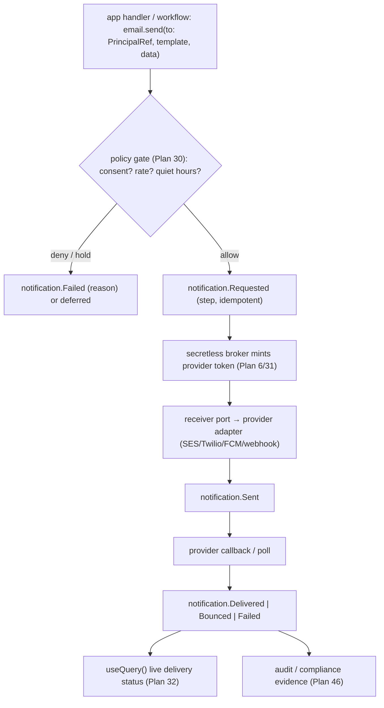

# Plan 45 — App communications (notify · email · sms · push · outbound-webhook)

> Part of the [HoBo Design Plan Suite](./README.md). A first-class **`notify` capability family** for the *user's application* to reach *its* end-users — **email / SMS / push / outbound-webhook** — distinct from HoBo's own **ops alerting** ([ADR-0045](./adr/ADR-0045-slo-as-code-and-alerting.md)) yet sharing its **receiver-port** abstraction. Providers (SES/SendGrid/Twilio/FCM/APNs) are **secretless-brokered** adapters; sends are **event-sourced**, **policy-gated** (consent/rate/quiet-hours), and **typed from WIT records**. No new runtime. Decision record: [ADR-0059](./adr/ADR-0059-app-communications-notify.md).

> **Why this exists.** The resource catalog ([Plan 21](./21-resources-catalog.md)) had `topic`/`queue` for *intra-app* messaging and ADR-0045 had *ops* alert receivers, but **no app-facing way to message a human** — the single most common SaaS need (verify-email, password-reset, order-shipped, OTP, a customer webhook). This plane closes that without inventing infrastructure: it reuses the receiver-port, the secretless broker, the event log, and the policy plane.

## One port, two consumers (the reuse that makes this cheap)
ADR-0045 already defines **notification receivers** (email/Slack/PagerDuty/webhook) as **providers behind a port**, used by ops alerting. App communications is the **second consumer** of that same port:
- **Ops alerting** ([ADR-0045](./adr/ADR-0045-slo-as-code-and-alerting.md)) — the Yard messages *operators* when an SLO burns or a gate fails. Routed by the alert routing tree.
- **App communications** (this plan) — the developer's app messages *its end-users* from handler/workflow code. Routed by app intent + consent.

The port is shared; the **policy, audit, and addressing differ**. A SendGrid adapter written once serves both.

## The `notify` family — resources & the SDK surface
Four resources, each a `.allow()`-gated capability ([Plan 21](./21-resources-catalog.md)) behind a WIT port ([Plan 24](./24-wit-interfaces-reference.md)):

| Resource | `@hobo/sdk` | WIT port | `.allow()` verbs | Providers (adapters) |
|---|---|---|---|---|
| **Email** | `email(name)` | `hobo:notify` | `send` | SES / SendGrid / Postmark / SMTP / in-boundary relay |
| **SMS** | `sms(name)` | `hobo:notify` | `send` | Twilio / SNS / MessageBird |
| **Push** | `push(name)` | `hobo:notify` | `send` | FCM / APNs / Web Push (VAPID) |
| **Outbound webhook** | `webhookOut(name)` | `hobo:notify` | `send` | signed HTTP POST (the app's own customers' endpoints) |

```ts
import { email } from "@hobo/sdk";

// recipients are PrincipalRefs (Plan 36) or raw addresses; template is a typed WIT record
const tx = email("transactional").allow("send");

app.post("/orders/:id/ship", async (ctx) => {
  await tx.send({
    to: ctx.user,                                  // a PrincipalRef → resolves to the user's verified email
    template: "order-shipped",                     // typed; payload checked against its WIT record (ADR-0051)
    data: { orderId: ctx.params.id, eta: "Tue" },
  });                                              // returns the send's `seq` → reactive delivery status (Plan 32)
});
```
A `send` is a **`step`-class** unit (idempotent, memoized on its idempotency key) so a retried workflow never double-sends. It returns the `notification`'s stream id + `seq`, which a `useQuery()` can subscribe to for live delivery status.

## Typed templates (WIT-record payloads)
A notification **template** binds a channel + a content shape. Its payload is a **WIT record** ([ADR-0051](./adr/ADR-0051-wit-record-canonical-domain-schema.md)) — so the same canonical-domain-schema machinery that types events/projections types the `data` you pass to `send()`. TS types + Zod validators are **generated** ([ADR-0037](./adr/ADR-0037-sdk-codegen-surface.md)); a template-payload mismatch fails to compile, not at the provider. Localization/rendering is an adapter detail behind the port (built-in default renderer; MJML/Liquid providers optional).

## Recipients are PrincipalRefs
A recipient is a **`PrincipalRef`** ([Plan 36](./36-end-user-auth.md)/[ADR-0038](./adr/ADR-0038-end-user-application-auth.md)) — the same unified principal model as agents/users — resolved to a channel address (verified email, phone, device token) via the principal's contact records, or a raw address for unauthenticated sends (e.g. a marketing list). This means **consent and identity travel with the recipient**, not as ad-hoc strings, and the audit trail names *who* was contacted.

## Event-sourced delivery (auditable + reactive)
Every notification is a stream `notification:<id>` with lifecycle events ([Plan 11](./11-event-model.md)): `notification.Requested → Sent → Delivered | Bounced | Failed` (provider webhooks/poll feed the post-send transitions back via the receiver port). This buys three things for free:
- **Audit** — "did we email this user their data-export link, and when?" is a replayable fact (load-bearing for [Plan 46](./46-compliance-governance.md) compliance evidence).
- **Reactive status** — a `useQuery()` over the notification stream gives a live "sent → delivered" UI with no new plumbing ([Plan 32](./32-reactive-live-queries.md)).
- **Retry/compensation** — a `Failed` send is a saga signal; bounded retry + dead-letter follow the [Plan 5](./05-reliability-ha.md) reliability model.



## Secretless by construction
No provider API key lives in the Bindle, Camp config, or the event log. The send-time broker mints a short-lived, scoped credential for the chosen provider via workload identity ([Plan 6](./06-ai-native-agent-auth.md)/[Plan 31](./31-config-secretless-secrets.md)) — the same secretless guarantee as every other capability. In **air-gapped/sovereign** mode ([ADR-0036](./adr/ADR-0036-air-gapped-sovereign-mode.md)) the adapter degrades to an in-boundary SMTP/relay; channels with no in-boundary provider are reported by the capability-degradation matrix.

## Policy-gated (consent, rate, quiet hours)
App communications is a prime policy surface ([Plan 30](./30-policy-plane.md)) — sending to humans has legal + UX constraints. A `notify` action is a `policy.Decided`:
- **Consent / opt-out** — a recipient's marketing opt-out is an **obligation-checked** precondition; transactional vs marketing classification gates which rules apply.
- **Rate limits / quiet hours** — `allow but defer until 09:00 local` is an **obligation** (a durable deferral, not advice); per-recipient + per-app velocity caps trip like the spend breaker.
- **Channel fallback** — `allow email, deny SMS for this region` is a policy mutation choosing the channel.
Consent records and suppression lists are projections folded off the log, so "why didn't this send" is replayable.

## Events & ports
- **New:** `notification.*` ([Plan 11](./11-event-model.md), defined there); a **`hobo:notify`** port ([Plan 24](./24-wit-interfaces-reference.md)) and `email`/`sms`/`push`/`webhookOut` catalog rows ([Plan 21](./21-resources-catalog.md)). **Reused:** the ADR-0045 **receiver port** + provider adapters, `policy.Decided` ([Plan 30](./30-policy-plane.md)), the secretless broker ([Plan 6](./06-ai-native-agent-auth.md)/[Plan 31](./31-config-secretless-secrets.md)), `PrincipalRef` ([Plan 36](./36-end-user-auth.md)), WIT-record templates ([ADR-0051](./adr/ADR-0051-wit-record-canonical-domain-schema.md)), reactive status ([Plan 32](./32-reactive-live-queries.md)).
- **No new infrastructure:** the receiver port, broker, log, and policy plane already exist; this plane is their composition for an app-facing use.

## Verification
- A transactional send (`order-shipped`) from a workflow step: `notification.Requested → Sent`, idempotent on retry (no double-send), `useQuery()` shows `Delivered` when the provider callback arrives — all event-sourced.
- A send to an opted-out recipient is **denied** by policy with a replayable `policy.Decided`; a send during quiet hours is **deferred** via an obligation and fires at the window open.
- A template-payload type mismatch fails `hobo codegen --check`/compile, not at the provider.
- Air-gap: email degrades to in-boundary SMTP; SMS/push report `unavailable` in the capability-degradation matrix with no phone-home.

## Scope (v1) & YAGNI
- **v1:** `email`/`sms`/`push`/`webhookOut` behind `hobo:notify`; typed templates; PrincipalRef recipients; `notification.*` event sourcing; consent/rate/quiet-hours policy; one reference adapter per channel (SES/Twilio/FCM/signed-webhook).
- **Deferred:** rich campaign/marketing-automation orchestration (drip sequences, A/B subject lines); an inbound-email/2-way-SMS surface; a visual template designer (templates are WIT-record + renderer adapters); deliverability analytics beyond the `Delivered/Bounced` facts.

## Iteration hooks
- Whether `notify` channels are one `hobo:notify` port with a `channel` discriminator or one port per channel (kept as one for v1).
- Consent/preference-center as a built-in projection vs an app-owned aggregate.
- Whether outbound-webhook delivery (to the app's *customers*) wants its own retry/back-pressure policy distinct from human channels.
- Sharing the suppression-list projection with [Plan 46](./46-compliance-governance.md) erasure (an erased principal is auto-suppressed).
