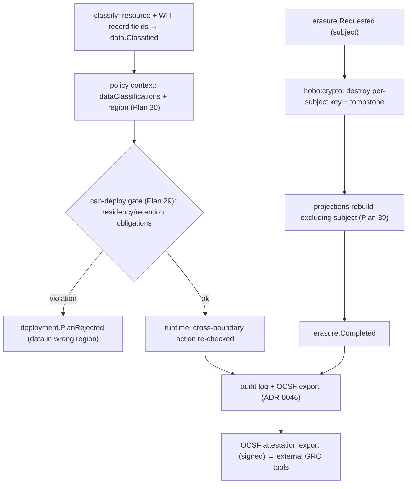

# Plan 46 — Compliance & data governance plane

> Part of the [HoBo Design Plan Suite](./README.md). A **governance plane over the existing planes**: **data-classification labels** drive **residency + retention enforced as policy obligations** at `can-deploy` *and* runtime; **right-to-erasure** is done by crypto-shredding + projection purge (honoring the forward-only log). The enforcement is the plane; an **OCSF attestation export** lets external GRC tools consume the audit facts. No new runtime — this is classification + policy + evidence-assembly over machinery HoBo already has. Decision record: [ADR-0060](./adr/ADR-0060-compliance-governance-plane.md).

> **Why this exists.** Residency was a *hint* ([ADR-0040](./adr/ADR-0040-cross-camp-stateful-consistency.md)/[ADR-0036](./adr/ADR-0036-air-gapped-sovereign-mode.md)), retention had a *floor* ([ADR-0023](./adr/ADR-0023-security-posture-commitments.md)), and audit/OCSF export existed ([ADR-0046](./adr/ADR-0046-boundary-standards-cloudevents-ocsf-otlp.md)) — but there was **no plane that turns a data classification into an *enforced* residency/retention decision** and no **right-to-erasure** mechanism. The enforcement is the gap HoBo had the raw materials for but no plane to deliver; attestation evidence rides out as an OCSF export.

## Data classification — the input everything keys on
Resources and WIT-record fields carry a **classification label** (`public` / `internal` / `pii` / `phi` / `pci` / `secret`, extensible). Labels attach two ways:
- **On a resource** — `sql("patients").classify("phi")` — the coarse default for everything it holds.
- **On a WIT-record field** ([ADR-0051](./adr/ADR-0051-wit-record-canonical-domain-schema.md)) — `email: pii`, `ssn: pii` — fine-grained, so a projection ([Plan 39](./39-data-plane-projections.md)) inherits classification per column and the schema *is* the data map.
Classification emits `data.Classified` ([Plan 11](./11-event-model.md)) and becomes the `context.dataClassifications` the policy plane already accepts ([Plan 30](./30-policy-plane.md) decision request). **Discovery** (scan a projection/field for likely PII) is an optional engine behind a port that *proposes* labels; humans/policy confirm.

## Residency & retention — enforced, not hinted
Classification + jurisdiction → **policy obligations** ([Plan 30](./30-policy-plane.md)) enforced at two points:
- **`can-deploy`** ([Plan 29](./29-contracts-compatibility.md)) — a plan that would place `phi` data in a Camp outside its allowed region is a **gate failure**, not a runtime surprise. This reuses the deterministic Matching context (`region`/`provider`, [ADR-0033](./adr/ADR-0033-deterministic-matching-and-planner-selection.md)) and cross-Camp residency ([ADR-0040](./adr/ADR-0040-cross-camp-stateful-consistency.md)); sovereign mode ([ADR-0036](./adr/ADR-0036-air-gapped-sovereign-mode.md)) is the strict ceiling.
- **Runtime** — a `notify`/replication/export action that would move classified data across a residency boundary is denied or mutated (e.g. region-pinned channel, [Plan 45](./45-app-communications.md)).

**Retention** is the dual: each classification declares a retention window; the compaction/archival rules ([Plan 11](./11-event-model.md)) honor it as a **floor and a ceiling** — audit streams are retained per policy, and data past its ceiling is a candidate for erasure. Retention rules ride the existing event-log compaction policy; no new store.

## Right-to-erasure on a forward-only log
The hard problem: HoBo's log is **append-only and never rewritten** ([Plan 11](./11-event-model.md)) — so how do you "delete" a user? **Crypto-shredding**, not history rewrite:
1. PII payloads are encrypted with a **per-subject key** via `hobo:crypto` ([Plan 21](./21-resources-catalog.md)/[Plan 31](./31-config-secretless-secrets.md)) — keys the app never holds.
2. An `erasure.Requested` opens a saga; **destroying the subject's key** renders every historical event carrying their PII permanently unreadable (the ciphertext stays, the plaintext is gone) and a **tombstone** event records the erasure.
3. **Projections rebuild excluding erased subjects** ([Plan 39](./39-data-plane-projections.md)) — the read side no longer surfaces the data; an `erasure.Completed` fact closes the saga.
This **honors the forward-only invariant** (no event is rewritten or removed) while delivering GDPR/CCPA deletion semantics — and it's auditable: the erasure itself is a replayable fact.

## OCSF attestation export — evidence from the log
HoBo standardizes the **enforcement**, not a compliance program. The audit facts it already records — the OCSF audit export ([Plan 12](./12-security-multitenancy.md)/[ADR-0046](./adr/ADR-0046-boundary-standards-cloudevents-ocsf-otlp.md)), `policy.Decided` (every access/residency/retention decision), `data.Classified`/`erasure.*` (the data lifecycle) — are exportable as a signed, point-in-time **OCSF attestation export** that external GRC tools can consume to assemble whatever certification evidence (SOC2/GDPR/HIPAA) a buyer needs. HoBo produces the replayable facts; it does not run the attestation program itself.

## Events & ports
- **New:** `data.Classified`, `governance.*` (residency/retention obligation lifecycle), `erasure.Requested`/`erasure.Completed` ([Plan 11](./11-event-model.md)). **Reused:** `policy.Decided`/obligations ([Plan 30](./30-policy-plane.md)), `compat.Gate*` ([Plan 29](./29-contracts-compatibility.md)), `match.Decided` region context ([ADR-0033](./adr/ADR-0033-deterministic-matching-and-planner-selection.md)), `hobo:crypto` ([Plan 21](./21-resources-catalog.md)), OCSF audit export ([ADR-0046](./adr/ADR-0046-boundary-standards-cloudevents-ocsf-otlp.md)), projection rebuild ([Plan 39](./39-data-plane-projections.md)).
- **Ports/engines behind ports:** a **classification/discovery** engine (built-in label rules; optional PII-discovery scanner) and a thin **OCSF attestation export** assembler (external GRC tools consume it). No new app-developer SDK surface beyond `.classify()` + `hobo attest`/`hobo erase`.

## Verification
- A plan placing a `phi`-classified `sql` in a non-permitted region is rejected at `can-deploy` with a precise residency violation; pinning to a permitted Camp passes.
- `hobo erase --subject <id>`: key destroyed, tombstone written, projections rebuilt excluding the subject, `erasure.Completed` — the subject's data is unreadable everywhere yet **no historical event was rewritten** (replay still works).
- `hobo attest` produces a signed OCSF attestation export whose every line traces to a source event (classification, residency/retention decision, access decision) for an external GRC tool to consume.
- A deploy routing `pii` to a Camp/provider outside its allowed region or classification fails the gate; pinning to a permitted target unblocks it (event-sourced) — the egress caveats for hosted embedders/models ([Plan 35](./35-search-vector-surface.md)) ride the same residency obligation.

## Scope (v1) & YAGNI
- **v1:** classification labels (resource + WIT-field) → enforced residency/retention obligations at `can-deploy` + runtime; crypto-shred erasure + projection purge; an OCSF attestation export over the audit facts for external GRC tools.
- **Deferred / out of scope:** the SOC2/GDPR/HIPAA attestation-program framing and a DPA/subprocessor registry as a product surface ([ADR-0064](./adr/ADR-0064-scope-ai-native-meta-cloud.md)) — HoBo exports the facts, GRC tools run the program; auto-PII-discovery beyond a basic scanner (proposes, never auto-classifies); data-lineage graph beyond classification + projection read-sets.

## Iteration hooks
- Classification taxonomy + whether labels are a closed enum or an extensible lattice with inheritance.
- Where the per-subject key boundary sits (per-user vs per-record vs per-tenant) — the granularity/erasure-blast-radius tradeoff.
- Whether attestation packs are first-party only or community/marketplace-distributed ([Plan 48](./48-marketplace-ecosystem.md)).
- Coupling the suppression list ([Plan 45](./45-app-communications.md)) to erasure so an erased subject is auto-suppressed across channels.
