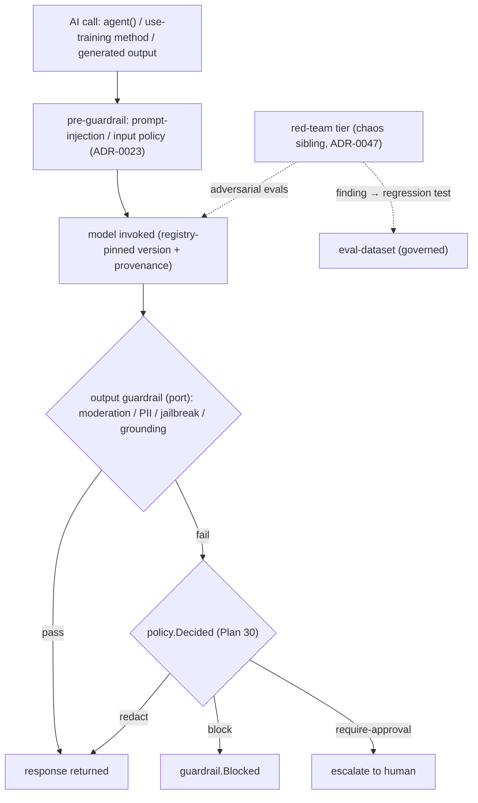

# Plan 47 — AI safety & model governance

> Part of the [HoBo Design Plan Suite](./README.md). Completes the AI-native thesis' **trust story**: a **model registry** (versioned models/prompts/eval-datasets with provenance + signing — the Registry pattern applied to models), **output guardrails** (a `guardrail` capability for moderation/PII/jailbreak/grounding checks as a gated step), **red-teaming** as a chaos-tier sibling, and **eval-dataset governance** — with **model cards** exported as facts (no responsible-AI "program"). The four-lens taxonomy (Contract/Eval/Policy/Trace) applied to model & prompt changes. No new runtime. Decision record: [ADR-0061](./adr/ADR-0061-ai-safety-model-governance.md).

> **Why this exists.** HoBo is AI-native to its core — `"use training"` ([Plan 23](./23-stubbable-ai-implementations.md)), the Forge ([Plan 33](./33-forge-generation-pipeline.md)), the Operator Crew ([Plan 40](./40-operator-agents.md)), the generated stack ([Plan 41](./41-generated-stack.md)). It had **prompt-injection defenses** ([ADR-0023](./adr/ADR-0023-security-posture-commitments.md)), **evals** ([Plan 23](./23-stubbable-ai-implementations.md)), and a **PII-not-trained** policy ([ADR-0025](./adr/ADR-0025-use-training-directive-and-training-engine.md)) — but **no governance of the models/prompts themselves**, no **output guardrails**, no **red-teaming**, and no **model cards**. A platform whose differentiator is "AI everywhere" must govern that AI, or the differentiator is also the biggest liability.

## A model registry (the Registry pattern, applied to models)
Models, prompts, and eval-datasets are **versioned, signed, provenance-bearing artifacts** in the existing **Registry** ([Plan 6](./06-ai-native-agent-auth.md)/[Plan 27](./27-drivers-packs-profiles.md)) — the same machinery that holds providers and Resource Packs:
- A **model entry** pins `{ id, version, provider, weights-or-endpoint ref, model card, eval results, signature }`. Local/in-boundary models and hosted endpoints are both entries (the latter with an egress caveat, like a subprocessor — [Plan 46](./46-compliance-governance.md)).
- A **prompt entry** is a versioned artifact too — because in HoBo a prompt *is* persisted code ([ADR-0048](./adr/ADR-0048-persisted-code-mutation-mechanism.md)) when `"use training"` rewrites it. Promotion is gated.
- An **eval-dataset entry** carries its own provenance + classification ([Plan 46](./46-compliance-governance.md)) — so a PII-bearing dataset can't be used for training ([ADR-0025](./adr/ADR-0025-use-training-directive-and-training-engine.md)).
`model.Registered`/`model.Promoted` are events; promotion runs the four-lens gate below.

## Output guardrails — a gated step in every AI call
A **`guardrail` capability** ([Plan 21](./21-resources-catalog.md)/[Plan 24](./24-wit-interfaces-reference.md)) runs **moderation / PII-leak / jailbreak / grounding** checks as a **policy-gated step** ([Plan 30](./30-policy-plane.md)) wrapped around any AI output — `agent()` responses ([Plan 6](./06-ai-native-agent-auth.md)), `"use training"` method outputs ([Plan 23](./23-stubbable-ai-implementations.md)), and generated-stack artifacts ([Plan 41](./41-generated-stack.md)). Engines sit **behind a port** (built-in rules default; **Llama Guard** / hosted moderation / a local classifier as adapters — chosen per Camp by Matching, air-gap → local). A failed check emits `guardrail.Blocked` and the policy decides: block, redact (mutate), or require-approval. Because it's the policy plane, "why was this output blocked" is a replayable `policy.Decided`.

## Red-teaming as a chaos-tier sibling
Adversarial evaluation reuses the **chaos verification tier** pattern ([ADR-0047](./adr/ADR-0047-chaos-resilience-verification-tier.md)): **hypothesis-driven, blast-radius-bounded, policy-gated** adversarial experiments against models/prompts/agents (jailbreak suites, prompt-injection corpora, harmful-content probes). A red-team run is event-sourced (`redteam.*`); a **discovered failure becomes a permanent regression test** in the governed eval-dataset — exactly as a chaos finding becomes a resilience regression test. Red-teaming runs in the same gated, replayable frame as every other HoBo verification tier.

## Eval-dataset governance
Eval-datasets are first-class governed artifacts (registry entries above): **versioned, classified, provenance-tracked**. This **extends the PII-not-trained policy** ([ADR-0025](./adr/ADR-0025-use-training-directive-and-training-engine.md)) into a full lifecycle — a dataset's classification ([Plan 46](./46-compliance-governance.md)) gates whether it may train or only evaluate; contamination checks (eval data leaking into training) are a policy rule; the `training-engine`'s reward signal ([Plan 23](./23-stubbable-ai-implementations.md) trajectories) is auditable against the dataset it was scored on.

## Model cards as facts
Every registered model carries a **model card** (intended use, training-data provenance class, eval results, known limitations, guardrail coverage) — a signed, replayable artifact assembled from the registry + `guardrail.*` + `redteam.*` + eval facts. Like compliance ([Plan 46](./46-compliance-governance.md)), HoBo exports these facts via the OCSF attestation export for an external GRC/responsible-AI tool to consume; it does **not** run a responsible-AI attestation *program* itself ([ADR-0064](./adr/ADR-0064-scope-ai-native-meta-cloud.md)). Model cards are the AI analog of the conformance/provenance bridge that underpins portability.

## The four lenses, applied to model & prompt changes
A model/prompt promotion is governed by the same four-lens taxonomy as any change ([Plan 29](./29-contracts-compatibility.md)/[Plan 30](./30-policy-plane.md)):
- **Contract** — the model's I/O schema + the guardrail floor *must never break* (a guardrail-coverage regression blocks promotion).
- **Eval** — the candidate *should improve* on the governed eval-dataset (champion/challenger + shadow, [Plan 23](./23-stubbable-ai-implementations.md)).
- **Policy** — *may/may not* be promoted (residency of weights, dataset classification, red-team clearance).
- **Trace** — *what actually happened* — every invocation is an OpenInference trajectory ([Plan 23](./23-stubbable-ai-implementations.md)) the registry links back to.

## Events & ports
- **New:** `model.Registered`/`model.Promoted`, `guardrail.Blocked`, `redteam.*` ([Plan 11](./11-event-model.md)); a **`hobo:guardrail`** port + `guardrail` catalog row ([Plan 21](./21-resources-catalog.md)/[Plan 24](./24-wit-interfaces-reference.md)). **Reused:** the Registry + signing/provenance ([Plan 6](./06-ai-native-agent-auth.md)/[Plan 27](./27-drivers-packs-profiles.md)), `policy.Decided` ([Plan 30](./30-policy-plane.md)), evals/trajectories/`training.*` ([Plan 23](./23-stubbable-ai-implementations.md)/[ADR-0025](./adr/ADR-0025-use-training-directive-and-training-engine.md)), the chaos tier ([ADR-0047](./adr/ADR-0047-chaos-resilience-verification-tier.md)), persisted prompts ([ADR-0048](./adr/ADR-0048-persisted-code-mutation-mechanism.md)), the OCSF attestation export ([Plan 46](./46-compliance-governance.md)).
- **Ports/engines behind ports:** the guardrail engine (built-in rules; Llama Guard/hosted/local adapters) and the red-team engine (built-in adversarial suites; external optional) — both certified by `@hobo/conformance` and air-gap-degradable.

## Verification
- A `"use training"` method whose candidate prompt regresses guardrail coverage is **blocked at promotion** (Contract lens) even if it improves the eval score (Eval lens) — replayable `policy.Decided`.
- A jailbreak that elicits disallowed content in a red-team run emits a `redteam.*` finding, becomes a regression test in the governed dataset, and fails future promotions until mitigated.
- An agent output containing PII is caught by the guardrail step → `guardrail.Blocked` (or redacted by policy); air-gap uses the local classifier with no egress.
- `hobo attest` produces a signed model-card export (via the OCSF attestation export) tracing to registry + guardrail + red-team + eval events, for an external responsible-AI/GRC tool to consume.

## Scope (v1) & YAGNI
- **v1:** model/prompt/eval-dataset registry entries (versioned, signed, provenance); the `guardrail` capability + one reference engine (built-in + Llama Guard adapter); red-teaming on the chaos-tier pattern; eval-dataset classification/contamination policy; model cards as exported facts; four-lens model-promotion gate.
- **Deferred / out of scope:** a responsible-AI attestation *program* framing ([ADR-0064](./adr/ADR-0064-scope-ai-native-meta-cloud.md)) — HoBo exports the facts, a GRC tool runs the program; automated continuous red-teaming campaigns; a watermarking/output-provenance scheme for generated media; fine-grained per-token cost/safety budgets (rides the spend breaker); model distribution rides Registry distribution ([ADR-0062](./adr/ADR-0062-marketplace-ecosystem.md)).

## Iteration hooks
- Whether guardrails are one `hobo:guardrail` port with check-type discriminators or a port per check class.
- Where the guardrail step sits for streaming responses (post-hoc vs incremental) — latency/safety tradeoff.
- How model-card schema aligns to emerging standards (EU AI Act technical docs, NIST AI RMF, model-card-toolkit).
- Sharing the red-team finding → regression-test loop with the Operator Crew's SRE postmortem loop ([Plan 44](./44-sre-incident-management.md)).
