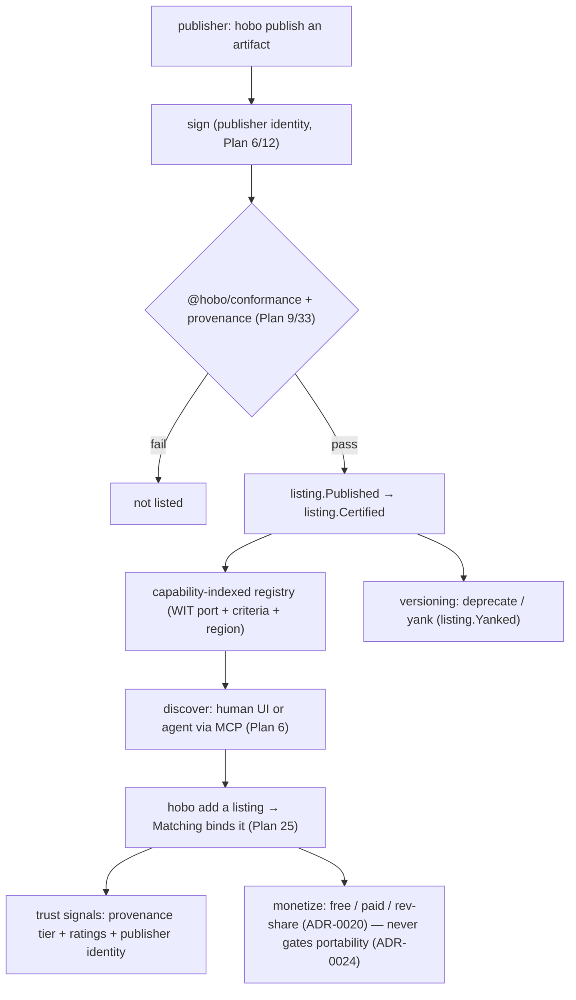

# Plan 48 — Marketplace & ecosystem

> Part of the [HoBo Design Plan Suite](./README.md). The **network-effect engine** over the Registry + Resource Packs ([Plan 27](./27-drivers-packs-profiles.md)) + signing/conformance ([Plan 9](./09-verification-open-questions.md)/[Plan 12](./12-security-multitenancy.md)) + monetization ([ADR-0020](./adr/ADR-0020-monetization-model.md)): **publish → discover → install → trust → monetize** for providers, Resource Packs, policy packs, agent-skills, runbooks, and Hobo Code modules. The hard rule, **never-gate-portability** ([ADR-0024](./adr/ADR-0024-portability-conformance-guarantee.md)): portability is never a paid feature. No new runtime — the marketplace is a governed index + lifecycle over artifacts HoBo already signs and certifies. Decision record: [ADR-0062](./adr/ADR-0062-marketplace-ecosystem.md).

> **Why this exists.** ADR-0020 *named* a marketplace as a monetization channel, and Plans 40/42/43 each **deferred** "a marketplace of operators / components / derivatives" — a standing forward-reference the suite never resolved. HoBo already has every primitive a marketplace needs (a Registry, signed Packs, conformance, provenance, monetization, MCP) but **no plane that ties them into publish→discover→install→trust→monetize**. This is that plane — and it's how the Forge + Crew compose with *community* content instead of only first-party.

## Listings — what's for sale (and what's free)
A **listing** is a published, versioned, signed artifact discoverable in the marketplace. Listing kinds reuse existing artifact types — the marketplace adds *distribution*, not new things to distribute:

| Listing kind | Underlying artifact | Source |
|---|---|---|
| **Provider** | a capability provider (WIT-port adapter) | [Plan 3](./03-providers-iac.md)/[Plan 33](./33-forge-generation-pipeline.md) (Forge-generatable) |
| **Resource Pack** | bundle of Resource Definitions | [Plan 27](./27-drivers-packs-profiles.md) |
| **Policy pack** | signed governance rules | [Plan 30](./30-policy-plane.md) |
| **Agent-skill** | a Crew/agent capability module | `@hobo/agent-skills` ([Plan 1](./01-monorepo.md)/[Plan 40](./40-operator-agents.md)) |
| **Runbook** | declarative incident response | [Plan 44](./44-sre-incident-management.md) |
| **Hobo Code module** | reusable config/code module | [Plan 38](./38-hobo-code-dsl.md) |
| **Guardrail / model card** | safety engine or governed model entry | [Plan 47](./47-ai-safety-model-governance.md) |

## Publish — signed, certified, provenance-bearing
Publishing a listing is **not** an upload — it's a gated promotion through the trust boundary HoBo already enforces:
1. **Sign** — the artifact is signed by the publisher's identity ([Plan 6](./06-ai-native-agent-auth.md)/[Plan 12](./12-security-multitenancy.md)).
2. **Certify** — it must pass `@hobo/conformance` for the WIT versions it claims ([Plan 9](./09-verification-open-questions.md)/[Plan 24](./24-wit-interfaces-reference.md)) — the same gate human- and Forge-authored adapters pass.
3. **Provenance** — SLSA-style build provenance + (for generated artifacts) the Forge's model/prompt/seed pinning ([Plan 33](./33-forge-generation-pipeline.md)) is attached.
`listing.Published` then `listing.Certified` are events; an uncertified artifact can't be listed. This makes "is this third-party provider safe to install" answerable from facts, not reputation alone.

## Discover — capability-indexed, agent-drivable
Discovery is **capability-indexed**: a listing is found by the **WIT port it realizes** + criteria ([Plan 25](./25-resource-definitions-matching.md) Matching dimensions) + classification/region needs ([Plan 46](./46-compliance-governance.md)) — so "find me a certified `database` provider for Azure in eu-west that passes conformance ≥ vX" is a structured query, not a text search. Because everything is capability-typed and MCP-surfaced ([Plan 6](./06-ai-native-agent-auth.md)), **an agent can drive discovery + install** as part of `hobo plan`/Forge — the marketplace is a first-class input to autonomous deployment, not just a human web page.

## Install — `hobo add`, bound by Matching
Installing is `hobo add <listing>` (generalizing `hobo pack add`, [Plan 27](./27-drivers-packs-profiles.md)): the artifact enters the local/Yard Registry as a candidate, and **Matching** ([Plan 25](./25-resource-definitions-matching.md)/[ADR-0033](./adr/ADR-0033-deterministic-matching-and-planner-selection.md)) decides where it actually binds — so installing a provider doesn't force its use; it makes it *available* to the deterministic selection. `listing.Installed` records the install + version. Air-gapped Yards install via the **signed offline bundle** path ([ADR-0036](./adr/ADR-0036-air-gapped-sovereign-mode.md)) — same trust boundary, no live marketplace connection required.

## Trust — provenance tier + ratings + identity
A listing's trustworthiness is a composite signal, not a star count:
- **Provenance tier** — `first-party` / `certified-community` (passed conformance + signed) / `forge-generated` (+ which model) / `unverified`. The tier is derived from facts, not claimed.
- **Publisher identity** — a verifiable identity ([Plan 6](./06-ai-native-agent-auth.md)); listings inherit their publisher's standing.
- **Ratings/usage** — community signal layered *on top of*, never *instead of*, the provenance/conformance floor.
Policy packs ([Plan 30](./30-policy-plane.md)) can require a minimum tier (e.g. "this Yard installs only first-party or certified-community providers") — so an enterprise governs its own supply chain.

## Monetize — without ever gating portability
Monetization reuses ADR-0020: a listing may be **free**, **paid**, or **revenue-share**, billed through the hosted `billing` port ([ADR-0039](./adr/ADR-0039-billing-quota-cost-attribution.md)). The **hard constraint**: **portability is never a paid feature** ([ADR-0024](./adr/ADR-0024-portability-conformance-guarantee.md)). Concretely — the conformance suite, the WIT ports, `hobo import`/export, and the ability to swap any provider for an equivalent are always free and open; a *specific* premium provider/pack can be paid, but the *escape hatch* to replace it with an OSS/Forge-generated equivalent always exists. The marketplace can't become a lock-in lever; that invariant is enforced, not promised. Because the Forge can *generate* a provider ([Plan 33](./33-forge-generation-pipeline.md)), the marketplace is never a community bottleneck either (the ADR-0020 point, now operationalized).

## Versioning, deprecation & yank
Listings are semver-versioned with conformance per version ([Plan 24](./24-wit-interfaces-reference.md)). A publisher can **deprecate** (still installable, warned) or **yank** (`listing.Yanked` — a compromised/broken version is pulled; installed copies are flagged by `hobo doctor`, not silently broken). Yank/deprecation are governed, event-sourced facts so "why did this disappear" is replayable — and a yanked-for-vulnerability listing feeds the security/SRE loop ([Plan 12](./12-security-multitenancy.md)/[Plan 44](./44-sre-incident-management.md)).

## Events & ports
- **New:** `listing.Published`/`listing.Certified`/`listing.Installed`/`listing.Yanked` ([Plan 11](./11-event-model.md)). **Reused:** the Registry + signing/provenance ([Plan 6](./06-ai-native-agent-auth.md)/[Plan 12](./12-security-multitenancy.md)), `@hobo/conformance` ([Plan 9](./09-verification-open-questions.md)/[Plan 24](./24-wit-interfaces-reference.md)), `provider.Registered`/`pack.Imported`/`forge.Certified` ([Plan 11](./11-event-model.md)), Matching ([Plan 25](./25-resource-definitions-matching.md)), the `billing` port ([ADR-0039](./adr/ADR-0039-billing-quota-cost-attribution.md)), MCP discovery ([Plan 6](./06-ai-native-agent-auth.md)), offline-bundle install ([ADR-0036](./adr/ADR-0036-air-gapped-sovereign-mode.md)).
- **No new infrastructure:** the marketplace is a governed index + lifecycle over existing signed/certified artifacts. `hobo publish` + `hobo add` are the CLI surface ([Plan 15](./15-cli-dx.md)).

## Verification
- `hobo publish` a provider: signing + conformance + provenance run; an artifact that fails conformance is **not** listed; a passing one emits `listing.Published → Certified`.
- `hobo add <provider-listing>` then a deploy: Matching binds it deterministically (or doesn't — install ≠ force), `listing.Installed` recorded; an agent can do the same via MCP.
- A Yard with a "first-party or certified-community only" policy pack **refuses** to install an `unverified` listing — replayable `policy.Decided`.
- **Portability invariant:** for any paid provider listing, an OSS/Forge-generated equivalent for the same WIT port is installable and passes the same conformance — the escape hatch is demonstrable, not theoretical.
- Air-gap: install via signed offline bundle works with no live marketplace; a `listing.Yanked` for a vuln flags installed copies via `hobo doctor`.

## Scope (v1) & YAGNI
- **v1:** listings for providers + Resource Packs + policy packs (the artifacts already signed/certified); publish (sign+certify+provenance) → discover (capability-indexed, MCP) → install (`hobo add`, Matching-bound) → trust (provenance tier + identity + ratings) → monetize (free/paid/rev-share via `billing`, portability never gated); versioning/deprecate/yank.
- **Deferred:** agent-skill/runbook/Hobo-Code/model listings (the kinds exist; their listing flows phase in with those subsystems); a hosted web storefront UI beyond the CLI/MCP surface; reviews/moderation tooling; complex revenue-share/tax/payout machinery (rides the hosted `billing` adapter).

## Iteration hooks
- Whether the trust tier is a fixed ladder or a richer attestation set ([Plan 47](./47-ai-safety-model-governance.md) model cards as a precedent).
- How yank propagation interacts with already-deployed Sets (warn vs block re-deploy vs forced migration window).
- Curation model: fully open vs first-party-reviewed vs community-moderated tiers.
- Whether `hobo publish`/`hobo add` and `hobo pack add`/Forge certification share one promotion core or stay distinct surfaces.
