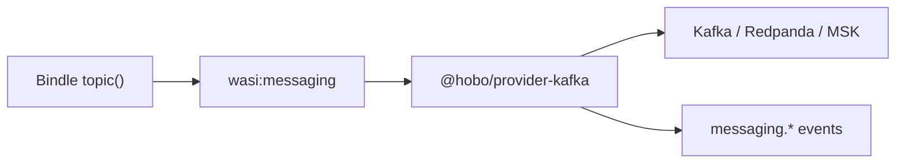
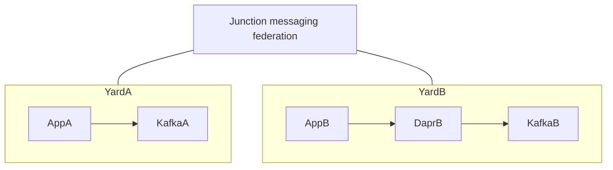

# Architecture, runtime, config, matching & environments — consolidated decisions

> Consolidated ADR decisions for **architecture, runtime substrate, config, matching & environments**. Each section is one architecture decision; see [`README.md`](./index.md) for the full ADR index.

## ADR-0001
**WASM/WASI/WIT-native; TypeScript is the first reference implementation.**

HoBo's programmable surface and runtime are **WASM/WASI/WIT-native** (the Component Model / wasmCloud): a building block is a **WIT interface**, a provider is a **WIT component**, the wire is **wRPC** ([ADR-0069](#adr-0069)). **TypeScript is the first reference implementation, not a requirement** — any Component-Model language authors against the same WIT contracts ([ADR-0072](#adr-0072)). The control plane dogfoods the same model (the Yard is itself a Bindle, [Plan 4](../control-plane.md#plan-04)). **Kubernetes is optional** — one possible execution adapter, never the foundation. **No IaC engine or hosting tech is fixed by HoBo**: whoever runs a self-hosted cloud **configures the IaC provider**, and hosting tech is selected **per workload** via Matching ([ADR-0006](#adr-0006)/[ADR-0033](#adr-0033)). The **ports are the full capability/resource surface** — APIs, schedules, AI, websites, storage, secrets/config, data/caching, messaging, feature flags, functions/workflows (Nitric + Vercel parity, [ADR-0002](#adr-0002)/[Plan 21](../authoring-resources-wiring.md#plan-21)) — not just the runtime substrate and infra ports. The cost is owning the reconciliation/HA a Kubernetes foundation would otherwise provide ([Plan 5](../reliability-observability-cost.md#plan-05)).

## ADR-0002
**Pluggable durable ports + a built-in engine (the Camp runtime).**

HoBo defines runtime ports (EventStore+Queue+Streamer+ActorHost+Clock), provided per Camp, and ships a **built-in runtime engine** (`runtime-local`, the zero-dep default). The capability/resource surface targets **parity with Nitric and Vercel** — APIs, schedules, AI, websites, storage, secrets/config, databases/caching, messaging, feature flags, and functions/workflows — all expressed as resources behind ports ([Plan 21](../authoring-resources-wiring.md#plan-21)). **Concrete runtime/provider adapters (`runtime-postgres`/`-temporal`/…, the cloud/IaC/build providers) are NOT in core — they ship as separate, provider-specific extension packages** (first-party-authored to seed adoption, consumed like git-registry plugins, [ADR-0006](#adr-0006)); core ships the ports + the built-in engine only. This delivers portability with no hard engine dependency, at the cost of maintaining the built-in engine plus a conformance suite for the runtime ports ([Plan 2](../sdk-api.md#plan-02)).

**The portability/no-dependency guarantee is only real if the suite asserts the durability invariants** — otherwise a backend (`runtime-postgres`/`-temporal`/`-restate`/`-cloudflare`) can be "conformant by name" while silently breaking exactly-once or split-brain safety. The runtime-port suite **enumerates hard assertions** (mirroring the `component-host` suite, [ADR-0031](#adr-0031) §5): **fencing-token rejection** (a stale-fence append fails — single-writer/split-brain), **idempotency-key dedup** (exactly-once *effects* over at-least-once), **`seq`-conditional append** (optimistic concurrency / no lost updates), and **deterministic replay == live state**. A backend that doesn't pass these may not back a Camp — *no durability guarantee without a conformance assertion that enforces it* ([Plan 9](../generated-stack.md#plan-09)).

## ADR-0003
**Event sourcing + CQRS as the foundation (command store, actor-produced events, cached materializations).**

An append-only **event log is the single source of truth** for both planes; **CQRS is the opinionated app-layer model**. The write side is a **command store**: actors execute commands and **produce events** ([ADR-0053](03-data-plane.md#adr-0053)); the read side **persists materialized views** in a read store, with the **most-recent value cached by default** for fast access. **Replay is from snapshots + cache, not always from `seq 0`**: periodic snapshots bound replay cost, and a rebuild folds the events after the latest snapshot. This gives free replay/audit/time-travel and recovery, at the cost of CQRS discipline, projections, snapshot/cache management, and schema upcasting ([Plan 11](../data-plane.md#plan-11)/[ADR-0050](03-data-plane.md#adr-0050)).

## ADR-0004
**Choreography sagas + virtual actors for orchestration.**

Orchestration is per-resource virtual actors (grains) reconciling desired↔actual, coordinating via events; compensation by choreography. **Compensation is robust under crash/failure, not just the happy path:** (a) a `deployment.RolledBack` flips each already-provisioned resource's **desired state to Destroyed**, so a crashed actor **re-derives the rollback on replay** (it's reconciliation, not a one-shot event it can miss); (b) reverse-dependency destroy order is **gated on observing dependents' `resource.Destroyed`** (a resource won't destroy while a dependent still exists); (c) a destroy that itself fails has an explicit **`Compensating → CompensationFailed`** terminal that **escalates to an incident** ([Plan 40](../operators-sre.md#plan-40)) rather than leaving the saga silently half-rolled-back. This gives no coordinator SPOF and per-resource isolation, at the cost of a harder "see the whole flow" — mitigated by the DeploymentView projection ([Plan 4](../control-plane.md#plan-04)).

## ADR-0005
**One ports/adapters shape for cloud, IaC, and build/VM.**

`CloudProvider`, `IacProvider`, `BuildProvider` are all swappable ports; a cloud provider composes the other two. The default **`BuildProvider` is a dagger-adjacent programmable build engine** — a DAG of containerized build steps — that **packages wasm components as OCI images by default (wasm-on-OCI)**, so `addContainer(...)` both wires *and builds* the container from one syntax. This gives uniform extensibility and one build mechanism for wasm-first and container workloads, at the cost of a provider implementing more surface to be "complete" ([Plan 4](../control-plane.md#plan-04)). The build *engine* runs on a **`build-machine`** host (self-hosted/GitHub/Blacksmith/Depot) the **Dispatcher** cost-routes per build ([ADR-0071](#adr-0071)).

## ADR-0006
**IaC mechanism: pluggable adapters (Pulumi · Crossplane · Terraform · OpenTofu); no single primary.**

The `IacProvider` port has **first-party adapters for Pulumi (Automation API), Crossplane, Terraform, and OpenTofu** — none is "the primary," and **they are NOT bundled into core**: each ships as a **separate provider-specific extension package** (first-party-authored to seed adoption, but installed/registered, not built-in). A self-hosted deployment **configures which IaC provider(s) it uses** on the **Yard** (or via Matching under the selected Yard, [ADR-0033](#adr-0033) / [yard-first-placement](yard-first-placement.md)) — Camps do not author cloud/IaC selection. **Nix is optional, never default multi-cloud IaC** ([devx-devenv-nix note](../devx-devenv-nix.md)). Adapters are **distributed and consumed like plugins from an external git registry**, and the port is **extensible using git repositories as importable modules**, so new IaC backends and shared modules install without forking HoBo. Regardless of adapter, **each resource owns an isolated IaC stack**: the unit of state is the resource, not the deployment.

Per-resource stacks give blast-radius isolation and rollback that reaches **what stack state records** — but a mid-apply failure (provider created an object, then the state-write failed: the classic "created-but-not-in-state" window) leaves an **orphan no destroy will reach**. So rollback is "destroy recorded state **plus a tag-based orphan sweep**": every provider object is tagged with `tenant/deployment/resource`, and reconciliation sweeps tagged objects absent from state (rather than re-creating duplicates on the next `refresh()`). "Clean compensation" is thus scoped honestly to recorded-state + orphan-sweep, at the cost of more state objects to manage ([Plan 4](../control-plane.md#plan-04)).

## ADR-0007
**Provider-specific options via an idiomatic typed-options builder (`.with(...)`).**

Per-provider optimization is additive, typed, and inert for non-resolved providers, so one Bindle targets many clouds unedited; `require`/`prefer` controls strictness. Provider options use an **idiomatic typed-options builder pattern** — the same shape .NET uses for middleware/service configuration (`addX(options => { … })` with a strongly-typed, per-provider options object) — so options are discoverable, validated, and composable. The agnostic promise and escape hatch coexist, at the cost of provider packages exporting accurate typed option builders ([Plan 2](../sdk-api.md#plan-02)).

## ADR-0011
**Scopes are first-class SDK objects (`bindle`/`camp`/`yard`/`junction`), not config files.**

The four scopes are constructed and composed **programmatically in the SDK**, not declared in separate `*.config.ts` files. `bindle(name)` declares the provider-agnostic app (`.addContainer(...)`, abstract deps); `camp(name)` imports Bindles as a **provider-neutral deployment target** until attached (`camp.import(app)`); `yard(name, { provider, camps? })` **authors the provider** and groups Camps under that provider with cross-Camp policy/gateways (`yard.setup(camp1, camp2)`); `junction(name)` connects Yards across clouds (`junction.add(azureYard, awsYard)`). The objects **are** the topology; config is data on them, not a parallel file. This gives one composable, typed, testable surface, keeping the Bindle **and the Camp** provider-agnostic until Yard attachment, while the Yard owns provider selection and the Junction carries cross-cloud federation ([Plan 2](../sdk-api.md#plan-02)/[Plan 7](../developer-experience.md#plan-07)/[yard-first-placement](yard-first-placement.md)).

## ADR-0026
**Scope model: `Bindle ⊂ Camp ⊂ Yard ⊂ Junction`.**

Four nested scopes, each owning a distinct kind of "what varies":

1. **Bindle = the app, provider-agnostic.** App-level abstractions only — service boundaries and **abstract dependencies** (a SQL/data store, a message bus, a bucket) — with **no cloud-provider specifics**. A Bindle deploys *into* Camps unchanged.
2. **Camp = a provider-neutral deployment target until attached to a Yard.** It imports Bindles and carries environment type, runtime-backend preference, and camp-local networking constraints. **It does not select the cloud provider** — the **Yard owns provider selection**; a Camp **infers** provider (and thus which concrete resources / IaC stack apply) from Yard attachment or Yard placement policy ([yard-first-placement ADR](yard-first-placement.md)). Two Camps can be the same Bindle under the same Yard but differ by group/region/env. A Camp **provides the durable runtime** (EventStore + Queue + Streamer + ActorHost + Clock, behind the `Runtime` interface; built-in `runtime-local`, backends `runtime-postgres`/`-temporal`/`-restate`/`-cloudflare`) once placed. **Camps can move between Yards** via **Trails** (app-owned continuous migration recipes), not via Camp-local provider pins.
3. **Yard = cross-Camp scope, provider-specific; owns provider selection.** A Yard groups Camps under **one** provider (`yard(name, { provider, camps? })`) and applies **cross-Camp constraints**: policies, provider-global networking (e.g. a vWAN), and global gateways (e.g. Azure Front Door). It runs the control plane for its provider. Zero Camps are allowed (requested shape before a live instance).
4. **Junction = cross-cloud / hybrid.** A Junction connects **Yards** (each provider-specific) for multi-cloud and hybrid scenarios — federating trust + signed artifacts + cross-cloud policy, never a shared-state controller ([ADR-0043](07-portability-extensibility.md#adr-0043)).

**Camps are inferred, but approval is a platform choice — and the cloud must exist first.** A Bindle deploys with **no Camp declared**: given the platform team's **approved default providers** ([ADR-0062](07-portability-extensibility.md#adr-0062)), the HoBo cloud **infers** a Camp (placement) under a selected/inferred **Yard** and would auto-place/rebalance via the Dispatcher ([ADR-0071](#adr-0071)). But an inferred Camp is **not approved by default** — approving it is a **deny-by-default control-plane decision** ([ADR-0074](02-identity-security.md#adr-0074)): a platform-engineer admin **enables auto-approval** or sets a **policy that passes for approval** (e.g. auto-approve inferred Camps on approved defaults outside production), else approval is explicit. This **happy path exists only because** a platform team first stood up the cloud, approved defaults, **and turned on (or wrote a policy for) inferred-Camp approval**; anything outside that escalates to explicit approval or a hand-authored **Camp / Yard / Junction** (the pin/override). So scopes are *inferred and policy-approved* by default and *authored only to override*; the nesting above defines structure *when scopes exist*, not a precondition for deploying.

**Environments are a matching dimension, not a layer** — a Camp carries an `environment type` ([Plan 25](../platform-engineering.md#plan-25)/[Plan 25](../platform-engineering.md#plan-25)).

**WIT interface** is the WebAssembly Component Model term ([Plan 20](../wasm-runtime-wit.md#plan-20)/[Plan 20](../wasm-runtime-wit.md#plan-20)) — the contract shape for ports.

### Consequences
- **(+)** Each level maps to a real concern: portable app (Bindle) / Yard-attached deployment target (Camp; provider inferred from Yard) / provider-global cross-Camp policy + gateways (Yard owns provider) / cross-cloud + hybrid (Junction), with no overloaded noun. Camps remain mobile across Yards via Trails.
- **(−)** Four nested scopes are more model to learn than a flat app/environment split.

## ADR-0031
**wasm host of record: self-hosted wasmCloud (default), wasm-in-container floor.**

HoBo is **wasm-first, OCI-container fallback** ([Plan 20](../wasm-runtime-wit.md#plan-20)), with WIT interfaces as the port contracts and late-bound **links** binding a component's imports to a provider's exports. The **host of record** — *what actually executes components* locally and in prod — is concrete so the "any language, one artifact, runs anywhere" claim holds and [ADR-0026](#adr-0026)'s "a Camp selects its runtime backend" has an answer at the wasm execution layer. Nomad was the evaluated scheduler alternative this decision displaces — see [ADR-0106](#adr-0106) and the [Nomad parity tracker](../../competitors/nomad.md#primitive-mapping).

1. **The wasm host is a port, not a mandate.** Introduce a **`component-host`** capability/port (the WASI interface impls + the link table + the component lifecycle). The host is a **property of a Camp** under its **Yard** ([ADR-0026](#adr-0026), [yard-first-placement](yard-first-placement.md)) — a Camp may declare a `component-host` preference and a runtime-backend preference the same way it declares other substrate requirements, while the **Yard owns cloud/infra provider selection** and the Camp **infers** that provider on attach. Camps stay heterogeneous ([ADR-0028](#adr-0028)): under one Yard, one Camp may run SpinKube while another runs provider-native.
2. **Default = self-hosted wasmCloud.** The default host is the **wasmCloud lattice** (CNCF; hosts mesh over **NATS/JetStream**), **self-hosted on your own infrastructure** — **Kubernetes** (the `wasmcloud-operator` + Helm-bundled NATS), **Coolify/Docker**, or **bare metal/VPS** — with no managed-cloud dependency. wasmCloud is the deliberate default because its lattice **speaks wRPC natively** — exactly HoBo's membrane ([ADR-0069](#adr-0069)) — so the whole stack (WIT ports + wRPC links + cross-host late binding) is coherent end-to-end, and it **embeds Wasmtime**, preserving dev/prod parity. Self-hosting keeps it portable: any k8s (Hetzner/k3s/Talos/AKS/EKS/GKE) or any Docker host runs it.
3. **wasm-in-container is the zero-infra portable floor; other hosts are opt-in.** For the simplest "runs anywhere a container runs" case (and Coolify/Docker deploys), the component host runs **inside an OCI container** via the existing OCI pipeline ([Plan 21](../authoring-resources-wiring.md#plan-21)) with **zero new infra** — the floor every Camp can fall back to. **SpinKube / containerd-wasm** (k8s shim density) and **provider-native wasm** (e.g. **Cloudflare Workers**) are opt-in adapters chosen per Camp, each certified against the `component-host` conformance suite ([Plan 9](../generated-stack.md#plan-09)).
4. **Local/dev + the `runtime-local` host = Wasmtime.** The canonical Bytecode Alliance Component-Model engine is the host of record for `hobo dev` and the built-in runtime, so **local semantics match prod** (the in-container default also embeds Wasmtime). **jco-in-Node is rejected** as the dev host — a second, divergent wasm semantics surface would undermine dev/prod parity.
5. **One conformance boundary, version-pinned.** A `component-host` adapter may only be selected by a Camp if it passes the **`@hobo/conformance/component-host`** suite ([Plan 9](../generated-stack.md#plan-09)) — the same trust machinery as provider/runtime-port conformance. The suite asserts the exact properties HoBo's guarantees depend on: **deterministic-Clock trace replay** (same run → identical state across hosts, for event-sourced replay [Plan 11](../data-plane.md#plan-11)), **`wasi:*` interface round-trip** (vendored/pinned interfaces behave identically), **link late-binding semantics** (an imported interface resolves to a provider export the same way everywhere), and **capability-handle isolation** (deny-by-default; an un-linked capability call fails). The chosen host **kind + version is pinned in the manifest IR** ([Plan 21](../authoring-resources-wiring.md#plan-21)): a Bindle records what it was built/certified against, and a Camp whose host is incompatible fails planning with a precise reason (mirroring the `wasi:*`/runtime version policy in [ADR-0024](07-portability-extensibility.md#adr-0024) §5). Host upgrades go through an explicit gated path with an **upcaster** where semantics change — no silent rewrite of component behavior. Host-specific capabilities (e.g. wasmCloud lattice link-migration) are typed as host-`.with()` options, inert on hosts that don't offer them, and flagged by `hobo doctor` as host lock-in (same model as provider `.with()`).

### Consequences
- **(+)** The default is a coherent, **self-hostable, CNCF** stack (self-hosted **wasmCloud** + the **wRPC** membrane + **Wasmtime**, on any k8s / Coolify / bare metal, no managed-cloud dependency), with **wasm-in-container** as the zero-infra portable floor and provider-native/SpinKube hosts opt-in — every component conformance-verified across hosts.
- **(−)** Self-hosted wasmCloud means operating **NATS/JetStream + the wasmCloud hosts** (more than a bare container, though the `wasmcloud-operator` + Helm bundle make it turnkey), and several host adapters mean conformance surface to build and maintain.

## ADR-0069
**The runtime & membrane: WIT-interface providers over wRPC, wrapped by a thin SDK.**

HoBo realizes the "runtime + membrane + provider" shape (proven by Nitric: app code → SDK → local runtime/membrane → provider plugin) natively on the WebAssembly **Component Model** rather than on a language-specific plugin SDK and a hand-rolled gRPC wire. The membrane is the component model — built on WIT ports ([Plan 20](../wasm-runtime-wit.md#plan-20)), late-bound **links**, and the `component-host` ([ADR-0031](#adr-0031)) — not a parallel mechanism.

1. **The runtime provides a full building-block set (Nitric parity), each as a WIT interface** ([Plan 20](../wasm-runtime-wit.md#plan-20)): APIs/HTTP, schedules, topics & subscriptions (pub/sub), queues, key/value, storage/blob, secrets, SQL, and websockets — alongside HoBo's own durable workflow/actors, reactive materializations, auth, and AI/training. A "building block" is just a **port** ([ADR-0005](#adr-0005)).
2. **Providers implement the WIT interfaces directly — not a Go/TS plugin SDK.** A provider is a WASM **component** (or WIT-conformant adapter) that *exports* the building-block interfaces; there is no HoBo-specific provider language or plugin API to learn — the contract **is** the WIT interface, and the generation pipeline can generate it ([ADR-0010](03-data-plane.md#adr-0010)/[ADR-0010](03-data-plane.md#adr-0010)). This is the key departure from Nitric's per-language provider plugins.
3. **The membrane is wRPC, not plain gRPC.** App-component imports are bound to provider-component exports by **links** and invoked over **wRPC** (wasmCloud's WIT-native RPC; transport-agnostic, NATS by default), so the same WIT contract drives in-process, cross-process, and cross-host (lattice) invocation — consistent with the `component-host` adapters ([ADR-0031](#adr-0031), incl. the wasmCloud-lattice host). No separate IDL or hand-maintained protobuf: the wire is generated from WIT. **The three invocation modes have different failure modes, so the membrane specifies them, not just the happy path** ([Plan 20](../wasm-runtime-wit.md#plan-20)): a **caller-supplied deadline propagates** with the call (every link is a Plan 5 timeout boundary, `link.Called` carrying the deadline); **backpressure** maps to NATS/JetStream flow-control so a saturated provider sheds rather than collapses; a **partial/ambiguous failure** (hung, severed mid-stream for the long-lived `wasi:io` streaming interfaces, ambiguous return) is classified into the Plan 5 failure taxonomy and reconciled by the idempotency-key rule (exactly-once for EventStore-append effects; **at-least-once + provider-side idempotency for provider RPC**, [Plan 5](../reliability-observability-cost.md#plan-05)); and a **runtime wire-version mismatch** (caller and provider built against different pinned wRPC/WIT minors meeting across a lattice link) is resolved by a defined rule — **negotiate the highest shared minor at or above a declared compatibility floor; below the floor, reject the *link* (not silently the call) with a typed `version-incompatible` error** surfaced at deploy/link-time — never silently coerced. These are gated by `@hobo/conformance/component-host` ([Plan 9](../generated-stack.md#plan-09)).
4. **A thin SDK wraps the runtime.** The TS SDK ([Plan 2](../sdk-api.md#plan-02)) is ergonomic sugar over the generated WIT bindings — typed clients for the runtime's imported interfaces. It holds **no cloud logic**; all behavior lives behind the WIT ports in the runtime + providers, so the SDK stays small and every language with a Component-Model binding can host the same app. The SDK is itself **WIT-first**: a canonical `hobo:sdk` WIT package `wit-bindgen`'d per language + a conformance-gated idiom layer — TS is the first idiom layer, not the source of truth ([ADR-0072](#adr-0072)).
5. **Deny-by-default enforcement is structural; the grant set is inferred from usage.** *Enforcement* is unchanged — an imported interface with no link / no grant cannot be invoked; wRPC only routes linked interfaces and capability handles are deny-by-default ([ADR-0023](02-identity-security.md#adr-0023)/[Plan 21](../authoring-resources-wiring.md#plan-21)). What is *authored* changes: the **grant set** (the `links` + `allow` baked into the manifest) is **inferred from usage by default** — resource-collection plus static analysis of the WIT functions a component actually imports/calls computes the least-privilege used-set, so `.allow()` is **optional**, written only to **narrow below usage** (assert a tighter contract — `can-deploy` fails if the code exceeds it) or to grant a **dynamic** verb static analysis can't see. Inferred = the used-set, so least-privilege is preserved *and recorded* (auditable in the manifest diff); a **policy-pack deny-ceiling** ([ADR-0074](02-identity-security.md#adr-0074)) still caps it — the separation between *usage* (app, inferred) and *policy* (SecOps, declared). Capability is granted by linking, not by ambient reachability.
6. **The contract is WIT/WASM, not a language.** The entire programmable surface — Bindles, services, providers — targets the Component Model and runs on wasmCloud; HoBo requires **WIT + WASM**, with **TypeScript as the first reference implementation, not a requirement**. Any language with a Component-Model toolchain authors against the same WIT interfaces.

### Consequences
- **(+)** One contract everywhere: a building block is a WIT interface, a provider is a WIT component, the wire is wRPC generated from that WIT — local dev, cross-process, and lattice all use the same mechanism ([ADR-0031](#adr-0031)), with conformance ([Plan 9](../generated-stack.md#plan-09)) as the single trust boundary and no language lock-in for provider authors.
- **(−)** wRPC is younger than gRPC (HoBo pins/vendors its wRPC + WIT versions and ships a membrane conformance suite), and "everything is a WIT interface" demands disciplined interface design + versioning ([ADR-0024](07-portability-extensibility.md#adr-0024)).

## ADR-0085
**wRPC + WIT baseline: exact toolchain pins, vendored interface hashes, and preview upcasters.**

HOBO-12 fixes the first version floor for the runtime membrane so downstream WIT and host slices build on one reproducible contract rather than a moving "latest" toolchain. The baseline is recorded as exact pins, not ranges: **Wasmtime/Component Model host `46.0.1`**, **`@bytecodealliance/jco` `1.24.3`**, **`@bytecodealliance/componentize-js` `0.21.0`**, **`wit-bindgen-cli` `0.58.0`**, **`wrpc` `0.17.0`**, and **wasmCloud `2.4.0`** as the self-hosted lattice integration floor. Wasmtime is the compatibility floor for local/component-host semantics; wasmCloud remains the default lattice host because it speaks wRPC natively ([ADR-0031](#adr-0031)/[ADR-0069](#adr-0069)).

The vendoring layout is `wit/deps/<namespace-package>/...` plus a lock manifest that records each imported/exported WIT contract as **`namespace:package/interface@semver@stability`** with a SHA-256 hash of the vendored source. The first smoke fixture vendors `wasi:clocks/wall-clock@0.2.0@stable` in `src/draft/exp-proofs/api/wrpc-wit-baseline-poc`; HOBO-15 expands this to the full reused `wasi:*` catalog. The manifest IR records the same per-interface pin shape, the component-model floor (`wasmtime@46.0.1`), and the selected link transport (`wrpc@0.17.0+nats`) so caller/provider skew fails planning instead of failing at runtime.

Preview and experimental interfaces may move faster than stable interfaces, but they still cannot silently mutate a deployed Bindle. Any breaking `preview` bump requires **an upcaster, a new Bindle version, and a deprecation window**; CI must reject a preview pin change that lacks those artifacts. A stable interface can take additive semver-compatible changes, but a hash drift or breaking shape change must either be pinned as a new version or fail the vendored-tree check. This applies equally to HoBo-authored `hobo:*` and vendored `wasi:*` packages.

### Consequences
- **(+)** WIT generation, wRPC links, and component-host compatibility now have a reproducible floor with drift checks; downstream interface work can cite one lock shape and one upgrade ceremony.
- **(−)** Toolchain upgrades become explicit work: bump the lock, regenerate fixtures, document compatibility, and add upcasters for any breaking or preview churn.

## ADR-0087
**Package namespace ownership map.**

HOBO-58 fixes the ambiguous boundary between the WIT package name `hobo:sdk`, npm `@hobo/bindles`, npm `@hobo/sdk`, and the topology/runtime packages. The ambiguity matters because docs can otherwise imply that `@hobo/sdk` is the app authoring SDK, when ADR-0072 reserves npm `@hobo/sdk` for operator and self-host extensions.

The canonical package/import table lives in [`package-namespaces.md`](../package-namespaces.md). `@hobo/bindles` owns app resource factories, bindle composition, connector declarations, and app config helpers including `config`, `secretRef`, `env`, and `fromBinding`. `@hobo/runtime` owns runtime control-flow primitives. `@hobo/camps`, `@hobo/yards`, and `@hobo/junctions` own topology factories and are not re-exported by `@hobo/bindles`. npm `@hobo/sdk` is the operator/self-host SDK for provider, policy, runbook, dispatcher, runner, generated provider, chaos surfaces. `@hobo/core` remains a shared type substrate, not an authoring import home.

`secret()` and `secretRef()` intentionally stay in `@hobo/bindles` with distinct meanings: managed secret resource versus config-value reference. Docs and future boundary lint must flag unqualified `@hobo/sdk` app-author guidance, topology imports from `@hobo/bindles`, and mixed runtime/operator `agent` imports without aliases.

### Consequences
- **(+)** App resource, runtime, topology, and operator imports are now reviewable by one table and one lint guard.
- **(−)** `@hobo/bindles` remains small and explicit, but users must import topology factories from their topology packages instead of a single omnibus SDK package.

## ADR-0072
**The SDK is WIT-first: a canonical `hobo:sdk` WIT package, generated per language, with conformance-gated idiom layers.**

HoBo treats WIT as the contract for providers ([ADR-0069](#adr-0069)), domain schema ([ADR-0051](03-data-plane.md#adr-0051)), and app-developer bindings ([ADR-0037](#adr-0037)); typed clients are generated from WIT (jco guest-types, [Plan 20](../wasm-runtime-wit.md#plan-20)). WIT cleanly expresses function signatures + records + imported interfaces — but **not** fluent builders, IfC collection-mode, decorators, or `.allow()` chaining, which are inherently language-side. The model splits the WIT-expressible *contract* from the language-native *ergonomics* without letting the ergonomics drift into new semantics.

1. **A canonical `hobo:sdk` WIT package is the SDK contract.** Beyond the capability + data interfaces ([Plan 20](../wasm-runtime-wit.md#plan-20)) and domain records ([ADR-0051](03-data-plane.md#adr-0051)), the SDK's **runtime primitives are pinned as WIT** — `workflow`/`step`/`actor`/`saga`/`agent`/`command`/`subscribe` signatures (the `hobo:workflow`/`hobo:actor`/`hobo:saga`/`hobo:agent` interfaces, [Plan 20](../wasm-runtime-wit.md#plan-20)) aggregated into the **`hobo:sdk` WIT package**. This package *is* the standard contract; its semantics are identical in every language.
2. **Each language SDK is built against WIT = generated bindings + a thin idiom layer.** A language SDK is produced by **`wit-bindgen`/jco against `hobo:sdk`** (the mechanical, low-level bindings) plus a **thin, language-native idiom layer** that adds ergonomics — TS builder chains + IfC collection ([Plan 21](../authoring-resources-wiring.md#plan-21)), Rust traits/builders, Python decorators/context-managers, Go option structs — and **nothing else**. The idiom layer lowers to the same generated bindings + emits the same **manifest IR** ([Plan 21](../authoring-resources-wiring.md#plan-21)); it carries **no cloud logic and no new semantics** ([ADR-0069](#adr-0069)'s thin-SDK rule, now made precise). The TS **`@hobo/bindles`** is therefore *the first idiom layer*, not a privileged source of truth. *(Naming: the npm **`@hobo/sdk`** package is a different layer — the operator/self-host SDK; the app idiom layer over this `hobo:sdk` WIT contract is **`@hobo/bindles`**.)*
3. **The WIT/idiom seam is the honest split.** WIT owns the **contract** (primitive + capability + data signatures, the `.allow()` verb set, the manifest-IR shape); the idiom layer owns the **ergonomics** (fluent surface, IfC collection-mode side-effects, decorators) that can't be expressed in WIT. This is why the IfC fluent surface ([Plan 21](../authoring-resources-wiring.md#plan-21)) and the WIT contract coexist — the fluent/IfC surface *is* the idiom layer, compiling down to the contract. **Hobo Code** ([ADR-0049](#adr-0049)) and every language SDK are **front-ends over the one `hobo:sdk` contract**.
4. **The idiom layer is conformance-gated to *lowering-equivalence over a corpus* — not a proof of zero semantics.** A `@hobo/conformance/sdk` suite ([Plan 9](../generated-stack.md#plan-09)) asserts that, for the conformance corpus, an idiom layer's inputs **lower to identical WIT calls + identical manifest IR** across languages (golden-IR equivalence + replay) — bounded by the corpus, like every conformance suite, *not* a universal proof. The behaviors an idiom layer **legitimately owns and that lowering-equivalence can't constrain** — **error mapping** (a Rust `result`-unwrap vs a TS throw vs a Go `(T,err)` are the same WIT `result<>` at the boundary but different in-language control flow), **async/cancellation**, and **IfC collection-mode side-effects/order** — are governed by a per-language **semantics annex** with **negative/error-path + cancellation test vectors**, not by the happy-path corpus. So an idiom layer with a missing/wrong error or cancellation mapping **fails the annex**, not the golden-IR check. The honest claim is *lowering-equivalence + an enumerated semantics annex*, not "no semantics."
5. **Idiom layers may be hand-authored *or* SWE-operator/AI-generated — both conformance-gated.** A language SDK's idiom layer is normally hand-authored for genuine taste, but may also be **generated by the SWE operator** ([Plan 40](../operators-sre.md#plan-40)/[ADR-0054](03-data-plane.md#adr-0054)) via the generation loop ([Plan 23](../generated-stack.md#plan-23)) from `hobo:sdk`: `wit-bindgen` produces the bindings, the SWE agent writes the idiomatic wrapper, and `@hobo/conformance/sdk` gates it exactly as for a human author. There is no trusted-by-convention path — generated or hand-written, the parity gate is the same.
6. **Reverse compiling is a first-class direction.** **Forward** = `hobo:sdk` → bindings → idiom layer → a component imports the interfaces. **Reverse** = a component/artifact → its **extracted WIT interfaces** (what it actually imports/exports) → an idiom-layer skeleton (the SWE operator's starting point) **or** a parity/adoption report. The two directions share one contract.

### Consequences
- **(+)** One `hobo:sdk` WIT package is the contract: every language SDK is `wit-bindgen`'d against it + a thin idiom layer, so multi-language SDKs become a generation+conformance task, not N re-implementations, and "thin SDK" becomes testable (*thin = generated bindings + a semantics-free idiom layer*).
- **(−)** Pinning primitive signatures in `hobo:sdk` makes them a maintained public contract subject to WIT versioning ([ADR-0024](07-portability-extensibility.md#adr-0024)), and a `@hobo/conformance/sdk` golden-IR/replay suite per language is new test surface to keep current.

## ADR-0033
**Deterministic Matching & Planner selection (+ default objective).**

Matching uses **Resource Definitions** + **specificity-scored Matching** and the auditable **`match.Decided`** event ([Plan 25](../platform-engineering.md#plan-25)); the **Planner is a pure function** ([Plan 4](../control-plane.md#plan-04)) with capability negotiation (`require` hard / `prefer` soft), region/colocation, and an *optional* cost-shaping step. HoBo's differentiator over Humanitec's opaque, specificity-based selection is an auditable, replayable decision — which holds only because selection is deterministic.

1. **Selection on the deploy path is deterministic rules — a pure function.** Selection is a pure function of `(catalog snapshot, deploy context, objective setting)` — **no clock, RNG, network, or model** — so it is unit-testable without a cloud and **identical on replay** (the property [Plan 9](../generated-stack.md#plan-09) already asserts of the Planner). **AI and cost/constraint *solvers* are advisory only, off the deploy path:** `hobo plan` may *surface* a cheaper alternative; the **generation pipeline** may *generate* candidate definitions ([Plan 23](../generated-stack.md#plan-23)); an LLM may *suggest* definitions at authoring time. None select at deploy time, so replay + `match.Decided` stay honest.
2. **The pipeline is gather → filter → rank → record:**
   - **Filter** to candidates whose criteria match the context **and** whose provider satisfies the resource's hard **`require`** capabilities (`Capability.satisfies` = `full` → accept; `prefer` may degrade with a `PlanWarning`; `require` miss → reject). If none satisfy `require` → **`deployment.PlanRejected`** with a precise, agent-correctable reason.
   - **Rank lexicographically:** (a) **specificity score** ([Plan 25](../platform-engineering.md#plan-25)) → (b) **explicit platform priority** (a new optional `priority` field on a definition, for deliberate override) → (c) the **default objective** (soft) → (d) a **stable deterministic tiebreak** (definition id, lexicographic).
3. **The default objective is configurable, defaulting to min-cost within constraints.** The objective is a Yard/Camp setting — `cost` | `latency` | `single-provider` | `carbon` | **`maximize-credits`** (credit/budget-aware cost, [ADR-0071](#adr-0071)) — defaulting to **lowest cost subject to satisfying `require`/`prefer`/region/colocation**. The region/colocation step ([Plan 4](../control-plane.md#plan-04) §4) already minimizes cross-provider egress, so cost is the natural remaining optimizer; the chosen objective is recorded in `match.Decided`/`deployment.Planned`.
4. **A true tie gets a stable tiebreak + a warning, never a block.** When candidates are equal on specificity, priority, and objective, break by the stable key (definition id) so the result is always deterministic + replay-stable, **and** emit a `PlanWarning` + flag the tie in `match.Decided` so a platform engineer can add an explicit `priority` to disambiguate.
5. **Enrich `match.Decided`; add no new event types.** Its payload carries the winner, the full ranking, the rejected candidates (with reasons), the objective used, and the tie flag.
6. **Static provider-capability feedback with remediation, at author time.** Registered providers/deps **advertise the capabilities they support** (the same `Capability` model the filter uses, sourced from the Capability Manifest, [ADR-0009](02-identity-security.md#adr-0009)). The SDK + Matching evaluate this **statically (compile-time)**: when a configuration uses a capability the selected provider does **not** support, surface **compile-time feedback** at the authoring site — and **suggest a remediation** (e.g. "provider X doesn't support containers — host them on registered provider Y that does"). This is **in addition to** the deploy-time `can-deploy`/`require`-miss rejection in (2): the same capability check runs early, against the catalog snapshot, so unsupported configurations are caught at author time with an actionable suggestion rather than only failing at deploy. Static feedback flows through the codegen surface ([ADR-0037](#adr-0037)) and `hobo doctor`; it is advisory at author time and remains backed by the hard `PlanRejected` gate on the deploy path. The check is **stability-aware** ([ADR-0075](07-portability-extensibility.md#adr-0075)): it reads the provider's Capability Spec (`interface@version@stability`), so a capability available only via a **`preview`/`experimental`** interface (e.g. `wasi:websocket`) surfaces a "pinned, may change" warning, and an unavailable one an error + remediation — both before deploy.

### Consequences
- **(+)** Matching is **demonstrably deterministic + auditable** — "why did this resource land on this infra?" is answerable and reproducible — while AI still adds value (AI-generated + LLM-suggested definitions) off the deploy path.
- **(−)** Pure rules can pick a sub-optimal option a full solver might improve on; mitigated by the soft cost objective, the advisory `hobo plan` suggestion, and explicit `priority`.

## ADR-0088
**Matching specificity vectors and catalog-hash tie attribution.**

ADR-0033 fixed that Matching is deterministic and auditable; this ADR pins the exact specificity
vector and tie semantics that HOBO-55 feeds into the Matching engine. The rejected alternatives were
(1) a raw "count every criterion" scalar, which made `envType+app` outrank a resource-targeted
definition in surprising ways; and (2) opaque numeric weights, which were deterministic but hard to
explain in `match.Decided`. The accepted shape is explicit enough for operators to audit and small
enough for providers, generated packs, and tests to reproduce.

1. **Filter remains exact and fail-closed.** A Resource Definition is a candidate only when every
   criterion it declares equals the deploy context. Unknown criterion fields are invalid contract
   data, not ignored. Missing `require` capabilities are rejected before ranking, as ADR-0033 says.
2. **Specificity is a grouped `0..3` score plus a deterministic detail vector.** The score is the
   number of specificity groups represented in the criteria: environment (`envType`/`env`),
   ownership (`app`/`tenant`), and resource (`resourceClass`/`resourceId`). That preserves the
   documented score range while preventing one concern from winning just by naming many fields.
   Within the score, Matching compares a detail vector in this order:
   `resourceId`, `resourceClass`, `tenant`, `app`, `env`, `envType`. This makes exact resource
   targeting beat class targeting, tenant-specific rules beat app-wide rules, and named environments
   beat broad environment types.
3. **Priority never crosses a specificity boundary.** Explicit `priority` is evaluated only after
   the full specificity comparison. A low-specificity catch-all with priority `1000` cannot beat a
   more-specific environment/resource rule; priority is for deliberate overrides inside the same
   specificity boundary.
4. **Objective is a soft tiebreak after priority.** The selected objective (`cost`, `latency`,
   `single-provider`, `carbon`, or the Dispatcher-owned `maximize-credits`) is compared only after
   specificity and priority. Objective inputs used on-path must be recorded inputs; live solvers,
   current clocks, RNG, network reads, and LLMs remain off-path.
5. **True ties are selected by definition id and flagged.** If two or more candidates are equal on
   specificity, priority, and objective, the lexicographically smallest stable definition id wins.
   `match.Decided` records `tie: true`, the tied ids, a `PlanWarning`, the complete ranking, rejected
   candidates, objective, and the catalog content hash.
6. **Catalog changes make tie-winner changes attributable.** A later catalog snapshot may add or
   rename an equal-rank definition and therefore change the stable-id winner. That is allowed only
   because the previous and current `match.Decided` events carry different catalog hashes; a winner
   change under the same catalog hash is a determinism bug.

The executable golden vectors for this decision live in
[`../../../src/draft/technical-proofs/matching-specificity-vectors`](../../../src/draft/technical-proofs/matching-specificity-vectors).

### Consequences
- **(+)** The Matching engine gets reproducible golden vectors for the subtle cases: true ties,
  catalog churn, tenant-vs-app specificity, and priority not overriding specificity.
- **(−)** The grouped score is slightly more model than a scalar count, but it is the smallest shape
  that keeps the documented `0..3` score and still explains "why this winner?" without hidden
  weights.

## ADR-0071
**The Dispatcher: credit/budget-aware cost routing across registered providers (placement · dispatch · traffic).**

With multi-provider support ([ADR-0026](#adr-0026)/[ADR-0043](07-portability-extensibility.md#adr-0043)) the same workload runs on several registered providers at very different effective cost, and free tiers / promotional credits / committed budgets make "cheapest" *time-* and *usage-varying*, not a static price. The Dispatcher makes cost-based routing a **native capability that leverages every registered provider** (and only those) to maximize free credits/budgets — for app services, **CI action runners**, and **build machines** alike. It builds on HoBo's one deterministic selector — Matching/Planner ([ADR-0033](#adr-0033)) — and the hard constraint is ADR-0033's: selection on the path stays **deterministic + replayable** — no live solver, no model, on the deploy/dispatch path.

1. **The Dispatcher is the credit/budget-aware generalization of the deterministic selector.** It is the same gather → filter (hard `require`) → rank → record pipeline as [ADR-0033](#adr-0033), applied at two **deterministic, replayable** decision points — **placement** (which registered provider hosts a resource — the existing Matching path, `match.Decided`) and **dispatch** (which registered runner / build-machine executes *this* CI job or *this* build, `dispatch.Decided`) — plus, **separately**, an ops-time **traffic** policy (a DNS-failover-class decision, `domain.RoutingChanged`, *not* on the deterministic pipeline — see points 3 & 6). It considers **exactly the providers the developer/platform registered** — every one a candidate, none outside the set — so it is non-limiting by construction. **Placement is autonomous by default and standing, not one-shot:** with no Camp declared the Dispatcher *chooses* where a Bindle lands and **re-places (rebalances)** it as effective cost / credits / conditions change — every re-placement priced with the **amortized switching cost** (point 2) and bounded by **residency + data-gravity + hysteresis** (point 6), so a stateful home moves only when a sustained margin justifies the migration. Declaring a **Camp / Yard / Junction is the override** that pins or constrains placement when auto-placement shouldn't decide ([ADR-0026](#adr-0026)). Autonomous placement draws only on the platform team's **approved default providers** (the pre-approved catalog, [ADR-0062](07-portability-extensibility.md#adr-0062)); whether an inferred Camp is **approved without a human is a deny-by-default policy choice** ([ADR-0074](02-identity-security.md#adr-0074)) — an admin enables auto-approval or sets a policy that passes, else it's explicit. So the zero-config happy path exists only once defaults are approved **and** inferred-Camp approval is enabled (or policy-passed).
2. **Effective marginal cost is the ranking signal, derived from a `CreditLedgerView` projection.** A `CreditLedgerView` folds, per registered provider, its **free-tier allotments + reset windows**, **promotional/committed credits + expiry**, **budget caps**, **spend-to-date**, and **rate/concurrency headroom** (a free tier that is rate-limited, not just depletable) off the existing log (`meter.*`/`spend.*`, [ADR-0039](02-identity-security.md#adr-0039)) plus a few declared facts (`credit.Registered`/`credit.Reset`/`credit.Exhausted`, [Plan 11](../data-plane.md#plan-11)). The Dispatcher ranks by the **effective marginal cost of the next unit of work** — `0` while free headroom remains (preferring *expiring-soonest* credit), list price (`cost.json`, [Plan 5](../reliability-observability-cost.md#plan-05)) after — **plus the amortized switching cost** of moving off the incumbent (cache/artifact egress, cold start), so a free-tier chase that costs more in egress than it saves does not win. A new objective mode **`maximize-credits`** ranks by this (unlike ADR-0033's *soft tiebreak*, the objective is now **load-bearing** for rotation); `min-cost`/`latency`/`single-provider`/`carbon` are unchanged.
3. **Replay-determinism, *and* concurrency-safety — they are different properties.** The ledger is read at a `seq` and **recorded into the decision**, so a placement/dispatch decision is a **pure function of its recorded inputs** and **replays identically** ([ADR-0033](#adr-0033) intact) — but *replay-determinism is not double-spend safety*. Because credits deplete concurrently and provider-reported usage is async (point 6), two decisions reading the same `seq` could both see the same free headroom and both consume it. So a dispatch **reserves** against the ledger via **optimistic concurrency** (a conditional append at the expected ledger `seq`, the same fencing the EventStore uses, [Plan 5](../reliability-observability-cost.md#plan-05)/[Plan 11](../data-plane.md#plan-11)): a second concurrent dispatch reading that `seq` loses the CAS and **re-ranks against the reserved balance** (so concurrent CI bursts can't blow the free tier, and a rate-limited free tier degrades to its concurrency headroom, not a stampede). The AI/advisory layer (`hobo plan` suggesting a cheaper mix, the Platform Engineer operator) stays **off-path**.
4. **CI action runners and build machines are first-class cost-routable provider categories.** A **`runner`** category (`hobo:runner`; adapters: self-hosted · GitHub Actions · Blacksmith · Depot) executes CI/action jobs; **`build-machine`** deepens the existing `BuildProvider` ([ADR-0005](#adr-0005); adapters: self-hosted · GitHub · Blacksmith · Depot) into the host a build *runs on*. Pipelines ([Plan 25](../platform-engineering.md#plan-25)) ask the Dispatcher per job/build; the chosen provider is recorded in `dispatch.Decided`. Both plug into the **same** selector + ledger as any other provider — registering one makes it a candidate; that is the whole integration.
5. **Cost routing is a policy, configured per Yard/Camp, composing with the existing FinOps planes.** Objective + hard constraints (stay-in-budget, residency, capability `require`) + the candidate set are a policy-plane configuration ([Plan 29](../contracts-policy-flags.md#plan-29)); it composes with the spend circuit-breaker + `costAvailabilityProfile` ([ADR-0039](02-identity-security.md#adr-0039)) and obeys data-residency obligations ([ADR-0060](02-identity-security.md#adr-0060)). The Dispatcher operates at the **Yard** for provider-internal cross-Camp routing and at the **Junction** for cross-cloud ([ADR-0026](#adr-0026)/[ADR-0043](07-portability-extensibility.md#adr-0043)).
6. **Traffic routing is data-gravity-bounded; hysteresis is a recorded input, not a hope.** Cost **traffic** routing applies **only to resources declared `active-active-eventual` or `pinned`-with-replica** ([ADR-0040](#adr-0040)) — it is **excluded for the single-writer-Camp default**, where a write must "go home" to the owner Camp, so cost-routing it would just add a cross-Camp hop. The `cost` DNS policy ([ADR-0035](07-portability-extensibility.md#adr-0035)) refuses at author time (`hobo doctor`/`can-deploy`) to front a resource that isn't one of those topologies. To bound thrash, **hysteresis is a concrete recorded input**: switch off the incumbent only if a challenger's effective cost (incl. switching cost, point 2) beats it by a margin `ε` sustained over a dwell window `W` (both policy-plane config); the prior placement is read at `seq` and recorded in `match.Decided`/`dispatch.Decided`, so the history-dependent choice stays replayable. Free-credit accounting is **best-effort** against async provider-reported usage (reconciled like all cost estimates, [Plan 5](../reliability-observability-cost.md#plan-05)); the point-3 reservation, not the ledger fold, is what bounds overshoot.

### Consequences
- **(+)** Cost optimization is a **native, auditable capability** spanning app services, CI runners, and build machines — *"maximize free credits/budgets across every cloud I registered"* is a single objective setting — and strictly non-limiting: registering a provider makes it eligible with no app-code change.
- **(−)** Effective-marginal-cost quality depends on providers declaring free tiers/credits + on usage reconciliation; a mis-declared free tier mis-ranks, and absent any credit facts the Dispatcher degrades to plain min-cost ([ADR-0033](#adr-0033)).

## ADR-0090
**Cross-cloud equivalence entries are provider-owned, registry-indexed, and resolved by a shared pure negotiation function.**

Provider equivalence is not a closed HoBo-owned matrix. Each provider package owns the entries saying which agnostic port requests it can realize as default Resource Definitions: provider id, resource class, WIT port, semantic paradigm, supported engines/features, conformance report reference, and remediation text. The Registry indexes those signed/provider-published entries into a catalog snapshot. HoBo core owns the entry schema and the resolver contract, not the provider list.

1. **The equivalence source of truth lives with provider packages.** A human-written or generated provider ships its equivalence entries with its Capability Manifest and conformance report. `.register()` records those entries as the provider's default Resource Definitions, so a **Yard that declares that provider** (with attached or inferred Camps) still has every manifest capability matchable under that Yard ([yard-first-placement](yard-first-placement.md)). Core may seed first-party entries, but they use the same provider-owned shape.
2. **Resolution is a pure function over a catalog snapshot.** `satisfies(request, entry)` returns `full | partial(missing[]) | none`. The function reads only the port request, the entry, and the pinned catalog snapshot: no live provider call, clock, model, or network. The later Matching/Planner ranker ([ADR-0033](#adr-0033)) wraps this result with context criteria, specificity, priority, objective, and stable tiebreak.
3. **`require` is hard; `prefer` may degrade.** Missing hard requirements reject a candidate. Missing preferred features return `partial(missing[])`; the Planner may accept that candidate only as a degraded result with a `PlanWarning` and a remediation suggestion. If every candidate is partial for a hard requirement, the plan is rejected with an agent-correctable reason.
4. **Conformance gates truthfulness.** An entry that claims `full` but lacks a current matching conformance report is treated as unavailable, not as an optimistic candidate. The resolver does not prove providers; `@hobo/conformance` does. The resolver consumes the conformance status as an input.
5. **No cross-paradigm equivalence by accident.** An equivalence entry carries a semantic paradigm (`relational`, `document`, `blob`, `container`, etc.). Cross-paradigm substitutions such as relational Postgres to document Mongo are `none` unless a separate, explicit paradigm package defines a higher-level port that permits that translation.
6. **Extensibility is catalog extension, not enum editing.** Third-party and generated providers add entries by publishing packages; the resolver accepts any provider/resource-class string that satisfies the schema and conformance gate. This keeps provider addition off the app-code path and avoids a central closed enum.

The executable spike POC is [`../../../src/draft/technical-proofs/cross-cloud-equivalence-model`](../../../src/draft/technical-proofs/cross-cloud-equivalence-model): it resolves database, object-store, and compute requests across AWS/Azure/Cloudflare/Fly fixtures; demonstrates `full`/`partial`/`none`; accepts a `prefer` degradation; rejects a hard requirement when every candidate is partial or none; accepts a third-party extension entry; rejects a failed-conformance claim; and rejects cross-paradigm substitution.

### Consequences
- **(+)** Concrete providers can evolve independently while the Planner remains deterministic and replayable: all provider variation enters as signed catalog facts, then ADR-0033's pure Matching path selects among them.
- **(+)** Author-time remediation has a concrete source: rejected/partial entries carry missing features and suggestions, so `hobo plan`, codegen, and `hobo doctor` can point to a registered provider that satisfies the request.
- **(−)** Provider packages now own a correctness-sensitive artifact. A stale or over-broad equivalence entry misleads author-time feedback until conformance or install-time verification rejects it, so generated-provider and registry slices must treat equivalence entries as signed, reviewed contract data.

## ADR-0091
**Non-TS idiom layers start from reverse-extracted WIT plus a parity report, not from the TypeScript surface.**

ADR-0072 makes `hobo:sdk` the contract and `@hobo/bindles` the first idiom layer. The non-TS round trip needs a sharper rule so the first TypeScript implementation does not become the de facto spec. Reverse extraction therefore produces a language-neutral component surface and a parity/adoption report. The SWE operator, or a human SDK author, uses that report to write a language-native skeleton that lowers back to the same `hobo:sdk` calls and `hobo.manifest/v1` IR.

1. **Reverse extraction emits a contract surface, not an API clone.** The reverse path reads a component artifact's imported/exported WIT surface and normalizes it into a stable surface digest: package, world, imported interfaces, exported interfaces, and function signatures. That digest is compared with the pinned `hobo:sdk` contract before any skeleton is generated. A drifted import/export/signature blocks skeleton generation and becomes an adoption report.
2. **The skeleton is language-native but semantics-bounded.** A Rust skeleton may expose builders/traits and `Result`; Python may expose decorators/context managers; Go may expose option structs. Those are idioms only. Each skeleton must include an explicit lowering map from each ergonomic operation to generated `hobo:sdk` binding calls and manifest records. It must not copy TypeScript builder chains as syntax or introduce cloud/provider logic.
3. **Parity has four lanes.** A parity report records: the extracted WIT surface digest, the golden-IR lowering corpus status, the language semantics-annex status, and unsupported/translated idiom notes. "At parity" means all four lanes are green or explicitly waived with an issue reference. Golden-IR equivalence does not cover error mapping, cancellation, async ordering, or collection side-effect order; the semantics annex owns those.
4. **TypeScript-only assumptions are translated, not standardized.** `@hobo/bindles` builder chains translate to a declaration graph and lowering events. IfC module-execution side effects translate to a collection transaction that records declaration facts in stable order. Decorators are optional ergonomics, not a required feature. Dynamic JavaScript proxy/monkey-patch behavior is not a contract surface. `.allow()`, `.with(...)`, `bind`, handler attach, and runtime primitive declarations must be represented in the WIT-call/manifest lowering map.
5. **Non-TS collection reaches the same manifest by explicit collection facts.** A Rust or Python guest does not need JavaScript module execution. It may use macro/decorator registration, an explicit registrar function, or build-time extracted declarations, but the output is the same ordered collection fact stream consumed by `hobo.manifest/v1`. Static analysis remains a supplement for coverage, not the source of truth.
6. **Recommendation for M2: keep `@hobo/bindles`, but freeze the lowering seam.** No pre-M2 refactor is required solely for non-TS support if `@hobo/bindles` exposes no TS-only semantic as contract. HOBO-399 should freeze public exports plus the lowering records, and any new ergonomic feature must name its lowering record and semantics-annex coverage before landing.

The spike proof bundle is [`../../../src/draft/technical-proofs/non-ts-idiom-roundtrip-spike`](../../../src/draft/technical-proofs/non-ts-idiom-roundtrip-spike). It works a sample component through extracted WIT surface -> parity report -> Rust skeleton sketch, identifies TypeScript-only assumptions and mitigations, and recommends keeping the TypeScript idiom layer while freezing the lowering seam.

### Consequences
- **(+)** Non-TS SDKs have a concrete starting point that is mechanically tied to `hobo:sdk`, not to TypeScript syntax.
- **(+)** The SWE operator can generate useful skeletons while still failing closed on WIT drift and semantics-annex gaps.
- **(-)** The SDK conformance surface grows: each language needs a lowering corpus, a semantics annex, and an adoption/parity report before it can claim parity.

## ADR-0092
**Self-host bootstrap uses a disposable seed Yard and explicit Identity handover.**

The Yard is itself a Bindle, so its first existence cannot depend on the target Yard's not-yet-running Identity service, token broker, or control-plane runtime. Self-host bootstrap therefore starts with a disposable local seed Yard, uses one scoped operator credential for the first apply, imports that seed log into the real Yard as provenance, and hands over only when the real Identity service can broker Yard control-plane tokens.

1. **Bootstrap has three ledgers: seed log, target resource state, and real Yard log.** `hobo yard up --seed` starts a single-node seed Yard on `@hobo/runtime-local` with a SQLite event store. The seed opens the first Deployment Delta/Set against an empty target and records the bootstrap `resource.*` events plus `identity.SeedTokenUsed`. The real Yard imports the seed log by hash as immutable provenance; it does not replay seed commands as new live commands.
2. **The operator credential is single-use and scoped to one bootstrap apply.** In connected mode it comes from `hobo login`; in air-gapped mode it comes from an in-boundary bootstrap trust root (ADR-0036). Its scope is `bootstrap-apply:<yard>:<camp>`, it is non-refreshable, and its use is audited as `identity.SeedTokenUsed`. If it expires mid-apply, the seed fails closed and requires explicit operator re-login for the same attempt id. No ambient cloud key or silent refresh is allowed.
3. **Handover is gated on real Identity readiness, not provision success alone.** Target resources must be provisioned, the seed log must be imported, and real Identity must be able to issue a brokered token for the Yard control-plane principal. Only then does the seed revoke the operator credential and discard itself. Premature handover is invalid.
4. **Recovery is idempotent by bootstrap attempt id.** A seed crash resumes the same attempt from the seed log plus observed target state. A second bootstrap for the same target is blocked unless it carries the same attempt id. Created-but-not-recorded resources use ADR-0006's tagged-state/orphan-sweep discipline.
5. **Air-gapped bootstrap runs the same state machine with in-boundary inputs.** The seed verifies a signed offline bundle and uses in-boundary Identity/CA/KMS substitutes before any apply. It does not require a public Registry, hosted IdP, public ACME, hosted model service, or other egress dependency.

The executable proof bundle is [`../../../src/draft/technical-proofs/self-host-bootstrap-ordering-spike`](../../../src/draft/technical-proofs/self-host-bootstrap-ordering-spike). It encodes the accepted order, credential lifecycle, handover trigger, air-gap delta, double-bootstrap guard, and failure-injection table for HOBO-59.

### Consequences
- **(+)** Self-host bootstrap is reproducible and auditable without depending on the service it is creating.
- **(+)** Air-gapped and connected bootstrap share one decision path instead of drifting into separate installers.
- **(+)** The seed log becomes provenance for the real Yard while avoiding live command replay.
- **(-)** Operators must preserve attempt ids and seed logs until handover, and a mid-apply credential expiry requires explicit re-authentication.

## ADR-0093
**SDK semantics annex is a separate conformance lane from golden-IR lowering parity.**

Golden-IR lowering equivalence proves only the mechanical boundary: identical author input lowers to identical `hobo:sdk` WIT calls and identical `hobo.manifest/v1` records. It cannot see whether a language idiom layer swallowed a WIT `result.err`, converted cancellation into a hidden retry, reordered awaited collection facts, or let an IfC handler attach before its resource declaration. Those behaviors are legitimate language-control-flow semantics, so they are pinned in a separate SDK semantics annex.

1. **Golden-IR is necessary but not sufficient.** A language SDK cannot claim parity with only WIT-call and manifest equality. The report must carry both a `goldenIr` lane and a `semanticsAnnex` lane.
2. **The annex owns negative vectors.** The minimum v1 categories are error mapping, cancellation, async ordering, and IfC side-effect order. Each category includes failing vectors, not only happy-path examples.
3. **Errors preserve WIT meaning in language-native form.** A WIT `result.err` maps to the idiom's explicit error channel (`throw`, `Result`, `(T, err)`, etc.) with the WIT tag preserved. Swallowing, defaulting, or widening the error is a conformance failure.
4. **Cancellation is caller-owned and visible.** Cancellation lowers to a typed cancelled result or language equivalent. Hidden retries, silent success, or deadline erasure are annex failures.
5. **Collection facts are ordered contract data.** IfC side effects lower to an ordered declaration fact stream. Async language machinery may schedule work however it wants, but the observed fact order must be deterministic and a handler observed before its resource declaration fails closed.

The executable proof bundle is [`../../../src/draft/technical-proofs/idiom-semantics-annex`](../../../src/draft/technical-proofs/idiom-semantics-annex). It shows a wrong TypeScript adapter passing golden-IR lowering equivalence while failing the semantics-annex `error-mapping` vector, and it covers cancellation, async ordering, and IfC side-effect guards for HOBO-31. The HOBO-5 conformance harness proof adds the report-level gate at [`../proofs/hobo-5-conformance-port-suite`](../proofs/hobo-5-conformance-port-suite/index.md), including language-specific golden-IR rejection and required annex vector coverage.

### Consequences
- **(+)** SDK parity no longer overclaims what WIT-call equality can prove.
- **(+)** Non-TS idiom layers can expose native control flow without becoming invisible semantics drift.
- **(-)** SDK conformance grows another required report lane and every language needs annex fixtures before claiming parity.

## ADR-0028
**Multi-Camp deployment model (cardinality, naming, atomicity).**

A **Camp** is **provider-neutral until attached to a Yard** and nested `Yard ⊃ Camp ⊃ Bindle` ([ADR-0026](#adr-0026), [yard-first-placement](yard-first-placement.md)). This ADR fixes cardinality (does one Bindle deploy to one Camp or many — the worked example [19](../worked-example.md#plan-19) splits one app's resources across clouds), naming (`prod` as the Camp id; Yard-attached display names may include provider for clarity), and atomicity (per-Camp Deployment Sets/Deltas/promote, [26](../platform-engineering.md#plan-25), give a multi-cloud `production` no atomic promote/rollback unit). **Camps can move between Yards via Trails.**

1. **A Camp is provider-neutral until Yard-attached; its canonical id is environment-scoped** (e.g. `prod`, `staging`, or a Yard-local name). A Camp carries an `environment type` ([25](../platform-engineering.md#plan-25)) and, once attached, provides that Yard's provider infra + one runtime backend. Display names like `prod-aws` may appear after attachment for operator clarity, but they are **not** Camp-authored provider selection.
2. **A Bindle deploys to one *or more* Camps.** Single-cloud = one Camp under one Yard. Multi-cloud / hybrid = the **same Bindle deployed across several Camps** under one or more Yards. Resource→Camp placement is expressed as Camp mapping overrides under the Yard provider (per-resource/per-tier on the `camp()` object), not in app code — preserving "no app edits to change where things run". **Cross-Yard Camp moves are Trail recipes**, not Camp-local provider pins.
3. **Cross-Camp `bind` edges are wired by the enclosing scope.** A `bind` between Camps under the **same provider** (e.g. two Azure Camps in different regions) is provisioned by the **Yard** (cross-Camp connectivity tier, [13](../security-networking.md#plan-12), mTLS by SVID). A `bind` that crosses **providers** (e.g. `api`@`prod` on AWS Yard → `db`@`prod` on Azure Yard) is federated by the **Junction** ([ADR-0043](07-portability-extensibility.md#adr-0043)). The data plane still talks directly (neither is on the request path).
4. **An "environment group" is the multi-cloud atomic unit (a Yard-level saga, not a new config layer).** A logical environment (e.g. `production` = Camps of envType production across Yards) groups its member Camps by `environment type`. `hobo up --camp production`, `hobo up --camp production --to <rev>`, and `hobo up --camp production --rollback` run a **choreographed saga** ([05](../reliability-observability-cost.md#plan-05)) over the member Camps' per-Camp Sets/Deltas, emitting `env.PromoteRequested → (per-Camp promote) → env.Promoted | env.PromoteRolledBack`; a member failure compensates the group (or proceeds if the member is marked `optional`). This is the **cross-Camp deploy-atomicity** answer: the default is **all-or-nothing across the group** (a failed Camp rolls back the group via the same compensation as [ADR-0004](#adr-0004)); a tolerated partial deploy is **only** via explicit `optional` members and is **surfaced as `env.PartiallyPromoted`, never a silent split**. `--camp prod` still targets a single Camp. The group is **orchestration over Camps, not a 4th scope noun**. The same env-group is **elevated to the "environment" rollup axis** for the operations dashboard + status pages ([ADR-0077](02-identity-security.md#adr-0077)): a named environment is a filter/rollup dimension (project × environment), not just a deploy unit.

### Consequences
- **(+)** Cardinality (Bindle→1..N Camps), Yard-owned provider selection with Camp mobility via Trails, naming (environment-scoped Camp ids), and atomicity (env-group saga reusing existing compensation) are fixed, and per-Camp Sets/Deltas/`can-deploy` are unchanged — the group composes them.
- **(−)** Cross-Camp app boundaries inherit cross-provider latency/egress; the Planner still prefers colocation ([13](../security-networking.md#plan-12)/[16](../reliability-observability-cost.md#plan-05)) and `hobo doctor` warns on accidental cross-cloud edges.
- **Related decisions:** stateful-data consistency across Camps is owned by [ADR-0040](#adr-0040) (declared replication topology, single-writer-Camp default, event-log backbone, labeled bounded-staleness + write-goes-home); app-data migration is owned by [ADR-0032](03-data-plane.md#adr-0032) ([Plan 32](../data-plane.md#plan-32)).

## ADR-0040
**Cross-Camp stateful consistency.**

A Bindle is deployable to **1..N Camps** (multi-cloud), with cross-Camp `bind` edges Yard-wired and the data plane talking directly ([ADR-0028](#adr-0028)). Cross-provider quorum writes are high-latency and partition-prone (CAP), so cross-Camp state is never silently strong. This is load-bearing: Plan 32's cross-Camp reactive queries, Plan 34's cross-engine/CDC moves, and [ADR-0035](07-portability-extensibility.md#adr-0035)'s cross-Camp traffic routing all build on it.

1. **Cross-Camp state declares a replication topology; HoBo wires it and surfaces the guarantee — no silent strong consistency.** Per piece of cross-Camp state, the topology is one of: **single-writer-Camp** (one Camp owns the data; other Camps read — the **default**), **active-active-eventual** (CRDT / event-merge, opt-in), or **pinned-single-Camp** (data lives in one Camp; compute may still span). The topology is part of the resource's resolved config / Resource Definition ([Plan 25](../platform-engineering.md#plan-25)/[Plan 25](../platform-engineering.md#plan-25)), not app code.
2. **The event log is the cross-Camp replication backbone.** HoBo-native event-sourced state (actors, runs, projections) replicates **via the log**: the owning Camp is the single writer; other Camps consume a **replicated read-stream** into **bounded-staleness projections** (reusing event-store replication, [Plan 11](../data-plane.md#plan-11), and the quorum/HA machinery, [Plan 5](../reliability-observability-cost.md#plan-05)). **Provider-backed stores** (`sql`/`kv`/`bucket`) default to **single-writer-Camp + cross-Camp read** over the connectivity tiers ([Plan 12](../security-networking.md#plan-12)); **active-active CDC / multi-primary for provider stores is the opt-in `active-active-eventual` topology** — the same per-engine CDC boundary [Plan 32](../data-plane.md#plan-32) draws for cross-engine moves.
3. **Consistency is surfaced honestly.** Reads from a non-owner Camp are **labeled bounded-staleness** (stale-by ≤ replication lag, reusing [Plan 5](../reliability-observability-cost.md#plan-05) §Control-plane-HA's labeled reads) — never silently stale. **The bound stays honest under partition.** A non-owner Camp can only measure lag from data it *receives*, so the replicated stream carries a **monotonic owner watermark/heartbeat**: "stale-by ≤ lag" is asserted only while a heartbeat has been seen within an agreed interval. If the heartbeat goes stale (partition / owner down), the read flips to **`staleness: unbounded` (partition-suspected)** — never a stale-but-bounded *lie* — and a lag/heartbeat policy obligation ([Plan 29](../contracts-policy-flags.md#plan-29)) can fail-closed for callers that require a real bound. **Reads-your-writes** holds within the writer Camp (and cross-Camp after replication, observable via the stream `seq`/version). **Consistency-requiring writes "go home"** — they route to the owning Camp. **Cross-Camp reactive queries** ([Plan 32](../data-plane.md#plan-32)) subscribe to the owner Camp's reactor or a replicated-stream reactor that carries the staleness label.
4. **No new event types** — replication rides the existing event-store replication ([Plan 11](../data-plane.md#plan-11)/[Plan 5](../reliability-observability-cost.md#plan-05)); a topology is resource config; staleness is a read-label + an observability signal ([Plan 5](../reliability-observability-cost.md#plan-05)) that can trip a policy obligation ([Plan 29](../contracts-policy-flags.md#plan-29)) when lag exceeds a bound.

### Consequences
- **(+)** CAP-honest multi-cloud data story: developers see the real guarantee (bounded staleness, single-writer) and choose active-active-eventual deliberately where they can tolerate merge semantics, reusing event-sourcing as the replication backbone with minimal new mechanism.
- **(−)** Single-writer-Camp means the owning Camp is a write bottleneck/availability dependency for that state — **this is an explicit CP choice** (consistency over availability for single-writer state): during a cross-cloud partition, consistency-requiring writes to that state from a non-owner Camp **fail rather than fork**, even if the writer's own Camp is up. Mitigated by the owner Camp's intra-Camp HA ([Plan 5](../reliability-observability-cost.md#plan-05)); a true **ownership-failover ceremony** (fence the old writer, promote a replica, replay the tail, with a stated RTO/data-loss window) is **deferred** — until then, owner-Camp unavailability = unavailability of that state's consistency-requiring writes. (`active-active-eventual` is the opt-in for availability-over-consistency.)

## ADR-0037
**SDK codegen surface & policy.**

HoBo's typed surface runs throughout — `ctx.bindings.db` is "a provider-agnostic typed client" ([Plan 2](../sdk-api.md#plan-02)), "typed clients are generated from those interfaces (jco guest-types)" ([Plan 20](../wasm-runtime-wit.md#plan-20)), "type-safe end to end" ([Plan 7](../developer-experience.md#plan-07)). This ADR specifies *what* is generated, *where* it lives, *when* it runs, and the developer-facing artifact, matching the concrete codegen story a Convex/Aspire audience expects (Convex commits `convex/_generated/`).

1. **Sources → generated artifacts.** Codegen is a **deterministic pure function** of: the **WIT interfaces** (jco guest-types, [Plan 20](../wasm-runtime-wit.md#plan-20)) + **Zod schemas** (step/workflow/`query`/search I/O) + **`.allow()`** scopes ([Plan 21](../authoring-resources-wiring.md#plan-21)) + the **bindle graph** (`bind` edges, [Plan 21](../authoring-resources-wiring.md#plan-21)). It emits: typed `ctx.bindings.<name>` clients, typed `useQuery()`/search results ([Plan 32](../data-plane.md#plan-32)/[Plan 32](../data-plane.md#plan-32)), typed workflow/step signatures, typed provider `.with()` options, and a typed **`api` function-tree** reference.
2. **Location & commit policy: a checked-in `_generated/` directory** (`.hobo/generated/` or `src/_generated/`). Rationale: reviewable in diffs, gives editors types with **no build step**, and is **offline/air-gap-friendly** ([ADR-0036](07-portability-extensibility.md#adr-0036)). **`hobo codegen --check`** is a CI gate that regenerates and fails on drift.
3. **When it runs:** `hobo dev` regenerates on change (watch); `hobo build` regenerates + fails on drift; `hobo new` scaffolds an initial `_generated/`. Because generation is deterministic, the same sources always produce the same output (reproducible; replay/air-gap friendly).
4. **Agent parity:** an MCP `codegen` tool so agents regenerate + typecheck like the CLI ([Plan 6](../ai-native-agent-auth.md#plan-06)/[Plan 7](../developer-experience.md#plan-07)).
5. **Domain-schema emitters (WIT-record canonical, [ADR-0051](03-data-plane.md#adr-0051)).** When domain types are authored as WIT records ([Plan 32](../data-plane.md#plan-32)), codegen adds two deterministic outputs alongside the TS types: **protobuf** message descriptors (the event-body wire encoding, [Plan 11](../data-plane.md#plan-11)) and **Zod** validators (a runtime-validation view of the record). Same `_generated/` location + `--check` drift gate; protobuf is an encoding, not an authoring source.

### Consequences
- **(+)** A concrete, reviewable, offline-friendly codegen DX that matches the Convex/Aspire expectation (editors get full types with no build step), reusing existing sources (WIT/jco, Zod, `.allow()`, the graph) — codegen adds an emitter + a CLI/MCP command + a CI check, not a new model.
- **(−)** A checked-in `_generated/` dir adds diff noise on schema/binding changes and a `codegen --check` CI step, and generated TS quality depends on the WIT→TS (jco) mapping fidelity.

## ADR-0049
**"Hobo Code" is the configuration + code DSL: a two-level authoring model.**

"Hobo Code" is the AI-native authoring surface that configures **Yards/Camps/Bindles** *and* code in one human-readable form; the machine-readable **auth + capability standard** carries the accurate name **Capability Manifest**. HoBo is **AI-native** — agents and the generation pipeline generate, repair, and optimize HoBo artifacts ([Plan 6](../ai-native-agent-auth.md#plan-06)/[Plan 23](../generated-stack.md#plan-23)/[Plan 23](../generated-stack.md#plan-23)). The TypeScript+IfC surface ([Plan 2](../sdk-api.md#plan-02)/[Plan 21](../authoring-resources-wiring.md#plan-21)) suits humans with an editor and type-checker but is a noisy generation/training target (large grammar, host imports, collection-time side-effects, hard-to-score ASTs), so Hobo Code is a purpose-built DSL **optimal for AI generation, training, and optimization** — small, regular, declarative-first, deterministic, token-efficient, with a stable canonical AST.

1. **The Capability Manifest carries the auth+capability standard** ([Plan 6](../ai-native-agent-auth.md#plan-06)) — `index/signs/capabilities/auth/cost.json`, served at `/.well-known/capability-manifest/`, WIT `hobo:capability-manifest`. It is the machine-readable auth advertisement, distinct from Hobo Code (which is "code").
2. **Hobo Code is a two-level authoring model.** Authors enter at whichever level fits, and both compile to the same artifacts:
   - **Level 1 — declarative DSL/config (no code).** A first-class entry point: write the small, regular declarative surface ([Plan 21](../authoring-resources-wiring.md#plan-21)) to declare scope/topology (`Yard`/`Camp`/`Bindle` + resources + `.allow()` + `bind` wiring) and behavior shape (`workflow`/`step`/`actor`/`saga`/`agent`, trainable methods) **without writing code**. The same declarative path drives **initialization, specification, and code-generation** — an author (or the generation pipeline) declares intent and gets a working stack.
   - **Level 2 — generated SDK code stubs (intermediary artifacts).** The DSL **generates SDK code-stub definitions** the developer drops into: typed `service`/`workflow`/`step`/`actor` skeletons, resource handles with `.allow()` pre-wired, and the `bind` graph stitched. Stubs are the seam where hand-written code lands; the author fills bodies, the declarative source stays the source of truth for topology.
3. **The flow is declarative DSL/config → generated SDK stubs → code.** The no-code declarative path is the front door; it emits SDK stubs (Level 2), and developers extend the stubs with behavior. A pure no-code stack is valid end-to-end (declarations alone produce a deployable Bindle); a code-heavy stack starts from the same declarations and grows.
4. **Hobo Code composes with Matching and codegen, adding nothing semantically new.** It is a **sibling authoring front-end** to the TypeScript SDK ([Plan 2](../sdk-api.md#plan-02)) — both are front-ends over the canonical **`hobo:sdk` WIT contract** ([ADR-0072](#adr-0072)), alongside every language's idiom layer: all lower to the same **Manifest IR** ([Plan 21](../authoring-resources-wiring.md#plan-21)) and runtime constructs; the scope model is unchanged ([ADR-0026](#adr-0026)). The generated SDK stubs are produced by **codegen** ([ADR-0037](#adr-0037)) — the same deterministic, checked-in `_generated/` discipline and `--check` drift gate — so DSL → stub output is reviewable and reproducible. Provider placement of declared resources runs through **deterministic Matching** ([ADR-0033](#adr-0033)); the DSL declares the resource graph, Matching resolves it to Camps. TS↔Hobo Code is mechanically convertible (both are views over the IR/AST), so teams mix surfaces and the generation pipeline emits either.

### Consequences
- **(+)** One DSL serves both a **no-code declarative path** (init/spec/codegen without writing code) and a **code path** (generated SDK stubs the developer extends) — the widest authoring funnel — reusing one IR, two front-ends, and deterministic codegen ([ADR-0037](#adr-0037)) + Matching ([ADR-0033](#adr-0033)) with no new runtime semantics.
- **(−)** Two authoring surfaces (TS ↔ Hobo Code) plus two entry levels must stay semantically aligned — enforced by the shared IR + transpiler + the codegen `--check` gate — and generated-stub quality depends on codegen fidelity.

## ADR-0102
**Opt-in component-host adapter certification starts with SpinKube / containerd-wasm.**

HOBO-35 spikes the first opt-in adapter named by [ADR-0031](#adr-0031) and [Plan 20](../wasm-runtime-wit.md#plan-20). The certification target is **SpinKube / containerd-wasm** before provider-native wasm because it is closest to the Wasmtime-shaped local and OCI-floor hosts: it can keep the same WIT/WASI surface, link semantics, fuel/epoch controls, NaN canonicalization, and resource-limit behavior inside a Kubernetes RuntimeClass-shaped boundary. Provider-native wasm remains valid, but it starts as a gap-list path until its required pinned `wasi:*` interfaces and determinism controls pass the same suite.

1. **Certification target.** The first opt-in adapter to certify is SpinKube / containerd-wasm. A Camp may select it only after `@hobo/conformance/component-host` passes from Wasmtime local to the SpinKube profile with the same component descriptor.
2. **Gap-list path for provider-native wasm.** A provider-native host that lacks any required `wasi:*` interface fails planning with a precise reason before adapter selection. It is not "partially conformant" unless every missing interface is explicitly represented as a planning gap or prefer-degrade path in a later requirement.
3. **Covered vs non-covered behavior is explicit.** The adapter report must list conformance-covered assertions: deterministic-clock replay, pinned `wasi:*` round trips, link late-binding, capability-handle isolation, NaN canonicalization, fuel/epoch scheduling, and resource-limit semantics. Wall-clock scheduling jitter and host-specific partial-failure timing stay declared non-covered divergences unless a later suite adds them.
4. **Host-specific options are typed lock-in.** Host-specific features such as SpinKube link migration are exposed only as `host.<kind>.with(...)` options. They are inert on other hosts and always surfaced by `hobo doctor`/PortabilityReport as host lock-in.

The executable spike is [`../../../src/draft/technical-proofs/component-host-adapter-certification-spike`](../../../src/draft/technical-proofs/component-host-adapter-certification-spike/README.md), with proof notes in [`../proofs/hobo-35-component-host-adapter-certification`](../proofs/hobo-35-component-host-adapter-certification/index.md).

### Consequences
- **(+)** The opt-in adapter story has a concrete first certification target rather than an open-ended "support N hosts" claim.
- **(+)** Provider-native wasm remains supported by the architecture without weakening the portability guarantee; unsupported `wasi:*` surfaces fail planning with reasons.
- **(-)** SpinKube certification still creates Kubernetes-specific operational surface area, so host options must stay typed and visible as portability lock-in.

## ADR-0105
**Componentize-js S0 stage gate: stable inputs digest + smoke + OCI manifest determinism; byte-identical wasm deferred.**

HOBO-603 spikes whether `@bytecodealliance/componentize-js@0.21.0` can satisfy HOBO-584's byte-identical double-build acceptance after HoBo applies every contractual determinism control (`SOURCE_DATE_EPOCH`, sorted sources, workspace path remap, exact toolchain pins, `disableFeatures` for clocks/random/stdio/http). The spike at [`../../../src/draft/technical-proofs/componentize-js-determinism-spike`](../../../src/draft/technical-proofs/componentize-js-determinism-spike/README.md) still emits **different wasm bytes on every clean build** while `inputsDigest` and jco smoke output remain stable. Root cause: ComponentizeJS snapshots the StarlingMonkey JS engine via Wizer; upstream reproducibility is tracked in [bytecodealliance/ComponentizeJS#321](https://github.com/bytecodealliance/ComponentizeJS/issues/321) with no fix in 0.21.0.

1. **S0 stage gate (HOBO-584).** `@hobo/componentize` acceptance requires: (a) stable `inputsDigest` across rebuilds, (b) smoke equivalence on the pinned export (`health` → `hello-bindle:ok`), (c) OCI manifest determinism from canonical JSON over deterministic inputs, and (d) `wasm-tools validate` (pinned `1.235.0`) in scoped CI. These gates prove the build path is input-stable and component-valid without claiming byte-identical wasm from componentize-js today.
2. **Deferred byte-identical wasm.** Digest-equality double-build and signing-time digest gates move to the artifact signing / provenance slice ([HOBO-7](../proofs/hobo-7-signed-artifact-publish-install/index.md) / HOBO-587) when upstream reproducibility lands or `wasm-tools` canonicalization is adopted. S0 must not silently treat digest drift as success — CI and tests must assert the relaxed gate explicitly and fail if `inputsDigest` or smoke regresses.
3. **Upstream tracking.** Toolchain pins stay on ADR-0085 floors; a future componentize-js release that achieves byte stability can tighten the gate without changing the inputs/smoke/OCI contract.

Executable spike: [`../../../src/draft/technical-proofs/componentize-js-determinism-spike`](../../../src/draft/technical-proofs/componentize-js-determinism-spike/README.md). Repro: `pnpm --prefix src/draft/technical-proofs/componentize-js-determinism-spike repro`.

### Consequences
- **(+)** S0 can close the TS→component→OCI path with provable input stability and validation instead of blocking on upstream snapshot nondeterminism.
- **(+)** Trade-off is explicit — digest drift is documented, tested, and deferred rather than ignored.
- **(−)** Registry consumers cannot rely on wasm byte identity for cache keys until the signing slice adds canonicalization or upstream fixes land; `inputsDigest` + content-addressed manifest layers remain the S0 identity surface.

## ADR-0106
**Nomad evaluated and displaced: self-hosted wasmCloud + Matching + Dispatcher subsume the scheduler pillar; Nomad is accepted-future as a deploy-target/host adapter, rejected as the foundation.**

1. **The evaluation.** Nomad (+ Nomad Pack) was assessed as a direct scheduler/runtime/control-plane competitor and candidate substrate; full capture + parity tracker in [`../../competitors/nomad.md#primitive-mapping`](../../competitors/nomad.md#primitive-mapping).
2. **Why displaced.** The scheduler pillar is subsumed by self-hosted wasmCloud as host of record ([ADR-0031](#adr-0031)), deterministic Matching for placement ([ADR-0033](#adr-0033)), and the Dispatcher for execution-host routing ([ADR-0071](#adr-0071)). Nomad jobspec → Manifest IR; allocation → `match.Decided`; task drivers → `component-host`/OCI adapters.
3. **Disposition of Nomad-as-provider** (closes the floated-but-undispositioned question in [nomad.md#positioning](../../competitors/nomad.md#what-it-is)): **accepted-future** as a Camp deploy-target/host adapter (component-host-in-container scheduled by Nomad, or an OCI driver adapter, generatable by the generation pipeline like any adapter); **rejected** as HoBo's scheduler foundation or a core dependency. Not in the seed provider set.

### Consequences
- **(+)** Lineage auditable; one-way mapping becomes two-way; brownfield Nomad shops have a stated path.
- **(−)** One more adapter surface if/when accepted-future is exercised.

## ADR-0108
**In-Camp workload scheduling: the component-host scheduler seam — wadm on the default self-hosted wasmCloud lattice, substrate-delegated elsewhere.**

The [Dispatcher](01-architecture-core.md#adr-0071) decides *which* provider or Camp hosts a resource, and actor-key placement ([Plan 5](../reliability-observability-cost.md#plan-05)) covers grains, but nothing owned which lattice host runs each service-component instance *inside* a Camp. This ADR names that owner per `component-host` adapter — the intra-Camp layer below cross-Camp placement ([ADR-0033](#adr-0033)) and distinct from the Dispatcher ([ADR-0071](#adr-0071)).

1. **Scheduling is a named responsibility of the `component-host` port** (extends [ADR-0031](#adr-0031) §1): every `component-host` adapter must declare its **scheduler of record**. Do **not** mint a new WIT interface and do **not** reuse the name `hobo:scheduler` (already the cron-trigger port, [Plan 20](../wasm-runtime-wit.md#plan-20)); the seam is internal to the adapter.
2. **Default host (self-hosted wasmCloud):** the scheduler of record is **wadm** (wasmCloud Application Deployment Manager) — the wadm-equivalent question resolves to wadm itself. HoBo renders each `component.v1` manifest-IR entry into a wadm/OAM application manifest; the `scaling {min,max}` annotation renders to a wadm **spreadscaler** (min/max instances), and spread/anti-affinity renders to spreadscaler spread requirements over host labels.
3. **Per-substrate delegation:** (a) **k8s substrate** = two-level scheduling — the k8s scheduler places wasmCloud host pods (**bin-packing** at pod level), wadm places components onto those hosts; (b) **Coolify/Docker** and **bare-metal/VPS** = lattice-native — wadm schedules across the statically registered host set (these substrates supply no scheduler of their own); (c) **wasm-in-container** zero-infra floor = no lattice — `scaling` renders to the substrate's replica primitive (k8s Deployment replicas / Coolify service scale); (d) **provider-native** (Cloudflare Workers) = provider scheduler owns placement; non-mappable scheduling annotations are inert and flagged by `hobo doctor` as host lock-in (same model as host-`.with()`, [ADR-0031](#adr-0031) §5).
4. **The consumer of `scaling {min,max}`** is therefore the Camp's `component-host` adapter (never the app, never the Yard Planner); conformance (`@hobo/conformance/component-host`, [Plan 9](../generated-stack.md#plan-09)) gains named assertions: min instances maintained, max never exceeded, and re-placement on host loss within a bounded window.
5. **Explicit disposition of the remaining semantics**, each labeled **designed** / **delegated** / **deferred**: **bin-packing** + **failure-domain spread** / **anti-affinity** = **delegated** (wadm spreadscaler on the lattice; k8s scheduler for host pods); **host drain** = **designed** (cordon host, re-place components via lattice link late-binding, then remove; on k8s, compose with node drain); **preemption**, **oversubscription**, and **capacity reservation** = **deferred**, each recorded in the ADR-Pn open-decisions list ([07-portability-extensibility.md#open--proposed-decisions-adr-pn](07-portability-extensibility.md#open--proposed-decisions-adr-pn)). Scheduling decisions stay deterministic + replayable per [ADR-0033](#adr-0033) (reconciliation, no on-path solver/LLM).
6. **Boundary statement:** actor-key placement (consistent-hash leases, [Plan 5](../reliability-observability-cost.md#plan-05)) is a distinct, unchanged mechanism for grains; this ADR governs **service-component instances** only.

### Consequences
- **(+)** Nomad's in-Camp scheduler competence has an explicit owner on the accepted wasmCloud architecture; `scaling {min,max}` has a named consumer; substrates without their own scheduler are covered by wadm.
- **(−)** Preemption, oversubscription, and capacity-reservation semantics remain open (ADR-P6–P8); conformance suite gains scheduling assertions to build and certify per adapter. *(Resolved 2026-07-03 by [ADR-0124](#adr-0124).)*

## ADR-0121
**Built-in-engine consensus: delegate to the Camp substrate's log/store by default (single-writer quorum, active-passive); ship embedded consensus only for the self-hosted zero-dependency floor — never hand-roll Raft on the app path.**

### Context
ADR-P1 asked whether the built-in `runtime-local`/engine owns consensus (its own Raft) or delegates to the Camp's runtime store. The authoritative event log needs a linearizable append under the single-writer aggregate/actor-lease model ([ADR-0004](#adr-0004)/[ADR-0053](03-data-plane.md#adr-0053)); stage-6 acceptance already commits to "single-writer quorum replication (active-passive semantics)". The open choice is the *mechanism*, and whether HoBo maintains a bespoke consensus implementation.

### Decision
1. **Consensus is a `log-store`/`consensus` port; delegate to the substrate by default** (engines-behind-ports, [ADR-0054](03-data-plane.md#adr-0054) pattern): the managed store the Camp already runs provides the linearizable primitive — conditional-write/serializable stores (Postgres, DynamoDB, Cosmos) or the lattice/broker log (NATS JetStream on the self-hosted wasmCloud default). HoBo does not re-implement what the substrate guarantees.
2. **Embedded consensus only for the zero-dependency self-host floor:** where no managed store exists, use a **library** Raft (an audited embedded implementation) for a single-writer quorum — never a hand-rolled protocol, and never on the app request path.
3. **Active-passive is the default** (single-writer quorum; the stateless tier scales active-active); **active-active-eventual** stays the opt-in CRDT topology already designed ([ADR-0040](#adr-0040)). The `consensus` choice is per-Camp config, recorded, and conformance-gated for linearizable append + leader failover within a bound.
4. **Determinism preserved:** consensus orders the log; it never runs an on-path solver/LLM ([ADR-0033](#adr-0033)).

### Consequences
- **(+)** No bespoke consensus to maintain in the common (managed-substrate) case; the self-host floor still works with a vetted library, not a hand-rolled protocol.
- **(+)** Resolves ADR-P1 consistently with the existing active-passive/CRDT split ([ADR-0040](#adr-0040)) and engines-behind-ports.
- **(−)** Behavior depends on each substrate's consistency guarantees — the `consensus` conformance suite must assert linearizable append per adapter, and a mis-declared store is a latent correctness risk (caught by conformance).

## ADR-0123
**Durable-workflow authoring: explicit `workflow`/`step` wrappers are the canonical, language-neutral API; the `"use workflow"`/`"use step"` directive is opt-in TypeScript build-time sugar that lowers to the same wrappers — the transform stays shallow (step-boundary insertion + replay-safety lint), never a deep rewrite.**

### Context
ADR-P5 (and the "compiler magic" open question) asked how deep the build-time transform for `"use workflow"`/`"use step"` should go, and whether the directive or the wrapper is canonical. HoBo borrows the durable feel from Vercel Workflows ([vision.md](../vision.md#what-hobo-borrows-deliberately)), but the runtime contract is language-neutral WIT ([ADR-0069](#adr-0069)) and determinism must stay auditable.

### Decision
1. **The wrapper is ground truth.** `workflow(...)`/`step(...)` explicit functions are always available and are the *only* form the runtime sees; they work in any Component-Model language ([ADR-0069](#adr-0069)) because they are ordinary calls, not a TS-toolchain feature.
2. **The directive is opt-in sugar for the TS reference SDK**, lowered at build time to the wrappers by a **shallow** transform: it inserts step boundaries and threads the durable context — nothing more. No control-flow rewriting, no hidden state machine, no non-obvious semantics.
3. **A replay-safety lint, not magic, enforces determinism:** the transform emits a lint over each `step` body (no unguarded clock/random/IO outside a step) rather than silently "fixing" code; violations are errors, not rewrites — keeping the compiler-magic risk out.
4. **Parity is generation, not divergence:** other-language SDKs expose the wrapper form; the directive is a per-idiom-layer nicety ([ADR-0072](#adr-0072)), never a semantic fork.

### Consequences
- **(+)** Resolves ADR-P5 and the compiler-magic open question: the durable-workflow DX exists, but the runtime contract is explicit and language-neutral, and determinism is lint-enforced, not rewritten.
- **(−)** The directive's convenience is TS-only; non-TS authors use the (equivalent) wrapper form — a DX asymmetry, not a capability one.

## ADR-0124
**In-Camp scheduling policies (preemption, oversubscription/density, capacity-reservation): per-Camp policy knobs on the component-host scheduler seam, safe deny-by-default, substrate-delegated where a scheduler exists; HoBo enforces only on the self-hosted bare floor.**

### Context
[ADR-0108](#adr-0108) named the component-host scheduler seam (wadm default; substrate-delegated) and explicitly deferred **preemption (P6)**, **oversubscription/density (P7)**, and **capacity-reservation (P8)** to the ADR-Pn list. This ADR closes all three consistently with ADR-0108's substrate-delegation stance and [ADR-0033](#adr-0033) determinism.

### Decision
1. **Preemption (P6): default *no preemption*.** A running instance is not evicted for a higher-priority one unless it opts in via `priorityClass` + `preemptible: true`. **`job()` batch workloads are preemptible by default; `service()` workloads are not.** Delegated to the substrate (k8s PriorityClass/preemption; wadm) where present; on the bare lattice floor HoBo's placement honors the flag. Every preemption is a recorded placement fact ([ADR-0033](#adr-0033)).
2. **Oversubscription/density (P7): default *no oversubscription*** (requests = limits) for `service`; an **opt-in per-Camp ratio** allows burstable/batch density. Density is bounded by the host's declared capacity ([ADR-0031](#adr-0031)); delegated to the substrate's requests/limits where present.
3. **Capacity-reservation (P8): a declarative Camp-level policy** (reserve N units for a workload class), realized via the substrate's reservation primitive (k8s ResourceQuota + reserved PriorityClass; cloud capacity reservations) or the self-host scheduler — **honest about limits: HoBo guarantees no more than the substrate does**, and a non-mappable reservation is inert + flagged by `hobo doctor` (the [ADR-0108](#adr-0108) §3 lock-in model).
4. **All three are policy-plane-governed** ([Plan 29](../contracts-policy-flags.md#plan-29)), deterministic + replayable (no on-path solver, [ADR-0033](#adr-0033)), and gain `@hobo/conformance/component-host` assertions ([Plan 9](../generated-stack.md#plan-09)).

### Consequences
- **(+)** Closes ADR-P6–P8; the component-host seam now has a complete, honest scheduling-policy story that delegates first and enforces only where it must.
- **(+)** Safe defaults (no preemption for services, no oversubscription) mean the common case needs no tuning.
- **(−)** Guarantees are only as strong as the substrate's primitives; the conformance suite asserts per-adapter behavior, and bare-floor enforcement is simpler than a managed scheduler's.

## ADR-0126
**Committed platform entry files under `packages/hobo/fixtures/deploy/` are the sanctioned exception to the TypeScript-first JS-family policy.**

### Context
The technical-standards policy (AGENTS.md "JS-family policy") forbids new `.js`/`.mjs` implementation
files in favor of `.ts` sources, and requires an ADR for exceptions. Deploy providers need known-good
platform entry files (`cloudflare/worker.mjs`, `vercel/api/hello.js`) that live deploy lanes upload
verbatim. Those artifacts are not part of barebones examples — examples keep only `src/` + tests.

### Decision
Files under `packages/hobo/fixtures/deploy/<provider>/` MAY be plain `.js`/`.mjs` when the target
platform ingests them verbatim. Barebones examples (e.g. `examples/hello-bindle`) must not ship
`deploy/`, `contracts/`, or `data-models/` folders. The exception is scoped to package-owned deploy
fixtures only — a fixture directory must not grow application logic beyond the thin entry shim.

### Consequences
- **(+)** The live lanes deploy exactly what is reviewed; no lane-side transpile step to trust.
- **(+)** Examples stay free of boilerplate and stay out of source control noise.
- **(−)** Entry shims can diverge from example `.ts` handlers; provider tests pin the fixture response.

## ADR-0128
**ts-autocode is vendored as a git submodule at `external/ts-autocode` and linked into the pnpm workspace; HoBo's trainable scanning/emission delegates to it.**

### Context
HoBo's trainable layer reimplemented discovery and registration emission with regex parsing and
string templates (`packages/runtime/src/training/scan.ts`, the CLI directive scanner), while
[ts-autocode](https://github.com/Tyler-R-Kendrick/ts-autocode) provides the same capabilities over
the real TypeScript compiler API plus digest-guarded, AST-aware source rewriting — exactly the
"AST-aware, region-scoped edits, never blind string patching" ADR-0048 requires. The reusable parts
of HoBo's layer (the `@intent`/`@returns`/`@description` grounding decorators, ambient-class
scanning, deterministic text helpers) were upstreamed into the `ts-autocode-grounding` package.

### Decision
- ts-autocode is a git submodule at `external/ts-autocode`, pinned by commit and tracking the
  integration branch in `.gitmodules`. Its packages (`ts-autocode`, `ts-autocode-grounding`,
  `ts-autocode-harness`, `ts-autocode-rewrite`, `ts-autocode-training`) are pnpm workspace members
  (globs in `pnpm-workspace.yaml`; `pnpm.overrides` force `workspace:*` resolution for the
  unpublished sibling versions). HoBo packages depend on them with `workspace:*`.
- HoBo-specific semantic sugar (api/app/workflow/hooks/bindings generation in
  `packages/cli/src/codegen/engine.ts` and the scaffold templates) stays in HoBo; reusable
  simplifications (grounding decorators, class scanning, text/digest helpers) live upstream.
- Contribution workflow: edit inside `external/ts-autocode`, commit and push to a ts-autocode
  branch, then bump the submodule pointer in HoBo in the same change that consumes it. CI checks
  out with `submodules: recursive`; the submodule keeps its own npm lockfile and CI.
- Lint/guard scope: `external/**` is outside Biome/ast-grep/architecture-guard scope — ts-autocode
  enforces its own conventions.

### Consequences
- **(+)** One source of truth for trainable discovery/emission; HoBo consumes current source with
  exact-commit pinning and can contribute upstream without publish cycles.
- **(+)** The regex parser and manual bracket counting in `scan.ts` are deleted in favor of AST
  discovery; generated-region edits inherit ts-autocode's sha256 body-digest guard.
- **(−)** Contributors need submodule discipline (`git submodule update --init --recursive` after
  checkout); a stale pointer surfaces as missing workspace packages at `pnpm install`.
- **(−)** Two package managers coexist (pnpm in HoBo, npm inside the submodule's own CI); the
  submodule's `package-lock.json` is never touched by HoBo installs.

**Amended 2026-10-12 ([ADR-0169](#adr-0169)).** The pin is still the gitlink, and nothing about the workspace link changed. What changed is how the checkout is obtained and checked: `pnpm run pins:fetch ts-autocode` replaces the hand-typed `git submodule update --init` (a shallow fetch of exactly that commit; `-- --reference <local clone>` downloads nothing the clone has), `pnpm run pins:status` checks offline that the checkout is the gitlink with a clean tree and that `.gitmodules` and `tools/pins/siblings.json` name the same repository, `pnpm run pins:bump ts-autocode <ref>` moves the gitlink and stages it, and `pnpm run setup` initialises the submodule before it installs, so the "stale pointer surfaces as missing workspace packages" consequence above is caught before `pnpm install` rather than after a failed build.

## ADR-0131
**Station as control-plane occupancy primitive; Broker as pure Conductor; Rails as versioned profiles.**

### Context
Self-host and cloud-host setup previously split across bare-metal Yard init, embedded broker, local-host catalog, and `hobo.broker.json`. Durable Connections lived on the Yard token-broker framing while the Conductor accumulated policy ownership. The railroad vocabulary (Station / Rail / Conductor / Yard / Junction) risked overlap with app-topology containment.

### Decision
1. **Station** is the hard control-plane isolation boundary a Conductor occupies. One Station = one isolation domain (not multi-tenant by default). Station is **not** a fifth app-topology containment noun — `Bindle ⊂ Camp ⊂ Yard ⊂ Junction` is unchanged.
2. **Station owns** Connections, Rails (content-addressed profiles), Station identity, Station-scoped connector registry portion, and the control-plane event partition for `station.*` / `rail.*` / `connection.*` while occupied.
3. **Conductor (Broker)** owns nothing durable: mounts Station client + active Rail(s), runs resolve/scale/deliver, emits receipts/rejections that pin `stationId` + `railHash` + `catalogHash` + `policyHash`.
4. **Rail** is a Station-owned, versioned, content-addressed policy/engine/billing/delivery/connector profile. Guardrail remains the *effect language* inside policies; Rail is the *profile*. Bootstrap Rail is sealed least-privilege for `station init`; production posture detects bootstrap left active.
5. **Junction** remains peer federation (ADR-0043): no shared mutable state, never a super-controller. May federate Stations as members with signed trust/Rails/policy packs; authority stays at the Station that owns the data. Full membership machinery is follow-on; this ADR requires fail-closed cross-Station Connection denial without federation grant.
6. **Station-as-Bindle** when possible (`station()` in `@hobo/stations`); `hobo station init` is the only non-Bindle seed.
7. **Main setup** is Station occupancy. Missing Station fails closed with remediation `hobo station init` — no silent durable auto-init.
8. **CLI:** `up`/`down` remain sole lifecycle verbs; `station` is ops/setup only.

### Consequences
- **(+)** Single occupancy model; every Conductor resolve pins Station + active Rail; Connections are Station-owned by construction; cross-Station use fails closed without federation grant.
- **(−)** Operators must run `hobo station init` before broker/connection/up paths; bootstrap Rail is for seed only — production posture refuses bootstrap-active occupancy.

## ADR-0138
**Messaging plane unification; Kafka first-class capability provider; Dapr as optional Camp runtime / sidecar adapter (ActorHost dual realization).**

### Context
HoBo already maps `topic()` → `wasi:messaging`, `queue()` → `hobo:queue`, and actor `signal` onto Runtime ports, with the preferred execution path the **in-process wasm component-host** ([ADR-0031](#adr-0031)). Durable log backends (Kafka / Redpanda / MSK / Confluent / Event Hubs Kafka protocol) and optional **Dapr** sidecars (pub/sub, virtual actors, workflows) are common production shapes. The competitor reference noted composition as plausible but uncommitted (`docs/competitors/dapr.md`). Without a unified Messaging model, delivery guarantees, consumer groups, secretless credentials, multi-tenant topic isolation, and dual actor placement (native lease+fence vs Dapr placement) would fragment into parallel tools — violating ports-first late binding.

### Decision
1. **Unified Messaging port** (`@hobo/core` Messaging / `MESSAGING_PORT_CONTRACT_VERSION`): backend-agnostic publish / subscribe / consume / ack / nack / dead-letter / audit events. Portable default delivery is **at-least-once**; **exactly-once** and transactional produce are **capability flags** Matching and `can-deploy` may require. App code targets `wasi:messaging` / `topic()` only — never Kafka clients or Dapr SDKs (escape hatches remain doctor-flagged non-portable).
2. **Kafka capability provider** (`@hobo/provider-kafka`): exports `wasi:messaging` (+ aligned `hobo:queue` pull semantics). Resource Definitions (`KafkaCluster` / `KafkaTopic`) are secretless-first (`credentialBindingRef`; parse rejects plaintext password fields). Local path: Redpanda or **fidelity=simulated** emulator. Metering on produce/consume. Cross-Yard federation composes with Junctions (`deriveMessagingFederationPlan`).
3. **Dapr optional Camp runtime** (`@hobo/runtime-dapr`, `HoboRuntimeHostKind: "dapr"`): realizes **ActorHost** over Dapr virtual-actor concurrency mapped to HoBo lease+fence tokens; **messaging** over Dapr pub/sub (including generated `pubsub.kafka` component YAML from HoBo Resource Definitions + `.allow()` scopes); **workflows** mapped partially to Dapr activities. Self-hosted and Kubernetes modes. HoBo remains control-plane authority (Matching, policy, cost, SVID injection, junctions, audit). **ADR-0031 stands** — Dapr is opt-in via Camp `runtimeRequirements` / explicit placement, never the default.
4. **ActorHost multi realization**: `defineActor` / `activateActor` are host-injected; `resolveActorPlacement` selects `native` (deterministic fallback/oracle), `dapr` (opt-in), or `rivet` (preferred compatible resolver when Matching evidence is current) without app code change. Single-writer + fencing assertions apply; Rivet does **not** replace the EventStore — actor-local SQLite holds the HoBo journal/inbox/outbox, and raw Rivet queue receive-loss is not at-least-once. Residual Dapr divergences (reminders, optional state-store fold) and Rivet non-guarantees (no global actor SQL, no `wait:true` actor-to-actor) are declared non-covered where not claimed. Celld remains a future independent Durable Objects resolver.
5. **Surfaces**: `hobo doctor` reports Kafka/Dapr readiness; `hobo messaging status|realize|component-yaml` inspects and dry-runs secretless component YAML; policy pack `hobo.policy.messaging/v1` can require exactly-once, deny Dapr in regulated envs, and deny cross-tenant messaging; Gatekeeper reasons via `evaluateMessagingCanDeploy`.
6. **Event-sourced audit**: topic/subscription creation, publish, consume, dead-letter, permanent delivery failures, actor activation under either placement, and junction messaging federation emit replayable facts.

### Diagrams

Native Kafka path:

Dapr path:

Hybrid + cross-cloud:

### Consequences
- **(+)** One authoring surface; Kafka production durability via honest `KafkaBrokerTransport` (harness or real broker); Dapr polyglot/sidecar path via honest `DaprSidecarClient` without reversing wasm-first default; secretless + multi-tenant defaults; executable messaging conformance against both adapters.
- **(−)** Permanent non-goals (not open residuals): Kafka operator UI, full Dapr workflow **engine** parity (activity-name map only), advanced schema-registry wire protocols, junction data-plane byte relay (control-plane federation is in).
- **Preserves** ADR-0031, ports/adapters, PACT/CUE/protobuf discipline, Matching, Junctions, Trails composition points for topic/schema migrations.
- **Fidelity honesty:** `live` only when a transport/client is actually used; `live: true` without one throws.

## ADR-0145
**Traits: declaratively attached operational behavior, anchored on the manifest `annotations` block.**

### Context
Nine mechanisms independently attach operational behavior to resources/components without changing their code — `.allow()` verbs (author-inferred least privilege), `.with()` provider annotations (author-explicit, lock-in-scored by the PortabilityReport per [ADR-0024](07-portability-extensibility.md#adr-0024)), manifest `annotations.scaling`, policy packs ([ADR-0039](02-identity-security.md#adr-0039)/[ADR-0096](02-identity-security.md#adr-0096)), Trails recipes ([ADR-0134](02-identity-security.md#adr-0134)), Workload Profiles ([Plan 25](../platform-engineering.md#plan-25)), Resource Packs, and the session-replay default ([ADR-0137](03-data-plane.md#adr-0137)) — with no shared name, type, attach point, or lifecycle. The word "trait" appears in HoBo only as [ADR-0144](07-portability-extensibility.md#adr-0144)'s OAM vocabulary mapping. OAM proved the developer/operator role split deserves schema-level names ([`../../standards/oam.md`](../../standards/oam.md)); leaving the concept unnamed invites nine more one-off mechanisms.

### Decision
1. **Trait is a first-class HoBo term**: a declaratively attached operational behavior that modifies *how* a resource/component runs — never *what* it is. The canonical **attach point is the manifest IR `annotations` block** (already the structural home of `scaling` and `with`); trait-shaped mechanisms that ride other carriers are classified below, not relocated.
2. **Trait kinds** (the mechanism map is normative):
   - *Author-inferred*: `.allow()` least-privilege verbs — derived from usage, surfaced in the manifest.
   - *Author-explicit*: manifest `annotations` — portable operational annotations (`scaling {min,max}`) and provider `.with(...)` blocks (Camp/Yard-scoped, PortabilityReport-scored, never on Bindles).
   - *Platform-applied*: Workload Profiles (how a service is realized, incl. scheduling constraints), policy packs (deny-ceiling composed), platform defaults with opt-out (session replay), and Trails recipes at migrate-time.
   - *Distribution*: Resource Packs / App Kits carry bundled trait defaults; they are wrappers, not traits themselves.
3. **Non-traits, explicitly**: Resource Definition `class` (a Matching *selection* dimension), `.dependsOn`/links (structure, not behavior), and `EffectSpec`/`ResilienceProfile` (contract metadata on the *edge*, ADR-0136 — boundary-side, not component-side).
4. **Role split preserved**: developers author Bindle-side traits (`.allow()`, portable annotations); operators/platform own Camp/Yard-side traits (provider `.with()`, profiles, packs, defaults). `assertNoBindleProviderSelection` remains the enforcement seam.
5. **Vocabulary now, unification later**: this ADR names the concept and the map (glossary + [architecture taxonomy](../architecture.md#plan-10)). A typed `TraitDescriptor` unifying attach/lifecycle metadata is a recorded iteration hook, not built here.

### Non-goals
- No OAM TraitDefinition CRD-style registry; no new runtime machinery; no relocation of existing mechanisms.

### Consequences
- **(+)** Agents and humans get one name and one map for "attach behavior without touching code"; OAM-fluent adopters get a direct translation.
- **(+)** New behavior-attachment proposals must classify themselves as a trait kind (or argue a new kind) instead of inventing mechanism #10 unnamed.
- **(−)** "Trait" now means the HoBo concept; OAM's narrower CRD sense must be qualified when discussing KubeVela/wadm.

## ADR-0155
**Station capabilities as a typed manifest; localhost capability discovery gates `hobo-code init`; hobo-code dev scenarios dogfood `station()` declarations.**

### Context
ADR-0131 made Station the control-plane occupancy primitive, but "Station capability" stayed prose: PAM is "an optional Station capability / Rail profile" (ADR-0133), Session Replay a "default-supplied Station capability" (ADR-0137), dashboards/Evidence/evals "Station sidecars" — with no type, registry, or manifest behind any of it. Meanwhile hobo-code auto-inited its Station from ad-hoc literals in `bindCodeStation` (in tension with ADR-0131 §7's "no silent durable auto-init"), shipped no `init` verb, and had no way to state what a dev machine must offer before occupancy makes sense: platform-matrix CoW detection was an acknowledged TODO, and ollama/devenv/harness probes existed as disconnected inspections.

### Decision
1. **StationCapability is a typed declaration** (`hobo.station-capability/v1`, `@hobo/stations`): `capability:<kind>:<slug>` over a closed kind vocabulary (`runtime | vcs | isolation-backend | model-server | toolchain | harness | sidecar | pam | replay`), with provenance `default` (platform-supplied; present unless observed absent) | `discovered` (evidence-only) | `declared`, a `required` bit, and remediation text. Declarations attach on the Station via `station(..., { capabilities })`.
2. **Matching is fail-closed and audited** (`hobo.station-capability-manifest/v1`): declared-but-unobserved `discovered`/`declared` capabilities are missing, never assumed; every present row carries evidence (`bin:…`, `http:…`, `matrix:…`); the manifest persists at `HOBO_HOME/stations/<id>/capabilities.json` (discovery parallel of `sidecars.json`).
3. **`hobo-code init` is the discovery-gated seed** for dev-scenario occupancy: injectable machine probes (Node version, git, ADR-0139 isolation platform matrix, ollama loopback probe, devenv/nix, harness detection) produce a `hobo.code.machine-discovery/v1` report matched against the Station's declared capability set. Required-missing refuses to write durable state (remediation instead); `--dry-run` never writes; the report persists under `HOBO_HOME/durable/code/machine-discovery.json`.
4. **hobo-code dogfoods `station()` for dev scenarios**: `local-dev` / `ephemeral` / `preview` are authored declarations (`codeDevStation`) carrying isolation class, trust domain, and the default localhost capability set; `hobo-code init` and session auto-init both derive `initStation` arguments from the declaration. `local-dev` keeps the historical `station:local` identity.
5. **`isolationClass` is declared, never defaulted**: `station()` passes the ADR-0133 class through verbatim; an absent class stays visibly absent.
6. **Scope honesty**: session-path auto-init stays ungated for compatibility (declaration-derived, not discovery-gated); `hobo station init` (operator path) is unchanged; Station residency normalization (ADR-0146 parity) and federation membership remain open.

### Consequences
- **(+)** "Station capability" is now diffable, testable surface — the PAM/Replay/sidecar prose has a type, and dev machines get an auditable yes/no with remediation instead of a shrug.
- **(+)** The durable state hobo-code creates is authored in one reviewable declaration; drift between docs and auto-init literals can no longer happen silently.
- **(−)** Two init verbs coexist (`hobo station init` operator seed, `hobo-code init` discovery-gated dev seed); docs must keep the distinction crisp.
- **(−)** The capability kind vocabulary is closed; new facility families require an ADR amendment rather than an ad-hoc string.

## ADR-0158
**Deployment phases: `plan` / `init` / `handle` — one program, three evaluations, phase-safe by contract.**

**Status:** Accepted — names the phase axis already implicit in plan-time vocabulary (PortabilityReport, plan-time cost estimate, "plan-time placement is necessary but not sufficient — runtime replication is gated too"); composes with [ADR-0157](07-portability-extensibility.md#adr-0157) binding resolution and [ADR-0136](03-data-plane-effects-resiliency.md) contract effects; informed by the [Alchemy capture](../../competitors/alchemy.md#phases--one-program-plantime--runtime) phase model.

### Context
"Plan-time" is established HoBo vocabulary, but it has no counterpart: the runtime side has no named split between per-activation initialization and per-request handling, `ctx.bindings` materialization has no defined moment, and "cold start" is already taken twice (generation-pipeline cold-start; wasm cold-start latency). Alchemy demonstrates the value of naming the axis: "every alchemy program runs in two phases — plantime builds the plan, runtime serves requests," with the init Effect running at plantime *and again at cold start*, the request body running per request, and phase misuse rejected by the type system (`RuntimeContext` is runtime-exclusive). HoBo's run-to-collect authoring already evaluates one program twice; the phases exist — they are just unnamed and unenforced.

### Decision
1. **Three named phases per workload program.** **`plan`** — `hobo plan|up|dev` collection: manifest IR, Matching, ADR-0157 binding resolution (`binding.Resolved`), PortabilityReport, cost estimate; no effectful provider call outside a `DeploymentOffer`. **`init`** — per component **activation** (the reserved word; never "cold start"): projected bindings materialize into the typed `ctx.bindings` clients exactly once per activation (`binding.Projected`), before any request is served. **`handle`** — per request/event/step: the handler body, with request-scoped context. Deploy-time one-off work (seeding, notifications) is not a fourth phase — it is already workflow steps and saga machinery.
2. **One program, two evaluations.** The same component module is evaluated at `plan` (run-to-collect: declare resources, `.allow()`, binds) and at `init` (build clients from projections). Phase is exposed as `ctx.phase` and as a `hobo:runtime` phase interface for non-TS guests. `hobo dev` is a plan+init loop with a **separate dev flag** — dev is a mode, not a phase (mirroring Alchemy's `ALCHEMY_DEV` vs `ALCHEMY_PHASE` distinction), so "am I local" and "am I serving" stay independent questions.
3. **Phase safety is contract-typed, with a polyglot floor.** The generated WIT surface splits instance-init interfaces from request-handler interfaces: request-scoped capabilities (incoming request, per-request principal, reply) exist only on the handler context type, and init-scope construction APIs are absent from handler scope. In typed guest languages phase misuse is a compile error against `_generated/` bindings; everywhere else it is a named conformance assertion — the polyglot equivalent of Alchemy's `RuntimeContext` coloring. Phases are orthogonal to ADR-0136 `EffectSpec`: effects say *what* an edge may do, phases say *when* code runs; neither substitutes for the other.
4. **Determinism obligations per phase.** `init` must be deterministic given the projected bindings (replay of an activation is byte-equivalent); `handle` remains the replayed unit of record. A nondeterministic `init` is a conformance failure, which is what makes activation replay and the ADR-0135 journal composable.
5. **No new event families, and no per-activation control-plane writes.** `plan` rides `deployment.*`; `init` rides `actor.Activated` only — client construction at activation emits nothing, since a per-activation fact in the deploy log is a hot-path write with no audit value (`binding.Projected` is deploy-time wiring, ADR-0157); `handle` rides existing runtime facts.
6. **Implementation scope is the vocabulary and its enforcement primitives, not a handler pipeline.** `@hobo/runtime` today ships training and replay; `ctx.bindings` exists in draft proofs, not in a shipped handler surface. This ADR therefore lands as: the closed phase vocabulary and parse in `@hobo/core`, the phase-scoped context *types* the eventual handler surface must consume, the dev-mode-vs-phase separation, and the conformance assertions that make phase misuse detectable. Wiring an executing handler pipeline to these types is downstream work and must not be claimed as delivered by this ADR.

### Non-goals
- No user-extensible phase list and no lifecycle-hook DSL; three phases, closed.
- No renaming of existing plan-time vocabulary; this ADR names the runtime side to match.
- No per-request client construction as a supported pattern — clients are `init`-scoped by design; a handler needing a differently-scoped client is a design smell surfaced by the split interfaces.

### Consequences
- **(+)** Docs and SDKs get one vocabulary for "when does this run," and `ctx.bindings` gains a defined materialization moment with a determinism obligation.
- **(+)** Client-per-activation is the enforced performance posture; the accidental client-per-request anti-pattern becomes unrepresentable in generated typed surfaces.
- **(+)** Phase misuse is detectable on every guest language — compile-time where the language allows, conformance-time everywhere.
- **(−)** The WIT world split is real codegen and conformance work, and draft-proof `ctx.bindings` surfaces must migrate onto the split interfaces.

## ADR-0162
**Package tiering: "a tier base library" is legitimate only when the base package's whole public surface *is* the tier's vocabulary — otherwise the shared vocabulary lifts.**

**Status:** Accepted — governs the banked-edge allowlist in `packages/conformance/src/boundaries.ts` deferred to "a future ADR" by [ADR-0151](07-portability-extensibility.md#adr-0151) (contract packages as implementable vocabulary), [ADR-0135](03-data-plane-sqlite-default.md) (portable SQLite EventStore), and [ADR-0156](07-portability-extensibility.md#adr-0156) (lifting layer-1 contracts into `@hobo/core`); constrains [ADR-0144](07-portability-extensibility.md#adr-0144) Bindle-first authoring by naming which cross-package reaches are permitted.

### Context

The boundary gate's layering rules say an adapter may import `@hobo/core`, a layer-1 contract package, or nothing. Fourteen edges are banked as accepted exceptions, and six comments in that file defer their justification to "a future ADR that classifies … as a distinct tier." Three tier *rules* already exist in code without an ADR behind them — `isConnectorTierBaseEdge` (`connector-acp`, `swe-shared`), `isPackTierBaseEdge` (`pack-framework`), and the dev-only harness exemption — so the concept is in production, unwritten, and growing by exception.

**Reading the fourteen edges against the source changed the question.** Five of them are not runtime edges at all. `provider-agentv`, `provider-ax` and `runner-depot` import nothing but `@hobo/core` from `src/`; `pack-framework/src` imports only `@hobo/bindings` and `@hobo/capability-profiles`, and its two `@hobo/cloud` mentions are prose inside doc comments. In every case the dependency is a `devDependency` reached from `test/`:

| Banked entry | src imports of the target | Real provenance |
|---|---|---|
| `provider-agentv -> training-pipeline` | none | devDependency, `test/live-eval-loop.test.ts`, `test/capture-grade.test.ts` |
| `provider-ax -> runtime` | none | devDependency, `test/end-to-end.test.ts` |
| `runner-depot -> runner-blacksmith` | none | devDependency, `test/dispatch-routing.test.ts` |
| `pack-framework -> cloud` | none (doc-comment mentions only) | devDependency, `test/resource-definition-compat.test.ts` |
| `provider-convex -> bindles` | none | devDependency, `test/golden-bindle.test.ts` |

Two committed claims are therefore wrong and are corrected here rather than quietly carried forward. The allowlist's header says the AI training/eval providers "legitimately COMPOSE the SDK training/runtime packages instead of reaching them through a core port" — they compose nothing; the packages appear only in their test suites. And `pack-framework -> cloud` is annotated as a "genuine breach awaiting the ADR-0156 lift" when `semantics.ts` deliberately *infers* its return type so the package never re-declares `ResourceDefinitionSemantics`, and the test asserts structural assignability against the real type. That is the opposite of a breach: it is a compatibility check that keeps a duplicate definition honest.

That leaves nine genuine runtime edges, and the question they pose is narrower than "is tiering legitimate." Every one of them is a package importing a *subset* of another package's exports. The exception, though, is granted per package pair, so it licenses the whole target surface. `provider-convex` needs one function from `@hobo/sdk` and is granted `@hobo/sdk`, which itself depends on `@hobo/cloud`, `@hobo/contracts` and `@hobo/dispatcher`. That gap between what is needed and what is permitted is where the tiering question actually lives.

### Decision

1. **The test for a legitimate tier base library is mechanical, not editorial.** A package may serve as a tier's base — reachable by every member of that tier, expressed as a `is<Tier>TierBaseEdge` rule rather than an edge list — when **both** hold:
   - **(a) Surface identity.** The base package's entire public surface *is* the tier's shared vocabulary. If the tier needs a strict subset of what the package exports, the exception grants reach the tier does not need, and the vocabulary lifts instead.
   - **(b) Depth.** The base package depends on nothing above `@hobo/core` and the layer-1 contract packages. A base that reaches an app package drags the whole tier through it transitively, which the gate cannot see because it evaluates one edge at a time.

   `connector-acp` (nine exports, deps `@hobo/core` + the ACP SDK) and `pack-framework` (deps `@hobo/bindings` + `@hobo/capability-profiles`, both layer-1 contracts) satisfy both. They are the reason the concept exists and they stay.

2. **Per-group verdicts for the nine runtime edges.**

   | Group | Verdict | Why |
   |---|---|---|
   | `runner-blacksmith`/`runner-depot` → `runner-github` | **Split — lift half, keep half, rename the rest** | Fails (a) badly. What is imported is two different things: provider-neutral vocabulary (`EXECUTION_HOST_MANIFEST_SCHEMA`, `COST_SCHEMA`, `CATEGORY_SKUS`, `CATEGORY_PORTS`, `RUNNER_CATEGORY`, `BUILD_MACHINE_CATEGORY`, and the `RunnerProvider`/`BuildMachineProvider`/`ExecutionHostManifest`/`ProviderTerms`/`CostProvenance` types), and GitHub-Actions *protocol* surface (`GithubActionsClient`, `trackDispatchedRun`). The first half lifts to a contract package; nothing about a cost schema is GitHub-specific. The second half is not a tiering problem at all — Blacksmith and Depot **are** GitHub Actions runner replacements, so speaking the GitHub Actions protocol is their domain definition, the same shape as a SWE connector speaking ACP. Rename that residue from "runner-tier base library" to what it is: a protocol dependency. |
   | `provider-opa`/`provider-cedar` → `@hobo/contracts` | **Lift. Do not wait for a tier.** | Two type-only names (`GatekeeperEffect`, `PolicyDecisionRequest`) across two packages. This is the cheapest fix on the list and needs no new concept. Reclassifying `@hobo/contracts` as layer-1 is *not* available: it depends on `@hobo/policy`, so a layer-1 `contracts` would immediately point outward. The two types move; the edge disappears. |
   | `adapter-openbao` → `@hobo/identity` | **Lift. This is the defect, not the exception.** | The imports are `SecretsPort`, `SecretsAccessResult`, `FetchLike` — all type-only, and one of them is named *Port*. The layering rule is "adapters may import only core ports"; a port living outside `@hobo/core` does not create a tier, it creates an exception to a rule it should have satisfied. Straight ADR-0156 lift. |
   | `provider-convex` → `@hobo/sdk` | **Lift `defineResource`; refuse the tier.** | One import, `defineResource`, against a package that depends on `@hobo/cloud`, `@hobo/contracts` and `@hobo/dispatcher`. Fails (a) and fails (b). "Any provider may import `@hobo/sdk`" is not the permission anyone wants; "any provider may import the resource-definition helper" is. The helper is a pure definition function and moves to the contract layer. |
   | `connector-firecrawl` → `@hobo/bindles` | **Lift `defineConnector`; refuse the tier.** | Identical shape and identical verdict. The existing comment anticipates "future connector packages extend this list until the same future ADR classifies the connector tier" — this ADR declines to classify it, because the list would be growing against the *authoring* package's whole surface rather than against the connector vocabulary. Note this edge is a real runtime `dependencies` entry, unlike `provider-convex -> bindles`. |
   | `runtime-local`/`runtime-browser` → `storage-sqlite` | **Legitimate — and the fix is classification, not an exception.** | The one group where the tier concept holds cleanly. `@hobo/storage-sqlite` depends on `@hobo/core` alone and its entire surface is the engine vocabulary (`SqliteJournal`, `SqliteDriver`, the codecs, the id generators) — it satisfies (a) and (b) exactly. ADR-0135 already sanctions the composition. Two named exceptions to express a package that is structurally a layer-1/2 engine is the wrong instrument: register `packages/storage-sqlite` for what it is and both entries retire with no rule change. |

3. **The five dev-only entries retire through the `dev` marker, not through the allowlist.** `WorkspaceEdge.dev` already distinguishes a test-time edge from a runtime one, and the marker is now merged strictly — one runtime sighting of a pair withdraws it regardless of discovery order, so a package cannot keep a dev exemption by declaring a dependency under `devDependencies` and importing it from `src/` anyway. The layering rules key the harness exemption on `to === "packages/contract-harness"`; that condition widens to "the edge is dev-only," recorded as its own named exemption rather than by broadening the harness rule, so the two reasons stay separable in the source. What the layering rules govern is what a package depends on **to run**; a test suite reaching a sibling to assert compatibility is not a layering fact.

4. **Nothing is added to `ACCEPTED_ADAPTER_PACKAGE_EDGES`.** Its own comment says the list should only ever shrink. This ADR is the retirement schedule for eleven of its fourteen entries, and the remaining three (the two runner→`runner-github` edges after the vocabulary lift, plus whatever survives as protocol dependency) become a tier rule with a written criterion behind it.

5. **This ADR decides; it does not implement.** Each lift is a per-package change with its own blast radius and belongs in its own PR. The decisions above are the acceptance criteria those PRs are reviewed against, in the order cheapest-first: the two `@hobo/contracts` types, the `storage-sqlite` classification, `SecretsPort`, `defineResource`/`defineConnector`, then the execution-host vocabulary.

### Non-goals

- No new package layer and no fourth kind in `PackageKind`. Every verdict above is expressible with `core`, `contract`, `adapter`, `package` as they stand.
- Not a claim that every cross-tier reach is debt. Two survive on their merits (storage engine, GitHub Actions protocol), and saying so is the point of deciding per group rather than issuing a blanket verdict.
- No change to `CONTRACT_PACKAGE_PATHS` for `@hobo/contracts`, `@hobo/sdk`, `@hobo/identity`, `@hobo/cloud` or `@hobo/bindles`. Reclassifying an app package to silence an edge is the failure mode this ADR exists to refuse — each of them depends on something above layer 1, so the classification would be a lie the gate would then have to be taught to ignore.
- No retroactive rewrite of ADR-0135 or ADR-0151; both stand. This ADR only decides how their sanctioned compositions are *expressed* in the boundary gate.

### Consequences

- **(+)** The banked list stops being a place where "we will explain this later" accumulates. Eleven of fourteen entries have a named retirement path and three have a written criterion.
- **(+)** The tier test is checkable by a reviewer in two minutes — read the target's `package.json` deps and its `index.ts` export count — rather than being an argument about intent.
- **(+)** Two false claims carried in committed source comments are corrected: the training/eval providers compose nothing, and `pack-framework -> cloud` is a compatibility assertion rather than a breach.
- **(−)** Five lifts are real refactors touching packages owned by different work streams, and each one moves a public symbol between packages — a breaking change for anyone importing the old path, mitigated only by re-export shims that themselves need retiring.
- **(−)** Widening the dev-only exemption beyond `contract-harness` weakens the guard against *test-time* coupling, which is a real signal even when it is not a layering fact. The mitigation is that the marker is now merged strictly rather than positionally; without that hardening this decision would not be safe to take.
- **(−)** `runner-github` ends up as both a concrete provider and the origin of a protocol other providers speak. That is honest but confusing, and the rename in verdict 1 is load-bearing documentation, not cosmetics.

## ADR-0164
**Placement is re-evaluable: a separate verdict step decides *whether* to re-decide, residency outranks opportunity, and movement requires declared consent.**

**Status:** Accepted — extends [ADR-0033](#adr-0033) matching and [ADR-0071](#adr-0071) cost-aware placement; gated by [ADR-0146](02-identity-security.md#adr-0146) residency and [ADR-0136](03-data-plane-effects-resiliency.md) declared effects. Prompted by the [CAST AI capture](../../competitors/cast-ai.md#where-cast-ai-is-stronger) and [gap analysis §7.1 N2](../../competitors/gap-analysis.md#71-new-architecture-level-gaps).

### Context
`match.Decided` records where a workload was placed and why, once. Catalogs gain and lose offerings, jurisdictions change, objectives change — and nothing revisited the decision, so a placement that was right on Tuesday stayed recorded as right forever. CAST AI re-solves node shape continuously and produces *realized* rather than projected savings; HoBo recorded a decision and walked away.

The counter-risk is well known: a system that continuously re-optimizes and cannot explain why it moved a workload at 3am is an operational liability.

### Decision
1. **Separate the verdict from the re-match.** `evaluateReplacement` answers only "has an input changed such that the decision might differ, and may we act?" The re-matching stays with the existing planner. This split is what makes a move explainable — the verdict *names* the changed input.
2. **Carry the prior decision forward.** A re-placement is recorded as a diff against the decision it supersedes, never as a fresh decision with no history.
3. **No change, no churn.** Identical inputs hold. A re-evaluator that re-decides every tick is a workload shuffler.
4. **Residency outranks opportunity.** A move landing where residency forbids is `blocked`, never silently skipped — a silent skip is how a compliance problem becomes invisible. `undefined` permitted-regions means unconstrained; an empty array means evaluated-and-none. Collapsing those would turn "we did not check" into "nowhere is legal".
5. **Movement requires declared consent.** A workload that has not declared it tolerates interruption is not moved for a mere improvement. The opportunity is still *named* and surfaced as `deferred`, so an operator can see it and choose.
6. **Forced ≠ improvable.** A placement that has become unlawful must move regardless of interruption tolerance; staying is not on offer. These must not collapse into one flag.
7. **Residency is reported, not assumed.** The verdict takes the *evaluated* result from `evaluateResidency`; it never re-derives it. Defaulting to satisfied is safe because a caller that found a violation is required to say so.

### Consequences
- **(+)** Placement stops being a one-shot record without introducing a continuous optimizer nobody asked for.
- **(+)** Every move is attributable to a named input change, which is the property CAST AI's approach lacks and HoBo's event log makes cheap.
- **(+)** Price joins later as one more changed-input reason without reshaping the mechanism.
- **(−)** Price is **not** an input yet: cost-aware re-placement needs multi-provider price data HoBo does not have (tracked as the N5 gap). Today the trigger set is catalog, objective and residency only.
- **(−)** Nothing schedules this. It is a pure verdict function; deciding *when* to call it — on catalog publish, on policy change, periodically — is a separate decision.

## ADR-0167
**Cost-aware placement is scoped to what HoBo can actually price: an unpriced offering is not a free one, and a cost-optimality claim is withheld when the candidate set cannot support it.**

**Status:** Accepted — scopes [ADR-0071](#adr-0071) (cost-aware placement) and Plan 5 (plan-time estimation); informed by the [Infracost](../../competitors/infracost.md) and [Vantage](../../competitors/vantage.md) captures; closes gap N5 in [gap-analysis](../../competitors/gap-analysis.md) on the scoping leg. **The resourcing leg — build, license, or consume a price feed — remains an open commercial decision and is deliberately not taken here.**

### Context
ADR-0071 makes placement cost-aware and Plan 5 estimates at plan time. Both rest on accurate multi-provider price data, and the design treated that data as free. It is not: Infracost built a business around a Cloud Pricing API, and Vantage publishes prices as a distribution strategy precisely because assembling them is expensive. Treating the dependency as costless is a planning error.

The error is not only in the plan. It is in the catalog, where it has a concrete and currently active failure mode:

- `ResourceDefinition.cost.marginalPrice` is a bare decimal string. The `currency` that `CostSignal` carries is dropped by `definitionsFor`, and no source or staleness travels with the number.
- Every default in the repo — `@hobo/sdk`, the local provider, the event-rehydration path — is `marginalPrice: "0"`.
- The planner ranks with `Number.parseFloat(def.cost.marginalPrice)`. Under `min-cost`, a provider that declared **nothing** therefore scores zero and outranks every provider that declared a real price. Silence wins the auction.
- An unparseable price becomes `+Infinity` and quietly loses, so a typo in a manifest is indistinguishable from an expensive offering.

So HoBo does not merely lack good price data; it cannot currently tell the absence of a price from a price of zero, which is the specific way a cost claim becomes false rather than imprecise.

### Decision
1. **A price states what it is worth.** `classifyPriceQuality` yields `priced`, `unpriced`, or `unparseable`. A bare `"0"` is `unpriced` — it is the repo-wide default, not an offer of free compute. `unparseable` stays distinct from `unpriced` because a malformed price is a fixable defect while a missing one is a data-coverage problem someone has to resource; collapsing them hides the typo for as long as the manifest lives.
2. **A genuinely free offering stays expressible** via `priceDeclared`, so free tiers remain modellable. The difference between a claim and a default is that someone said it.
3. **A cost-optimality claim is withheld, not faked.** `assessCostObjective` reports whether a cost-objective decision may be described as the cheapest option, and names the candidates that prevented it. Ranking still happens — a planner that refuses to place anything is worse than one that places without boasting — but the *claim* is separated from the *placement*, and only the claim depends on complete price data.
4. **Non-cost objectives are unaffected.** Latency ranking does not rest on price, so unpriced candidates are not that verdict's business.
5. **Estimation stays credential-free.** Infracost's constraint — price without touching the customer's cloud account — removes the largest adoption objection for a cost tool, and applies unchanged to HoBo's estimation path. Nothing in this ADR introduces a credential dependency on the estimation side.

### Non-goals
- **Not a decision to acquire price data.** Building, licensing, or consuming a feed is a commercial commitment with an owner who is not this ADR. What this ADR does is make the absence visible and non-silent, so the commercial decision can be made on evidence instead of on an assumption that the data is free.
- Not a repricing of the catalog: no provider manifest gains a price here, and coverage today is close to zero.
- Not a currency model. `marginalPrice` still carries no currency; that gap is recorded, not closed.

### Consequences
- **(+)** The active fault — unpriced outranking priced under `min-cost` — becomes detectable, and the surface that would have claimed "cheapest" can now decline to.
- **(+)** The commercial question gets a measurable form: `coverage` says what fraction of a candidate set could be priced at all, which is the number that argues for or against buying a feed.
- **(−)** Once callers adopt this, most cost-objective decisions will report `claimable: false`, because the catalog genuinely has almost no prices. That is the honest state being made visible, and it will read as a regression to anyone who believed the previous silence.
- **(−)** The seam exists but the planner does not yet consult it: `rankByObjective` still parses `marginalPrice` directly. Wiring it in is follow-up work, and until then this is a capability rather than an enforcement.

## ADR-0168
**Price data is resourced by consuming published, unauthenticated feeds: no purchase, no vendor contract, and a credential-free core that cannot fetch.**

**Status:** Accepted — completes [ADR-0167](#adr-0167)'s open leg and closes gap N5 in [gap-analysis](../../competitors/gap-analysis.md); informed by the [Infracost](../../competitors/infracost.md) and [Vantage](../../competitors/vantage.md) captures.

### Context
ADR-0167 scoped HoBo's cost claims to what it can price, and deliberately left the resourcing question open: build price data, license it, or consume someone else's. That looked like a commercial decision because Infracost built a business on a Cloud Pricing API and Vantage publishes its data as a distribution strategy — both of which read as "this asset costs money".

Re-examined, the third option has a free form. AWS publishes a Price List Bulk API, Azure a Retail Prices API, GCP a Cloud Billing catalog, and Vantage publishes openly. All four are reachable **without authentication and without a contract**. So the option that needs no purchase and no vendor commitment is available, and taking it is an engineering decision rather than a commercial one.

### Decision
1. **Consume published feeds.** Adapters read the vendors' own public price documents. HoBo does not build a pricing dataset, and does not license one.
2. **The core cannot fetch.** `buildPriceBook` / `lookupPrice` accept already-fetched `PriceObservation` records and perform no I/O. This is what makes credential-freedom structural rather than a promise: estimation cannot acquire a credential dependency by accident, which is Infracost's constraint and the thing that removes the largest adoption objection a cost tool faces.
3. **A stale price is not a price.** Past a caller-declared `maxAgeMs`, a lookup reports `stale` and returns the figure *labelled as stale*. A confidently wrong price is worse than an absent one, because the absent one gets investigated. Clock skew from a publisher never ages into freshness — the age is clamped at zero.
4. **Currency is part of the record and part of the match.** A price in an unrequested currency is refused, never converted. `ResourceDefinition.cost` drops the currency that `CostSignal` carried, which is exactly how a EUR price silently becomes a USD one.
5. **Integer minor units**, consistent with [ADR-0166](03-data-plane.md#adr-0166).
6. **Unusable records are dropped at ingest and cannot shadow good ones.** A published feed is someone else's output, so it is the input most likely to contain something that is not a price. Filtering happens before the newest-wins comparison, so a malformed newer record does not displace a valid older one.
7. **`priceBookCoverage` reports what can be priced now**, naming what it could not. A stale price counts as uncovered, because coverage answers "what can we price today", not "what did we once know".

### Non-goals
- No FX conversion. Without a rate source, converting is inventing.
- No scheduled refresh. Fetch cadence belongs to the adapters and their operators.
- No claim that catalog coverage is now high: this resources the *mechanism*, and the provider manifests still carry no real prices. `priceBookCoverage` is what will say when that changes.

### Consequences
- **(+)** N5 closes without a purchase, and the credential-free property is enforced by structure rather than by discipline.
- **(+)** Cost claims now have a path to becoming claimable: ADR-0167 says when a claim may be made, this says where the numbers come from.
- **(−)** Public feeds are vendor-shaped and change without notice; each adapter carries real parsing and drift risk, and that risk is per-provider rather than shared.
- **(−)** Published list prices are not negotiated prices. An enterprise with committed-use discounts will find HoBo's figures systematically high, and no public feed can fix that — an estimate against list price must say that is what it is.

## ADR-0169
**Every sibling HoBo consumes has one pin, one fetch/bump command and one offline drift check, in one file driven by one script: a git pin is the submodule gitlink, an executable is a sha256-pinned release asset in a machine-wide content-addressed cache.**

**Status:** Accepted — extends [ADR-0128](#adr-0128) (ts-autocode as a submodule) from one sibling to every sibling.

### Context
HoBo consumes four sibling repositories, and each needs something different from them. **ts-autocode** is TypeScript source that must be linked into the pnpm workspace. **mirror.cloud** and **OpenSesame** are executables built from Go and Rust: OpenSesame's shared cargo target measured 6.2 GB of debug and 826 MB of release output on 2026-10-12 (`du -sh` of the `debug` and `release` directories of the shared target; it grows with every build) and its git pack is 432 MiB (`git count-objects -vH`), so a consumer that builds them pays that once per checkout. **ai-bdd** is reached across a process boundary (an exit code and a report file). None of them is published to npm. HoBo has no running CI (`README.md`, "CI and gates"), so a pin that is only checked by a hosted job is not checked at all.

Before this decision one sibling was pinned, by a gitlink, and obtained by a command typed from a README; a second would have invented a second mechanism, a third a third.

### Decision
1. **One rule: a consumer takes the narrowest artifact that satisfies it.** Source linked into the workspace is a submodule; an executable is a release asset pinned by sha256; a process boundary is a contract, not a pin; a vendored lint plugin is a copy with a manifest. Nothing is built from a sibling's source unless it is linked into the workspace.
2. **One file, `tools/pins/siblings.json`,** with three sections: `git` (path, repository, branch, optional sparse cone), `assets` (per target `{url, sha256, size, entry}`, or `null` for "not published yet") and `vendor`. It is read by one parser (`scripts/lib/pins.ts`): https-only URLs without credentials, spaces or control characters, 64-hex digests, repository-relative paths that cannot escape, closed key sets, unique names, a frozen result.
3. **One script, `scripts/bootstrap-siblings.mts`,** erasable TypeScript with node builtins only, so it runs before `pnpm install` (and the way `setup` uses it, before the submodule exists). Three verbs: `pnpm run pins:status [--online]`, `pnpm run pins:fetch [name...]` and `pnpm run pins:bump <name> <ref>`; with no verb it initialises every git pin. Exit 0 ok, 1 a check or an operation failed, 2 wrong usage; an unexpected system error is one `ERR <code>: <message>` line (`HOBO_PINS_DEBUG=1` shows the stack). Every wait on the network is bounded by `HOBO_PINS_NET_TIMEOUT_MS` (default 120000, a whole number from 1 to 600000, anything else a usage error): a git call that touches the network runs in its own process group and is ended, with every transport helper it started, at that deadline; over https it also gives up on a link slower than 1000 bytes/s for 30 s (`http.lowSpeedLimit`/`http.lowSpeedTime` are curl settings: over ssh only the deadline applies); a download waits at most that long for a response or for its next bytes, within a ceiling for the whole file. The deadline covers a whole call, a clone included (and the probe's depth-1 fetch, below): enough for ts-autocode (about 1 MB), but a larger repository made a git pin would need `HOBO_PINS_NET_TIMEOUT_MS` raised, which the error names. Running out is `NET_TIMEOUT`, naming the call, with nothing staged or kept. The group is started by a small node parent that passes SIGINT, SIGTERM and SIGHUP on to it, and whose listeners exist before git does: git starts on the next turn of the event loop, after any signal already pending has been handled, so a Ctrl-C that comes once those listeners exist either ends the parent with 128 + the signal's number (130 for SIGINT) before git exists or reaches git's group. One that comes earlier, while Node is still starting the parent, ends it by the signal itself (the default action, not an exit status); no git exists yet then, so nothing is left running. Before round 5 the listeners came after the spawn, and a signal in that gap ended the parent and left git running (9 of 30 runs in `scripts/test/pins-wrapper.test.ts`). Because each network git has its own session, it has no controlling terminal: ssh (reached only when a user's `url.<base>.insteadOf` rewrites the https remotes) cannot ask for a passphrase, a password or a host key, and git cannot ask for a username or a password. The key must be in ssh-agent and the host in `known_hosts`, or a credential helper must answer; when git's error says `Permission denied (publickey`, `Permission denied (password`, `keyboard-interactive`, `Host key verification failed`, `could not read Username`, `could not read Password` or `Authentication failed` (and only then: a local "Permission denied" is a file error), the `GIT_FAILED` message says so. `Permission denied, please try again.` is left out because it is never ssh's last word: with no terminal and no askpass program, ssh reads an empty password, sends it, and prints that line on each retry (OpenSSH `readpass.c`, `sshconnect2.c`; read, not run), but it then ends with `Permission denied (` and the methods the server offers, such as `(publickey,password).`, which the hint already matches (it matches a list that begins with `publickey` or `password` or names `keyboard-interactive`; OpenSSH's sshd lists `publickey` first whenever it offers it). The one git a person watches, the `git submodule update` of `setup` and `pins:fetch`, runs under the same wrapper but asynchronously: when the script's stderr is a terminal it gets `--progress` and its stderr is passed on as it arrives (the last 64 KiB kept for that hint); without a terminal its stderr is printed once the call returns, as before. Every git the script runs is started without git's own `local_repo_env` (the names `git rev-parse --local-env-vars` prints on git 2.43: `GIT_DIR`, `GIT_WORK_TREE`, `GIT_INDEX_FILE`, `GIT_COMMON_DIR`, `GIT_OBJECT_DIRECTORY`, `GIT_ALTERNATE_OBJECT_DIRECTORIES`, `GIT_SHALLOW_FILE`, `GIT_GRAFT_FILE`, `GIT_PREFIX`, `GIT_IMPLICIT_WORK_TREE`, `GIT_NO_REPLACE_OBJECTS`, `GIT_REPLACE_REF_BASE`) plus `GIT_NAMESPACE`; `GIT_CONFIG` is removed too: it names the file the `git config` command reads when given no scope, which no other git command reads (`git submodule update` included), and git drops it for a submodule (`prepare_other_repo_env` keeps only the other two), so keeping it let the stale-URL check read one file while git used another. That check reads `submodule.<name>.url` with no scope, so it sees what `git submodule update` sees: the system and global files, this clone's own, and the command line (`git -c`, `GIT_CONFIG_COUNT`, `GIT_CONFIG_PARAMETERS`), the last one winning; round 5 made it read only `.git/config`, and a stale URL from `git -c` or the global file then went unchecked and was cloned from (round 6). Its fix names the scope: `git submodule sync -- <path>` for this clone's own (it also overrides a global or system one), or dropping the key from `git -c`, `GIT_CONFIG_COUNT` or `GIT_CONFIG_PARAMETERS`, which nothing in the repository can override. A read git cannot answer (any exit but 0, a value, or 1, none set) is itself a problem, never an empty answer: before round 7 a git without `--show-scope` read nothing and the stale URL was cloned from. `GIT_CONFIG_PARAMETERS`, `GIT_CONFIG_COUNT` (with its `GIT_CONFIG_KEY_<n>` and `GIT_CONFIG_VALUE_<n>`) and `GIT_CEILING_DIRECTORIES` are kept, because they configure git rather than locate a repository. Keeping the first two is a decision: only the person who runs the verb sets them, the same trust as `PATH`, `~/.gitconfig` and `GIT_SSH_COMMAND`, which also decide what git runs; git itself passes them to every command it runs in a submodule, so a hand-typed `git submodule update` sees them too; and they are how `git -c` reaches a child git and how a CI job hands git a token without writing it to a file (`GIT_CONFIG_COUNT` with an `http.extraHeader` or a `url.<base>.insteadOf`), which stripping them would break. They can run code (`core.fsmonitor`, `core.sshCommand`, `credential.helper`), and that is in scope by design, not a gap: whoever can set the environment of the process that runs the verb can already set `PATH` or `GIT_SSH_COMMAND`, so refusing them would break working setups without closing anything. They cannot move the repository: git reads `core.worktree` and `core.bare` for discovery only from the repository's own configuration file (checked with both variables, and with an `include.path`, in the round 5 review). So a verb run from a git hook, which in a linked worktree gets `GIT_DIR` and `GIT_INDEX_FILE`, acts where it would without them. It needs Node 22.6 or newer for `--experimental-strip-types`, as `agent:check` and `doctor` already do, git 2.31 or newer (`git rev-parse --path-format=absolute`; `git config --show-scope` is 2.26), checked once, before the first git pin is read, and refused with that message (`GIT_FAILED`), and a git checkout (a zip download has no submodules, and the script says so).
4. **A git pin is the gitlink and nothing else.** There is no second copy of the commit id to drift.
   - *Before any network call*, `setup`, `pins:fetch` and `pins:bump` refuse: a `.gitmodules` URL for the path that is not https; a `.gitmodules` URL, or the URL git's configuration gives the submodule (any scope, the command line included), that does not name the manifest's repository (scheme and host compared without case, the path with it); more than one `.gitmodules` section for the path, or a path or url set twice in one section, or a submodule key or value holding a line break or another control character, or a section name git ignores (empty, or with a `..` component when split on `/` or `\`, the rule of git's `check_submodule_name`: git does not read that section, and `modules/<name>` built from such a name can be any directory, another clone's `.git` included, which round 6 found status reading) (`GITMODULES_AMBIGUOUS`: `.gitmodules` is read with `git config -z`, so a value cannot forge a key, and git could pick a section the script did not compare); a path that is, or passes through, a symbolic link (`external/lib -> ..` would resolve to the superproject), with `rm <path> && git submodule update --init -- <path>` as the fix; a `.git` in the path that is a symbolic link, or whose repository (`git rev-parse --git-common-dir`, resolved) is the superproject's own (`gitdir: ../../.git` keeps git's top level at the path while it works on the superproject), with `rm -rf <path> && git submodule update --init -- <path>` as the fix; a `.git` file naming any other repository but the submodule's own, with the same fix. git keeps a submodule's repository at `<superproject git dir>/modules/<name>`: also when the superproject was cloned with `--separate-git-dir`, is itself a submodule, or is a linked worktree (whose `modules/` is under its own git dir, not the common one). An older git, or a plain clone, keeps it in the path's own `.git` directory. A hand-made `git clone --separate-git-dir` keeps it in a directory of its own. That last one is allowed only while it serves no other work tree: not named `.git` (that is the repository of the directory holding it), not a linked worktree, outside the superproject's git and common directories, and with no `core.worktree` naming another directory (which the top-level check below already refuses, since `core.worktree` decides git's top level). So another clone's `.git`, a linked worktree of another repository, and another directory inside the superproject's git directory are refused; before round 5, status advised a `stash` in such a clone and fetch then detached it. Telling `modules/<name>` from another submodule's directory needs the name; when `.gitmodules` names no section for the path, or is refused, that check is skipped and the `.gitmodules` refusal speaks alone, so status says it once with a fix that works, and fetch and bump stop on it before the `.git` check (round 6: status had repeated an ambiguity, and with no entry it called the submodule's own repository foreign and offered an `rm -rf` that could not bring it back). Each of these comparisons is by identity (device and inode), the superproject's directories found among a path's parents the same way, and `.git` is matched without case: realpath resolves symbolic links and `..`, but a bind mount, or `gitdir: ../../.GIT` on a case-insensitive filesystem (macOS, Windows), names the superproject's repository under a path that no string comparison matches (round 6). A hand-made separate directory named `.GIT` is therefore refused on Linux too. The separate directory is allowed rather than refused because a developer who moved a submodule's repository out by hand loses nothing to the pins, and such a directory belongs to no other checkout that git records; and a path whose `.git` is not a repository of its own (an empty `.git` directory makes git answer for the superproject, a `.git` file whose module directory was deleted makes it fail; git's top level is compared with the path under the root's real location, never with a link's target), with `rm -rf <path> && git submodule update --init -- <path>` as the fix. `git submodule update` uses `.gitmodules` (or the URL a stale `git submodule init` left), not the manifest, so without this a branch that edits `.gitmodules` makes `setup` contact a host the manifest never named. Every git call that touches the network pins the transports itself (`-c protocol.allow=never`, `GIT_ALLOW_PROTOCOL=https:ssh`), so a configuration that enables `ext::` cannot widen it. What the script does not defend against is the submodule's own configuration: git trusts the clone it works in, so a `core.fsmonitor`, a `core.hooksPath` or a hook in `<path>`'s git directory runs on `status` or `checkout` exactly as it would for a hand-typed git command. That configuration is written by git on this machine, not delivered by the parent repository, but a directory someone else prepared is outside what the pins check.
   - `pins:fetch` runs `git submodule update --init`, with `--depth 1` for a submodule that is new or already shallow (a developer's full clone stays full) (falling back to a full fetch when the server refuses a fetch of an unadvertised commit), optionally borrowing objects from a local clone with `--reference` (the checkout then depends on that clone staying in place), then applies a cone-mode sparse checkout when the pin configures one. It does not move a submodule with uncommitted changes, nor off a commit that no branch, tag or remote contains (it would survive only in the reflog) unless `--force`; each commit the pins place the submodule on is kept under `refs/pins/<sha>`, which is how a normal move between two pins of a shallow clone is told from abandoning work.
   - `pins:status` is offline: gitlink against the checkout's HEAD, a clean tree, and the repository named the same everywhere. Each problem is printed with its fix: a command where one exists (`pnpm run pins:fetch`, `git submodule sync`, `git -C <path> stash`, and for a path `.gitmodules` does not register, the two `git config -f .gitmodules` lines that register it: `git submodule add` refuses a path whose gitlink is already in the index, which it always is by then); for a `.gitmodules` that disagrees with the manifest, the command that makes it match, or the instruction to correct the manifest if `.gitmodules` is right. With `--online` it also prints where the branch is and checks that the server serves the pinned commit, asking from a throwaway repository (below).
   - `pins:bump` resolves a commit id here (a short one locally or through `--reference`), and otherwise a name as `refs/tags/<name>^{commit}` and then `refs/heads/<name>` on the server (so a tag or branch named like `beefcafe` or `2024` works); then it asks the server whether it serves that commit, because a commit that exists only in the reference clone is a pin nobody else can fetch (`NOT_PUSHED`); only then does it check the submodule out and stage the gitlink. The question is asked by fetching the commit into a new, empty bare repository under the cache root (made 0700, refused like the asset cache when it is not private, removed when the answer is in), never into the superproject or the submodule. Its git runs under the same signal guard as a download: armed before the repository exists, so SIGINT, SIGTERM or SIGHUP ends that git and removes the repository (a program that embeds the probe gets `INTERRUPTED`); its stderr is kept up to 64 MiB, past which it is stopped and refused; one a harder kill left is swept, once older than an hour, at the start of every probe (only real directories the user owns; a link is neither followed nor removed). Fetching into the user's repositories, even with `git fetch --dry-run`, would download the pack and write `.git/shallow`. It moves nothing else: the superproject's objects and shallowness are unchanged, a full submodule clone stays full (the commit is fetched with `--depth 1` only into a clone that is already shallow), and the only other write is the `refs/pins/<sha>` ref described above. The sparse set is applied but not part of `status`, because a hosted checkout is full.
5. **An asset pin is verified before it can run.** Bytes stream to a private (`0600`) partial file, `<entry>.<pid>.<12 random hex>.partial`, created exclusively (`O_CREAT|O_EXCL`, never through a link), while they are hashed; once the stream matches, the file is hashed again through its open descriptor, made `0755` through it, closed, and only then renamed into the cache (the rename publishes by name: only the cache's owner can swap the name between the check and the rename). On a digest mismatch, a size overrun or shortfall, an HTTP error, a redirect to anything but https, a timeout, or a SIGINT, SIGTERM or SIGHUP, the partial file and any directory the fetch made are deleted before anything is made executable: the signal handlers are installed before the fetch makes its first directory and removed only after the rename (or the failure path's cleanup), every file operation is synchronous so a signal is handled between network reads, the handler first stops whatever is writing (the download, or the probe's git) and only then removes what it made, inside a `try` so that it can never throw (what a racing writer left is swept later), and a signal is re-raised only when no other handler is listening (a program that embeds the fetch gets its own handler called once and an `INTERRUPTED` rejection). A process killed harder (SIGKILL, power loss) leaves its partial file; no later run can open that name, and the next fetch sweeps it once it is older than a minute and either older than an hour, named after a process that is gone, or named after the sweeping process's own pid without being one of its downloads (so a reused pid, such as pid 1 in a container, cannot keep it). The cache is `${XDG_CACHE_HOME:-~/.cache}/siblings/<sha256>/<entry>`, once per machine and outside every repository, keyed by content so two pins of the same bytes share a directory. It is created `0700` whatever the umask, and refused with the fix that applies when it is not a directory (remove it), not the user's (set `XDG_CACHE_HOME` to a directory you own), or writable by group or others (`chmod go-w`). A cached file is re-hashed every time it is asked about, only a regular file counts (a link, even to a correct file, does not), and a corrupt or invalid one is replaced, not trusted. `pins:status` re-hashes the cache offline and, with `--online`, compares each pinned digest with the release's published `SHA256SUMS`.
6. **A release is read by convention.** It publishes `SHA256SUMS` and one file per target named `<pin name>-<target>` (`mirror-linux-x64`, `mirror-linux-arm64`). `pins:bump <asset> <tag>` checks the tag against the release-tag rule before any request, reads the sums, downloads every file it pins and checks it against its published sum (a pin is never written from a list alone), measures the size, and rewrites only that entry of `siblings.json`. It never loses something quietly: a target the pin has and the release does not list is refused unless `--drop <target>` names it, a pin's `entry` (the name a binary runs under) is carried over unless `--entry` renames it, a change of repository (`--repo`, which a first bump of a `null` entry needs) is printed as `repo: old -> new`, and every bump prints `kept: ...  dropped: ...`. The parser builds every object in one key order, so the committed file is its own canonical form and a bump is a one-entry diff (pinned by a test). **This is trust on first use:** the sums and the files come from the same release host, so the check catches corruption and a list/file mismatch, not a compromised release. Authenticity is what the packslip exit criterion below buys.
7. **`null` is a state, not a gap, and an override is unverified by definition.** `mirror` and `opensesame-kit` are `null` until the two sibling repositories publish releases. `pins:fetch` of a `null` entry fails and names the override that must be set instead (`MIRROR_BIN`, `HOBO_OPENSESAME_KIT`); fetching everything skips them; `pins:status` reports them `unpinned` and says whether the override is set, and for a pinned asset says that a set override shadows the pin. **A binary named by an override has been verified by nobody.** A lane that runs one must say so in its own output. The refusal lives in two verbs: in CI (`CI`, `GITHUB_ACTIONS` or `TF_BUILD` set to anything but empty, `false` or `0`), `pins:status` and `pins:fetch` exit 1 while an override variable is set, unless `HOBO_PINS_ALLOW_OVERRIDE=1` says the run is meant to test a local build; `pins:bump` and the no-verb initialisation do not read the overrides. A lane that reads `MIRROR_BIN` or `HOBO_OPENSESAME_KIT` itself (the OpenSesame adapter's real-kit lane, which lands in its own change, does) is not refused by anything here: it is bound by this decision only if it runs `pins:status` first, which is what the slices that follow must do.
8. **The vendored lint plugin is declared here and verified elsewhere.** `vendor.anti-slop` records where the copy comes from; its offline hash check belongs to the slice that adopts the newer plugin. `pins:status` lists it as vendored and says it does not check it; `pins:fetch` and `pins:bump` refuse it and name the installer of the repository it comes from.
9. **A test-only escape, named.** `HOBO_PINS_ALLOW_LOCAL=1` lets the manifest name loopback http URLs and local repository paths, and lets git use the file and http transports, so the tests can run against a real HTTP server and real repositories on disk. Nothing else should set it.

### Rejected
- **Submodule plus sparse checkout for OpenSesame and mirror.cloud.** It pays their history and still needs cargo or go to produce the executable. ts-autocode is the only submodule because it is the only sibling linked into the workspace (`649,303` bytes of tree in 111 files at the pinned commit, `877.63 KiB` of history).
- **npm packages.** None of the three is published, and HoBo's own README says it is not on npm either.
- **`opm add packslip:` now.** It can install a Sigstore-signed vendor release and is the intended end state. Not yet: it needs signing in two sibling release workflows that do not exist, an `opm.toml` and lock in HoBo, and its 24-hour minimum release age would hold every sibling bump unless excluded per tool. **Exit criterion:** the `assets` entries are shaped like a packslip statement (per-platform file, digest, executable), so replacing `pins:fetch` by `opm add packslip:` deletes the fetch half of the script and nothing else.
- **Vendoring binaries into git.** It bloats every clone of every worktree.

### Gates that protect this change, and the tracked gaps
- **TypeScript:** the script and its libraries are erasable TypeScript under the root `tsconfig.json` (strict, `noUncheckedIndexedAccess`, `exactOptionalPropertyTypes`) and the repository's anti-slop rules; each file stays under 400 lines.
- **Tests:** `scripts/test/pins*.test.ts` and `scripts/test/bootstrap-siblings*.test.ts` run the real script under native type stripping against real git repositories on disk and a real loopback HTTP server, with git's configuration isolated; `scripts/test/pins-wiring.test.ts` pins the package scripts, `setup`, the remediation text, the disabled CI job, the docs and the manifest's agreement with `.gitmodules`; `scripts/test/pins-hygiene.test.ts` pins that the tests clean up after themselves. `pnpm run test:scripts` runs them.
- **Protobuf and CUE (tracked gap):** the manifest is JSON parsed by one hand-written decoder, not a protobuf/CUE-backed data model, because the script must run before any package is installed. If the manifest outgrows this, the decoder is the one place to replace.
- **PACT (tracked gap):** the process boundaries here are git and HTTP; they are proven by tests against the real tools, not by PACT files. The release convention in decision 6 is the contract the two sibling release workflows must meet, and should become a consumer pact when the first one exists.
- **Hosted CI is disabled:** `.github/workflows-disabled/hobo-ci.yml` runs `pins:status --offline` in `pr-gate` after checkout and `setup-node` (strip-types needs Node 22.6+) and before `pnpm install`, behind the same `if: ${{ false }}` as every job (`pnpm run actions:lint`).

### What the tests do not prove
- **Windows is unverified.** The cache's mode check reads `mode & 0o022`, and Windows reports `0o777` for a writable directory, so on Windows every asset verb would answer `CACHE_UNSAFE`; the process-group kill of a timed-out git call relies on POSIX process groups. The asset targets are `linux-*`, so only a maintainer bumping from Windows is affected. macOS is not run either.
- **git 2.43 only.** The behaviour of `--depth` fetches, `git config -z` output and `rev-parse --show-toplevel` were checked against git 2.43. An older git is stood in for (a `git` on PATH that reports 2.25.1, or that rejects `--show-scope`), not run.
- **TLS is not exercised by the tests**: the git and http servers are loopback, plain http, behind `HOBO_PINS_ALLOW_LOCAL`.
- **The probe downloads the commit's tree**: asking whether a server serves a commit fetches that commit at depth 1 into the throwaway repository (a partial-clone filter would need the repository configured as a promisor), so it costs one shallow checkout's worth of transfer; for ts-autocode that is about 350 KB.
- **The submodule's own git configuration is trusted**, as described in decision 4.
- **ssh is not run.** The tests use https-shaped and file remotes; the missing terminal is shown, and ssh's messages are reproduced by a stand-in, not by OpenSSH.
- **The pseudo-terminal needs util-linux `script`.** Where `script --version` does not name util-linux (BSD and macOS ship another `script`), the end-to-end progress case is skipped with that reason; the decision (`--progress` only for a terminal) and the live pass-through of git's stderr are checked everywhere without a terminal.
- **No case-insensitive filesystem is run.** `.GIT` is tested as a directory of its own on Linux, where it is refused by name; the identity comparison is tested on hard links (a file, since directories cannot be hard-linked), and end to end through a bind mount only where an unprivileged user and mount namespace can be made (`unshare --user --map-root-user --mount`; skipped with the reason elsewhere, as on runners that restrict user namespaces).
- **A separate git directory that another checkout's `.git` file also names is not detected.** Nothing in the directory records the files that point at it, so the hand-made `--separate-git-dir` layout is trusted when it meets every condition in decision 4.

### Consequences
- **(+)** A bump is one reviewable change (a gitlink, or one `siblings.json` entry), and the drift check is offline and names its fix.
- **(+)** Nothing here builds a toolchain: an executable is paid for once per machine, shared by every worktree, and a fetched file is never run before it is verified.
- **(+)** A consumer cannot be silently downgraded: an unpublished asset is an explicit `null` with a named override, a bump cannot drop a build or rename a binary without saying so, and `pins:status` and `pins:fetch` refuse an override in CI.
- **(−)** Two sibling repositories must publish tagged releases with `SHA256SUMS` before `mirror` and `opensesame-kit` can be pinned. Until then a lane that needs them runs from a local build via the override, which is unverified.
- **(−)** An asset is one file per target. A multi-file kit must either be an archive extracted by the lane that uses it or become several pins; the layout is decided with the OpenSesame release workflow, not here.
- **(−)** `--reference` helps only when the local clone has the commit, and a shallow fetch of a commit that is not a branch tip relies on the server allowing it (GitHub does for reachable commits; the full-fetch fallback covers the rest).
- **(−)** `pins:fetch` and `setup` now refuse more than they did: a `.gitmodules` that disagrees with the manifest, a commit made by hand inside the submodule, a cache others can write. Each refusal prints its fix; `--force` is the one override.

## ADR-0173
**The vendored anti-slop plugin carries a SHA-256 manifest and an offline drift test; HoBo keeps its own rule lineage until OpenSesame's rules pass HoBo's recent working set.**

**Status:** Accepted — manifest and drift test only. Adopting OpenSesame's rule set was measured and deferred: the adoption condition below does not hold.

### Context
HoBo vendors the anti-slop Oxlint plugin (descended from `dmmulroy/anti-slop`, MIT) in three places: [`tools/oxlint/anti-slop`](../../../tools/oxlint/anti-slop/index.ts), which `oxlint.config.ts` loads, and the `install-anti-slop` skill's asset under `.claude/skills/` and `.agents/skills/`. The three were byte-identical (21 files each), but nothing asserted it: `skills:mirror-check` compares the two skill mirrors with each other, never with `tools/`.

The actively maintained lineage is OpenSesame's `skills/install-anti-slop` asset (commit `8043081f8`, its ADR 0200). It now ships `MANIFEST.sha256` (one `<sha256>  <path>` line per file), a `verify.mjs` that checks a copy against it, the MIT `LICENSE`, and an installer flag `--no-tests` that leaves its RuleTester suites out. Against HoBo's copy, 8 of the 21 shared files are byte-identical and 13 differ in logic; upstream adds `shared/typescript-program.ts`, which builds a TypeScript program for type-aware checks.

The adoption condition was set before this ADR: adopt OpenSesame's rule set only if `lint:slop:changed` stays clean on the files HoBo's last 30 commits on `main` changed. Measured with oxlint 1.79.0, HoBo's `oxlint.config.ts` and its rule list unchanged, HoBo at `248ff34c` and OpenSesame at `51f27bc9`:

| Scope | HoBo's copy | OpenSesame's copy |
|---|---|---|
| Last 30 commits' changed lintable files (72) | 374 findings in 34 files | 765 findings in 58 files (24 newly flagged, none cleared) |
| `lint:slop` repo-wide | 3,814 diagnostics (3,740 anti-slop) in 438 files, 9.0 s | 10,538 diagnostics (10,464 anti-slop) in 1,039 files, 65.5 s |

Repo-wide, by rule: `no-known-value-widening` 127 → 5,880, `require-safety-comment-for-type-assertion` 2,010 → 2,435, `no-unknown-parameters` 259 → 623, `no-unsafe-dictionary-type` 578 → 652, `no-unknown-returns` 68 → 155, `no-object-parameters` 2 → 12, `no-unknown-type-aliases` 0 → 11; the other rules are unchanged. The condition fails under either reading: the lane is not clean on those files even with HoBo's own copy, and OpenSesame's copy flags 24 more of them.

### Decision
1. **Each copy carries `MANIFEST.sha256`** in the upstream format: `<sha256>  <path>`, paths relative to the copy, sorted bytewise, LF endings, no line for the manifest itself. For HoBo's 21 rule files it is byte-identical to what upstream's own renderer produces, and `sha256sum -c MANIFEST.sha256` reads it. Each copy also carries upstream's MIT `LICENSE` (the notice HoBo's copy had lost), listed in the manifest like any other file, so the copy is 22 files.
2. **[`scripts/test/anti-slop-vendor.test.ts`](../../../scripts/test/anti-slop-vendor.test.ts) is the drift check**, run by `test:scripts` and selected by `scripts/relevant-check-policy.ts` (so pre-commit and `agent:check` run it) whenever a copy or the test changes: every listed file is present, a regular file (never a symlink) and matches its digest, no unlisted file exists, and the three copies are identical, manifest included. It is offline and needs nothing but Node. `.gitattributes` marks the three trees `-text`, so no checkout rewrites their line endings.
3. **Upstream `verify.mjs` is not vendored.** The JavaScript-family file policy in `AGENTS.md` bans new `.mjs` implementation files, and the TypeScript test already does its job, so no exception is warranted. The test therefore does not expect the manifest's `verify.mjs` line or its test-only lines (`*.test.*`, `*.spec.*`, fixture and snapshot directories), and reports either file as extra if it appears. That lets the upstream manifest be vendored unchanged.
4. **HoBo keeps its rule lineage; no rule changes here.** To edit a rule, change `tools/oxlint/anti-slop`, copy the tree over both skill assets, and regenerate the manifest in all three: `cd tools/oxlint/anti-slop && find . -type f ! -name MANIFEST.sha256 | sed 's|^\./||' | LC_ALL=C sort | xargs sha256sum > MANIFEST.sha256` (GNU coreutils; `shasum -a 256` prints the same format).
5. **Adoption is one command per copy.** For each of the three trees run `node <OpenSesame>/skills/install-anti-slop/scripts/install.mjs <tree> --force --no-tests`, then delete `<tree>/verify.mjs`. Regenerate nothing: the manifest comes from the asset. `--force` copies over an existing tree without deleting, so a file upstream dropped stays behind, and the drift test names it as extra. Run against this branch, that sequence leaves 24 files per copy and the drift test passes unchanged. `pins:bump anti-slop` will wrap this command once it lands (#1582).
6. **Revisit when** the files under active change pass OpenSesame's rules: rerun the measurement above and adopt when OpenSesame's copy adds no finding to the last 30 commits' changed files, or when a maintainer accepts the measured cost.

### Consequences
- **(+)** A hand edit to one copy, a missed manifest update, or a stale file left by an install fails the pre-commit check and `test:scripts` offline, with one line naming each file.
- **(+)** Adopting OpenSesame's lineage later is mechanical: the test and the manifest format do not change.
- **(−)** Two lineages remain. Fixes made upstream (its type-aware imported-dictionary analysis among them) do not reach HoBo until adoption.
- **(−)** The manifest detects drift, not tampering: whoever can edit a rule can edit the manifest beside it.
- **(−)** The measurement shows the changed-file lane is not holding: 34 of the 72 files changed by the last 30 commits fail HoBo's own rules, so those commits reached `main` without passing `lint:slop:changed`. Adoption waits on that backlog as much as on upstream's stricter rules.
- **(+)** Each copy ships the upstream MIT `LICENSE`, so the vendored code carries its notice; the manifest holds it like any rule file.
- **(−)** The skill's own `scripts/install.mjs` and `SKILL.md` stay at the older upstream version, which needs no `verify.mjs`. The current upstream installer imports `verify.mjs`, so syncing it would reopen point 3.
