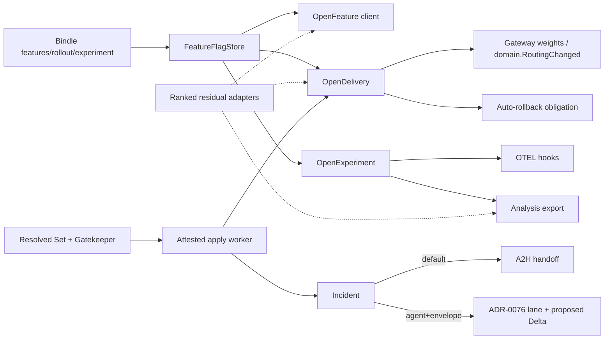
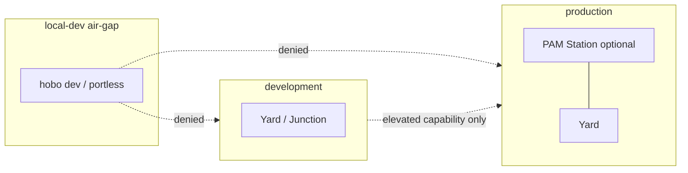

# Identity, security, governance & verification — consolidated decisions

> Consolidated ADR decisions for **identity, security, secrets, governance, verification, SLO & cost**. Each section is one architecture decision; see [`README.md`](./index.md) for the full ADR index.

## ADR-0008
**Keyless agent identity (SVID/OIDC federation) + token broker.**

**Context:** static keys vs federated identity. **Decision:** agents get short-lived SVIDs; the broker exchanges them for resource-scoped provider tokens (OIDC federation preferred, OAuth-OBO for human delegation). **The broker is the top confused-deputy target, so scope is bound to an *attested* workload, not self-asserted claims:** before honoring a `{run-id, tenant, parent-principal, code-version}` request, Identity **verifies a workload attestation** — the wasm component-image digest + a **host-signed launch measurement** (Firecracker/host attestation, [ADR-0012](#adr-0012)) — so a generated/forked provider in tenant A's executor **cannot mint a tenant-B token by asserting B's claims** (the SVID binds to the measured workload, not to attacker-supplied attributes). **Identity genesis is specified:** the SVID-CA / OIDC issuer **signing key is generated in the target KMS *before* the seed Yard self-deploys**, with a **stable issuer URL from genesis** (providers federate against it once), so the discarded local seed never holds the durable root and self-deploy doesn't rotate the key out from under established provider trust. **Broker availability:** the broker is the sole credential path, so it runs **HA** with a **bounded credential-cache + renewal-grace window** — broker unavailability degrades gracefully (cached tokens renew within grace) instead of instantly bricking the data plane (a stated SPOF mitigation). **Consequences:** no static secrets, full credential audit; we must run an HA OIDC IdP + attestation verification + per-provider trust setup ([Plan 6](../ai-native-agent-auth.md#plan-06), [Plan 12](../security-networking.md#plan-12)).

## ADR-0009
**Capability Manifest capability/auth standard + Registry.**

**Decision:** providers publish machine-readable signs (`capabilities/auth/cost.json`) at a well-known path; the Registry indexes them. The **`capabilities` declaration is the statically-evaluable Capability Spec** ([ADR-0075](07-portability-extensibility.md#adr-0075)): it lists the exact WIT **`interface@semver` + stability tier (`stable`/`preview`/`experimental`/`deprecated`) + the `@hobo/conformance` suite version passed**, so the SDK/Matching can **statically determine availability** of a specific capability (e.g. the preview `wasi:websocket`) before deploy. **A provider/resource also declares an availability SLA** here (a sibling of `cost.json`'s cost facts) — the design-time input the architecture-availability model composes through the dependency graph ([ADR-0078](#adr-0078)); a missing SLA is treated as "unrated," never assumed 100%. **Consequences:** agents self-discover + self-provision; static availability + preview-awareness fall out of the spec; we must define, version, and possibly standardize the schema ([Plan 6](../ai-native-agent-auth.md#plan-06)).

## ADR-0012
**Credential-scoped executors; isolation tier chosen per workload.**

**Decision:** IaC/build and untrusted/generated code run with **no ambient creds and a single scoped token**, in a sandbox whose **isolation tier is selected per workload/trust level** via Matching ([ADR-0033](01-architecture-core.md#adr-0033)) — gVisor or container tiers where the workload allows. **But the floor for AI-generated / unattested code is a non-overridable invariant: it MUST run in a microVM (Firecracker).** This is *not* a Matching default a Resource Definition or `.with()` can downgrade — it's a **mandatory policy rule** ([ADR-0074](#adr-0074)) keyed on the attestation state (no valid workload attestation, [ADR-0008](#adr-0008) ⇒ microVM), so a mis-classification can't drop generated code into a weaker shared tier. The tier is optimized per workload *above* that floor, not below it. **Consequences:** strong isolation where it's needed without paying microVM cost for every workload, and generated/unattested code is contained by construction; the executor manages several isolation backends behind one contract ([Plan 4](../control-plane.md#plan-04), [Plan 12](../security-networking.md#plan-12)).

## ADR-0023
**Security posture commitments.**

### Context
The design (esp. [security-networking.md#plan-12](../security-networking.md#plan-12)) names the right threats — runaway/confused-deputy agents, generation pipeline prompt-injection, supply-chain, cross-tenant access. The posture is **secure-by-default, zero-trust, defense-in-depth**: nothing is trusted by location or network position, every request authenticates and is authorized at each hop, and controls are layered so no single failure is fatal. For an agent-facing control plane that holds other people's cloud credentials and runs AI-generated code, the mitigations are **verifiable requirements**, not threat-model prose — backed by industry-standard scanning, monitoring, and best-practice adherence.

### Decision
HoBo commits the following security requirements (each is an `NFR`/`TR` with a verification method):
1. **Bound the static-key escape hatch** — any static API key carries a **maximum TTL (default ≤ 7 days)** and an enforced rotation schedule (expiry fails closed, does not hang), is **fully audited on every fetch** (not just grant/revoke), and is only reachable behind an explicit opt-in; federation is always preferred. (TR-051, NFR-005)
2. **Rate-limit & quota the Gateway/MCP surface** — per-principal (SVID/OIDC) and per-tenant limits with backpressure; exceeds return a typed throttle error. Protects against runaway agents and DoS. (TR-071, NFR-019)
3. **AI generation and agent-facing prose are hardened against prompt injection** — (TR-083) (a) **Generation-pipeline inputs** — source docs/OpenAPI fed to generation pipeline are scanned/sanitized; the signed provenance includes a scrub report; conformance runs with **no egress** as a hard requirement. (b) **Discovery-time manifest prose** — Registry-served Capability Manifest prose (`signs.md`/`llms.txt` and free-text description fields in `index.json`/`capabilities.json`/`auth.json`, [Plan 6](../ai-native-agent-auth.md#plan-06) §6.1) is **untrusted input in any agent context** (planning, operating, or generation). The Registry signature ([ADR-0009](#adr-0009)) authenticates *who published* the manifest, not that its prose is safe to obey; agent-facing surfaces returning manifest content (e.g. `search_registry`) deliver it as **inert data** — embedded instructions can never expand an agent's authority, because tool contracts ([Plan 29](../contracts-policy-flags.md#plan-29)), the deny-by-default policy plane, and scoped tokens bound every action regardless of prose content, proven for the MCP surface by the [HOBO-194 hardening proof](../proofs/hobo-194-mcp-server-hardening/index.md).
4. **Confused-deputy default-deny** — before any agent obtains a scoped token, the policy engine checks `{principal, tenant, resource, action}`; cross-tenant issuance is denied unless explicitly delegated. (TR-053)
5. **Quantified audit retention** — `token.*`/`resource.*`/policy-decision streams are retained for a defined minimum and never compacted. (NFR-018, TR-052)
6. **Encryption everywhere it matters** — envelope encryption at rest for event streams across **all** runtimes (not just `runtime-local`); per-run payload decryption requires log-read **and** explicit authorization (run-owner / `decrypt:run`). (TR-111)
7. **Supply-chain specifics** — all published artifacts carry CycloneDX SBOMs; CI blocks publishing on CVSS ≥ 7.0 (with a documented waiver path); plugins signed with SLSA-style provenance. (TR-112)
8. **Redaction at capture, not export** — secret/PII values are scrubbed **before** a span/event is stored, so a value never enters the event log, OTel/OpenInference spans, error messages, or **training trajectories** ([Plan 21](../authoring-resources-wiring.md#plan-21)/[Plan 23](../generated-stack.md#plan-23)). (TR-054, TR-111)
9. **Continuous scanning & monitoring** — supply-chain (SBOM/CVE), IaC/policy, and secret-leak scanners run in CI and continuously in production, wired to the audit/observability plane; controls map to recognized standards so adopters can assess them against their own frameworks.

Defense-in-depth: these layer — federation removes most secrets, the policy engine default-denies what remains, encryption protects data at rest, rate-limits cap blast radius, and continuous scanning catches regressions.

### Consequences
- **(+)** The security promises are verifiable gates, not prose; regulated adopters (BR-010) can assess them.
- **(−)** Some requirements (e.g. encryption on every runtime) depend on the runtime adapter's capabilities — opt-in-where-unsupported with the gap documented.

## ADR-0027
**Secretless-first configuration & secrets.**

### Context
HoBo issues keyless workload identities (SVIDs) and brokers short-lived provider tokens ([ADR-0008](#adr-0008)), and forbids static secrets at rest ([Plan 12](../security-networking.md#plan-12)). An **app** also needs a defined way to declare and load configuration and secrets — otherwise teams default to the antipattern: static secrets in env files/images/IaC, or worse, in the event log.

### Decision
HoBo defines a **secretless-first** config/secrets model ([Plan 21](../authoring-resources-wiring.md#plan-21)):
1. **References, not values, declared in a varlock-style typed schema.** `config()`/`secret()`/`env()` declarations resolve to **references**, resolved **per Camp at use-time** — a value never lives in the Bindle, the Camp config, or the event log. The declaration surface is a **typed, annotation/decorator-driven schema** in the spirit of varlock's `.env.schema`: each config/secret item declares its **type**, **required-ness**, **sensitivity** (secret vs non-secret config), and **source** (bound resource / provider-federated store / Camp value / static escape hatch). The schema is the committed, agent-readable *shape* (validated, coerced, and codegen'd to typed `ctx.config`, [ADR-0037](01-architecture-core.md#adr-0037)) while the *values* stay out of reach — going beyond varlock's vault-resolution by preferring no secret at all (the brokered path in (2)).
2. **Resolution ladder (secretless-first):** (a) **bound resource** → SVID-brokered short-lived token (no secret exists); (b) **secret with provider federation** → broker a scoped token and read from the provider's secret store at use-time; (c) **non-secret config** → typed value from the Camp's Deployment Set; (d) **static-secret escape hatch** → only where no federation exists, **bounded** by TTL + rotation + audit + opt-in ([ADR-0023](#adr-0023)).
3. **IaC state and provisioning outputs are a secret sink — closed explicitly.** IaC providers materialize secrets *into stack state* (a generated RDS master password, connection strings); those must not leak the way app config can't. So: **IaC state is encrypted at rest** (in the Yard's object store), and **secret-typed provisioning outputs are reference-ized — never captured as plaintext into `resource.Provisioned`** ([Plan 4](../control-plane.md#plan-04)): a connection string with an embedded credential lands as a brokered **reference** (ladder (a)/(b)), so the credential never enters the event log (upholding [ADR-0023](#adr-0023) §6/§8). Conformance asserts **no plaintext secret in IaC state or any event**.
4. **Provider resolution is a pluggable adapter under the Yard's provider, realized at the Camp.** The default identity/secrets model (SVID/SVID-brokered tokens, OIDC federation) stays the default, but cloud-specific IAM, keys, and certs plug in through a **`secrets` port adapter / extension** per **Yard** provider. The Bindle declares *what it needs*; *where* it comes from (Key Vault vs Secrets Manager vs Vault) is selected by the **Yard-owned provider** and realized for Camps attached under that Yard — so **swapping clouds re-homes Camps via Trails / Yard attachment** (+ the matching adapter), not a Camp-local provider pin or app edit ([ADR-0024](07-portability-extensibility.md#adr-0024), [yard-first-placement](yard-first-placement.md)).
5. **Audit + redaction.** Resolution is `config.Resolved` (ref → source, not value); secret reads are `secret.Accessed` joined to `token.Used`; values are redacted from logs/OTel/OpenInference spans and per-run-encrypted if they must transit a step's I/O.

### Operational design (implemented)

#### Authoring surface (`@hobo/bindles`)
```ts
import { config, secret, env, secretRef, fromBinding } from "@hobo/bindles";

export const appConfig = config({
  LOG_LEVEL: env.string().default("info").enum(["debug", "info", "warn", "error"]),
  FEATURE_X: env.boolean().default(false),
  MAX_CONCURRENCY: env.int().min(1).max(1000).default(32),
  DB_URL: secret.string().required().source("bound-resource"),
  API_KEY: secret.string().sensitive().source("provider-federation"),
  LEGACY_PASSWORD: secret.string().sensitive()
    .source("static-escape").ttl("7d").rotation("required"),
});
```
- **Dual `env` / `secret` surfaces:** `env({...})` remains Camp annotation injection; `env.string()/.boolean()/.int()/.json()` build schema fields. `secret(name)` remains the residual managed-store resource (`hobo:secrets`, [ADR-0113](#adr-0113)); `secret.string()` builds sensitive schema fields. Preferred paths are identity federation + `secretRef` / `fromBinding` — **`hobo:secrets` is residual only**.
- Schema is hashed (`schemaHash`) and versioned (`hobo.config-schema/v1`). Agents receive `schemaOnlyView(...)` only — no values.
- Static-escape TTL is enforced ≤ **7 days** at schema build time ([ADR-0023](#adr-0023)). Sensitive fields cannot carry default values.

#### Resolution ladder + ranking (enforced)
| Rank | Source | Mechanism |
|------|--------|-----------|
| 1 | `bound-resource` | SVID → token broker → short-lived token; no secret exists |
| 2 | `provider-federation` | Brokered token + Camp `secrets` port (Vault JWT/OIDC preferred; AWS SM / Azure KV adapters) |
| 3 | `camp-value` | Non-secret typed value from Deployment Set / fixtures |
| 4 | `static-escape` | Opt-in only; TTL ≤ 7d; rotation required; fully audited; deny-ceiling capable |

Policy may set **deny-ceilings** (`allowedSources`, `forbidStaticEscape`) so production packs forbid rank 4. Capability Manifest ranking for residual classical credentials:
1. Native identity federation (no secret)
2. Mediated dynamic secret via short-lived brokered token + secretless connector
3. Versioned managed secret via `hobo:secrets` (still mediated)
4. Static escape hatch (last, bounded, audited)

#### Package responsibilities
| Package | Responsibility |
|---------|----------------|
| `@hobo/bindles` | `config` / `env` / `secret` / `fromBinding` / `secretRef` schema surface + validation |
| `@hobo/identity` | Resolution ladder orchestration (`resolveConfigSchema` / `resolveConfigEntry`), residual `SecretsPort` adapters (memory fixture **default**, Vault JWT/OIDC, AWS SM, Azure KV), redacted `config.Resolved` / `secret.Accessed` events, contract-asserted dev fixtures |

Optional residual **OpenBao** lives in **`@hobo/adapter-openbao`** (not a default dependency of `@hobo/identity` or composed `hobo`). Default residual installs use **memory** (`createMemorySecretsPort` / `createLocalStationSecretsPort`). Ranking is unchanged: bound-resource → provider-federation → camp-value → static-escape.

**Local Station + wasm component host:** residual secrets on the **host** default to memory. Wasm guests receive only redacted placeholders / non-sensitive mesh env (`x-hobo-env-*`). Install `@hobo/adapter-openbao` for residual OpenBao (JWT + KV v2, offline or live).
| `@hobo/connectivity` | Secretless connector (CyberArk-style mediation): plugin registry (postgres, tcp, mysql, redis + extensions); isolation tiers `shared` / `per-tenant` / `per-workload`; named local endpoints ([ADR-0130](07-portability-extensibility.md)); lease renew / drain; credential closed over — never on public lease |
| `@hobo/cloud` CredentialAudit | Folds `config.*` / `secret.*` into never-compact security audit (joined with `token.*` / `connection.*`) |
| `@hobo/contracts` Gatekeeper | Optional `secretlessConfig` verdict dimension composed into can-deploy |
| `@hobo/wit` | `hobo:secrets@0.1.0` residual managed-store WIT (experimental) + generated provider/guest bindings |
| Policy plane | Ranking enforcement, static-hatch ceilings, cross-yard trust deny-by-default |
| Architecture guards / can-deploy | `evaluateSecretlessConfigGate` + Gatekeeper; schema validity, ranking, no plaintext in events/IaC/agent context (`assertNoPlaintextConformance`) |

#### Mediation architecture (residual classical credentials)
When pure identity federation is impossible (legacy protocols): the **secretless connector** is a Junction-local / Camp-scoped mediator. The workload dials only a **stable named endpoint** (overlay DNS / portless). The mediator authenticates with its own short-lived SVID, fetches material via the ladder, performs the protocol handshake, and shuttles bytes. **Credential material never reaches the application process.** Lease renewal composes with SVID partition grace ([ADR-0100](#adr-0100)). First plugins: **Postgres** and **generic TCP**; interface is extensible.

#### Local / agent DX
- Schema is the primary artifact. `hobo dev` uses **contract-asserted fixtures** (`createContractAssertedConfigFixtures`) matching the same contracts as `can-deploy` ([ADR-0070](#adr-0070)).
- Agents / MCP / training trajectories receive schema + placeholders only (redaction-at-capture + inert-output invariant).
- Optional encrypted local overrides (git-ignored) are limited to **non-sensitive** values.
- Existing gitleaks + hooks block high-severity plaintext leaks.

#### Events & retention
- `config.Resolved` — name, source, valueRef (never value); `redacted: true`
- `secret.Accessed` — valueRef, versionId, optional grantId join to `token.Used`; `plaintextPresent: false`
- Credential events use **never-compact** security-audit retention ([ADR-0023](#adr-0023) / NFR-018)

#### Threat mitigations (summary)
Static key leakage → ranking + TTL + rotation + redaction + scanning + opt-in. Confused deputy → attested workload + policy deny-by-default. Proxy compromise → short-lived only, minimal privilege, monitoring. Partition mid-flight → signed grace leases. Agent/log leakage → schema-only + inert outputs. Cross-yard over-permission → explicit trust + audited grants. IaC state leakage → reference-ize outputs; encrypt state; conformance asserts no plaintext.

### Consequences
- **(+)** The common case has **no secret to steal** (brokered tokens); secrets that do exist are referenced, short-lived, and audited (strengthens the zero-secret KPI, NFR-005), and config/secret sourcing is portable (declared in Bindle, sourced per Camp). Residual classical credentials are mediated so apps never hold them. can-deploy + Gatekeeper enforce ranking; typed `ctx.config` is codegen'd; local DX uses encrypted non-sensitive overrides + contract fixtures; `hobo:secrets@0.1.0` WIT is available as the residual managed-store port only.
- **(−)** Requires a Camp-scoped `secrets` port adapter selection and a config-resolution path in the runtime; providers lacking federation fall back to the bounded static hatch or the secretless connector. Operator-run live cloud accounts still supply brokered STS/OIDC tokens to the adapters (adapters never hold long-lived cloud root keys).

## ADR-0038
**End-user / application auth.**

### Context
[Plan 6](../ai-native-agent-auth.md#plan-06) is a deep treatment of **agent/workload** auth (SVIDs, the token broker, Capability Manifest, OBO). An app deployed on HoBo also needs to authenticate its **end users** (humans), and `auth()` ([Plan 2](../sdk-api.md#plan-02) §53) covers sign-in, sessions, JWT/JWKS verification, IdP integration. HoBo has the substrate — it issues + verifies OIDC/JWTs via JWKS for agents, is secretless-first, has a policy plane + `.allow()` for authorization, and the event envelope's `actor: PrincipalRef` admits a `user`. End-user auth is assembled from that substrate without reinventing a full identity provider.

### Decision
1. **`auth()` is a federation + verification port (`hobo:auth`), not a homegrown IdP.** It verifies OIDC/JWT from any provider — Google / GitHub / Clerk / Auth0 / **custom JWT** (the shoo/Convex-`customJwt` pattern) — reusing HoBo's **OIDC + JWKS + secretless** machinery. The IdP is a **swappable adapter**, with a default set of **WorkOS · Auth0 · Supabase Auth · Microsoft Entra ID** (+ Google/GitHub/Clerk/customJwt) selected per Camp/Yard by Matching — only registered adapters are considered, and the set is non-limiting + auto-generatable ([ADR-0073](07-portability-extensibility.md#adr-0073)). A **thin optional built-in** (passkey / email magic-link) covers zero-config dev and runs offline/air-gap ([ADR-0036](07-portability-extensibility.md#adr-0036)). HoBo does **not** build a full hosted IdP; identity is federation + verification, with cloud-native IdPs plugged in as adapters.
2. **Unified principal model.** An end-user is a **`PrincipalRef`** (the event `actor` already admits `user`), exposed as **`ctx.user`** alongside `ctx.identity` (SVID). **Authorization is the same policy plane** ([Plan 29](../contracts-policy-flags.md#plan-29)) **+ `.allow()`-style declarative rules** keyed on user claims (record-level), and **audit rides the existing event `actor`** ([Plan 11](../data-plane.md#plan-11)). One identity/authz/audit path for users + agents + services; agent **OBO** ([Plan 6](../ai-native-agent-auth.md#plan-06)) carries the same user principal.
3. **Stateless JWKS verify per request + optional event-sourced sessions.** JWTs are verified via JWKS on each request (edge-friendly, matches `customJwt`); optional **`session.*`** records provide revocation / "sign out everywhere" + audit, and reactive queries ([Plan 32](../data-plane.md#plan-32)) re-evaluate on auth-state change.
4. **Surface:** client `useAuth()`/`signIn()`/`signOut()` (peer to `useQuery()`); server `ctx.user` (typed verified claims). **Events:** `user.Authenticated` · `session.Started/Refreshed/Revoked` (authz decisions ride `policy.Decided`).

### Consequences
- **(+)** HoBo apps get real end-user auth (sign-in/sessions/verification/IdP integration) reusing OIDC/JWKS, the policy plane, `.allow()`, and the event audit rather than new machinery; the unified `PrincipalRef` model keeps users, agents, and services on one authz + audit path, and OBO chains (user → agent → resource) are one identity story.
- **(−)** Federation-first means HoBo depends on external IdPs for production-grade user management (the thin built-in is dev-grade); orgs needing a fully self-contained IdP supply one through the IdP adapter.

## ADR-0070
**Dev-mode auth bypass via integrated contract testing.**

### Context
Local dev needs to skip real authentication — no IdP round-trips, works offline — without the dev code path **diverging** from production. The usual "set `AUTH_DISABLED=true`" flag runs untested logic in dev and silently differs from prod. HoBo already treats every boundary as a consumer-driven **contract** ([ADR-0015](#adr-0015)) and authenticates principals via the `auth` port ([ADR-0008](#adr-0008)/[ADR-0038](#adr-0038)); the dev bypass should ride that machinery, not a bespoke flag.

### Decision
**Dev auth is a contract-satisfied fixture, not a disabled check.**
1. The `auth` port carries a **consumer-driven contract** describing the principal/claims the app expects (subject, roles, tenancy, scopes). It is the same contract the app declares for prod.
2. In **`hobo dev`**, the runtime satisfies that contract with a **contract-asserted dev principal** — a fixture identity generated to match the contract — instead of calling a real IdP. Auth still "runs"; it's just fulfilled by the contract fixture. The developer can override claims per-request/session (e.g. assume a role/tenant) within what the contract allows, making role/tenancy testing first-class.
3. **The same contract is enforced at `can-deploy`** ([ADR-0015](#adr-0015)): a real IdP/Camp must satisfy the identical `auth` contract, so dev and prod are **contract-equivalent** — the bypass cannot drift from production semantics.
4. **Deny-by-default still holds** ([ADR-0069](01-architecture-core.md#adr-0069)): the dev principal only obtains the capabilities granted by `.allow()`/links. Bypassing *authentication* never bypasses *authorization*.

### Consequences
- **(+)** Fast, offline inner loop with **authorization faithful to prod** — the dev identity is defined by the same contract that gates deploys; role/claim/tenancy testing is built in, reusing the contract plane + `auth` port with no new mechanism.
- **(−)** **Scope of "cannot drift" is authorization, not authentication.** The `auth` contract constrains the **principal/claims shape** — it does *not* exercise JWKS verification, signature/`alg`/issuer/audience checks, expiry, or revocation, the parts that actually break in prod auth. So `hobo dev` proves authz, not the verification path; the **verification path is exercised against a fixture IdP at `can-deploy`/CI** (real JWKS validate, reject `alg:none`/wrong-issuer/expired — [Plan 9](../generated-stack.md#plan-09) end-user-auth test), so a verification misconfig fails the gate even though `hobo dev` never authenticates.

## ADR-0074
**Organizational governance: RBAC + mandatory policy rules over HoBo's own control-plane surface.**

### Context
Enterprises must be able to **lock down** cloud capabilities, policy config, and resource access **not only on deployed infra (which HoBo governs) but on HoBo itself**: who may register a provider, change policy, set the Dispatcher objective, run the generation pipeline, approve a deploy, read the audit log. HoBo's policy plane ([Plan 29](../contracts-policy-flags.md#plan-29)) is the universal decision engine: `request = { subject{kind,id,roles?,scopes?,delegatedBy?}, action, resource, phase, context } → { effect, obligations }`, deny-by-default, signed/versioned **policy packs**, every decision an event. It governs *deploy/runtime* actions and carries `subject.roles` + phases spanning `author→plan→apply→runtime`. Enterprise governance extends this to: (1) HoBo's **own control-plane operations** (register a provider, edit a Resource Definition, change a policy pack, set the Dispatcher objective, run the generation pipeline, approve a Delta, read the audit log, manage roles) as **first-class policy subjects/resources** so they can be uniformly locked down; (2) **org-level RBAC** and a **mandatory hierarchical policy-rule (deny-ceiling)** model. This is platform governance (what enterprises require of any control plane), **not** an app-business/SaaS function — the [ADR-0064](07-portability-extensibility.md#adr-0064) cut (no billing/monetization) is unaffected; the *hosted-operator-as-a-business* stays out, the governance *mechanism* comes in.

### Decision
1. **HoBo's own control-plane operations are first-class policy subjects/resources.** A `hobo:*` **admin action/resource taxonomy** makes every control-plane action a governed, deny-by-default, event-sourced policy decision — the same engine as deploys, at the `author/plan/apply/...` phases. "Govern the deployed cloud" and "govern HoBo" are the same policy plane over two resource namespaces. **The full action list + default role→action matrix is enumerated once, canonically, in [Plan 29](../contracts-policy-flags.md#control-plane-action-taxonomy-and-default-role-bindings)** (NIST RBAC / INCITS 359, least privilege + SoD, cloud-IAM `hobo:<resource>:<verb>` naming) — this ADR records the *decision*, not the table.
   - **Completeness is a hard gate, not a "should."** Deny-by-default only protects an *enumerated-but-unbound* `(role,action,resource)` — it does **not** catch a control-plane operation that was never given an action id (that code path has no check). So **every control-plane CLI/MCP verb must map to a `hobo:*` action id or the build fails** (`@hobo/conformance`), and the taxonomy explicitly includes the easily-missed high-privilege actions: **`derivative upgrade`** ([ADR-0057](07-portability-extensibility.md#adr-0057), swaps engines/patches), **`registry` bundle-import** ([ADR-0036](07-portability-extensibility.md#adr-0036), a supply-chain trust action), and **`relay` register/attach** ([Plan 12](../security-networking.md#plan-12)).
   - **Evaluation point + latency.** A control-plane decision is evaluated by the **in-Yard `policy-engine`** ([Plan 29](../contracts-policy-flags.md#plan-29)) — no management-plane round-trip on the hot path — with decisions async-shipped to the management-plane audit log; it carries a **control-plane-authz p99 NFR** ([ADR-0021](07-portability-extensibility.md#adr-0021)) and a **bounded decision-cache TTL + revocation-propagation bound** so a revoked role stops acting promptly (the Crew operators are high-frequency principals — `operator:dispatch`/`gen:execute` in a repair loop must not pay an unbounded hop).
2. **Governance attaches to the existing Yard & Junction scopes — no new scope noun.** RBAC roles, SSO/SCIM org identity, and deny-ceiling policy packs are carried by the **Yard** (single-provider estate) and the **Junction** (cross-cloud estate). Org-wide rules that span Junctions are **shared signed policy packs**, distributed by the **Junction's existing "federates signed policy packs"** mechanism ([ADR-0043](07-portability-extensibility.md#adr-0043)) — so a multi-Junction org stays consistent without a new top-level scope (honoring [ADR-0026](01-architecture-core.md#adr-0026)/[ADR-0028](01-architecture-core.md#adr-0028)'s resistance to extra scope nouns). "The org" is realized as the governance config a Yard/Junction carries, not a fifth deploy noun.
3. **RBAC binds principals to roles that populate `subject.roles`.** Built-in roles — **Org-Admin · Security/Policy-Admin · Platform-Engineer · Deployer · Operator-Supervisor · Auditor (read-only)** — plus **custom roles** composed from the action taxonomy (1). Roles bind to principals via **SSO/SCIM groups** through the existing `auth` port ([ADR-0038](#adr-0038)/[ADR-0073](07-portability-extensibility.md#adr-0073)); the resolved roles populate the policy `subject.roles` already in the model. **Operator Agents (the Crew) are principals under the same RBAC** ([Plan 40](../operators-sre.md#plan-40)) — an operator can never exceed its assigned role.
4. **Policy rules are per-rule `mandatory | default` (default mandatory), composed by a defined algebra.** **`mandatory`** = a **hard deny-ceiling** a lower scope may only **further restrict, never widen**; **`default`** = an **overridable recommendation**. The "can only restrict" property needs an explicit **composition algebra** (deny-by-default alone does *not* resolve two conflicting *explicit* rules): across all matching packs (Junction shared → Yard → Camp → Bindle), the decision is **deny-overrides** (any `mandatory` deny wins), **scope-monotonic** (a child pack's effective deny-set ⊇ its parent's — a child cannot *un-deny* a parent `mandatory`, only add denies), with a deterministic **most-restrictive-wins** tie-break — so two federated `mandatory` packs that disagree resolve to the union of their denies, identically on every Yard. Examples: providers only from an allow-list, prod only in approved regions, **no `.with()` escape hatches in prod**, **no `preview`/`experimental` interfaces in prod** ([ADR-0075](07-portability-extensibility.md#adr-0075)), no external-egress integration ports, agents capped at `$N`, air-gap can't be disabled, **2-person approval** for policy changes.
5. **Separation of duties via approval obligations; org-scoped, event-sourced audit.** Sensitive control-plane actions carry **approval obligations** ([Plan 29](../contracts-policy-flags.md#plan-29) — the durable obligation mechanism), with the org setting which role approves (e.g. a Platform-Engineer's policy change needs Security-Admin approval). Every control-plane decision is a `policy.Decided` event; role/policy-rule/membership changes ride the existing policy-pack + `identity.*`/`token.*` families — **no new event families** — and the **OCSF audit export** ([ADR-0046](#adr-0046)) feeds the org's GRC tooling. Audit is org-scoped and (per [ADR-0023](#adr-0023)) retained + never compacted.
6. **Honest enforceability boundary: mandatory policy rules bind *honest* Yards; cross-Yard assurance is by attestation, not control.** The Junction **federates** signed packs, it is **not a controller** ([ADR-0043](07-portability-extensibility.md#adr-0043)) and the `policy-engine` seam is itself swappable ([ADR-0057](07-portability-extensibility.md#adr-0057)) — so a **compromised or rogue Yard that forks/ignores its policy-engine cannot be *stopped* from above**. The guarantee is therefore stated honestly: a `mandatory` policy rule is enforced **within a Yard's own honest enforcement**, and **cross-Yard assurance is detective, by attestation** — each Yard ships **signed decision logs + a remote attestation of its policy-engine build** to the management-plane log, reconciled centrally so a Yard that drops/forks enforcement is **detected and flagged** (a `policy`-violation/attestation-gap signal), not silently trusted. Orgs needing prevention scope the estate to **attested Yards under a shared trust root**; a Yard outside that root is outside the guarantee, and `hobo doctor` says so.
7. **Genesis + break-glass are explicit.** The first principal is a bootstrap **Org-Admin** seeded at Yard genesis (`hobo up ./platform --seed`, [Plan 4](../control-plane.md#plan-04)) via a one-time, audited **`identity.GenesisAdmin`** fact (immediately rotatable) — resolving the chicken-and-egg that `role:bind`'s no-self-escalation rule ([Plan 29](../contracts-policy-flags.md#plan-29)) otherwise creates. A **break-glass path** — an **offline-signed emergency override**, fully audited, distinct from the IdP-dependent normal path — recovers the estate when the IdP is down *and* a mis-authored `mandatory` policy rule would otherwise brick all changes (the waiver path needs a live approver; break-glass doesn't).

### Consequences
- **(+)** Orgs can lock down **HoBo itself**, not just the infra: who registers providers, changes policy, runs the generation pipeline, sets cost routing, approves deploys, or reads audit — each a deny-by-default, role-gated, audited decision, with mandatory policy rules a lower scope can't widen, reusing the policy plane + signed packs + obligations, the `auth` port for SSO/SCIM, the Junction's pack federation, and the event log + OCSF export. **No new scope noun, no new event families.**
- **(−)** The `hobo:*` admin taxonomy is a new maintained surface (every control-plane action needs an action id + default role mapping) and must stay complete or an ungoverned action is a hole; mandatory policy rules can also over-restrict if mis-authored, with the gated **waiver** path ([Plan 29](../contracts-policy-flags.md#plan-29) `policy.WaiverRequested/Approved`) the audited escape valve.

## ADR-0079
**App multi-tenancy as a first-class capability: the app-tenant model, the tenancy-model spectrum & tenant lifecycle.**

Full surface in [Plan 50](../security-networking.md#plan-50).

### Context
HoBo is a multi-tenant platform with a deep isolation model ([Plan 12](../security-networking.md#plan-12): data/compute/credential/network/wasm dimensions, per-tenant streams, a dedicated tier). A developer building a **SaaS on HoBo** also needs to make **their** application multi-tenant — isolate each customer's data, route per customer, configure/quota/meter per customer, honor per-customer residency, and run the customer's lifecycle (onboard → suspend → export → delete). End-user auth ([ADR-0038](#adr-0038)) gives `ctx.user` (a person) and the `auth` contract carries a latent **tenancy** claim; app multi-tenancy **exposes HoBo's own tenancy machinery one level up** — without conflating the two tenants, with **honest isolation guarantees per model**, and respecting the business-scope cut ([ADR-0064](07-portability-extensibility.md#adr-0064)).

### Decision
1. **Two tenants, explicitly distinct, enforced at two distinct points.** The **platform tenant** (`EventEnvelope.tenant`, [Plan 12](../security-networking.md#plan-12)) is the HoBo account/org — HoBo's own hard isolation boundary, enforced at the **envelope level + store partitioning**. The **app tenant** (new) is the developer's customer, surfaced as **`ctx.tenant`**, enforced at the **`streamId` prefix + the projection auto-filter** *within* one platform tenant ([ADR-0080](#adr-0080)). They are **two axes, not one chain**: infra containment is `Bindle ⊂ Camp ⊂ Yard ⊂ Junction` ([ADR-0026](01-architecture-core.md#adr-0026)); **project** ([ADR-0077](#adr-0077), a non-containment rollup dimension) and **app-tenant** are **application/organizational dimensions** — an app-tenant is a partition **within one app (Bindle)**, in a project, inside one platform tenant; it is **never a sixth infra scope noun**. An `AppTenant` is an event-sourced aggregate (`tenant:<id>`). **`ctx.tenant` has a defined source in every context:** the gateway resolves it from the verified end-user **tenancy claim** ([ADR-0038](#adr-0038)) and/or routing ([ADR-0035](07-portability-extensibility.md#adr-0035)) on the request path; an **async/system unit** (workflow/saga/cron/topic-subscriber) carries it **captured at enqueue time, propagated like `causationId`**; a **projection fold** derives it from the event's `streamId` prefix — and a unit with **no captured tenant fails closed**, never all-tenants ([ADR-0080](#adr-0080)).
2. **A declared tenancy-model spectrum, realized by Matching, with per-model guarantees.** The app declares a model — **pooled** (shared infra, stream-per-tenant, *logical* isolation; default), **siloed** (dedicated resources or a **Camp-per-tenant**, *physical* isolation; bounded to few large/regulated tenants), **bridge/tiered** (pooled long-tail + promote-to-silo), **region-pooled** (pooled in-region, siloed across regions — for per-tenant residency). The model (and a per-tenant override) is a **Matching decision** ([ADR-0033](01-architecture-core.md#adr-0033)) recorded in `match.Decided`, so **promotion pooled→siloed is a config change**, never an app rewrite (access is always via `ctx.tenant`). The data move is **not** the blue/green managed-store move ([ADR-0032](03-data-plane.md#adr-0032)) verbatim — re-keying one tenant's streams out of a shared append-only single-writer log needs a **defined zero-loss cutover**: `tenant.Suspended` freezes the tenant's aggregates → drain to a quiescent `seq` → export → import into the silo → **fence the old streams** → `tenant.Resumed`; a conformance test asserts **zero lost/duplicated events** (source quiescent `seq` == silo head). Only that one tenant is briefly write-frozen.
3. **Tenant lifecycle is first-class + event-sourced** (`tenant.Provisioned/Suspended/Resumed/Offboarded/Exported/Erased`, [Plan 11](../data-plane.md#plan-11)) — explicitly the **app's** customer tenant (the platform tenant has no lifecycle). **Erase = per-tenant crypto-shred via a key *hierarchy*, reconciled with [ADR-0051](03-data-plane.md#adr-0051):** since ADR-0051's forgetting key is per-subject and forbids invariants over shreddable fields, a tenant is **not** wholesale-encrypted under one key; instead a **tenant key envelops the tenant's per-subject keys**, so erasing the tenant destroys the tenant key → all wrapped subject keys become unrecoverable in one act (≡ batch-destroy). **Routing/identity fields (the `streamId` prefix, ids, invariant keys) stay cleartext**; only PII is encrypted — so **aggregate invariants survive** the erase. Whole-tenant right-to-erasure **without rewriting the forward-only log** ([ADR-0060](#adr-0060)); **export** is a portable dump of the tenant's streams (no lock-in, [ADR-0024](07-portability-extensibility.md#adr-0024)).
4. **Per-tenant cross-cutting reuses existing planes** — routing ([ADR-0035](07-portability-extensibility.md#adr-0035)), config/flags ([ADR-0044](#adr-0044) targeting on `ctx.tenant`), quotas + noisy-neighbor control + per-tenant **showback** ([ADR-0039](#adr-0039)), residency ([ADR-0040](01-architecture-core.md#adr-0040)/[ADR-0060](#adr-0060)), and per-tenant observability/status ([Plan 49](../developer-experience.md#plan-49)) — almost no new runtime.
5. **Scope boundary (honors [ADR-0064](07-portability-extensibility.md#adr-0064)):** isolation / routing / config / quota / **showback** / residency / lifecycle / observability are **in**; **billing the app's tenants** (per-tenant invoicing / subscriptions / plans-as-a-product) is **out** — HoBo gives the developer the showback + quota inputs to run *their own* billing, not a billing engine.

### Consequences
- **(+)** A developer builds a real multi-tenant SaaS on HoBo with first-class primitives — `ctx.tenant`, a declared model, per-tenant routing/config/quota/residency/lifecycle/observability — reusing the planes HoBo already has; pooled→siloed is a config+migration, so a tenant can be upgraded to isolation without an app rewrite, and whole-tenant erasure (crypto-shred) + export give clean GDPR/offboarding + no-lock-in stories.
- **(−)** Two "tenant" notions are an inherent confusion risk (mitigated by the strict naming `ctx.tenant` = app-tenant vs `EventEnvelope.tenant` = platform), and siloed/Camp-per-tenant is bounded (doesn't scale to many tenants) with per-tenant residency forcing region-pooling/silo.

## ADR-0080
**Tenant isolation by construction + the cross-tenant-leak conformance gate.**

The load-bearing safety half of app multi-tenancy ([ADR-0079](#adr-0079)) — the cross-tenant data leak is the #1 multi-tenant failure. Full surface in [Plan 50 §C](../security-networking.md#plan-50).

### Context
In a pooled app-tenancy model the classic catastrophe is a cross-tenant leak — a query that forgot its `WHERE tenant_id`, a projection that folded the wrong stream, a subscription that pushed another tenant's data. "Be careful" is not a guarantee. HoBo can do better because data access already flows through platform-owned seams (the event log + stream keys, the projection/`repo`/`view` boundary, `.allow()` + the policy plane, [Plan 32](../data-plane.md#plan-32)/[Plan 29](../contracts-policy-flags.md#plan-29)).

### Decision
1. **The app-tenant is a `streamId` *prefix*, not a change to the aggregate model.** `streamId` is already the aggregate key (one aggregate = one stream, [ADR-0053](03-data-plane.md#adr-0053)); for a multi-tenant app the grammar is **`<app-tenant>/<aggregateType>:<id>`** (e.g. `acme/order:01H…`) — the app-tenant **partitions the keyspace**, distinct from the platform `EventEnvelope.tenant`. **Per-aggregate optimistic `seq` semantics are unchanged**; tenancy multiplies which streams exist, not how one stream serializes. A fold/command is therefore *structurally* tenant-scoped — a key with another tenant's prefix is one you weren't given.
2. **The projection/`repo`/`view` filter is platform-owned, deny-by-default, and composes with platform-tenant scoping.** Tenant scoping is applied by HoBo at the data-access boundary ([Plan 32](../data-plane.md#plan-32)), **not** a developer-written predicate; a tenant-scoped read with **no resolved `ctx.tenant` fails closed** — never all tenants. **Two enforcement points, both applied:** platform-tenant on `EventEnvelope.tenant` (envelope + store partition, [Plan 12](../security-networking.md#plan-12)); app-tenant on the `streamId` prefix + `ctx.tenant`. They **compose** — an app-tenant leak can neither cross nor be *masked* by platform-tenant scoping (a conformance assertion). **`ctx.tenant` provenance is defined for async/system contexts** (workflow/saga/cron/topic-subscriber capture it at enqueue, propagated like `causationId`; a projection fold derives it from the `streamId` prefix), so "fail closed on no tenant" holds for background work without defaulting to all-tenants.
3. **Cross-tenant access is an explicit multi-tenant *scope token*, a distinct code path from "unresolved."** App-developer staff who legitimately span tenants act as a **cross-tenant-admin** role ([ADR-0074](#adr-0074)/[Plan 29](../contracts-policy-flags.md#plan-29)) carrying an explicit **`ctx.tenants` set (or `*`) granted by a `policy.Decided`** — **not** an unresolved `ctx.tenant` (which fails closed). Keeping them separate code paths ensures a dropped-tenant bug reads as deny, never as admin. Every cross-tenant read/write is gated + audited; an ordinary `ctx.user` reaches **only** its own tenant.
4. **`.raw()` is *denied by default* on a pooled store, not merely flagged.** On a pooled (shared) store the raw escape hatch ([Plan 32](../data-plane.md#plan-32)) bypasses the auto-filter and is an *active cross-tenant read*, so flag-as-debt would be detective, not preventive — silently downgrading "by construction." Pooled `.raw()` is therefore **denied** unless the developer supplies an explicit hand-scoped tenant predicate the gate verifies (or runs as cross-tenant-admin); it is free on a **siloed** store (the silo is the boundary). Either way surfaced as isolation debt alongside the portability-debt flag ([ADR-0024](07-portability-extensibility.md#adr-0024)).
5. **A cross-tenant-leak conformance gate with a runnable oracle.** Seed tenants **A** and **B** with distinct **sentinel** records; under an ordinary `ctx.user` of A, every surface (command/query/**subscription**/**search**/projection) querying B's sentinel **denies/returns-empty** *and* (positive control) **A's own sentinel is present** — so an all-deny-because-broken impl can't pass; the no-tenant case fails closed. **Search is covered explicitly** (vector/graph search is a `step` with a developer predicate, not the auto-filter): the **search index is tenant-partitioned** (per-tenant index/namespace or a non-bypassable platform-injected filter at the `hobo:search` port). **Subscriptions** carry `ctx.tenant` + tenant-lifecycle state in their **read-set**, so `tenant.Suspended`/`Erased`/claim-change **re-scope or close** the live subscription (no stale cross-tenant push). A **siloed** model additionally asserts **physical** separation. **Honest guarantee per model:** pooled = **logical** isolation; siloed = **physical**. The docs never claim pooled gives physical isolation.

### Consequences
- **(+)** The cross-tenant leak is structurally prevented (stream-key scoping + platform-owned deny-by-default filter), not left to developer care; the conformance gate proves it, and the honest pooled-vs-siloed guarantee lets a buyer choose isolation knowingly (siloed/regulated tenants get a provable physical boundary).
- **(−)** App-tenant scoping must reach **every** seam — request, async/system context, projection fold, search step, and live subscription re-eval — or it leaks; the breadth is real surface to build and conformance-cover.

## ADR-0015
**Contracts & policy are HoBo-native planes; a single `can-deploy`/Gatekeeper gate composes the checks; obligations are durable effects.**

**Decision:** consumer-driven contracts/compatibility ([Plan 29](../contracts-policy-flags.md#plan-29)) and policy decisions ([Plan 29](../contracts-policy-flags.md#plan-29)) are first-class, HoBo-native planes; engines sit behind ports.

1. **Contract plane.** The `contract-engine` runs **PACT-style consumer-driven contract testing as the built-in, default behavior** — an internal implementation detail of the contract plane, never a user-facing option to swap; developers declare contracts and never touch PACT directly. HoBo owns the Contract IR; ecosystems integrate via adapters with no hard dep. **"Verified by construction" is scoped honestly to contract *mode*:** *declared* (WIT/Zod) and *inferred* (compile-time from the wiring graph) contracts are proven by construction; *observed*/*promoted* contracts are **trace-mined from sampled traffic** ([Plan 29](../contracts-policy-flags.md#plan-29)) and are therefore **confidence-bounded, not proven** — an unobserved-but-valid producer variant can slip a promotion. So a promoted contract carries the **sample coverage** behind it, the promotion gate records that coverage, and promotion runs inside a **migration window** so a still-unobserved shape surfaces as a `compat.Gate*` failure rather than a silent break.
2. **Policy plane.** The `policy-engine` is a built-in HoBo engine; policy is **typed TypeScript** by default, and HoBo owns the Policy IR.
3. **One Gatekeeper gate composes everything.** Deployability is a single explainable decision — contracts-compatible AND policy-allows/approves AND eval-gates-pass AND conformance AND within-cost AND signed/attested — evaluated at Delta→Set/promote and surfaced as `hobo verify` ([Plan 29](../contracts-policy-flags.md#plan-29)/[Plan 25](../platform-engineering.md#plan-25)). One event-sourced decision replaces scattered CI gates.
4. **Obligations are durable effects, not advice.** An "allow but require X" obligation (canary/approval/auth/shadow-eval) is realized as a HoBo effect/saga and tracked `ObligationCreated→Satisfied`; an unmet obligation blocks ([Plan 29](../contracts-policy-flags.md#plan-29)/[Plan 5](../reliability-observability-cost.md#plan-05)).

**Consequences:** compatibility and governance are enforced at a single auditable gate — one event-sourced decision, durable obligations, and HoBo-owned IRs with engines behind ports. Declared/inferred contracts are proven by construction; observed/promoted ones are confidence-bounded (sample-coverage-recorded, migration-windowed).

## ADR-0044
**Feature flags & progressive delivery.**

### Context
HoBo controls *deploys* with canary/progressive rollout ([Plan 5](../reliability-observability-cost.md#plan-05)), Delta→Set gates ([Plan 25](../platform-engineering.md#plan-25)), and policy obligations ([Plan 29](../contracts-policy-flags.md#plan-29)). It also toggles *behavior within a running version* — kill-switches, gradual `%` rollout, per-segment targeting, experiments — without a redeploy. Feature flags are the standard answer (OpenFeature is the CNCF standard for flag evaluation), provided in a way that composes with HoBo's audit, policy, identity, and reactive planes rather than as a bolt-on.

### Decision
1. **A first-class `feature-flag` port (`hobo:feature-flag`), OpenFeature-compatible.** HoBo speaks the OpenFeature evaluation API; the **built-in flag store is the default** (zero-dep, air-gap-friendly), and **OpenFeature providers** (flagd/LaunchDarkly/…) are **opt-in per-Camp adapters** (Matching, [ADR-0033](01-architecture-core.md#adr-0033)). Flag types = boolean/string/number/object. Definitions are **IfC** (declared in the Bindle); values/targeting are runtime state.
2. **Change governance: event-sourced + optionally policy-gated + reactive.** Every value/targeting change is a `flag.*` event ([Plan 11](../data-plane.md#plan-11), full audit/replay); a flip can pass through the **policy plane** ([Plan 29](../contracts-policy-flags.md#plan-29)) so prod kill-switches / risky `%` bumps require approval or carry obligations (e.g. auto-revert on SLO burn); a change is a **`data.Changed`-class signal** so reactive queries/clients (`useFlag`/`useQuery`, [Plan 32](../data-plane.md#plan-32)) re-evaluate live.
3. **In-process, deterministic, identity-aware evaluation.** Components evaluate flags **in-process** against a ruleset synced via the Streamer/event log (edge-friendly, no SPOF); targeting context is the unified **`PrincipalRef`** (`ctx.user` [ADR-0038](#adr-0038) / `ctx.identity`); evaluation is a **pure function of `(ruleset@seq, context)`** → replayable + safe inside a reactive `query()` ([ADR-0050](03-data-plane.md#adr-0050)).
   - **A true kill-switch is a fast-path push, not poll-sync.** A normal flip propagates with bounded delay tied to the sync interval, but a flag marked **`killSwitch`** is delivered by **push invalidation over the Streamer** (the reactive-fan-out path, [Plan 32](../data-plane.md#plan-32)) with a **declared end-to-end latency budget** (flip → last in-process evaluator) that is itself an SLO ([ADR-0045](#adr-0045)) — so "kill-switch" names a control whose worst-case latency is bounded and verified, not an unbounded chain of eventually-consistent hops. A `flag.Changed` for a kill-switch that misses the budget raises an alert.
4. **Flags + deploy gates compose** for progressive delivery: canary = the deploy dial, flag `%` = the release dial; health signals can auto-revert a flag via a policy obligation.
5. **Events** `flag.Defined`/`flag.Changed`/`flag.Evaluated`(sampled)/`flag.Archived`; flip-gate decisions ride `policy.Decided`.

### Consequences
- **(+)** A standard-compatible capability that composes with HoBo's audit (`flag.*`), policy (gated flips + obligations), identity (`ctx.user` targeting), and reactive (`useFlag` re-eval) planes; the built-in default keeps it air-gap-friendly and OpenFeature compatibility avoids lock-in, while deterministic in-process eval is edge-friendly and replay-safe.
- **(−)** A synced ruleset means a bounded propagation delay on an ordinary flip (seconds); **kill-switches** take the push fast path (point 3) with a declared, alerted latency budget rather than the poll-sync interval.


### Executable expansion (production Harness · 2026-07-27)

- Single `FeatureFlagStore` in `@hobo/identity` (variants, fractional splits, kill-switch invalidation seq, tenant isolation, migration cohort fields). `flag.Evaluated` is sampled (default 1%; kill-switch / fail-safe always recorded).
- OpenFeature-shaped `HoboOpenFeatureProvider` / `HoboFeatureClient` — sole app evaluation API (no vendor SDK). Ranked residual OFREP backends are mediated only.
- EvaluationContext auto-enriched from `PrincipalRef` + Camp/Yard/env via `enrichEvaluationContext`.
- Bindle IfC: `features()`, `declareExperiment()`, `rollout()` in `@hobo/bindles`.
- OpenDelivery (`OpenDeliveryEngine`) + OpenExperiment (`OpenExperimentEngine`) + `Harness` composition with auto-rollback obligations.
- Gateway-weighted rollouts compose via `composeGatewayWeightFromRollout` / `applyRolloutToGatewayRouting` → `domain.RoutingChanged` / `domain.RolledBack` (ADR-0035 weighted split).
- Experiment analysis/export: built-in baseline + residual analysis port; commercial engines stay adapters.
- Optional CD residual adapters (Argo/Flagger-shaped HTTP) rank behind built-in delivery — no operator binaries.
- Policy-gated mutations (`gateFlagMutation`) emit `policy.Decided`-shaped facts.
- CLI: `hobo feature list|eval|set|kill|canary|experiment`.
- Local fixtures: `createContractAssertedHarnessFixtures` for offline `hobo dev`.

## ADR-0045
**SLO-as-code, error-budget gating & alerting model.**

### Context
[Plan 5](../reliability-observability-cost.md#plan-05) ships built-in SLOs + burn-rate alerts and alert routing as a provider capability; [ADR-0021](07-portability-extensibility.md#adr-0021) sets NFR/SLO baselines. SLOs are **declarative, app-owned, error-budget-bearing** (the [OpenSLO](../../standards/openslo.md) model) and the budget feeds HoBo's gates; alerting carries the **grouping / dedup / silencing / inhibition / routing-tree** depth of the [Prometheus AlertManager](../../technologies/prometheus-alertmanager.md) model. Both live in the observability/reliability area and share the burn-rate signal, so they're decided together.

### Decision
1. **SLOs are declared as code, OpenSLO-aligned.** A Bindle/Camp declares **SLOs + SLIs + objectives + error budgets** (an [OpenSLO](../../standards/openslo.md)-compatible shape; HoBo speaks the standard, the SLI source is a metric provider behind a port). SLIs are computed from the existing telemetry ([Plan 5](../reliability-observability-cost.md#plan-05) OTel/projections). Declarations are versioned config (part of the resolved Set, [Plan 25](../platform-engineering.md#plan-25)). **SRE process SLIs are first-class too:** `sre.mttd` (detect) and `sre.mttr` (resolve) are declared the same way and their burn gates deploys / requires a postmortem ([Plan 40](../operators-sre.md#plan-40)).
2. **Error budgets drive gates.** Burn-rate + remaining-budget is a **policy input**: a policy ([Plan 29](../contracts-policy-flags.md#plan-29)) can **freeze deploys / require approval when the budget is exhausted or burning too fast** (a `can-deploy` dimension, [Plan 29](../contracts-policy-flags.md#plan-29)), and an obligation can **auto-revert a rollout or feature-flag** ([ADR-0044](#adr-0044)) on burn. SLO state is event-sourced (`slo.*`/budget facts derived as a projection). **The freeze must not wedge its own recovery (fix-forward exemption).** A deploy tagged **`incident-remediation`** (the burn-restoring change the SRE operator proposes, [Plan 40](../operators-sre.md#plan-40)) is **exempt from the burn-freeze *dimension* only** — it still must pass contracts + conformance + policy + cost; the burn dimension cannot block the very deploy that would stop the burn. The exemption is itself audited (`policy.Decided` with the remediation tag + the incident it cites), so "fix-forward" is a bounded, attributable bypass, not a blanket override — and `can-deploy` asserts a remediation-tagged deploy is never blocked by the freeze it targets.
3. **Alerting is an AlertManager-style routing model layered over the `hobo:notify` transport.** The **transport is one canonical port — `hobo:notify`** ([ADR-0059](03-data-plane.md#adr-0059), the WIT catalog port [Plan 20](../wasm-runtime-wit.md#plan-20)): a `send(channel, to, …)` with secretless-brokered provider adapters (email/Slack/PagerDuty/SES/Twilio/FCM/signed-webhook). Alerting **does not add a second transport** — it is a **routing model over `hobo:notify`**: alerts derived from SLO burn + health/drift/spend signals ([Plan 5](../reliability-observability-cost.md#plan-05)/[ADR-0039](#adr-0039)) pass through **grouping, deduplication, silencing, inhibition, and a routing tree**, then `send` to the resolved receivers. Ops alerting, app communications ([ADR-0059](03-data-plane.md#adr-0059)), status-page delivery, and on-call paging are **four consumers of the same `hobo:notify` port** — addressing/policy/audit differ, the transport + adapters do not (an adapter is written once and serves all). Alert lifecycle is **event-sourced** (`alert.Fired`/`alert.Grouped`/`alert.Silenced`/`alert.Inhibited`/`alert.Resolved`) so "why did (or didn't) this page" is replayable — and high-risk policy gates ([Plan 6](../ai-native-agent-auth.md#plan-06)) route to the same port.

### Consequences
- **(+)** SLOs are app-owned, declarative (OpenSLO), and **consequential** (error budgets gate deploys + auto-revert rollouts/flags); alerting gains production-grade grouping/silencing/inhibition, event-sourced for "why did this page" replay — reusing existing telemetry, the policy/can-deploy gate, feature-flag auto-revert ([ADR-0044](#adr-0044)), and the event log, with engines/receivers behind ports.
- **(−)** An error-budget *deploy freeze* is a sharp control — its thresholds need tuning to avoid blocking legitimate fixes (mitigated by the **`incident-remediation` fix-forward exemption** above plus a break-glass waiver via policy, [Plan 29](../contracts-policy-flags.md#plan-29)).

## ADR-0046
**Boundary standards: CloudEvents, OCSF & OTLP.**

### Context
HoBo's internal source of truth is its rich `EventEnvelope` ([Plan 11](../data-plane.md#plan-11)) — HoBo-native, carrying `seq`/`streamId`/`causationId`/fencing/idempotency that CloudEvents doesn't. At its **boundaries** — exporting events to external consumers, shipping audit data to a SIEM, emitting telemetry — speaking the relevant open standards avoids lock-in and integration friction. HoBo speaks **OTel/OpenInference** ([Plan 5](../reliability-observability-cost.md#plan-05)), **CloudEvents** (event export), **OCSF** (security/audit normalization), and **OTLP-native** export.

### Decision
1. **Internal envelope stays native; export is CloudEvents-compatible.** The internal `EventEnvelope` is unchanged (it's a superset). At the **export boundary** (webhooks, external subscribers, the GitOps/Pipelines triggers [Plan 25](../platform-engineering.md#plan-25)), HoBo emits **[CloudEvents](../../standards/cloudevents.md)** — a deterministic mapping (`type`→`type`, `id`→`id`, `streamId`→`source`+`subject`, `ts`→`time`, `data`→`data`, with HoBo-specific fields as CloudEvents **extensions**). Internal HoBo→HoBo stays native; only the external surface is CloudEvents. **Ordering/causation is preserved only for consumers that read the extensions:** `seq`, `causationId`, and the fencing fields ride as **named CloudEvents extensions**, so a generic CloudEvents consumer that ignores extensions gets at-least-once, *unordered* delivery — **ordered/replayable consumption is an explicit consumer contract** (read the `hobo*` extensions). Conformance asserts a HoBo→CloudEvents→HoBo round-trip preserves `seq`/`causationId` so the documented ordered path actually holds.
2. **Audit log exports to OCSF.** Security-relevant events (`token.*`, `identity.*`, `policy.Decided`, `domain.Cert*`, `registry.BundleImported`, `flag.Changed`, …) map to **[OCSF](../../standards/ocsf.md)** classes (Authentication, Authorization/Entitlement, Configuration/Change, etc.) for export to a SIEM — a projection/exporter over the existing audit streams ([Plan 12](../security-networking.md#plan-12)), not a change to how HoBo stores them. **Export is a one-way boundary the erasure tombstone cannot reach** ([ADR-0060](#adr-0060) §3): once a PII-bearing event is shipped to an external SIEM, destroying HoBo's per-subject key no longer reaches that copy. So a **PII-bearing field is exported only as crypto-shred-keyed ciphertext (the SIEM holds the wrapped form) or is redacted/excluded from the export** — the export carries no plaintext that survives an erasure. The SIEM's own retention is documented as an out-of-scope downstream HoBo cannot erase.
3. **OTLP-native telemetry, confirmed.** Telemetry (metrics/traces/logs incl. OpenInference AI spans) exports over **OTLP** to the tenant's backend ([Plan 5](../reliability-observability-cost.md#plan-05)) — already the design; this ADR pins it as the committed wire format so there's no proprietary telemetry path.
4. **All three are boundary mappings behind exporters**, not model changes — HoBo's event-sourced core is untouched; the standards are how it *speaks to the outside*.

### Consequences
- **(+)** HoBo interoperates at its boundaries (CloudEvents subscribers, OCSF SIEMs, OTLP backends) without a proprietary format while keeping its richer internal model; all three are **exporters/projections** over the existing log — minimal new machinery, no core change.
- **(−)** Boundary mappings must be maintained as the standards evolve (CloudEvents/OCSF versioning) and as HoBo's event catalog grows — an ongoing mapping-fidelity cost.

## ADR-0047
**Chaos / continuous-resilience verification tier.**

### Context
HoBo lists fault-injection tests (kill the Yard mid-deploy, partition an actor, inject provider failures, [Plan 9](../generated-stack.md#plan-09)) and defines a failure taxonomy + reliability algorithms ([Plan 5](../reliability-observability-cost.md#plan-05)). On top of those sits the **discipline**: a steady-state-hypothesis-driven, blast-radius-controlled, continuous/automated chaos tier that *validates the resilience claims* ([ADR-0021](07-portability-extensibility.md#adr-0021) RTO/RPO; canary auto-rollback; saga compensation) rather than asserting them. HoBo is unusually well-suited to this because **event-sourcing + deterministic replay make failures cheap to reproduce**.

### Decision
1. **Chaos is a first-class verification tier** ([Plan 9](../generated-stack.md#plan-09)), alongside unit / conformance / integration / E2E / determinism-replay. Each chaos experiment is defined by a **steady-state hypothesis** (an SLO/health invariant, [ADR-0045](#adr-0045)), a **fault to inject**, a **blast-radius bound** (tenant/Camp/resource scope), and an **abort condition**.
2. **Fault injection reuses HoBo's own seams** — kill/partition an actor (lease/fencing, [Plan 5](../reliability-observability-cost.md#plan-05)), drop/delay events, fail a provider call (the Executor boundary), expire a token, trip the spend breaker, revoke a session — driven through a **`chaos` capability** (a test/ops-time injector, policy-gated so it can never run unscoped in prod). External engines (Chaos Mesh / LitmusChaos / AWS FIS) are **optional providers** behind it. `fault` is also a **boundary mode** ([ADR-0076](#adr-0076)): scoping injection to a **sandbox lane** lets a hypothesis be tested **without faulting the real service**. The containment is only real if the lane is **strictly isolated** — `EventEnvelope.lane`-filtered (no fault/poison-event reaches a baseline subscriber, [ADR-0076](#adr-0076) R1) and no **shared baseline lease** held (fork-on-touch, R3); a chaos/self-heal experiment that *can't* be contained that way (e.g. it must hold a real lease) is routed to an **ephemeral-Camp clone**, not a shared-baseline lane (R7) — so faulting a lane never indirectly faults the real service via a shared lock/queue/subscriber. **Containment is decided by a gate, not by trusting an upfront label.** A **pre-flight check at lane admission** (run by the lane controller, the same actor that mints the lane token) **statically analyzes the experiment's declared seams** — does it declare a baseline lease, async egress to a baseline subscriber, or a non-overlayable external side effect? — and a **runtime guard denies the lane at first attempt** to take a baseline single-writer lease or emit a non-lane-tagged event. Either trigger **refuses the lane and routes to the ephemeral-Camp clone**, so a *misclassified* "containable" experiment fails closed (denied the lane) instead of leaking; conformance asserts an experiment that attempts a baseline lease inside a lane is denied.
3. **Event-sourcing makes it cheap + safe.** Every injected fault + observed outcome is an event (`chaos.*`); a failed experiment yields a **replayable trace** that becomes a permanent regression test (the same pattern as AI live-fix, [Plan 23](../generated-stack.md#plan-23)). Determinism ([Plan 11](../data-plane.md#plan-11)) means a discovered failure reproduces exactly.
4. **Continuous + gated.** Chaos runs in CI (against `runtime-local` + a Camp) and, optionally, **continuously in prod within a blast-radius + policy budget** ([Plan 29](../contracts-policy-flags.md#plan-29) gate; error-budget-aware, [ADR-0045](#adr-0045)) — game-day-style, never unbounded.

### Consequences
- **(+)** Resilience claims ([ADR-0021](07-portability-extensibility.md#adr-0021) RTO/RPO, auto-rollback, compensation) are *validated continuously*, not asserted; failures become replayable regression tests, reusing HoBo's failure taxonomy, event-sourcing/replay, policy gating, and SLO/error-budget — the `chaos` capability + `chaos.*` events are the only new surface.
- **(−)** Prod chaos is operationally sensitive; the blast-radius + budget gating must be airtight (a bad experiment is an incident), and chaos coverage is only as good as the injectable seams.

## ADR-0060
**Compliance & data governance as a plane over the existing planes.**

### Context
HoBo composes its compliance raw materials (audit log, OCSF export, residency rules, retention windows, `hobo:crypto`, the policy plane) into one plane of **enforced** governance. Regulated buyers need: data placed where law requires, deleted on request, retained for the right window, and **provable** via attestations. Doing this per-app or per-cloud would be inconsistent and unauditable — so governance is a plane.

### Decision
1. **Classification is the keystone.** Resources and WIT-record fields carry classification labels ([ADR-0051](03-data-plane.md#adr-0051)); `data.Classified` feeds the policy plane's existing `dataClassifications`/`region` context ([Plan 29](../contracts-policy-flags.md#plan-29)).
2. **Residency + retention are enforced as policy obligations** at **`can-deploy`** ([Plan 29](../contracts-policy-flags.md#plan-29)) *and* runtime — reusing Matching region context ([ADR-0033](01-architecture-core.md#adr-0033)), cross-Camp residency ([ADR-0040](01-architecture-core.md#adr-0040)), and sovereign mode ([ADR-0036](07-portability-extensibility.md#adr-0036)) as the ceiling. Misplacement is a gate failure, not a runtime surprise.
3. **Right-to-erasure = crypto-shredding + projection purge, never history rewrite.** PII is encrypted per-subject via `hobo:crypto`; erasure destroys the key + writes a tombstone (`erasure.Requested/Completed`) and rebuilds projections excluding the subject ([Plan 32](../data-plane.md#plan-32)). The forward-only log invariant ([Plan 11](../data-plane.md#plan-11)) is preserved. **The guarantee is enforced, not assumed, and scoped to HoBo-controlled stores.** (a) **Coverage is gated:** `can-deploy`/conformance **rejects any WIT-record field labeled `pii`/`phi`/`pci` whose persisted/event payload is not provably routed through `hobo:crypto` under the subject key** ([ADR-0051](03-data-plane.md#adr-0051) classification + codegen), and a replay-time assertion proves **no plaintext PII for an erased subject is decodable post-shred** — a single mis-classified plaintext field is a gate failure, not a silent erasure hole. (b) **Scope is honest:** key destruction reaches every HoBo-controlled store/projection, but **data already exported past HoBo's boundary** (an external SIEM via OCSF, [ADR-0046](#adr-0046) §2; a hosted-model provider that saw a prompt) is **out of reach of the tombstone** — so PII-bearing exports are crypto-shred-keyed or excluded ([ADR-0046](#adr-0046) §2) and the erasure claim is "unreadable in HoBo-controlled stores," never "unreadable everywhere."
4. **Attestation bundles are assembled from the log** — SOC2/GDPR/HIPAA evidence is a signed projection over audit/OCSF + `policy.Decided` + `data.Classified`/`erasure.*`, produced by `hobo attest`; frameworks are declarative control→evidence packs.
5. **A subprocessor/DPA registry** is authoritative for who-processes-what-where; routing classified data to an unregistered/disallowed subprocessor fails `can-deploy`.

### Consequences
- **(+)** Enforced, provable governance with little new machinery — classification + obligations + crypto-shred + an evidence projection, all on existing planes; erasure that respects the immutable log is a genuinely hard problem solved coherently, and attestations-from-the-log make audits cheaper and continuously fresh.
- **(−)** Crypto-shredding requires disciplined per-subject key management (enforced by the §3 classification-coverage gate, not left to discipline); attestation packs encode an interpretation of each framework's controls — evidence assembly, **not** a legal certification, which still requires an auditor.

## ADR-0061
**AI safety & model governance: sandboxed execution, registry, guardrails, red-teaming.**

### Context
HoBo's differentiator is AI everywhere: trainable methods, the generation pipeline, the Operator Crew, the generated stack. That makes the *governance* of models, prompts, and eval-datasets — and the *safety* of their outputs — load-bearing, and it makes the *execution environment* for AI work load-bearing too. Governance covers a registry for models/prompts, output moderation, adversarial red-teaming, and model cards / responsible-AI evidence, all enforced rather than advisory. Ungoverned, the differentiator is the biggest liability.

### Decision
1. **All AI work runs in sandboxed environments by default.** Every `agent()` / `"use training"` / generation pipeline / generated-stack execution runs in an isolated, capability-scoped sandbox (the wasm runtime boundary, [Plan 20](../wasm-runtime-wit.md#plan-20)) with no ambient authority — network/filesystem/secret access is grant-only. Sandboxing is the enforced default, not an opt-in. **A hosted-model call is not an exception to grant-only egress.** A hosted-endpoint model is a first-class Registry entry ([Plan 6](../ai-native-agent-auth.md#plan-06)), but calling it needs network egress — so the entry **carries an explicit, residency-obligation-checked egress grant** ([ADR-0060](#adr-0060)): the egress to the provider is the **gated, audited boundary** (an un-granted hosted-model call is **denied by the sandbox**, and sending classified data to a non-residency-compliant endpoint fails the obligation), while the output guardrail (point 2) governs the *returned* output. Air-gap simply has no such grant, so it degrades to local models.
2. **Governance is enforced via industry toolkits as the default layer.** Moderation, guardrails, and safety run through **Microsoft's AI governance / Responsible AI toolkit** and **NVIDIA NeMo Guardrails** as the built-in, enforced default — wired into the `guardrail` capability ([Plan 21](../authoring-resources-wiring.md#plan-21)/[Plan 20](../wasm-runtime-wit.md#plan-20)) as a **policy-gated step** ([Plan 29](../contracts-policy-flags.md#plan-29)) wrapping `agent()`/`"use training"`/generated outputs. These toolkits provide the default moderation/guardrail/safety layer (input/output filtering, topical rails, jailbreak defense, responsible-AI checks); they run local-first so air-gap keeps working. `guardrail.Blocked` + `policy.Decided` make every block replayable. **Streaming outputs are gated incrementally, not post-hoc** — the most common LLM delivery mode can't be allowed to leak tokens before moderation. The guardrail runs on a **buffered window with a commit boundary (a watermark): the model may not emit past the watermark until that window passes the rails**, so a disallowed span is blocked **before client delivery**, never retracted after it has been sent. Conformance asserts a disallowed token in a *streamed* response is withheld at the watermark, not emitted-then-corrected.
3. **The Registry pattern governs models/prompts/eval-datasets** ([Plan 6](../ai-native-agent-auth.md#plan-06)/[Plan 25](../platform-engineering.md#plan-25)): versioned, signed, provenance-bearing entries; prompts are governed because they are persisted code ([ADR-0048](03-data-plane.md#adr-0048)); promotion runs the four-lens gate.
4. **Red-teaming reuses the chaos tier** ([ADR-0047](#adr-0047)): hypothesis-driven, blast-radius-bounded, policy-gated adversarial experiments (`redteam.*`); a finding becomes a permanent regression test in a governed eval-dataset.
5. **Eval-datasets are governed artifacts** — classified ([Plan 46](../governance-planes.md#plan-46)), contamination-checked, extending the PII-not-trained rule ([ADR-0025](03-data-plane.md#adr-0025)) into a lifecycle.
6. **Model cards + responsible-AI attestations** are assembled from registry + guardrail + red-team + eval facts (the [Plan 46](../governance-planes.md#plan-46) attestation mechanism), signed and replayable.

### Consequences
- **(+)** The AI-native differentiator gets a matching trust story: sandboxed-by-default execution + an enforced governance layer (Microsoft Responsible AI, NeMo Guardrails) + registry entries + the chaos-tier pattern + attestation assembly; guardrail-coverage-as-contract means an "improved" prompt can't ship if it weakens safety, and the toolkits run local-first so air-gap keeps working.
- **(−)** The guardrail layer adds latency to every AI call, and streaming responses are gated at a **buffered-window watermark** (point 2) so a disallowed span is blocked before delivery, at the cost of a small first-token latency for the buffered span.

## ADR-0039
**Metering, quota, cost attribution & cost-driven availability.**

### Context
The platform **attributes cloud cost**, enforces **quotas**, guards against **runaway spend**, and uses **cost as an availability lever** — independent of any commercial model. Money-movement (billing/invoicing/chargeback) is out of scope ([ADR-0064](07-portability-extensibility.md#adr-0064)); this ADR is **FinOps / cost-safety**, not billing. [Plan 5](../reliability-observability-cost.md#plan-05) carries plan-time cost estimation, soft/hard **budgets**, **agent spend-caps**, and a **provider-resilience circuit-breaker**; this ADR adds the **metering** model (what's measurable + how), **quota** enforcement beyond budget alerts, a **runaway-spend** safeguard, a **cost-attribution / showback** pipeline, and the **cost↔availability link** that ties cost controls to the availability machinery ([Plan 5](../reliability-observability-cost.md#plan-05): leases/fencing, replication, circuit breakers, canary/auto-rollback, drift). For an AI-native control plane the right primitive is *"hold this availability target **within** this budget,"* not "pick one" — without the linkage, cost controls can themselves *cause* outages (a tripped breaker hangs requests) and the Planner would minimize cost unbounded by any availability floor.

### Decision
1. **Metering is an event-sourced projection.** A **`MeteringView`** folds **usage/cost counters** from the event log HoBo already keeps — `deployment.*`, `run.*`, `resource.*`, `gen.*`, `token.*`, and egress ([Plan 12](../security-networking.md#plan-12)/[Plan 5](../reliability-observability-cost.md#plan-05)) — across a small dimension set: **control-plane operations, runtime-compute-seconds, storage-GB, egress-GB, and generation runs**. **The metered *quantities* ride existing events as carried fields — not a new pipeline.** Discrete facts already exist; the continuous measures are folded from **counters the terminal events carry** (e.g. `run.Completed.computeMs`, a byte counter on the egress/security-plane event, a periodic `resource.Metered{storageBytes}` heartbeat for stock quantities) — so "no new instrumentation" means **no new pipeline**, with the understanding that these quantity fields are part of the event payloads ([Plan 11](../data-plane.md#plan-11)). The view stays auditable, replayable, and rebuildable from zero like every projection, so **every cost figure traces to a carried fact**. The **Dispatcher**'s `CreditLedgerView` ([ADR-0071](01-architecture-core.md#adr-0071)) is the credit/budget-aware sibling of this view — it adds per-provider free-tier/promo/budget facts (`credit.*`) to derive an **effective marginal cost** for cost routing.
2. **Quotas + a runaway-spend circuit-breaker run through the policy plane.** A metered counter crossing a threshold produces a **`policy.Decided`** ([Plan 29](../contracts-policy-flags.md#plan-29)): **soft** → warn/alert obligation; **hard** → **deny at the gate** (block the spend-incurring action — deploy / agent provisioning / generation pipeline run). **The hard quota cannot rely on the lagging projection alone.** `MeteringView` is an eventually-consistent fold (bounded-staleness, [ADR-0040](01-architecture-core.md#adr-0040)), so a hot-looping agent races ahead of the projection and the breaker would only trip *after* the spend is incurred. So a spend-incurring action is gated on a **synchronous pre-commit reservation**: the policy gate **decrements an at-issue quota counter (a fenced reservation) before the action runs**, and the `MeteringView` reconciles the actual cost afterward. The reservation bounds worst-case overshoot to **one in-flight action's reserved cost**, not "until the projection catches up." Excess **spend *velocity*** still trips a **durable spend circuit-breaker** — a saga obligation reusing the breaker pattern from [Plan 5](../reliability-observability-cost.md#plan-05) — that **halts spend-incurring actions until acknowledged/reset**. The existing **agent spend-caps** ([Plan 6](../ai-native-agent-auth.md#plan-06)/[Plan 5](../reliability-observability-cost.md#plan-05)) generalize to **tenant / Camp** quotas.
3. **Showback (cost attribution, not money).** Cost is attributed by the dimensions already in the event envelope — **(platform) tenant → project → Camp → Bindle → run/agent/team**, and (for a multi-tenant app) **also by `app-tenant`** ([Plan 50](../security-networking.md#plan-50)) — and surfaced as **showback** (visibility). The cost/showback/allocation abstraction is **modeled on the [OpenCost](https://opencost.io) open standard** (the CNCF cost-allocation spec) — captured with FOCUS in [`../../standards/focus-opencost.md`](../../standards/focus-opencost.md) — so figures are portable and interoperate with existing FinOps tooling rather than being a bespoke shape. Per-app-tenant showback gives the developer the cost/usage input to run *their own* billing — but HoBo itself ships **no chargeback/invoicing**, and **does not bill the app's tenants** ([ADR-0064](07-portability-extensibility.md#adr-0064)/[ADR-0079](#adr-0079)): showback + quotas are in, charging money is the developer's business. It is OSS-core and self-hostable like the rest of the platform.
4. **Cost is an availability lever: graceful degradation before hard-stop.** Cost controls **shed quality-of-service gracefully** rather than hard-stopping, and provisioning optimizes cost **within** an availability floor. A declarative **`costAvailabilityProfile`** per Camp/Bindle binds a budget to an availability target with ordered **degradation tiers** — authored inline on the Camp/Bindle policy surface ([Plan 21](../authoring-resources-wiring.md#finops--inline-budget--cost-availability)):
   ```ts
   costAvailabilityProfile({
     budgetUsd: 5000,                 // period hard cap
     availabilitySlo: 0.999,          // nominal target ([ADR-0045](#adr-0045))
     tiers: [                         // entered as spend velocity approaches the cap
       { name: "nominal", upToBudgetFrac: 0.80, slo: 0.999 },
       { name: "reduced", upToBudgetFrac: 0.95, slo: 0.99,  shed: ["batch", "analytics"] },
       { name: "minimal", upToBudgetFrac: 1.00, slo: 0.95,  shed: ["non-critical"] },
     ],
     strategy: "shed-low-priority-first",   // | "degrade-all" | "fail-closed"
   })
   ```
   Resources/handlers carry a **`priority`/criticality** label (`critical`|`standard`|`low`); tiers shed lowest-priority load first. The `MeteringView` feeds **real-time spend velocity** into the policy plane, so a `policy.Decided` can ask *"at this velocity, do we cross tier N before period end?"* and yield `allow` (fits nominal) · **`allow-degraded`** + obligation (*"enter reduced tier; shed batch"*) · `deny`/`fail-closed` (would breach the hard cap). Crossing a tier is a **durable saga obligation, not a halt** (`spend.DegradationRequired`): the **SRE operator** ([Plan 40](../operators-sre.md#plan-40)) + runtime enforce it by composing existing levers — **scale-to-zero** non-critical workloads ([Plan 5](../reliability-observability-cost.md#plan-05) wasm economics), **feature-flag shed** ([Plan 29](../contracts-policy-flags.md#plan-29)), **cache-TTL increase / expensive-query shed**, **request-priority shedding** (an honest `503` + `Retry-After` to low-priority callers, never a silent hang), and **canary hold**. The **runaway-spend circuit-breaker (point 2) is the last resort** *after* graceful tiers are exhausted — degradation is the path *to* it, not a synonym for it; recovery emits `spend.DegradationRolledBack` when velocity falls. The Planner objective ([ADR-0033](01-architecture-core.md#adr-0033)) becomes *"minimize cost **subject to** the availability floor"* — the cheapest realization (provider/topology) that still meets `availabilitySlo`, with the cost **and** SLO rationale recorded in `match.Decided`/`deployment.Planned`. A cost-induced degradation is a first-class incident class ([Plan 40](../operators-sre.md#plan-40)): the SRE operator may *propose* cost-efficient remediation (*"hold 99% to stay under budget while the leak is fixed"*) as a gated obligation, and postmortem-by-replay shows exactly which load was shed and when.
5. **Events:** `spend.CircuitTripped` · `spend.CircuitReset` · `spend.DegradationRequired` · `spend.DegradationApplied` · `spend.DegradationRolledBack`. **Quota + degradation decisions ride the existing `policy.Decided`** + saga/obligation model (no new engine); metering itself is a projection (no per-usage events).

### Consequences
- **(+)** The platform can meter, quota, protect against runaway spend, attribute cost, and **hold an availability target within a budget** — all from the existing log + policy plane, with auditable figures and honest failure modes (priority shedding + `503`+`Retry-After`) instead of silent hangs; little new machinery (a projection + a profile + a Planner constraint + the `spend.*` events).
- **(−)** Metering fidelity depends on the cost-dimension model, and a spend circuit-breaker that halts actions is a sharp safeguard — tier thresholds + velocity windows need tuning to avoid false trips and flapping while still catching real runaways.

## ADR-0076
**Boundary virtualization: stubs/links carry a mode for request-level isolation, preview, self-healing & non-destructive chaos.**

### Context
HoBo has the pieces — **stubs** (typed recording placeholders behind a WIT port, [Plan 23](../generated-stack.md#plan-23)), **PACT contracts** on every boundary in four modes ([Plan 29](../contracts-policy-flags.md#plan-29)), **links** that late-bind import→export with the membrane routing *only linked* interfaces ([Plan 20](../wasm-runtime-wit.md#plan-20)), **shadow traffic + champion/challenger + gated canary/auto-rollback** ([Plan 23](../generated-stack.md#plan-23)/[Plan 5](../reliability-observability-cost.md#plan-05)), the **`chaos` capability** ([ADR-0047](#adr-0047)), and **ephemeral per-PR Camps** ([Plan 25](../platform-engineering.md#plan-25)). A *boundary* can be virtualized — served by something other than the live provider — and this same capability is the substrate for testing, preview environments, self-healing experiments, and non-destructive chaos: a first-class "fork just my service into the real shared environment" path, instead of standing up the whole system or hand-writing mocks.

### Decision
1. **A link carries a boundary *mode* (the stub mechanism, generalized).** For any boundary (a link, [Plan 20](../wasm-runtime-wit.md#plan-20)), the host can serve it as: **`live`** (the real provider, default) · **`mock`** (a contract-conformant stub auto-served from the boundary's PACT contract + recorded traces — no hand-written mocks) · **`record`/`replay`** (capture real traffic, replay deterministically) · **`fork`** (route to an overriding impl) · **`shadow`** (duplicate traffic to a candidate, discard its response) · **`fault`** (inject latency/error/drop via the `chaos` capability). This is **not a new subsystem** — `mock`/`record`/`replay` *are* the existing stub ([Plan 23](../generated-stack.md#plan-23)); `shadow` *is* the existing eval/champion-challenger path ([Plan 23](../generated-stack.md#plan-23)); `fault` *is* `chaos` ([ADR-0047](#adr-0047)) scoped to a boundary; the decision unifies them as modes on the link seam.
2. **Request-level isolation is the default (a sandbox lane), with an ephemeral-Camp clone available.** A **lane** = a *selector* + a set of boundary-mode overrides, overlaid on a **shared baseline environment**; matching requests route to the lane's forks/mocks, all other traffic stays baseline — the **bridge-to-kubernetes / request-level-isolation** model (*one shared env, no full clone*). **Lane membership is a signed lane token bound to the requesting principal + tenant** (SVID/`ctx.user`, [Plan 6](../ai-native-agent-auth.md#plan-06)/[Plan 12](../security-networking.md#plan-12)), **not a bare header** — so it can't be spoofed to reach another dev's fork or to escape isolation. It is **enforced fail-closed at every wRPC membrane hop** *and* **carried on the `EventEnvelope` (`lane`) for async** (the *Robustness* section below): a sync hop or async subscriber that can't prove in-lane provenance **denies — it never falls through to the baseline**. The heavier **ephemeral-Camp clone** ([Plan 25](../platform-engineering.md#plan-25)) remains for full isolation.
3. **PACT makes mock/fork safe — checked at lane join, not only at deploy.** A `mock` *serves* the boundary contract (the SUT exercises the real expected shape). A `fork` must **satisfy the boundary's consumer-driven contract before any baseline traffic routes to it** — a **lightweight runtime contract-check at lane join** (the fork's exported contract verified against the baseline consumers' expectations), *distinct from* the deploy-time `can-deploy` ([Plan 29](../contracts-policy-flags.md#plan-29)) since a `hobo dev --fork` never goes through Delta→Set. A fork that fails the check is refused the lane. Contracts bound *shape*, **not behavior or resource use** — fidelity (R9) and blast radius (R5) are handled separately.
4. **Writes are lane-scoped — and baseline aggregates are lane-aware, not just the fork.** A lane's writes go to **lane-scoped overlays** (isolated streams + projection sinks, [Plan 25](../platform-engineering.md#plan-25)/[Plan 32](../data-plane.md#plan-32)). Because state is a **single-writer aggregate folding its own stream** ([Plan 32](../data-plane.md#plan-32)), isolation can't be left to "forks write overlays" — a *baseline* service serving a lane request would otherwise read/append the *real* stream. So **any aggregate a lane request touches forks-on-touch**: it folds the baseline stream up to the fork point, then appends the lane's events to a **lane tail** (read-your-writes within the lane; the baseline stream is never appended under a lane), and a lane request may **never take a baseline single-writer lease**. **Side-effecting external boundaries** (`notify`/payments/real provider writes, [Plan 21](../authoring-resources-wiring.md#plan-21)) have no overlay, so they **default to `mock`/`record` inside a lane** (deny-by-default for real external side effects unless the lane is explicitly granted `live` egress). Overlays are reaped with the lane and are in the retention/erasure scope ([ADR-0060](#adr-0060)).
5. **The same mechanism serves four consumers + preview:** **(a) test isolation** — `hobo test`/`hobo sandbox` runs a SUT with out-of-scope boundaries auto-`mock`ed from contracts, or `fork`s just the SUT into a shared baseline ([Plan 9](../generated-stack.md#plan-09)); **(b) preview environments** — first-class per-PR: a lane over a shared baseline (forked changed services + mocked/real rest) *or* a cheap ephemeral Camp, with a preview URL, lane-scoped writes, reaped on merge/TTL ([Plan 25](../platform-engineering.md#plan-25)); **(c) AI self-healing experiments** — the SRE/SWE operator tries a candidate fix on a `shadow`/`fork` lane against shadowed real traffic, scores it (evals), and promotes only via the gated canary ([Plan 23](../generated-stack.md#plan-23)/[Plan 40](../operators-sre.md#plan-40)) — the safe-experiment substrate for AI self-healing ([Plan 9](../generated-stack.md#plan-09)); **(d) non-destructive chaos** — `fault` injected into a lane bounds the blast radius to that lane, so the steady-state hypothesis is tested without faulting the real service ([ADR-0047](#adr-0047)).
6. **Mostly existing families — corrected routing, minimal new facts.** Lane lifecycle is an `env.*` overlay (`env.Cloned`/`env.Reaped`); a boundary mode rides `link.Established`; `mock`/`record` reuse `stub.Recorded`/`link.Called`; `shadow` reuses `impl.Shadowed`/`eval.*`; `fault` reuses `chaos.*` ([Plan 11](../data-plane.md#plan-11)). **Routing is *not* a per-request `policy.Decided`** (that is a deploy/gate-time decision model, [Plan 29](../contracts-policy-flags.md#plan-29)) — it is the **signed lane token enforced at the membrane** + `EventEnvelope.lane` (point 2 / R1). **Lane-origin events are tagged with the lane id and excluded by default** from observed-contract promotion ([Plan 29](../contracts-policy-flags.md#plan-29)), training trajectories ([Plan 23](../generated-stack.md#plan-23)), and tenant metering rollups ([ADR-0039](#adr-0039)) — a fork's experimental/faulty behavior never poisons a baseline contract, a training reward, or a bill.

### Robustness hardening
The mechanism above is clean on the *synchronous* link seam; HoBo's *asynchronous, event-sourced* seam (the log, `topic`/`queue`, the Reactor, sagas) and several isolation guarantees carry explicit hardening, since the async seam dominates this architecture. The load-bearing properties:
- **R1 — Async isolation is first-class, on the *replay* path as well as live dispatch.** The lane selector is a field of the **`EventEnvelope` (`lane`)** ([Plan 11](../data-plane.md#plan-11)); **every subscriber/Reactor/saga/queue dispatch filters by lane, deny-by-default** — a baseline subscriber **ignores** lane events (so a forked `orders` service's emitted `Order.Placed` can't make baseline `billing` charge a real card), while a lane subscriber sees lane events + baseline read-through. **Crucially this is an invariant of the *fold/replay* path too, not only live dispatch:** because authoritativeness is "rebuild-from-zero == live state" ([Plan 11](../data-plane.md#plan-11)), a **baseline projection/aggregate rebuild excludes `lane`-tagged events by default** — otherwise an upcaster or an older lane-unaware projection that re-folds the whole log would silently fold a fork's experimental/faulty events into baseline state. Conformance asserts a **from-zero baseline rebuild over a log containing lane events equals the lane-free rebuild**. Without this (on both paths) the "can't corrupt shared state" guarantee is false in an event-sourced system — this is the single biggest fix.
- **R2 — Fail-closed, signed, principal/tenant-bound membership — and short-lived/revocable, not just unspoofable** (point 2): no silent baseline fallthrough on a dropped/absent selector; the token is verified at each membrane hop and can't be spoofed; a lane is **strictly tenant-scoped** (the token carries + enforces the tenant claim, read-through is filtered by the *original request's* tenant — no confused-deputy cross-tenant read, [Plan 12](../security-networking.md#plan-12)/[ADR-0023](#adr-0023)). **"Can't be spoofed" is not "can't be replayed":** the lane token is **bound to the lane TTL with short-lived rotating credentials + a nonce/expiry**, and the membrane checks a **`lane.Revoked` revocation signal** — so a leaked token grants at most a bounded, revocable window onto that lane, not unbounded access. Conformance asserts an **expired or revoked lane token denies fail-closed** (never falls through to baseline).
- **R3 — Lane-aware aggregates + external-side-effect default-mock, with `live` egress itself gated** (point 4): fork-on-touch, write-goes-to-overlay, no baseline lease, real egress denied in-lane by default. The default-mock is necessary but not sufficient — a lane *can* be granted `live` external egress, so that grant is **not a free flag**: any `live` external-egress grant inside a lane **must itself pass a deny-by-default policy gate** ([Plan 29](../contracts-policy-flags.md#plan-29)), be **audited** (`policy.Decided`), and run under the **R5 blast-radius bound**. Assertion: **no `notify`/payment/real-write side effect fires from a lane lacking an explicit, gated `live` grant** — so a misclassified preview/self-heal lane can't quietly send a real notification or charge a card.
- **R4 — Read-through honors data governance** ([ADR-0060](#adr-0060)): a preview/fork reading baseline data passes the same classification/residency obligation as any runtime read; **`restricted` classes default to masked/synthetic** in a lane; lane overlays are in the crypto-shred/retention model.
- **R5 — Resource blast-radius is bounded** (contracts bound shape, not resource use): a lane runs under a **resource budget** (rate/concurrency/lease-acquisition/queue-depth caps) + isolation tier ([ADR-0012](#adr-0012)) + an abort/circuit-breaker, so a hot-looping or poison-message fork can't degrade the shared baseline — the same blast-radius discipline [ADR-0047](#adr-0047) requires of `fault`, now also of `fork`.
- **R6 — Deterministic replay requires recording read-through.** A lane mixes recorded mocks with **live** baseline reads, which are non-deterministic; so a lane's baseline read-through is **captured at the boundary (value + observed `seq`)** like a `record` mode — a lane run replays against that capture, or it is **not** claimed replayable.
- **R7 — Self-heal/chaos lanes take the strictest isolation** ([ADR-0047](#adr-0047)/[Plan 23](../generated-stack.md#plan-23)): no async egress to baseline subscribers, no shared-lease acquisition; if a candidate fix or fault can't be contained to the lane, it routes to an **ephemeral-Camp clone** instead of a shared-baseline lane — so an experiment/fault never leaks into prod via a shared subscriber or lease.
- **R8 — Lifecycle: TTL + drain-before-reap.** A lane has a TTL; reap **quiesces in-flight requests + fails/migrates running sagas** before discarding the overlay (no saga left mid-compensation with a vanished overlay); overlays have a size cap with backpressure ([Plan 32](../data-plane.md#plan-32)); a lane is a **metering dimension** ([ADR-0039](#adr-0039)).
- **R9 — Mock fidelity is labeled; `hobo verify` stays honest** ([ADR-0042](07-portability-extensibility.md#adr-0042)): a `mock` is contract-conformant (*shape*), not behaviorally complete, so an auto-mock result carries the ADR-0042 fidelity label (`mock`/`simulate`) and **`hobo verify` refuses a prod-ready claim from an all-mock run** — exactly as for unrun `camp` checks; `mock` fidelity is graded by contract mode (declared < observed/promoted < replay-of-recorded). Honest message: *"passed against mocks, not the real service."*
- **R10 — Propagation is a runtime control, not a test.** "Conformance asserts baggage propagation" is reserved for verifying each **port adapter forwards the lane field**; the *system* guarantee is the fail-closed signed token (R2) enforced at the membrane — a runtime mechanism, not a unit test.

### Consequences
- **(+)** Testing friction drops sharply: a dev `fork`s one service into the **real** shared environment isolated by their branch/identity, or runs it with every dependency auto-`mock`ed from contracts — one mechanism, four payoffs (test sandboxes, cheap preview environments, safe self-healing experiments, non-destructive chaos), safe by construction across both sync and async seams (with R1–R10): lane-isolated (deny-by-default, **fail-closed**, signed + tenant-bound), baseline aggregates **fork-on-touch**, real external side effects denied in-lane, resource blast radius bounded, read-through governed + recorded.
- **(−)** Async lane-filtering touches **every** subscriber/Reactor/saga/queue dispatch + the `EventEnvelope` — real surface to build and conformance-cover (a dispatcher that ignores `lane` is a leak, so the filter is a **runtime invariant, not opt-in**), and a lane is a signed, tenant-scoped, resource-budgeted, governed overlay — more machinery than "route a header."

## ADR-0077
**Projects & environments as grouping dimensions; the operations dashboard & per-project status pages.**

Full surface in [Plan 49](../developer-experience.md#plan-49).

### Context
HoBo's scope chain `Bindle ⊂ Camp ⊂ Yard ⊂ Junction` ([ADR-0026](01-architecture-core.md#adr-0026)) is **infra ownership**, but a real product is "many services across many clouds and many environments" — a grouping that **cross-cuts** that chain. The developer dashboard ([Plan 7](../developer-experience.md#plan-07)) is authoring-focused; a default **operations** surface rolls up health/SLO/incidents/cost across clouds and environments, and a **status** surface (aggregate uptime + dependent-service health) serves stakeholders. The raw material exists — SLO/error-budget ([ADR-0045](#adr-0045)), incidents ([ADR-0058](03-data-plane.md#adr-0058)), cost/showback ([ADR-0039](#adr-0039)), the dependency/link graph ([Plan 21](../authoring-resources-wiring.md#plan-21)/[Plan 20](../wasm-runtime-wit.md#plan-20)), the env-group ([ADR-0028](01-architecture-core.md#adr-0028)) — composed into operator- and stakeholder-facing surfaces with named grouping concepts for a multi-Bindle product.

### Decision
1. **Project = a grouping dimension over Bindles, not a fifth infra scope.** A **project** names an app/product/portfolio that spans many Bindles, Camps, Yards, and Junctions. It is **recorded on events like `tenant`** ([Plan 12](../security-networking.md#plan-12)) — an ownership / observability / RBAC rollup axis — **never inserted into `Bindle ⊂ Camp ⊂ Yard ⊂ Junction`** (which stays pure infra containment, [ADR-0026](01-architecture-core.md#adr-0026)). A Bindle declares its project; the dimension is inherited by every event its resources/runs emit. A project is an RBAC/ownership boundary in the `hobo:*` taxonomy ([ADR-0074](#adr-0074)) — **but, being also an authz boundary, it is constrained**: a project **lives inside one `tenant` and never spans tenants**, project names are **namespaced per tenant**, RBAC over a project is evaluated **within** the owning tenant, **re-assigning** a Bindle's project is a **privileged, audited `policy.Decided`** (it moves resources across an RBAC boundary), and the **singleton-project default inherits the Bindle owner's grants** (a missing/mutated tag can't widen access). **Every rollup filters `tenant` first**, then `project`/`environment`; an `environment`-axis rollup is intersected with the caller's grants so same-environment-type Camps of another project/tenant are never co-mingled.
2. **Environment = the env-group elevated to a rollup axis.** A named environment (`production`/`staging`) is the set of Camps of that **environment type** ([ADR-0028](01-architecture-core.md#adr-0028)), possibly across providers/Yards. It already exists as the multi-cloud deploy unit; here it becomes a **filter/rollup axis**. The operational grid is **project × environment**, drillable Project → Bindle → Camp → resource.
3. **A default operations dashboard — projection-only, runtime-agnostic, off the request path.** The fleet view (the Aspire analog for prod, [`docs/competitors/aspire`](../../competitors/aspire.md)) composes fleet topology (the link map + hop class), health/SLO, incidents, deployments, cost, and architecture availability ([ADR-0078](#adr-0078)), each a **read-only projection** over the log ([Plan 11](../data-plane.md#plan-11)) scoped by project × environment. It reuses the developer dashboard's projection model ([Plan 7](../developer-experience.md#plan-07)), never sits on the data-plane request path ([Plan 4](../control-plane.md#plan-04)), and is RBAC-governed per project ([ADR-0074](#adr-0074)).
4. **A default status page per project — internal by default, opt-in public, redacted.** Every project gets a status page (aggregate uptime/downtime, **dependent-service health**, incident history + postmortem-as-replay [ADR-0058](03-data-plane.md#adr-0058); the [ADR-0078](#adr-0078) architecture estimate is **internal-only**), drillable to Bindle, filterable by environment. **Internal by default;** publishing public is a deliberate, curated act with a **hard, conformance-gated redaction contract**: only **declared public components** (an allowlist mapping public component → internal service set) are shown; internal service/provider/Camp/cost identifiers **and the entire [ADR-0078](#adr-0078) estimate** (weakest-link/hop-class/per-provider 9s/hints) are redacted; the public page shows only a **coarse rolled-up *observed* availability per public component** + curated incidents (`statuspage.IncidentPosted` free text passes the redaction scan before publish). It **propagates the bounded-staleness label** ([ADR-0040](01-architecture-core.md#adr-0040)) and renders **"delayed/unknown" rather than a confident stale "operational"** under partition. Served on a custom domain ([ADR-0035](07-portability-extensibility.md#adr-0035)) with no auth. The **conformance gate** is a denylist scan over the *rendered* output (incl. incident free text) + allowlist fuzz; each served snapshot's **content hash** + a `statuspage.Published` **re-emitted on every allowlist/profile change** make "what was shown publicly, when" provable, not merely "what was declared publishable."
5. **Minimal events; reuse `notify` for delivery.** Grouping adds **no** event family (`project` is a recorded dimension; `environment` derives from Camp type). Status pages add only `statuspage.Published`/`Unpublished`/`IncidentPosted`; subscriber notification rides the `notify` port ([ADR-0059](03-data-plane.md#adr-0059)), not a re-built mechanism.

### Consequences
- **(+)** A product gets a default cross-cloud, cross-environment operations view and a per-project status page with **no setup** — projections over data HoBo already has; `project`/`environment` give a clean rollup for observability, cost, *and* governance without a new infra scope, and the public page can't leak internal topology by construction (allowlist + redaction contract + audited disclosure facts).
- **(−)** `project` is a new tagging dimension every event carries and every Bindle declares, and the redaction contract is a maintained surface — a mis-mapped component could over-expose, so publishing is gated + audited.

## ADR-0078
**Architecture-derived availability — the "march of the 9s."**

Full surface in [Plan 49](../developer-experience.md#plan-49) §D.

### Context
HoBo knows each app's **dependency graph** (the link map + bind edges, [Plan 21](../authoring-resources-wiring.md#plan-21)/[Plan 20](../wasm-runtime-wit.md#plan-20)), each resource's **provider** and **replication topology** ([ADR-0040](01-architecture-core.md#adr-0040)), and each provider's **declared capabilities** ([ADR-0009](#adr-0009)/[ADR-0075](07-portability-extensibility.md#adr-0075)). That is exactly the information needed to *estimate* availability from architecture, beyond the **observed** uptime reported after the fact. An estimate makes the reliability cost of an architecture (long serial chains, cross-cloud hops, missing redundancy) visible **before** an outage and quantifies "what a replica buys."

### Decision
1. **An `AvailabilityView` projection composes availability over the dependency graph.** Pure function of `(dependency-graph snapshot, declared SLAs, topology, observed window)` — replayable/explainable like every HoBo decision. No new event types.
2. **Two inputs: published SLAs (design-time) + observed (calibration).** Each provider/resource declares an **availability SLA** in its Capability Manifest/Spec ([ADR-0009](#adr-0009)/[ADR-0075](07-portability-extensibility.md#adr-0075)); an unknown SLA is a **declared "unrated,"** never silently 100%. Observed availability (SLO/health + `incident.*`, [ADR-0045](#adr-0045)/[ADR-0058](03-data-plane.md#adr-0058)) is shown **alongside** the estimate; the **estimate-vs-observed gap is a first-class signal**.
3. **Composition rules — a defined algorithm over a real DAG, not a naïve path product.** A **serial dependency** multiplies availabilities (`∏aᵢ` → **fewer 9s**); a **redundant set** composes parallel (`1 − ∏(1 − aᵢ)` → **more 9s**), but **active-active uses the parallel formula directly while active-passive/failover applies a coverage/failover-success factor** (detection + switch time + failover-can-fail), so a passive replica isn't over-credited ([ADR-0040](01-architecture-core.md#adr-0040)); **each network hop is a failure domain** classed **in-Camp / cross-Camp / cross-cloud** whose availability is a **declared input** (hop-class default in the Capability Manifest, overridable per link, [ADR-0009](#adr-0009); undeclared ⇒ "unrated"), so a cross-cloud hop visibly costs 9s. **Well-definedness:** the graph (shared sub-dependencies, diamonds, components on both serial and redundant paths) is **reduced to series-parallel form, else a minimal-cut-set computation**; a **shared sub-dependency is composed once (memoized per component, not per path)**; **cycles are rejected and flagged** (a dependency cycle is itself a finding). Output = estimated availability + **estimated annual downtime** per service, rolled up per Bindle/environment/project, with a **weakest-link path** and **"+N 9s if you add a replica here"** hints.
4. **The estimate is an upper bound, comparative guidance — not an SLA; gating is warn-only on the *observed* number.** It is a pure projection (replayable), but §D's limits mean it is an *upper bound on availability* used for relative comparison + redundancy hints, never an absolute prediction. So its tie to the availability floor is **warn-only**: an architecture whose *estimate* can't clear the **nominal `availabilitySlo`** (the top tier of the `costAvailabilityProfile` — distinct from that profile's *runtime* degradation ladder, [ADR-0039](#adr-0039)) raises a **`can-deploy` warning** ([Plan 29](../contracts-policy-flags.md#plan-29)); the **hard deploy gate keys on the *observed* SLO, not the estimate** — design-time reliability feedback, not a block on an optimistic number.

### Consequences
- **(+)** "Estimated downtime due to architecture" is a real, explainable number per service/app/environment/project — the march of the 9s through the actual hop graph, rewarding declared redundancy ([ADR-0040](01-architecture-core.md#adr-0040)) and pricing cross-cloud hops; a projection + a composition algorithm, no new runtime or events, with the estimate-vs-observed gap as a diagnostic.
- **(−)** The estimate is only as good as declared SLAs + the modeled serial/parallel structure (correlated/grey/human failures aren't captured), and real dependency graphs aren't series-parallel — the composition needs a reduction step (series-parallel else minimal-cut-set) + memoized shared sub-dependencies + cycle rejection.

## ADR-0082
**Golden Suites: a reproducible, default-on test/eval/benchmark gate for every deployment, with A2H handoff on failure.**

### Context
HoBo's verification machinery exists but is à la carte: conformance proves a provider/impl satisfies a port ([Plan 09](../generated-stack.md#plan-09)), contracts gate compatibility ([Plan 29](../contracts-policy-flags.md#plan-29)), evals score AI quality ([ADR-0025](03-data-plane.md#adr-0025)), chaos ([ADR-0047](#adr-0047)) and SLOs ([ADR-0045](#adr-0045)) cover resilience/availability. Nothing makes *"this deployment is well-tested"* a **single, reproducible, default property** that holds for **every deployment — HoBo's own cloud/infra and the customer's apps, infra, and agents** — nor a uniform way to act on a failure.

### Decision
1. **A Golden Suite is a signed, versioned, reproducible bundle that pins + orchestrates the existing checks** — conformance, contracts, evals/rubrics, benchmarks, chaos experiments, SLO/availability assertions — into one named artifact, distributed like a Resource Pack via the Registry ([Plan 25](../platform-engineering.md#plan-25)). No new check runtime; the suite is the orchestration + the pinned baselines.
2. **A golden-master primitive (`golden.sample`)** covers behaviors with no existing check: record a **blessed reference output** on first run (or explicit bless), then assert reproduction on every deploy (approval/characterization testing). Reproducibility rides the determinism-replay invariant (`replay == live`, [Plan 09](../generated-stack.md#plan-09)) + pinned fixtures + boundary-virtualization **lanes** ([ADR-0076](#adr-0076)), so a suite runs against a fork/replay lane, never live prod.
3. **One mechanism, four targets.** HoBo's own infra (conformance + determinism + chaos, pinned per release); the **customer app** (contracts + evals + golden-master + benchmarks); the **customer infra** (golden the resolved Set/Manifest IR + post-deploy health/SLO/`AvailabilityView` assertions); the **customer agents** (eval rubrics + guardrail checks + a **trajectory golden** — a fixed scenario set reproduced within tolerance).
4. **Default-on; disable/extend per scope.** A **default suite is auto-derived** from what a Bindle already declares (its contracts, conformance suites, SLOs); custom suites are added like packs. Disabling is explicit per-scope config; a **mandatory policy rule / deny-ceiling** ([ADR-0074](#adr-0074)) can forbid disabling golden suites in prod.
5. **A `can-deploy` gate dimension + continuous.** The golden suite is a dimension of the Gatekeeper ([Plan 29](../contracts-policy-flags.md#plan-29)) — composed with contracts+policy+evals+conformance+cost; a failing pre-deploy run **blocks** the deploy, and **continuous + scheduled** re-runs catch post-deploy drift.
6. **Failure → Incident → Crew decision tree → A2H.** A failure opens an **Incident** ([ADR-0058](03-data-plane.md#adr-0058)); the relevant Crew operator ([ADR-0054](03-data-plane.md#adr-0054)) runs the existing **auto-fix → propose → escalate** tree. A suite/case marked **`requiresHuman`** skips auto-remediation and goes straight to **A2H (agent-to-human handoff)** — a named protocol over the existing escalation: `crew.HandoffRequested` + a **policy obligation with a deadline** ([Plan 29](../contracts-policy-flags.md#plan-29)) routed over the **`hobo:notify` transport** ([ADR-0059](03-data-plane.md#adr-0059)) + on-call. The handoff carries a typed package (the golden diff, proposed fixes, blast radius, the decision required); the human's decision — **apply fix / re-bless the golden / abort** — is event-sourced and audited. (Agent-to-agent delegation needs no new protocol — it is the principal model + MCP.)
7. **Events** `golden.SuiteDeclared/Pinned/Ran/Passed/Failed/Drifted/Blessed` ([Plan 11](../data-plane.md#plan-11)); failure rides `incident.*`/`crew.*`/`policy.Decided`; A2H rides `crew.HandoffRequested` + the obligation — no new family.
8. **Not a Bindle resource or WIT capability.** Every Camp hosts an always-on `evals` sidecar whose default golden suite is the exact-match rubric over a trainable region's contract examples and recorded traces. Project eval tests may add more training cases. There is no `golden()` factory and no `hobo:golden` port.

### Consequences
- **(+)** "Well-tested by default" becomes a single reproducible, signed, replayable property enforced uniformly for HoBo and customer apps/infra/agents, composed from machinery that already exists (conformance, contracts, evals, chaos, SLO, lanes, `can-deploy`, the Crew, Incidents, `notify`, obligations) — a strong dogfood, no parallel test stack.
- **(+)** Failure is actionable, not just red: it opens an Incident the Crew works, with a clean, audited human-handoff lane for the cases that demand it.
- **(−)** A meaningful default suite depends on the determinism-replay invariant holding and on enough declared contracts/conformance to auto-derive from; a thin app gets a thin default suite (the suite reports its own coverage honestly). Golden-master samples need a bless/re-bless discipline or they rot — re-bless is itself an A2H-gated, audited act.

## ADR-0083
**The Harness: progressive delivery as a pluggable core (OpenFeature · OpenDelivery · OpenExperiment, over OpenTelemetry).**

### Context
HoBo's release machinery is real but scattered: feature flags ([ADR-0044](#adr-0044)), canary/blue-green/automated-rollback ([Plan 5](../reliability-observability-cost.md#plan-05)), traffic shifting (the `gateway`/`domain` flip, [ADR-0035](07-portability-extensibility.md#adr-0035)), SLO-burn auto-revert ([ADR-0045](#adr-0045)), and a thin experimentation story (a multivariate flag + the eval/metrics surface). There is no single model of *how a change safely reaches users* — and the industry has converged on **progressive delivery** as that model, with a clear separation of concerns and a tool ecosystem per concern.

### Decision
1. **The Harness is HoBo's progressive-delivery core** — one subsystem that carries a *deployed* change to users safely: flag-gated release → canary/blue-green rollout → traffic shift → metric-watched automated rollback → optional experiment. It is a first-class **core capability**, **not** HoBo's whole identity (provisioning + the durable runtime + agnostic mapping remain the broader platform). It runs *after* the deploy-time gate ([`can-deploy`/Gatekeeper](../contracts-policy-flags.md#plan-29) + the Golden suite [ADR-0082](#adr-0082)): the gate decides *whether* to ship; the Harness decides *how* it rolls out.
2. **Three pluggable, standard-shaped ports — OpenTelemetry under all three.**
   - **OpenFeature (`hobo:feature-flag`)** — flags. The **real CNCF standard** HoBo already speaks ([ADR-0044](#adr-0044)); built-in store default, adapters flagd/LaunchDarkly/Unleash.
   - **OpenDelivery (`hobo:delivery`)** — **canary · blue/green · rollouts · promotion policies**. A **HoBo-shaped port** (no established standard yet; **CDEvents** is the closest delivery-events spec HoBo would speak at the boundary). Built-in default = HoBo's existing canary + blue/green + automated-rollback ([Plan 5](../reliability-observability-cost.md#plan-05)); adapters **Argo Rollouts · Flagger · Spinnaker**. Traffic shifting delegates to the `gateway`/`domain` traffic-split ([ADR-0035](07-portability-extensibility.md#adr-0035)).
   - **OpenExperiment (`hobo:experiment`)** — **assignment · exposure · metrics · statistical analysis**. A **HoBo-shaped port** (no standard exists). Built-in default over the event log + the eval/metrics surface; adapters **Statsig · GrowthBook · Optimizely · Eppo · Amplitude**. Self-evolving / continuous-ML experiments ride the `training-engine` + eval loop ([ADR-0025](03-data-plane.md#adr-0025)).
   - **OpenTelemetry** is the substrate under all three ([ADR-0046](#adr-0046)): every flag eval, rollout step, and experiment exposure/metric is OTLP — the *same* telemetry feeds rollback analysis and experiment statistics.
   - **Honest about status:** OpenFeature + OpenTelemetry are real, adopted standards; **OpenDelivery and OpenExperiment are HoBo's standard-shaped port abstractions** with named adapters, not CNCF standards today — HoBo would speak the real standard at the boundary if/when one emerges.
3. **Automated rollback is an OpenDelivery capability** (Flagger-style metric analysis): a rollout step watches its SLOs/metrics (OTEL) + continuous Golden-suite failure ([ADR-0082](#adr-0082)) + SLO error-budget burn ([ADR-0045](#adr-0045)); a breach triggers automatic rollback (a policy obligation), otherwise the step promotes.
4. **Composition (the standard progressive-delivery loop):** deploy dark → ramp the flag (OpenFeature) → shift traffic to the canary (OpenDelivery over the gateway) → watch SLO + experiment metrics (OTEL) → **auto-rollback or promote** → optionally conclude an experiment (OpenExperiment). Policy obligations (`require-canary`) and the Golden gate shape it; every step is event-sourced.
5. **Swappable core — for the right reason only.** The Harness's built-in delivery/experiment engines are per-Camp Matching selections like any port. The **core pattern** itself (progressive delivery) changes only if the industry's dominant release pattern shifts — at which point a new Harness implements the new pattern behind the same three-port shape.
6. **Events** `rollout.Started/Stepped/Promoted/RolledBack/Failed` and `experiment.Assigned`(sampled)/`Exposed`(sampled)/`Concluded`; reuse `flag.*` ([ADR-0044](#adr-0044)), SLO/`alert.*` ([ADR-0045](#adr-0045)), and `policy.Decided`. Auto-rollback rides the existing obligation mechanism — no bespoke rollback family.

### Executable expansion (2026-07-27)

Harness ports are production-ready in `@hobo/identity`: `FeatureFlagStore` + `HoboOpenFeatureProvider` (OpenFeature), `OpenDeliveryEngine` (OpenDelivery), `OpenExperimentEngine` (OpenExperiment), composed by `Harness` / `createHarness`. Progressive loop emits `rollout.*` / `experiment.*` / `flag.*` / `domain.RoutingChanged`; auto-rollback activates kill-switch + zero flag percent + zero gateway weight. Built-in experiment analysis/export and ranked residual adapters (OFREP / CD webhook / analysis) are complete without hard vendor deps. Continuous identity migration continues to use the same store.

**Continuous Delivery plane (attested apply · 2026-07-27)** lives in `@hobo/cloud` `src/cd/`: Gatekeeper-approved **ResolvedDeploymentSet** → workload-attested apply worker (SVID + launch measurement + short-lived scoped tokens, no ambient credentials) → secret-free status/diff (references only) → OpenDelivery progressive composition → failure opens Incident with **default A2H** or opt-in self-heal **only inside an ADR-0076 lane** proposing a Delta that re-enters Gatekeeper + Harness. CLI: `hobo deploy`, `hobo incident`.



### Consequences
- **(+)** One coherent, industry-legible delivery story (progressive delivery; OpenFeature + OTEL real; canary/blue-green/experiment vocabulary) that **consolidates four scattered areas** into one Harness with three clean ports, pluggable to the dominant tools (Argo/Flagger/Spinnaker; Statsig/GrowthBook/Optimizely).
- **(+)** A clean split — the deploy gate decides *whether*, the Harness decides *how*; automated rollback composes SLO burn + Golden-suite drift + experiment guardrail-metrics over one OTEL substrate.
- **(−)** Two of the three "standards" are HoBo-coined (stated honestly); committing to them bets the port shapes survive contact with a future real standard. Experiment statistics carry the usual hazards (peeking, multiple comparisons, under-powered tests) — handled by the OpenExperiment statistical-analysis capability + the held-out/independent-judge discipline already required for evals ([ADR-0025](03-data-plane.md#adr-0025)).

## ADR-0084
**Cross-App Access (XAA): IdP-brokered, policy-governed user-delegated access to/from external apps (ID-JAG over token exchange).**

### Context
HoBo is AI-native: its agents and apps must connect to *external* apps and MCP servers (Asana, Slack, Zendesk, Figma, …) on a user's behalf, and external agents (Claude, Cursor, …) will connect *into* HoBo-hosted apps. The status quo is per-app OAuth + consent run directly between the two apps, so the enterprise IdP only ever saw "the user signed into Asana", never "an AI agent can now act *as* the user in Asana" — leaving **standing API keys, invisible consent, and no central governance or audit** of connector/agent access. The industry answer is **Cross-App Access (XAA)** — the **Identity Assertion JWT Authorization Grant (ID-JAG)** ([draft-ietf-oauth-identity-assertion-authz-grant](https://datatracker.ietf.org/doc/draft-ietf-oauth-identity-assertion-authz-grant/), an official **MCP authorization extension**) built on **Token Exchange (RFC 8693)** + the **JWT assertion grant (RFC 7523)**: the IdP the target already trusts for SSO mints a short-lived, audience-bound assertion the requester exchanges for a least-privilege token, checked against enterprise policy first. HoBo already has every primitive — a keyless token broker that does token exchange ([ADR-0008](#adr-0008)), `auth.json` flows ([ADR-0009](#adr-0009)), a `hobo:auth` federate+verify IdP port ([ADR-0038](#adr-0038)), a deny-by-default policy plane carrying `subject.delegatedBy` ([ADR-0074](#adr-0074)), and an MCP surface ([Plan 6](../ai-native-agent-auth.md#plan-06)).

### Decision
1. **XAA is a flow on the existing token broker, not new infrastructure.** Identity ([ADR-0008](#adr-0008)) gains an **ID-JAG exchange**: it exchanges a user's ID token (or an agent's SVID carrying the user `PrincipalRef` via OBO) for a **short-lived, audience-bound ID-JAG** scoped to one target app, which the agent/app then redeems at the target's authorization server (RFC 8693) for a least-privilege access token. Same Token-Exchange machinery as provider federation (AssumeRoleWithWebIdentity/WIF), specialized to connector-mediated external access. Declared as a new `flows` entry **`oauth2-xaa`** in `auth.json` ([ADR-0009](#adr-0009)), carrying the target audience + resource indicators, preferred over `oauth2-obo` for external-app access.
2. **Both directions are first-class.** **Outbound** — a HoBo agent/app reaches an external app on a user's behalf (Identity mints the ID-JAG, the agent redeems it). **Inbound** — a HoBo-hosted app is the *target*: its `auth()` port accepts an ID-JAG (audience = the HoBo app) from an external requesting agent, verifies it against the trusted IdP's JWKS, and issues a scoped token. So **HoBo apps are XAA resource servers by default**.
3. **The IdP is the governance point — reusing `hobo:auth` + the policy plane.** The brokering IdP is the same swappable `hobo:auth` adapter (WorkOS/Auth0/Entra/Okta/Keycloak, [ADR-0038](#adr-0038)/[ADR-0073](07-portability-extensibility.md#adr-0073)) or HoBo's own Yard Identity as OIDC issuer. Every connector grant is a **deny-by-default policy decision** ([ADR-0074](#adr-0074)): the request already carries `subject.delegatedBy`, so "agent X may access external app Y on behalf of user Z" is a policy/deny-ceiling rule, checked *before* the ID-JAG is minted. A `mandatory` rule can **require XAA** (refuse standing API keys / private OAuth) for classes of target where it's available.
4. **Scoped + audited — no standing privilege.** ID-JAGs and the resulting access tokens are **short-lived and audience-bound** (no reuse across targets); the full **user → agent → external-app** delegation chain is recorded on `token.Granted/Used/Revoked` (the `CredentialAudit` projection, [Plan 11](../data-plane.md#plan-11)), so "which agent reached which external app as which user, when" is always answerable — closing the agent-action-auditability gap.
5. **MCP-native.** XAA is an official MCP authorization extension: `@hobo/mcp` accepts XAA inbound, and the `request_token` tool brokers it outbound, so HoBo agents reaching external MCP servers and external agents reaching HoBo are governed uniformly ([Plan 6](../ai-native-agent-auth.md#plan-06)).
6. **Requested scope is inferred from declaration + usage, not hand-listed.** Consistent with HoBo's usage-inference model ([ADR-0069](01-architecture-core.md#adr-0069)): a developer *declares* a connector dependency (`connector("asana")`) and *uses* its typed client; the target's `auth.json` advertises the **available** scopes, and collection + static analysis of which connector operations the code calls infer the **least-privilege requested subset**, baked into the manifest (`allow`) and used to bound the ID-JAG. `.allow()` narrows it, a policy deny-ceiling ([ADR-0074](#adr-0074)) caps it, and deny-by-default means a scope the code never exercises is never requested — so least-privilege connector access is the default with no scope strings hand-written ([Plan 21](../authoring-resources-wiring.md#plan-21)).

### Consequences
- **(+)** Governed, least-privilege, no-standing-privilege, fully-audited access **between HoBo and the external app/MCP ecosystem in both directions**, reusing the broker + `auth.json` + policy plane + MCP with almost no new machinery; HoBo apps become first-class XAA resource servers and HoBo agents first-class governed XAA clients.
- **(−)** ID-JAG is a **moving IETF draft** (version-pin + conformance-test the flow; track adoption) and requires the target to support it; for non-XAA targets HoBo falls back to `oauth2-obo` / MCP-OAuth2.1 (functional, less central governance). XAA's governance is only as strong as the shared IdP both sides trust for SSO.

## ADR-0094
**Autonomous-action safety rails: bounded blast radius, oscillation guards, and fail-closed A2H.**

### Context
The Crew model lets operators diagnose autonomously and route writes through the policy plane
([Plan 40](../operators-sre.md#plan-40), [Plan 29](../contracts-policy-flags.md#plan-29)).
The design already says writes are keyed by blast radius + environment, low-risk fixes may canary,
`requiresHuman` signals enter A2H, and chaos uses bounded experiments ([ADR-0047](#adr-0047)).
What was underspecified was the safety-rail algorithm: how blast radius is computed, how the
auto/canary/approval/A2H class is derived, and what prevents an operator from amplifying an outage
by reacting to its own remediation.

### Decision
1. **Every autonomous write carries a `SafetyEnvelope` before policy evaluation.** The envelope is
   computed by the diagnosing operator and revalidated by the policy gate. It records the acting
   principal, incident/correlation id, source signal ids, target scope (tenant/project/Camp/resource),
   environment, action kind, idempotency key, reversibility, compensation reference, estimated
   affected users/resources, spend impact, conformance state, and causation link to any prior
   remediation. Missing or uncomputable fields are not defaulted optimistically; the envelope becomes
   `blastRadius = unknown`.
2. **Decision class is most-restrictive-wins.** The safety classifier emits exactly one class:
   `auto`, `canary-with-auto-rollback`, `require-approval`, or `a2h-escalate`. `auto` is allowed
   only for low-impact, reversible, non-prod or explicitly preapproved scopes with conformance green
   and budget headroom. `canary-with-auto-rollback` is allowed for bounded prod/shared-scope changes
   only when the action is reversible, has an executable rollback/compensation path, has SLO/Golden
   abort signals, and policy does not require human approval. Irreversible, high-impact, over-budget,
   low-confidence, or governance-sensitive actions become `require-approval`. `requiresHuman`,
   `blastRadius = unknown`, unclassified signals, and triggered loop guards become `a2h-escalate`.
3. **Operators may not re-act on their own effects.** Every remediation emits a causal action id.
   Follow-on signals carrying that id, or arriving inside the action's cooldown/evaluation window,
   are quarantined as "self-caused" and may only update the same incident or escalate; they may not
   launch another same-scope write. The rail also enforces max actions per incident, max actions per
   target scope per window, and monotonic attempt counters. A second action in the same scope needs
   an independent signal outside the cooldown or a human decision.
4. **Fail-closed defaults are explicit.** If the operator cannot compute blast radius, cannot prove
   reversibility, cannot find the compensation path, cannot bound spend, or cannot decide whether a
   signal was self-caused, it routes to A2H. The default is not "require approval later" after a
   proposed mutation; it is no mutation until a human or another governed agent supplies the missing
   evidence.
5. **Scenario table is part of the contract.**

| Scenario | Safety class | Guard |
|---|---|---|
| Prod provider-degraded failover to a healthy Camp | `canary-with-auto-rollback` unless org policy requires approval | step traffic, watch SLO/Golden signals, single failover per scope during cooldown |
| Low-risk staging scale-up for queue depth | `auto` | cap replicas/spend, require reversible scale-down, idempotency key |
| False-positive drift with conflicting observations | `require-approval` or `a2h-escalate` when confidence is unknown | diagnose-only until evidence confirms actual drift |
| Runaway loop where the operator's prior fix caused the next alert | `a2h-escalate` | self-causation quarantine, max-attempt guard, no second same-scope write |

### Consequences
- **(+)** The Crew's write path is now a concrete, reviewable safety algorithm rather than a prose
  promise: every action has a bounded envelope, a deterministic class, and replayable causal guards.
- **(+)** The default for unknown blast radius is safe: no autonomous mutation, direct A2H with the
  missing evidence in the handoff package.
- **(−)** Some useful remediations will be slower because the rail deliberately treats ambiguous
  signals, unknown blast radius, and self-caused follow-on signals as human/escalation cases.

## ADR-0096
**Deny-ceiling composition algebra for mandatory policy packs.**

### Context
[ADR-0074](#adr-0074) made mandatory policy rules a hard deny-ceiling: lower scopes may further restrict, never widen. That property is not guaranteed by "deny by default" alone. A lower-scope allow, a maliciously reordered pack list, or two federated mandatory packs that disagree could otherwise produce different answers per Yard, or worse, fail open. The composition algorithm must therefore be part of the policy contract, not an implementation detail.

### Decision
1. **Scope order is fixed:** `Junction -> Yard -> Camp -> Bindle`. Composition sorts by scope rank, pack id, then rule id before evaluation so input order is not observable.
2. **Mandatory denies compose by union.** Every `mandatory` deny contributes to the effective deny-set. A child scope can add denies, but cannot remove or weaken a parent mandatory deny; this is the scope-monotonic invariant.
3. **Default rules are recommendations.** `default` denies or allows may be overridden by lower scopes. They never erase a mandatory deny.
4. **Attempts to widen past a mandatory deny are compose-time failures.** A lower-scope allow that intersects the mandatory deny-set rejects the composed pack set while preserving the deny in the failure result, so the system fails closed.
5. **Most-restrictive wins for bounded mandatory values.** For numeric ceilings such as `agent.maxSpendCents`, the effective value is the smallest maximum; ties are broken by deterministic source id.
6. **Federated mandatory conflicts resolve to the union of denies.** Two signed Junction/Yard packs that deny different or overlapping surfaces produce the same union on every honest Yard. There is no undefined conflict state.

The executable proof vectors live in `src/draft/technical-proofs/deny-ceiling-algebra-poc` and cover deterministic Yard replay, scope monotonicity, default override, mandatory widening rejection, federated-union behavior, most-restrictive numeric limits, and malicious pack-order permutations.

### Consequences
- **(+)** Mandatory policy packs now have one replayable algebra that policy engines, conformance tests, and future OPA/Cedar adapters can implement against.
- **(+)** Adversarial ordering and child-scope widening attempts fail closed without losing the effective deny evidence.
- **(-)** The algebra is intentionally conservative: default rules are the only place to express overridable recommendations, while mandatory rules must be modeled as ceilings or bounded maxima.

## ADR-0097
**ID-JAG threat model and draft-version tracking for Cross-App Access.**

### Context
[ADR-0084](#adr-0084) chose Cross-App Access over private per-app OAuth consent so enterprise policy can see and govern "agent X acts as user Y in external app Z". HOBO-54 already pins the ID-JAG wire contract, and `auth.json` already pins the active draft string. The missing decision was how HoBo treats ID-JAG as a moving IETF draft, and which abuse cases must become adversarial regression vectors before outbound and inbound XAA hardening can ship.

As of 2026-06-26, the official IETF Datatracker page shows `draft-ietf-oauth-identity-assertion-authz-grant-04` as the current draft. HoBo keeps that as the active protocol pin until a branch explicitly reviews a newer draft and updates the HOBO-48 `auth.json` pin, the HOBO-54 wire vectors, and the adversarial matrix together.

### Decision
1. **The draft pin is a contract input, not a comment.** `oauth2-xaa` declarations and ID-JAG assertions carry `draft-ietf-oauth-identity-assertion-authz-grant-04`. A target authorization server must advertise compatible grant-profile support before HoBo uses XAA with it. A mismatched, missing, or newer unreviewed draft revision yields `hold` or `invalid_grant`, never silent interop.
2. **Draft bumps require vector-diff review.** A newer Datatracker revision, MCP authorization-extension change, token/grant-profile registration change, OAuth security BCP change, or incompatible target metadata opens a requirements review. The pin may move only with updated `auth.json`, wire-contract vectors, and threat-model fixtures in the same branch.
3. **Threat families are fixed for the adversarial handoff.** The HOBO-271 matrix covers stage-1 assertion theft/replay, stage-2 audience/resource confusion, IdP-compromise blast radius, scope upgrade at redemption, draft-version skew, forced fallback from `oauth2-xaa` to `oauth2-obo`, actor-token confusion, sender-constrained token downgrade, and refresh-token-as-subject-token broadening.
4. **Fallback is explicit and policy-gated.** HoBo may use `oauth2-obo` or MCP OAuth only when target discovery does not advertise compatible XAA, or a policy allows that lower-governance route. If a target supports XAA and a mandatory rule requires it, downgrade attempts fail closed and are recorded in CredentialAudit.
5. **Unsupported extension paths fail closed.** HoBo rejects unexpected `actor_token` use in XAA until a supported profile defines actor processing. When sender-constrained ID-JAG use is required, `cnf` and DPoP proof must match; missing proof or mismatched thumbprint is not treated as bearer fallback.
6. **The spike output is executable.** The matrix and guard requirements live in `src/draft/technical-proofs/id-jag-threat-model-spike`, and the proof doc lives in `docs/design/proofs/hobo-271-id-jag-threat-model`. Future adversarial slices consume this as the minimum coverage list.

### Consequences
- **(+)** XAA hardening now has a concrete threat matrix and draft-tracking rule instead of a generic "track the draft" note.
- **(+)** The most dangerous downgrade paths - OBO fallback, actor-token confusion, sender-constrained-token downgrade, and version skew - are fail-closed by contract before runtime code exists.
- **(-)** HoBo may temporarily reject targets that implement a newer ID-JAG draft until the pin and vectors are reviewed together.

## ADR-0100
**SVID rotation under partition: signed renewal grace, then fail closed.**

### Context
[ADR-0008](#adr-0008) says the broker is the sole credential path and therefore needs HA with a
bounded credential-cache plus renewal-grace window. HOBO-99 proved the happy-path SVID rotation
contract: long agent runs rotate before TTL expiry and never keep a stale credential. The remaining
question is what happens when a workload is partitioned from Identity across its rotation deadline.
A naive fail-closed-at-rotation rule bricks healthy long-running work during brief broker/Identity
outages. A naive fail-open rule lets stale credentials live for an unbounded partition.

### Decision
1. **Grace is signed by Identity and bounded by the current SVID.** Identity issues each workload a
   rotation lease with `rotateAt`, `notAfter`, `renewalGraceUntil`, `epoch`, and scope. The grace
   window may extend past `rotateAt`, but `renewalGraceUntil` MUST NOT exceed the current SVID's
   `notAfter`.
2. **Default bound: rotate at two-thirds TTL, grace until `notAfter`.** With the standard 15 minute
   SVID TTL, rotation is due at 10 minutes and partition grace is at most 5 minutes. Shorter TTLs
   use the same ratio and cap grace at the remaining signed validity window.
3. **Fail open only for same-or-narrower cached renewal.** While `now <= renewalGraceUntil`, the
   local broker/cache may renew provider tokens only for the same tenant/run/agent and same-or-
   narrower scope already present in the lease. Scope widening or a new audience requires live
   Identity and fails closed while partitioned.
4. **Workloads cannot extend grace.** Client-supplied grace deadlines are ignored as authority and
   rejected if they exceed the signed `renewalGraceUntil`. Grace is an Identity-issued lease, not a
   runtime preference.
5. **After grace, fail closed with an auditable fact.** A partition lasting beyond
   `renewalGraceUntil` yields `identity.PartitionGraceExpired`; token renewal, SVID use, and brokered
   provider access stop until Identity is reachable. The system must prefer a bounded interruption
   over unbounded stale-credential use.
6. **Partition heal is idempotent by epoch.** When Identity returns before grace expires, it rotates
   once to `epoch + 1` and emits `identity.Rotated`. Replay or duplicate heal attempts that observe
   the next epoch reuse it, avoiding double issue and validity gaps.

The executable spike vectors live in `src/draft/technical-proofs/svid-partition-grace-spike`. They cover the standard
15 minute TTL / 5 minute grace recommendation, in-grace cached renewal, post-grace fail-closed,
scope-widening rejection, workload grace-extension rejection, and idempotent heal.

### Consequences
- **(+)** Broker HA has a concrete degraded-mode rule: brief Identity partitions do not instantly
  brick long runs, but no credential remains usable past its signed SVID validity.
- **(+)** The rule composes with the existing least-privilege and attestation decisions because
  grace can only preserve or narrow an already-attested scope.
- **(-)** A partition longer than the signed grace window interrupts the workload. That is an
  explicit availability/security tradeoff, not an implementation accident.

## ADR-0104
**SLO-gated rollback decisions use sustained evidence, not single-sample panic.**

### Context
[ADR-0083](#adr-0083) makes automated rollback an OpenDelivery capability, and [ADR-0045](#adr-0045)
lets SLO error-budget burn auto-revert a rollout or flag. HOBO-342 implemented the per-step metric
analysis gate: compose a pinned SLO snapshot, Golden-suite result, thresholds, and analysis window
into `promote | hold | rollback`. The remaining question was calibration: which default window and
hysteresis catches slow-burn bad rollouts without rolling back one-sample noise?

### Decision
1. **Default analysis window is 15 minutes.** The default gate evaluates the latest pinned SLO
   samples inside a `15m` window. A shorter five-minute default is too brittle for sparse SLO
   projections: with six-minute sampling, it sees only the latest point and cannot distinguish a
   real slow burn from insufficient evidence.
2. **Rollback requires sustained breach.** The default rollback threshold remains `burnRate >= 12`
   or `remainingBudgetRatio <= 0.08`, but rollback requires two consecutive usable breach samples.
   A single breach sample is not enough to auto-revert.
3. **Promotion after risk requires sustained health.** After any recent breach-like sample, promotion
   requires two usable healthy samples below the hold threshold (`burnRate < 1` and
   `remainingBudgetRatio > 0.2`). Otherwise the verdict is `hold`, not optimistic `promote`.
4. **Missing data is a safety hold.** `stale`, `unavailable`, or `no-data` SLO reads produce `hold`.
   They cannot promote and cannot be counted as healthy evidence.
5. **Every verdict remains replayable.** The decision event carries a stable digest of
   `(snapshot@seq, Golden-suite result, thresholds, window, samples)`; replay validates the same
   verdict from pinned evidence instead of re-reading live telemetry.

The executable spike vectors live in `src/draft/technical-proofs/slo-rollback-decision-correctness-spike`. They show
the recommended policy at 0 FP / 0 FN for the labeled corpus, the five-minute window missing the
slow-burn bad rollout, the one-sample policy over-rolling a transient blip, and missing data yielding
`hold`.

### Consequences
- **(+)** The default rollback gate now has a reviewed operating point: it catches sustained
  slow-burn failures without making one-sample noise an automatic rollback.
- **(+)** `hold` is the safe middle state for missing data and post-blip hysteresis, preserving
  safety without pretending the rollout is healthy.
- **(-)** Detection latency is at least two usable samples inside the 15-minute window. Faster
  rollback requires an explicitly reviewed policy override with its own replay evidence.

## ADR-0113
**Versioned managed secrets: `hobo:secrets` as a version-model extension over `wasi:config/store`.**

### Context
Nitric's secret API is versioned: `put` returns a version identifier, and `access` reads the
latest value or a pinned version. HoBo's Nitric and Dapr parity tables claim `wasi:config`/
`hobo:secrets` ✅ for "secret (versioned)", but the Plan 20 interface catalog defines no
`hobo:secrets` port and no version model. The `secret()` catalog resource exposes only `put` and
`access` verbs with no version semantics, and `wasi:config/store` is a flat latest-value read
surface that cannot express Nitric's put→version / access-latest-or-pinned contract.

### Decision
1. **Define `hobo:secrets@0.1.0`** (stability tier `experimental`, [ADR-0075](07-portability-extensibility.md#adr-0075)) as the WIT port behind the `secret(name)` catalog resource ([Plan 21](../authoring-resources-wiring.md#plan-21)):
   - `put(name, value) -> version-id` — write a new secret version.
   - `access(name) -> (version-id, value)` — read the latest version.
   - `access-version(name, version-id) -> value` — read a pinned version.
   - `list-versions(name) -> list<version-id>` — enumerate versions for audit and rollback.
2. **`wasi:config/store` remains the read-only latest-value view** for config-style consumption;
   the version model is added by `hobo:secrets`, not by extending the WASI standard's shape.
3. **`.allow()` verb set stays exactly `put`,`access`.** Version pinning is an argument to
   `access` (latest vs pinned `version-id`), not a new verb — so IAM, wasm link, and token-scope
   inference ([Plan 21](../authoring-resources-wiring.md#plan-21)) is unchanged.
4. **`secret.Accessed` audit events carry the resolved `version-id`.** Values are never logged
   ([ADR-0027](#adr-0027)).
5. **Cloud equivalence:** AWS Secrets Manager version stages, Azure Key Vault secret versions, GCP
   Secret Manager versions — each provider adapter maps `version-id` to its native version/stage
   model behind the same port.

### Relationship to secretless-first
`secret()` / `hobo:secrets` is the **Nitric-parity managed-store surface**, not a new default.
`fromBinding` / `secretRef` and SVID-brokered tokens ([ADR-0008](#adr-0008), [ADR-0023](#adr-0023),
[ADR-0027](#adr-0027)) remain the recommended path for app configuration and credentials. Versioned
managed secrets exist so parity tables and provider adapters can be honest; they do not weaken
secretless-first.

### Alternatives considered
- **(a) Drop the "(versioned)" claim and the `hobo:secrets` alias** — rejected: the alias is
  already load-bearing in Nitric and Dapr parity tables and in Plan 21's `secret()` resource row.
- **(b) Fold versioning into `wasi:config/store`** — rejected: not in the standard's shape and
  would couple HoBo-specific semantics to a reused WASI interface.

### Consequences
- **(+)** Nitric/Dapr "secret (versioned)" parity rows become honest; audit-by-version is
  expressible without inventing parallel secret machinery.
- **(+)** Provider adapters can map native version/stage models without changing the `.allow()`
  verb surface.
- **(-)** One more `hobo:*` interface to conform; the version model must survive provider mapping
  and the `@hobo/conformance` secrets-port suite.

## ADR-0114
**Route-level API security: per-route rules, middleware chain, and `hobo:http` enforcement.**

### Context
[Plan 21](../authoring-resources-wiring.md#plan-21) catalogues `api()` with `.allow()` = "route-level security" but, before this ADR, no design text specified the authoring surface — Nitric's `oidcRule`/`securityRule` per route and `api.use()` middleware equivalents were unspecified, and the referenced `hobo:http` extension port was undefined in the canonical interface catalog ([GAP-009](../../../GAPS.md)).

### Decision
1. **`api()` security is route-scoped, not a verb list.** The `api` resource declares named security rules at API scope (`api(name, { security: [rules] })`), per-route overrides (`{ security: "ruleName" }` on each handler), and explicit `{ public: true }` opt-out. Deny-by-default: routes without `public` require a matching rule.
2. **Middleware is a first-class seam on `hobo:http`.** `api.use(middleware)` registers an ordered chain evaluated after route matching and before the handler. This is the same seam the Plan 29 policy obligation *allow public endpoint → require auth middleware* mutates ([Plan 29](../contracts-policy-flags.md#plan-29)).
3. **`hobo:http` is the canonical extension over `wasi:http`.** It owns route matching, security-rule enforcement (via linked `hobo:auth`), middleware execution, and principal injection (`ctx.user` / `ctx.identity`) before delegating to `wasi:http/incoming-handler` ([Plan 20](../wasm-runtime-wit.md#plan-20)).
4. **Manifest IR carries per-route `security` entries.** Resource-collection lowers declarations into `api.v1` resources with a `security` rule map, `middleware` list, and per-route `security` fields — consumed identically by gateway/IaC adapters and the runtime.
5. **Local dev enforces the same rules.** `hobo dev` evaluates per-route security and middleware against the contract-asserted dev principal ([ADR-0070](#adr-0070)), closing Nitric's documented gap where `oidcRule`/`securityRule` are not enforced in `nitric start`.

### Consequences
- **(+)** Nitric API-security parity is explicit and testable; `hobo:http` is catalogued; gateway + runtime + dev share one IR.
- **(−)** Providers must implement both gateway authorizers and the `hobo:http` runtime enforcement path; middleware authors must keep chains deterministic for replay/conformance.

## ADR-0115
**FinOps advisory plane: cost anomaly detection, forecasting & rightsizing as deterministic MeteringView projections emitting advisory `cost.*` facts.**

### Context
The FinX surface and FinOps Framework standards baseline promise "budgets, forecasts, attribution,
anomaly signals, commitments, and optimization recommendations"
([finops-budget-routing-control-plane.md](../finops-budget-routing-control-plane.md) Product Surfaces +
Standards Baseline), and a `Forecast` contract shape already exists there; but no design doc
specified how anomalies/forecasts are computed, no `cost.*` event family existed, "rightsizing"
appeared nowhere, and the only cost-reactive mechanisms were threshold breakers/degradation tiers
([ADR-0039](#adr-0039)).

### Decision
1. A **`FinOpsAdvisoryView` projection** (data-plane projection pattern,
   [Plan 11](../data-plane.md#plan-11)) folds the existing `MeteringView` counters at a pinned `seq`
   (same pinned-snapshot replayability discipline as
   [ADR-0071](01-architecture-core.md#adr-0071)) into per-dimension, per-attribution-scope
   (tenant→Camp→Bindle) rolling baselines and spend velocity — no new instrumentation.
2. **Anomaly detection** is a deterministic rule — current-window spend deviating from the rolling
   baseline beyond a policy-configured band emits `cost.AnomalyDetected` (carries dimension, scope,
   baseline, observed value, ledger seq); recovery emits `cost.AnomalyResolved`; anomalies route
   through existing `alert.*`/incident paths, never auto-remediate.
3. **Forecasts** extrapolate spend velocity to period end per budget scope (the `Forecast` shape from
   the FinOps control-plane contract) and emit `cost.ForecastUpdated`, feeding the policy plane's
   "do we cross tier N before period end" question.
4. **Rightsizing and commitment recommendations** are advisory `cost.RecommendationIssued` facts
   comparing observed utilization against the provisioned Workload Profile and `cost.json` unit
   prices (rightsizing = smaller profile / scale-to-zero candidates; commitments = savings-plan/reserved-capacity
   opportunities); they are applied only through the Crew/SRE propose branch as gated Deltas/obligations
   ([Plan 40](../operators-sre.md#plan-40)), never auto-purchased or auto-resized.
5. The built-in deterministic detector/forecaster is the default; smarter models are an optional
   `finops-engine` behind a port (engines-behind-ports pattern,
   [ADR-0054](03-data-plane.md#adr-0054)); the `cost.*` facts remain the contract either way.
6. Enforcement stays with the existing breakers/degradation tiers ([ADR-0039](#adr-0039)) — this
   plane observes, predicts, and proposes only.

### Consequences
- **(+)** FinX promises now trace to a named mechanism, owner, and replayable facts.
- **(+)** Reuses MeteringView, so every advisory figure traces to logged facts.
- **(-)** The built-in window-based detector will miss seasonality — sophisticated detection is
  deferred to the engine port.
- **(-)** One more projection and event family to maintain.

## ADR-0120
**API management (per-consumer API keys, usage plans/quotas, a developer API catalog) is a thin management surface composed over route-level security + identity + entitlements/quotas + rate-limit policy — not a new runtime plane; monetized API products stay out of scope.**

### Context
The 2026-07-03 infra re-classification flagged "API management" as backlogged. The building blocks already exist — route-level API security with named rules including API-key ([ADR-0114](#adr-0114), `api(name, { security })`), the bounded max-TTL static-key escape hatch (§static-key bound above), entitlements/plan limits and tenant quotas (`entitlements-plan-limits.md`, `tenant-isolation-quotas.md`), and abuse/rate-limit policy (the `hobo-491-entitlement-abuse-rate-limit-policy` proof). What is missing is the consolidated **per-consumer** surface: issuing an API key *per external consumer*, binding it to a **usage plan** (a rate/quota tier), and exposing a **developer-facing API catalog** — the layer AWS API Gateway usage plans, Apigee, and Kong call "API management."

### Decision
1. **API management is a composition, recorded as a capability — not a new plane.** A per-consumer **API key** is a scoped `PrincipalRef` credential issued through the existing identity/token machinery ([Plan 6](../ai-native-agent-auth.md#plan-06)) via the bounded max-TTL static-key path where federation is unavailable; a **usage plan** is a named policy binding (rate + quota + allowed routes) evaluated by the policy plane ([Plan 29](../contracts-policy-flags.md#plan-29)) and enforced by the existing rate-limit/quota mechanism (`tenant-isolation-quotas.md`, the `hobo-491` proof); route exposure/authz stays `api(name, { security })` ([ADR-0114](#adr-0114)).
2. **The consumer registry + usage-plan binding is the only genuinely new ergonomics** — register consumer → issue key → bind usage plan → observe usage via MeteringView. It adds no new runtime and rides `token.*`/`policy.Decided`/`meter.*` facts (no new event family).
3. **The developer catalog reuses the generated typed-client + contract surface** ([ADR-0037](01-architecture-core.md#adr-0037)/[Plan 29](../contracts-policy-flags.md#plan-29)) — not a bespoke portal product.
4. **Monetized API products are out of scope.** Per-call billing, paid API tiers, and an API marketplace are commercialization ([ADR-0064](07-portability-extensibility.md#adr-0064)); usage plans meter and throttle (FinOps showback, [ADR-0039](#adr-0039)) but never invoice.

### Consequences
- **(+)** Records the API-management decision (closing the re-classification item) as a composition, so it no longer reads as a missing plane — and pins the monetization boundary explicitly.
- **(+)** The consumer/usage-plan surface is a bounded add over proven machinery (identity + policy + quota + metering).
- **(−)** A per-consumer-key + usage-plan management UX still has to be built as ergonomics; until then, teams wire the primitives directly.

## ADR-0132
**Continuous Identity Migration Plane: dual-path PrincipalRef continuity, Matching/policy-triggered, zero Bindle config.**

### Context
Identity adapters, residency obligations, tenancy-spectrum promotion, claim-schema evolution, and Yard moves all require moving principals between source and target IdP/adapters without bricking long-running sessions, agents, or SVIDs. Prior design covered contract-asserted dev principals ([ADR-0070](#adr-0070)), SVID partition grace ([ADR-0100](#adr-0100)), and tenant lifecycle fencing (Plan 50), but continuous dual-path migration was not a first-class platform capability. Requiring Bindle dual-adapter blocks, migration scripts, or progressive flags would violate hands-off DevX.

### Decision
1. **Continuous dual path is the platform default.** Matching records when migration is required or desirable (adapter-change, residency, spectrum, schema, yard-move, policy). Policy packs may ceiling-deny; they are never required to enable continuous mode. **Nothing is required in the Bindle** for continuous migration.
2. **PrincipalRef is the durable identity.** Source and target adapter subjects are aliases mapped through a platform-derived **MappingSpec** (parse-don't-validate; auto-default via `defaultContinuousMappingSpec`). Application code and agents never observe adapter subject change as a breaking event.
3. **Dual-path / dual-audience continuity** reuses ADR-0100 short-lived grace discipline: both adapters (or dual-audience bridge tokens from the TokenBroker) remain valid until Golden dual-consistency oracles and Harness ramp declare cutover safe. Scope never widens.
4. **Progressive ramp** uses existing Harness / OpenFeature-shaped cohort flags (`createMigrationCohortFlag` / `advanceMigrationRamp`); auto-abort + compensate on dual-oracle failure. No parallel flag system.
5. **Event family** `identity.MigrationStarted` / `DualLinked` / `ShadowVerified` / `DualConsistencyChecked` / `MigrationProgressed` / `Migrated` / `MigrationCutover` / `MigrationAborted` / `MigrationCompensated` carries never-compact `CREDENTIAL_AUDIT_RETENTION` and folds into CredentialAudit.
6. **Local/prod parity:** contract-asserted dual fixtures extend ADR-0070 (`createContractAssertedDualFixtures`); fidelity labels stay `simulated` offline. `hobo doctor` and `hobo identity status` surface dual-oracle + can-migrate evidence.
7. **can-migrate** is a Gatekeeper-compatible dry-run dimension (compatible with upgrade-migration shapes); offline-capable when MappingSpec + dual fixtures are present.
8. **Reactive agents** re-attest on `identity.Migrated` with zero agent or developer configuration (`agentActionsForMigrationEvents`).
9. **Spectrum / bulk cutover** composes with existing Suspend → drain → export → import → fence — this plane does not reimplement fencing.

### Consequences
- **(+)** Hands-off continuous migration; PrincipalRef continuity; offline dual fixtures; Harness auto-abort; CredentialAudit completeness.
- **(+)** Zero required Bindle fields; optional preferredAdapters only influence Matching ranking.
- **(+)** Built-in OpenFeature `FeatureFlagStore` drives cohort ramps (`flag.*` events); `IdentityMigrationControlPlane` auto-starts from Matching; spectrum cutover composes Suspend→drain→dual-migrate→export→import→fence→resume; dual adapters implement `hobo:identity/adapter` (contract-asserted offline, live IdPs swap behind the same port); MCP agents re-attest via `rebindAgentsOnMigrationEvents` with zero config.
- **(−)** Full multi-IdP federation *UI* and billing/support automation remain product surfaces outside this plane's contracts.


## ADR-0133
**Hard environment network isolation + optional Privileged Access Gateway (PAM).**

### Context
Local-dev, remote development, staging, and production networks must be unable to talk to each other by default while preserving an in-env "one network" feel. Prior connectivity delivered soft multi-tenancy and overlay foundations ([ADR-0130](07-portability-extensibility.md#adr-0130)) but `createTagAclPolicyEngine` only denied cross-tenant traffic — not cross-`env:` classes. Tenant isolation (`TenantIsolationRegistry`) did not cover environment classes. Elevated production access must not trust pure network membership.

### Decision
1. **Isolation spectrum** — soft floor always on (PolicyEngine + `env:` tags + default deny across isolation classes); hard floor optional (distinct overlay control planes per class, recommended for production).
2. **Canonical isolation classes** — `local-dev`, `preview`, `development`, `staging`, `production`, `ephemeral` with parse-don't-validate aliases (`dev`→`development`, `prod`→`production`).
3. **Env membership is control-plane gated** — isolation-critical labels cannot be self-assigned; production assignment requires dual control; membership emits `access.Membership*` events.
4. **Elevated access** — short-lived audience-bound JWT-SVID capability (`mintElevatedAccessCapability`); network membership is a signal only. `hobo access request` mints audited capabilities.
5. **Break-glass** — dual-approved, time-bound, auto-expiry, post-incident review obligation (`access.BreakGlass*`).
6. **Local-dev air-gap** — pure local/portless never joins remote overlays; named endpoints reject remote backends in local mode.
7. **Junctions env-scoped** — federation denied across isolation classes without dual-controlled CrossEnvGrant.
8. **Privileged Access Gateway** — optional Station capability / Rail profile with full secretless session brokering (`createPrivilegedAccessGateway` / Teleport·Boundary·JumpServer·native kinds). Local path mints verifiable short-lived session tokens; remote HTTP transports are complete API clients (no embedded third-party binaries). Station tagged to one isolation class; production/staging require elevated capability JWT verify; audit streams off-box immediately.
9. **Policy pack** — versioned `hobo.env-network-isolation/v1` loaded by TagAcl/rego-lite and referenced from Rails; fail-closed; refuse silent widening.
10. **Composition** — tenant × env: harder axis wins (`assertComposedIsolation`).



### Consequences
- **(+)** Hard, testable walls between environment networks; elevated access is capability-based; PAM is optional and subject to policy.
- **(+)** Offline conformance suite proves cross-env deny + positive controls.
- **(−)** Operators must assign control-plane membership for isolation-critical labels. Tailscale ACL documents are generated and DNS preferences can be applied when an API client is configured; full ACL JSON review/push remains an operator control-plane action.

## ADR-0134
**HoBo Trails: app-owned continuous migration recipes that compose continuous identity.**

### Context
Schema/data migrations (Supabase/Flyway/Atlas/pgroll patterns), cross-cloud app moves, and continuous identity duals ([ADR-0132](#adr-0132)) were separate mental models. Apps need versioned, composable runbooks for *their* transforms while pure identity continuous migration must remain hands-off (zero Bindle/Trail authoring). Inventing a parallel progressive system or replacing the identity plane would violate architecture guards.

### Decision
1. **Trails** are versioned, app-owned, Git-resident recipe packs (OpenRewrite-inspired composition) executed by `@hobo/trails`. Naming is locked to **Trails** (not tracks).
2. **Continuous identity is a first-class platform recipe** (`identity.continuous`) composed into Trails; Matching/policy still activates pure identity duals with **zero required Trail or Bindle authoring**.
3. **Step kinds** include schema (versioned SQL / declarative / expand-contract), data transform + continuous-dual-data (CDC-style dual/delta), identity-continuous, junction-rebind, secretless re-resolve, validation/oracle, cutover, custom TS. Platform recipes expand hierarchically.
4. **Progressive dual by default** — expand/contract dual-schema, dual data fixtures, Harness `FeatureFlagStore` ramp ([ADR-0083](#adr-0083)/[ADR-0044](#adr-0044)); auto-abort + compensate on dual/junction failure. No parallel progressive plane.
5. **History** is durable and idempotent per trail/step/target/tenant (schema_migrations analog).
6. **can-trail** is a Gatekeeper-compatible dry-run dimension (compatible with can-migrate / upgrade-migration dry-run shapes). Offline when fixtures are present.
7. **Cross-cloud** orchestrates over existing junctions + overlay — Trails do not invent networking.
8. **Local/prod parity** — `createContractAssertedTrailFixtures` (ADR-0070 fidelity `simulated`); CLI observe: `hobo trails status|plan|inspect`; `hobo doctor` surfaces Trails + hands-off identity evidence.
9. **Events** `trail.Started|Planned|DualActive|Progressed|Validated|Cutover|Compensated|Aborted|Failed|HistoryRecorded` (cataloged in event-families); identity-linked runs use never-compact credential-audit retention.
10. **App ownership of Trail content**; platform owns engine, common recipes, history, progressive controls, Golden oracles.

### Consequences
- **(+)** One continuous migration abstraction spanning identity (hands-off) and app-specific data/schema/cross-cloud without parallel control planes.
- **(+)** Golden oracles prove dual consistency, zero-loss, fail-closed, progressive abort, compensation, history idempotency, junction integrity, identity hands-off.
- **(−)** Full commercial CDC depth (live Debezium connectors) and multi-DB dual-schema beyond Postgres-shaped fixtures remain residual production hardening, not required for the continuous dual Trail contracts.

## ADR-0141
**Canonical binding delivery membrane: WIT import → link → provider (no env-credential channel).**

### Context
Cloud Foundry delivered bindings via `VCAP_SERVICES` and Aspire-style hosts often inject `ConnectionStrings__*` into process env. That dual path conflicts with HoBo's WIT/wRPC membrane ([ADR-0069](01-architecture-core.md#adr-0069), [ADR-0023](#adr-0023)): capability is granted by **links**, deny-by-default. Env bags of credentials also compromise agentic integrity (agents scrape env) and wasm guest isolation. Operators asked for better 12-factor conformance without reintroducing password-in-env.

### Decision
1. **The only supported binding delivery document is the Component Model membrane:** Bindle bind edges → manifest **links** → WIT **imports** late-bound to **provider exports** → generated `ctx.bindings.*` / capability calls.
2. **Env is never a substitute for links.** Secret-shaped process env (`ConnectionStrings__*`, URI userinfo, password-like keys, ambient `{resource.connectionString}` grants as runtime secrets) is **forbidden** on default bind/manifest/serve paths and fails the **binding-delivery** can-deploy dimension.
3. **Non-goals (explicit):** `VCAP_SERVICES` compatibility; OSBAPI as the core provider protocol; CredHub product; password-in-env as "12-factor compliance"; default OpenBao/Vault on every lattice.
4. **Optional public discovery only:** non-credential HTTP/named endpoints may be projected when classified public; never credentials.
5. **12-factor under HoBo:** Factor III = schema outside the release + linked `wasi:config` (refs/sensitivity); Factor IV = attached services as **linked capabilities**, not connection-string env bags.

### Consequences
- **(+)** One integrity membrane; agents and guests cannot harvest ambient secrets from env.
- **(+)** Honest 12-factor without CF legacy delivery shapes.
- **(−)** Aspire demos that relied on `ConnectionStrings__*` must migrate to `ctx.bindings` / `fromBinding` / links.

## ADR-0142
**Config as linked capability vs residual secrets; delegated refs and classification.**

### Context
[ADR-0027](#adr-0027) ranks secretless resolution; [ADR-0113](#adr-0113) defines residual `hobo:secrets` over `wasi:config/store`. Teams still conflate (a) a Spring/CF "config server" that stores passwords, (b) deploy variance (log level, feature labels), and (c) residual classical vaults. Federation does not obsolete non-secret config, but a credential warehouse on every lattice is wrong for agentic defaults.

### Decision
1. **`wasi:config/store` is a normal capability** (import → link → provider). HoBo's pin returns `{ key, value-ref, sensitivity }` — refs first, not ambient values.
2. **Config provider is import-optional:** if a component does not import config, no always-on config/vault service is required. Offline default is memory; durable Camp backends are optional profile choices — never OpenBao-as-config-provider.
3. **Classification:** `public` | `internal` | `sensitive`. Sensitive config uses the ADR-0027 ladder (`fromBinding` / federation / ref); materialization is **host-mediated** only. Agents receive `schemaOnlyView` / placeholders; events carry refs + sensitivity, never plaintext.
4. **Residual secrets** (`hobo:secrets`, SecretsPort, optional `@hobo/adapter-openbao`) stay residual. Memory is the default local residual; optional vault adapters are not default `@hobo/identity` dependencies.
5. **No Config Server product** that doubles as CredHub. Non-secret camp-value may flow through the linked config provider; credentials do not.

### Consequences
- **(+)** Clear split: capability config vs residual vaults vs identity federation.
- **(+)** Aligns with agent schema-only and never-compact credential audit.
- **(−)** Operators must not expect always-on secret-config microservices on every Camp.


## ADR-0146
**Jurisdiction vocabulary, residency evaluation, and control→evidence packs — legal geography and compliance become typed, fail-closed inputs.**

### Context
Residency was typed but hollow: `residency` fields on Yards/Stations were never read, `can-trail`/`can-migrate` consumed a caller-supplied `residencyConflict` boolean no evaluator produced, `Tenant` had no residency despite Plan 50 §G, data-classification labels were doc-only, region tokens were unnormalized free strings in two styles, and "jurisdiction" appeared once in prose ([governance-planes](../governance-planes.md)) and once as a Cloudflare literal. On the compliance side, [ADR-0060](#adr-0060) §4 promised "frameworks are declarative control→evidence packs" with no schema, while the evidence sources (never-compact audit retention, `policy.Decided`, `gatekeeper.Decided`, OCSF export, crypto-shred) already exist. OSCAL is the recognized open spec for mapping controls to implementations ([`../../standards/oscal.md`](../../standards/oscal.md)).

### Decision
1. **Typed legal geography in `@hobo/core`** (`ports/jurisdiction.ts`, proto+CUE): a `JurisdictionId` catalog (eu, eea, us, us-gov, uk, ch, ca, au, in, jp, br, global) with informational `legalBasis` citations (GDPR, adequacy decisions, FedRAMP, provider sovereignty knobs) — cited, never depended on ([ADR-0144](07-portability-extensibility.md#adr-0144)); a normalized region→jurisdictions seed mapping (aws/gcp-style tokens + coarse doc tokens; unmapped regions — including Azure/Cloudflare tokens not yet seeded — fail closed by design and extend the catalog as providers land); typed `DataClassification` (`public|internal|pii|phi|pci|secret`) replacing the doc-only labels.
2. **`evaluateResidency` is the single evaluator**: pure and deterministic over `(constraint, region, catalog)`, **fail-closed on unmapped regions** (geography the platform cannot attest is geography a constraint cannot allow). It produces the `residencyConflict` inputs `can-trail`/`can-migrate` already consume and the machine-readable conflict codes (`region-unmapped`, `jurisdiction-denied`, `jurisdiction-not-allowed`).
3. **Tenants carry residency**: optional `Tenant.residency: ResidencyConstraint` closes the Plan 50 §G promise; Gatekeeper reasons gain a `residency` gate value so residency refusals are first-class, not folded into `policy`.
4. **Residency policy pack** (`@hobo/policy`, dependency-free): the walkthrough's `eu-data-stays-in-eu` rule as a real pack — deny for regulated classifications (pii/phi/pci/secret), warn for unregulated, deny unmapped regions, residency-evidence obligations on every allow. Layering is deliberate: core owns geography, policy owns rules over verdicts.
5. **Control→evidence packs** (`@hobo/policy`): `hobo.control-evidence-pack/v1` — a framework's controls each cite evidence refs (`event-stream:` | `gate:` | `artifact:` | `retention:`) with an honest per-control status; `evaluateControlCoverage` computes satisfied/missing (planned controls never count as satisfied). Vocabulary aligns with OSCAL component-definition/control-implementation; a NIST SP 800-53 seed pack maps a small control set to evidence HoBo actually has. HoBo exports evidence for external GRC programs; **it does not attest** (governance-planes scope preserved).

### Non-goals
- No attestation program, no certification claims ([compliance-evidence-pack](../compliance-evidence-pack.md) rules unchanged).
- No OSCAL schema dependency. The v1 iteration hooks have since landed as the v2 loop closure: the Gatekeeper consumes a precomputed `residency` dimension (`ResidencyGateVerdict`) and `hobo verify --region` threads `Tenant.residency` + plan region + typed `context.dataClassifications` (validated by the policy IR) through it; the broker's yard-placement matcher enforces requested `shape.residency` tags fail-closed against declared regions or explicit guarantees, with a first-class `residency` rejection plane; junction connectivity inference drops edges on member residency conflicts with explicit diagnostics (ADR-0103 #4 realized); and `evaluateResidency` gained an **opt-in** transfer-mechanism mode (`adequacy` / `adequacy-or-scc`) over a cited `TRANSFER_MECHANISMS` data catalog, emitting the `transferBasis` every ok verdict relied on — the default mode stays strictly fail-closed, and mechanisms never bypass denied jurisdictions or unmapped regions.

### Consequences
- **(+)** Residency conflicts become evaluable, attributable plan-time verdicts with remediation, feeding existing gates without new event families.
- **(+)** "Which controls does this deployment satisfy?" is a computable coverage report over real evidence streams.
- **(−)** The jurisdiction catalog is a curated platform artifact that must track legal reality; unmapped-region fail-closed means new provider regions require a mapping entry before regulated workloads can land there — deliberate friction.

## ADR-0161
**Better Auth is the default self-hosted, full-featured `hobo:auth` adapter, shipped as an auth bundle over existing ports.**

**Status:** Accepted — extends [ADR-0038](#adr-0038) (federate + verify port; named adapter set) and [ADR-0073](07-portability-extensibility.md#adr-0073) (registered adapters, swap rules); consumes [ADR-0113](#adr-0113) brokered secrets and [ADR-0160](03-data-plane.md#adr-0160) migrations; informed by the [Alchemy capture](../../competitors/alchemy.md#feature-surface) Better Auth integration.

### Context
ADR-0038's adapter spectrum has hosted IdPs (WorkOS · Auth0 · Supabase Auth · Entra ID · Google/GitHub/Clerk/customJwt) at one end and the thin built-in (passkey / email magic-link) for zero-config dev and air-gap at the other. Between them is a real gap: a **full-featured, self-hostable, framework-agnostic** auth stack — organizations, plugins, OAuth providers, session management — with no SaaS dependency. Better Auth is the TypeScript ecosystem's standard answer, and Alchemy's integration proves the packaging shape: one declaration whose deployment "handles database provisioning, schema migrations, secret generation, and route serving," host-portable ("same handler runs on Cloudflare Workers and AWS Lambda unchanged").

### Decision
1. **Better Auth joins the ADR-0038 named adapter set** as the default *self-hosted full-featured* option, sitting between the thin built-in and the hosted IdPs. It is selected per Camp/Yard by Matching like every registered adapter; nothing about ADR-0038's federate + verify model changes — Better Auth is an **issuer** adapter, and verification stays the existing JWKS/OIDC path with the unified principal model.
2. **Shipped as an auth bundle over existing ports** (Resource Pack packaging, ADR-0062/ADR-0144): declaring `auth()` with the Better Auth adapter (a) provisions its relational store through `hobo:data/relational`, with schema evolution as ADR-0160 gated migrations — not adapter-private DDL; (b) provisions the signing secret as **brokered material** per ADR-0113 — the app never holds it, deliberately diverging from Alchemy's state-persisted `Alchemy.Random` resource; (c) mounts its routes on the declared `api()`/`web()` surface under a configured base path.
3. **Host-portable by the membrane, not by per-platform layers.** The bundle's handler consumes only ports (`ctx.bindings`), so one bundle runs on any Camp host — meeting Alchemy's Workers/Lambda-unchanged bar through ADR-0141 rather than N platform-specific implementations.
4. **Swap rules apply unchanged.** ADR-0073 governs replacing it on a live Yard (prior-issuer session invalidation, versioned conformance-tested claims mapping); ADR-0036 air-gap minimal profiles keep the thin built-in — Better Auth is a default, not a floor.

### Non-goals
- Not a hosted IdP and not an ADR-0038 replacement; the port, principal model, and policy-plane authz are unchanged.
- No commitment to Better Auth plugin parity — plugins surface where they compose with the port; gaps are documented impedance (ADR-0144), not shims.
- **Not a vendored auth server.** The adapter's implementable surface is the registered adapter descriptor, config parse (parse-don't-validate), the versioned claims→principal mapping, the declared port requirements (relational store, brokered secret, route mount), and the conformance suite that proves the mapping. Executing Better Auth's runtime is declared by the bundle and gated on the dependency being present — it fails closed with remediation rather than degrading, and this ADR must not be read as shipping a running auth service.

### Consequences
- **(+)** Self-hosters get real auth (orgs, OAuth, sessions) with zero SaaS dependency and zero pasted secrets, one declaration away.
- **(+)** Auth data joins the governed data plane: its schema evolves through the same gated migrations as app data.
- **(−)** A third-party framework's release cadence now sits inside a default bundle; version pinning and upgrade testing are platform obligations.

## ADR-0170
**HoBo runs under OpenSesame's proxied invocation and holds a surrogate in place of the credential, in the environment the adapter builds: an optional `SecretsPort` adapter, Vercel only, AWS refused by type.**

**Status:** Accepted — extends [ADR-0113](#adr-0113) (residual `SecretsPort`) and [ADR-0027](#adr-0027) (the resolution ladder: this is a `provider-federation` source); implements the receiving end of OpenSesame's surrogate credentials (ADR 0150 there). Does not change [ADR-0161](#adr-0161) or add a SecretRef scheme.

### Context
HoBo deploys with provider credentials. Reading `VERCEL_TOKEN` from the environment (`packages/hobo/src/compose.ts`) means the process, and anything an agent runs beside it, holds a long-lived secret. OpenSesame runs a command with **secret references in place of credentials**, like `op run`: `opensesame dev --agent run -- <cmd>` reads an `.env.schema` whose entry is `NAME=opensesameConnection(conn://…, projection=legacy-token, paths="…", methods="…")`, and its optional `surrogate-proxy` plugin gives the child an `osr_` surrogate, a proxy and a CA. The proxy swaps the surrogate for the sealed token at the provider's own host, only inside the declared scope, and revokes it when the run ends or a surrogate is sent anywhere else (exit 77). The plugin brokers `vercel` and `github` only.

Three facts, each checked against the OpenSesame code and the real binary rather than its docs, shape the adapter:

1. **A run without a surrogate still succeeds.** With the plugin absent or off, or no sealed entry, `dev run --agent` starts the child, hands it an `ostest_…` placeholder and exits as the child does — 0. Against an emulator that accepts any token that is a false green.
2. **The status alone does not say how a run ended.** 77 (tripwire), 143 and 129 (SIGTERM, SIGHUP) are also statuses a child can return; a child killed by a signal makes OpenSesame exit 1; every refusal before the child starts is `Error: …` and 1.
3. **HoBo's clients use global `fetch`**, which honours `HTTPS_PROXY` only with `NODE_USE_ENV_PROXY=1` (Node 22.21+ or 24+). Shown by the real lane to work through the plugin's proxy on Node 22.22; observed without the variable, `fetch` ignores `HTTPS_PROXY` and dials the provider directly (the handshake then failed against the run's CA), so the proxy is never used and the surrogate buys nothing.

### Decision
1. **`@hobo/adapter-opensesame` (`packages/adapters/`) is an optional `SecretsPort` of kind `opensesame`** (one additive member of the union in `@hobo/identity`). `access(locator)` returns the child's own `osr_` surrogate (`^osr_[0-9a-f]{32}$`, read from the environment it was started with) as `provider-federation` material, and only when that same environment carries the markers of a run `runProxied` started: `HOBO_OPENSESAME_CHILD=1`, `NODE_USE_ENV_PROXY=1` and an `HTTPS_PROXY` that is an `http` URL on loopback with a port. Anything else — a placeholder, nothing, a plain token, a surrogate-shaped value with no run behind it (`no_run_provenance`) — is denied `placeholders_only`. That is shape plus run markers, not cryptographic provenance: the port cannot ask OpenSesame whether a surrogate is live, so an `osr_` copied from another run into an environment that also fakes all three markers would pass. What it stops is the plain mistakes — a surrogate pasted or left over, served as material and sent straight to the provider with no proxy. `put` is read-only: secrets enter by a person's `opensesame pass insert`, never through HoBo. It is not a default dependency of `@hobo/identity` or the composed `hobo` binary.
2. **Bindings are references.** `hobo.credentials.json` (a `CredentialBindings` document: protobuf + CUE under the package's `data-models/`) maps the existing locator `hobo-token://vercel/deploy` to a connection, the variable the child reads, and a **non-empty** scope of path prefixes and methods. An unbounded scope is unrepresentable, as it is for the plugin (no empty `paths` or `methods`, no `//`, `.` or `..` segment); the parser's patterns are the CUE's, and OpenSesame's `surrogate-scope.json` vectors are replayed against it. Bounded is not narrow: a one-segment prefix such as `/v9` with all five methods is bounded by path alone, and that is the operator's choice; the adapter does not narrow it further. The bindings file is a repository file, so a hostile checkout can name any sealed `connections/*` entry; showing the person the connection and scope before a run is the wiring slice's job. `env_name` may not name a variable the run depends on — the proxy and CA variables, `PATH`, `HOME`, `SHELL`, `IFS`, and the `NODE_*`, `OPENSESAME_*`, `LD_*`, `DYLD_*` and `HOBO_OPENSESAME_CHILD` names — which is `reserved_env_name`, from one list that the parser and the CUE share.
3. **The adapter renders the schema, launches, and reads the end.** `renderEnvSchema` writes the `.env.schema` (0600, in a directory of its own); `buildLaunch` refuses a nested run, a Node that cannot proxy `fetch`, a missing env-spec bridge, and a NUL in the command; `runProxied` classifies the end from the status **and** OpenSesame's own stderr lines (`parseOutcome`): a run that left a placeholder is `placeholders_only` whatever its status, and 77/143/129 count as a tripwire/signal only beside OpenSesame's line, matched anywhere in it because a child's unterminated last write leaves that line glued to its own text. The stderr read is advisory (the child shares the stream, and can forge one of those lines, which gains it only a fail-closed kind); the port is the gate. No text the child printed reaches an outcome or an error: the notice is a fixed sentence per kind.
   - **The environment is built, not inherited.** OpenSesame hands its child everything it was started with except the store passphrase and the names a binding overwrites, so passing the caller's environment would give the command the caller's AWS keys, `GITHUB_TOKEN` and a real `VERCEL_TOKEN`. The run starts from an allowlist (`HOME`, `USER`, `LOGNAME`, `SHELL`, `LANG`, `TERM`, `TMPDIR`, `TZ`, `CI`, `LC_*`, `NODE_*`, `XDG_*`, `HOBO_*` except credential-shaped names, the Windows trio on win32, the checked `OPENSESAME_ENV_PARSE`), plus the names the caller lists in `passEnv` (the store passphrase is one of them: OpenSesame needs it, strips it, and gets it only if listed), plus the run's own two variables, which win. A process that already holds a value that is not a surrogate in a bound variable, or in the provider's conventional ones (`VERCEL_TOKEN`, `VERCEL_API_TOKEN`), is refused with `real_credential_in_env` before anything is written.
   - **`PATH` is reduced, not inherited.** OpenSesame's first act is `parse_schema_file`. Before its commit `c403ba90a` that ran a bare `node` with the store passphrase in its environment (removed only for the final command), so an empty or relative `PATH` entry let a `./node` in a checkout take it; since then OpenSesame looks `node` up only in `PATH` directories that group and others cannot write and starts it by absolute path with a minimal environment. **The adapter relies on neither** and holds with both: `PATH` is always the caller's entries that are absolute, exist, are *trusted places* and that only their owner can add a file to, each written as it resolves; when none remain, the system directories `/usr/local/bin`, `/usr/bin` and `/bin` that pass the same rule (on Windows, SystemRoot's `System32` and SystemRoot), and when not even those pass the run is refused (`bridge_missing`) before anything is started or any passphrase is passed, because an empty `PATH` makes the lookup search the working directory (`/usr/local/bin` is the directory hosted images and Intel Homebrew leave open to all, so the fallback is held to the rule too). A sticky directory such as `/tmp` is fine above a file and not as a `PATH` entry: sticky stops others removing a name, not adding one, and a lookup is by name. A command that lives only in a dropped directory must be named by absolute path in `argv`.
   - **`node` for the schema comes from that `PATH`.** OpenSesame searches the `PATH` the adapter built, so the two rules compose: with no `node` in a directory both accept, the run is refused before the command starts, which the adapter reads as `bridge_missing` from either version's words (`os error 2`; "no usable `node`"). An `OPENSESAME_NODE` override, which would name the file and skip OpenSesame's directory rule, is proposed in OpenSesame and is not on its main (2026-10-17). The adapter does not depend on it: it is not on the allowlist, and a caller whose OpenSesame reads it lists it in `passEnv`, where it is passed as given, the caller's explicit choice like an explicit `bin` path.
   - **A trusted place** (`trust.ts`) resolves through every symlink; it and every directory above it belong to the effective user or root and are not writable by group or others (a sticky directory they own, like `/tmp`, is allowed above it); it is not under `node_modules/.bin` and not inside the working directory's tree (the filesystem root and the home directory are not projects). Not checked: the contents of the place, ACLs and extended attributes, a mount that lies about modes (WSL's `/mnt/c` and FAT show every file as 0777 and are refused), Windows ownership, or that a trusted place stays so between check and use; a swap there needs write access to the place or a directory above it, which the rule refuses. On a umask-002 system a download made executable is 0775 and is refused until its mode is fixed.
   - **The `opensesame` that is started is found and identified first.** A bare name is looked up on the absolute entries of `PATH` only; the first executable file found must be in a trusted place or the run is refused (`opensesame_bin_untrusted`), not skipped for a later one; a path with a separator is the caller's explicit choice, resolved once and not held to the rule. The resolved path is what is probed and what is started. It is asked `--version` with the reduced `PATH` alone in its environment and must answer `opensesame X.Y.Z` before the real launch, which is the first place the passphrase can appear. That is a shape check, not authentication: it stops the wrong program by accident or by a stray earlier entry on `PATH`, and a program that prints that line from a trusted place is the user's to trust.
   - **An interrupt ends the run it started, as far as a process can.** From before the first await to the schema's removal, SIGTERM and SIGHUP are passed on as they are; SIGINT and SIGQUIT are passed on as SIGTERM (OpenSesame does not stop the command on an interrupt) and re-raised on the process once the schema is gone, so Ctrl-C still ends it by the signal; a signal that reaches no running OpenSesame (before it is started, or after the command ended) is re-raised the same way; from the `exit` event OpenSesame is sent SIGTERM and the schema directory is removed, neither able to throw. The read of OpenSesame's stderr ends a second after it exits even when a descendant holds the pipe. **SIGKILL and a crash cannot be handled:** the 0600 schema directory stays in the temp directory — connection names, paths and methods, never a token — and OpenSesame and its command run on with their surrogate until the command ends or the surrogate's lifetime runs out. Two behaviours are documented, not changed: an ignored signal (`nohup`, `trap '' HUP`) is not respected (the listeners replace the ignore), and a second Ctrl-C is passed on as SIGTERM again and never escalates, so a wedged OpenSesame needs SIGKILL. When OpenSesame itself is ended by a signal, the outcome is `signalled` with `128+n` (`exitCodeOf` returns it) and a notice that the command it started may still be running.
4. **Vercel only; AWS is `provider_not_brokered`.** AWS requests are signed with SigV4 in process from a live secret key, which header substitution cannot serve, and OpenSesame's AWS credential helper fails closed until its STS mint exists. The adapter says so and refuses the binding; the real path waits for that OpenSesame slice.
5. **No public test-build asset.** The plugin's test build (`--features upstream-override`) is the only build that can be aimed at a loopback server and must never hold a real token, so it is not published. The real lane (`test:real`, env-gated by `HOBO_OPENSESAME_KIT`, fails rather than skips) runs against a kit built locally; the package README says exactly how.
6. **Node `^22.21 || >=24` is stated in this package's `engines` only** (Node 23 has no `NODE_USE_ENV_PROXY`, and the launch refuses it). The boundary gate gains one exact edge (`adapter-opensesame -> identity`, the second port implementer, the same reason as `adapter-openbao`).

### What this does not prove
- **"Holds a surrogate in place of the credential" is conditional.** It holds for the environment the adapter builds. The allowlist is a heuristic by *name*: `HOBO_*`, `LC_*`, `XDG_*` and `NODE_*` names that do not look credential-shaped (`HOBO_PAT`, `HOBO_DEPLOY_KEY`, `HOBO_BEARER`) reach the command, whatever they hold. `passEnv` is passed as given. Files the command can read as the user (`HOME`, `XDG_*` point at them) are the user's. `real_credential_in_env` is a convenience for the provider's own names (a bound variable, `VERCEL_TOKEN`, `VERCEL_API_TOKEN`); a token under any other name is not detected. The allowlist is the guard, and it cannot see what a name does not say.
- The port's gate is shape plus run markers, not cryptographic provenance (decision 1).
- The `--version` check is a shape check, not authentication (decision 3), and the trusted-place rule is owner, mode and location, not a signature.
- The stderr classification is advisory; a child can forge a fail-closed line (decision 3). Nothing a child wrote reaches an outcome or an error except the exit status it chose (`exitCode`, "status N"), which is eight bits.
- `tokenLeaked: false` in the pact is true by construction in the stand-in lane, which never reads the dummy that stands for the sealed token; only the real lane, which seals it, redeems it at a recording upstream and sweeps the child's environment, arguments, output, every file under the sandbox and every process, is evidence.
- Cleanup stops at what a handler can reach: not SIGKILL, not a crash (decision 3).

### Non-goals
- Not a way to hold a credential: nothing here reveals, caches or logs one, and no message echoes a rejected value.
- Not wired into `hobo up` yet: relaunching the composed binary under OpenSesame and the `OPENSESAME_PLACEHOLDERS_ONLY` guard in `compose.ts` are the next slice, on this package.
- Not a replacement for bound-resource or federated identity where a provider offers one.
- No Windows or macOS lane: the real lane reads `/proc`, and OpenSesame's proxied-run suite is Linux only.

### Consequences
- **(+)** A HoBo process started this way holds a spent-on-exit surrogate, and the adapter turns the one silent downgrade (a green run with a placeholder) into a typed failure.
- **(+)** The process boundary is a pact verified against a stand-in binary on every test run and against the real one under `test:real`.
- **(−)** The real lane needs a locally built kit: a few GB of Rust build, or about nine minutes and 1.7 GB of RAM for the CLI with `CARGO_PROFILE_DEV_DEBUG=0` on `/dev/shm`. Until a release publishes one, only people who can run `cargo build` run it.
- **(−)** OpenSesame's wording is a contract the adapter reads: `test/fixtures/opensesame-lines.ts` copies the lines, the pact pins what they mean, and the real lane fails if the binary's lines drift.
- **(−)** AWS credentials from OpenSesame at deploy time are not available until the STS mint lands.
- **(−)** Where Node is installed only in a directory group or others can write (hosted CI images make theirs world-writable), the run is `bridge_missing` until the caller can name a `node` OpenSesame accepts.
