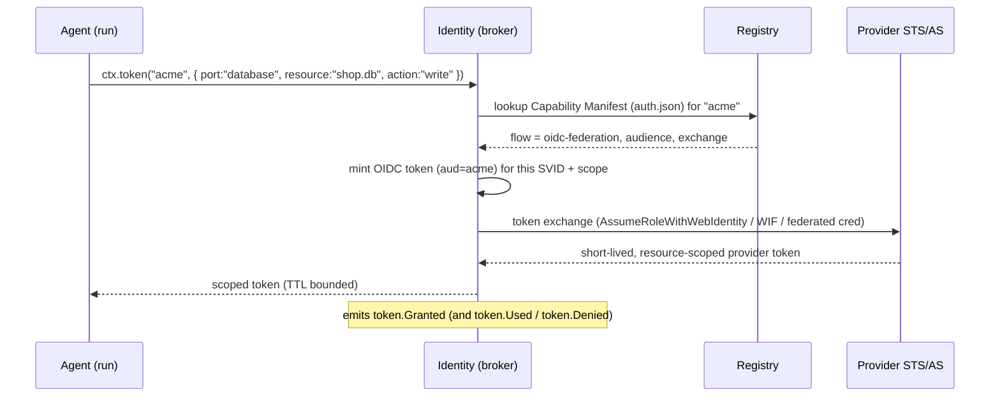
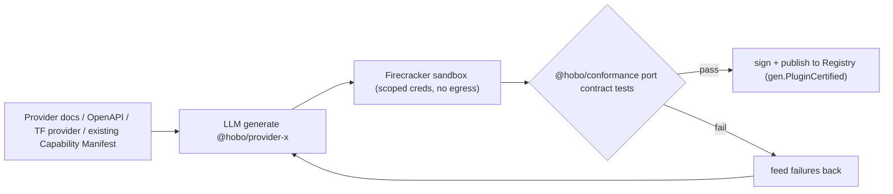
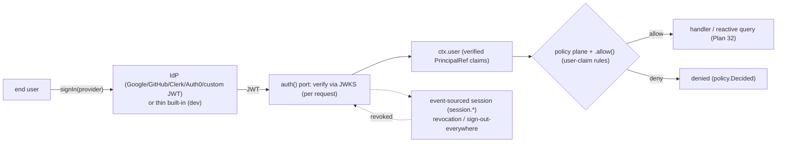

# AI-Native Platform & Agent Auth

This capability doc covers HoBo's identity story end to end: **agent/workload auth** (SVIDs, the token broker, the Capability Manifest, the generation pipeline) and **end-user / application auth** (app users signing in) — one principal model, one policy plane, one audit trail.

## Plan 06

> **Drivers & Resource Packs (Humanitec parity):** the **generation pipeline** also generates **Resource Definitions** and **Resource Packs** ([Plan 25](./platform-engineering.md#plan-25)/[Plan 25](./platform-engineering.md#plan-25)) — not just providers/implementations — so the platform-rules layer isn't human-bottlenecked. The Registry catalogs packs with provenance + conformance reports.

> **Contracts & policy (gates):** an **agent action is a policy decision** ([Plan 29](./contracts-policy-flags.md#plan-29)) — `{subject: agent, action, resource, phase}` → allow/deny/warn/require-approval **+ obligations** (e.g. "auto-fix preview, only *propose* prod"); the agent-action policy here is the same model. Each **agent tool** also carries a **contract** (I/O + auth scope + allowed side effects, [Plan 29](./contracts-policy-flags.md#plan-29)), so calls outside the tool's scope/shape are rejected and audited.

### Design stance: agents are principals, not scripts
Most platforms bolt agent support on as "an API key in a script." HoBo treats an agent as a **first-class authenticated principal** with its own identity, scoped capabilities, a full audit trail, and durable execution. Three pillars: **Capability Manifest** (the capability/auth standard), **Identity** (issuance + brokering), and the **generation pipeline** (AI-generated providers). All three are reachable over **MCP** so agents drive HoBo natively.

**Epic reference implementation.** The synthesized Identity/Auth/XAA reference architecture lives at [`../../src/draft/epic-proofs/identity-auth-secrets-cross-app-access-xaa/`](../../src/draft/epic-proofs/identity-auth-secrets-cross-app-access-xaa/) and runs the Plan 06 workload credential, `hobo:auth`, secretless config, XAA delegation, recovery, and audit slices with mocked service boundaries plus consumer-side Pact fixtures.

> **Runtime/AI integration.** The generation pipeline (§6.5) generates not just providers but **implementations** behind WIT ports — the stub → implement → trace → auto-evolve → live-fix loop is specified in [Plan 23](./generated-stack.md#plan-23). And `.allow()` ([Plan 21](./authoring-resources-wiring.md#plan-21)) is what scopes the tokens the broker issues: one declaration drives IAM **+ wasm capability links + token scope**.

> **Scope note — this plan is *agent/workload* auth.** **End-user / application auth** (an app's human users signing in) is covered in §6.7 below ([ADR-0038](./adr/02-identity-security.md#adr-0038)). They are *not* separate systems: an end-user is just another **`PrincipalRef`** (`ctx.user` alongside `ctx.identity`), authorized via the same policy plane + `.allow()` and audited via the same event `actor`. The **OBO** flow below (§6.2, an agent acting *for* a specific human) carries that same end-user principal — user → agent → resource is one identity chain.

---

### 6.1 Capability Manifest — the `auth.md` standard
A machine-readable standard each Provider publishes so any agent can understand *what it offers* and *how to authenticate* — with no human reading docs or pasting keys. Markdown for humans + strict JSON companions for machines, at a well-known location.

```
/.well-known/capability-manifest/
  index.json          # version, links, signature, issuer
  signs.md            # human/LLM-readable overview (also emitted as llms.txt)
  capabilities.json   # which ports + service models, regions, equivalence classes
  auth.json           # supported auth flows, scopes, token lifetimes, resource indicators
  cost.json           # optional cost/region signals for the Planner (Plan 16)
```

**`capabilities.json`**
```jsonc
{
  "provider": "acme-cloud",
  "ports": [
    { "port": "database", "engines": ["postgres","mysql"], "features": ["managed","ha","vector"], "regions": ["us-east","eu-west"] },
    { "port": "objectStore", "regions": ["us-east","eu-west","ap-south"] },
    { "port": "compute", "kinds": ["container","function"] }
  ],
  "equivalence": { "database{postgres,managed}": "acme.pg.flex", "objectStore": "acme.blobs" }
}
```

**`auth.json`** — the heart of the standard
```jsonc
{
  "issuer": "https://acme-cloud.example.com",
  "flows": [
    { "type": "oidc-federation", "audience": "hobo",
      "exchange": "sts:AssumeRoleWithWebIdentity",
      "trust": { "oidcDiscovery": "https://yard.example.com/.well-known/openid-configuration" } },
    { "type": "oauth2-obo", "authorizationServer": "https://acme.example.com/oauth",
      "scopes": ["db:write","compute:deploy","objstore:rw"] },
    { "type": "oauth2-xaa", "idJag": true, "authorizationServer": "https://acme.example.com/oauth",
      "audience": "urn:acme:app", "scopes": ["tasks:read","tasks:write"] },   // XAA available scopes; HoBo requests only the subset inferred from usage (ADR-0084)
    { "type": "device-code" },
    { "type": "api-key", "header": "X-Api-Key", "rotation": "manual" }
  ],
  "scopeModel": "least-privilege-per-resource",
  "resourceIndicators": ["urn:acme:db", "urn:acme:compute", "urn:acme:objstore"],
  "tokenLifetimeSec": 3600,
  "audit": { "events": ["token.Granted","token.Used","token.Revoked"] }
}
```

- **Discovery:** the Registry crawls/accepts `index.json`, verifies its signature, and indexes capabilities + auth for the Planner and agents.
- **Preference order:** HoBo prefers **keyless** flows (`oidc-federation` > `oauth2-xaa` (Cross-App Access) > `oauth2-obo` > `device-code` > `api-key`) so static secrets are a last resort; `oauth2-xaa` is preferred for user-delegated access to an *external* app because the IdP brokers and governs it ([ADR-0084](./adr/02-identity-security.md#adr-0084)).
- **Thematic anchor:** real hobo "signs" were a shared symbol language for finding resources & safe passage — `signs.md` is exactly that, for agents. This is the "standard like auth.md" the project calls for, and the Registry is the centralized place providers register it.
- **Trust boundary:** `signs.md`/`llms.txt` and manifest description fields are untrusted input wherever an agent reads them — the signature authenticates the publisher, not the safety of the prose; instructions inside a manifest never widen what an agent may do ([ADR-0023](./adr/02-identity-security.md#adr-0023) item 3, [Plan 12](./security-networking.md#plan-12) threat table).

---

### 6.2 Agent identity & the token broker
Every actor/agent gets a **workload identity** (SPIFFE-style SVID / short-lived OIDC token) issued by the Yard's **Identity** service. No static secrets live in agent code.

**Identity lifecycle:**
1. **Attest** — an agent run starts; the runtime attests it to Identity (run id, tenant, parent principal, code version).
2. **Issue** — Identity mints a short-lived SVID (JWT-SVID with `spiffe://yard/<tenant>/agent/<name>`), recorded as `identity.Issued`.
3. **Rotate** — SVIDs auto-rotate well within TTL (`identity.Rotated`); long agent runs never hold a stale credential.
4. **Scope** — the SVID encodes the agent's allowed ports/resources (least privilege), derived from the Bindle + tenant policy.

**Token brokering (agent → provider), keyless by default:**

- **OIDC federation** (AWS `AssumeRoleWithWebIdentity`, GCP Workload Identity Federation, Azure federated credentials) is the default — no secret ever stored.
- **OAuth On-Behalf-Of** when the agent acts for a specific human (carries the user's delegated consent + scope).
- **MCP/OAuth2.1** for SaaS tools that speak it.
- **Every issuance is an event** (`token.Granted` → `token.Used` → `token.Revoked`) → a fully replayable credential audit (the `CredentialAudit` projection, [Plan 11](./data-plane.md#plan-11)). This directly answers the industry gap where agent actions can't be audited.

**Dev-mode auth bypass — the local-dev path ([ADR-0070](./adr/02-identity-security.md#adr-0070)).** In **`hobo dev`** the runtime skips real attestation/IdP round-trips by satisfying the `auth` port's **consumer-driven contract** (subject/roles/tenancy/scopes the app expects, [Plan 29](./contracts-policy-flags.md#plan-29)) with a **contract-asserted dev principal** — a fixture matching that contract. Auth still runs; it's just fulfilled by the fixture, offline. The dev can override claims/roles/tenant per session within the contract, so role/tenancy testing is first-class. **Prod parity** holds because the **same `auth` contract is enforced at `can-deploy`** (a real IdP/Camp must satisfy it), so the dev path is contract-equivalent to prod and cannot drift. Deny-by-default is untouched: the dev principal only gets `.allow()`-granted capabilities ([Plan 12](./security-networking.md#plan-12)).

**Least privilege & guardrails:**
- Tokens are scoped to `(port, resource, action)` and the minimal provider permission for that equivalence class — never "admin."
- **High-risk actions** (destroy, spend above a budget, touch prod) require a policy gate: auto-allowed, require human approval (a `createHook` the dashboard/Slack resolves), or denied. Policy is per-tenant, versioned, and itself event-sourced. An agent's **`spendCapUsd`** is one instance of the general **quota** model — agent caps, Camp/tenant budgets, and plan-tier quotas are the same policy-plane gate over the `MeteringView`, backed by a runaway-spend circuit-breaker ([Plan 5](./reliability-observability-cost.md#plan-05)/[ADR-0039](./adr/02-identity-security.md#adr-0039)).

---

### 6.3 Durable protocol agents
HoBo does not define or maintain a public agent SDK. Durable agent frameworks integrate through protocol connectors (for example A2A or ACP) and receive identity + scoped credentials through connection-scoped connector tokens.
```ts
import { connector } from "@hobo/bindles";

export const opsAgentProtocol = connector("ops-agent-protocol", {
  protocol: "a2a",
  permissions: ["incident.read", "deploy.propose"],
});

export async function proposeDeploy(ctx, bindle: string) {
  const token = await ctx
    .connector("ops-agent-protocol")
    .connection({ audience: "a2a://ops", protocol: "a2a" })
    .token({ scopes: ["deploy.propose"], purpose: `deploy:${bindle}` });

  return ctx.hobo.deploy(bindle, { token, mode: "proposal" });
}
```
Because tools run in the external agent runtime and HoBo records connector token issuance, every credential grant and gated write remains replayable for debugging, audit, and post-incident review without HoBo owning an agent framework.

---

### 6.4 MCP control surface
The Yard exposes an **MCP server** (`@hobo/mcp`) so any agent (Claude, etc.) can drive HoBo natively. Initial tool surface:
| MCP tool | Purpose |
|---|---|
| `list_bindles` / `get_bindle` | discover apps + topology |
| `plan` | dry-run a deploy → returns the DeploymentPlan + cost + warnings |
| `deploy` / `promote` / `rollback` / `destroy` | lifecycle (guardrail-gated) |
| `inspect_run` / `tail_logs` | observability over projections + streams |
| `search_registry` | find providers by capability (reads Capability Manifest) |
| `request_token` | broker a scoped provider token (audited) |
| `get_drift` / `heal` | drift status + reconcile |

MCP auth uses the same Identity/SVID model; tools are capability-scoped. HoBo also publishes `llms.txt` / `llms-full.txt` / `docs.json` (matching Lakebed's machine-readable ethos) — but for *operations*, not just app contracts.

**Inert-tool-output invariant.** Every MCP tool result — including `search_registry` results carrying Capability Manifest prose — is inert data: a tool output can never schedule, authorize, or widen a follow-up tool call beyond the agent's existing grant; prompt-injected content in a result is recorded but powerless ([ADR-0023](./adr/02-identity-security.md#adr-0023) item 3; proven in [HOBO-194](./proofs/hobo-194-mcp-server-hardening/index.md)).

---

### 6.5 The generation pipeline — AI-generated provider plugins
Instead of relying on a community to write adapters, the **generation pipeline** generates and certifies them.

1. **Generate** a candidate provider (port impls + IaC mappings + equivalence classes + a Capability Manifest manifest) from the backend's docs/OpenAPI/Terraform provider/Capability Manifest.
2. **Sandbox-test** it in a Firecracker microVM with capability-scoped tokens and no outbound egress (can't exfiltrate) against `@hobo/conformance` ([Plan 9](./generated-stack.md#plan-09)).
3. **Certify** on pass: sign and publish to the Registry (`gen.PluginCertified` with the test report + provenance); on fail, feed errors back for repair.

**Conformance tests are the trust boundary** that makes AI-generated extensibility safe — a plugin is only as trusted as the contract tests it passed, and the signed report is part of its Registry record.

> **The generation/repair loop is specified in detail in [Plan 33 — generation pipeline](./generated-stack.md#plan-23)** ([ADR-0010](./adr/03-data-plane.md#adr-0010)): the sketch above is **contract-first** (the WIT port + conformance suite + Capability Manifest are authoritative; docs/OpenAPI/TF are *sanitized hints*), the "feed failures back" step is the **`training-engine` optimizer** ([ADR-0025](./adr/03-data-plane.md#adr-0025)) under a **bounded repair budget** (exhaustion → `gen.NeedsHuman`), and the same loop generates **providers, implementations, and Resource Definitions** — not just providers.

---

### 6.6 How this all reduces to "zero developer effort"
A developer (or their agent) writes a Bindle, points it at "acme-cloud," and the agent — using its SVID, the Registry's Capability Manifest, and the broker — obtains exactly the scoped tokens it needs, deploys, and leaves an auditable trail. The developer never created an IAM role, pasted a key, or wrote an adapter. If acme-cloud isn't supported yet, the generation pipeline generates and certifies the provider on demand.

**Cross-Yard identity federation.** The same OIDC/SVID federation extends across sovereign Yards in a **Junction** ([ADR-0043](./adr/07-portability-extensibility.md#adr-0043)): a principal from one Yard is authenticated by another under an agreed trust root.

### 6.7 End-user / application auth — same principal, same plane
Agent auth and end-user auth are one system seen from two ends. The §6.2 scope note already says it: an end-user is just another **`PrincipalRef`** — the event envelope's `actor` already admits `user` ([Plan 11](./data-plane.md#plan-11)) — and the **OBO** flow (§6.2) is that same human principal acting *through* an agent. So app users signing in reuse the identity, authorization, and audit machinery built above, rather than standing up a parallel stack.

**The `auth()` port — federate + verify.** HoBo does **not** reinvent a full identity provider (a deep, security-critical domain). `auth()` is a **federation + verification** port (`hobo:auth`):
- **Verify any IdP.** It validates an OIDC/JWT from any provider — Google / GitHub / Clerk / Auth0 / **custom JWT** (the shoo + Convex-`customJwt` pattern, [docs/competitors/shoo](../competitors/shoo.md)/[convex](../competitors/convex.md#auth-integrations--ops)) — reusing the **OIDC + JWKS + secretless** machinery Identity already runs for agents (§6.2, [Plan 21](./authoring-resources-wiring.md#plan-21)). Providers are declared IfC-style (issuer / JWKS URL / algorithm).
- **Thin built-in for zero-config dev.** An optional built-in (passkey / email magic-link) lets `hobo dev` and small apps work with no external IdP — and runs **offline / in air-gap** ([ADR-0036](./adr/07-portability-extensibility.md#adr-0036)).

```ts
import { auth } from "@hobo/bindles";
export const appAuth = auth({
  providers: [
    auth.oidc({ issuer: "https://accounts.google.com" }),
    auth.customJwt({ issuer: "https://shoo.example", jwks: "…/jwks.json", alg: "ES256" }),
    auth.builtin(),   // optional thin passkey/email for dev
  ],
});
```



**Unified principal model.** An authenticated end-user surfaces in handlers as **`ctx.user`** (typed, verified claims) alongside `ctx.identity` (the SVID, §6.2) — one identity/authz/audit path for **users + agents + services**:
- **Tenancy** — when the app is multi-tenant, the user's verified **tenancy claim** (and/or routing) resolves the **app tenant** as **`ctx.tenant`** ([Plan 50](./security-networking.md#plan-50)/[ADR-0079](./adr/02-identity-security.md#adr-0079)) — the customer org the person belongs to, *distinct from* HoBo's platform `tenant` ([Plan 12](./security-networking.md#plan-12)). Data access is scoped to `ctx.tenant` **by construction + deny-by-default** ([ADR-0080](./adr/02-identity-security.md#adr-0080)); an ordinary `ctx.user` reaches **only** its own tenant, while a legitimate **cross-tenant-admin** is a distinct, audited role ([ADR-0074](./adr/02-identity-security.md#adr-0074)) — never the default end-user path.
- **Authorization** is the **same policy plane** ([Plan 29](./contracts-policy-flags.md#plan-29)) + **`.allow()`** declarative rules ([Plan 21](./authoring-resources-wiring.md#plan-21)) keyed on user claims (record/row-level), so "this user may read only their own orders" is a policy decision, not ad-hoc handler code (imperative checks on `ctx.user` remain available).
- **Route-level enforcement** — per-route `security` rules and the `api.use()` middleware chain are enforced at the **`hobo:http`** port before handlers run ([Plan 21](./authoring-resources-wiring.md#route-level-api-security)/[ADR-0114](./adr/02-identity-security.md#adr-0114)); gateway authorizers and `hobo dev` share the same manifest IR `security` entries, including in local dev (unlike Nitric's documented local-enforcement gap).
- **Audit** rides the existing event `actor` ([Plan 11](./data-plane.md#plan-11)) — every user action is already an attributable, replayable fact, identical to agent/service actions. No parallel audit trail.
- **Delegation** — an agent acting **on behalf of** a user (OBO, §6.2) carries that same user `PrincipalRef`, so user → agent → resource is one coherent identity chain.

**Local dev** uses the same **contract-asserted dev principal** as §6.2 ([ADR-0070](./adr/02-identity-security.md#adr-0070)): the `auth` port carries a consumer-driven contract (subject/roles/tenancy/scopes the app expects, [Plan 29](./contracts-policy-flags.md#plan-29)), and in `hobo dev` the runtime satisfies it with a fixture principal — the thin built-in is one such fixture source — instead of verifying a real IdP JWT. The dev overrides claims/roles/tenant per session within the contract, so `ctx.user`-keyed record-level rules ([Plan 29](./contracts-policy-flags.md#plan-29)/`.allow()`) are exercised against real principals offline. Prod parity is structural: the **same `auth` contract is enforced at `can-deploy`**, so the dev path is contract-equivalent and cannot drift. Authentication is fulfilled by the fixture; authorization is not bypassed (deny-by-default, only `.allow()`-granted capabilities, [Plan 12](./security-networking.md#plan-12)).

**Sessions & token model.**
- **Stateless verify by default.** The IdP's JWT is verified via **JWKS on each request** (edge-friendly, matches `customJwt` + the existing JWKS), producing `ctx.user`. No central session read on the hot path.
- **Event-sourced sessions for revocation.** Optional **`session.*`** records make revocation / "sign out everywhere" + session audit first-class; reactive queries/mutations ([Plan 32](./data-plane.md#plan-32)) **re-evaluate when auth state changes** (a revoked session re-pushes/denies affected live queries), reusing the reactor's `data.Changed` path.

**Client & server surface.**
- **Client:** `useAuth()` (current user + status), `signIn(provider)`, `signOut()` — a peer to `useQuery()` ([Plan 32](./data-plane.md#plan-32)); generated typed against the configured providers ([ADR-0037](./adr/01-architecture-core.md#adr-0037)).
- **Server:** `ctx.user` (verified claims, typed) gates handlers and reactive queries; combine with policy/`.allow()` for record-level authorization.

**Events ([Plan 11](./data-plane.md#plan-11)).** `user.Authenticated` (verification result + principal claims) · `session.Started` · `session.Refreshed` · `session.Revoked`. User authorization decisions ride the existing **`policy.Decided`** ([Plan 29](./contracts-policy-flags.md#plan-29)) — no duplicate authz events.

---

### 6.8 Cross-App Access (XAA) — governed agent/app access to external apps
Connecting a HoBo agent or app to an *external* app on a user's behalf (Asana, Slack, an external MCP server) must not mean a private OAuth+consent dance the enterprise can't see — that leaves **standing API keys and invisible consent** (the IdP only ever saw "the user signed in", never "an AI agent can now act *as* the user in Asana"). HoBo speaks **Cross-App Access (XAA)** — the **Identity Assertion JWT Authorization Grant (ID-JAG)** ([draft-ietf-oauth-identity-assertion-authz-grant](https://datatracker.ietf.org/doc/draft-ietf-oauth-identity-assertion-authz-grant/); an official **MCP authorization extension**), built on **Token Exchange (RFC 8693)** + the **JWT assertion grant (RFC 7523)** — the same broker machinery §6.2 already uses for provider federation, specialized to connector-mediated external access ([ADR-0084](./adr/02-identity-security.md#adr-0084)).

**Two-stage, brokered by the IdP the target already trusts for SSO:**
```mermaid
sequenceDiagram
  participant A as HoBo agent/app (requester)
  participant ID as IdP / Identity broker (hobo:auth or Yard Identity)
  participant RAS as External app Authorization Server (Asana/Slack)
  participant R as External app (resource)
  A->>ID: token-exchange: user ID token (or OBO SVID) → ID-JAG for audience=Asana
  Note over ID: policy check (subject.delegatedBy = user; ADR-0074) BEFORE minting
  ID-->>A: short-lived, audience-bound ID-JAG (assertion)
  A->>RAS: RFC 8693 exchange: ID-JAG → access token (least-privilege scopes)
  RAS-->>A: short-lived access token, scoped to Asana only
  A->>R: call Asana as the user, within scope
  Note over ID: every step is token.Granted / token.Used (full user→agent→app chain)
```

**Both directions are first-class.**
- **HoBo as requester (outbound).** A HoBo agent/app reaching an external app on a user's behalf — Identity mints the audience-bound ID-JAG, the agent redeems it at the target's AS. Declared per target as the `oauth2-xaa` flow in `auth.json` (above).
- **HoBo as resource (inbound).** A HoBo-hosted app is the *target*: its **`auth()` port** (§6.7) / Yard AS accepts an ID-JAG (audience = the HoBo app) from an external requesting agent (Claude, Cursor, …), verifies it against the trusted IdP's JWKS, and issues a scoped token — gated by the policy plane + `.allow()`. So **HoBo apps are XAA resource servers by default**, reachable by external agents under enterprise governance.

**Governed, scoped, audited — no standing privilege.** The brokering IdP is the same swappable **`hobo:auth`** IdP (WorkOS/Auth0/Entra/Okta/Keycloak, [ADR-0038](./adr/02-identity-security.md#adr-0038)/[ADR-0073](./adr/07-portability-extensibility.md#adr-0073)) or HoBo's own Yard Identity acting as OIDC issuer. Every connector grant is a **deny-by-default policy decision** ([ADR-0074](./adr/02-identity-security.md#adr-0074)) — the request already carries `subject.delegatedBy`, so "agent X may access external app Y on behalf of user Z" is a policy/deny-ceiling rule, checked *before* the ID-JAG is minted (a `mandatory` rule can **require XAA** and refuse standing API keys where a target supports it). Tokens are short-lived + audience-bound (no reuse across targets); the whole **user → agent → external-app** chain rides `token.Granted/Used/Revoked` (the `CredentialAudit` projection), so "which agent reached which external app as which user, when" is always answerable. For targets that don't yet speak ID-JAG (still an IETF draft), HoBo falls back to `oauth2-obo` / MCP-OAuth2.1 — functional, but without the central XAA governance.

The ID-JAG draft-version pin and XAA abuse matrix are tracked in [ADR-0097](./adr/02-identity-security.md#adr-0097): draft skew, forced OBO fallback, actor-token confusion, sender-constrained-token downgrade, and refresh-token subject broadening all fail closed until explicitly reviewed.

**App-facing surface — declare the app, infer the scope.** You don't list OAuth scopes by hand. Declare a connector dependency and use its typed client; HoBo infers the least-privilege scope set from the operations you call (declaration + usage, [Plan 21](./authoring-resources-wiring.md#plan-21)/[ADR-0069](./adr/01-architecture-core.md#adr-0069)) and brokers the XAA token for exactly that set, on behalf of `ctx.user`:
```ts
import { connector } from "@hobo/bindles";
const asana = connector("asana");                           // declaration → typed client from Asana's Capability Manifest
await asana.tasks.create({ name, assignee: ctx.user.id });  // usage → infers scope tasks:write; XAA token brokered automatically
```
`auth.json`'s `scopes` advertise what the target *offers*; the manifest records the inferred subset HoBo actually *requests* (`allow`). `connector("asana").allow("tasks:read")` narrows it; a policy deny-ceiling ([ADR-0074](./adr/02-identity-security.md#adr-0074)) caps it. Full authoring surface in [Plan 21](./authoring-resources-wiring.md#plan-21).

**Verification ([Plan 9](./generated-stack.md#plan-09)).** An end-user-auth test: a JWT from a fixture IdP is verified via JWKS → `ctx.user` carries the claims; an **expired / wrong-issuer / tampered** token is rejected; a **policy/`.allow()` rule keyed on user claims** gates a query/mutation (allow + deny cases); **revocation** (`session.Revoked`) blocks subsequent requests **and re-pushes affected reactive queries**; the **thin built-in dev provider works offline** (air-gap tie, [ADR-0036](./adr/07-portability-extensibility.md#adr-0036)).

**Scope.** The `auth()` federate+verify port (OIDC + `customJwt`, reference adapters: Google/GitHub/Clerk/Auth0) + a thin built-in (passkey/email) for dev; `ctx.user` as a unified `PrincipalRef`; policy/`.allow()` authorization on user claims; stateless JWKS verify + event-sourced sessions/revocation; `useAuth()`/`signIn`/`signOut`. A full hosted IdP (accounts/passwords/MFA at scale), B2B org/role hierarchies beyond claims, SCIM provisioning, and step-up/MFA orchestration are out of scope.
