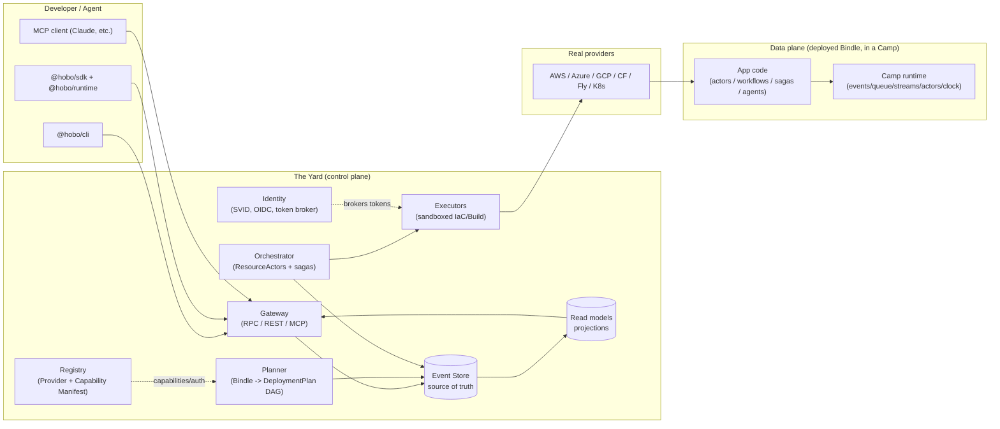

# Reference Architecture & Monorepo

This capability doc covers the reference architecture and, beneath it, the monorepo & package layout that realizes it.

## Plan 10

**Plan 10 — Reference architecture overview**

> **Resource Definitions & Matching (Humanitec parity):** the Planner box resolves resources via **Resource Definitions + Matching** ([Plan 25](./platform-engineering.md#plan-25)); Executors can run behind a **HoBo Relay** inside a private network ([Plan 25](./platform-engineering.md#plan-25)); a **GitOps publisher** is an alternate path from Set → cluster. Control/data-plane split and event-sourced invariants are unchanged.

> **Contracts & policy (gates):** two governance planes sit at the deploy decision point as **WIT ports with built-in engines** — a **contract plane** (compatibility/`can-deploy`, [Plan 29](./contracts-policy-flags.md#plan-29)) and a **policy plane** (decisions + obligations, [Plan 29](./contracts-policy-flags.md#plan-29)) — composed by the **Gatekeeper** alongside conformance/evals/cost. The organizing lens across the suite: **Contract = must never break · Eval = should improve · Policy = may/may not be allowed · Trace = what actually happened.**

> **Runtime/IfC integration.** Deployed services are **wasm components** (OCI-container fallback) running on a wasm host that links each component's imported WIT ports to **capability providers** ([Plan 20](./wasm-runtime-wit.md#plan-20)). The deploy path gains a **resource-collection (IfC)** step that emits the **manifest IR** the Planner consumes ([Plan 21](./authoring-resources-wiring.md#plan-21)/[Plan 21](./authoring-resources-wiring.md#plan-21)). The control/data-plane split and event-sourced invariants below are unchanged.

> **Data plane + the Operator Crew.** App **domain data is event-sourced by default** — the "Read models" box generalizes to developer-authored **projections** the architect maps onto any backend (a **projection sink**, [Plan 32](./data-plane.md#plan-32)). A roster of built-in **Operator Agents (the Crew)** runs inside the Yard — SRE · Endpoint Monitor · GitOps · Platform Engineer ([Plan 40](./operators-sre.md#plan-40)) — each a principal on the same identity/policy/event model; the **SRE operator** drives **incidents + self-healing** ([Plan 40](./operators-sre.md#plan-40)). HoBo **generates / self-heals / persists the app across data · business · message · intelligence · UI** ([Plan 23](./forge-generated-stack.md#plan-23)) — Forge-generated adapters + self-optimizing runtime functions + design.md-driven UI ([ADR-0056](./adr/06-ai-generation-operators.md#adr-0056)). Beyond portability, every box is **patchable** — engines/adapters swap behind ports, certified by conformance ([Plan 23](./forge-generated-stack.md#plan-23)). The control/data-plane split + event-sourced invariants below are unchanged.

### The one-paragraph model
A developer (or agent) writes a **Bindle** (app topology, [Plan 2](./sdk-api.md#plan-02)) and **`camp()`/`yard()` scope objects** mapping ports to **Providers** ([Plan 4](./control-plane.md#plan-04)). The **Yard** ([Plan 4](./control-plane.md#plan-04)) — HoBo's **provider-specific** control plane, one per provider — receives a deploy request, the **Planner** turns the Bindle + mapping into a **DeploymentPlan** (a DAG of `ResourcePlan`s), and the **Orchestrator** drives each resource to reality through **ResourceActors** that call **IaC/Build adapters** inside sandboxed **Executors**, brokering short-lived credentials from **Identity**. Every state transition is an **event** ([Plan 11](./event-model.md#plan-11)) in an append-only log, so the whole system is replayable, auditable, and recoverable. The app deploys into a **Camp** — a **provider-specific** target (≈ a Pulumi stack) that maps the Bindle's abstract deps to one provider's concrete resources in one group/region and supplies the **durable runtime** ([Plan 2 §Layer 1](./sdk-api.md#plan-02)): event store, queue, streams, actor host, and clock. The scopes nest **`Bindle ⊂ Camp ⊂ Yard ⊂ Junction`** ([ADR-0026](./adr/01-architecture-core.md#adr-0026)): multi-region within a provider = several Camps under one Yard; multi-cloud = several Yards under a **Junction** (the cross-cloud / hybrid scope).

### Control plane vs data plane
HoBo has two distinct planes; keeping them separate is a core architectural commitment.

- **Control plane (the Yard).** Decides *what infra should exist* and makes it exist. Event-sourced, actor-based, multi-tenant. It is **provider-specific** — one Yard per provider, governing that provider's **Camps** and holding cross-Camp policy + provider-global networking/gateways. Cross-cloud / hybrid topology is the **Junction** connecting Yards, not the Yard itself ([ADR-0026](./adr/01-architecture-core.md#adr-0026)). Never on the critical path of a running app's request. If the Yard is down, deployed apps keep serving.
- **Data plane (the running Bindle).** The developer's actual app + the **Camp's durable runtime**. Uses HoBo's runtime SDK primitives (actors, workflows, sagas, agents) but does not depend on the Yard at request time. The runtime it runs against is **provided by the Camp** (provider-specific) and can be fully self-managed.



### Component responsibilities (C4 "container" level)
| Component | Responsibility | Key inputs | Key outputs (events) |
|---|---|---|---|
| **Gateway** | Authn/z; expose SDK RPC + REST + MCP; accept commands; serve read models | Commands, identity tokens | `DeployRequested`, `BindleRegistered`, … |
| **Identity** | Issue workload identities (SVIDs); act as OIDC IdP; broker provider tokens via Capability Manifest | SVID requests, provider Capability Manifest | `IdentityIssued`, `TokenGranted`, `TokenRevoked` |
| **Registry** | Catalog providers + their Capability Manifest (capabilities, auth, cost) | Provider manifests | `ProviderRegistered`, `CapabilityManifestUpdated` |
| **Planner** | Resolve mapping rules → `DeploymentPlan` DAG; solve capability/region/cost constraints | Bindle, config, Registry | `Planned`, `PlanRejected` |
| **Orchestrator** | Drive the plan; one **ResourceActor** per resource reconciling desired↔actual; choreography sagas for cross-resource ordering & compensation | `DeploymentPlan`, observed state | `Provisioning`, `Provisioned`, `Failed`, `Compensating`, `Deployed` |
| **Executors** | Run IaC apply/preview/destroy + image/VM builds in Firecracker sandboxes with scoped creds | `IacProgram`, `BuildSpec`, brokered token | `ExecStarted`, `ExecOutput`, `ExecSucceeded`, `ExecFailed` |
| **Event Store** | Append-only source of truth; subscriptions; snapshots | Events | (is the log) |
| **Read models** | Materialized projections for queries/UI | Event stream | (query API) |

### Request lifecycles (two canonical paths)
**Deploy (command path):**
`hobo deploy` → Gateway authenticates the principal → emits `DeployRequested` → Planner consumes it, emits `Planned` → Orchestrator spawns ResourceActors → each emits `Provisioning`→`Provisioned` (or `Failed`→`Compensating`) → on DAG completion, `Deployed`. A crash anywhere is recovered by replaying the deployment's event stream.

**Run inspection (query path):**
`hobo inspect run <id>` / dashboard → Gateway → read model projection of the run's events (workflow/step/actor/saga timeline). Never touches the providers.

### Key boundaries & invariants
1. **Commands mutate only via events.** No component writes resource state except by appending an event (CQRS/ES). This is what makes everything replayable.
2. **Executors are the only thing that touches a cloud**, always sandboxed, always with a short-lived scoped token (never a long-lived secret). See [Plan 12](./security-networking.md#plan-12).
3. **The Yard is itself a Bindle** deployed by an earlier Yard (or bootstrapped locally) — see [Plan 4 §Bootstrapping](./control-plane.md#plan-04).
4. **Same code, many Camps.** Swapping a Camp's runtime backend changes the durability backing, never app logic. See [Plan 2 §Layer 1](./sdk-api.md#plan-02).

### Runtime/IfC components (integrated)
Two boxes the runtime/IfC model adds to the map above:
| Component | Responsibility | Key events |
|---|---|---|
| **Wasm host** (per provider target) | run service **components**; hold the **link table** binding each import → a capability provider ([Plan 20](./wasm-runtime-wit.md#plan-20)) | `link.Established`, `link.Called` |
| **Collector** (IfC) | run components in resource-collection mode → the **manifest IR** the Planner consumes ([Plan 21](./authoring-resources-wiring.md#plan-21)/[Plan 21](./authoring-resources-wiring.md#plan-21)) | `bindle.ResourcesCollected`, `bindle.ManifestProduced` |

**Invariant addendum.** A deployed component reaches a backend **only via a link the manifest declared** — deny-by-default capability security extends invariant #2 from the executor to the running data plane ([Plan 12](./security-networking.md#plan-12)).

### Iteration hooks
- ~~Whether read models live in the same store (projections) or a separate query DB.~~ **Resolved ([Plan 32](./data-plane.md#plan-32)/[ADR-0050](./adr/03-data-plane.md#adr-0050)):** architect-selected per context via Matching — default is a native standing projection over the log; a projection may be materialized into a separate query backend (a **projection sink**) when wanted.
- Gateway protocol details (gRPC vs tRPC-style vs plain HTTP+JSON for the SDK RPC).
- How far the control/data-plane split goes for HoBo's own managed Camps/runtimes.

### Monorepo & package architecture
The architecture above is realized as a layered monorepo. **Tooling:** pnpm workspaces + Turborepo; TypeScript (strict, `nodenext`); `tsup`/`unbuild` for builds; Vitest; Biome; Changesets for versioned publishing.

#### Layering & dependency rule
Packages are layered; dependencies point **inward only** (`apps → adapters → sdk/runtime → core`). `@hobo/core` depends on nothing HoBo. This keeps adapters swappable and prevents the agnostic core from leaking provider details.
```
core  ←  sdk, runtime  ←  runtimes/*, providers/*, iac/*, build/*  ←  cli, cloud, mcp, registry, identity
                          (all adapters depend only on core's port interfaces)
```

#### Packages (initial layout)
```
packages/
  core/            @hobo/core         types, port interfaces, Capability Manifest schema, event envelope, DI/container
  wit/             @hobo/wit          WIT interfaces (wasi:* reuse + hobo:* ports) + generated TS bindings  [Plan 20]
  sdk/             @hobo/sdk          IfC resources (api/kv/bucket/queue/topic/secret/sql/...) + .allow(); bindle() (advanced)  [Plan 21]
  runtime/         @hobo/runtime      actors/grains, workflow/step, sagas, agent(), stubs, ctx
  componentize/    @hobo/componentize component build via jco + per-language toolchains -> OCI artifacts  [Plan 20]
  cli/             @hobo/cli          hobo dev|deploy|plan|inspect|login|registry|yard|forge
  runtimes/          (the durable runtime backends a Camp provides)
    runtime-local      @hobo/runtime-local     (built-in engine; sqlite/filesystem)
    runtime-postgres   @hobo/runtime-postgres
    runtime-temporal   @hobo/runtime-temporal
    runtime-restate    @hobo/runtime-restate
    runtime-cloudflare @hobo/runtime-cloudflare  (Durable Objects)
  providers/
    provider-aws       @hobo/provider-aws
    provider-azure     @hobo/provider-azure
    provider-gcp       @hobo/provider-gcp
    provider-cloudflare/-fly/-kubernetes ...
  iac/
    iac-pulumi         @hobo/iac-pulumi        (Automation API — primary)
    iac-cdktf / iac-crossplane / iac-opentofu
  build/
    build-wasm         @hobo/build-wasm        (jco/cargo-component/TinyGo/... -> wasm component, OCI artifact)
    build-dagger       @hobo/build-dagger      (container fallback images)
    build-packer / build-firecracker / build-vagrant
  cloud/             @hobo/cloud        The Yard (control plane), itself a Bindle; hosts the built-in Operator Agents (the Crew)  [Plan 40]
  registry/          @hobo/registry     Provider/Capability Manifest catalog service
  identity/          @hobo/identity     SVID issuance, OIDC provider, token broker
  mcp/               @hobo/mcp          MCP server exposing HoBo to agents
  agent-skills/      @hobo/agent-skills skills the Operator Agents (the Crew) + external MCP agents compose          [Plan 40]
  hobo-code/         @hobo/hobo-code    the Hobo Code DSL — token-efficient IR for codegen + platform config         [Plan 21]
  conformance/       @hobo/conformance  port contract test suites (shared by all adapters)
  contracts/         @hobo/contracts    HoBo Contract IR + compatibility/can-deploy engine (built-in)  [Plan 29]
  policy/            @hobo/policy        policy decision model + built-in TypeScript engine            [Plan 29]
  evals/             @hobo/evals         rubrics + promotion gates for semantic functions             [Plan 23]
  training/          @hobo/training      training-engine port + built-in OPTO optimizer + OpenInference capture (INTERNAL; not on the SDK surface)  [Plan 23]
    provider-pact             @hobo/provider-pact             (optional) Pact/Broker adapter behind contract-engine
    provider-opa              @hobo/provider-opa              (optional) OPA/Rego adapter behind policy-engine
    provider-cedar            @hobo/provider-cedar            (optional) Cedar adapter behind policy-engine
    provider-agent-lightning  @hobo/provider-agent-lightning  (optional, INTERNAL) Microsoft Agent Lightning behind training-engine
    provider-trace            @hobo/provider-trace            (optional, INTERNAL) Microsoft Trace (OPTO) behind training-engine
examples/
  hello-bindle/ multi-cloud-shop/ durable-agent/ self-host-yard/
```

#### Projects (the stated top-level surfaces → packages)
The product's named **Projects** map to packages here: **Cloud** → `@hobo/cloud` (+ `registry`/`identity`); **SDK** → `@hobo/sdk` (+ `runtime`); **CLI** → `@hobo/cli`; **MCP** → `@hobo/mcp`; **agent-skills** → `@hobo/agent-skills`; **DSL** → `@hobo/hobo-code` (the token-efficient IR for codegen + platform config, [Plan 21](./authoring-resources-wiring.md#plan-21)). *(A `@hobo/ui-render` / UI-generation surface is out of scope — [ADR-0064](./adr/08-scope-and-requirements.md#adr-0064).)*

#### Conventions
- **Ports live in `core`**, implementations in adapter packages; adapters never import each other.
- **Every adapter runs `@hobo/conformance`** for the ports it claims, in CI ([Plan 9](./verification.md#plan-09)).
- **Examples are tests** — `examples/*` double as E2E fixtures.
- **Public type surface is the contract** — provider option types are exported for `.with(...)` autocomplete ([Plan 2](./sdk-api.md#plan-02)).

#### Iteration hooks
- Package boundaries; whether `runtime` and `sdk` merge.
- Build tooling (tsup vs unbuild vs tsc project refs).
- Versioning policy: lockstep vs independent semver per package.
