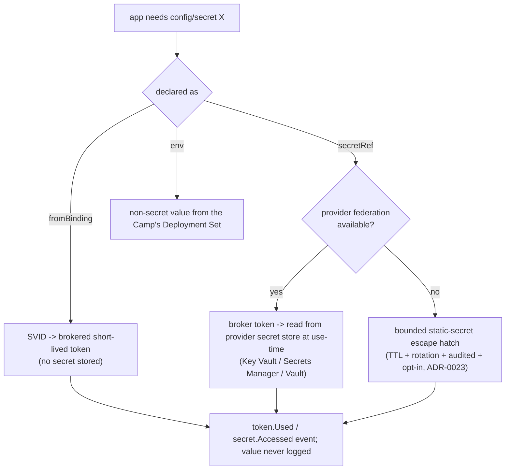
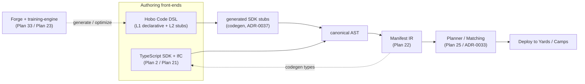

# Authoring: Resources, Wiring, Config & DSL

This capability doc consolidates Plan 21, Plan 22, Plan 31, Plan 38 of the HoBo design suite.

## Plan 21

**Plan 21 — Resource catalog & the `.allow()` model**

> **Contracts & policy (gates):** an `.allow()` declaration is also a **capability contract** ([Plan 29](./contracts-policy-flags.md#plan-29)) — the **required** scope must be ⊆ the **granted** scope on the resolved provider; a mismatch is a contract failure caught by `can-deploy`, not a runtime surprise.

### The `.allow()` model — one declaration, three effects
Declaring a permission on a resource drives **three** things at once:
1. **Least-privilege IAM** — the IaC adapter generates the minimal cloud policy ([Plan 3](./control-plane.md#plan-03)).
2. **WASM capability grant (link)** — the component is linked to *only* the provider interfaces its permissions require; everything else is denied by the wasm host ([Plan 20](./wasm-runtime-wit.md#plan-20)).
3. **Agent token scope** — the broker issues scoped tokens bounded to exactly these `(resource, verbs)` ([Plan 6](./ai-native-agent-auth.md#plan-06)).

```ts
// IfC-default authoring: resources declared inline, permissions co-located
import { bucket, kv, topic } from "@hobo/sdk";

const profiles = bucket("profiles").allow("read", "write");   // → S3 RW IAM + wasi:blobstore link + token scope
const sessions = kv("sessions").allow("get", "set");          // → wasi:keyvalue (get/set only)
const events   = topic("user-created").allow("publish");      // → wasi:messaging (publish only)
```
Permissions are **deny-by-default**: omit a verb and neither IAM, link, nor token grants it. This unifies least-privilege IAM with wasm capability security and HoBo's agent auth.

### Catalog — resource → WIT port → permission verbs
| Resource | `@hobo/sdk` | WIT port | `.allow()` verbs | Equivalence (AWS/Azure/GCP/CF) |
|---|---|---|---|---|
| **API / HTTP** | `api(name)` | `wasi:http` (+ `hobo:http`) | route-level security | API GW+Lambda / Container Apps / Cloud Run / Workers |
| **KV** | `kv(name)` | `wasi:keyvalue` | `get`,`set`,`delete` | DynamoDB / Cosmos / Firestore / KV |
| **Bucket** | `bucket(name)` | `wasi:blobstore` (+ `hobo:blob-events`) | `read`,`write`,`delete` | S3 / Blob / GCS / R2 |
| **Queue** (pull) | `queue(name)` | `hobo:queue` | `enqueue`,`dequeue` | SQS / Service Bus / Tasks / Queues |
| **Topic** (push) | `topic(name)` | `wasi:messaging` | `publish`,`subscribe` | SNS / Event Grid / Pub/Sub / — |
| **Secret** | `secret(name)` | `wasi:config`/`hobo:secrets` | `put`,`access` | Secrets Mgr / Key Vault / Secret Mgr |
| **SQL** | `sql(name)` | `wasi:sql`/`hobo:sql` | (conn string) | RDS / Azure DB / Cloud SQL / Neon |
| **Schedule** | `schedule(name)` | `hobo:scheduler` | n/a | EventBridge / Timer / Cloud Scheduler |
| **WebSocket** | `websocket(name)` | `hobo:websocket` | n/a | API GW WS / Web PubSub / — |
| **Batch job** | `job(name)` | `hobo:job` (+ `vm`/`microVm`) | `submit` | AWS Batch / Azure Batch / Cloud Batch |
| **Website** | `web(name)` | static + `wasi:http` | n/a | CloudFront+S3 / Front Door+Blob / CDN+GCS |
| **Compute/service** | `service(name)` | component (exports `wasi:http`) | (binds below) | Fargate / Container Apps / Cloud Run / Workers |
| **Search** | `search(name)` | `hobo:search` | `index`,`query`,`admin` | pgvector+PG-FTS / OpenSearch / Azure AI Search / Pinecone ([Plan 35](./data-plane.md#plan-35)) |
| **Embed** | `embed(name)` | `hobo:embed` | `embed` | local model / hosted embedding API (used via `search`; [Plan 35](./data-plane.md#plan-35)) |
| **Domain** | `domain(name)` | `hobo:dns` (+ `gateway`) | `bind`,`route` | Yard-level; ACME DNS-01 certs; failover/weighted/latency across Camps ([ADR-0035](./adr/07-portability-extensibility.md#adr-0035)) |
| **DNS** | (capability) | `hobo:dns` | `read`,`write` | Route53 / Azure DNS / Cloud DNS / Cloudflare ([Plan 13](./security-networking.md#plan-13)) |
| **Feature flag** | `flag(name)` | `hobo:feature-flag` | `eval`,`change` | built-in store / OpenFeature providers (flagd/LaunchDarkly) ([Plan 37](./contracts-policy-flags.md#plan-37)) |
| **Auth** (end-user) | `auth(name)` | `hobo:auth` | (verify/session) | federate+verify any IdP (Google/GitHub/Clerk/Auth0/customJwt) + thin dev built-in ([Plan 36](./ai-native-agent-auth.md#plan-36)) |
| **Crypto** | `crypto(name)` | `hobo:crypto` | `encrypt`,`decrypt`,`sign`,`verify` | KMS / Key Vault / Cloud KMS / in-boundary HSM — **keys the app never holds**, brokered like secrets ([Plan 31](./authoring-resources-wiring.md#plan-31)) |
| **Email / SMS / Push / Webhook-out** | `email`/`sms`/`push`/`webhookOut(name)` | `hobo:notify` | `send` | SES/SendGrid · Twilio/SNS · FCM/APNs · signed HTTP — a thin **cloud-messaging port** (typed templates, PrincipalRef recipients, policy-gated), shares the ops receiver port ([ADR-0059](./adr/03-data-plane.md#adr-0059)) |
| **Guardrail** | `guardrail(name)` | `hobo:guardrail` | `check` | built-in rules / Llama Guard / hosted moderation / local — **AI output safety** (moderation/PII/jailbreak/grounding) as a policy-gated step ([Plan 47](./governance-planes.md#plan-47)/[ADR-0061](./adr/04-governance-verification.md#adr-0061)) |
| **UI render** | `ui(name)` | `hobo:ui-render` | `render`,`drive` | pluggable engines: OpenUI (UI from intent) · json-render (declarative render IR) · mcp-apps (MCP-driven app surfaces) — **app/UI generation** typed from the domain schema, design.md-gated, reactive to materializations ([ADR-0056](./adr/06-ai-generation-operators.md#adr-0056)) |

The catalog reaches **capability parity with Nitric and Vercel** ([ADR-0002](./adr/01-architecture-core.md#adr-0002)): APIs, schedules, AI (`search`/`embed`/`guardrail`), websites, storage, secrets/config, databases/caching (`sql`/`kv`), messaging (`topic`/`queue`/`notify`), feature flags, and functions/workflows (`service`/`job` + the durable runtime) — every capability expressed as a resource behind a port. Cross-cloud equivalence classes are owned by [Plan 3](./control-plane.md#plan-03); this table is the resource→port view.

**Full Nitric building-block parity (one resource per block, each a WIT interface).** Every Nitric building block has a catalog row above, each backed by a WIT port ([ADR-0069](./adr/01-architecture-core.md#adr-0069)):

| Nitric building block | HoBo resource | WIT interface | `.allow()` verbs |
|---|---|---|---|
| APIs / HTTP routing | `api(name)` | `wasi:http` (+ `hobo:http`) | route-level security |
| Schedules (cron) | `schedule(name)` | `hobo:scheduler` | n/a (cron trigger) |
| Topics & subscriptions (pub/sub) | `topic(name)` | `wasi:messaging` | `publish`,`subscribe` |
| Queues | `queue(name)` | `hobo:queue` | `enqueue`,`dequeue` |
| Key/value store | `kv(name)` | `wasi:keyvalue` | `get`,`set`,`delete` |
| Storage / blob (buckets) | `bucket(name)` | `wasi:blobstore` (+ `hobo:blob-events`) | `read`,`write`,`delete` |
| Secrets | `secret(name)` | `wasi:config`/`hobo:secrets` | `put`,`access` |
| SQL databases | `sql(name)` | `wasi:sql`/`hobo:sql` | (conn string) |
| Websockets | `websocket(name)` | `hobo:websocket` | n/a (connect/message/disconnect) |

HoBo's runtime provides **everything Nitric's runtime does** — the full building-block set above — but realized as **WIT interfaces**, with providers implementing the WIT world (not Go plugins) and invoked over the **wRPC membrane** ([ADR-0069](./adr/01-architecture-core.md#adr-0069)). A building block is just a port; HoBo's own durable workflow/actors, materializations, auth, and AI ports (the rest of the catalog) sit alongside the Nitric set on the same membrane.

> **Data resources vs the data plane.** For an app's **domain data**, the default path is **not** raw `ctx.bindings.db` access — it's the event-sourced **command → aggregate → projection** model ([Plan 39](./data-plane.md#plan-39)/[ADR-0050](./adr/03-data-plane.md#adr-0050)). The `sql`/`kv`/`bucket`/`search` resources here are then **how a projection *sink* is realized** (a data architect maps a read model onto one via Matching), plus the **escape hatch** for direct access and the home of **adopted authoritative-external** stores ([ADR-0041](./adr/07-portability-extensibility.md#adr-0041)). They remain first-class resources; domain reads/writes go through `command`/`repo`/`view`, not hand-written queries by default.

### IfC-default authoring (resources emerge from code)
The **default** authoring mode is Nitric-style: declare resources inline and `.allow()` what you use; HoBo's deploy pipeline runs each component in **resource-collection mode** to capture declarations into the **manifest IR** ([Plan 22](./authoring-resources-wiring.md#plan-22)). Handlers attach to resources directly:
```ts
import { api, kv } from "@hobo/sdk";
const todos = kv("todos").allow("get", "set");
const app = api("main");
app.get("/todos/:id", async (ctx) => ctx.json(await todos.get(ctx.params.id)));
app.post("/todos",    async (ctx) => { await todos.set(crypto.randomUUID(), await ctx.json()); });
```
The explicit `bindle()` topology ([Plan 2](./sdk-api.md#plan-02)) remains available as the **advanced/escape-hatch** mode when you want to declare the graph by hand or do things collection can't infer.

### Handlers, events & triggers (parity with Nitric "services")
Each entry point compiles to a component exporting the right WIT interface:
- HTTP routes → `wasi:http/incoming-handler`.
- `topic.subscribe`, `bucket.on('write', …)`, `schedule.cron(…)`, `queue` workers, `websocket.on(…)`, `job.handler(…)` → host triggers that invoke the component. These also flow through HoBo's durable runtime ([Plan 2](./sdk-api.md#plan-02)) so a subscriber can be a workflow/saga with replay + compensation — a capability Nitric lacks.

### Notes
- `hobo:blob-events` / `hobo:websocket` are HoBo WIT shapes where no standard `wasi:*` exists.
- SQL migrations are specified in [Plan 34](./data-plane.md#plan-34) ([ADR-0032](./adr/03-data-plane.md#adr-0032)): declarative desired-schema + auto-diff (raw `.up.sql`-style steps as an escape hatch), gated **expand/backfill/contract** apply + snapshot rollback, and cross-cloud move within an equivalence class.
- `.allow()` verbs are per-resource-type typed enums; each provider's IAM adapter maps them to that provider's actions.
- Collection runs each component to capture declarations; non-TS languages are collected the same way (run-to-collect), with static analysis as a supplement.

## Plan 22

**Plan 22 — Wiring, config & the manifest IR (Aspire model)**

> **Deltas & Sets (Humanitec parity).** The manifest IR is the immutable **Deployment Set**; a **Delta** is a mutable diff against it (draft→review→promote), both event-sourced ([Plan 26](./platform-engineering.md#plan-26)). Placeholders/output-refs align to Humanitec syntax (`${resources.<type>.<class>#<id>.outputs.<name>}`, `${context.*}`) — see [Plan 27](./platform-engineering.md#plan-27). Besides direct apply, a **GitOps publisher** can write the Set to Git for Argo/Flux ([Plan 28](./platform-engineering.md#plan-28)).

### Wiring: `bind` = reference (lazy, convention-based)
HoBo `bind` adopts Aspire `.WithReference()` semantics:
- Declaring `bind: { db }` (or referencing a resource inside a handler) records a **dependency edge** (drives the DAG + link), and **injects connection info/endpoints** into the consumer.
- **Lazy resolution** (Aspire's `ReferenceExpression`): references resolve at deploy/runtime, so the *same component* runs locally and on any provider with no code change.
- **Convention:** endpoints/connection info are injected with predictable keys (Aspire uses `services__<name>__<endpoint>__<i>` and `ConnectionStrings__<name>`); HoBo exposes them as a typed `ctx.bindings.<name>` client generated from the resource's WIT port, with the raw env convention available underneath for non-wasm/container fallback.

```ts
const db  = sql("db");
const api = service("api", { bind: { db } });   // api gets a typed db client; edge + link recorded
// container/component fallback receives ConnectionStrings__db / services__db__... env vars
```

### Config for any component *or* container (uniform)
Adopt Aspire's `AddContainer` surface, applied identically to wasm components and OCI containers (wasm-on-OCI is just another image):
- **Endpoints:** `withHttpEndpoint(port, targetPort, name)`, `withEndpoint({ scheme, port, targetPort, external, protocol })`.
- **Env / args:** `withEnvironment(k, v)`, `withArgs(...)` (values may be lazy references).
- **Storage:** `withBindMount(src, dst, readOnly?)`, `withVolume(name, dst)`.
- **Lifecycle:** `withLifetime("persistent")`, `withExplicitStartup()`, `waitFor(dep)`, `waitForCompletion(job)`.
- **Health:** `withHttpHealthCheck(path)` / `withHealthCheck()` — feeds rollout gates ([Plan 5](./reliability-observability-cost.md#plan-05)).
```ts
container("cuda-job", "ghcr.io/acme/cuda-job:1.2")       // OCI fallback workload
  .withEndpoint({ port: 8080, scheme: "http" })
  .withEnvironment("MODEL", "yolo")
  .withVolume("models", "/models")
  .withHttpHealthCheck("/healthz");
```

### Annotations = typed extensibility (`.with(...)`)
Aspire attaches behavior via resource **annotations** consumed by deploy tools. HoBo's existing provider-specific options pattern **is** this: `.with(provider.options())` adds typed annotations that the resolved Provider/IaC adapter consumes; non-resolved providers' annotations are inert ([Plan 2](./sdk-api.md#plan-02)). New first-party annotations (health, lifetime, replicas, scaling, residency) are typed and provider-neutral.

### The manifest IR (deployment intermediate representation)
Resource-collection ([Plan 21](./authoring-resources-wiring.md#plan-21)) emits a **HoBo manifest** — the union of Nitric's resource spec and Aspire's `aspire-manifest.json`. It is the single artifact the Planner/Orchestrator consume and that publishers/IaC adapters render to real infra. Sketch:
```jsonc
{
  "schema": "hobo.manifest/v1",
  "resources": {
    "db":  { "type": "sql.v1", "port": "wasi:sql", "allow": ["query"],
             "connectionString": "{db.connectionString}" },
    "api": { "type": "component.v1", "image": "oci://.../api@sha256:…", "runtime": "wasm",
             "exports": ["wasi:http/incoming-handler"],
             "links": [ { "import": "wasi:sql", "to": "db" } ],
             "endpoints": { "http": { "scheme": "http", "targetPort": 8080, "external": true } },
             "env": { "ConnectionStrings__db": "{db.connectionString}" },
             "annotations": { "scaling": { "min": 1, "max": 10 }, "with": { "aws.fargate": { "cpu": 512 } } } },
    "site":{ "type": "website.v1", "bind": ["api"] }
  }
}
```
- **Tokens** like `{db.connectionString}` are lazy references resolved at deploy (Aspire pattern).
- **`links`** are the wasm capability bindings ([Plan 20](./wasm-runtime-wit.md#plan-20)); **`allow`** mirrors the permission model ([Plan 21](./authoring-resources-wiring.md#plan-21)).
- The manifest is **content-addressed and event-sourced** (`deployment.Planned` carries it), so it's auditable/replayable ([Plan 11](./event-model.md#plan-11)).

### Publishers (deploy targets)
Like Aspire publishers / `azd`, the manifest is rendered by pluggable backends: the default **Pulumi Automation API** adapter ([Plan 3](./control-plane.md#plan-03)), plus Crossplane (k8s), and container/wasm-host targets (SpinKube/containerd-wasm, wasmCloud lattice). The manifest decouples *what to deploy* from *how*.

### PortabilityReport ([ADR-0024](./adr/07-portability-extensibility.md#adr-0024))
A **plan-time, event-sourced scorecard** computed from the manifest IR + the Matching result, emitted alongside `deployment.Planned` (event **`deployment.PortabilityReported`**) so "how locked-in is this Bindle?" is an auditable, replayable fact — not a manual audit. It complements `hobo doctor` (interactive warnings) with a structured per-deploy record:
- **Portability %** — the fraction of resources backed by a provider **equivalence class** with **≥2-cloud capability** (a single-provider-only resource lowers the score).
- **Lock-in sources, with severity** — provider `.with()` blocks, raw escape hatches (`.raw(driver => …)` dialect leaks, [Plan 39](./data-plane.md#plan-39)), **host-`.with()`** options ([ADR-0067](./adr/01-architecture-core.md#adr-0067)), and **paradigm mismatches** (cross-paradigm-only data features, paradigm-class-scoped per [ADR-0024 §Detect lock-in](./adr/07-portability-extensibility.md#adr-0024)/[ADR-0052](./adr/03-data-plane.md#adr-0052)).
- **Per-resource provider-equivalence-class** — the class chosen + **why other members were rejected** (reuses the rejected-candidate reasons in `match.Decided`, [ADR-0033](./adr/05-config-matching-environments.md#adr-0033)).
- **Upgrade readiness** — the pinned **`component-host` + `wasi:*` versions** ([ADR-0067](./adr/01-architecture-core.md#adr-0067)) and whether a host upgrade path/upcaster is available, so portability and upgradability read off one report.

### Notes
- The manifest schema (`hobo.manifest/v1`) stays interop-close to Aspire's `aspire-manifest.json`, and HoBo imports an Aspire manifest as one input format.
- The container/wasm-host fallback injects endpoints/connection info on the Aspire `services__<name>__<endpoint>__<i>` / `ConnectionStrings__<name>` convention.
- First-party annotations (health, lifetime, replicas, scaling, residency) are typed and provider-neutral; `.with(...)` carries provider-specific options.

## Plan 31

**Plan 31 — Configuration & secretless secrets**

### The problem
Apps need configuration (URLs, flags, tuning) and credentials (DB access, third-party API keys). The antipattern everyone falls into: static secrets baked into env files, images, IaC, or — worst — the event log. HoBo already issues **keyless workload identities** and brokers short-lived provider tokens ([Plan 6](./ai-native-agent-auth.md#plan-06)); this plan makes that the *default* path for app config/secrets too, and defines the SDK surface for loading them.

### Principles
1. **Secretless-first.** The best secret is no secret: a bound resource is reached via the app's **SVID → brokered short-lived token**, so there is nothing to store or leak ([ADR-0008](./adr/README.md)).
2. **References, not values.** Config/secret declarations resolve to **refs** (a pointer to a provider secret store path, a binding, or a federation trust), resolved **at use-time, per Camp**. A value never lives in the `Bindle`, the Camp config, or the event log.
3. **Secretless is the default; provider specifics are a pluggable `secrets` port adapter.** The default identity path — SVID → SVID-brokered short-lived tokens, OIDC federation — stays the default. Cloud-specific IAM, keys, and certs plug in through a **`secrets` port adapter / extension per provider** ([ADR-0027](./adr/02-identity-security.md#adr-0027)). Because a Camp is the provider-specific layer, *where* a secret/config actually comes from (Key Vault vs Secrets Manager vs Vault; which region) and *which* adapter resolves it is a Camp concern; the Bindle only declares *what it needs*. Overriding the default identity path with a cloud-native one is a Camp + extension change, not an app edit.
4. **Every access is audited; values are never telemetry.** Secret reads are `token.Used` / `secret.Accessed` events; OTel/OpenInference spans and `ctx.log` redact values ([Plan 14](./reliability-observability-cost.md#plan-14)).

### SDK surface
Declared inline (IfC, [Plan 21](./authoring-resources-wiring.md#plan-21)) alongside resources; typed; read via `ctx.config`.
```ts
import { config, secretRef, env, fromBinding } from "@hobo/sdk";

export const cfg = config({
  DB:        fromBinding("db"),            // secretless: brokered client/token via the bind (Plan 13)
  STRIPE:    secretRef("stripe/api-key"),  // a real secret → resolved from the Camp's secret store at use-time
  LOG_LEVEL: env("info"),                  // non-secret typed config (per-Camp overridable)
});

export const charge = step(async (o: Order) => {
  const stripe = await ctx.config.STRIPE();   // fetched now via a brokered token; in-memory only
  // ...
});
```
- `fromBinding(name)` — **preferred**: no secret at all; the bound resource is reached with the app's SVID-brokered token (the `bind` edge already wires identity-aware connectivity, [Plan 13](./security-networking.md#plan-13)).
- `secretRef(ref)` — a genuine third-party secret; `ref` is a logical name resolved per-Camp to the provider's `secrets` port path; the value is fetched at use-time and held in memory, never persisted. *(Named `secretRef`, **not** `secret`, to avoid colliding with the catalog's `secret()` resource in [Plan 21](./authoring-resources-wiring.md#plan-21), which **declares a managed secret store**; `secretRef` only **reads** a value from one.)*
- `env(default)` — non-secret configuration; lives in the Camp's Deployment Set ([Plan 26](./platform-engineering.md#plan-26)) and is overridable per Camp/Delta.

### The resolution ladder (secretless-first)

1. **Bound resource** → SVID-brokered token (zero stored secret). Default for `database`/`queue`/`objectStore`/etc.
2. **Secret with provider federation** → broker a scoped token, read the value from the provider's secret store at use-time.
3. **Non-secret config** → typed value from the Camp's Deployment Set (no broker needed).
4. **Static-secret escape hatch** → only when a provider offers no federation/secret-store path. **Bounded, concretely:** max TTL **≤ 7 days** (default; per-Camp tunable down), **rotation enforced** (a key past TTL fails closed with a typed `SecretExpiredError`, it does not hang), **every fetch audited** (not just grant/revoke), and **in-process cache bounded** (short TTL; each cache miss re-audits) — explicit opt-in ([ADR-0023](./adr/02-identity-security.md#adr-0023)). `hobo doctor` warns when this path is used where federation exists ([Plan 15](./developer-experience.md#plan-15), FR-014).

### Per-Camp binding (where values actually come from)
The Bindle declares *needs*; each Camp supplies the *source* (provider-specific), e.g.:
```ts
// hobo.config.ts — Camp "prod-aws"
camp("prod-aws").config({
  STRIPE: fromSecretStore("aws:secretsmanager", "prod/stripe"),   // resolved via brokered token
  LOG_LEVEL: "warn",
});
```
The same Bindle on `prod-azure` resolves `STRIPE` from Key Vault — **no app-code change** (the portability promise, [ADR-0024](./adr/07-portability-extensibility.md#adr-0024)). Resolution decisions are recorded as `config.Resolved` (ref → source **+ Camp**, never the value).

**Multi-Camp drift.** Because each Camp sources secrets independently, the *same logical secret* can diverge across Camps (rotated in AWS, stale in Azure). HoBo does **not** sync secret values (it never holds them), but `hobo doctor` / `hobo verify` compare resolved **refs across an environment group** and warn on a key that is missing or maps inconsistently; `config.Resolved` (ref + Camp) makes drift inspectable in the audit log. Value correctness remains the secret-store owner's responsibility.

### Events & audit
- `config.Resolved` — a declared key bound to a source (binding / secret-store path / federation trust); carries the *ref* + Camp, never the value.
- `secret.Accessed` — a use-time fetch, joined to the run/agent + the brokered `token.Used` (the [CredentialAudit](./event-model.md#plan-11) projection answers "who read which secret, when, with which token"). `secret.Unavailable` — a failed fetch (store down / denied).
- **Redaction is at capture time, not export.** Values are scrubbed **before** a span/event is stored — so a secret never lands in the event log, OTel/OpenInference spans, error messages, or **training trajectories** ([Plan 23](./forge-generated-stack.md#plan-23): a `"use training"` method that calls `ctx.config.STRIPE()` must not leak the value into its trajectory). Values that must transit a step's I/O are per-run encrypted ([TR-111](../requirements/TRD.md)).

### Local development (`hobo dev`)
The local Camp (`runtime-local`) has no cloud secret store, so `secretRef` resolves against a **dev-only** source, in order: (1) a gitignored **`.env.local`**, (2) the OS keychain, (3) an interactive prompt (skipped in CI; CI uses `.env.local` or stubbed providers). Dev secrets are **clearly marked non-production**, audited as `secret.Accessed { camp: "local", source: "dev" }`, and never satisfy a production `can-deploy`. Tests prefer `stub()`ed providers ([Plan 23](./forge-generated-stack.md#plan-23)) so unit runs need no real secret at all.

### Availability & failure modes
If a Camp's secret store is unreachable, `secretRef` resolution **fails fast after a bounded retry** (a small capped-backoff budget), emits `secret.Unavailable`, and surfaces a typed error the step can handle — it does **not** silently fall back to a static value. A short, bounded in-process cache (above) may serve a recently-fetched value within its TTL; beyond that, the call fails rather than serve stale/unknown credentials. Treat secret-store availability as a dependency in the SLO budget ([Plan 5](./reliability-observability-cost.md#plan-05)).

### App-facing crypto (keys the app never holds)
The secretless model extends to **cryptography**: a `crypto(name)` resource (`hobo:crypto` port, [Plan 21](./authoring-resources-wiring.md#plan-21)/[Plan 24](./wasm-runtime-wit.md#plan-24)) offers `encrypt`/`decrypt` (envelope) + `sign`/`verify` where the **key material never enters app code** — the app holds a brokered key *handle* (via Identity, [Plan 6](./ai-native-agent-auth.md#plan-06)), and the operation runs against a per-Camp **KMS / Key Vault / Cloud KMS / in-boundary HSM** behind the port (air-gap: in-boundary KMS, [ADR-0027](./adr/02-identity-security.md#adr-0027)/[ADR-0036](./adr/07-portability-extensibility.md#adr-0036)). Same secretless guarantee as tokens: nothing key-shaped at rest in the app. (Closes the Dapr-crypto parity item, [gap-analysis G9](../../competitors/gap-analysis.md).)

### Why this is safe
- **Nothing to steal by default** — the common case (bound resources) uses brokered tokens, so there is no secret at rest ([ADR-0008](./adr/README.md)).
- **Blast radius is bounded** — tokens are short-lived + resource-scoped; the static fallback is TTL'd, rotated, and audited ([ADR-0023](./adr/02-identity-security.md#adr-0023)).
- **Portable** — the Bindle declares needs, the Camp supplies sources; swapping clouds is a Camp change, never an app edit.

### Notes
- The authoring surface is `config()`/`secretRef()`/`env()`, read via `ctx.config`.
- Fetched secrets are held in a short, bounded in-process cache (TTL above); each cache miss re-audits.
- Non-secret config supports live reload, pushed from the Camp's Deployment Set.
- Each provider's `secrets` port adapter resolves per-Camp sourcing; providers without a native secrets port use a shim adapter behind the same port.

## Plan 38

**Plan 38 — Hobo Code (the configuration + code DSL)**

> **One surface for config *and* code, with two entry levels.** Hobo Code is HoBo's human-readable DSL that declares **Yards, Camps, Bindles** and their resources/wiring **and** the workflow/step/agent behavior that runs in them — built to be **optimal for AI generation, training, and optimization** as well as human authoring. It is a *sibling* authoring front-end to the TypeScript SDK: both lower to the same **Manifest IR** ([Plan 22](./authoring-resources-wiring.md#plan-22)) + runtime constructs ([ADR-0049](./adr/05-config-matching-environments.md#adr-0049)).

### Two-level authoring model
Authors enter at whichever level fits; both compile to the same artifacts ([ADR-0049](./adr/05-config-matching-environments.md#adr-0049)).

- **Level 1 — declarative DSL/config, no code.** A first-class no-code entry point: the small, regular declarative surface declares **scope/topology** (`Yard`/`Camp`/`Bindle` + resources + `.allow()` + `bind` wiring) and **behavior shape** (`workflow`/`step`/`actor`/`saga`/`agent`, `"use query"`/`"use training"` methods) **without writing code**. The same declarative path drives **init, spec, and code-generation** — declarations alone produce a deployable Bindle.
- **Level 2 — generated SDK code stubs (intermediary artifacts).** The DSL **generates typed `service`/`workflow`/`step`/`actor` stubs** with `.allow()` pre-wired and the `bind` graph stitched. Stubs are the seam where hand-written code lands: the author fills the bodies while the declarative source stays authoritative for topology.

**Flow: declarative DSL/config → generated SDK stubs → code.** The no-code declarative path is the front door; it emits SDK stubs, and developers extend the stubs with behavior. A pure no-code stack is valid end-to-end; a code-heavy stack starts from the same declarations and grows.

**Ties to the rest of the model:**
- **Stubs via codegen** ([ADR-0037](./adr/05-config-matching-environments.md#adr-0037)) — the same deterministic, checked-in `_generated/` discipline and `--check` drift gate, so DSL → stub output is reviewable and reproducible.
- **Placement via deterministic Matching** ([ADR-0033](./adr/05-config-matching-environments.md#adr-0033)) — the DSL declares the resource graph; Matching resolves it to Camps.
- **Both levels lower to the one Manifest IR** ([Plan 22](./authoring-resources-wiring.md#plan-22)) — no new runtime semantics; the scope model is unchanged (`Yard ⊃ Camp ⊃ Bindle`, [ADR-0026](./adr/01-architecture-core.md#adr-0026)).

### Why a DSL
HoBo is **AI-native** ([Plan 6](./ai-native-agent-auth.md#plan-06)): agents and the Forge generate, repair, and optimize HoBo artifacts (the Forge, [Plan 33](./forge-generated-stack.md#plan-33); `"use training"`, [Plan 23](./forge-generated-stack.md#plan-23)). TypeScript + IfC ([Plan 2](./sdk-api.md#plan-02)/[Plan 21](./authoring-resources-wiring.md#plan-21)) is ideal for humans with an editor and a type-checker but a noisy generation/training target: large grammar, host imports, collection-time side-effects, an AST that is hard to diff/score. Hobo Code is **small, regular, declarative-first, and low-ambiguity** — exactly what makes a surface cheap to generate correctly, cheap to *train on*, and cheap to *optimize* against a reward signal. It also forces no author through code when a declaration would do (Level 1).

### Design properties
- **Small, regular grammar** with a **stable, canonical AST** — one obvious way to express a thing, so generated programs are diffable and scoreable.
- **Declarative-first + deterministic** — no host imports or collection-time side-effects; the same source always lowers to the same IR (replay-safe, [Plan 11](./event-model.md#plan-11)).
- **Schema-aware & self-describing** — the grammar carries enough structure that a model (and a linter) can complete/repair it locally; errors are machine-actionable (like `deployment.PlanRejected`).
- **Token-efficient** — terse but readable, so generation/training context stays small.
- **Round-trippable with TypeScript** — TS↔Hobo Code is mechanically convertible (both are views over the same IR/AST), so teams mix surfaces and the Forge emits either.

### Where it sits (front-end over the shared IR)


### Relationship to existing concepts
- **Manifest IR ([Plan 22](./authoring-resources-wiring.md#plan-22))** — the lowering target; Hobo Code is one more way to produce it. The IR is the single source of truth.
- **TypeScript SDK ([Plan 2](./sdk-api.md#plan-02))** — the peer front-end; identical semantics, different ergonomics. Codegen ([ADR-0037](./adr/05-config-matching-environments.md#adr-0037)) and conformance ([Plan 9](./verification.md#plan-09)) apply to both.
- **The Forge, the Crew & `"use training"` ([Plan 33](./forge-generated-stack.md#plan-33)/[Plan 40](./operators-sre.md#plan-40)/[Plan 23](./forge-generated-stack.md#plan-23))** — the primary *consumers/producers* of Hobo Code: it is the **token-efficient IR for codegen + platform config** that the generated stack ([Plan 41](./forge-generated-stack.md#plan-41)) emits and the **Platform Engineer operator** ([Plan 40](./operators-sre.md#plan-40)) authors. A compact, regular, low-ambiguity target is what makes generation/repair/optimization tractable and cheap in tokens.
- **Capability Manifest ([Plan 6](./ai-native-agent-auth.md#plan-06))** — a distinct artifact, not to be confused with this DSL: it is the machine-readable auth+capability standard (`/.well-known/capability-manifest/`, WIT `hobo:capability-manifest`).
- **Data plane / projections ([Plan 39](./data-plane.md#plan-39))** — a target for Hobo Code's config half: declaring **projections + schema mappings** (and the WIT-record domain schema, [ADR-0051](./adr/03-data-plane.md#adr-0051)) is exactly the kind of regular, declarative surface the DSL is for.

### Notes
- The config half (Yards/Camps/Bindles + resources + `.allow()` + wiring) and the embedded-code half (workflow/step bodies, compiled to wasm components, [Plan 20](./wasm-runtime-wit.md#plan-20)) are both first-class.
- Toolchain: parser, canonicalizing formatter, LSP, and the TS↔Hobo Code transpiler; the canonical artifact is the AST, surfaced as text.
- The training/optimization interface scores and mutates a generated program's AST via the `training-engine` ([ADR-0025](./adr/06-ai-generation-operators.md#adr-0025)).
- Grammar evolution is versioned; existing Bindles migrate via the shared IR + transpiler.
