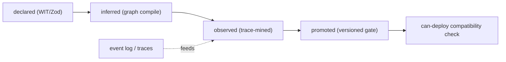
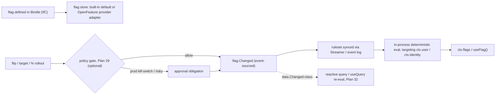

# Contracts, Policy & Feature Flags

This capability doc covers three planes — contracts (the `can-deploy` gate), the policy plane (decisions, obligations & gates), and feature flags & progressive delivery.

## Plan 29

### Why this exists (conformance ≠ compatibility)
HoBo already has **conformance** ([Plan 9](./generated-stack.md#plan-09)/[Plan 20](./wasm-runtime-wit.md#plan-20)): proof that *one implementation satisfies its WIT port*. That is necessary but not sufficient. It does **not** answer the version-skew question:

> *Will `api@v3` (which removed `tenantId` from `order.created`) still work with `worker@v2` that's already running in prod?*

That's a **contract** between a **producer and its consumers**, evaluated against **what's actually deployed** — the dimension the `can-deploy` gate covers. The organizing lens (shared with [Plan 23](./generated-stack.md#plan-23)):

> **Contract = must never break · Eval = should improve · Policy = may/may not be allowed · Trace = what actually happened.**

### Contracts are a dimension of the graph (not test files)
Every **edge** in the manifest graph ([Plan 21](./authoring-resources-wiring.md#plan-21)) carries a typed contract; HoBo covers more than HTTP:

| Edge | Contract checks |
|---|---|
| HTTP API | request/response shape + status compatibility |
| Event / message / topic | payload shape, required fields, envelope/ordering/idempotency |
| Resource binding | the behavior app code expects of a `database`/`blobstore`/… port |
| Service / actor / workflow | command/query I/O, step inputs/outputs, compensation expectations |
| **Capability (`.allow()`)** | **required scope ⊆ granted scope** ([Plan 21](./authoring-resources-wiring.md#plan-21)) |
| **Runtime / SLO** | latency, availability, idempotency, ordering ([Plan 5](./reliability-observability-cost.md#plan-05)) |
| **Semantic function** | I/O schema + invariants + forbidden outputs ([Plan 23](./generated-stack.md#plan-23)) |
| **Agent tool** | tool I/O, auth scope, allowed side effects ([Plan 6](./ai-native-agent-auth.md#plan-06)) |
| Provider / interface | conformance to the port it claims ([Plan 20](./wasm-runtime-wit.md#plan-20)) |

### Four contract modes (IfC-inferred, then refined by reality)
Developers don't hand-write contracts (IfC-default, [Plan 21](./authoring-resources-wiring.md#plan-21)); they're derived and refined:
1. **Declared** — from WIT types + Zod/validators on resources.
2. **Inferred** — from graph compilation (who publishes/consumes what, which `.allow()` scopes).
3. **Observed** — **trace-mined** from the event log ([Plan 11](./data-plane.md#plan-11)): "99.8% of 42k `order.created` had `tenantId`; the 0.2% without came from `worker@v1`."
4. **Promoted** — an observed shape is promoted to a **versioned compatibility gate** with a migration window.

> **Contracts make boundary virtualization safe ([ADR-0076](./adr/02-identity-security.md#adr-0076)).** Because every boundary carries a contract, the host can serve it in a **mode** — `mock` (a contract-conformant fake auto-served from the contract + traces, *no hand-written mocks*), `fork` (a forked/branch impl), `shadow`, or `fault`. A `fork` must **satisfy the boundary contract at *lane join*** — a **lightweight runtime check** (the fork's exported contract verified against the baseline consumers' expectations before any baseline traffic routes to it), *distinct from* the deploy-time `can-deploy` gate (a `hobo dev --fork` never goes through Delta→Set). Contracts bound *shape*, not behavior or resource use — so a `mock` carries a fidelity label ([ADR-0042](./adr/07-portability-extensibility.md#adr-0042)) and lanes carry a resource budget. **Lane-origin `contract.Observed`/trace events are tagged + excluded by default** from observed-contract promotion (and from training trajectories) — a fork's experimental behavior never poisons a baseline contract. This is the substrate for low-friction test sandboxes, request-level branch isolation, preview environments, self-healing experiments, and non-destructive chaos ([Plan 9](./generated-stack.md#plan-09)/[Plan 25](./platform-engineering.md#plan-25)).



### The `can-deploy` gate (compatibility matrix)
At **Delta → Set / promote** time ([Plan 25](./platform-engineering.md#plan-25)) the Planner ([Plan 4](./control-plane.md#plan-04)/[Plan 4](./control-plane.md#plan-04)) builds a compatibility matrix: the proposed Set's producer/consumer **versions** vs the versions the event log says are **running in the target environment**. Incompatible skew → block with a precise, machine-readable reason (an agent can self-correct, like `deployment.PlanRejected`). Recorded as `compat.GatePassed` / `compat.GateFailed`.
```text
$ hobo can-deploy --target prod
blocked: api@1.8.0 publishes order-events/order.created v3 (removed tenantId),
         but worker@1.4.2 (running in prod) consumes v2 which requires tenantId.
fixes:   1) dual-publish tenantId during a 14d migration window
         2) deploy worker@1.5.0 first  3) add a compatibility shim
```
This is HoBo's generalization of `can-i-deploy`, driven by HoBo's own graph + event log (not an external broker).

### The unified Gatekeeper — `hobo verify`
`can-deploy` is one input to a single composite decision. The **Gatekeeper** (a step in the Planner/Orchestrator) requires **all** gates:
```text
deployable =
  contracts compatible            (this doc)
  AND policy allows / approves     (Plan 29 — incl. obligations)
  AND eval gates pass              (Plan 23 — for AI/semantic impls)
  AND conformance satisfied        (Plan 9/24)
  AND within cost budget           (Plan 16)
  AND artifact signed + attested   (Plan 12)
  AND the golden suite passes       (ADR-0082 — the default-on reproducible suite)
  AND the deployment plan is valid (Plan 3)
```
The **golden suite** ([ADR-0082](./adr/02-identity-security.md#adr-0082)) is a first-class gate dimension here: a signed, reproducible bundle that pins the other checks (contracts + evals + conformance + benchmarks + chaos + SLO) plus golden-master samples, default-on for every deployment and run against a replay/fork lane. A **mandatory policy rule (deny-ceiling)** can keep it un-disableable in prod ([ADR-0074](./adr/02-identity-security.md#adr-0074)). `hobo verify --target prod` returns a structured decision (per-gate results + suggested fixes); every gate result is an event, so "why did this deploy block?" is replayable ([Plan 11](./data-plane.md#plan-11)). On failure, the **generation pipeline/live-fix** remediation loop ([Plan 23](./generated-stack.md#plan-23)) classifies the failure (producer-broke-consumer, consumer-over-specified, semantic drift) and proposes safe fixes (shim, deploy-order, migration window, loosen an over-strict matcher) — all themselves gated; a continuous post-deploy golden failure instead opens an Incident → Crew → A2H ([Plan 40](./operators-sre.md#plan-40)).

### Epic reference implementation

The branch-scoped reference implementation for this plane lives at [`../../src/draft/epic-reference-implementations/contracts-policy-governance/README.md`](../../src/draft/epic-reference-implementations/contracts-policy-governance/README.md). It synthesizes the contract, policy, RBAC, obligation, provenance, quota, and governance-conformance POCs into a mocked Gatekeeper vertical slice. Its simulation proves:

- compatible producer/consumer contracts can produce an auditable allow-with-obligations result;
- mandatory deny-ceiling policy blocks lower-scope attempts to disable prod gates;
- unavailable or malformed policy providers fail closed without live external calls.

The reference package carries a POC ledger, Pact-style inventory for every internal and external boundary, deterministic fixtures, and a Node simulation command. It intentionally leaves live feature-flag providers, external policy-engine adapters, residency engines, attestation networks, and control-plane bypass PR repair as follow-up surfaces instead of expanding Plan 29 scope.

### The `contract-engine` ([ADR-0015](./adr/02-identity-security.md#adr-0015))
The contract engine is a **WIT port** (`contract-engine`) with a **built-in HoBo implementation** (it already has the graph, traces, and event log it needs). **PACT-style consumer-driven contract testing is the built-in, default behavior of that engine — an internal implementation detail developers never see.** Developers declare contracts (or let IfC infer them, above); they never interact with PACT directly and there is no PACT option to turn on or swap. HoBo owns the source of truth — the **HoBo Contract IR** — and consumer-driven testing runs against the graph + event log by construction. PACT/OpenAPI/AsyncAPI/Protobuf are import/export *targets* over that IR for interop with outside ecosystems, never the model and never a behavior toggle.

### Consumer-driven contracts drive the dev auth bypass ([ADR-0070](./adr/02-identity-security.md#adr-0070))
The `auth` port ([Plan 6](./ai-native-agent-auth.md#plan-06)/[Plan 6](./ai-native-agent-auth.md#plan-06)) carries a **consumer-driven contract** like any other edge — the subject/roles/tenancy/scopes the app expects of its principal. In **`hobo dev`** the runtime satisfies that contract with a **contract-asserted dev principal** (a fixture matching the contract) instead of calling a real IdP: auth still runs, fulfilled by the fixture, and the dev can override claims/roles/tenant per session within what the contract allows. **The same `auth` contract is enforced at `can-deploy`** (above) — a real IdP/Camp must satisfy the identical contract in prod — so dev and prod are **contract-equivalent** and the bypass cannot drift. This is the contract plane defining the dev identity, not a bespoke `AUTH_DISABLED` flag.

### Camps declare enforcement modes
Each **Camp** (via its runtime + wasm host, [Plan 20](./wasm-runtime-wit.md#plan-20)/[Plan 20](./wasm-runtime-wit.md#plan-20)) announces the contract modes it supports — `record-and-verify` (local), `strict` (prod), `verify-at-build-observe-at-runtime` (edge) — like an Aspire component announcing capabilities.

### The policy plane — one decision model behind every gate

HoBo gates agent actions, live-fix, deploys, and pipelines through the policy plane: a **single decision model** every gate calls, carrying **lifecycle phases**, **rich effects**, and **obligations**. It answers one question everywhere:

> *Is this action allowed, denied, warned, mutated, gated for approval — and what must follow if allowed?*

This is the **Policy = may/may not be allowed** lens of the taxonomy above, distinct from *Contract = must never break* and *Eval = should improve*.

#### The decision model
A decision **request** describes the action in context:
```text
request = {
  subject:  { kind: user|service|agent|system, id, roles?, scopes?, delegatedBy? }
  action:   deployment.apply | resource.delete | agent.tool.call | contract.promote
            | semantic.implementation.promote | provider.plugin.certify | runtime.invoke | …
  resource: { kind: app|environment|deployment|contract|semantic-function|agent|secret|…, id }
  phase:    author | local | test | plan | apply | runtime | observe | train | promote | repair
  context:  { graphDiff?, deploymentPlan?, contractResults?, evalResults?, costEstimate?,
              dataClassifications?, region?, provider?, riskScore?, traceSummary? }
}
```
> **End-user authorization rides this model.** `subject.kind = user` is populated from a verified **`ctx.user`** ([Plan 6](./ai-native-agent-auth.md#plan-06)/[ADR-0038](./adr/02-identity-security.md#adr-0038)) — its claims (`roles`/`scopes`/tenant) drive record-level rules like "a user may read only their own orders" as a **`policy.Decided`**, the same way agent/service actions are gated. No separate end-user authz engine; `.allow()` ([Plan 21](./authoring-resources-wiring.md#plan-21)) is the declarative shorthand over these user-claim rules.

The **decision** is richer than allow/deny:
```text
decision = {
  effect: allow | allow-degraded | deny | warn | mutate | require-approval
  reason, violations[], mutations[], approvals[]
  obligations[]            // "allowed, but you must…"
  evidence: { policyIds[], inputHash, engine }   // → recorded as an event
}
```

#### Obligations are HoBo effects (the powerful part)
An **obligation** lets policy say *allow but require X*, and in HoBo that X is a **durable, event-sourced effect/saga** ([Plan 5](./reliability-observability-cost.md#plan-05)) — not advice the caller may ignore. Examples:
- *allow deploy* **→ require canary** (the Orchestrator must roll out as canary, [Plan 25](./platform-engineering.md#plan-25)).
- *allow public endpoint* **→ require auth middleware** (a graph mutation before apply).
- *allow model change* **→ require shadow evaluation** ([Plan 23](./generated-stack.md#plan-23)).
- *allow generated provider* **→ require sandbox verification** ([Plan 23](./generated-stack.md#plan-23)).
- *allow agent action* **→ require human approval before apply** (a `createHook`, [Plan 6](./ai-native-agent-auth.md#plan-06)).
- *allow spend-incurring action within quota* **→ deny past a hard quota, or trip a spend circuit-breaker on runaway velocity** ([Plan 5](./reliability-observability-cost.md#plan-05)/[ADR-0039](./adr/02-identity-security.md#adr-0039)) — the `MeteringView` counter is the policy input, the breaker is a durable obligation/saga ([Plan 5](./reliability-observability-cost.md#plan-05)) halting deploys/agent-provisioning/generation runs until acknowledged.
- *allow at this spend velocity* **→ `allow-degraded` + a degradation obligation** (*"enter the reduced tier; shed batch/analytics"*) when **spend velocity** would cross a `costAvailabilityProfile` tier before period end ([Plan 5](./reliability-observability-cost.md#plan-05)/[ADR-0039](./adr/02-identity-security.md#adr-0039)) — graceful QoS shedding by priority is the durable effect, the runaway-spend breaker the last resort.
- *allow a feature-flag flip* **→ require approval for a prod kill-switch / risky `%` bump, or attach an auto-revert obligation on SLO burn** (via the policy plane above; [ADR-0044](./adr/02-identity-security.md#adr-0044)) — a `flag.Changed` is a policy-gated event like any other deploy-affecting action (see *feature flags*, below).
- *allow a `notify` send* **→ deny to an opted-out recipient, or defer until the quiet-hours window opens** ([Plan 21](./authoring-resources-wiring.md#plan-21)/[ADR-0059](./adr/03-data-plane.md#adr-0059)) — consent + per-recipient rate limits are obligation-checked preconditions, with deferral a durable effect (not advice).
- *allow a deploy/runtime action on classified data* **→ deny if it places/moves the data outside its allowed region, or past its retention ceiling** ([Plan 46](./governance-planes.md#plan-46)/[ADR-0060](./adr/02-identity-security.md#adr-0060)) — `context.dataClassifications`/`region` (above) drive a residency/retention obligation at `can-deploy` *and* runtime; routing to an unregistered subprocessor is denied.
- *allow an AI output* **→ block, redact, or require-approval on a guardrail failure** ([Plan 46](./governance-planes.md#plan-46)/[ADR-0061](./adr/02-identity-security.md#adr-0061)) — moderation/PII/jailbreak/grounding checks are a policy-gated step (`guardrail.Blocked`); guardrail-coverage is a *promote*-phase contract for model/prompt changes.
Obligations are tracked to completion via `policy.ObligationCreated` → `…Satisfied` events; an unsatisfied obligation blocks the gate. **Obligations may carry a deadline:** an unmet obligation past its deadline **escalates** (e.g. an unacked incident pages up the on-call ladder) rather than silently lingering ([Plan 40](./operators-sre.md#plan-40)) — the durable form of an SLA on a follow-up.

#### Phases (policy spans the whole lifecycle)
| Phase | Example rule |
|---|---|
| author | public handlers must declare input schemas |
| local | no hardcoded secrets in source |
| test | every external interaction needs a contract (above) |
| plan | prod data resources must be encrypted + backed up |
| apply | no prod resource deletion without approval |
| runtime | an agent cannot call a tool outside its delegated scope |
| observe | PII must not appear in traces |
| train | PII-bearing traces can't be used for training |
| promote | a candidate impl must beat the champion on evals ([Plan 23](./generated-stack.md#plan-23)) |
| repair | agents may auto-fix preview, only *propose* prod changes |

#### Policy packs
Rules are grouped into **policy packs** — versioned, **signed** resources ([Plan 12](./security-networking.md#plan-12)) scoped to org/app/environment and bound per target ([Plan 25](./platform-engineering.md#plan-25) matching can select which pack applies). Packs are distributed like Resource Packs ([Plan 25](./platform-engineering.md#plan-25)) and auto-generatable. Because packs are signed + portable, they **federate across sovereign Yards in a `Junction`** ([ADR-0043](./adr/07-portability-extensibility.md#adr-0043)) — shared policy without a shared control plane.

#### Governing HoBo itself — org RBAC & mandatory policy rules (deny-ceilings) ([ADR-0074](./adr/02-identity-security.md#adr-0074))
The same plane governs **HoBo's own control-plane surface**, not just deployed infra — enterprises lock down *who may change HoBo*, not only *what runs*:
- **HoBo's own operations are policy subjects/resources.** A `hobo:*` admin action/resource taxonomy makes every control-plane action a gated, deny-by-default, audited decision: register/deprecate a provider · edit a Resource Definition / install a Pack/listing · change a policy pack · set the **Dispatcher** objective / register a runner·build-machine·artifact-repo·IdP ([ADR-0071](./adr/01-architecture-core.md#adr-0071)/[ADR-0073](./adr/07-portability-extensibility.md#adr-0073)) · open/approve/promote a Delta · run the generation pipeline · configure a Yard/Camp/Junction · read the event log/audit/secrets-broker · manage roles/policy-rules.
- **RBAC populates `subject.roles`.** Built-in roles (Org-Admin · Security/Policy-Admin · Platform-Engineer · Deployer · Operator-Supervisor · Auditor) + custom roles from the taxonomy, bound to principals via **SSO/SCIM** through the `auth` port ([ADR-0038](./adr/02-identity-security.md#adr-0038)/[ADR-0073](./adr/07-portability-extensibility.md#adr-0073)). **Operator Agents (the Crew) are principals under the same RBAC** ([Plan 40](./operators-sre.md#plan-40)) — never exceeding their role.
- **Org policy rules are per-rule `mandatory | default` (default mandatory).** Attached to the **Yard/Junction** (no new scope noun), a `mandatory` rule is a **hard deny-ceiling** — a lower scope may only *further restrict*, never *widen*, what a higher scope denies (the AWS-SCP property, falling out of deny-by-default); a `default` rule is overridable. Org-wide rules ride the Junction's signed-pack federation (above). Separation-of-duties uses **approval obligations** (e.g. a policy change needs Security-Admin approval); the gated **waiver** path is the escape valve. No new event families — decisions ride `policy.Decided`, audited + OCSF-exported ([ADR-0046](./adr/02-identity-security.md#adr-0046)).

#### Control-plane action taxonomy and default role bindings
The concrete enumeration behind [ADR-0074](./adr/02-identity-security.md#adr-0074), following recognized standards: **NIST RBAC** (INCITS 359) with **least privilege** + **separation of duties**, cloud-IAM action naming, **Kubernetes RBAC** verbs, **SCIM** + **OIDC/SAML** for role binding ([ADR-0038](./adr/02-identity-security.md#adr-0038)/[ADR-0073](./adr/07-portability-extensibility.md#adr-0073)), and **OCSF** audit ([ADR-0046](./adr/02-identity-security.md#adr-0046)).

**Naming convention.** Admin actions use the cloud-IAM **`hobo:<resource>:<verb>`** shape (AWS `service:Action`; cf. GCP `service.resource.verb`, Azure RBAC `read/write/action/delete`). In a policy request this lowers to `resource = hobo:<resource>`, `action = <verb>`. Verbs are a **canonical reduced set** — `create · read · list · update · delete` (CRUD+list, as Kubernetes RBAC) plus well-known lifecycle verbs `register · deprecate · approve · promote · execute · configure · rotate · bind` (cf. Kubernetes `approve`/`bind`/`escalate`, Azure `*/action`). `manage` = all verbs on that resource. Everything is **deny-by-default**: an unlisted `(role, action, resource)` is denied.

**The `hobo:*` control-plane resources & actions.**

| Resource (`hobo:`) | Actions | Phase | Governs |
|---|---|---|---|
| `provider` | register · read · list · update · deprecate | author/plan | a CloudProvider / capability provider in the Registry ([Plan 4](./control-plane.md#plan-04)) |
| `resource-definition` | create · read · list · update · delete | author | Matching definitions ([Plan 25](./platform-engineering.md#plan-25)) |
| `resource-pack` | install · read · list · publish · yank | author | Resource Packs ([Plan 25](./platform-engineering.md#plan-25)) |
| `listing` | publish · read · list · install · yank · approve | author | Registry distribution incl. **scope listings** (Bindle/Camp/Yard/Junction) + **pre-approved catalog** curation ([ADR-0062](./adr/07-portability-extensibility.md#adr-0062)) |
| `driver` | register · read · list · update | author | the Driver taxonomy ([Plan 25](./platform-engineering.md#plan-25)) |
| `integration` | register · read · list · update · deprecate | author | swappable adapters — auth IdP · artifact-repo · runner · build-machine · issue-tracker · knowledge ([ADR-0071](./adr/01-architecture-core.md#adr-0071)/[ADR-0073](./adr/07-portability-extensibility.md#adr-0073)) |
| `dispatcher` | read · configure | author | the cost-routing objective ([ADR-0071](./adr/01-architecture-core.md#adr-0071)) |
| `policy-pack` | create · read · list · update · delete · approve | author/apply | policy + **deny-ceiling** packs (this plane) — **SoD: author ≠ approver** |
| `role` | create · read · list · update · delete · bind | author | RBAC roles; `bind` assigns a role to a principal (no self-escalation, cf. K8s `escalate`) |
| `yard` · `camp` · `junction` | create · read · list · update · delete · configure | plan/apply | scope lifecycle + governance config ([ADR-0026](./adr/01-architecture-core.md#adr-0026)) |
| `delta` | create · read · update · approve · promote | apply | the deploy change unit ([Plan 25](./platform-engineering.md#plan-25)) — **SoD: opener ≠ prod-promoter** |
| `deployment` | read · rollback | apply/runtime | a live deployment |
| `forge` | execute · read | author/repair | the generation/repair loop ([Plan 23](./generated-stack.md#plan-23)) |
| `operator` | read · configure · dispatch · disable | runtime/repair | the Crew operator agents ([Plan 40](./operators-sre.md#plan-40)) |
| `secret-broker` | read-metadata · rotate · configure | runtime | brokered creds — secret **values** are never a grantable read ([ADR-0023](./adr/02-identity-security.md#adr-0023)/[ADR-0027](./adr/02-identity-security.md#adr-0027)) |
| `audit` | read · export | observe | the event log / OCSF export ([ADR-0046](./adr/02-identity-security.md#adr-0046)) — read-only |
| `derivative` | upgrade · read | author/repair | swap an engine / fork the Yard / apply persisted patches ([ADR-0057](./adr/07-portability-extensibility.md#adr-0057)) — high-privilege |
| `registry` (bundle) | import · read | author | signed offline bundle import ([ADR-0036](./adr/07-portability-extensibility.md#adr-0036)) — a supply-chain trust action |
| `relay` | register · attach · read · revoke | apply | register/attach an outbound Relay into a private network ([Plan 12](./security-networking.md#plan-12)) |

> **Completeness is a hard gate** ([ADR-0074](./adr/02-identity-security.md#adr-0074)): every control-plane CLI/MCP verb must map to a `hobo:*` action above **or the build fails** (`@hobo/conformance`) — deny-by-default only protects an *enumerated-but-unbound* tuple, not an action that was never given an id. **Pack composition** is **deny-overrides + scope-monotonic** (a child pack's effective deny-set ⊇ its parent's; a child can add denies, never un-deny a parent `mandatory`) with a deterministic **most-restrictive-wins** tie-break — so conflicting federated `mandatory` packs resolve to the union of their denies, identically on every Yard. [ADR-0096](./adr/02-identity-security.md#adr-0096) pins the composition algebra and its proof vectors.

**Default built-in role → action bindings** (least privilege; `manage` = all verbs; `—` = no grant). Custom roles compose any subset of the above.

| Resource group | Org-Admin | Security/Policy-Admin | Platform-Engineer | Deployer | Operator-Supervisor | Auditor |
|---|---|---|---|---|---|---|
| `role` (RBAC) | manage | read · bind | — | — | — | read · list |
| `policy-pack` / deny-ceilings | manage¹ | manage · **approve** | read | read | read | read · list |
| `provider` · `resource-definition` · `resource-pack` · `driver` · `integration` · `dispatcher` | manage | read | manage | read | read | read · list |
| `yard` · `camp` · `junction` | manage | read · configure(policy-rules) | configure | read | read | read · list |
| `delta` · `deployment` | manage | read | create · update | create · update · **promote**² | read | read · list |
| `forge` | execute | read | execute | — | execute³ | read |
| `operator` (Crew) | manage | read | configure | — | manage | read |
| `secret-broker` | configure · rotate | configure · rotate | rotate | — | rotate | — |
| `audit` | read · export | read · export | read | read | read | **read · export** |

¹ Even Org-Admin's policy/rule change can require a second approver where a `mandatory` rule sets **2-person approval** — an org can make *no* role self-approve a policy change. ² `delta:promote` to **prod** is gated by an approval obligation per org policy rules (a Deployer promotes lower environments freely, prod with approval). ³ `gen:execute` under Operator-Supervisor is the Crew's SWE/Platform-Engineer operator acting under its own capped role, not the human.

**Separation of duties (NIST).** The principal who *authors* a policy/rule change cannot *approve* it (the Security/Policy-Admin approves); the principal who *opens* a prod Delta is not automatically the one who *promotes* it; `role:bind` cannot grant privileges the binder lacks (no self-escalation). These constraints are themselves `mandatory` policy rules an org may tighten but not silently remove.

#### The `policy-engine` ([ADR-0015](./adr/02-identity-security.md#adr-0015))
`policy-engine` is a **WIT port**. The default implementation is built-in **typed TypeScript rules** (testable, no Rego to learn). Unlike the `contract-engine` (whose PACT-style testing is built-in, not swappable), the policy engine genuinely accepts optional capability providers: **OPA/Rego** (`@hobo/provider-opa` — maps the request to OPA `input`, runs embedded/WASM/sidecar/Envoy, returns the decision) and **Cedar** (`@hobo/provider-cedar`) for ABAC-style authz. HoBo Cloud is the **management plane** (pack registry, distribution, decision logs); Camps/providers are **enforcement points** — the decision/enforcement split, with HoBo owning the model (the **HoBo Policy IR**).

#### Decisions are events
Every `policy.Decided` (effect + evidence + obligations), `policy.ViolationDetected`, `policy.WaiverRequested/Approved`, and obligation lifecycle is an event ([Plan 11](./data-plane.md#plan-11)) → a replayable, auditable answer to "*why was this allowed/blocked, under which pack version?*". The Gatekeeper (above) composes the policy decision with contracts + evals + conformance + cost into one `hobo verify` result.

### The Harness — progressive delivery (flags · delivery · experiment)

> **Deploy ≠ release.** A canary ([Plan 5](./reliability-observability-cost.md#plan-05)) shifts traffic between *deployed versions*; a feature flag toggles *behavior within a running version* — kill-switches, gradual `%` rollout, per-segment targeting, experiments — without a redeploy. HoBo needs both, and they compose with the contracts, policy, gates, audit, and reactive planes already in play here.

The **Harness** ([ADR-0083](./adr/02-identity-security.md#adr-0083)) is HoBo's **progressive-delivery core** — the subsystem that carries a *deployed* change to users safely. The deploy gate (the Gatekeeper/`can-deploy` + the [Golden suite](./adr/02-identity-security.md#adr-0082)) decides **whether** to ship; the Harness decides **how it rolls out**, through three pluggable, standard-shaped ports with **OpenTelemetry** ([ADR-0046](./adr/02-identity-security.md#adr-0046)) under all three:

| Concern | Port | Built-in default | Adapters |
|---|---|---|---|
| **Flags** — kill-switch / `%` / targeting | **OpenFeature** `hobo:feature-flag` (real CNCF standard) | built-in store | flagd · LaunchDarkly · Unleash |
| **Delivery** — canary · blue/green · rollouts · promotion policies · automated rollback | **OpenDelivery** `hobo:delivery` (HoBo-shaped port; CDEvents at the boundary) | HoBo canary + blue/green + auto-rollback ([Plan 5](./reliability-observability-cost.md#plan-05)) | Argo Rollouts · Flagger · Spinnaker |
| **Experiment** — assignment · exposure · metrics · statistical analysis | **OpenExperiment** `hobo:experiment` (HoBo-shaped port; no standard yet) | event-log + eval/metrics surface | Statsig · GrowthBook · Optimizely · Eppo · Amplitude |

**Honest about status:** OpenFeature + OpenTelemetry are real adopted standards; **OpenDelivery / OpenExperiment are HoBo-shaped port abstractions** (named adapters above), not standards today — HoBo speaks the real standard at the boundary if one emerges. The Harness's built-in engines are per-Camp Matching selections; the **core pattern** changes only if the industry's dominant release pattern does. The flag port detailed below is the OpenFeature leg; delivery composes with [Plan 5](./reliability-observability-cost.md#plan-05) and the `gateway`/`domain` traffic-split ([ADR-0035](./adr/07-portability-extensibility.md#adr-0035)), experiment with the eval surface ([Plan 23](./generated-stack.md#plan-23)).

**Reference implementation:** the epic rollup for Progressive Delivery — The Harness lives at [`src/draft/epic-reference-implementations/progressive-delivery-harness`](../../src/draft/epic-reference-implementations/progressive-delivery-harness/README.md). It composes the flag, delivery, SLO, experiment, policy, event-stream, and rollback-hardening POCs into one mocked-boundary simulation with Pact-style contracts for every service boundary.

#### The `feature-flag` port — OpenFeature-compatible
A first-class **`feature-flag` capability** (`hobo:feature-flag`) that **speaks the [OpenFeature](../standards/openfeature.md) evaluation API** — the same "speak the standard, engine behind a port" stance the policy plane takes (OPA/Cedar as optional `policy-engine` providers, above). (The `contract-engine` is *not* of this shape — its PACT-style testing is built-in default behavior, not a swappable provider, as established above and in [ADR-0015](./adr/02-identity-security.md#adr-0015).)
- **Built-in flag store is the default** (zero-dep, self-host/air-gap friendly, [ADR-0036](./adr/07-portability-extensibility.md#adr-0036)); **OpenFeature providers** (flagd / LaunchDarkly / etc.) are **opt-in adapters** selected per Camp by Matching ([ADR-0033](./adr/01-architecture-core.md#adr-0033)).
- **Flag types:** boolean, string, number, object (the OpenFeature set).
- **Definitions are IfC** — flags are declared in the Bindle (name, type, default, targeting rules); flag *values/targeting* are runtime state (below).

```ts
import { flag } from "@hobo/bindles";
export const newCheckout = flag.boolean("new-checkout", { default: false });
// server: const on = await ctx.flags.eval(newCheckout);   // typed, deterministic
// client: const on = useFlag(newCheckout);                // reactive (Plan 32)
```



#### Change governance — event-sourced, optionally gated, reactive
- **Event-sourced.** Every value/targeting change is a `flag.*` event ([Plan 11](./data-plane.md#plan-11)) → a replayable "who flipped what, when, for whom" audit (the trail standalone flag tools lack).
- **Optionally policy-gated.** A flip can pass through the policy plane (above): a **prod kill-switch** or a risky `%` bump can require approval / carry an obligation (e.g. "auto-revert if error-rate SLO burns", tying to [#25](./generated-stack.md#plan-09)). Low-risk dev flips are ungated.
- **Reactive.** A flag change is a `data.Changed`-class signal, so reactive queries + clients (`useFlag`/`useQuery`, [Plan 32](./data-plane.md#plan-32)) re-evaluate **live, no redeploy** — the reactor re-pushes affected results.

#### Evaluation — in-process, deterministic, identity-aware
- **In-process evaluation** against a ruleset **synced via the Streamer / event log** (edge-friendly, low-latency, the OpenFeature in-process/flagd model) — no per-eval network hop or SPOF.
- **Targeting context** is the unified **`PrincipalRef`** — `ctx.user` (end-user claims/segments, [ADR-0038](./adr/02-identity-security.md#adr-0038)) and `ctx.identity` (SVID/tenant) — so flag targeting reuses HoBo's one identity model.
- **Deterministic:** evaluation is a pure function of `(ruleset@seq, context)`, so it's **replayable** and safe to call inside a reactive `query()` ([ADR-0050](./adr/03-data-plane.md#adr-0050)).

#### OpenDelivery (`hobo:delivery`) — canary, blue/green, rollouts, promotion policies, automated rollback
The delivery leg drives *how a deployed version takes traffic*. The built-in default is HoBo's canary + blue/green + auto-rollback ([Plan 5](./reliability-observability-cost.md#plan-05)) over the `gateway`/`domain` traffic-split ([ADR-0035](./adr/07-portability-extensibility.md#adr-0035)); **Argo Rollouts / Flagger / Spinnaker** are per-Camp adapters. **Automated rollback** is a delivery capability (Flagger-style metric analysis): each rollout step watches its SLO/metrics (OTEL), continuous [Golden-suite](./adr/02-identity-security.md#adr-0082) failure, and SLO error-budget burn ([ADR-0045](./adr/02-identity-security.md#adr-0045)) — a breach **auto-rolls-back** (a policy obligation), otherwise it **promotes**. The standard loop: deploy dark → ramp the flag → shift canary traffic → watch metrics → roll back or promote. Events `rollout.Started/Stepped/Promoted/RolledBack/Failed`.

#### OpenExperiment (`hobo:experiment`) — assignment, exposure, metrics, statistical analysis
The experiment leg measures *whether the change was good*. A `%`/multivariate flag provides **assignment**; **exposure** + **metrics** ride OTEL + the event log; **statistical analysis** runs over them (built-in default; **Statsig / GrowthBook / Optimizely / Eppo / Amplitude** as adapters). Self-evolving / continuous-ML experiments ride the `training-engine` + eval loop ([ADR-0025](./adr/03-data-plane.md#adr-0025)); the stats surface guards against peeking / multiple-comparisons / under-power. Events `experiment.Assigned` (sampled) · `experiment.Exposed` (sampled) · `experiment.Concluded`.

#### Events ([Plan 11](./data-plane.md#plan-11))
`flag.Defined` · `flag.Changed` (value/targeting diff + actor) · `flag.Evaluated` (sampled, optional — for experiment analytics) · `flag.Archived`; delivery `rollout.*`; experiment `experiment.*`. Flip/rollback-gate decisions ride the existing `policy.Decided`.

#### Verification ([Plan 9](./generated-stack.md#plan-09))
A **feature-flag test**: define a flag → assert in-process eval is deterministic for a fixed `(ruleset@seq, ctx.user)`; a targeting rule selects the right segment; a flip emits `flag.Changed` and **re-pushes an affected reactive query** ([Plan 32](./data-plane.md#plan-32)); a **prod kill-switch flip requires the policy gate** (above); the built-in store works **offline/air-gap**; an OpenFeature provider adapter passes the same conformance.

#### Scope
The `feature-flag` port (OpenFeature-compatible) + built-in store + boolean/string/number/object flags + IfC definitions + in-process deterministic eval (targeting via `ctx.user`/`ctx.identity`) + event-sourced `flag.*` + optional policy-gated flips + reactive re-eval + OpenFeature provider adapters. Experiments get a stats surface over the emitted `flag.Evaluated` events, flag-debt auto-cleanup (stale-flag detection + archival) is built in, and cross-Camp flag-state consistency rides [ADR-0040](./adr/01-architecture-core.md#adr-0040).
