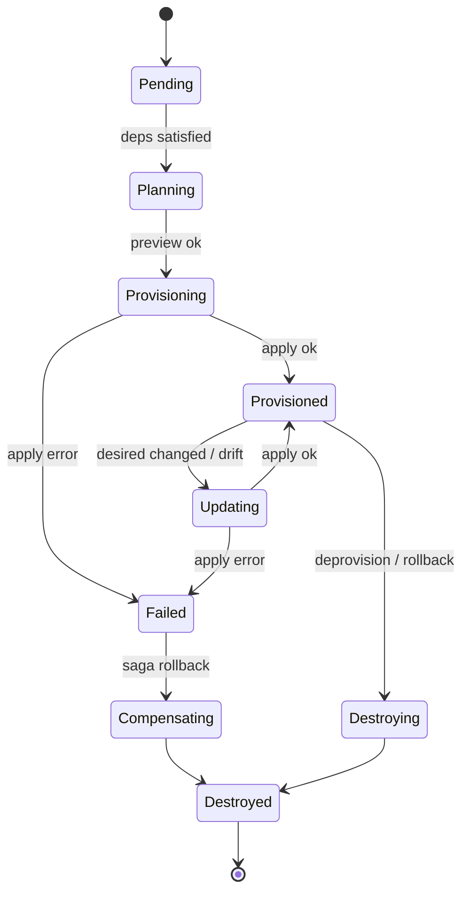
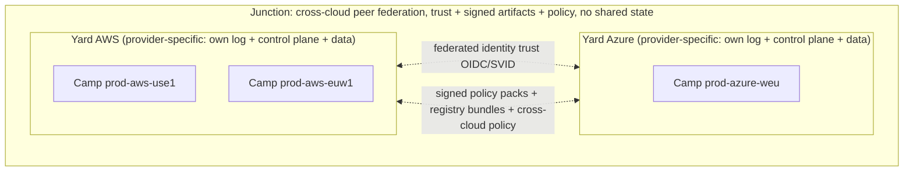
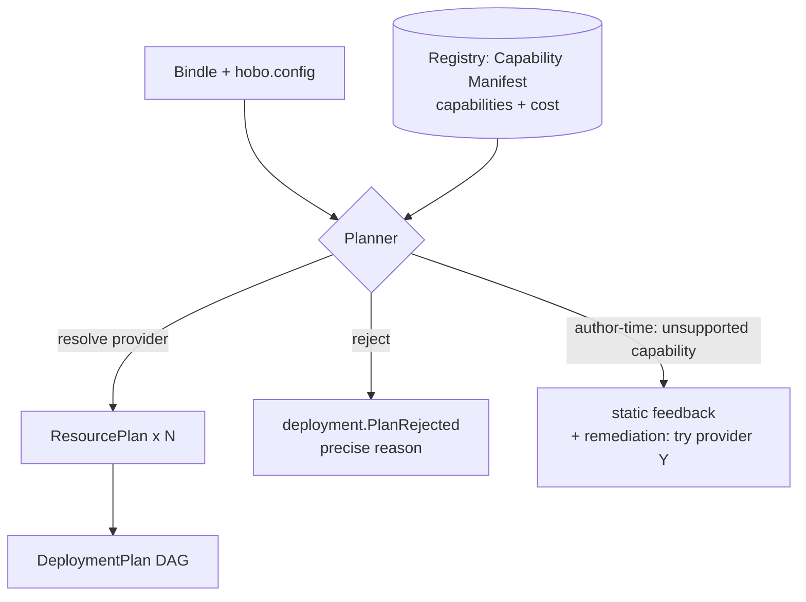

# The Control Plane (the Yard)

This capability doc covers the Yard control plane end to end: its services and reconciliation model, plus the provider, IaC, and build/VM adapters it drives.

## Plan 04

> **Runtime/IfC integration.** The Planner consumes the **manifest IR** produced by IfC resource-collection ([Plan 21](./authoring-resources-wiring.md#plan-21)); ResourceActors also manage **links** binding components to capability providers ([Plan 20](./wasm-runtime-wit.md#plan-20)).

> **Resource Definitions & Matching (Humanitec parity).** The Planner resolves each resource via **Resource Definitions + Matching**; the lifecycle works in **Deltas → Sets** with **incremental** reconcile (only changed nodes); Executors can run behind a **HoBo Relay** for private-network targets, with a **GitOps publisher** as an alternate apply path; and **Pipelines** drive *when* deploys happen ([Plan 25](./platform-engineering.md#plan-25)).

> **Contracts & policy (gates).** Two governance planes back grains: a **contract-engine** and a **policy-engine**, each a WIT port with a built-in default ([Plan 29](./contracts-policy-flags.md#plan-29)). The Orchestrator invokes the **Gatekeeper** at Delta→Set/promote (contracts + policy + evals + conformance + cost); **obligations** from a policy decision (e.g. require-canary) shape the rollout; every gate result is an event.

Reference implementation: the [Control Plane epic rollup](../../src/draft/epic-proofs/control-plane-planner-matching-orchestrator/README.md) synthesizes the Planner, Matching, Delta-to-Set reconcile, ResourceActor choreography, drift/rollback, dispatcher safety, and self-host bootstrap POCs with mocked service boundaries and Pact fixtures.

The Yard is the orchestrator that maps Bindle deployments to real hosting. It is **itself a HoBo Bindle** (dogfood) and runs on the TS-native core; Kubernetes/Crossplane is an optional execution substrate adapter, never a requirement.

### Services (each a grain-based module)
- **Gateway** — SDK RPC + REST + **MCP** ingress; authenticates the principal (human or agent SVID), authorizes against tenant + scope, turns requests into commands, and serves read models. Stateless; horizontally scalable.
- **Identity** — issues agent/workload identities (SPIFFE-style SVIDs), acts as OIDC provider + token broker ([Plan 6](./ai-native-agent-auth.md#plan-06)).
- **Registry** — Provider + Capability Manifest catalog; capability search; plugin certification records from the generation pipeline.
- **Planner** — Bindle + mapping → `DeploymentPlan` DAG; capability/region/cost solving (resolution algorithm in the adapters section below).
- **Orchestrator** — **choreography saga engine** over the event store. One **ResourceActor** (a controller-style grain) per resource owns its lifecycle and reconciles desired↔actual via the resolved IaC adapter. Resource actors coordinate by emitting/observing events (e.g. `resource.Provisioned(db)` → unblocks `api`), not via a central coordinator.
- **Executors** — sandboxed (Firecracker) runners that execute IaC applies + Dagger builds with short-lived scoped creds.
- **Event Store + Projections** — source of truth + read models ([Plan 11](./data-plane.md#plan-11)).

### The ResourceActor reconciliation FSM
Each resource in a plan gets a durable virtual actor keyed `resource:<deployment>:<name>`. Its job is to converge **observed** state to **desired** state, idempotently, surviving crashes by replaying its own event stream.



**Reconcile loop (idempotent core):**
1. Load desired (`ResourcePlan`) + observed (last `resource.*` + IaC `refresh()`).
2. Compute a **diff** (`IacProvider.preview`).
3. If empty → emit nothing (converged). If non-empty → emit `resource.Provisioning`/`UpdateRequested`, dispatch an `IacProgram` to an Executor.
4. On `exec.Succeeded` → record outputs, emit `resource.Provisioned`. On `exec.Failed` → emit `resource.Failed` with classified error (retryable vs fatal, see [Plan 5](./reliability-observability-cost.md#plan-05)).
5. The actor is **edge-triggered** by events and **level-triggered** by a periodic resync (drift). Both paths run the same loop → reconciliation is convergent and safe to repeat (the controller pattern, Kubernetes-style, but event-sourced).

**Why actors, not a monolithic engine:** per-resource isolation means one stuck provider call can't block the whole deploy; single-writer leases ([Plan 5](./reliability-observability-cost.md#plan-05)) prevent two reconciles racing on the same resource; and each actor's stream is an independent audit/replay unit.

### Choreography over orchestration (and why)
Cross-resource ordering (DB before API, network before VM) is expressed as a **dependency DAG** in the plan and realized by **choreography**: a ResourceActor subscribes to the `resource.Provisioned` events of its dependencies and self-activates when they're all present. There is no central coordinator issuing step-by-step commands.

- **Pro:** resilient (no coordinator SPOF), naturally parallel (independent subtrees provision concurrently), and each actor is autonomous/replayable.
- **Con:** harder to see "the whole flow" — we mitigate with a **DeploymentView** projection that reconstructs the saga graph from events for the dashboard, and with explicit `correlationId` on every event.
- **Compensation** is also choreographed: a `resource.Failed` past the no-go threshold emits `deployment.RolledBack`, which each already-`Provisioned` actor observes and reacts to by `Destroying` itself in reverse-dependency order (tracked via the DAG).

### Executor sandbox model
IaC apply and image builds run untrusted-ish provider code, so they are isolated:
- Each exec runs in a **Firecracker microVM** (fast boot, hardware isolation), with no ambient cloud creds.
- The Orchestrator requests a **short-lived, capability-scoped token** from Identity *for that specific resource + provider + action*, injected into the microVM at start, expired at end ([Plan 12](./security-networking.md#plan-12)).
- Stdout/diff/state stream back as `exec.Output` events (live in the dashboard) and IaC state is persisted to the resource's own backend (per-resource Pulumi stack by default — see [the IaC state model](#iac-state-model) below).
- Executors are pooled and pre-warmed; concurrency is bounded per tenant and per provider (backpressure, [Plan 5](./reliability-observability-cost.md#plan-05)).

### Command / event API surface
The Gateway accepts **commands** (imperative, validated, authorized) and the only side effect is appending **events** ([Plan 11](./data-plane.md#plan-11)). Representative commands:
`RegisterBindle` · `PublishBindleVersion` · `CreateCamp` · `Deploy` · `Promote` · `Rollback` · `Destroy` · `RegisterProvider` · `RequestToken`. Reads go to projections, never to live providers.

### Bootstrapping (chicken-and-egg)
The Yard runs itself, so first existence is special:
1. **Local seed:** `hobo up ./platform --seed` runs a single-node Yard on a **local Camp** (`@hobo/runtime-local`, SQLite event store) — enough to deploy the Yard Bindle to a real provider.
2. **Self-deploy:** that seed deploys `@hobo/sdk` (the Yard Bindle) to the target Camp (e.g. a managed Postgres runtime + container provider), producing a "real" Yard. **The bootstrap-apply credential comes from the operator, not from a not-yet-existing Identity:** since the target Yard's Identity service doesn't exist yet, the seed's Executor provisions the real Yard's infra using the **operator's own OIDC/SVID obtained at `hobo login`** — a single, short-lived, scoped credential used *once* for the bootstrap apply and **audited as `identity.SeedTokenUsed`**. This resolves the chicken-and-egg: the operator credential bootstraps infra; the real Identity then takes over all subsequent token issuance.
3. **Handover:** the real Yard imports the seed's event log (the deployment that created it) as immutable provenance; **the handover point is explicit — once the real Identity is up, federated, and able to issue a brokered token for the Yard control-plane principal, it becomes the sole token broker and the seed credential is retired** — then the seed is discarded.
The accepted ordering, credential lifecycle, provenance import, and recovery rules are pinned in [ADR-0092](./adr/01-architecture-core.md#adr-0092): a second bootstrap for the same target is blocked unless it resumes the same attempt id, and a seed crash after partial provisioning resumes from the seed log plus observed target state.
This makes self-hosting a first-class, reproducible path, not a bespoke install script. With the Yard live, the platform team **approves default providers** ([ADR-0062](./adr/07-portability-extensibility.md#adr-0062)) and decides how inferred Camps get approved: an admin **enables auto-approval** or sets a **policy that passes** ([ADR-0074](./adr/02-identity-security.md#adr-0074)) — off by default. With both in place (the **happy path**), the cloud **infers a Camp** for each Bindle and approves it by that policy, so app devs deploy zero-config; anything outside it escalates to explicit approval or a hand-authored Camp.
- **Air-gapped profile:** the same self-deploy runs **fully in-boundary with zero egress** ([ADR-0036](./adr/07-portability-extensibility.md#adr-0036)) — artifacts arrive via signed offline bundle import, trust roots (Identity/CA/KMS) and any AI models stay in-boundary, and the deterministic core needs no network. An air-gapped boundary is a single in-boundary Yard.

### Multi-tenancy
Tenant = isolation boundary for event streams, actor placement, credential scope, and executor pools. Self-host runs single-tenant; hosted runs multi-tenant on the same code. Full model in [Plan 12](./security-networking.md#plan-12).

### Yard scope & multi-Yard (the Junction) ([ADR-0026](./adr/01-architecture-core.md#adr-0026)/[ADR-0043](./adr/07-portability-extensibility.md#adr-0043))
The Yard is **provider-specific** — **one Yard per provider** — running that provider's control plane over its **Camps** and applying cross-Camp constraints: policies, provider-global networking (e.g. a vWAN), and global gateways (e.g. Azure Front Door). **Multi-region within a provider is several Camps under one Yard; it needs no second Yard.** Going cross-cloud / hybrid means **several Yards** (one per provider), connected by a **`Junction`** — the normal, first-class multi-cloud mechanism, not an extreme-isolation escape hatch. The Junction federates Yards as **peers** — sharing **identity trust + signed policy packs + signed registry bundles + cross-cloud policy**, never shared state and never a controller; each Yard keeps its own log/control-plane/data (residency preserved). The Junction also **infers the cross-cloud connectivity plane** (tier/peering + `hobo:dns` rules) from the member Yards' manifests and federates each Yard its half to realize — it decides *what* must connect, never reaching in to do it ([ADR-0043](./adr/07-portability-extensibility.md#adr-0043)). A regulated/air-gapped boundary ([ADR-0036](./adr/07-portability-extensibility.md#adr-0036)) is just one provider-specific Yard that may stand alone or join a Junction. **A Yard is provider-scoped and federation-ready; the Junction is how Yards span clouds ([ADR-0043](./adr/07-portability-extensibility.md#adr-0043)).**



### Providers, IaC & build/VM adapters

Reference implementation: the [Providers, IaC & Build Adapters epic rollup](../../src/draft/epic-proofs/providers-iac-build-adapters/README.md) synthesizes provider package shape, conformance, equivalence, manifests, realize/IaC/build/driver adapters, provider matrix, generation certification, Resource Packs, drift/import/partial-apply safety, and the multi-cloud shop gate with mocked boundaries and Pact fixtures.

This is the layer the Yard's Planner, Orchestrator, and Executors drive: how an abstract resource resolves to a concrete provider, and how that provider realizes it through IaC and build adapters.

A CloudProvider is a **capability provider** — it implements a WIT interface's exports for a backend, and **binding a resource means creating a link** (wasmCloud model) from a component's import to a provider's export, late-bound at deploy/runtime ([Plan 20](./wasm-runtime-wit.md#plan-20)). The realize → IaC path below also wires those links and emits the **manifest IR** ([Plan 21](./authoring-resources-wiring.md#plan-21)). Providers can be authored in any wasm language and AI-generated via the generation pipeline ([Plan 23](./generated-stack.md#plan-23)). Provider resolution is **context-matching**, not static mapping: the Planner picks a **Resource Definition** per resource ([Plan 25](./platform-engineering.md#plan-25)), with a Camp's inline mapping (the `camp()` object) as sugar over default definitions; the `IacProvider` is one **Driver** in a taxonomy (terraform/template/echo/container/custom-webhook, [Plan 25](./platform-engineering.md#plan-25)) that a capability provider selects to realize a resource. The same **Gatekeeper** that the Orchestrator runs at Delta→Set (contracts + policy + evals + conformance + cost — Plans [29](./contracts-policy-flags.md#plan-29)/[30](./contracts-policy-flags.md#plan-29)/[23](./generated-stack.md#plan-23)/[9](./generated-stack.md#plan-09)/[16](./reliability-observability-cost.md#plan-05)) also runs before Apply here; a blocked gate emits a precise `deployment.PlanRejected` reason an agent can self-correct.

#### Intended providers & deploy targets (non-limiting)
This is HoBo's **intended seed set — not a closed list.** Every entry is a swappable adapter behind the `CloudProvider` / `component-host` / `IacProvider` ports: a Bindle stays provider-agnostic, the **generation pipeline** generates new provider adapters on demand ([Plan 23](./generated-stack.md#plan-23)), conformance guarantees portability ([ADR-0024](./adr/07-portability-extensibility.md#adr-0024)), and capability gaps are surfaced at author time with remediation, never silently ([ADR-0033](./adr/01-architecture-core.md#adr-0033)). Adding a provider never edits app code.

- **Runtime hosts (`component-host`).** Default = **self-hosted wasmCloud** (lattice over NATS/JetStream) on **k8s** (`wasmcloud-operator`), **Coolify/Docker**, or **bare metal**; **wasm-in-container** is the zero-infra floor; **SpinKube** and **provider-native wasm (Cloudflare Workers)** are opt-in; local/dev = Wasmtime ([ADR-0031](./adr/01-architecture-core.md#adr-0031)).
- **Self-host / deploy targets.** Kubernetes on any distro/cloud (Hetzner `kube-hetzner`/Talos, k3s, AKS/EKS/GKE), **Coolify** (Docker PaaS on any VPS, API/MCP-drivable), Docker/Compose, bare-metal/VPS. "Self-host = hosted" — the same code. **Nomad** (existing HashiCorp-shop clusters) is **accepted-future** as a deploy-target/host adapter — a `component-host`-in-container or OCI driver scheduled by Nomad, generatable like any adapter — and **rejected** as HoBo's scheduler foundation ([ADR-0106](./adr/01-architecture-core.md#adr-0106), [Nomad parity](../competitors/nomad.md#hobo-mapping)).
- **CI runners & build machines (`runner` / `build-machine`).** Execution-host categories the **Dispatcher** cost-routes per job ([ADR-0071](./adr/01-architecture-core.md#adr-0071)): **self-hosted** (Executors behind the Relay, the default), **GitHub Actions**, **Blacksmith** (fast runners), **Depot** (remote container builds + cache). Registering several lets HoBo maximize free credits/budgets by routing each build/CI run to the cheapest registered option.

**Cloud / infra providers (`CloudProvider`):**

| Provider | Realizes (representative ports) | IaC adapter |
|---|---|---|
| **Self-hosted** (k8s / Coolify / bare-metal) | compute · the wasmCloud runtime host · networking | Crossplane · Pulumi · Terraform |
| **Hetzner** | compute (servers/VPS) · networking (LB/firewall/vSwitch) · volumes · **S3-compatible object storage** · k8s substrate (HKE / k3s / Talos) | Terraform `hcloud` · Pulumi |
| **Cloudflare** | edge compute (**Workers**, wasm-native host) · R2 (object, S3-compat) · D1 (SQL) · KV · Durable Objects · Queues · Vectorize (vector) · Workers AI · Hyperdrive · DNS | Terraform `cloudflare` · Wrangler |
| **Vercel** | web/SSR hosting · functions (serverless + edge) · Blob · Edge Config (relational/KV via marketplace: Neon/Upstash) | Vercel CLI · Terraform `vercel` |
| **AWS · Azure · GCP** | full IaaS/PaaS (compute, data, storage, messaging, networking) | Pulumi · Terraform · OpenTofu · Crossplane |
| **Fly.io** | global app/VM hosting · volumes | Terraform · Pulumi |

Cloudflare and self-hosted wasmCloud are first-class **wasm** targets; **Hetzner** is the cheap **self-host substrate** for wasmCloud-on-k8s; **Vercel/Cloudflare** cover the **edge/web** tier. A Camp picks one provider (and its runtime host) per [ADR-0026](./adr/01-architecture-core.md#adr-0026); cross-cloud spans Yards under a Junction ([ADR-0043](./adr/07-portability-extensibility.md#adr-0043)).

#### The three adapter families (one shape)
Everything that touches the outside world is a port with swappable adapters:
- **CloudProvider** — implements capability ports (now **WIT interfaces**: `wasi:keyvalue`, `wasi:blobstore`, `wasi:sql`, …, plus `hobo:*`) for a backend (self-hosted/Hetzner/AWS/Azure/GCP/Cloudflare/Vercel/Fly/K8s).
- **IacProvider** — the *mechanism* a CloudProvider uses to realize resources (Pulumi/Terraform/OpenTofu/Crossplane).
- **BuildProvider** — produces images/rootfs/**wasm components** (Dagger/Packer/Firecracker/Vagrant/jco+componentize) — the build *engine*.

A CloudProvider composes the other two: it declares *what* a resource is, then emits an `IacProgram` (and optionally a `BuildSpec`) for the chosen IaC/Build adapters to execute, plus the **links** that bind components to it at runtime.

**Execution-host provider categories (cost-routed by the Dispatcher).** Two more provider categories follow the same ports/adapters shape, but instead of realizing app resources they are *where work runs* — and so are selected per job by the **Dispatcher** ([ADR-0071](./adr/01-architecture-core.md#adr-0071)) to maximize free credits/budgets across **only the registered providers**:
- **RunnerProvider** (`hobo:runner`) — executes CI / action jobs. Adapters: **self-hosted · GitHub Actions · Blacksmith · Depot**.
- **BuildMachineProvider** (`hobo:build-machine`) — the host a build *runs on* (the BuildProvider engine executes on it; deepens [ADR-0005](./adr/01-architecture-core.md#adr-0005)). Adapters: **self-hosted · GitHub · Blacksmith · Depot** (Depot = remote container builds + shared cache; Blacksmith = fast runners). Default = the Executors behind the Relay ([Plan 25](./platform-engineering.md#plan-25)).
```ts
export interface RunnerProvider {
  id: "self-hosted" | "github" | "blacksmith" | "depot";
  capabilityManifest(): CapabilityManifest;        // incl. cost.json + declared free tiers/credits (Plan 5)
  run(job: RunnerJob): Promise<RunnerResult>;       // execute a CI/action job
}
export interface BuildMachineProvider {
  id: "self-hosted" | "github" | "blacksmith" | "depot";
  capabilityManifest(): CapabilityManifest;
  execute(build: BuildSpec): Promise<ImageRef>;     // run a BuildProvider engine on this host
}
```
Both publish a Capability Manifest with `cost.json` + declared free-tier/credit facts, so the Dispatcher's `CreditLedgerView` ([Plan 5](./reliability-observability-cost.md#plan-05)) can rank them by **effective marginal cost** and record the pick as `dispatch.Decided` ([Plan 11](./data-plane.md#plan-11)). Registering a runner/build-machine makes it a candidate; that is the whole integration. A missing adapter is auto-generatable ([Plan 23](./generated-stack.md#plan-23)).

**Integration providers (swappable external touchpoints, [ADR-0073](./adr/07-portability-extensibility.md#adr-0073)).** The same ports/adapters shape covers the meta-cloud's external integrations — only registered adapters are considered, all secretless-brokered + policy-gated + auto-generatable:
- **ArtifactRepoProvider** (`hobo:artifact-repo`) — the package/artifact repositories HoBo **builds against and publishes to**: **npm · NuGet · PyPI · OCI** (+ Maven/cargo/RubyGems). Serves dependency pulls + publishes outputs (language packages and the component **OCI images** `@hobo/componentize` produces, [Plan 20](./wasm-runtime-wit.md#plan-20)), with **SLSA provenance** on publish ([ADR-0010](./adr/03-data-plane.md#adr-0010)) and **air-gap mirroring** (generalizes [ADR-0036](./adr/07-portability-extensibility.md#adr-0036)); equivalent mirrors are Dispatcher-routable ([ADR-0071](./adr/01-architecture-core.md#adr-0071)).
- **Auth (`hobo:auth`)** — swappable IdP adapters (**WorkOS · Auth0 · Supabase Auth · Entra** + the existing set, [ADR-0038](./adr/02-identity-security.md#adr-0038)/[ADR-0073](./adr/07-portability-extensibility.md#adr-0073)).
- **Operator-facing seams** (named, auto-generatable; full surface later, [ADR-0073](./adr/07-portability-extensibility.md#adr-0073)): `issue-tracker` (**JIRA · GitHub Issues · Linear**) and `knowledge` (**Confluence · Obsidian · Wikis**) — the integration surface the **Crew** ([Plan 40](./operators-sre.md#plan-40)) drives, reusing the `notify`/receiver-port pattern ([ADR-0059](./adr/03-data-plane.md#adr-0059)).
```ts
export interface ArtifactRepoProvider {
  id: "npm" | "nuget" | "pypi" | "oci" | "maven" | "cargo" | string;
  capabilityManifest(): CapabilityManifest;             // endpoints + auth (brokered) + retention
  pull(ref: ArtifactRef): Promise<Artifact>;            // build input
  publish(a: Artifact, prov: SlsaProvenance): Promise<ArtifactRef>;  // build output + provenance
}
```

#### Port & provider interfaces
```ts
// A capability port (one of many): the agnostic contract apps depend on
export interface DatabasePort {
  kind: "database";
  engine: "postgres" | "mysql" | "sqlite" | "mongo" | "kv";
  // requested features the provider must satisfy/negotiate
  features?: { managed?: boolean; ha?: boolean; vector?: boolean; serverless?: boolean };
}
// Note: `vector` here is a DB *capability hint* for negotiation; the full-text/vector/hybrid
// retrieval surface is a first-class `search` port ([Plan 32](./data-plane.md#plan-32)/[ADR-0034](./adr/03-data-plane.md#adr-0034)), not just a database flag.

export interface Capability {
  port: PortKind;                       // "database" | "compute" | "objectStore" | ...
  satisfies(req: PortRequest): Match;   // full | partial(missing[]) | none — capability negotiation
  estimateCost(req: PortRequest): CostSignal;
}

export interface CloudProvider {
  id: string;                                   // "aws"
  regions: string[];
  capabilities: Capability[];
  realize(plan: ResourcePlan): { iac: IacProgram; build?: BuildSpec };
  capabilityManifest(): CapabilityManifest;     // machine-readable signs (Plan 6)
  client(port: PortKind, outputs: Outputs): unknown; // the runtime client for ctx.bindings
}

export interface IacProvider {
  id: "pulumi" | "cdktf" | "crossplane" | "opentofu";
  preview(program: IacProgram): Promise<Diff>;
  apply(program: IacProgram): Promise<Outputs>;
  destroy(program: IacProgram): Promise<void>;
  refresh(program: IacProgram): Promise<DriftReport>;
}

export interface BuildProvider {
  id: "dagger" | "packer" | "firecracker" | "vagrant";
  build(spec: BuildSpec): Promise<ImageRef>;
}
```

#### The Planner: Bindle + mapping → DeploymentPlan
The Planner is a pure function (easy to test, replayable): `plan(bindle, config, registry) → DeploymentPlan`. Steps:

1. **Collect resources** from the Bindle into nodes; collect `bind` edges into a dependency DAG.
2. **Resolve a Resource Definition per resource** via **context-matching** ([Plan 25](./platform-engineering.md#plan-25)): gather definitions of the resource's `type`, keep those whose criteria match the deploy context `{envType, app, env, tenant, resourceClass, resourceId}`, score by specificity, pick the highest, and record a **`match.Decided`** event (auditable "why this infra"). A Camp's inline mapping (`bindings`→`tiers`→`defaultProvider` on the `camp()` object) is **sugar that compiles to default definitions**, naturally outscored by explicit platform definitions.
3. **Capability negotiation** — for the resolved definition's provider, call `Capability.satisfies(request)`:
   - `full` → accept.
   - `partial(missing)` → if the request used `prefer`, accept with a `PlanWarning` (degrade, e.g. emulate `vector` via an extension or fall back to a container); if `require`, reject the candidate.
   - `none` → reject.
   - If no definition can satisfy a `require`, emit `deployment.PlanRejected` with a precise reason (good for agents to self-correct).
4. **Region & colocation** — honor explicit regions; otherwise pick a region satisfying all colocated resources' constraints (latency edges from `bind`), minimizing cross-provider/cross-region egress.
5. **Objective ranking** ([Plan 25](./platform-engineering.md#plan-25)/[ADR-0033](./adr/01-architecture-core.md#adr-0033)) — when multiple candidates satisfy `full` and tie on specificity + explicit `priority`, rank by the **configurable objective** (`cost`|`latency`|`single-provider`|`carbon`, **default = min-cost within constraints**), then a **stable tiebreak** (definition id). Deterministic, not a solver/LLM; rationale recorded in `match.Decided` + as `meta` on `deployment.Planned`.
6. **Emit `DeploymentPlan`** — DAG of `ResourcePlan{ name, port, provider, options, deps, strategy }`, each tagged with its resolved provider + merged `.with(...)` options (only the resolved provider's block survives).

The plan is content-addressed and stored via `deployment.Planned`, so the exact decisions are auditable and re-runnable.

**Compile-time provider-capability feedback with remediation ([ADR-0033](./adr/01-architecture-core.md#adr-0033)).** Not all providers support all capabilities. Each registered provider **advertises its supported capabilities** in the Registry's Capability Manifest, and the Planner/Matching runs the same capability-negotiation pass **statically, at author time** (in-editor / `hobo plan` / pre-commit) against that manifest — not only at deploy. An unsupported configuration (a `require`d capability the resolved provider can't satisfy) surfaces as **static feedback before deploy**, each finding carrying a **remediation suggestion**: the Planner scans registered providers for one that *does* advertise the capability and names it (e.g. *"provider X doesn't support containers — host on registered provider Y"*). This is in addition to — not a replacement for — deploy-time rejection: the same gap still emits `deployment.PlanRejected` with a precise reason at deploy, so an agent or human gets the same signal early (fast feedback) and late (enforced).



#### Resolution pipeline (plan → real infra)
1. **Plan** — as above.
2. **Realize** — each CloudProvider turns its `ResourcePlan`s into an `IacProgram` for the chosen IaC adapter (default `@hobo/iac-pulumi` via the **Pulumi Automation API** — embeddable, TS-native, no CLI shell-out).
3. **Build** — image/VM resources call BuildProviders (`@hobo/build-dagger` for container images; `build-packer`/`build-firecracker` for VM/microVM images). Output `ImageRef`s feed back into the IaC program.
4. **Apply** — IaC adapter runs `preview` then `apply` inside a Firecracker Executor with scoped creds ([Plan 12](./security-networking.md#plan-12)); `Outputs` (URLs, conn strings) become resource bindings and flow back as events.

#### IaC backends
- **Pulumi Automation API** = primary (programmatic, multi-cloud, TS-native, real language for compositions).
- **Crossplane** = the adapter used when a Camp's substrate is Kubernetes (compositions + managed resources; reconciliation delegated to k8s controllers).
- **OpenTofu** = open-source HCL path (wrap the binary; state via supported backends).
- **CDKTF** = **import-only** (HashiCorp sunset) — read existing stacks, don't author new.
- Provider-specific IaC config is passed via `.with(...)` too (e.g. Pulumi stack settings, OpenTofu backend, Crossplane composition selectors).

#### IaC state model
- **Per-resource stacks by default:** each resource owns an isolated IaC stack (Pulumi stack / TF workspace) keyed by `tenant/deployment/resource`. Benefits: blast-radius isolation, independent reconcile/lock, clean compensation (destroy one slice). Cost: more state objects — acceptable.
- **State backend:** pluggable; default to the Yard's own object store; locking via the resource's ActorHost lease (single-writer already guaranteed, so IaC-level locks are belt-and-suspenders).
- **Outputs → bindings:** stack outputs are captured into `resource.Provisioned` and resolved into the dependent resources' env/secret refs.
- **Drift:** `refresh()` feeds the drift loop in [Plan 5](./reliability-observability-cost.md#plan-05).
- **Adopt-in-place (migration, [ADR-0041](./adr/07-portability-extensibility.md#adr-0041)):** `hobo import` reads an existing estate's IaC state (CDKTF import-only / Pulumi Automation API) into the graph as **`adopted`** nodes — managed by id/state, **never destroyed/recreated on import** (drift-detect only). An **`external` resource kind** references infra HoBo doesn't manage yet, so a HoBo-managed resource can `bind` across the boundary during an incremental (strangler-fig) migration. Adoption emits `resource.Adopted` ([Plan 11](./data-plane.md#plan-11)).

#### Cross-cloud equivalence classes
Agnostic ports map to provider services via curated equivalence classes (extensible, and what the [generation pipeline](./ai-native-agent-auth.md#plan-06) targets):
| Port (request) | AWS | Azure | GCP | Cloudflare | Fly |
|---|---|---|---|---|---|
| `database{postgres,managed}` | RDS/Aurora PG | Flexible Server | Cloud SQL PG | (Neon/Hyperdrive) | Fly Postgres |
| `objectStore` | S3 | Blob | GCS | R2 | Tigris |
| `compute{container}` | Fargate/App Runner | Container Apps | Cloud Run | Workers/Containers | Machines |
| `queue` | SQS | Service Bus | Pub/Sub | Queues | (NATS) |
| `cache` | ElastiCache | Cache for Redis | Memorystore | KV | Upstash |

ADR-0090 fixes the model behind this table: equivalence entries are shipped by provider packages as their default Resource Definitions and indexed by the Registry into a catalog snapshot; HoBo core owns only the schema and the deterministic `satisfies(request, entry) -> full | partial(missing) | none` negotiation function. `require` misses reject a candidate, `prefer` misses may degrade with a `PlanWarning`, conformance failure makes an entry unavailable, and third-party/generated providers extend the catalog without editing a central enum ([ADR-0090](./adr/01-architecture-core.md#adr-0090)). The executable POC for the decision lives in [`../../src/draft/technical-proofs/cross-cloud-equivalence-model`](../../src/draft/technical-proofs/cross-cloud-equivalence-model).

#### Build / VM adapters
- **Dagger** — reproducible container build pipelines, defined in TS, run in containers; primary image path for `compute`/`containerService`.
- **Packer** — baked VM images (AMI/Azure image) for `vm`.
- **Firecracker** — microVM rootfs for `microVm` and the Executor sandbox itself.
- **Vagrant** — local VM parity for `hobo dev` when a resource truly needs a VM.

#### Authoring a provider (human or generation pipeline)
A provider package exports: (1) a factory (`aws({...})`) returning a `CloudProvider`, (2) typed `.with(...)` option builders per port (`aws.rds`, `aws.fargate`), (3) capability declarations + equivalence mappings, (4) `realize()` emitting IaC, (5) a runtime `client()` per port, and (6) a `code()` Capability Manifest manifest. It must pass `@hobo/conformance` for every port it claims — that suite is the contract that lets AI-generated providers be trusted ([Plan 6](./ai-native-agent-auth.md#plan-06), [Plan 9](./generated-stack.md#plan-09)). Items (3) and (4) — the equivalence mappings and `realize()` — are the provider's **default Resource Definitions**, one per capability; `.register()` records them, so a Camp that names only a cloud + IaC has every manifest capability matched automatically ([Plan 25](./platform-engineering.md#plan-25)). Platform-engineer `defineResource`/`bindings` are overrides that win by specificity, not prerequisites.
