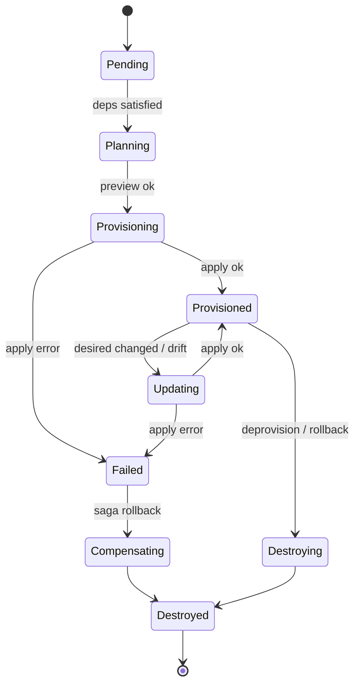
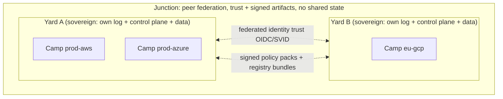
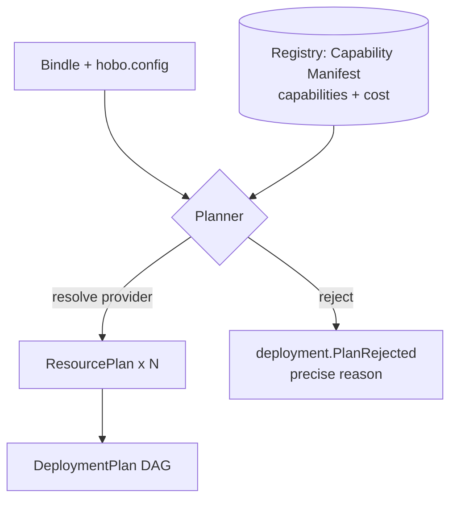

# The Control Plane (the Yard)

This capability doc consolidates Plan 4, Plan 3 of the HoBo design suite.

## Plan 04

**Plan 4 — The Yard (hobo-cloud control plane)**

> **Runtime/IfC integration.** The Planner now consumes the **manifest IR** produced by IfC resource-collection ([Plan 22](./authoring-resources-wiring.md#plan-22)); ResourceActors additionally manage **links** binding components to capability providers ([Plan 20](./wasm-runtime-wit.md#plan-20)). The reconciliation FSM and choreography below are unchanged.

> **Resource Definitions & Matching (Humanitec parity).** The Planner resolves each resource via **Resource Definitions + Matching** ([Plan 25](./platform-engineering.md#plan-25)); the lifecycle works in **Deltas → Sets** with **incremental** reconcile (only changed nodes) ([Plan 26](./platform-engineering.md#plan-26)); Executors can run behind a **HoBo Relay** for private-network targets and a **GitOps publisher** is an alternate apply path ([Plan 28](./platform-engineering.md#plan-28)); **Pipelines** drive *when* deploys happen.

> **Contracts & policy (gates).** New grains back the two governance planes: a **contract-engine** ([Plan 29](./contracts-policy-flags.md#plan-29)) and a **policy-engine** ([Plan 30](./contracts-policy-flags.md#plan-30)), each a WIT port with a built-in default. The Orchestrator invokes the **Gatekeeper** at Delta→Set/promote (contracts + policy + evals + conformance + cost); **obligations** from a policy decision (e.g. require-canary) shape the rollout; every gate result is an event.

The Yard is the orchestrator that maps Bindle deployments to real hosting. It is **itself a HoBo Bindle** (dogfood) and runs on the TS-native core; Kubernetes/Crossplane is an optional execution substrate adapter, never a requirement.

### Services (each a grain-based module)
- **Gateway** — SDK RPC + REST + **MCP** ingress; authenticates the principal (human or agent SVID), authorizes against tenant + scope, turns requests into commands, and serves read models. Stateless; horizontally scalable.
- **Identity** — issues agent/workload identities (SPIFFE-style SVIDs), acts as OIDC provider + token broker ([Plan 6](./ai-native-agent-auth.md#plan-06)).
- **Registry** — Provider + Capability Manifest catalog; capability search; plugin certification records from the Forge.
- **Planner** — Bindle + mapping → `DeploymentPlan` DAG; capability/region/cost solving (algorithm in [Plan 3](./control-plane.md#plan-03)).
- **Orchestrator** — **choreography saga engine** over the event store. One **ResourceActor** (a controller-style grain) per resource owns its lifecycle and reconciles desired↔actual via the resolved IaC adapter. Resource actors coordinate by emitting/observing events (e.g. `resource.Provisioned(db)` → unblocks `api`), not via a central coordinator.
- **Executors** — sandboxed (Firecracker) runners that execute IaC applies + Dagger builds with short-lived scoped creds.
- **Event Store + Projections** — source of truth + read models ([Plan 11](./event-model.md#plan-11)).

### The ResourceActor reconciliation FSM
Each resource in a plan gets a durable virtual actor keyed `resource:<deployment>:<name>`. Its job is to converge **observed** state to **desired** state, idempotently, surviving crashes by replaying its own event stream.



**Reconcile loop (idempotent core):**
1. Load desired (`ResourcePlan`) + observed (last `resource.*` + IaC `refresh()`).
2. Compute a **diff** (`IacProvider.preview`).
3. If empty → emit nothing (converged). If non-empty → emit `resource.Provisioning`/`UpdateRequested`, dispatch an `IacProgram` to an Executor.
4. On `exec.Succeeded` → record outputs, emit `resource.Provisioned`. On `exec.Failed` → emit `resource.Failed` with classified error (retryable vs fatal, see [Plan 5](./reliability-observability-cost.md#plan-05)).
5. The actor is **edge-triggered** by events and **level-triggered** by a periodic resync (drift). Both paths run the same loop → reconciliation is convergent and safe to repeat (the controller pattern, Kubernetes-style, but event-sourced).

**Why actors, not a monolithic engine:** per-resource isolation means one stuck provider call can't block the whole deploy; single-writer leases ([Plan 5](./reliability-observability-cost.md#plan-05)) prevent two reconciles racing on the same resource; and each actor's stream is an independent audit/replay unit.

### Choreography over orchestration (and why)
Cross-resource ordering (DB before API, network before VM) is expressed as a **dependency DAG** in the plan and realized by **choreography**: a ResourceActor subscribes to the `resource.Provisioned` events of its dependencies and self-activates when they're all present. There is no central coordinator issuing step-by-step commands.

- **Pro:** resilient (no coordinator SPOF), naturally parallel (independent subtrees provision concurrently), and each actor is autonomous/replayable.
- **Con:** harder to see "the whole flow" — we mitigate with a **DeploymentView** projection that reconstructs the saga graph from events for the dashboard, and with explicit `correlationId` on every event.
- **Compensation** is also choreographed: a `resource.Failed` past the no-go threshold emits `deployment.RolledBack`, which each already-`Provisioned` actor observes and reacts to by `Destroying` itself in reverse-dependency order (tracked via the DAG).

### Executor sandbox model
IaC apply and image builds run untrusted-ish provider code, so they are isolated:
- Each exec runs in a **Firecracker microVM** (fast boot, hardware isolation), with no ambient cloud creds.
- The Orchestrator requests a **short-lived, capability-scoped token** from Identity *for that specific resource + provider + action*, injected into the microVM at start, expired at end ([Plan 12](./security-networking.md#plan-12)).
- Stdout/diff/state stream back as `exec.Output` events (live in the dashboard) and IaC state is persisted to the resource's own backend (per-resource Pulumi stack by default — see [Plan 3](./control-plane.md#plan-03)).
- Executors are pooled and pre-warmed; concurrency is bounded per tenant and per provider (backpressure, [Plan 5](./reliability-observability-cost.md#plan-05)).

### Command / event API surface
The Gateway accepts **commands** (imperative, validated, authorized) and the only side effect is appending **events** ([Plan 11](./event-model.md#plan-11)). Representative commands:
`RegisterBindle` · `PublishBindleVersion` · `CreateCamp` · `Deploy` · `Promote` · `Rollback` · `Destroy` · `RegisterProvider` · `RequestToken`. Reads go to projections, never to live providers.

### Bootstrapping (chicken-and-egg)
The Yard runs itself, so first existence is special:
1. **Local seed:** `hobo yard up` runs a single-node Yard on a **local Camp** (`@hobo/runtime-local`, SQLite event store) — enough to deploy the Yard Bindle to a real provider.
2. **Self-deploy:** that seed deploys `@hobo/cloud` (the Yard Bindle) to the target Camp (e.g. a managed Postgres runtime + container provider), producing a "real" Yard.
3. **Handover:** the real Yard imports the seed's event log (the deployment that created it) so its own provenance is auditable, then the seed is discarded.
This makes self-hosting a first-class, reproducible path, not a bespoke install script.
- **Air-gapped profile:** the same self-deploy runs **fully in-boundary with zero egress** ([ADR-0036](./adr/07-portability-extensibility.md#adr-0036)) — artifacts arrive via signed offline bundle import, trust roots (Identity/CA/KMS) and any AI models stay in-boundary, and the deterministic core needs no network. A single in-boundary Yard; multi-Yard federation is deferred ([Q20](./verification.md#plan-09)).

### Multi-tenancy
Tenant = isolation boundary for event streams, actor placement, credential scope, and executor pools. Self-host runs single-tenant; hosted runs multi-tenant on the same code. Full model in [Plan 12](./security-networking.md#plan-12).

### Yard scope & multi-Yard (the Junction) ([ADR-0043](./adr/07-portability-extensibility.md#adr-0043))
The Yard is the central **cross-cloud / cross-region orchestrator**, and **one Yard per app/org is the norm** — a multi-cloud `production` is several **Camps** under *one* Yard ([ADR-0026](./adr/01-architecture-core.md#adr-0026)/[ADR-0028](./adr/05-config-matching-environments.md#adr-0028)); **multi-region needs no second Yard.** A *second* Yard is warranted only for **extreme isolation** — a tenant/boundary requiring a wholly separate control plane (sovereign/regulated, air-gapped [ADR-0036](./adr/07-portability-extensibility.md#adr-0036), or isolation beyond per-tenant streams). When such sovereign Yards must interoperate, an optional **`Junction`** federates them as **peers** — sharing **identity trust + signed policy packs + signed registry bundles**, never shared state and never a controller; each Yard keeps its own log/control-plane/data (residency preserved). **Single-Yard is the default and federation-ready; the Junction federates sovereign Yards when needed ([ADR-0043](./adr/07-portability-extensibility.md#adr-0043)).**



### Iteration hooks
- ResourceActor resync interval & jitter; how aggressive drift auto-heal should be (auto vs propose).
- Plan-level vs resource-level compensation thresholds (when does one failure roll back the whole deploy vs just retry locally?).
- Whether the Planner is a Yard service or a library invoked at the edge.
- Executor isolation tier (Firecracker vs gVisor vs container) per trust level.

## Plan 03

**Plan 3 — Providers, IaC & build/VM adapters**

> **Runtime integration (WASM/WASI).** Ports are now **WIT interfaces** and a CloudProvider is a **capability provider** that implements an interface's exports for a backend; **binding a resource = creating a link** (wasmCloud model) from a component's import to a provider's export, late-bound at deploy/runtime ([Plan 20](./wasm-runtime-wit.md#plan-20)). The deploy layer below (realize → IaC) is unchanged and now also wires links + emits the **manifest IR** ([Plan 22](./authoring-resources-wiring.md#plan-22)). Custom providers can be authored in any wasm language (not just Go like Nitric) and AI-generated via the Forge ([Plan 23](./forge-generated-stack.md#plan-23)).

> **Resource Definitions & Matching (Humanitec parity).** The Planner no longer resolves providers by static mapping — it resolves a **Resource Definition** per resource via **context-matching** ([Plan 25](./platform-engineering.md#plan-25)); the `hobo.config.ts` mapping is sugar over default definitions. The `IacProvider` here is one **Driver** in a taxonomy (terraform/template/echo/container/custom-webhook, [Plan 27](./platform-engineering.md#plan-27)); a capability provider picks a driver to realize a resource.

> **Contracts & policy (gates).** Before Apply, the Planner runs the **Gatekeeper** — a composite decision requiring contracts-compatible (`can-deploy`, [Plan 29](./contracts-policy-flags.md#plan-29)) AND policy-allows/approves (incl. obligations, [Plan 30](./contracts-policy-flags.md#plan-30)) AND eval gates ([Plan 23](./forge-generated-stack.md#plan-23)) AND conformance ([Plan 9](./verification.md#plan-09)) AND within cost ([Plan 16](./reliability-observability-cost.md#plan-16)). `contract-engine` and `policy-engine` are WIT ports with built-in defaults (Pact/OPA/Cedar optional providers). A blocked gate emits a precise reason (like `deployment.PlanRejected`) an agent can self-correct.

### The three adapter families (one shape)
Everything that touches the outside world is a port with swappable adapters:
- **CloudProvider** — implements capability ports (now **WIT interfaces**: `wasi:keyvalue`, `wasi:blobstore`, `wasi:sql`, …, plus `hobo:*`) for a backend (AWS/Azure/GCP/Cloudflare/Fly/K8s).
- **IacProvider** — the *mechanism* a CloudProvider uses to realize resources (Pulumi/CDKTF/Crossplane/OpenTofu).
- **BuildProvider** — produces images/rootfs/**wasm components** (Dagger/Packer/Firecracker/Vagrant/jco+componentize).

A CloudProvider composes the other two: it declares *what* a resource is, then emits an `IacProgram` (and optionally a `BuildSpec`) for the chosen IaC/Build adapters to execute, plus the **links** that bind components to it at runtime.

### Port & provider interfaces
```ts
// A capability port (one of many): the agnostic contract apps depend on
export interface DatabasePort {
  kind: "database";
  engine: "postgres" | "mysql" | "sqlite" | "mongo" | "kv";
  // requested features the provider must satisfy/negotiate
  features?: { managed?: boolean; ha?: boolean; vector?: boolean; serverless?: boolean };
}
// Note: `vector` here is a DB *capability hint* for negotiation; the full-text/vector/hybrid
// retrieval surface is a first-class `search` port ([Plan 35](./data-plane.md#plan-35)/[ADR-0034](./adr/03-data-plane.md#adr-0034)), not just a database flag.

export interface Capability {
  port: PortKind;                       // "database" | "compute" | "objectStore" | ...
  satisfies(req: PortRequest): Match;   // full | partial(missing[]) | none — capability negotiation
  estimateCost(req: PortRequest): CostSignal;
}

export interface CloudProvider {
  id: string;                                   // "aws"
  regions: string[];
  capabilities: Capability[];
  realize(plan: ResourcePlan): { iac: IacProgram; build?: BuildSpec };
  capabilityManifest(): CapabilityManifest;     // machine-readable signs (Plan 6)
  client(port: PortKind, outputs: Outputs): unknown; // the runtime client for ctx.bindings
}

export interface IacProvider {
  id: "pulumi" | "cdktf" | "crossplane" | "opentofu";
  preview(program: IacProgram): Promise<Diff>;
  apply(program: IacProgram): Promise<Outputs>;
  destroy(program: IacProgram): Promise<void>;
  refresh(program: IacProgram): Promise<DriftReport>;
}

export interface BuildProvider {
  id: "dagger" | "packer" | "firecracker" | "vagrant";
  build(spec: BuildSpec): Promise<ImageRef>;
}
```

### The Planner: Bindle + mapping → DeploymentPlan
The Planner is a pure function (easy to test, replayable): `plan(bindle, config, registry) → DeploymentPlan`. Steps:

1. **Collect resources** from the Bindle into nodes; collect `bind` edges into a dependency DAG.
2. **Resolve a Resource Definition per resource** via **context-matching** ([Plan 25](./platform-engineering.md#plan-25)): gather definitions of the resource's `type`, keep those whose criteria match the deploy context `{envType, app, env, tenant, resourceClass, resourceId}`, score by specificity, pick the highest, and record a **`match.Decided`** event (auditable "why this infra"). The simple `hobo.config.ts` mapping (`bindings`→`tiers`→`defaultProvider`) is **sugar that compiles to default definitions**, so it still works and is naturally outscored by explicit platform definitions.
3. **Capability negotiation** — for the resolved definition's provider, call `Capability.satisfies(request)`:
   - `full` → accept.
   - `partial(missing)` → if the request used `prefer`, accept with a `PlanWarning` (degrade, e.g. emulate `vector` via an extension or fall back to a container); if `require`, reject the candidate.
   - `none` → reject.
   - If no definition can satisfy a `require`, emit `deployment.PlanRejected` with a precise reason (good for agents to self-correct).
4. **Region & colocation** — honor explicit regions; otherwise pick a region satisfying all colocated resources' constraints (latency edges from `bind`), minimizing cross-provider/cross-region egress.
5. **Objective ranking** ([Plan 25](./platform-engineering.md#plan-25)/[ADR-0033](./adr/05-config-matching-environments.md#adr-0033)) — when multiple candidates satisfy `full` and tie on specificity + explicit `priority`, rank by the **configurable objective** (`cost`|`latency`|`single-provider`|`carbon`, **default = min-cost within constraints**), then a **stable tiebreak** (definition id). Deterministic, not a solver/LLM; rationale recorded in `match.Decided` + as `meta` on `deployment.Planned`.
6. **Emit `DeploymentPlan`** — DAG of `ResourcePlan{ name, port, provider, options, deps, strategy }`, each tagged with its resolved provider + merged `.with(...)` options (only the resolved provider's block survives).

The plan is content-addressed and stored via `deployment.Planned`, so the exact decisions are auditable and re-runnable.



### Resolution pipeline (plan → real infra)
1. **Plan** — as above.
2. **Realize** — each CloudProvider turns its `ResourcePlan`s into an `IacProgram` for the chosen IaC adapter (default `@hobo/iac-pulumi` via the **Pulumi Automation API** — embeddable, TS-native, no CLI shell-out).
3. **Build** — image/VM resources call BuildProviders (`@hobo/build-dagger` for container images; `build-packer`/`build-firecracker` for VM/microVM images). Output `ImageRef`s feed back into the IaC program.
4. **Apply** — IaC adapter runs `preview` then `apply` inside a Firecracker Executor with scoped creds ([Plan 12](./security-networking.md#plan-12)); `Outputs` (URLs, conn strings) become resource bindings and flow back as events.

### IaC backends
- **Pulumi Automation API** = primary (programmatic, multi-cloud, TS-native, real language for compositions).
- **Crossplane** = the adapter used when a Camp's substrate is Kubernetes (compositions + managed resources; reconciliation delegated to k8s controllers).
- **OpenTofu** = open-source HCL path (wrap the binary; state via supported backends).
- **CDKTF** = **import-only** (HashiCorp sunset) — read existing stacks, don't author new.
- Provider-specific IaC config is passed via `.with(...)` too (e.g. Pulumi stack settings, OpenTofu backend, Crossplane composition selectors).

### IaC state model
- **Per-resource stacks by default:** each resource owns an isolated IaC stack (Pulumi stack / TF workspace) keyed by `tenant/deployment/resource`. Benefits: blast-radius isolation, independent reconcile/lock, clean compensation (destroy one slice). Cost: more state objects — acceptable.
- **State backend:** pluggable; default to the Yard's own object store; locking via the resource's ActorHost lease (single-writer already guaranteed, so IaC-level locks are belt-and-suspenders).
- **Outputs → bindings:** stack outputs are captured into `resource.Provisioned` and resolved into the dependent resources' env/secret refs.
- **Drift:** `refresh()` feeds the drift loop in [Plan 5](./reliability-observability-cost.md#plan-05).
- **Adopt-in-place (migration, [ADR-0041](./adr/07-portability-extensibility.md#adr-0041)):** `hobo import` reads an existing estate's IaC state (CDKTF import-only / Pulumi Automation API) into the graph as **`adopted`** nodes — managed by id/state, **never destroyed/recreated on import** (drift-detect only). An **`external` resource kind** references infra HoBo doesn't manage yet, so a HoBo-managed resource can `bind` across the boundary during an incremental (strangler-fig) migration. Adoption emits `resource.Adopted` ([Plan 11](./event-model.md#plan-11)).

### Cross-cloud equivalence classes
Agnostic ports map to provider services via curated equivalence classes (extensible, and what the [Forge](./ai-native-agent-auth.md#plan-06) targets):
| Port (request) | AWS | Azure | GCP | Cloudflare | Fly |
|---|---|---|---|---|---|
| `database{postgres,managed}` | RDS/Aurora PG | Flexible Server | Cloud SQL PG | (Neon/Hyperdrive) | Fly Postgres |
| `objectStore` | S3 | Blob | GCS | R2 | Tigris |
| `compute{container}` | Fargate/App Runner | Container Apps | Cloud Run | Workers/Containers | Machines |
| `queue` | SQS | Service Bus | Pub/Sub | Queues | (NATS) |
| `cache` | ElastiCache | Cache for Redis | Memorystore | KV | Upstash |

### Build / VM adapters
- **Dagger** — reproducible container build pipelines, defined in TS, run in containers; primary image path for `compute`/`containerService`.
- **Packer** — baked VM images (AMI/Azure image) for `vm`.
- **Firecracker** — microVM rootfs for `microVm` and the Executor sandbox itself.
- **Vagrant** — local VM parity for `hobo dev` when a resource truly needs a VM.

### Authoring a provider (human or Forge)
A provider package exports: (1) a factory (`aws({...})`) returning a `CloudProvider`, (2) typed `.with(...)` option builders per port (`aws.rds`, `aws.fargate`), (3) capability declarations + equivalence mappings, (4) `realize()` emitting IaC, (5) a runtime `client()` per port, and (6) a `code()` Capability Manifest manifest. It must pass `@hobo/conformance` for every port it claims — that suite is the contract that lets AI-generated providers be trusted ([Plan 6](./ai-native-agent-auth.md#plan-06), [Plan 9](./verification.md#plan-09)).

### Iteration hooks
- ~~Planner objective function when several providers fully satisfy~~ — **decided ([ADR-0033](./adr/05-config-matching-environments.md#adr-0033), resolves ADR-P4):** configurable `cost`|`latency`|`single-provider`|`carbon`, default **min-cost within constraints**, applied deterministically (no solver/LLM on-path).
- Per-resource vs grouped IaC stacks (isolation vs state sprawl).
- How `prefer` degradation is surfaced/approved (silent warning vs require ack).
- Maintaining equivalence classes by hand vs Forge-generated + curated.
- Crossplane substrate: delegate reconciliation to k8s vs keep ResourceActors authoritative.
