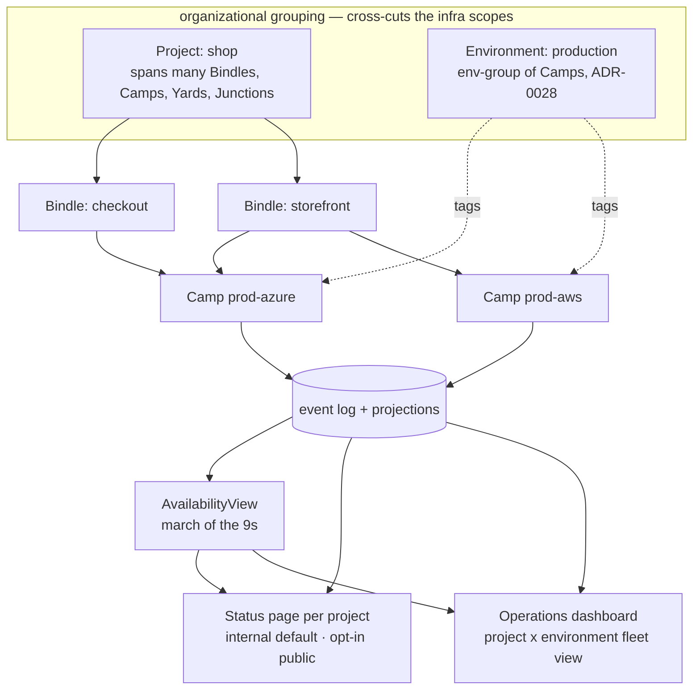
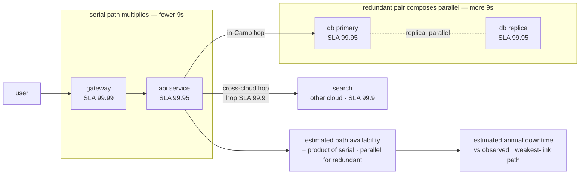

# Operations Dashboard, Status Pages & Architecture Availability

This capability doc specifies HoBo's **default operational surfaces** for multi-cloud, multi-environment deployments: a fleet-wide **operations dashboard** (the prod analog of the Aspire dashboard, but across clouds and environments), a per-**project** **status page** (aggregate uptime + dependent-service health, internal by default and publicly shareable on opt-in), and the **architecture-derived availability** model — the *"march of the 9s"* — that estimates downtime from the dependency graph and calibrates it against observed history.

Everything here is a **projection over the event log** ([Plan 11](./event-model.md#plan-11)): no surface holds privileged state, so every view is consistent with the audit log by construction — the same principle the developer dashboard already follows ([Plan 7](./developer-experience.md#plan-07)).

## Plan 49

**Plan 49 — Operations dashboard, status pages & the march of the 9s**

> **Relationship to existing surfaces.** [Plan 7](./developer-experience.md#plan-07) is the **developer/authoring** dashboard (deploy timeline, link map, run inspector, AI proposals). This plan adds the **operations** surface — the cross-cloud, cross-environment *fleet* view and the externally-facing *status* view — built from the same projection-and-event model. SLOs/error budgets ([ADR-0045](./adr/04-governance-verification.md#adr-0045)), incidents ([ADR-0058](./adr/06-ai-generation-operators.md#adr-0058)), cost/showback ([ADR-0039](./adr/04-governance-verification.md#adr-0039)), and the dependency graph ([Plan 21](./authoring-resources-wiring.md#plan-21)/[Plan 20](./wasm-runtime-wit.md#plan-20)) are the inputs; this plan composes them into operator- and stakeholder-facing surfaces.

### A. Projects & environments — grouping dimensions, not new infra scopes ([ADR-0077](./adr/04-governance-verification.md#adr-0077))

A single product can have many services across many clouds and many environments, so two **grouping dimensions** sit *across* the infra scope chain `Bindle ⊂ Camp ⊂ Yard ⊂ Junction` ([ADR-0026](./adr/01-architecture-core.md#adr-0026)):

- **Project** — a named grouping of **Bindles** (an app / product / portfolio). A project **spans many Bindles, Camps, Yards, and Junctions**. It is **not a fifth containment noun** in the scope chain (that chain is infra ownership); it is an **ownership / observability / RBAC rollup dimension**, recorded on events alongside `tenant` (the same way `tenant` scopes every event, [Plan 12](./security-networking.md#plan-12)). A Bindle declares the project it belongs to; the dimension is inherited by every event the Bindle's resources/runs emit.
  - **A project lives *inside* one tenant — it never spans tenants.** `tenant` is the hard isolation boundary; `project` is a grouping *within* it. Project names are **namespaced per tenant** (no cross-tenant name collision), and RBAC over a project ([ADR-0074](./adr/02-identity-security.md#adr-0074)) is always evaluated **within** the owning tenant — authorization never derives from the project tag alone.
  - **Because `project` is also an authorization boundary, its assignment is governed, not a free mutable tag.** Re-assigning a Bindle's project is a **privileged, audited action** (a `policy.Decided` over the `hobo:*` taxonomy, [ADR-0074](./adr/02-identity-security.md#adr-0074)), since it moves resources across an RBAC boundary; the **singleton-project default** (a Bindle with no declared project) inherits the **Bindle owner's** grants, so a missing/mutated tag can't silently widen or escape access.
- **Environment** — the **env-group** ([ADR-0028](./adr/05-config-matching-environments.md#adr-0028)) elevated to a first-class rollup dimension: a named logical environment (`production`, `staging`, `dev`) = the set of Camps of that **environment type**, possibly spanning providers/Yards (`production` = {`prod-aws`, `prod-azure`}). It already exists as the multi-cloud atomic deploy unit; here it becomes a **filter/rollup axis** for every operational surface.

The operational grid is therefore **project × environment**, drillable **Project → Bindle → Camp → resource/service** and filterable to a single environment. Because both are recorded on events (project) or derived from Camp `environment type` (environment), the rollups are **projections**, not new state — and they compose with org governance ([ADR-0074](./adr/02-identity-security.md#adr-0074): a project is an RBAC/ownership boundary) and metering ([ADR-0039](./adr/04-governance-verification.md#adr-0039): showback already rolls up tenant→Camp→Bindle→run, now also by project/environment).

**Rollup invariant — `tenant` filters first, always.** Every dashboard/status/availability projection filters on the caller's **`tenant` before** any `project`/`environment` axis. The **`environment` axis is derived from Camp `environment type`, not from `project`**, so an `environment`-only rollup is **intersected with the caller's project/RBAC grants** — Camps of the same environment type belonging to a *different* project or tenant are **never co-mingled** into one authorized view. (This is the one real footgun of a cross-cutting dimension; the invariant closes it.)

### B. The operations dashboard — the Aspire analog for multi-cloud, multi-environment ([ADR-0077](./adr/04-governance-verification.md#adr-0077))

A **default fleet view** that an operator opens without configuring anything — the prod-scale, cross-cloud counterpart to the Aspire local dashboard ([`competitors/aspire`](../../competitors/aspire.md)). Like every HoBo view it is a **read-only projection** over the log; the same read API backs the CLI and agents ([Plan 7](./developer-experience.md#plan-07)). Default views, each scoped by **project × environment**:

| View | Projection / source | What it shows |
|---|---|---|
| **Fleet topology** | the **link map** + bind graph ([Plan 21](./authoring-resources-wiring.md#plan-21)/[Plan 20](./wasm-runtime-wit.md#plan-20)) across Camps/clouds | every service + dependency edge, **annotated with the hop class** (in-Camp / cross-Camp / cross-cloud) and per-edge health |
| **Health & SLO** | SLI/SLO + error budgets ([ADR-0045](./adr/04-governance-verification.md#adr-0045)), `slo.*` | per-service health, burn rate, budget remaining; cross-Camp aggregation inherits the bounded-staleness label ([ADR-0040](./adr/05-config-matching-environments.md#adr-0040)) |
| **Incidents** | the Incident aggregate + `incident.*` ([ADR-0058](./adr/06-ai-generation-operators.md#adr-0058)) | open incidents, MTTD/MTTR, the SRE decision trail |
| **Deployments** | DeploymentView ([Plan 7](./developer-experience.md#plan-07)) | per-environment rollout/promotion/rollback timeline with replay/time-travel |
| **Cost** | `MeteringView` + showback ([ADR-0039](./adr/04-governance-verification.md#adr-0039)) | spend by project/environment/Camp + `costAvailabilityProfile` degradation state |
| **Architecture availability** | `AvailabilityView` (§D) | estimated vs observed 9s, weakest-link path, "add a replica → +N 9s" hints |

The dashboard is **runtime-agnostic** (read API only) so it works against any Camp backend; it never sits on the data-plane request path (it reads projections, [Plan 4](./control-plane.md#plan-04)). It is part of HoBo's own control-plane surface, so access is governed by RBAC over the `hobo:*` action taxonomy ([ADR-0074](./adr/02-identity-security.md#adr-0074)), scoped per project.

### C. Status pages — one per project, internal by default, opt-in public ([ADR-0077](./adr/04-governance-verification.md#adr-0077))

Every **project** automatically gets a **status page** — the stakeholder-facing aggregate of "is it up, what's degraded, what happened" — drillable to a Bindle and filterable by environment. It is a projection over the same facts, so it can never disagree with the audit log:

- **Aggregate uptime / downtime** — observed availability per service and rolled up to Bindle / environment / project, over selectable windows; derived from SLO/health + `incident.*` (an incident's open→resolved span is downtime for its impacted components).
- **Dependent-service health** — the **public-facing components** the project declares (e.g. *API*, *Checkout*, *Search*), each mapping to one or more internal services in the dependency graph, with current status (operational / degraded / outage) and the **upstream dependencies** that affect it.
- **Incident history + post-incident timelines** — from `incident.*` and **postmortem-as-replay** ([ADR-0058](./adr/06-ai-generation-operators.md#adr-0058)); public updates are curated, not the raw internal trail.
- **Architecture availability (internal page only)** — the §D estimate shown next to observed, so an internal reader sees both *"what the architecture implies"* and *"what actually happened."* This is **never on a public page** (see redaction below) — the estimate, weakest-link path, hop classes, and per-provider 9s would leak the internal topology.

**Internal by default; public is a deliberate, curated publish.** A published page:
1. exposes **only declared public components** (an explicit allowlist mapping public component → internal service set), never the raw internal topology;
2. **redacts** internal service names, provider/Camp identities, cost, **and the entire §D architecture estimate** (no weakest-link path, hop classes, per-provider 9s, or "+N 9s" hints) — a reader sees "Checkout: degraded," not "checkout@prod-azure RDS replica lag" and not "checkout's cross-cloud hop to a single-replica Postgres." **The public page shows only a coarse, rolled-up *observed* availability per declared public component** + curated incidents; nothing architecture-derived;
3. **carries the staleness label and degrades safely.** Because the rolled-up number can be fed by cross-Camp **bounded-staleness** reads ([ADR-0040](./adr/05-config-matching-environments.md#adr-0040)) — exactly during a partition/incident when accuracy matters most — a published status **propagates the staleness label** and renders **"status delayed / unknown" rather than a confident stale "operational"** when the read is beyond its freshness bound (fail-safe, not fail-confident);
4. is served on a **custom domain** via the existing ingress/cert machinery ([ADR-0035](./adr/07-portability-extensibility.md#adr-0035)), **no auth**;
5. emits a `statuspage.Published` fact (and `statuspage.Unpublished` on retract); **the published allowlist + redaction profile is re-captured on every change** (a new `statuspage.Published`) *and* each served public snapshot records a **content hash**, so "what was shown publicly, and when" is provable — not merely "what was declared publishable." Public incident updates are `statuspage.IncidentPosted`, and their **free text passes the same redaction scan before publish** (curated text is otherwise a leak vector).

Delivery of subscriber notifications (email/SMS/webhook on a public incident post) is **not re-built here** — `statuspage.IncidentPosted` is an event the existing `notify` port ([ADR-0059](./adr/03-data-plane.md#adr-0059)) delivers, reusing one mechanism.

### D. Architecture availability — the "march of the 9s" ([ADR-0078](./adr/04-governance-verification.md#adr-0078))

An **`AvailabilityView`** projection that answers *"what availability does this architecture imply, and how does that compare to what we observe?"* — by walking the **dependency graph** the link map already carries and composing per-component availability through it.

**Inputs (both, per the design decision):**
- **Published SLAs (design-time).** Each provider/resource carries a declared **availability SLA** in its Capability Manifest / Capability Spec ([ADR-0009](./adr/02-identity-security.md#adr-0009)/[ADR-0075](./adr/07-portability-extensibility.md#adr-0075)) — e.g. a managed-Postgres adapter declares `availability: 99.95`. Missing/unknown SLAs are treated as a **declared unknown** (shown as "unrated," never silently assumed 100%).
- **Observed (calibration).** Measured availability from SLO/health + `incident.*` over a window feeds back as the empirical input, so the view shows **estimated vs actual**; the **gap is a signal** (architecture under-delivering → a real reliability bug; over-delivering → conservative SLAs or lucky).

**Composition over the graph (a defined algorithm, not hand-waving):**
- A **serial dependency** (a request that needs both A and B) multiplies availabilities — `a · b` → **fewer 9s**. A long serial chain is why "five services at 99.9% each" is only ~99.5% end-to-end.
- A **redundant set** composes as **parallel** — `1 − ∏(1 − aᵢ)` → **more 9s** — but **active-active vs active-passive differ**: active-active uses the parallel formula directly, while **active-passive/failover applies a coverage/failover-success factor** (detection + switch time + failover-can-itself-fail), so the model doesn't over-credit a passive replica as if cutover were instant and certain. This rewards the redundancy [ADR-0040](./adr/05-config-matching-environments.md#adr-0040) declares, honestly per topology.
- **Each network hop is a failure domain with its own availability**, classed **in-Camp / cross-Camp / cross-cloud** (the classes the fleet topology shows). Per-hop availability is itself a **declared input** (a hop class carries a default availability in the Capability Manifest, overridable per link, [ADR-0009](./adr/02-identity-security.md#adr-0009)) — *not* an invented constant; an undeclared hop is "unrated." A **cross-cloud hop visibly costs 9s** — pricing "split this service to another cloud" rather than hiding it.
- **Well-definedness on a real graph:** the dependency graph is a DAG with shared sub-dependencies, diamonds, and components on both serial and redundant paths — so composition is **not** a naïve path product. The view reduces the graph to **series-parallel form** where possible and falls back to a **minimal-cut-set** computation otherwise; a **shared sub-dependency is composed once (memoized per component, not per path)** so it is never double-counted; **cycles are rejected and flagged** (a dependency cycle is itself a finding, not silently composed).

**Outputs:** estimated availability + **estimated annual downtime** per service, rolled up per Bindle / environment / project; a **weakest-link path** highlight; and **actionable hints** ("add a replica here → +N 9s"). The estimate is a **pure projection** of `(dependency-graph snapshot, declared SLAs, hop availabilities, topology, observed window)` — replayable and explainable. **It is an upper bound on availability (a lower bound on real downtime), comparative guidance — not an absolute prediction or an SLA:** §D's own limits (below) mean correlated/grey/human failures aren't captured, so the estimate is used for *relative* comparison and redundancy hints. Accordingly its tie to the Planner's availability floor is **warn-only, and gates on the *observed* number, not the estimate**: an architecture whose *estimate* can't clear the **nominal `availabilitySlo`** (the top tier of the `costAvailabilityProfile`, [ADR-0039](./adr/04-governance-verification.md#adr-0039) — distinct from that profile's *runtime* degradation ladder) raises a **`can-deploy` warning** ([Plan 29](./contracts-policy-flags.md#plan-29)), never a hard block; only the observed SLO gates.

**Honest limits (stated, not hidden):** the model assumes the declared per-component SLAs and the modeled serial/parallel structure; correlated failures (a shared region/provider outage hitting "independent" replicas), partial/grey failures, and human/deploy-induced outages are **not** captured by SLA composition — which is exactly why **observed calibration runs alongside** and the gap is surfaced rather than the estimate being treated as truth.

### Events ([Plan 11](./event-model.md#plan-11))

Deliberately minimal — the surfaces are projections, the groupings are dimensions on existing events:
- **Grouping** is **not** a new event family: `project` is a recorded dimension on existing events (like `tenant`); `environment` derives from Camp `environment type` ([ADR-0028](./adr/05-config-matching-environments.md#adr-0028)).
- **Availability** is the **`AvailabilityView`** projection over the dependency graph + declared SLAs + `slo.*`/`incident.*` — **no new event types**.
- **Status page** adds only **`statuspage.Published`** · **`statuspage.Unpublished`** · **`statuspage.IncidentPosted`** (what was shown publicly, and when — an auditable disclosure trail; subscriber delivery rides `notify`, [ADR-0059](./adr/03-data-plane.md#adr-0059)).

### Verification ([Plan 9](./verification.md#plan-09))

- **Grouping rollup test:** events tagged with a `project` and Camps of an `environment type` roll up correctly; a Bindle in two environments appears once per environment, not double-counted.
- **Dashboard projection test:** every dashboard view is reproducible from the log alone (no privileged state); a from-zero rebuild equals the live view.
- **Status-page redaction test (the security-critical gate, failure modes included):** a **denylist scan over the fully rendered public output** (not just the structured fields) asserts **no** internal service/provider/Camp/cost identifier and **no §D architecture-estimate field** (weakest-link, hop class, per-provider 9s, hints) ever appears — including in **`statuspage.IncidentPosted` free text**, which must pass the same scan *before* publish; a **mis-mapped / over-broad allowlist** entry is fuzzed and a public component mapping to ≥1 internal service still emits zero internal identifiers; un-publishing removes public reachability; each served snapshot's **content hash** matches the audited `statuspage.*` trail (proving what bytes were shown, not just what was declared publishable); a **stale read renders "delayed/unknown," never a fresh "operational."**
- **Availability composition test:** a serial chain multiplies, a redundant pair composes parallel, a cross-cloud hop lowers the estimate; the weakest-link path is the true min; an unrated component is reported "unrated," never assumed 100%.
- **Calibration test:** estimated vs observed both render; an injected outage ([ADR-0047](./adr/04-governance-verification.md#adr-0047)) moves *observed* and widens the gap.

### Scope / YAGNI

- **In scope:** the projections, the grouping dimensions, the status-page model + redaction contract, the availability composition algorithm, the events above — all over existing machinery (log, SLO, incidents, cost, the dependency graph, ingress, `notify`).
- **Out of scope this round:** the actual frontend implementation; a full public-status-page *subscription product* (we emit the events; `notify` delivers); ingesting third-party SLA feeds beyond declared/observed; SLA-of-SLAs contractual modeling; correlated-failure / fault-tree analysis beyond serial/parallel composition (noted as an iteration hook).

### Iteration hooks

- **Correlated-failure modeling** — shared-region/provider failure domains as a refinement of the independence assumption (fault-tree / common-cause), beyond serial/parallel.
- **Latency "march" alongside availability** — composing p99 latency through the same hop graph (cross-cloud hops add latency too), a natural sibling of the 9s.
- **Per-public-component SLO publishing** — letting a project publish a *target* per public component and tracking attainment on the public page.
- **Project as a deploy/promotion unit** — today project is observability/ownership; whether a project-wide promote (across its Bindles/environments) is ever desirable is deferred (env-group promotion already covers the multi-Camp case, [ADR-0028](./adr/05-config-matching-environments.md#adr-0028)).
