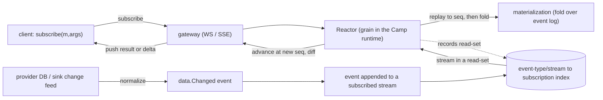
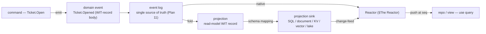
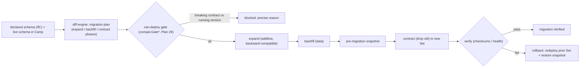
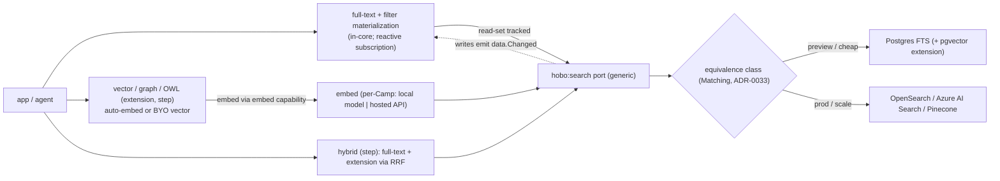

# Event Model & the Data Plane (sourcing, reactivity, projections, migrations, search)

This capability doc specifies the HoBo data plane end-to-end: how application data is written, projected, queried, made reactive, searched, evolved, and moved across clouds.

The app layer is **CQRS** ([ADR-0053](./adr/03-data-plane.md#adr-0053)): writes go through commands into aggregates (the write model); reads come from projections/materializations (the read model). The default **read** surface is a subscription to an observable materialization; the opinionated **query** surface is a **GraphQL facade over materialized views and snapshots** — CQRS querying of materializations produced by GraphQL reducers, with **snapshots cached by default** ([ADR-0050](./adr/03-data-plane.md#adr-0050)). Per-entity/per-materialization **tunable consistency** ([ADR-0052](./adr/03-data-plane.md#adr-0052)) defaults to session.

## Plan 11

> **Runtime/IfC integration.** Two event families are in the catalog: **resource-collection** (`bindle.ResourcesCollected`, `bindle.ManifestProduced` — the IfC step, [Plan 21](./authoring-resources-wiring.md#plan-21)/[Plan 21](./authoring-resources-wiring.md#plan-21)) and **cross-WIT-boundary calls** (`link.Called` / stub recordings — the trace stream that powers AI implement/evolve/live-fix, [Plan 23](./generated-stack.md#plan-23)). Both ride the same envelope and replay rules below.

### Why event sourcing is the foundation (not an add-on)
**The append-only event log is the single source of truth** for both the control plane (the Yard) and the data-plane runtime (the Camp's runtime). This buys four properties:
- **Recovery** — crash mid-deploy or mid-workflow → replay the stream to rebuild exact state.
- **Audit** — every infra change and every credential issuance is an immutable, ordered fact (directly answers "what did the agent do, and with what token?").
- **Time-travel** — reconstruct state as-of any point; diff two points.
- **Determinism** — durable workflows replay over cached step results (the Vercel model).

The cost is discipline (CQRS, projections, versioning) and that read-after-write needs projections; the audit/replay story is a primary differentiator vs Lakebed.

### The event envelope
A single envelope shape across control plane and data plane:
```ts
export interface EventEnvelope<T = unknown> {
  id: string;            // globally unique (ULID — sortable by time)
  type: string;          // "deployment.Provisioned", "run.StepCompleted", ...
  v: number;             // schema version of `type` (for upcasting)
  streamId: string;      // aggregate/run/actor key, e.g. "deployment:01H..."
  seq: number;           // per-stream monotonic sequence (optimistic concurrency)
  ts: string;            // ISO8601, set by the Camp's runtime Clock (deterministic on replay)
  actor: PrincipalRef;   // who/what caused it (user, agent SVID, system)
  tenant: string;        // isolation boundary (Plan 12)
  project?: string;      // organizational grouping (app/product/portfolio) — a rollup/ownership/RBAC dimension that cross-cuts the infra scopes, NOT a containment scope (ADR-0077). Absent = the Bindle's singleton-project default
  causationId?: string;  // the command/event that directly caused this
  correlationId?: string;// the saga / deploy / run this belongs to
  data: T;               // typed payload
  lane?: string;         // sandbox-lane id (signed, principal/tenant-bound); absent = baseline — dispatch filters on it, deny-by-default (ADR-0076)
  meta?: Record<string, unknown>; // tracing (traceparent), idempotency keys
}
```
- **Ordering:** total order within a stream by `seq`; global causal order via `id` (ULID) + `causationId`/`correlationId`.
- **Concurrency:** appends are conditional on expected `seq` (optimistic locking) → no lost updates.
- **Idempotency:** producers attach an idempotency key in `meta`; the store dedups, giving exactly-once *effects* over an at-least-once queue.

### Event catalog (by aggregate)
Naming: `aggregate.PastTenseFact`. Commands (imperative) are *not* stored; only the facts they produce are.

The canonical event-family index used by `docs:design-lint` is [`event-families.md`](./event-families.md); this section remains the detailed data-plane catalog of individual event names.

**Bindle / Camp**
`bindle.Registered` · `bindle.VersionPublished` · `camp.Created` · `camp.RuntimeBound` · `env.PromoteRequested` · `env.Promoted` · `env.PromoteRolledBack` · `env.PartiallyPromoted` (a tolerated partial deploy across the group — only via `optional` members, never a silent split, [ADR-0028](./adr/01-architecture-core.md#adr-0028)) (multi-Camp environment-group saga)

**Deployment** (the control-plane saga)
`deployment.Requested` · `deployment.Planned` · `deployment.PortabilityReported` (plan-time portability scorecard: portability % + lock-in sources + per-resource equivalence class + upgrade readiness — [Plan 21](./authoring-resources-wiring.md#plan-21)/[ADR-0024](./adr/07-portability-extensibility.md#adr-0024)) · `deployment.PlanRejected` · `deployment.Deployed` · `deployment.RolledBack`

**Resource** (one stream per resource instance)
`resource.Provisioning` · `resource.Provisioned` · `resource.UpdateRequested` · `resource.Updated` · `resource.Failed` · `resource.Compensating` · `resource.Destroyed` · `resource.CompensationFailed` (a destroy that itself failed → escalates to an incident rather than a silent half-rollback, [ADR-0004](./adr/01-architecture-core.md#adr-0004)) · `resource.DriftDetected` · `resource.Adopted` (existing resource brought under management on `hobo import` + its source/provenance, [ADR-0041](./adr/07-portability-extensibility.md#adr-0041))

**Execution** (IaC/build runs)
`exec.Started` · `exec.Output` · `exec.Succeeded` · `exec.Failed`

**Identity / auth** (the audit trail)
`identity.Issued` · `identity.Rotated` · `identity.SeedTokenUsed` (the operator's one-time `hobo login` OIDC/SVID used for a Yard bootstrap-apply before the target Identity exists — [Plan 4 §Bootstrapping](./control-plane.md#plan-04)) · `token.Granted` · `token.Used` · `token.Revoked` · `token.Denied`

**End-user auth** (app users, [Plan 6](./ai-native-agent-auth.md#plan-06)/[ADR-0038](./adr/02-identity-security.md#adr-0038)) — same `actor: PrincipalRef` audit path as agents/services
`user.Authenticated` (verification result + principal claims) · `session.Started` · `session.Refreshed` · `session.Revoked` (revocation / sign-out-everywhere; authz decisions ride `policy.Decided`)

**App tenancy** (multi-tenant apps, [Plan 50](./security-networking.md#plan-50)/[ADR-0079](./adr/02-identity-security.md#adr-0079)) — the **app's customer** tenant lifecycle (`ctx.tenant`), distinct from the platform `tenant` envelope field (which is HoBo's own isolation boundary and has no lifecycle)
`tenant.Provisioned` (an app-tenant onboarded — pooled record + per-tenant forgetting key, or a siloed silo/Camp via `match.Decided`) · `tenant.Suspended` · `tenant.Resumed` · `tenant.Offboarded` · `tenant.Exported` (portable dump of the tenant's streams — no lock-in) · `tenant.Erased` (**per-tenant crypto-shred** — destroy the tenant's forgetting key + tombstone; projections rebuild excluding it; forward-only log intact, [ADR-0080](./adr/02-identity-security.md#adr-0080)/[ADR-0060](./adr/02-identity-security.md#adr-0060)). *The app-tenant scoping dimension itself is the **stream key** + the deny-by-default projection filter ([ADR-0080](./adr/02-identity-security.md#adr-0080)); cross-tenant admin access is audited via `policy.Decided`; model selection/promotion ride `match.Decided`/`migration.*` — no new event types for those.*

**WebSocket connections** ([Plan 20](./wasm-runtime-wit.md#plan-20)/[ADR-0075](./adr/07-portability-extensibility.md#adr-0075)) — the `hobo:websocket` extension's event-sourced *connection lifecycle* (principal-bound, like `session.*`); **per-frame messages ride the Streamer, not the log** (a policy may opt specific message types into audit)
`ws.Connected` (connId + subprotocol + origin + Camp) · `ws.Authenticated` (principal/`PrincipalRef` bound to the connection — authz via `.allow()`/`policy.Decided`) · `ws.Subscribed` / `ws.Unsubscribed` (channel/room membership for fan-out) · `ws.Disconnected` (connId + close code/reason + `by: client|server|policy`)

**Registry**
`provider.Registered` · `provider.CapabilityManifestUpdated` · `provider.Deprecated` · `gen.PluginCertified` · `registry.BundleImported` (signed offline bundle imported + verified — air-gap supply chain, [ADR-0036](./adr/07-portability-extensibility.md#adr-0036))

**Runtime (data-plane, per Run)** — mirrors Vercel's durable model
`run.Started` · `run.StepScheduled` · `run.StepCompleted` · `run.StepFailed` · `run.SleepScheduled` · `run.HookCreated` · `run.HookResumed` · `run.Suspended` · `run.Completed` · `run.Failed`

**Actors / sagas**
`actor.Activated` · `actor.StateAppended` · `actor.Passivated` · `saga.Started` · `saga.StepEmitted` · `saga.Compensated` · `saga.Completed`

**IfC collection** (the resource-collection step, [Plan 21](./authoring-resources-wiring.md#plan-21)/[Plan 21](./authoring-resources-wiring.md#plan-21))
`bindle.ResourcesCollected` · `bindle.ManifestProduced`

**Links & WIT-boundary calls** (the trace stream powering AI implement/evolve/live-fix, [Plan 20](./wasm-runtime-wit.md#plan-20)/[Plan 23](./generated-stack.md#plan-23))
`link.Established` (carries the **boundary mode** — `live`/`mock`/`record`/`replay`/`fork`/`shadow`/`fault` — for boundary virtualization, [ADR-0076](./adr/02-identity-security.md#adr-0076)) · `link.Called` · `stub.Recorded` · `impl.Generated` · `impl.Certified` · `impl.Promoted` · `livefix.Proposed` · `livefix.Applied` · `livefix.RolledBack`

> **Boundary virtualization & sandbox lanes** ([ADR-0076](./adr/02-identity-security.md#adr-0076)) add **no new families** but **two envelope/routing rules**: (1) the **`EventEnvelope` carries `lane`** (a signed, principal/tenant-bound lane token) and **every subscriber/Reactor/saga/queue dispatch filters by lane, deny-by-default** — a baseline subscriber **ignores** lane events (so a forked service's emitted event can't drive a baseline subscriber to mutate real state), a lane subscriber gets lane events + baseline read-through; (2) **routing is the membrane-enforced signed token, *not* a per-request `policy.Decided`** (that is a deploy/gate-time fact). A sandbox lane is otherwise an `env.*` overlay; the boundary mode rides `link.Established`, `shadow` rides `impl.Shadowed`/`eval.*`, `fault` rides `chaos.*`. **Lane-origin events are tagged with the lane id and excluded by default** from observed-contract promotion ([Plan 29](./contracts-policy-flags.md#plan-29)), training trajectories ([Plan 23](./generated-stack.md#plan-23)), and tenant metering rollups ([ADR-0039](./adr/02-identity-security.md#adr-0039)). A lane run is replayable **only** with its baseline read-through recorded (value + observed `seq`).

**Platform config & matching** (Resource Definitions, [Plan 25](./platform-engineering.md#plan-25))
`resourcedef.Registered` · `resourcedef.Updated` · `pack.Imported` · **`match.Decided`** (winning definition + full lexicographic ranking [specificity → priority → objective → stable tiebreak] + objective used + tie flag + rejected candidates with reasons → "why this infra", deterministic/replayable — [ADR-0033](./adr/01-architecture-core.md#adr-0033))

**Environments, deltas & sets** ([Plan 25](./platform-engineering.md#plan-25))
`env.Created` · `env.Cloned` · `env.Reaped` (ephemeral TTL) · `delta.Opened` · `delta.Updated` · `delta.Applied` · `set.Created` · `deployment.Promoted`

**Pipelines** ([Plan 25](./platform-engineering.md#plan-25))
`pipeline.Triggered` · `pipeline.StepStarted` · `pipeline.StepCompleted` · `pipeline.GateRequested` · `pipeline.GateApproved` · `pipeline.GateRejected` · `pipeline.Completed`

**Contracts & compatibility** ([Plan 29](./contracts-policy-flags.md#plan-29))
`contract.Inferred` · `contract.Observed` · `contract.Promoted` · `contract.Verified` · `contract.VerificationFailed` · **`compat.GatePassed`** · **`compat.GateFailed`**

**Policy** ([Plan 29](./contracts-policy-flags.md#plan-29))
**`policy.Decided`** (effect + evidence + obligations) · `policy.ViolationDetected` · `policy.WaiverRequested` · `policy.WaiverApproved` · `policy.ObligationCreated` · `policy.ObligationSatisfied`

**Cost & metering** ([Plan 5](./reliability-observability-cost.md#plan-05)/[ADR-0039](./adr/02-identity-security.md#adr-0039)) — metering is the `MeteringView` *projection* (no per-usage events); quota decisions ride `policy.Decided`
`spend.CircuitTripped` · `spend.CircuitReset` (runaway-spend breaker) · `spend.DegradationRequired` · `spend.DegradationApplied` · `spend.DegradationRolledBack` (cost-driven graceful degradation saga, [ADR-0039](./adr/02-identity-security.md#adr-0039))

**Cost routing & credits** (the Dispatcher, [ADR-0071](./adr/01-architecture-core.md#adr-0071)) — credit/budget state is the `CreditLedgerView` *projection*; **placement** reuses `match.Decided`, **traffic** reuses `domain.RoutingChanged`
`dispatch.Decided` (per-job selection of a `runner`/`build-machine` provider + full ranking + objective + the credit-ledger snapshot used → "why this build/CI ran here", deterministic/replayable like `match.Decided`) · `credit.Registered` (a provider's free-tier/promo/committed allotment declared + reset window/expiry) · `credit.Reset` (a free-tier/credit window rolled over) · `credit.Exhausted` (free headroom hit zero → the Dispatcher stops preferring it; consumption itself is derived from `MeteringView`, no per-use event)

**Evals & promotion** ([Plan 23](./generated-stack.md#plan-23))
`eval.Ran` · `eval.GatePassed` · `eval.GateFailed` · `impl.Shadowed` · `impl.Promoted`

**Golden Suites** (the reproducible default test/eval/benchmark gate, [ADR-0082](./adr/02-identity-security.md#adr-0082))
`golden.SuiteDeclared` · `golden.Pinned` · `golden.Blessed` (a golden-master reference accepted) · `golden.Ran` · `golden.Passed` · `golden.Failed` · `golden.Drifted` (post-deploy regression). Failure rides `incident.*`/`crew.*`/`policy.Decided`; the A2H handoff rides `crew.HandoffRequested` + a policy obligation — no new family.

**Reactive streams & subscriptions** ([Plan 32](#plan-32))
`subscription.Opened` · `subscription.Recomputed` (new `seq` + read-set hash) · `subscription.Pushed` · `subscription.Closed` · **`data.Changed`** (normalized sink change-feed event)

**Data plane / projections** ([Plan 32](#plan-32)) — app domain data is event-sourced (commands→events here); a projection folds streams into an architect-chosen sink
`projection.Declared` (read-model record + event-type read-set + reactivity class) · `projection.Lagged` (staleness/lag exceeded a bound → policy input) · `projection.SinkRebound` (Matching reselected a sink; links `match.Decided`) — sink **schema** changes reuse `migration.*`; sink **change-feeds** reuse `data.Changed`; rebuild-from-zero is a `migration.PhaseApplied` backfill

**Operator Agents (the Crew)** ([Plan 40](./operators-sre.md#plan-40)) — roster-level facts; per-agent runs reuse `run.*`, domain facts ride existing families
`crew.AgentDispatched` (which operator + triggering signal) · `crew.ActionProposed` (action + blast radius + `policy.Decided` ref) · `crew.ActionApplied`/`crew.ActionDenied` (ride `policy.Decided`) · `crew.HandoffRequested` (escalate to another operator or a human)

**AI generation** ([Plan 23](./generated-stack.md#plan-23))
`gen.Requested` · `gen.CandidateGenerated` · `gen.Validated` · `gen.ValidationFailed` · `gen.Repaired` (iteration n + failing-assertion set) · `gen.NeedsHuman` · `gen.Certified` (extends the Registry's `gen.PluginCertified` + `impl.*`)

**App-data migrations** ([Plan 32](#plan-32)) — the developer's `sql`-resource schema/data, *not* this log's own upcasting (see Schema evolution below)
`migration.Planned` · `migration.SnapshotTaken` · `migration.PhaseApplied` (phase = `expand`/`backfill`/`contract` + the diff) · `migration.Verified` · `migration.RolledBack` · `migration.Failed` · **(cross-cloud move)** `migration.Exported` · `migration.Imported` · `migration.CutOver`

**Custom domains & ingress** ([Plan 12](./security-networking.md#plan-12)/[ADR-0035](./adr/07-portability-extensibility.md#adr-0035))
`domain.Registered` · `domain.Validated` (DNS/ACME challenge passed) · `domain.CertIssued` · `domain.CertRotated` · `domain.RoutingChanged` (routing-policy decision + chosen target Camps → "why traffic went where")

**Feature flags** (the Harness flags leg, [Plan 29](./contracts-policy-flags.md#plan-29)/[ADR-0044](./adr/02-identity-security.md#adr-0044))
`flag.Defined` · `flag.Changed` (value/targeting diff + actor — "who flipped what, for whom") · `flag.Evaluated` (sampled, optional, for experiments) · `flag.Archived` (flip-gate decisions ride `policy.Decided`)

**Progressive delivery & experiments** (the Harness delivery + experiment legs, [ADR-0083](./adr/02-identity-security.md#adr-0083))
`rollout.Started` · `rollout.Stepped` · `rollout.Promoted` · `rollout.RolledBack` · `rollout.Failed` (canary/blue-green steps; auto-rollback rides a `policy.Decided` obligation + SLO `alert.*`) · `experiment.Assigned` (sampled) · `experiment.Exposed` (sampled) · `experiment.Concluded`

**SLO & alerting** ([Plan 5](./reliability-observability-cost.md#plan-05)/[ADR-0045](./adr/02-identity-security.md#adr-0045)) — SLO/budget state is a projection; these are the decision/notification facts
`slo.Declared` · `slo.BudgetBurned` (burn-rate threshold crossed → policy input) · `alert.Fired` · `alert.Grouped` · `alert.Silenced` · `alert.Inhibited` · `alert.Resolved`

**Incident & SRE** ([Plan 40](./operators-sre.md#plan-40)) — an **Incident** is an aggregate (stream `incident:<id>`, single-writer, rebuildable) that correlates `alert.*`/`slo.BudgetBurned`/`resource.DriftDetected`/`compat.GateFailed` into one command point; the SRE operator ([Plan 40](./operators-sre.md#plan-40)) drives it
`incident.Opened` (cause + severity + impact) · `incident.Triaged` · `incident.RootCauseIdentified` (diagnosis; optional HolmesGPT) · `incident.RemediationProposed` (action + blast radius + `policy.Decided` ref) · `incident.RemediationApplied`/`incident.RemediationFailed` · `incident.Resolved` · `incident.SLABreached` (MTTD/MTTR overrun) · `incident.PostmortemFiled` (replay-generated)
`runbook.Defined` (trigger + diagnosis steps + gated fix actions) · `runbook.Triggered` · `runbook.StepCompleted` · `runbook.Completed`/`runbook.Failed` (built on the Pipelines engine, [Plan 25](./platform-engineering.md#plan-25); remediation applies ride live-fix + `policy.Decided`)

**Status pages** ([Plan 49](./developer-experience.md#plan-49)/[ADR-0077](./adr/02-identity-security.md#adr-0077)) — per-**project** stakeholder pages; the surfaces themselves are projections, only the public-disclosure trail is event-sourced
`statuspage.Published` (a project's public page went live — the declared public-component allowlist + redaction profile + a content hash of the served snapshot; **re-emitted on every allowlist/profile change** so the in-force profile is reconstructable at any time) · `statuspage.Unpublished` (retracted) · `statuspage.IncidentPosted` (a curated public incident update — its free text redaction-scanned before publish; subscriber delivery rides `notify`, [ADR-0059](./adr/03-data-plane.md#adr-0059)). *The operations dashboard, the status page's aggregate uptime/dependency views, and architecture availability (the `AvailabilityView`, "march of the 9s", [ADR-0078](./adr/02-identity-security.md#adr-0078)) are all **projections** over existing facts — no new event types; `project`/`environment` are rollup dimensions, not events.*

**Chaos** ([ADR-0047](./adr/02-identity-security.md#adr-0047)) — fault injection is policy-gated + blast-radius-bounded
`chaos.ExperimentStarted` (hypothesis + fault + blast radius) · `chaos.FaultInjected` · `chaos.SteadyStateChecked` · `chaos.Aborted` · `chaos.ExperimentCompleted` (a failed experiment's replay becomes a regression test, [Plan 23](./generated-stack.md#plan-23))

**Training** (`"use training"` semantic-function optimization, [Plan 23](./generated-stack.md#plan-23))
`training.RunStarted` · `training.TrajectoryCaptured` (OTel/OpenInference span tree + I/O) · `training.RewardObserved` (live-eval signal) · `training.CandidateProposed` (rewritten prompt/code) · `training.CandidateEvaluated` · `training.Promoted` · `training.Rejected`

**App communications** (the `notify` port, [Plan 21](./authoring-resources-wiring.md#plan-21)/[ADR-0059](./adr/03-data-plane.md#adr-0059)) — the app messaging *its* end-users via the shared receiver port ([ADR-0045](./adr/02-identity-security.md#adr-0045)); a send is a `step`, recipient is a `PrincipalRef`
`notification.Requested` (channel + template + recipient + idempotency key) · `notification.Sent` · `notification.Delivered` · `notification.Bounced` · `notification.Failed` (provider callbacks/poll feed the post-send transitions; consent/quiet-hours decisions ride `policy.Decided`)

**Compliance & governance** ([Plan 46](./governance-planes.md#plan-46)) — classification drives enforced residency/retention; erasure honors the forward-only log
`data.Classified` (resource/WIT-field label → the policy `dataClassifications` context) · `governance.ResidencyEnforced`/`governance.RetentionEnforced` (obligation outcomes; violations ride `compat.GateFailed`/`policy.Decided`) · `erasure.Requested` · `erasure.Completed` (crypto-shred key destruction + tombstone → projections rebuild excluding the subject; **no event is rewritten or removed**)

**AI safety & model governance** ([Plan 46](./governance-planes.md#plan-46)) — models/prompts/eval-datasets are signed Registry artifacts; guardrails are policy-gated steps
`model.Registered` (version + provider + model card + provenance) · `model.Promoted` (four-lens gate passed) · `guardrail.Blocked` (which check + the `policy.Decided` ref) · `redteam.ExperimentStarted` · `redteam.FindingRecorded` (→ regression test in a governed eval-dataset) · `redteam.ExperimentCompleted` (chaos-tier sibling, [ADR-0047](./adr/02-identity-security.md#adr-0047))

**Registry distribution** ([ADR-0062](./adr/07-portability-extensibility.md#adr-0062)) — a governed lifecycle over already-signed/certified artifacts; install ≠ force (Matching binds)
`listing.Published` · `listing.Certified` (signed + `@hobo/conformance`-passed + provenance — uncertified ⇒ unlisted) · `listing.Installed` (extends `provider.Registered`/`pack.Imported`/`gen.Certified`) · `listing.Yanked` (compromised/broken version pulled; installed copies flagged by `hobo doctor`, not silently broken)

**Derivatives** ([Plan 23](./generated-stack.md#plan-23)/[ADR-0057](./adr/07-portability-extensibility.md#adr-0057)) — the `hobo derivative upgrade` ceremony for long-lived forks: check `derivative.json` compat → run pinned upcasters → re-run seam conformance → report
`derivative.UpgradeStarted` · `derivative.UpgradeSucceeded` · `derivative.UpgradeFailed` · `derivative.EphemeralPatchApplied` (a runtime-instance patch's full diff + regions + provenance — *not* promoted to source control, but durable in the log so replay reconstructs the patched instance; [ADR-0057](./adr/07-portability-extensibility.md#adr-0057))

**Junction (peer federation)** ([ADR-0043](./adr/07-portability-extensibility.md#adr-0043)) — cross-Yard trust/policy/registry federation **plus inferred cross-cloud connectivity** under an agreed root; never reaches into a member Yard's state (each Yard realizes its own half of an inferred link)
`junction.YardJoined` · `junction.TrustEstablished` · `junction.TrustRevoked` (drops a peer immediately — fast revocation bounding the forge-principals-into-A window; the mechanism [ADR-0074](./adr/02-identity-security.md#adr-0074) §6 cross-Yard governance depends on) · `junction.ArtifactShared` · `junction.PolicyPropagated` · `junction.ConnectivityInferred` · `junction.YardLeft`

### Projections (read models)
Events are the write model; queries read **projections** rebuilt by folding the stream. Projections:
- **DeploymentView** — current status + per-resource state for the dashboard timeline.
- **TopologyView** — Bindle resources → resolved providers + options (the topology graph).
- **RunView** — workflow/step/actor/saga trace for the run inspector.
- **CredentialAudit** — every `token.*` event, joined to the run/agent that triggered it.
- **DriftView** — resources whose observed state diverged from desired.
- **AvailabilityView** — architecture-derived availability ("march of the 9s", [ADR-0078](./adr/02-identity-security.md#adr-0078)): composes declared provider SLAs + observed availability through the dependency graph (serial multiplies, redundant sets parallel, each hop a failure domain) → estimated vs observed downtime per service, rolled up by Bindle/environment/project.

Projections are rebuildable from zero at any time (this is the test that the log is truly authoritative). **Cross-Camp:** a non-owner Camp builds **bounded-staleness projections** from the owner Camp's replicated read-stream — the same fold, fed by replication ([ADR-0040](./adr/01-architecture-core.md#adr-0040)/[Plan 5](./reliability-observability-cost.md#plan-05)).

**App domain data uses the same machinery.** The projections above are HoBo's *own* control-plane read models; **application** domain data is event-sourced the same way ([Plan 32](#plan-32)/[ADR-0050](./adr/03-data-plane.md#adr-0050)): developer-authored, sink-targeted projections fold WIT-record-typed event streams into a backend the **architect** picks via Matching. **Where a read model lives is architect-selected per context** (default = a native standing projection over the log; opt into Postgres/Mongo/… when wanted), recorded in `match.Decided`.

**Two folds, one log (CQRS).** The same stream is folded for two purposes: the **write-model fold** lives in the **aggregate** (an [actor](./sdk-api.md#plan-02), single-writer lease + fencing) and is the authoritative state a **command** checks invariants against before appending under optimistic `seq` ([ADR-0053](./adr/03-data-plane.md#adr-0053)); the **read-model fold** is the projection (above), derived and possibly materialized into a separate sink. The `streamId` ("aggregate/run/actor key") is the consistency boundary; writes are serializable *per aggregate*, never globally (cross-aggregate flows are sagas, [ADR-0040](./adr/01-architecture-core.md#adr-0040)).

### Snapshots & compaction
- **Snapshots:** for long-lived streams (actors, the Yard's own state), periodically persist a fold result + the `seq` it covers, so activation replays only the tail. Snapshots are a cache, never a source of truth.
- **Compaction:** runtime `run.*` streams can be archived to cold storage after terminal state + retention window; audit (`token.*`, `resource.*`) streams are retained per compliance policy and never compacted away. **Domain streams** (the app's own event-sourced data, [Plan 32](#plan-32)) carry a **distinct retention/compaction policy**: a high-volume domain aggregate may be **snapshot-and-truncated** (snapshot ≥ retention floor, older events tiered to cold storage behind an audit marker) so "domain data on the log" doesn't grow unbounded — while compliance-retained `token.*`/`resource.*`/policy streams stay never-compacted ([ADR-0050](./adr/03-data-plane.md#adr-0050)).

### Schema evolution (versioning events)
- Each `type` carries `v`. Readers run **upcasters**: pure functions `vN → vN+1` chained to the current version, so old events remain replayable forever.
- Additive changes (new optional fields) don't bump `v`. Renames/semantic changes do, with an upcaster.
- Never rewrite history; only add upcasters. This keeps replay/audit guarantees intact across years of schema drift.
- **Poison events** — a body a deterministic fold/aggregate still can't process (a bad upcast, a decode error) would otherwise wedge an append-only stream forever. The reader emits a **quarantine fact** (`*.Quarantined`, e.g. `resource.Quarantined`/`<aggregate>.Quarantined`, recording the offending `seq` + reason) that lets the fold **skip it deterministically** — never a silent rewrite of the log; the quarantine is itself an auditable event and a `hobo doctor`/incident signal ([ADR-0050](./adr/03-data-plane.md#adr-0050)).
- **This is HoBo's *own* event-log evolution.** The developer's **application database** (the `sql` resource) evolves differently — via gated **expand/backfill/contract** migrations + snapshots ([Plan 32](#plan-32)/[ADR-0032](./adr/03-data-plane.md#adr-0032)). Don't conflate the two: upcasters here, schema migrations there.

### How replay powers durable workflows
A workflow run is a stream of `run.*` events. On resume, the runtime replays the workflow function: each `step()` call checks the stream for a matching `StepCompleted` and returns the cached result if present, otherwise schedules the step (`StepScheduled`), suspends, and resumes when the step worker appends `StepCompleted`. Determinism is enforced by seeding `Math.random`/`crypto` and freezing `Date`/`env` from the run's seed events — identical to the Vercel model, but the `EventStore` is whichever runtime backend the Camp provides. See [Plan 2 §Layer 4](./sdk-api.md#plan-02).

## Plan 32

> **Why streams, not queries.** Convex/Lakebed *store-then-query*: you write a query function over a built-in DB and the platform re-runs it on change. HoBo is **event-sourced** (the log already *is* a change stream; actors and projections already fold it — [Plan 11](#plan-11)) and **multi-cloud**. So the natural primitive is **subscribe to an event-type stream and fold it into a materialization you observe** — RX (reactive-extensions) semantics over the log. The store is an *optional cache* of a materialization (§Projections & persistence-agnostic data access), not the thing you query. The opinionated request/response **query** surface is a **GraphQL facade** over those materializations ([ADR-0050](./adr/03-data-plane.md#adr-0050)).

### The model in one paragraph
A **materialization** is a deterministic **fold over subscribed event types** (a projection — §Projections), exposed as a **subscribable observable**. **Registering interest in event types *is* the subscription** (the read-set). When you `subscribe`, the runtime replays the stream to the current **log position (`seq`)** to give you the current value, then a **Reactor** keeps the subscription live: when any stream in the read-set appends, it recomputes/advances the materialization at the new monotonic `seq`, diffs, and **pushes** the result (or a delta) to the client over the **gateway** (WebSocket/SSE) backed by the **`Streamer`** runtime port. Monotonic `seq` ⇒ a client never sees state regress; **reads-your-writes** holds because a command returns its `seq` and the client's subscriptions advance to ≥ that `seq` before the write acks.

### The default surface: `subscribe` + RX materializations
A materialization is declared as a **fold over subscribed event types** and composed with RX-style operators. The fold/operators are **deterministic and read-only** (no `step`, no writes — the same determinism rules as `workflow`/`actor` folds, [Plan 2](./sdk-api.md#plan-02)).
```ts
import { subscribe } from "@hobo/events";
import { from } from "@hobo/runtime";

// a materialization: subscribe to event types -> RX pipeline (filter/scan/map) -> observable<Ticket[]>
export const openTickets = from("Ticket.Opened", "Ticket.Assigned", "Ticket.Closed")
  .scan(foldTicketList)                 // deterministic fold (state, event) -> state
  .map(list => list.filter(t => t.status === "open"));
// equivalently authored as a named projection (§Projections `projection(...)`) — same artifact, observable surface.

// client (typed, generated from the WIT interface — Plan 24): the DEFAULT
const tickets$ = subscribe(openTickets, { team: "infra" });     // an Observable<Ticket[]>
const { data, seq } = useSubscription(openTickets, { team: "infra" }); // React: re-renders on push
```
- **Registration = subscription.** Declaring the materialization over event types creates its read-set; subscribing attaches a client. No separate "register then query" step.
- **Replay-then-live** (RX `ReplaySubject`/`scan`): a new subscriber gets the current materialized value (folded to `seq`) immediately, then the live tail — "current value + updates" for free from event sourcing.
- **RX operator vocabulary:** `map` · `filter` · `scan`/`fold` · `distinctUntilChanged` · `combineLatest`/`join` · `window`/`buffer` · `debounce`/`coalesce` — composed over event-type streams; deterministic + replayable.

### The query surface: a GraphQL facade + escape hatches
Request/response reads are served by a **GraphQL facade over materialized views and snapshots** ([ADR-0050](./adr/03-data-plane.md#adr-0050)): the resolver reads a materialization produced by a **GraphQL reducer** (the fold). GraphQL subscriptions map onto the same observable materializations, so query and stream share one model. **Snapshots are cached by default**, so repeated point/query reads hit the cached snapshot rather than re-folding; cache freshness follows the entity's tunable consistency level ([ADR-0052](./adr/03-data-plane.md#adr-0052)).

When a stream subscription is the wrong shape — a one-shot read, a point lookup, full-text/vector **search**, pagination, or analytics — you reach for the **escape hatches**, served from a materialization's cached snapshot or **sink cache** (§Projections):
```ts
const now   = await snapshot(openTickets, { team: "infra" }); // one-shot current value @ seq (cached by default)
const t     = await repo<Ticket>("tickets").get(id);          // point lookup (sink cache)
const found = await view("tickets").search({ text: "disk full" }); // search capability (§Search)
```
- `useQuery()` is **sugar** for `useSubscription()` over a materialization (Convex familiarity), not the primary surface.
- Point/search/OLAP read from the **sink cache** (a durable, indexed materialization), so they carry that sink's reactivity/consistency caveats (§Projections honest-limits). `hobo doctor` nudges toward `subscribe` for live views.

### The Reactor (the engine)

- A **`Reactor`** grain (one per Camp, sharded by subscription) holds, per active subscription: `{ materialization, args, readSet, lastSeq, client }`.
- An **inverted index** `stream/event-type → subscriptions` means an append wakes **only** affected subscriptions (no full re-scan).
- **Consistency = per-subscription consistent snapshot @ `seq`** ([ADR-0050](./adr/03-data-plane.md#adr-0050)): each push is computed at a single monotonic log position; pushes are delivered in `seq` order; the client never regresses; reads-your-writes as above. The guarantee is **tunable per entity/materialization** ([ADR-0052](./adr/03-data-plane.md#adr-0052)) — session by default, dialable to bounded-staleness/strong or down to eventual; the level is a `match.Decided` outcome the reactor's snapshot@`seq` machinery honors.
- **Coalescing + backpressure** ([Plan 5](./reliability-observability-cost.md#plan-05)): bursts collapse to the latest `seq`; slow clients get coalesced snapshots, not an unbounded backlog (RX backpressure).
- **Auth-state is part of the read-set.** A subscription runs as a principal (`ctx.user`, [Plan 6](./ai-native-agent-auth.md#plan-06)); its authorization inputs (session + claims) are tracked like any dependency, so **`session.Revoked`** recomputes affected subscriptions — denying/re-scoping the push — without a client poll.
- **Feature-flag state is part of the read-set too.** A materialization that reads a flag tracks the ruleset; **`flag.Changed`** re-pushes affected results live ([Plan 29](./contracts-policy-flags.md#plan-29)) — a kill-switch/`%` bump takes effect without redeploy or poll.
- **Cross-cutting members get a bounded fan-out (no recompute storm).** A `flag.Changed` or `session.Revoked` can sit in the read-set of a very large number of subscriptions, so a naïve "recompute every dependent now" is a thundering herd. The Reactor treats high-cardinality cross-cutting members specially: their invalidations are **coalesced and drained through a bounded, rate-limited fan-out queue** (re-evaluation sharded across Reactor workers, [Plan 5](./reliability-observability-cost.md#plan-05) backpressure), so a single global flip degrades to *bounded re-push latency*, not an unbounded synchronous spike. The push still arrives without a client poll; it is **fairness-scheduled**, not instantaneous-for-all. (Per-subscription monotonicity/`seq` ordering is unaffected.)

### Source of truth: native log (default) + sink change-feed (opt-in)
- **Native (default).** Materializations fold the **event log** directly. The log *is* the change stream — zero extra infrastructure, works on **any** Camp runtime backend (`runtime-local` … `runtime-cloudflare`), inherits replay/audit. The portable, recommended path; **always reactive**.
- **Sink change-feed (opt-in capability).** A materialization may be **cached** in a provider store (§Projections); if that store advertises a **`change-feed`** capability ([Plan 21](./authoring-resources-wiring.md#plan-21)/[Plan 20](./wasm-runtime-wit.md#plan-20)) — Postgres logical replication, DynamoDB Streams, Mongo change streams — the adapter **normalizes** changes into `data.Changed{ resource, key, op }` so the **same Reactor** keeps the cached materialization live. The capability is a stable interface with a Postgres reference adapter.
- **No change feed?** A query over that sink cache is typed **non-reactive** (`reactive: false`) — `snapshot`/`repo.get` still work (served from the cached snapshot) but won't live-update; `hobo doctor` warns when a *live view* depends on a non-reactive cache ([Plan 7](./developer-experience.md#plan-07)). The native materialization is always available as the reactive default.

### Client SDK
- **Default:** `subscribe(m, args) → Observable` (framework-agnostic; async-iterator + callback forms); React `useSubscription(m, args) → { data, seq, stale }`.
- **Escape hatches:** `snapshot(m, args)` (one-shot @ `seq`); `useQuery` (sugar over `useSubscription`); `repo.get`/`view().search` (§Search).
- **Optimistic updates:** a command may declare a local optimistic patch, applied client-side until the authoritative push at ≥ its `seq`.
- **Typed end-to-end** from the WIT-generated client ([Plan 20](./wasm-runtime-wit.md#plan-20)). Subscriptions authenticate with the workload/agent **SVID**, are **tenant + Camp scoped** ([Plan 6](./ai-native-agent-auth.md#plan-06)/[Plan 12](./security-networking.md#plan-12)); `.allow()` read scopes gate what a materialization may touch ([Plan 21](./authoring-resources-wiring.md#plan-21)).

### Transport
Long-lived subscriptions multiplex over **one** gateway connection per client (WebSocket primary, SSE fallback), backed by the `Streamer` port — the same mechanism run-streams already use ([Plan 2 §Layer 1](./sdk-api.md#plan-02)/[Plan 5](./reliability-observability-cost.md#plan-05)). The Yard is **not** on this path; the Reactor runs in the data-plane Camp runtime.

### Events ([Plan 11](#plan-11))
`subscription.Opened` · `subscription.Recomputed` (new `seq` + read-set hash) · `subscription.Pushed` · `subscription.Closed` · **`data.Changed`** (normalized sink change-feed event). Pushed *results* are ephemeral (not persisted); *subscriptions* are a projection so they rebuild on Reactor failover. Schema evolution adds no reactive-path events: index create/change rides **`migration.*`** (§Migrations); a vector/graph/OWL/hybrid search is a step (`run.StepCompleted`).

### Verification ([Plan 9](./generated-stack.md#plan-09))
- **Subscription test:** `subscribe` → append an event in the read-set → assert a push at the new `seq` with the correct materialized value; assert monotonicity (no regression) and reads-your-writes (a client's command is visible to its own subscription before/at ack).
- **Replay-then-live:** a new subscriber receives the current value (folded to `seq`) before any live push.
- **Change-feed conformance:** the `change-feed` capability suite (a sink that claims it must emit ordered `data.Changed` for insert/update/delete) — same trust-boundary model as other ports.
- **Determinism:** a materialization replays to the identical value at the same `seq` (deterministic + read-only).
- **Replay/live equivalence:** HOBO-60 / [ADR-0086](./adr/03-data-plane.md#adr-0086) make this executable: a reusable assertion folds a live interleaving and a replayed event-log slice to the same normalized state at the same per-stream `seq` vector, catching ambient clocks, arrival-order dependence, floating-point drift, and impure upcasters.

### Reactive scope
Native event-sourced subscribable materializations **within a Camp**; `subscribe`/`from`+RX operators; `useSubscription` (default) + the GraphQL query facade + `snapshot`/`useQuery` (escape hatches); **cursor-based pagination** (`usePaginatedQuery` — page windows stable over the consistent-snapshot@`seq`, §Projections); tunable consistency ([ADR-0052](./adr/03-data-plane.md#adr-0052)) with session-default reads-your-writes; optimistic updates; the `change-feed` capability with a Postgres reference adapter. **Cross-Camp subscriptions** follow [ADR-0040](./adr/01-architecture-core.md#adr-0040): subscribe to the owner Camp's Reactor or a replicated-stream Reactor carrying the bounded-staleness label. Full-text/filtered **search** is a reactive materialization via `data.Changed`; non-deterministic search (vector/embedding) runs as a step (§Search).

**Non-goal:** global serializable snapshots — cross-aggregate/cross-Camp consistency is a saga or eventual ([ADR-0040](./adr/01-architecture-core.md#adr-0040)), never a silent distributed transaction.

### Projections & persistence-agnostic data access

> **The bet.** The event log is the single source of truth, folded into **rebuildable projections** — for HoBo's *own* control-plane state (`DeploymentView`/`RunView`) and for **application domain data** via the same machinery: a developer declares a logical record + queries; a data architect maps it onto SQL / NoSQL / KV / graph / vector / object-lake / OLAP — and neither has to know about the other. *Developers don't know or care how data is persisted or queried; architects have full autonomy over how it is.*

This gives you:
- **A persistence-agnostic data-access layer** — the `repo`/`view` surface over a logical model, so app access is never a dialect-leaky raw `db.query`.
- **A canonical domain-schema/DTO layer** that unifies Zod (I/O), WIT (ports), and the declarative SQL schema (§Migrations).
- **App domain data event-sourced by default**, with a first-class *"project this event stream into this backend via this mapping"* artifact.
- **Broad paradigm coverage** — relational, document, KV/wide-column, graph, vector, object/data-lake, and OLAP behind one projection abstraction.

#### The Projection — a subscribable materialization (optionally cached in a sink)
A **projection** ([Plan 11](#plan-11)) is, at the application layer, a **developer-authored materialization**: the same deterministic fold over subscribed event types exposed as the subscribable observable above ([ADR-0050](./adr/03-data-plane.md#adr-0050)), **optionally cached** in an architect-chosen sink for point/search/analytics reads. Five parts:

1. **Subscription** — the event stream(s) it folds, keyed by **WIT-record event types** (`Ticket.Opened`, `Ticket.Assigned`). This is its read-set on the write log.
2. **Fold (reducer)** — a deterministic, read-only `(state, event) → state` (the same determinism rules as `query()`/`workflow`: no `step`, no writes, seeded clock — [Plan 2](./sdk-api.md#plan-02)/[ADR-0050](./adr/03-data-plane.md#adr-0050)).
3. **Read-model record** — the canonical logical shape, a **WIT record** (the DTO; §Domain-schema layer).
4. **Schema mapping** — WIT-record fields → backend representation (columns / document fields / key+value / nodes+edges / vector field+filters / lake partitions). **Architect-owned.**
5. **Sink binding (optional cache)** — the concrete backend *cache*, chosen by **Resource Definitions + Matching** ([Plan 25](./platform-engineering.md#plan-25)/[ADR-0033](./adr/01-architecture-core.md#adr-0033)), never by app code; omit it and the materialization is served natively from the log (the default, always reactive).

What you can understand and depend on in isolation: a projection has a **stable logical contract** (a named read-model WIT record + the event types it folds); it is **rebuildable from zero** (drop the sink, replay the streams — the test that the *log*, not the sink, is authoritative); and it declares a **reactivity class** and a **tunable consistency level** (Cosmos-style: strong/bounded-staleness/session/consistent-prefix/eventual, session by default — [ADR-0052](./adr/03-data-plane.md#adr-0052); cross-Camp bounded-staleness per [ADR-0040](./adr/01-architecture-core.md#adr-0040)) as part of that contract, so callers know their guarantees.

**Two modes:**
- **Projected** *(default, event-sourced)* — the sink is derived from the log; writes never touch it directly.
- **Authoritative-external** ([ADR-0041](./adr/07-portability-extensibility.md#adr-0041)) — an existing DB declared the source of truth via `hobo import` (`external` kind + `echo` driver). Its `change-feed` (if any) runs it *backwards* into `data.Changed` so reactive reads still work; `hobo doctor` flags long-lived authoritative-external stores as migration debt.

**Where read models live is an architect's per-context choice, not a global fork.** A projection's sink is **architect-selected per context** via Matching (default = a native standing projection over the log; opt a projection into Postgres/Mongo/… when a purpose-built query backend is wanted), recorded in `match.Decided`.



#### Write path — command → aggregate → event (no direct sink writes)
**CQRS is the opinionated app-layer default** ([ADR-0053](./adr/03-data-plane.md#adr-0053)) — command/query-separated, not one option among several. The developer never writes to a sink. A **command** runs inside its **aggregate**'s single-writer boundary, checks invariants against the aggregate's current state, and emits domain events; projections fold those events into read models.
```ts
import { command } from "@hobo/data";

// a command targets an aggregate by key (stream `ticket:<id>`); the handler runs inside that
// aggregate's single-writer boundary, with ctx.state = the aggregate's WRITE-MODEL fold.
export const openTicket = command("Ticket.Open", { key: (i: OpenTicket) => i.id }, async (input, ctx) => {
  if (ctx.state.status) throw new Conflict("ticket already exists");   // invariant vs current state
  ctx.emit("Ticket.Opened", { id: input.id, team: input.team, title: input.title });
  // appended under the aggregate's lease + optimistic expectedSeq; returns its seq
});
```
- **The command's consistency boundary is an aggregate, realized as an [actor](./sdk-api.md#plan-02)** — single-writer lease + fencing + optimistic `seq` ([Plan 11](#plan-11)). The handler runs inside that boundary; `ctx.state` is the aggregate's **write-model fold** (authoritative, for invariant checks), then `ctx.emit` appends. (`command` is the typed, domain-write sibling of an actor `signal`; an aggregate is just an actor whose handlers emit domain events.)
- **Two folds, one log (CQRS).** The **aggregate fold** is the *write* model (authoritative, in the single-writer, for invariants); a **projection fold** (read path below) is the *read* model (derived, in architect-chosen sinks). "Actor state = folded stream" and "projection = folded stream" are the two sides of the same log.
- **Per-aggregate serializability, not global.** Optimistic `seq` on the aggregate's stream gives serializable writes *within* an aggregate with no global lock — the CAP-honest analog of Convex's serializable mutations ([competitors/convex](../../competitors/convex.md#functions)). Cross-aggregate consistency is a **saga** ([Plan 2](./sdk-api.md#plan-02)) or eventual ([ADR-0040](./adr/01-architecture-core.md#adr-0040)) — never a silent distributed transaction. Decision record: [ADR-0053](./adr/03-data-plane.md#adr-0053).
- A command is a **`step`-class** unit (idempotent via the existing idempotency-key machinery, [Plan 2](./sdk-api.md#plan-02)); **reads-your-writes** — it returns its `seq` and the client advances subscriptions to ≥ that `seq` before ack. **Naked `emit`** (no aggregate) remains for domain facts that need no invariant boundary.
- **Aggregates are lane-aware (sandbox isolation, [ADR-0076](./adr/02-identity-security.md#adr-0076)).** When a command carries an `EventEnvelope.lane` ([Plan 11](#plan-11)), the aggregate **forks-on-touch**: it folds the baseline stream up to the fork point, then appends the lane's events to a **lane tail** (`<streamId>@<lane>`) — the **baseline stream is never appended to under a lane**, and a lane command **never takes the baseline single-writer lease** (so a branch/preview experiment can't corrupt shared state, even via a baseline service serving a lane request). Lane reads are **overlay-over-baseline**; a lane's baseline read-through is **recorded (value + observed `seq`)** so the lane run replays deterministically. Lane tails are reaped with the lane and are in the retention/erasure scope ([ADR-0060](./adr/02-identity-security.md#adr-0060)).

#### Declaring a projection — subscribe + fold + read-model
A projection is declared with per-event-type fold handlers (the same `on:` shape as an [actor](./sdk-api.md#plan-02) or [saga](./sdk-api.md#plan-02)), typed by its read-model **WIT record**:
```ts
import { projection } from "@hobo/data";

// "orders": fold Order.* events → the Order read-model record; `key` picks the row each event lands in.
export const orders = projection<Order>("orders", {
  key: (e) => e.id,                                              // read-model row id
  on: {
    OrderPlaced:    (s, e) => ({ ...s, id: e.id, status: "placed", total: e.total }),
    OrderConfirmed: (s, e) => ({ ...s, status: "confirmed" }),   // deterministic, read-only (query-class)
    OrderShipped:   (s, e) => ({ ...s, status: "shipped" }),
  },
});
```
- The fold is **deterministic + read-only** (no `step`, no writes — the same rules as `query()`/`workflow`), so the projection is **rebuildable from zero** by replay.
- The developer declares *only* the logical fold + read-model; the **sink** (relational/document/…) is bound by the data architect's `projection-sink` Resource Definition ([Plan 25](./platform-engineering.md#plan-25)), never here. The read-model record's fields are what the schema mapping targets.
- `index` hints (which fields are queryable/sortable — needed for `where`/`order`/`paginate`) are declared on the read-model and ride the same migration machinery as any index (§Migrations/§Search).

#### Read path — subscribe (default), GraphQL facade (query), point escape hatches
The **default** read is a **subscription** to the materialization ([ADR-0050](./adr/03-data-plane.md#adr-0050)): `subscribe(...)`/`useSubscription(...)` returns a live observable folded from the event log. The **opinionated request/response query surface is a GraphQL facade over materialized views and snapshots** — CQRS querying of materializations produced by **GraphQL reducers** (the reducer is the fold; the resolver reads the materialization). GraphQL subscriptions map onto the same observable materializations, and **snapshots are cached by default** ([ADR-0050](./adr/03-data-plane.md#adr-0050)), so query and stream share one model and one engine. The **repository + query DSL below are the snapshot / point-lookup / search escape hatches** over the cached snapshot or sink cache — reach for them for one-shot, by-key, full-text/vector, or analytical reads.
```ts
import { view, repo } from "@hobo/data";

const tickets = repo<Ticket>("tickets");              // entity form, typed by the read-model record
const t    = await tickets.get(id);                   // by key
const open = await tickets.find({ team, status: "open" });

export async function openTickets(team: string): Promise<Ticket[]> {
  "use query";                                         // reactive, read-only
  return view("tickets").where({ team, status: "open" }).order("createdAt").limit(50);
}
```
- Both forms target a **projection by logical name** (`"tickets"`), never a table; the resolved sink + driver come from Matching, so the same query runs over Postgres or Mongo unchanged.
- The predicate DSL is the **one §Search specifies** (`eq`/`in`/`range`/…) — domain queries, search filters, and `.allow()`/tenant scoping compose in one predicate language, no second grammar.
- `view(...)` inside `"use query"` is reactive (read-set tracked, re-pushed on change); `repo.get/find` outside a query is the one-shot snapshot read (served from the cached snapshot). Same primitive, two ergonomics.
- Typed end-to-end from the WIT-generated client + the projection's read-model record ([ADR-0037](./adr/01-architecture-core.md#adr-0037)). Tenant + `.allow()` read scopes are enforced at the projection boundary ([Plan 21](./authoring-resources-wiring.md#plan-21)/[Plan 12](./security-networking.md#plan-12)) exactly as reactive queries are scoped above.
- **App-tenant isolation is by construction** (multi-tenant apps, [Plan 50](./security-networking.md#plan-50)/[ADR-0080](./adr/02-identity-security.md#adr-0080)). For the developer's *own* customers (`ctx.tenant`, distinct from the platform `tenant`), the app-tenant is part of the **stream key** (no accidental cross-tenant fold) and the `repo`/`view`/projection **auto-filter by `ctx.tenant` is platform-owned and deny-by-default** — a tenant-scoped read with **no resolved tenant fails closed, never returns all tenants**. The **`.raw(driver => …)` escape hatch bypasses this filter, so it is tenant-unsafe** and flagged as isolation debt (alongside its portability-debt flag); raw reads on a pooled multi-tenant store must hand-scope. A cross-tenant-leak conformance gate fuzzes every read/write surface and asserts deny ([ADR-0080](./adr/02-identity-security.md#adr-0080)).
- **Pagination is cursor-based over the consistent snapshot @ `seq`, never `OFFSET`.** `view("tickets").order("createdAt").paginate({ cursor, limit: 50 })` returns `{ items, nextCursor, seq }`, where `nextCursor` encodes the **sort-key position** (not a row offset) — so pages stay stable as the set changes (items enter/leave within their key range instead of shifting every page). A **paginated reactive query** subscribes to its current page-window key-range: a `data.Changed` *within that range* re-pushes the page at a new `seq` (the reactor delivers in `seq` order, never regressing); "load more" extends the window via the dynamic read-set re-tracked per recompute. Client: **`usePaginatedQuery()`** (familiar to a Convex audience, [competitors/convex](../../competitors/convex.md#database)). *Honest limit:* cursor pagination needs the **sort key indexable in the sink** (a sink-capability/Matching concern); deep arbitrary-sort pagination over a non-indexed projection is expensive, and **vector** results are top-`k` (§Search), paginated by `k`, not cursors.

#### The raw escape hatch (kept honest)
```ts
// explicitly non-portable; only compiles when the resolved driver advertises raw access
const rows = await view("tickets").raw(pg => pg.query("select … for update"));
```
- **Provider-namespaced + typed to the resolved driver** (`pg`, `mongo`, …) — a dialect leak fails to compile against a *different* resolved backend instead of breaking silently at runtime, so a raw `db.query` can never leak unnoticed.
- **Flagged** as a non-portable edge in the manifest IR; surfaced by `hobo doctor`/`can-deploy` ([Plan 29](./contracts-policy-flags.md#plan-29)) and counted as a `PlanWarning` against the portability guarantee ([ADR-0024](./adr/07-portability-extensibility.md#adr-0024)) — that edge breaks "same Bindle, N clouds", and HoBo says so.
- **Read-only on projected sinks** (a derived sink must not diverge from the log); raw **writes** are permitted only on **authoritative-external** (adopted) stores.

#### The domain-schema layer — author in any serialization that compiles to WIT
**WIT is the canonical domain schema, authored in the serialization a team prefers** ([ADR-0051](./adr/03-data-plane.md#adr-0051)). Domain types/DTOs resolve to **WIT records**, but may be authored as **WIT records, Zod schemas, or Protobuf messages** — each compiles to the same canonical WIT. One record family is the single upstream for event payloads, projection/read-model shapes, and backend mappings, regardless of authoring surface. **Constraints (ranges, formats, cross-field invariants) are declared in CUE** and apply to the canonical type independent of how it was expressed — one constraint language across WIT, Zod, and Protobuf inputs.
```wit
// domain.wit — one canonical contract (authorable as WIT / Zod / Protobuf), Plan 24
package app:shop@0.1.0;
interface domain {
  record ticket {                       // the read-model / DTO record
    id: string,
    team: string,
    title: string,
    status: ticket-status,
    created-at: timestamp,
  }
  enum ticket-status { open, assigned, closed }
  record ticket-opened   { id: string, team: string, title: string }   // event-body records
  record ticket-assigned { id: string, assignee: string }
  record ticket-closed   { id: string }
}
```
- **Events reference domain records.** `Ticket.Opened` carries a `ticket-opened` record as its `data` payload in the `EventEnvelope` ([Plan 11](#plan-11)); the envelope is unchanged, only the typed body is WIT-record-derived.
- **Generation ([ADR-0037](./adr/01-architecture-core.md#adr-0037)):** from the canonical WIT, emit **TS types** via `jco guest-types`; **Protobuf** message descriptors as the **wire encoding for event bodies** (Protobuf is the *encoding*, not an authoring constraint); **Zod validators** as a runtime-validation view; **CUE constraints** applied across them. All deterministic, checked into `_generated/`.
- **One canonical type, many views.** Whichever serialization authored a type (WIT/Zod/Protobuf), the canonical WIT record is the single upstream for the TS type, Protobuf encoding, Zod validator, CUE constraints, projection shape, and Plan 29's "Declared" contract. Hand-written Zod stays valid for ad-hoc step I/O.
- **Evolution, two mechanisms wired together, contract-tested (PACT).** **Event bodies** evolve by [Plan 11](#plan-11) upcasters (forward-only `vN→vN+1`, never rewrite history); the **sink schema** evolves by the §Migrations expand→backfill→contract machinery. A domain change does both — upcast the body, gate-migrate the sink — and is pinned by its **PACT contract** ([ADR-0051](./adr/03-data-plane.md#adr-0051)) so a change breaking a live consumer is caught before deploy. Right-to-be-forgotten is satisfied by crypto-shredding (§Migrations), not history rewrite.

#### Paradigm taxonomy for projection sinks
Each paradigm is a **projection-sink kind** behind one stable WIT port, a Matching dimension (`type: "projection-sink", paradigm: …`). The **core ships native, relational (Postgres), and document (Mongo)**; every other paradigm is an **adapter behind the same port**, and **vector/graph search backends are search extension libraries** ([ADR-0034](./adr/03-data-plane.md#adr-0034)). Adding a paradigm is a new adapter, not a model change.

**Opt-in paradigm packages (the Encore-style developer surface, [ADR-0081](./adr/03-data-plane.md#adr-0081)).** The generic **`data`** dep above is the **portable default** (Matching picks the paradigm). A developer who wants paradigm-idiomatic, typed ergonomics — like Encore's `new SQLDatabase(...)` — instead **opts into a paradigm package**: **`@hobo/sql`** (relational), **`@hobo/vector`** (ANN search), **`@hobo/graph`** (traversal), **`@hobo/document`** (NoSQL/document). Each is a **typed idiom layer** over the same `hobo:projection`/`hobo:search` ports (no new runtime; the ANN/traversal *capability* for vector/graph lives in the WIT search extension, [ADR-0034](./adr/03-data-plane.md#adr-0034), not the package), and maps to **cloud natives selected by Matching** by default — relational → managed-Postgres (RDS/Azure-Postgres/Cloud SQL/Neon); vector → pgvector/OpenSearch/Azure AI Search/Pinecone/Turbopuffer; graph → Neptune/Cosmos-Gremlin/Neo4j-Aura; document → DynamoDB/Cosmos/Firestore/MongoDB-Atlas — and stays **overridable**: pin the native (`.with(provider.native())`, [ADR-0007](./adr/01-architecture-core.md#adr-0007)), override the mapping (a Resource Definition, [ADR-0033](./adr/01-architecture-core.md#adr-0033)), or drop to dialect (`.raw(driver => …)`, read-only on projected sinks). **Portability is honest per paradigm** ([ADR-0081](./adr/03-data-plane.md#adr-0081) §2): `@hobo/sql` is portable within the **managed-Postgres** class (SQL Server/MySQL are *separate* engine classes, pin-only); `@hobo/vector`/`@hobo/graph` give **source** portability (one typed surface) but **no** runtime within-class guarantee (engines aren't substitutable). Opting in is a **deliberate, surfaced specialization**, flagged in the PortabilityReport, never hidden. This closes Encore's Postgres-only + fixed-mapping gap ([`competitors/encore`](../../competitors/encore.md)) while keeping the portable `data` default.

| Paradigm | Realization | Maps WIT record → | Reactive read? | Honest limit |
|---|---|---|---|---|
| **Native** (log / standing projection) | **core (default)** | in-runtime read model over the log | **Yes** (the log *is* the change stream) | recompute-not-incremental; bounded by fold cost |
| **Relational** (Postgres ref) | **core** | fields → columns; record → table; enums → enum/check | **Yes** via `change-feed` (Postgres ref adapter) | dialect features behind the raw escape hatch |
| **Document** (Mongo ref; Cosmos/Firestore) | **core** | record → document; nested records → embedded | **Yes** if change-feed (change streams) | no cross-document joins in the portable DSL |
| **KV / wide-column** (Dynamo/Cosmos/Cassandra) | adapter | record → key (PK rule) + value; secondary fields → GSIs | partial (Dynamo Streams) | DSL limited to key/range; rich predicates → escape hatch |
| **Graph** (Neptune/Neo4j) | adapter / search extension | record → node; relations → edges (mapping declares which) | mostly non-reactive | traversal not in the portable predicate DSL |
| **Vector** (via §Search `search` extension) | search extension | record → indexed doc + vector field + filter fields | text/filter reactive; **vector search is a step** | vector queries off the reactive path by construction |
| **Object / data-lake** (S3/Parquet) | adapter | record → partitioned files (partition keys from fields) | **non-reactive** (batch) | append/compaction latency; query via an OLAP engine |
| **OLAP / columnar** (ClickHouse/BigQuery/DuckDB) | adapter | record → columnar table; fields → typed columns | **non-reactive** (analytical) | bounded-staleness batch; not for reads-your-writes UI |

**Honest reactivity rule (one sentence; canonical: [ADR-0052](./adr/03-data-plane.md#adr-0052) §3):** a projection is reactive **iff** its sink advertises the `change-feed` capability **or** it is the native log-backed projection; everything else is typed `reactive: false` and `hobo doctor` warns when a `"use query"` depends on it. Each sink kind ships a `@hobo/conformance` suite ([Plan 20](./wasm-runtime-wit.md#plan-20)/[Plan 9](./generated-stack.md#plan-09)): claim a paradigm → round-trip a fixture record set, **honor the declared consistency level** ([ADR-0052](./adr/03-data-plane.md#adr-0052)), and (if reactive) emit ordered `data.Changed`.

#### Composition (reuse, not reinvent)
- **Matching ([Plan 25](./platform-engineering.md#plan-25)/[ADR-0033](./adr/01-architecture-core.md#adr-0033)).** The architect declares a `projection-sink` Resource Definition (`defineResource({ type: "projection-sink", paradigm, provider, driver, with, match })`); the Planner selects per context — native projection in a preview Camp, managed Postgres in prod — recorded in `match.Decided`. **Developer owns the logical record + query; architect owns the mapping + sink** — the autonomy split *is* the Matching boundary.
- **Migrations (§Migrations).** A derived sink has **two** evolution paths: **rebuild-from-zero** (replay into the new shape — the default; **paradigm-agnostic**, so document/KV/vector sinks evolve without a relational diff engine) and **in-place expand→backfill→contract** (the optimization for large relational sinks; the *required* path only for **authoritative-external** adopted stores that can't be rebuilt from the log). Both are `can-deploy`-gated and PACT-contract-tested; cross-cloud sink moves use export→import within an equivalence class.
- **Reactivity (§The Reactor).** Projections **are** the read models the reactor runs over — developer-authored and sink-targeted. `data.Changed`, read-set tracking, consistent-snapshot@`seq`, and reads-your-writes are reused verbatim — **no new reactor**.
- **Cross-Camp ([ADR-0040](./adr/01-architecture-core.md#adr-0040)).** A projection declares a replication topology (single-writer-Camp default); a non-owner Camp builds a bounded-staleness projection from the owner's replicated read-stream; reads carry the staleness label; consistency-requiring writes "go home."
- **Adopt-in-place ([ADR-0041](./adr/07-portability-extensibility.md#adr-0041)).** The escape hatch from the event-sourced default: `external`/adopted authoritative stores answer the same `repo`/`view` surface, so a half-migrated app coexists (strangler-fig) — some entities projected, some authoritative-external, one data surface.

#### Projection events & ports
- **New `projection.*`:** `projection.Declared` (logical record + event-type read-set + reactivity class), `projection.Lagged` (staleness/lag exceeded a bound → policy input, [Plan 29](./contracts-policy-flags.md#plan-29)/[ADR-0040](./adr/01-architecture-core.md#adr-0040)), `projection.SinkRebound` (Matching reselected a sink; links the `match.Decided`). **Reused, not new:** `data.Changed`, `match.Decided` ([Plan 25](./platform-engineering.md#plan-25)), `migration.*` (§Migrations), `resource.Adopted` ([ADR-0041](./adr/07-portability-extensibility.md#adr-0041)).
- **New port `hobo:projection`:** `declare(spec)`, `fold(state, event) → state` (guest reducer), `materialize`, `rebuild`, `read(query)`, `read-raw(driver-call)`. Its query surface is the predicate DSL shared with `hobo:search`.
- **Generalize the `change-feed` capability** (today on the `database` port) to a **sink capability** any projection-sink provider may advertise — the gate for whether a projection is reactive, under the same conformance trust boundary. Sink drivers realize their mapping over existing `wasi:sql`/`wasi:keyvalue`/`wasi:blobstore`/`hobo:search`.

#### Honest limits (stated, not hidden)
- **Consistency is tunable, eventual is the cheap end.** CQRS means a projection lags the log by its fold/replication latency. The level is **configurable per entity/materialization** ([ADR-0052](./adr/03-data-plane.md#adr-0052)) — session by default (reads-your-writes within the owning Camp, observable via `seq`), dialable up to bounded-staleness/strong or down to eventual. This is [ADR-0003](./adr/README.md)'s "read-after-write needs projections" made explicit and tunable at the app layer.
- **Portability is equivalence-class-bounded.** "Same Bindle, N backends" holds *within* a paradigm's class; cross-*paradigm* portability (relational ↔ document) is not automatic — the mapping is paradigm-specific. Cross-engine within a class follows the §Migrations export→import.
- **Leak-free query is impossible; leaks are made visible instead** (the raw escape hatch fails to compile against a different backend and is flagged).
- **Reactivity is not universal** — only native + change-feed-advertising sinks are reactive; vector/object-lake/OLAP are off the reactive path by construction.
- **Single-writer-Camp is a cross-Camp bottleneck** ([ADR-0040](./adr/01-architecture-core.md#adr-0040)); active-active-eventual (CRDT) is opt-in and pushes merge semantics onto the developer.

#### Projection verification
- **Projection round-trip:** declare a projection over a fixture event stream → assert the read model materializes; **drop the sink + replay → identical state** (rebuildable-from-zero test).
- **Persistence-agnostic read:** the same `repo`/`view` query resolves to the native sink in a preview Camp and to managed Postgres in prod (Matching), byte-identical app code.
- **Reactivity class honesty:** a `"use query"` over a non-change-feed sink is typed `reactive: false` and `hobo doctor` warns; a change-feed sink re-pushes on `data.Changed`.
- **Escape-hatch honesty:** `.raw(pg => …)` fails to type-check when the resolved driver is `mongo`; the edge is flagged as portability debt in `can-deploy`.
- **Schema evolution:** a domain-record change produces a Plan 11 upcaster (event body) **and** an expand→backfill→contract plan (sink); the change is pinned by its PACT contract, and a contract phase that breaks a running consumer is blocked by `can-deploy`.
- **Tunable consistency:** an entity declared `strong`/`bounded-staleness`/`session`/`eventual` ([ADR-0052](./adr/03-data-plane.md#adr-0052)) is read at the declared level; the conformance suite asserts the sink honors it.

#### Projection scope
The `projection` concept + `hobo:projection` port; CQRS `command`/`repo`/`view` surface + GraphQL query facade + raw escape hatch; the domain-schema layer authorable as WIT/Zod/Protobuf with CUE constraints and TS/Protobuf/Zod codegen; **core sink kinds native, relational (Postgres), document (Mongo)**, with KV/wide-column, graph, object/data-lake, and OLAP as **adapters behind the same stable port** and vector/graph via the **§Search extensions**; per-entity tunable consistency ([ADR-0052](./adr/03-data-plane.md#adr-0052)); PACT-contract-tested schema versioning with crypto-shred forgetting; `projection.*` events; the generalized `change-feed` capability; the [Hobo Code](./authoring-resources-wiring.md#plan-21) authoring surface for declaring projections/mappings.

**Non-goal:** cross-paradigm auto-migration (relational↔document is a re-model, not a config flip) and silent active-active strong consistency (CRDT active-active is opt-in and pushes merge semantics onto the developer).

### Migrations & cross-cloud portability

> **Two different "schema evolutions" — don't conflate them.** HoBo's **own** event log evolves by **forward-only upcasters that never rewrite history** ([Plan 11](#plan-11)) — that is *control-plane* data. **This section is about the developer's *application* database** (the `sql` resource, [Plan 21](./authoring-resources-wiring.md#plan-21)/[Plan 20](./wasm-runtime-wit.md#plan-20)) — a provider-backed store (RDS / Azure DB / Cloud SQL / Neon) whose schema and data the app owns. Different layer, different mechanism.

This covers relational **`sql`** resources, **Postgres** as the reference adapter, plus the projection-sink evolution paths below. **Schema versioning follows the PACT contract-testing strategy** ([ADR-0032](./adr/03-data-plane.md#adr-0032)/[ADR-0051](./adr/03-data-plane.md#adr-0051)): data/materialization schemas are contract-tested like service boundaries, so a change that would break a live consumer is caught before deploy.

#### Authoring — declarative schema + auto-diff
A developer **declares the desired schema** alongside the `sql` resource (IfC — the same run-to-collect model as the rest of the Bindle, [Plan 21](./authoring-resources-wiring.md#plan-21)/[Plan 21](./authoring-resources-wiring.md#plan-21)). HoBo's **diff engine** compares it to the schema **currently live in the target Camp** and computes a **reviewable migration plan** — a sequence of typed phases, not hand-written step files.
- **Escape hatch:** raw per-dialect SQL steps for operations the diff engine can't express (data transforms, non-trivial constraints, vendor features). Raw steps are still gated + snapshotted like any other.
- **Why declarative, not `.up/.down.sql`:** the declared target is portable across SQL dialects by construction, HoBo can *reason* about intent (is this phase additive or destructive?), and the plan reviews like a [Delta](./platform-engineering.md#plan-25) ([ADR-0032](./adr/03-data-plane.md#adr-0032)).

#### Apply — expand → backfill → contract, gated
The diff engine decomposes every change into **backward-compatible phases**, each applied as a **gated saga step** at **Delta → Set / promote** ([Plan 25](./platform-engineering.md#plan-25)):



- **Expand** — additive only (add column/table/index, nullable or defaulted). The *old* app version keeps working against the new schema.
- **Backfill** — populate/transform data into the expanded shape, chunked + idempotent (an interrupted backfill resumes — exactly-once *effects*, [Plan 5](./reliability-observability-cost.md#plan-05)/[Plan 11](#plan-11)).
- **Contract** — the **only destructive** phase (drop the old column/table). A **pre-migration snapshot** is taken first.
- **Gating composes with the contract plane.** `can-deploy` ([Plan 25](./platform-engineering.md#plan-25)/[Plan 29](./contracts-policy-flags.md#plan-29)) checks a contract phase against the app/consumer versions **still running per Camp**: a drop that would break a running version emits `compat.GateFailed` and is **blocked** with a precise reason an agent can self-correct against — exactly like `deployment.PlanRejected`.

#### Rollback — no `.down` scripts
Because expand phases are additive, the **prior app version still runs against the migrated schema**, so:
- **App rollback** = re-apply the previous immutable **Set** ([Plan 25](./platform-engineering.md#plan-25) already preserves stateful-resource state on rollback).
- **Data rollback** = **restore the pre-migration snapshot** taken before the contract phase.

There are no inverse (`.down`) migrations — they give false safety (a dropped column's data is already gone) and would force hand-written inverses against the declarative model. Forward-fix or snapshot-restore are the two honest paths.

#### Cross-cloud move — export → import within an equivalence class
Moving a `sql` resource to a **different Camp/provider within the same provider equivalence class** (the *managed-Postgres* class — RDS / Azure DB for Postgres / Cloud SQL / Neon, [Plan 21](./authoring-resources-wiring.md#plan-21)/[Plan 25](./platform-engineering.md#plan-25)) is a **gated, event-sourced saga**:
1. **Export** — snapshot / logical dump on the source (`migration.Exported`).
2. **Import** — restore into the freshly provisioned target (`migration.Imported`).
3. **Cutover** — flip traffic via the existing **blue/green + `gateway` flip** machinery ([Plan 5](./reliability-observability-cost.md#plan-05)); the source stays hot for fast rollback (`migration.CutOver`).
4. **Verify** — row counts / checksums / health gate; on pass, **reap** the source after a soak window.

**Cross-*engine* moves (Postgres→MySQL)** are lossy/semantic, not mechanical; they go through a **CDC / dual-write replication adapter** (also the near-zero-downtime path for large/live DBs). Portability is bounded to equivalence classes so the guarantee stays real; the CDC/dual-write adapter is the deliberate cross-engine path.

#### Schema versioning (PACT) & forgetting (GDPR)
- **Versioning is contract-tested (PACT strategy)** ([ADR-0032](./adr/03-data-plane.md#adr-0032)/[ADR-0051](./adr/03-data-plane.md#adr-0051)). Data and materialization schemas are versioned and **contract-tested like service boundaries**: consumer/provider expectations are pinned per version, so a contract phase that would break a live consumer is caught by `can-deploy` (`compat.GateFailed`) before deploy. Event bodies evolve via [Plan 11](#plan-11) upcasters; projection-sink schemas evolve via the expand→backfill→contract machinery above. A domain-record change wires to both and is gated by its PACT contract.
- **Forward-only is the default, configurable for right-to-be-forgotten.** No-history-rewrite holds by default. Where a data subject must be forgotten (GDPR), HoBo **crypto-shreds**: destroying the per-subject **forgetting key** makes the record's encrypted fields permanently unrecoverable, **anonymizing the record without rewriting history** ([ADR-0032](./adr/03-data-plane.md#adr-0032)/[ADR-0051](./adr/03-data-plane.md#adr-0051)). The log stays append-only and replayable; forgotten fields decrypt to tombstones. Erasure is a configurable obligation, not a history rewrite.

#### Projection sinks: rebuild-from-zero vs in-place migration
A **projection sink** (§Projections/[ADR-0050](./adr/03-data-plane.md#adr-0050)) is a *derived* backend whose schema is **declarative** (the read-model WIT record + mapping), so it has a second evolution path that an authoritative store does not:
- **Rebuild-from-zero (the default for derived sinks; paradigm-agnostic).** Change the read-model record/fold → **replay the event streams into the new shape** (Plan 11's "rebuildable from zero" *is* a backfill). This needs **no relational diff engine**, so it works for **document / KV / vector** sinks alike. Cut over old→new sink with the blue/green machinery above.
- **In-place expand→backfill→contract (this section's gated machinery).** The *optimization* for **large relational** sinks where a full rebuild is too expensive, and the *required* path for **authoritative-external** (adopted, [ADR-0041](./adr/07-portability-extensibility.md#adr-0041)) stores — which are the source of truth and **cannot** be rebuilt from the log. Same pre-contract snapshot + `can-deploy` gate.

Cross-cloud sink moves use the export→import path above within an equivalence class.

#### Migration events ([Plan 11](#plan-11))
`migration.Planned` · `migration.SnapshotTaken` · `migration.PhaseApplied` (phase = `expand`/`backfill`/`contract`, with the diff) · `migration.Verified` · `migration.RolledBack` · `migration.Failed` · (cross-cloud move) `migration.Exported` · `migration.Imported` · `migration.CutOver`. Every phase, snapshot, and cutover is an immutable, replayable fact → "what changed the schema, when, and could it be rolled back?" is answerable from the log.

#### Migration verification ([Plan 9](./generated-stack.md#plan-09))
- **Migration test:** declare schema vN→vN+1 → assert the diff engine produces the expected **expand/backfill/contract** phases; assert a **destructive contract phase that breaks a still-running version is blocked** by `can-deploy` (`compat.GateFailed`); assert **snapshot + restore** rollback returns the prior state.
- **Cross-cloud move test:** export→import a fixture DB **within the Postgres equivalence class** to a second Camp → assert row counts/checksums match and cutover/rollback both work.

#### Migration scope
Declarative-diff authoring + raw escape hatch; expand/backfill/contract apply gated by `can-deploy`; pre-contract snapshot + restore rollback; PACT-contract-tested schema versioning; crypto-shred forgetting; intra-equivalence-class (managed-Postgres) cross-cloud move; cross-engine moves and large/live cutover via the CDC/dual-write adapter; in-place kv/blob/document migration where a sink needs it (derived projection sinks otherwise evolve by **rebuild-from-zero**, see above). Multi-region active-active data is an [ADR-0040](./adr/01-architecture-core.md#adr-0040) topology concern ([Q16](./generated-stack.md#plan-09)).

### Search — the generalized `search` capability

#### The `search` port — one generic interface, paradigm-agnostic
A **`search(name)`** resource backed by a `hobo:search` WIT interface ([Plan 20](./wasm-runtime-wit.md#plan-20)) is a **generic, extensible retrieval port**: one stable query/index/filter contract that **does not commit to a search paradigm** ([ADR-0034](./adr/03-data-plane.md#adr-0034)). **Full-text search is the in-core default** over the port; **vector/semantic, graph traversal, OWL/Semantic-Web reasoning, and hybrid are OPTIONAL extension libraries** an app installs, not built-ins. Each extension registers a modality behind the generic port (a `search-extension` Matching dimension), bringing its own index declaration and operators; the core stays small and paradigm-agnostic.

The port is realized by a provider **equivalence class** ([Plan 4](./control-plane.md#plan-04)/[Plan 25](./platform-engineering.md#plan-25)): **Postgres FTS** (cheap, colocated with the DB) for the in-core full-text default, **managed engines** (OpenSearch / Azure AI Search / Pinecone / Turbopuffer) at scale; the **pgvector** extension colocates vector with the DB when installed. **Matching** ([ADR-0033](./adr/01-architecture-core.md#adr-0033)) picks the realization per context — FTS in a preview Camp, a managed index in prod — exactly the Resource-Definitions value, applied to retrieval.

`.allow()` verbs: **`index`** (write/maintain indexed docs), **`query`** (search), **`admin`** (manage indexes) — same triple-effect IAM + wasm link + token scope as every resource ([Plan 21](./authoring-resources-wiring.md#plan-21)).

> **`search` is the text/vector projection-sink paradigm.** In the data-plane taxonomy (§Projections/[ADR-0052](./adr/03-data-plane.md#adr-0052)), `search` is one **projection sink** among several — a read model materialized into a text/vector index, sharing this doc's predicate DSL. Its determinism split is the taxonomy's reactivity rule in miniature: **full-text/filtered search is deterministic** and so a reactive **materialization** citizen ([ADR-0050](./adr/03-data-plane.md#adr-0050)); **non-deterministic modalities** (vector/embedding, external reasoners) **run as `step`s**, off the reactive path.



#### Index declaration — declarative, per modality
Indexes are **declared on the resource**, IfC-style, not imperatively built. Each modality declares its own index shape:
- **Text index (in-core)** — fields + analyzer/tokenizer + optional **prefix** matching (typeahead).
- **Vector index (extension)** — field + **`dimensions`** + the **filter fields** allowed in queries.
- **Graph / OWL index (extension)** — the extension's own node/edge or ontology schema.

An index *is* schema, so creating/changing one flows through the **same gated expand→backfill→contract migration machinery** as a `sql` schema change (§Migrations/[ADR-0032](./adr/03-data-plane.md#adr-0032)) — building a large index is a backfill phase; dropping one is a (snapshotted) contract phase; `can-deploy` gates it.

#### Query surface & reactivity — split by determinism
The boundary follows HoBo's determinism rules ([ADR-0050](./adr/03-data-plane.md#adr-0050)/[ADR-0033](./adr/01-architecture-core.md#adr-0033)/[ADR-0034](./adr/03-data-plane.md#adr-0034)):
- **Full-text + filtered search (in-core) is reactive.** It is deterministic, so it is a **reactive materialization** citizen ([ADR-0050](./adr/03-data-plane.md#adr-0050)): the runtime tracks its read-set and **re-pushes results to clients on `data.Changed`** (a write to the indexed data). Client surface: `useSubscription()` (or `useQuery()` sugar). This is the live-search DX the reactor enables.
- **Vector / graph / OWL search (extensions) run as `step`s.** A text query is auto-embedded (below) or a precomputed vector is passed in; vector search returns ranked **`{ id, score }`** by cosine / inner-product with a typed **filter** predicate. Because embedding and external reasoners are non-deterministic, these modalities are **off the reactive path** (mirrors Convex's "vector search in actions only").
- **Hybrid is a `step`** that fuses a reactive in-core full-text query with an installed extension (e.g. vector) via **reciprocal rank fusion (RRF)**, composed at the port.
- **Filter syntax** is the same typed predicate DSL used elsewhere (`eq`/`in`/`range`/…), so search filters compose with `.allow()`/tenant scoping rather than being a separate query language.

#### Embeddings — the `embed` capability (for the vector extension)
The **vector extension** can **auto-embed** indexed rows and text queries via an **`embed` capability** (`hobo:embed`), brokered secretlessly ([Plan 6](./ai-native-agent-auth.md#plan-06)/[Plan 21](./authoring-resources-wiring.md#plan-21)) so developers don't hand-wire an embedding API. The embedder is itself a capability **realized per Camp** and selected by Matching:
- **Local / in-boundary model** — for `hobo dev` and **air-gapped** Camps (no egress; relates to [Q20](./generated-stack.md#plan-09) / the air-gap gap).
- **Hosted embedding API** — for prod scale/quality.

**BYO precomputed vectors** is the escape hatch (compute embeddings in your own step, pass the vector in).

> **Egress caveat.** A *hosted* embedder sends query/row text to a third-party model provider (data egress + recurring cost) — the same class of concern as the optional `gbrain` agent tool ([`docs/agent-tooling.md`](../../docs/agent-tooling.md)). HoBo surfaces this as a cost/policy signal ([Plan 5](./reliability-observability-cost.md#plan-05)/[Plan 29](./contracts-policy-flags.md#plan-29)); the **local-model adapter** is the in-boundary answer. Never gate portability behind a paid embedder — the pgvector + local-model path is a complete default.

#### Search events ([Plan 11](#plan-11))
**No new event types.** Reactive full-text search reuses `subscription.Opened`/`subscription.Recomputed`/`subscription.Pushed` + **`data.Changed`**; index create/change rides **`migration.*`** (§Migrations); a vector/graph/OWL/hybrid search is a step (`run.StepCompleted`). The retrieval surface adds capability, not catalog bloat.

#### Search verification ([Plan 9](./generated-stack.md#plan-09))
A **search test**: index a fixture corpus, then assert (a) an in-core full-text query returns the expected ranked hits **and is reactive** (a write emits `data.Changed` → the subscribed result re-pushes); (b) with the vector extension installed, vector search returns cosine-ranked ids with a **filter** applied; (c) **hybrid** RRF fuses full-text + the vector extension; (d) the **same `search` Bindle resolves to Postgres FTS in a preview Camp and a managed engine in prod** (portability/equivalence — [ADR-0024](./adr/07-portability-extensibility.md#adr-0024)); (e) the `embed` capability is realized by a **local model in an air-gapped Camp** (no egress).

#### Search scope
The generic `search` port; **full-text search in the core** (reactive, declarative text index) with Postgres FTS + one managed engine as reference adapters; **vector, graph, OWL/Semantic-Web, and hybrid as optional extension libraries** behind the same port (vector ships pgvector + a managed engine, the `embed` capability with local + hosted adapters, BYO vectors as the escape hatch, hybrid/RRF fusing full-text + an extension). Each extension brings its own index declaration, operators, and conformance.

**Non-goal:** baking any rich modality into the core as a built-in default — apps install only the extensions they use.
