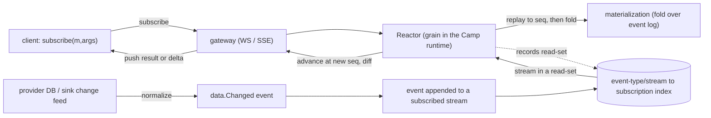
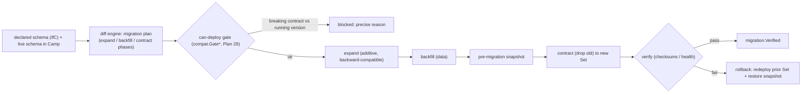
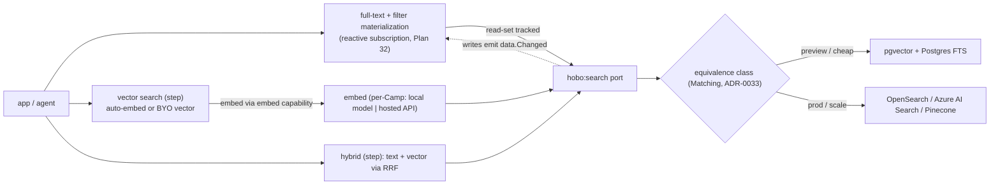
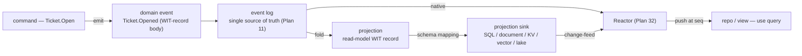

# The Data Plane: Reactivity, Migrations, Search & Projections

This capability doc consolidates Plan 32, Plan 34, Plan 35, Plan 39 of the HoBo design suite.

## Plan 32

**Plan 32 — Reactive streams & subscriptions (RX materializations)**

> **Why streams, not queries.** Convex/Lakebed *store-then-query*: you write a query function over a built-in DB and the platform re-runs it on change. HoBo is **event-sourced** (the log already *is* a change stream; actors and projections already fold it — [Plan 11](./event-model.md#plan-11)) and **multi-cloud**. So the natural primitive is **subscribe to an event-type stream and fold it into a materialization you observe** — RX (reactive-extensions) semantics over the log. The store becomes an *optional cache* of a materialization ([Plan 39](./data-plane.md#plan-39)), not the thing you query.

### The model in one paragraph
A **materialization** is a deterministic **fold over subscribed event types** (a projection — [Plan 39](./data-plane.md#plan-39)), exposed as a **subscribable observable**. **Registering interest in event types *is* the subscription** (the read-set). When you `subscribe`, the runtime replays the stream to the current **log position (`seq`)** to give you the current value, then a **Reactor** keeps the subscription live: when any stream in the read-set appends, it recomputes/advances the materialization at the new monotonic `seq`, diffs, and **pushes** the result (or a delta) to the client over the **gateway** (WebSocket/SSE) backed by the **`Streamer`** runtime port. Monotonic `seq` ⇒ a client never sees state regress; **reads-your-writes** holds because a command returns its `seq` and the client's subscriptions advance to ≥ that `seq` before the write acks.

### The default surface: `subscribe` + RX materializations
A materialization is declared as a **fold over subscribed event types** and composed with RX-style operators. The fold/operators are **deterministic and read-only** (no `step`, no writes — the same determinism rules as `workflow`/`actor` folds, [Plan 2](./sdk-api.md#plan-02)).
```ts
import { subscribe, from } from "@hobo/runtime";

// a materialization: subscribe to event types -> RX pipeline (filter/scan/map) -> observable<Ticket[]>
export const openTickets = from("Ticket.Opened", "Ticket.Assigned", "Ticket.Closed")
  .scan(foldTicketList)                 // deterministic fold (state, event) -> state
  .map(list => list.filter(t => t.status === "open"));
// equivalently authored as a named projection (Plan 39 `projection(...)`) — same artifact, observable surface.

// client (typed, generated from the WIT interface — Plan 24): the DEFAULT
const tickets$ = subscribe(openTickets, { team: "infra" });     // an Observable<Ticket[]>
const { data, seq } = useSubscription(openTickets, { team: "infra" }); // React: re-renders on push
```
- **Registration = subscription.** Declaring the materialization over event types creates its read-set; subscribing attaches a client. No separate "register then query" step.
- **Replay-then-live** (RX `ReplaySubject`/`scan`): a new subscriber gets the current materialized value (folded to `seq`) immediately, then the live tail — "current value + updates" for free from event sourcing.
- **RX operator vocabulary:** `map` · `filter` · `scan`/`fold` · `distinctUntilChanged` · `combineLatest`/`join` · `window`/`buffer` · `debounce`/`coalesce` — composed over event-type streams; deterministic + replayable.

### Query is the escape hatch (snapshot / point / search / analytics)
When a stream subscription is the wrong shape — a one-shot read, a point lookup, full-text/vector **search**, pagination, or analytics — you reach for the **query escape hatches**, served from a materialization's **sink cache** ([Plan 39](./data-plane.md#plan-39)):
```ts
const now   = await snapshot(openTickets, { team: "infra" }); // one-shot current value @ seq (was runQuery)
const t     = await repo<Ticket>("tickets").get(id);          // point lookup (sink cache)
const found = await view("tickets").search({ text: "disk full" }); // full-text/vector (Plan 35)
```
- `useQuery()` is **retained as sugar** for `useSubscription()` over a materialization (Convex familiarity), not the primary surface.
- Point/search/OLAP read from the **sink cache** (a durable, indexed materialization), so they carry that sink's reactivity/consistency caveats ([Plan 39](./data-plane.md#plan-39) honest-limits). `hobo doctor` nudges toward `subscribe` for live views.

### The Reactor (the engine, unchanged)

- A **`Reactor`** grain (one per Camp, sharded by subscription) holds, per active subscription: `{ materialization, args, readSet, lastSeq, client }`.
- An **inverted index** `stream/event-type → subscriptions` means an append wakes **only** affected subscriptions (no full re-scan).
- **Consistency = per-subscription consistent snapshot @ `seq`** ([ADR-0029](./adr/03-data-plane.md#adr-0029)): each push is computed at a single monotonic log position; pushes are delivered in `seq` order; the client never regresses; reads-your-writes as above.
- **Coalescing + backpressure** ([Plan 5](./reliability-observability-cost.md#plan-05)): bursts collapse to the latest `seq`; slow clients get coalesced snapshots, not an unbounded backlog (RX backpressure).
- **Auth-state is part of the read-set.** A subscription runs as a principal (`ctx.user`, [Plan 36](./ai-native-agent-auth.md#plan-36)); its authorization inputs (session + claims) are tracked like any dependency, so **`session.Revoked`** recomputes affected subscriptions — denying/re-scoping the push — without a client poll.
- **Feature-flag state is part of the read-set too.** A materialization that reads a flag tracks the ruleset; **`flag.Changed`** re-pushes affected results live ([Plan 37](./contracts-policy-flags.md#plan-37)) — a kill-switch/`%` bump takes effect without redeploy or poll.

### Source of truth: native log (default) + sink change-feed (opt-in)
- **Native (default).** Materializations fold the **event log** directly. The log *is* the change stream — zero extra infrastructure, works on **any** Camp runtime backend (`runtime-local` … `runtime-cloudflare`), inherits replay/audit. The portable, recommended path; **always reactive**.
- **Sink change-feed (opt-in capability).** A materialization may be **cached** in a provider store ([Plan 39](./data-plane.md#plan-39)); if that store advertises a **`change-feed`** capability ([Plan 21](./authoring-resources-wiring.md#plan-21)/[Plan 24](./wasm-runtime-wit.md#plan-24)) — Postgres logical replication, DynamoDB Streams, Mongo change streams — the adapter **normalizes** changes into `data.Changed{ resource, key, op }` so the **same Reactor** keeps the cached materialization live. v1 ships the capability interface + **one reference adapter (Postgres)**.
- **No change feed?** A query over that sink cache is typed **non-reactive** (`reactive: false`) — `snapshot`/`repo.get` still work but won't live-update; `hobo doctor` warns when a *live view* depends on a non-reactive cache ([Plan 15](./developer-experience.md#plan-15)). The native materialization is always available as the reactive default.

### Client SDK
- **Default:** `subscribe(m, args) → Observable` (framework-agnostic; async-iterator + callback forms); React `useSubscription(m, args) → { data, seq, stale }`.
- **Escape hatches:** `snapshot(m, args)` (one-shot @ `seq`); `useQuery` (sugar over `useSubscription`); `repo.get`/`view().search` ([Plan 35](./data-plane.md#plan-35)).
- **Optimistic updates:** a command may declare a local optimistic patch, applied client-side until the authoritative push at ≥ its `seq`.
- **Typed end-to-end** from the WIT-generated client ([Plan 24](./wasm-runtime-wit.md#plan-24)). Subscriptions authenticate with the workload/agent **SVID**, are **tenant + Camp scoped** ([Plan 6](./ai-native-agent-auth.md#plan-06)/[Plan 12](./security-networking.md#plan-12)); `.allow()` read scopes gate what a materialization may touch ([Plan 21](./authoring-resources-wiring.md#plan-21)).

### Transport
Long-lived subscriptions multiplex over **one** gateway connection per client (WebSocket primary, SSE fallback), backed by the `Streamer` port — the same mechanism run-streams already use ([Plan 2 §Layer 1](./sdk-api.md#plan-02)/[Plan 14](./reliability-observability-cost.md#plan-14)). The Yard is **not** on this path; the Reactor runs in the data-plane Camp runtime.

### Events ([Plan 11](./event-model.md#plan-11))
`subscription.Opened` · `subscription.Recomputed` (new `seq` + read-set hash) · `subscription.Pushed` · `subscription.Closed` · **`data.Changed`** (normalized sink change-feed event). *(Legacy aliases `query.Subscribed`/`Recomputed`/`Pushed`/`Unsubscribed` map onto these.)* Pushed *results* are ephemeral (not persisted); *subscriptions* are a projection so they rebuild on Reactor failover.

### Verification ([Plan 9](./verification.md#plan-09))
- **Subscription test:** `subscribe` → append an event in the read-set → assert a push at the new `seq` with the correct materialized value; assert monotonicity (no regression) and reads-your-writes (a client's command is visible to its own subscription before/at ack).
- **Replay-then-live:** a new subscriber receives the current value (folded to `seq`) before any live push.
- **Change-feed conformance:** the `change-feed` capability suite (a sink that claims it must emit ordered `data.Changed` for insert/update/delete) — same trust-boundary model as other ports.
- **Determinism:** a materialization replays to the identical value at the same `seq` (deterministic + read-only).

### Scope / YAGNI
**In v1:** native event-sourced subscribable materializations **within a Camp**; `subscribe`/`from`+RX operators; `useSubscription` (default) + `snapshot`/`useQuery` (escape hatch); **cursor-based pagination** (`usePaginatedQuery` — page windows stable over the consistent-snapshot@`seq`, [Plan 39](./data-plane.md#plan-39)); consistent-snapshot@`seq` + reads-your-writes; optimistic updates; the `change-feed` capability interface **+ one reference adapter (Postgres)**.
**Deferred:** cross-Camp subscriptions — specified by [ADR-0040](./adr/05-config-matching-environments.md#adr-0040) (subscribe to the owner Camp's Reactor or a replicated-stream Reactor carrying the bounded-staleness label); full DB-CDC coverage for every provider; global serializable snapshots. *(Full-text/filtered **search** is a reactive materialization via `data.Changed`; vector search is a step — [Plan 35](./data-plane.md#plan-35).)*

### Iteration hooks
- Read-set granularity (per-event-type vs per-stream vs per-key vs predicate-indexed) and recompute-vs-incremental-maintenance for expensive folds (incremental view maintenance later).
- Delta encoding for pushes (full snapshot vs diff vs operation log) and client cache/merge strategy.
- Subscription fan-out limits + Reactor sharding for very hot streams.
- Promoting a hot materialization to a standing cached projection automatically (sink auto-binding).

## Plan 34

**Plan 34 — App-data migrations & cross-cloud portability**

> **Two different "schema evolutions" — don't conflate them.** HoBo's **own** event log evolves by **forward-only upcasters that never rewrite history** ([Plan 11](./event-model.md#plan-11)) — that is *control-plane* data. **This plan is about the developer's *application* database** (the `sql` resource, [Plan 21](./authoring-resources-wiring.md#plan-21)/[Plan 24](./wasm-runtime-wit.md#plan-24)) — a provider-backed store (RDS / Azure DB / Cloud SQL / Neon) whose schema and data the app owns. Different layer, different mechanism.

### Scope (v1)
Relational **`sql`** resources, **Postgres** as the reference adapter. Deferred (iteration hooks): key-value/blob/document migrations, cross-*engine* moves (e.g. Postgres→MySQL), CDC/dual-write cutover, and multi-region active-active data.

### 1. Authoring — declarative schema + auto-diff
A developer **declares the desired schema** alongside the `sql` resource (IfC — the same run-to-collect model as the rest of the Bindle, [Plan 21](./authoring-resources-wiring.md#plan-21)/[Plan 22](./authoring-resources-wiring.md#plan-22)). HoBo's **diff engine** compares it to the schema **currently live in the target Camp** and computes a **reviewable migration plan** — a sequence of typed phases, not hand-written step files.
- **Escape hatch:** raw per-dialect SQL steps for operations the diff engine can't express (data transforms, non-trivial constraints, vendor features). Raw steps are still gated + snapshotted like any other.
- **Why declarative, not `.up/.down.sql`:** the declared target is portable across SQL dialects by construction, HoBo can *reason* about intent (is this phase additive or destructive?), and the plan reviews like a [Delta](./platform-engineering.md#plan-26). ([ADR-0032](./adr/03-data-plane.md#adr-0032) records the rejected alternatives.)

### 2. Apply — expand → backfill → contract, gated
The diff engine decomposes every change into **backward-compatible phases**, each applied as a **gated saga step** at **Delta → Set / promote** ([Plan 26](./platform-engineering.md#plan-26)):



- **Expand** — additive only (add column/table/index, nullable or defaulted). The *old* app version keeps working against the new schema.
- **Backfill** — populate/transform data into the expanded shape, chunked + idempotent (an interrupted backfill resumes — exactly-once *effects*, [Plan 5](./reliability-observability-cost.md#plan-05)/[Plan 11](./event-model.md#plan-11)).
- **Contract** — the **only destructive** phase (drop the old column/table). A **pre-migration snapshot** is taken first.
- **Gating composes with the contract plane.** `can-deploy` ([Plan 26](./platform-engineering.md#plan-26)/[Plan 29](./contracts-policy-flags.md#plan-29)) checks a contract phase against the app/consumer versions **still running per Camp**: a drop that would break a running version emits `compat.GateFailed` and is **blocked** with a precise reason an agent can self-correct against — exactly like `deployment.PlanRejected`.

### 3. Rollback — no `.down` scripts
Because expand phases are additive, the **prior app version still runs against the migrated schema**, so:
- **App rollback** = re-apply the previous immutable **Set** ([Plan 26](./platform-engineering.md#plan-26) already preserves stateful-resource state on rollback).
- **Data rollback** = **restore the pre-migration snapshot** taken before the contract phase.

There are no inverse (`.down`) migrations — they give false safety (a dropped column's data is already gone) and would force hand-written inverses against the declarative model. Forward-fix or snapshot-restore are the two honest paths.

### 4. Cross-cloud move — export → import within an equivalence class
Moving a `sql` resource to a **different Camp/provider within the same provider equivalence class** (the *managed-Postgres* class — RDS / Azure DB for Postgres / Cloud SQL / Neon, [Plan 21](./authoring-resources-wiring.md#plan-21)/[Plan 25](./platform-engineering.md#plan-25)) is a **gated, event-sourced saga**:
1. **Export** — snapshot / logical dump on the source (`migration.Exported`).
2. **Import** — restore into the freshly provisioned target (`migration.Imported`).
3. **Cutover** — flip traffic via the existing **blue/green + `gateway` flip** machinery ([Plan 5](./reliability-observability-cost.md#plan-05)); the source stays hot for fast rollback (`migration.CutOver`).
4. **Verify** — row counts / checksums / health gate; on pass, **reap** the source after a soak window.

**Cross-*engine* moves (Postgres→MySQL) are out of scope for v1** — they are lossy/semantic, not mechanical. **CDC / dual-write replication cutover** (near-zero-downtime for large/live DBs) is noted as a **future opt-in adapter capability**, not the v1 default.

### Events ([Plan 11](./event-model.md#plan-11))
`migration.Planned` · `migration.SnapshotTaken` · `migration.PhaseApplied` (phase = `expand`/`backfill`/`contract`, with the diff) · `migration.Verified` · `migration.RolledBack` · `migration.Failed` · (cross-cloud move) `migration.Exported` · `migration.Imported` · `migration.CutOver`. Every phase, snapshot, and cutover is an immutable, replayable fact → "what changed the schema, when, and could it be rolled back?" is answerable from the log.

### Verification ([Plan 9](./verification.md#plan-09))
- **Migration test:** declare schema vN→vN+1 → assert the diff engine produces the expected **expand/backfill/contract** phases; assert a **destructive contract phase that breaks a still-running version is blocked** by `can-deploy` (`compat.GateFailed`); assert **snapshot + restore** rollback returns the prior state.
- **Cross-cloud move test:** export→import a fixture DB **within the Postgres equivalence class** to a second Camp → assert row counts/checksums match and cutover/rollback both work.

### Projection sinks: rebuild-from-zero vs in-place migration
A **projection sink** ([Plan 39](./data-plane.md#plan-39)/[ADR-0050](./adr/03-data-plane.md#adr-0050)) is a *derived* backend whose schema is **declarative** (the read-model WIT record + mapping), so it has a second evolution path that an authoritative store does not:
- **Rebuild-from-zero (the default for derived sinks; paradigm-agnostic).** Change the read-model record/fold → **replay the event streams into the new shape** (Plan 11's "rebuildable from zero" *is* a backfill). This needs **no relational diff engine**, so it works for **document / KV / vector** sinks too — which is why a v1 document projection sink is fine even though *in-place* kv/blob/document migration is deferred below. Cut over old→new sink with the blue/green machinery (§4).
- **In-place expand→backfill→contract (this doc's gated machinery).** The *optimization* for **large relational** sinks where a full rebuild is too expensive, and the *required* path for **authoritative-external** (adopted, [ADR-0041](./adr/07-portability-extensibility.md#adr-0041)) stores — which are the source of truth and **cannot** be rebuilt from the log. Same pre-contract snapshot + `can-deploy` gate.

Cross-cloud sink moves use the export→import path (§4) within an equivalence class.

### Scope / YAGNI
**In v1:** declarative-diff authoring + raw escape hatch; expand/backfill/contract apply gated by `can-deploy`; pre-contract snapshot + restore rollback; intra-equivalence-class (managed-Postgres) cross-cloud move. **Deferred:** cross-engine moves, CDC/dual-write cutover, **in-place** kv/blob/document & cross-model migration (derived projection sinks of those paradigms still evolve by **rebuild-from-zero**, see §Projection sinks), multi-region active-active data ([Q16](./verification.md#plan-09)).

### Iteration hooks
- Diff-engine reference (build vs adopt Atlas/Prisma-style) and how much DDL it covers before falling to the raw escape hatch.
- Backfill throughput/throttling defaults + how online backfill interacts with live traffic and SLOs ([Plan 14](./reliability-observability-cost.md#plan-14)).
- Snapshot mechanism per provider (native DB snapshot vs logical dump) and retention/cost ([Plan 16](./reliability-observability-cost.md#plan-16)).
- Whether cross-Camp data consistency during a move is a HoBo guarantee or app-owned ([Q16](./verification.md#plan-09)).

## Plan 35

**Plan 35 — Search & vector surface**

### The `search` port — one interface, three modes
A **`search(name)`** resource backed by a `hobo:search` WIT interface ([Plan 24](./wasm-runtime-wit.md#plan-24)) unifies **full-text**, **vector**, and **hybrid** retrieval in a single interface — *not* three bolt-ons. It is a first-class port realized by a provider **equivalence class** ([Plan 3](./control-plane.md#plan-03)/[Plan 25](./platform-engineering.md#plan-25)): **pgvector + Postgres FTS** (cheap, colocated with the DB) at one end, **managed engines** (OpenSearch / Azure AI Search / Pinecone / Turbopuffer) at the other. **Matching** ([ADR-0033](./adr/05-config-matching-environments.md#adr-0033)) picks the realization per context — pgvector in a preview Camp, a managed index in prod — exactly the Resource-Definitions value, applied to retrieval.

`.allow()` verbs: **`index`** (write/maintain indexed docs), **`query`** (search), **`admin`** (manage indexes) — same triple-effect IAM + wasm link + token scope as every resource ([Plan 21](./authoring-resources-wiring.md#plan-21)).

> **`search` is the vector/text projection-sink paradigm.** In the data plane taxonomy ([Plan 39](./data-plane.md#plan-39)/[ADR-0052](./adr/03-data-plane.md#adr-0052)), `search` is one **projection sink** among several — a read model materialized into a text/vector index, sharing this doc's predicate DSL. Its determinism split is the taxonomy's reactivity rule in miniature: full-text/filtered search is a reactive **materialization** citizen ([ADR-0065](./adr/03-data-plane.md#adr-0065)), **vector search is a step** (non-deterministic embedding, off the reactive path — the query escape hatch).



### Index declaration — declarative (consistent with [Plan 34](./data-plane.md#plan-34))
Indexes are **declared on the resource**, IfC-style, not imperatively built:
- **Text index** — fields + analyzer/tokenizer + optional **prefix** matching (typeahead).
- **Vector index** — field + **`dimensions`** + the **filter fields** allowed in queries.

An index *is* schema, so creating/changing one flows through the **same gated expand→backfill→contract migration machinery** as a `sql` schema change ([Plan 34](./data-plane.md#plan-34)/[ADR-0032](./adr/03-data-plane.md#adr-0032)) — building a large index is a backfill phase; dropping one is a (snapshotted) contract phase; `can-deploy` gates it.

### Query surface & reactivity — split by determinism
The boundary follows HoBo's determinism rules ([ADR-0029](./adr/03-data-plane.md#adr-0029)/[ADR-0033](./adr/05-config-matching-environments.md#adr-0033)):
- **Full-text + filtered search is reactive.** It is deterministic, so it is a **reactive materialization** citizen ([Plan 32](./data-plane.md#plan-32)/[ADR-0065](./adr/03-data-plane.md#adr-0065)): the runtime tracks its read-set and **re-pushes results to clients on `data.Changed`** (a write to the indexed data). Client surface: `useSubscription()` (or `useQuery()` sugar). This is the live-search DX Plan 32 teed up.
- **Vector search is a `step`/action.** A text query is auto-embedded (below) or a precomputed vector is passed in; it returns ranked **`{ id, score }`** by cosine / inner-product with a typed **filter** predicate. Because embedding is external/non-deterministic, vector search is **off the reactive path** (mirrors Convex's "vector search in actions only").
- **Hybrid is a `step`** that fuses a reactive text query + a vector step via **reciprocal rank fusion (RRF)**.
- **Filter syntax** is the same typed predicate DSL used elsewhere (`eq`/`in`/`range`/…), so search filters compose with `.allow()`/tenant scoping rather than being a separate query language.

### Embeddings — the `embed` capability
The `search` port can **auto-embed** indexed rows and text queries via an **`embed` capability** (`hobo:embed`), brokered secretlessly ([Plan 6](./ai-native-agent-auth.md#plan-06)/[Plan 31](./authoring-resources-wiring.md#plan-31)) so developers don't hand-wire an embedding API. The embedder is itself a capability **realized per Camp** and selected by Matching:
- **Local / in-boundary model** — for `hobo dev` and **air-gapped** Camps (no egress; relates to [Q20](./verification.md#plan-09) / the air-gap gap).
- **Hosted embedding API** — for prod scale/quality.

**BYO precomputed vectors** is the escape hatch (compute embeddings in your own step, pass the vector in).

> **Egress caveat.** A *hosted* embedder sends query/row text to a third-party model provider (data egress + recurring cost) — the same class of concern as the optional `gbrain` agent tool ([`docs/agent-tooling.md`](../../docs/agent-tooling.md)). HoBo surfaces this as a cost/policy signal ([Plan 16](./reliability-observability-cost.md#plan-16)/[Plan 30](./contracts-policy-flags.md#plan-30)); the **local-model adapter** is the in-boundary answer. Never gate portability behind a paid embedder — the pgvector + local-model path is a complete default.

### Events ([Plan 11](./event-model.md#plan-11))
**No new event types.** Reactive full-text search reuses `subscription.Opened`/`subscription.Recomputed`/`subscription.Pushed` (legacy aliases `query.*` map onto these, [ADR-0065](./adr/03-data-plane.md#adr-0065)) + **`data.Changed`** ([Plan 32](./data-plane.md#plan-32)); index create/change rides **`migration.*`** ([Plan 34](./data-plane.md#plan-34)); a vector/hybrid search is a step (`run.StepCompleted`). The retrieval surface adds capability, not catalog bloat.

### Verification ([Plan 9](./verification.md#plan-09))
A **search test**: index a fixture corpus, then assert (a) a full-text query returns the expected ranked hits **and is reactive** (a write emits `data.Changed` → the subscribed result re-pushes); (b) vector search returns cosine-ranked ids with a **filter** applied; (c) **hybrid** RRF fuses text + vector; (d) the **same `search` Bindle resolves to pgvector in a preview Camp and a managed engine in prod** (portability/equivalence — [ADR-0024](./adr/07-portability-extensibility.md#adr-0024)); (e) the `embed` capability is realized by a **local model in an air-gapped Camp** (no egress).

### Scope / YAGNI
**In v1:** the unified `search` port (text + vector + hybrid/RRF), declarative text+vector indexes, reactive full-text + vector-as-step, the `embed` capability (local + hosted adapters) with BYO vectors as the escape hatch, and pgvector + one managed engine as reference adapters. **Deferred:** faceting/aggregations, learned/semantic re-ranking, multi-vector & late-interaction (ColBERT-style), and cross-Camp federated search ([Q16](./verification.md#plan-09)).

### Iteration hooks
- Reference adapters beyond pgvector + one managed engine; how much FTS analyzer config is portable vs provider-specific.
- Default embedding model(s) for the local adapter + dimension/version pinning (an embedding model change is itself an index migration).
- RRF weighting defaults + whether to expose a re-ranker hook.
- Whether vector search can ever be made reactive cheaply (cache embedding at subscribe time) without breaking determinism.

## Plan 39

**Plan 39 — The data plane: projections & persistence-agnostic data access**

> **The bet, finished.** Plan 11 already makes the event log the single source of truth and folds it into **rebuildable projections** — but only for HoBo's *own* control-plane state (`DeploymentView`/`RunView`). This plan extends the same machinery to **application domain data**: a developer declares a logical record + queries; a data architect maps it onto SQL / NoSQL / KV / graph / vector / object-lake / OLAP — and neither has to know about the other. *Developers don't know or care how data is persisted or queried; architects have full autonomy over how it is.*

### Why this exists (the gaps it closes)
HoBo had the ingredients but not the dish:
- **No persistence-agnostic data-access layer.** App access was raw `ctx.bindings.db.query("select 1")` (dialect-leaky); the `ctx.view(...)` in [Plan 32](./data-plane.md#plan-32) was pseudocode with no spec.
- **No canonical domain-schema/DTO layer.** Zod (I/O), WIT (ports), and the declarative SQL schema ([Plan 34](./data-plane.md#plan-34)) were disjoint.
- **App domain data was not event-sourced by default** and there was no first-class *"project this event stream into this backend via this mapping"* artifact.
- **Paradigm coverage was narrow** — relational was deep; document/graph/OLAP/data-lake were absent.

### The Projection — a subscribable materialization (optionally cached in a sink)
A **projection** (the word [Plan 11](./event-model.md#plan-11) already uses) is, at the application layer, a **developer-authored materialization**: a deterministic fold over **subscribed event types**, exposed as a **subscribable observable** ([Plan 32](./data-plane.md#plan-32)/[ADR-0065](./adr/03-data-plane.md#adr-0065)) and **optionally cached** in an architect-chosen sink for point/search/analytics reads. Five parts:

1. **Subscription** — the event stream(s) it folds, keyed by **WIT-record event types** (`Ticket.Opened`, `Ticket.Assigned`). This is its read-set on the write log.
2. **Fold (reducer)** — a deterministic, read-only `(state, event) → state` (the same determinism rules as `query()`/`workflow`: no `step`, no writes, seeded clock — [Plan 2](./sdk-api.md#plan-02)/[ADR-0029](./adr/03-data-plane.md#adr-0029)).
3. **Read-model record** — the canonical logical shape, a **WIT record** (the DTO; §WIT-record domain schema).
4. **Schema mapping** — WIT-record fields → backend representation (columns / document fields / key+value / nodes+edges / vector field+filters / lake partitions). **Architect-owned.**
5. **Sink binding (optional cache)** — the concrete backend *cache*, chosen by **Resource Definitions + Matching** ([Plan 25](./platform-engineering.md#plan-25)/[ADR-0033](./adr/05-config-matching-environments.md#adr-0033)), never by app code; omit it and the materialization is served natively from the log (the default, always reactive).

What you can understand and depend on in isolation: a projection has a **stable logical contract** (a named read-model WIT record + the event types it folds); it is **rebuildable from zero** (drop the sink, replay the streams — the test that the *log*, not the sink, is authoritative); and it declares a **reactivity class** and a **consistency label** (bounded-staleness, [ADR-0040](./adr/05-config-matching-environments.md#adr-0040)) as part of that contract, so callers know their guarantees.

**Two modes, named explicitly:**
- **Projected** *(default, event-sourced)* — the sink is derived from the log; writes never touch it directly.
- **Authoritative-external** *(adopted, [ADR-0041](./adr/07-portability-extensibility.md#adr-0041))* — an existing DB declared the source of truth via `hobo import` (`external` kind + `echo` driver). Its `change-feed` (if any) runs it *backwards* into `data.Changed` so reactive reads still work; `hobo doctor` flags long-lived authoritative-external stores as migration debt.

**Resolves a Plan 11 open question.** "Whether read models live in the same store or a separate query DB" is no longer a global fork: a projection's sink is **architect-selected per context** via Matching (default = a native standing projection over the log; opt a projection into Postgres/Mongo/… when a purpose-built query backend is wanted), recorded in `match.Decided`.



### Developer surface — the persistence-agnostic data access (the "pseudo-ORM")
Both an **entity repository** (ergonomic 80%) and a **query DSL** (the composable, reactive surface), over **one logical model**.

#### Write path — command → aggregate → event (no direct sink writes)
The developer never writes to a sink. A **command** runs inside its **aggregate**'s single-writer boundary, checks invariants against the aggregate's current state, and emits domain events; projections fold those events into read models.
```ts
import { command } from "@hobo/runtime";

// a command targets an aggregate by key (stream `ticket:<id>`); the handler runs inside that
// aggregate's single-writer boundary, with ctx.state = the aggregate's WRITE-MODEL fold.
export const openTicket = command("Ticket.Open", { key: (i: OpenTicket) => i.id }, async (input, ctx) => {
  if (ctx.state.status) throw new Conflict("ticket already exists");   // invariant vs current state
  ctx.emit("Ticket.Opened", { id: input.id, team: input.team, title: input.title });
  // appended under the aggregate's lease + optimistic expectedSeq; returns its seq
});
```
- **The command's consistency boundary is an aggregate, realized as an [actor](./sdk-api.md#plan-02)** — single-writer lease + fencing + optimistic `seq` ([Plan 11](./event-model.md#plan-11)). The handler runs inside that boundary; `ctx.state` is the aggregate's **write-model fold** (authoritative, for invariant checks), then `ctx.emit` appends. (`command` is the typed, domain-write sibling of an actor `signal`; an aggregate is just an actor whose handlers emit domain events.)
- **Two folds, one log (CQRS).** The **aggregate fold** is the *write* model (authoritative, in the single-writer, for invariants); a **projection fold** (read path below) is the *read* model (derived, in architect-chosen sinks). "Actor state = folded stream" and "projection = folded stream" are the two sides of the same log.
- **Per-aggregate serializability, not global.** Optimistic `seq` on the aggregate's stream gives serializable writes *within* an aggregate with no global lock — the CAP-honest analog of Convex's serializable mutations ([competitors/convex](../../competitors/convex.md#functions)). Cross-aggregate consistency is a **saga** ([Plan 2](./sdk-api.md#plan-02)) or eventual ([ADR-0040](./adr/05-config-matching-environments.md#adr-0040)) — never a silent distributed transaction. Decision record: [ADR-0053](./adr/03-data-plane.md#adr-0053).
- A command is a **`step`-class** unit (idempotent via the existing idempotency-key machinery, [Plan 2](./sdk-api.md#plan-02)); **reads-your-writes** — it returns its `seq` and the client advances subscriptions to ≥ that `seq` before ack ([Plan 32](./data-plane.md#plan-32)). **Naked `emit`** (no aggregate) remains for domain facts that need no invariant boundary.

#### Declaring a projection — subscribe + fold + read-model
A projection is declared with per-event-type fold handlers (the same `on:` shape as an [actor](./sdk-api.md#plan-02) or [saga](./sdk-api.md#plan-02)), typed by its read-model **WIT record**:
```ts
import { projection } from "@hobo/runtime";

// "orders": fold Order.* events → the Order read-model record; `key` picks the row each event lands in.
export const orders = projection<Order>("orders", {
  key: (e) => e.id,                                              // read-model row id
  on: {
    OrderPlaced:    (s, e) => ({ ...s, id: e.id, status: "placed", total: e.total }),
    OrderConfirmed: (s, e) => ({ ...s, status: "confirmed" }),   // deterministic, read-only (query-class)
    OrderShipped:   (s, e) => ({ ...s, status: "shipped" }),
  },
});
```
- The fold is **deterministic + read-only** (no `step`, no writes — the same rules as `query()`/`workflow`), so the projection is **rebuildable from zero** by replay.
- The developer declares *only* the logical fold + read-model; the **sink** (relational/document/…) is bound by the data architect's `projection-sink` Resource Definition ([Plan 25](./platform-engineering.md#plan-25)), never here. The read-model record's fields are what the schema mapping targets.
- `index` hints (which fields are queryable/sortable — needed for `where`/`order`/`paginate`) are declared on the read-model and ride the same migration machinery as any index ([Plan 34](./data-plane.md#plan-34)/[Plan 35](./data-plane.md#plan-35)).

#### Read path — subscribe (default) + the query/point escape hatches
The **default** read is a **subscription** to the materialization ([Plan 32](./data-plane.md#plan-32)/[ADR-0065](./adr/03-data-plane.md#adr-0065)): `subscribe(...)`/`useSubscription(...)` returns a live observable folded from the event log. The **repository + query DSL below are the snapshot / point-lookup / search escape hatches** over the sink cache — reach for them for one-shot, by-key, full-text/vector, or analytical reads.
```ts
import { view, repo } from "@hobo/runtime";

const tickets = repo<Ticket>("tickets");              // entity form, typed by the read-model record
const t    = await tickets.get(id);                   // by key
const open = await tickets.find({ team, status: "open" });

export async function openTickets(team: string): Promise<Ticket[]> {
  "use query";                                         // reactive, read-only (Plan 32)
  return view("tickets").where({ team, status: "open" }).order("createdAt").limit(50);
}
```
- Both forms target a **projection by logical name** (`"tickets"`), never a table; the resolved sink + driver come from Matching, so the same query runs over Postgres or Mongo unchanged.
- The predicate DSL is the **one already specified in [Plan 35](./data-plane.md#plan-35)** (`eq`/`in`/`range`/…) — domain queries, search filters, and `.allow()`/tenant scoping compose in one predicate language, no second grammar.
- `view(...)` inside `"use query"` is reactive (read-set tracked, re-pushed on change); `repo.get/find` outside a query is the one-shot `runQuery` analog. Same primitive, two ergonomics.
- Typed end-to-end from the WIT-generated client + the projection's read-model record ([ADR-0037](./adr/05-config-matching-environments.md#adr-0037)). Tenant + `.allow()` read scopes are enforced at the projection boundary ([Plan 21](./authoring-resources-wiring.md#plan-21)/[Plan 12](./security-networking.md#plan-12)) exactly as Plan 32 already scopes reactive queries.
- **Pagination is cursor-based over the consistent snapshot @ `seq`, never `OFFSET`.** `view("tickets").order("createdAt").paginate({ cursor, limit: 50 })` returns `{ items, nextCursor, seq }`, where `nextCursor` encodes the **sort-key position** (not a row offset) — so pages stay stable as the set changes (items enter/leave within their key range instead of shifting every page). A **paginated reactive query** subscribes to its current page-window key-range: a `data.Changed` *within that range* re-pushes the page at a new `seq` (Plan 32's reactor, in `seq` order, never regressing); "load more" extends the window via the dynamic read-set Plan 32 already re-tracks per recompute. Client: **`usePaginatedQuery()`** (familiar to a Convex audience, [competitors/convex](../../competitors/convex.md#database)). *Honest limit:* cursor pagination needs the **sort key indexable in the sink** (a sink-capability/Matching concern); deep arbitrary-sort pagination over a non-indexed projection is expensive, and **vector** results are top-`k` ([Plan 35](./data-plane.md#plan-35)), paginated by `k`, not cursors.

#### The raw escape hatch (kept honest)
```ts
// explicitly non-portable; only compiles when the resolved driver advertises raw access
const rows = await view("tickets").raw(pg => pg.query("select … for update"));
```
- **Provider-namespaced + typed to the resolved driver** (`pg`, `mongo`, …) — a dialect leak fails to compile against a *different* resolved backend instead of breaking silently at runtime (the fix for the old `ctx.bindings.db.query("select 1")` leak).
- **Flagged** as a non-portable edge in the manifest IR; surfaced by `hobo doctor`/`can-deploy` ([Plan 29](./contracts-policy-flags.md#plan-29)) and counted as a `PlanWarning` against the portability guarantee ([ADR-0024](./adr/07-portability-extensibility.md#adr-0024)) — the Bindle is no longer "same Bindle, N clouds" for that edge, and HoBo says so.
- **Read-only on projected sinks** (a derived sink must not diverge from the log); raw **writes** are permitted only on **authoritative-external** (adopted) stores.

### The WIT-record domain-schema layer
**WIT records are the canonical domain schema** ([ADR-0051](./adr/03-data-plane.md#adr-0051)). One record family is the single upstream for event payloads, projection/read-model shapes, and backend mappings.
```wit
// domain.wit — authored by the developer (the canonical contract, Plan 24)
package app:shop@0.1.0;
interface domain {
  record ticket {                       // the read-model / DTO record
    id: string,
    team: string,
    title: string,
    status: ticket-status,
    created-at: timestamp,
  }
  enum ticket-status { open, assigned, closed }
  record ticket-opened   { id: string, team: string, title: string }   // event-body records
  record ticket-assigned { id: string, assignee: string }
  record ticket-closed   { id: string }
}
```
- **Events reference domain records.** `Ticket.Opened` carries a `ticket-opened` record as its `data` payload in the `EventEnvelope` ([Plan 11](./event-model.md#plan-11)); the envelope is unchanged, only the typed body is WIT-record-derived.
- **Generation ([ADR-0037](./adr/05-config-matching-environments.md#adr-0037), four-source codegen + two new emitters):** **TS types** via `jco guest-types` (existing); **protobuf** wire encodings for event bodies (new emitter — protobuf is the *encoding*, never the authoring language); **Zod validators** generated from the record (new emitter). All deterministic, checked into `_generated/`.
- **WIT-first, Zod-generated for domain data.** Hand-written Zod stays valid for ad-hoc step I/O, but **domain DTOs are WIT-first** with Zod as a generated runtime-validation view — so the WIT record is the single upstream for TS type, protobuf encoding, Zod validator, projection shape, and Plan 29's "Declared" contract.
- **Evolution, two mechanisms wired together:** **event bodies** evolve by [Plan 11](./event-model.md#plan-11) upcasters (forward-only `vN→vN+1`, never rewrite history); the **sink schema** evolves by [Plan 34](./data-plane.md#plan-34) expand→backfill→contract. A domain change does both — upcast the body, gate-migrate the sink.

### Paradigm taxonomy for projection sinks
Each paradigm is a **projection-sink kind** behind a WIT port, a Matching dimension (`type: "projection-sink", paradigm: …`). Modeled now; a subset ships v1.

| Paradigm | v1? | Maps WIT record → | Reactive read? | Honest limit |
|---|---|---|---|---|
| **Native** (log / standing projection) | **v1 (default)** | in-runtime read model over the log | **Yes** (the log *is* the change stream) | recompute-not-incremental in v1; bounded by fold cost |
| **Relational** (Postgres ref) | **v1** | fields → columns; record → table; enums → enum/check | **Yes** via `change-feed` (Postgres ref adapter, [Plan 32](./data-plane.md#plan-32)) | dialect features behind the raw escape hatch |
| **Document** (Mongo ref; Cosmos/Firestore) | **v1 (one ref)** | record → document; nested records → embedded | **Yes** if change-feed (change streams) | no cross-document joins in the portable DSL |
| **KV / wide-column** (Dynamo/Cosmos/Cassandra) | roadmap | record → key (PK rule) + value; secondary fields → GSIs | partial (Dynamo Streams) | DSL limited to key/range; rich predicates → escape hatch |
| **Graph** (Neptune/Neo4j) | roadmap | record → node; relations → edges (mapping declares which) | mostly non-reactive | traversal not in the portable predicate DSL v1 |
| **Vector** (via [Plan 35](./data-plane.md#plan-35) `search`) | **v1** | record → indexed doc + vector field + filter fields | text/filter reactive; **vector search is a step** | vector queries off the reactive path by construction |
| **Object / data-lake** (S3/Parquet) | roadmap | record → partitioned files (partition keys from fields) | **non-reactive** (batch) | append/compaction latency; query via an OLAP engine |
| **OLAP / columnar** (ClickHouse/BigQuery/DuckDB) | roadmap | record → columnar table; fields → typed columns | **non-reactive** (analytical) | bounded-staleness batch; not for reads-your-writes UI |

**Honest reactivity rule (one sentence):** a projection is reactive **iff** its sink advertises the `change-feed` capability **or** it is the native log-backed projection; everything else is typed `reactive: false` and `hobo doctor` warns when a `"use query"` depends on it (Plan 32's existing check). Each sink kind ships a `@hobo/conformance` suite ([Plan 24](./wasm-runtime-wit.md#plan-24)/[Plan 9](./verification.md#plan-09)): claim a paradigm → round-trip a fixture record set and (if reactive) emit ordered `data.Changed`.

### Composition (reuse, not reinvent)
- **Matching ([Plan 25](./platform-engineering.md#plan-25)/[ADR-0033](./adr/05-config-matching-environments.md#adr-0033)).** The architect declares a `projection-sink` Resource Definition (`defineResource({ type: "projection-sink", paradigm, provider, driver, with, match })`); the Planner selects per context — native projection in a preview Camp, managed Postgres in prod — recorded in `match.Decided`. **Developer owns the logical record + query; architect owns the mapping + sink** — the autonomy split *is* the Matching boundary.
- **Migrations ([Plan 34](./data-plane.md#plan-34)).** A derived sink has **two** evolution paths: **rebuild-from-zero** (replay into the new shape — the default; **paradigm-agnostic**, so document/KV/vector sinks evolve without a relational diff engine, which is why a v1 document sink is fine though Plan 34 defers *in-place* document migration) and **in-place expand→backfill→contract** (the Plan 34 optimization for large relational sinks; the *required* path only for **authoritative-external** adopted stores that can't be rebuilt from the log). Both are `can-deploy`-gated; cross-cloud sink moves use export→import within an equivalence class.
- **Reactivity ([Plan 32](./data-plane.md#plan-32)/[ADR-0029](./adr/03-data-plane.md#adr-0029)).** Projections **are** the read models the reactor already runs over; this plan just makes them developer-authored and sink-targeted. `data.Changed`, read-set tracking, consistent-snapshot@`seq`, and reads-your-writes are reused verbatim — **no new reactor**.
- **Cross-Camp ([ADR-0040](./adr/05-config-matching-environments.md#adr-0040)).** A projection declares a replication topology (single-writer-Camp default); a non-owner Camp builds a bounded-staleness projection from the owner's replicated read-stream; reads carry the staleness label; consistency-requiring writes "go home."
- **Adopt-in-place ([ADR-0041](./adr/07-portability-extensibility.md#adr-0041)).** The escape hatch from the event-sourced default: `external`/adopted authoritative stores answer the same `repo`/`view` surface, so a half-migrated app coexists (strangler-fig) — some entities projected, some authoritative-external, one data surface.

### Events & ports
- **New `projection.*`:** `projection.Declared` (logical record + event-type read-set + reactivity class), `projection.Lagged` (staleness/lag exceeded a bound → policy input, [Plan 30](./contracts-policy-flags.md#plan-30)/[ADR-0040](./adr/05-config-matching-environments.md#adr-0040)), `projection.SinkRebound` (Matching reselected a sink; links the `match.Decided`). **Reused, not new:** `data.Changed` ([Plan 32](./data-plane.md#plan-32)), `match.Decided` ([Plan 25](./platform-engineering.md#plan-25)), `migration.*` ([Plan 34](./data-plane.md#plan-34)), `resource.Adopted` ([ADR-0041](./adr/07-portability-extensibility.md#adr-0041)).
- **New port `hobo:projection`:** `declare(spec)`, `fold(state, event) → state` (guest reducer), `materialize`, `rebuild`, `read(query)`, `read-raw(driver-call)`. Its query surface is the predicate DSL shared with `hobo:search`.
- **Generalize the `change-feed` capability** (today on the `database` port, [Plan 32](./data-plane.md#plan-32)) to a **sink capability** any projection-sink provider may advertise — the gate for whether a projection is reactive, under the same conformance trust boundary. Sink drivers realize their mapping over existing `wasi:sql`/`wasi:keyvalue`/`wasi:blobstore`/`hobo:search`.

### Honest limits (stated, not hidden)
- **Eventual consistency is the normal case.** CQRS means a projection lags the log by its fold/replication latency; a fresh write isn't instantly visible in every external sink (reads-your-writes holds within the owning Camp, observable via `seq`). This is [ADR-0003](./adr/README.md)'s "read-after-write needs projections" made explicit at the app layer.
- **Portability is equivalence-class-bounded.** "Same Bindle, N backends" holds *within* a paradigm's class; cross-*paradigm* portability (relational ↔ document) is not automatic — the mapping is paradigm-specific. Cross-engine within a class follows [Plan 34](./data-plane.md#plan-34)'s export→import.
- **Leak-free query is impossible; leaks are made visible instead** (the raw escape hatch fails to compile against a different backend and is flagged).
- **Reactivity is not universal** — only native + change-feed-advertising sinks are reactive; vector/object-lake/OLAP are off the reactive path by construction.
- **Single-writer-Camp is a cross-Camp bottleneck** ([ADR-0040](./adr/05-config-matching-environments.md#adr-0040)); active-active-eventual (CRDT) is opt-in and pushes merge semantics onto the developer.

### Verification
- **Projection round-trip:** declare a projection over a fixture event stream → assert the read model materializes; **drop the sink + replay → identical state** (rebuildable-from-zero test).
- **Persistence-agnostic read:** the same `repo`/`view` query resolves to the native sink in a preview Camp and to managed Postgres in prod (Matching), byte-identical app code.
- **Reactivity class honesty:** a `"use query"` over a non-change-feed sink is typed `reactive: false` and `hobo doctor` warns; a change-feed sink re-pushes on `data.Changed`.
- **Escape-hatch honesty:** `.raw(pg => …)` fails to type-check when the resolved driver is `mongo`; the edge is flagged as portability debt in `can-deploy`.
- **Schema evolution:** a domain-record change produces a Plan 11 upcaster (event body) **and** a Plan 34 expand→backfill→contract plan (sink); a contract phase that breaks a running consumer is blocked by `can-deploy`.

### Scope (v1) & YAGNI
- **v1:** the `projection` concept + `hobo:projection` port; `command`/`repo`/`view` surface + raw escape hatch; WIT-record domain schema + TS/protobuf/Zod codegen; sink adapters for **native, relational (Postgres), one document (Mongo), and vector (via Plan 35)**; `projection.*` events; `change-feed` generalized.
- **Deferred (modeled, not built):** KV/wide-column, graph, object/data-lake, OLAP sink adapters; cross-paradigm auto-migration; active-active CRDT sinks; the [Hobo Code](./authoring-resources-wiring.md#plan-38) authoring surface for declaring projections/mappings.

### Iteration hooks
- Whether `projection.Materialized`/`Rebuilt` should be modeled as `migration.PhaseApplied` backfill phases rather than new event types (minimize catalog bloat, per the [Plan 35](./data-plane.md#plan-35) precedent).
- PK/edge derivation rules for KV/graph mappings (how a WIT record's fields name a key or an edge).
- Incremental view maintenance for expensive folds (deferred; today recompute-not-incremental).
- Whether the repository `find()` predicate and the `view()` DSL should share a single compiled query AST end-to-end.
