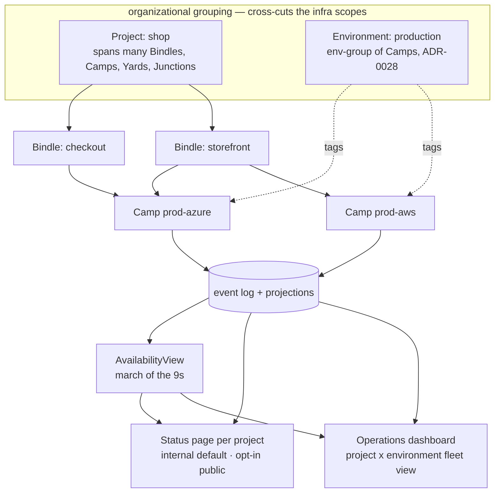
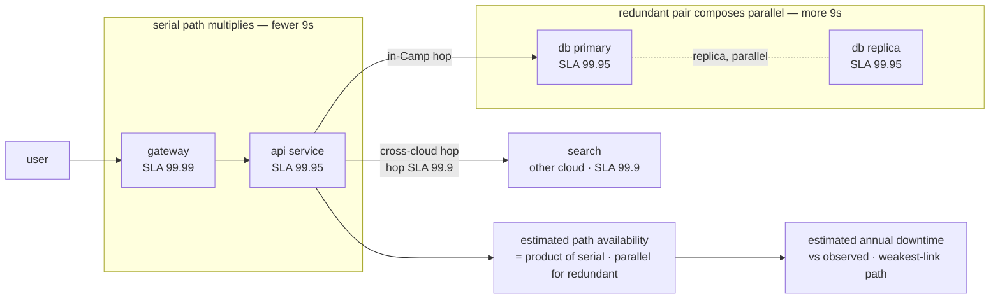

# Developer Experience: Dashboards, CLI & Status Pages

This capability doc covers the developer-facing surface end to end: the UI/dashboard and the CLI/DX, told as one narrative. This is the **developer/authoring** dashboard (deploy timeline, link map, run inspector, AI proposals); the **operations** counterpart — the multi-cloud / multi-environment **fleet** view and the per-project **status pages** + architecture availability — is [Plan 49](#plan-49), built from the same projection-and-event model.

## Plan 07

> **Resource Definitions & Matching (Humanitec parity):** add a **Resource Graph** view, a **matching-decision** view (`match.Decided` — which Resource Definition won and why, [Plan 25](./platform-engineering.md#plan-25)), a **Delta diff / promote** view ([Plan 25](./platform-engineering.md#plan-25)), and a **Pipelines** view with approval gates ([Plan 25](./platform-engineering.md#plan-25)) — matching Humanitec's Portal while staying projection-only.

> **Runtime/authoring views.** Adopt Nitric's **local-dashboard** features for `hobo dev` (test APIs, browse kv/sql/buckets, trigger schedules, publish to topics, inspect websockets) and add HoBo-native views: the **collected-resource/manifest** view ([Plan 21](./authoring-resources-wiring.md#plan-21)), the **link map** (component imports → providers, [Plan 20](./wasm-runtime-wit.md#plan-20)), and **cross-WIT-call traces** + AI implement/evolve/live-fix proposals & approvals ([Plan 23](./generated-stack.md#plan-23)).

### Principles
1. **Everything is a view over events.** No view has privileged state; each is a projection, so the dashboard is consistent with the audit log by construction.
2. **Replay/time-travel is a first-class UX**, not a hidden log. The deploy timeline and run inspector both scrub through history.
3. **Human + agent parity.** Every panel maps to an MCP tool ([Plan 6](./ai-native-agent-auth.md#plan-06)); the UI is "the agent's view, rendered for humans."
4. **Self-host = hosted UI.** Same app, ships with the Yard Bindle.

### Core views
| View | Source projection | What it shows |
|---|---|---|
| **Deployments timeline** | DeploymentView | event-sourced history with a replay/time-travel scrubber; per-resource provisioning states; rollback/compensation visualized on the DAG |
| **Topology graph** | TopologyView | resources → resolved providers + options; `bind` edges annotated with connectivity tier + estimated egress/cost ([Plan 12](./security-networking.md#plan-12), [Plan 5](./reliability-observability-cost.md#plan-05)) |
| **Run inspector** | RunView | workflow/step/actor/saga trace; per-step inputs/outputs/attempts/duration; **replay-diff** against current code ([Plan 5](./reliability-observability-cost.md#plan-05)) |
| **Registry browser** | Registry | providers, their Capability Manifest/signs, capabilities, cost signals, generation certification + provenance |
| **Agent activity & credential audit** | CredentialAudit | agent runs + every token grant/use/revoke, joined to the triggering run; approvals on policy gates |
| **Cost & FinOps** | cost projection | plan-time estimates vs actuals, budgets/caps, showback per tenant/Bindle/Camp |
| **Drift** | DriftView | resources diverged from desired; heal/propose actions |

### Key interactions
- **Plan preview before deploy** — render `hobo plan` output (provider resolution, cost, warnings, cross-cloud edges) as an approvable diff; deploy from the UI triggers the same command path as the CLI.
- **Approve a policy gate** — high-risk actions (destroy/prod/over-budget, incl. agent requests) surface as an inline approval that resolves a `createHook` ([Plan 6](./ai-native-agent-auth.md#plan-06)).
- **Promote / rollback** — move a Camp pointer with a confirmation; the timeline reflects it as events.
- **Live tail** — logs and run streams render in real time via the Camp's runtime `streams`.

### Tech & structure
- Next.js app, itself a HoBo `web` resource in the Yard Bindle; subscribes to projections via the Gateway's read API and to live data via streams.
- Component-driven; subscribes to projections via the Gateway's read API and to live data via streams.

### Local-dashboard & link views (integrated)
Additional views the runtime/IfC model adds, each a projection/stream like the rest:
| View | Source | Shows |
|---|---|---|
| **Local emulation** (Nitric-style) | `runtime-local` | test APIs; browse kv/sql/buckets; trigger schedules; publish to topics; inspect websockets ([CLI & developer experience](#cli--developer-experience)) |
| **Collected manifest** | `bindle.ManifestProduced` | the IfC resource-collection output (resources, links, annotations) before deploy ([Plan 21](./authoring-resources-wiring.md#plan-21)) |
| **Link map** | manifest links | each component's imports → resolved capability providers ([Plan 20](./wasm-runtime-wit.md#plan-20)) |
| **WIT-call traces** | `link.Called` / stub recordings | cross-port calls; the basis for AI implement/evolve/live-fix **proposals + gate approvals** ([Plan 23](./generated-stack.md#plan-23)) |

### CLI & developer experience

The same projection-and-event model the dashboard renders is what the CLI drives: every view above has a command that produces it, and every command an agent can call. The dashboard is the agent's view rendered for humans; the CLI is that view scripted.

> **Platform/ops surfaces (Humanitec parity):** Resource Definitions, Resource Packs, ephemeral/preview Camp cloning, Delta, Pipeline, and Relay are platform-team SDK/dashboard/MCP surfaces ([Plan 25](./platform-engineering.md#plan-25)), not additional top-level CLI verbs. Promotion remains `hobo up --camp prod` against the promoted revision; developer commands are unchanged.

> **Contracts & policy (gates):** add the verification surface — `hobo verify --target <env>` (the composite Gatekeeper: contracts + policy + evals + conformance + cost) and `hobo can-deploy --target <env>` ([Plan 29](./contracts-policy-flags.md#plan-29)). Failure explanation, dry-run remediation, observed-contract promotion, and generated-implementation promotion are gate results/actions exposed through SDK/dashboard/MCP surfaces ([Plan 23](./generated-stack.md#plan-23)), not separate lifecycle verbs. All read-only by default; mutations go through the same gates.

> **Runtime/authoring commands.** `hobo build` compiles each service to a **wasm component** (jco/`@hobo/componentize`, OCI-container fallback) — [Plan 20](./wasm-runtime-wit.md#plan-20). `hobo up`/`plan` run a **resource-collection** phase (IfC) that emits the **manifest IR** — [Plan 21](./authoring-resources-wiring.md#plan-21)/[Plan 21](./authoring-resources-wiring.md#plan-21). New commands: `hobo collect` (print collected resources, à la `nitric spec`) and `hobo stub <resource|service>` to run with stubs ([Plan 23](./generated-stack.md#plan-23)). The SDK Camp objects ([ADR-0011](./adr/01-architecture-core.md#adr-0011)) play the role of Nitric stack files — programmatic, not declared.

#### DX principles
1. **`npx hobo new` to running in under a minute** — no cloud account required for `hobo dev`.
   - **Maintenance (S1-20 / HOBO-610):** production CLI shell + offline `hobo new` scaffolds ship in `packages/cli` (`@hobo/cli`), promoting the HOBO-115/HOBO-118 draft proofs.
2. **The agnostic path is the default path** — you can build, run, test, and inspect locally before ever choosing a provider.
3. **Fast inner loop** — hot reload of handlers/workflows; local runtime with replay; no deploy needed to iterate.
4. **Type-safe across the agnostic path** — bindings, workflow signatures, and provider options are all typed; the editor guides you. (The `.raw()` escape hatch is untyped by design and the run-to-collect resource graph is coverage-gated — the two declared exceptions, [Plan 2 §Type ergonomics](./sdk-api.md#plan-02).)
5. **Everything the CLI does, an agent can do** — every command has an MCP equivalent ([Plan 6](./ai-native-agent-auth.md#plan-06)).

#### Command surface
The CLI collapses to two lifecycle verbs — **`hobo up`** (bring the topology up) and **`hobo down`** (tear it down) — plus a small essential set around them. Everything else is a flag or subcommand, not a new verb.
```
hobo up [--camp prod] [--strategy canary] [--to <rev>] [--rollback]
                                                         provision + deploy the object graph (ADR-0011); the only "ship it" verb
hobo down [--camp prod]                                  tear down / deprovision the topology
hobo dev [--fork <service> --into <env>]                 run locally on runtime-local (no cloud); --fork joins a shared env in your lane (request-level isolation, ADR-0076)
hobo sandbox / hobo test [--fork <svc>]                  run a system-under-test with out-of-scope boundaries auto-mocked from contracts (or fork the SUT) (ADR-0076)
hobo plan [--camp prod]                                  dry-run: DeploymentPlan + cost + warnings (what `up` would do)
hobo doctor                                              env/credential/connectivity diagnostics
hobo codegen [--check]                                   (re)generate typed clients into _generated/; --check fails on drift (CI) (ADR-0037)
hobo verify [--target <env>]                             composite Gatekeeper: contracts + policy + evals + conformance + cost
```
**`hobo up` subsumes the lifecycle verbs.** There is no separate `deploy`/`destroy`/`rollback`/`promote`/`yard up`:
- **deploy** → `hobo up` (provision-then-deploy is one convergence).
- **destroy / teardown** → `hobo down`.
- **rollback** → `hobo up --to <rev>` (re-realize a prior revision) or `hobo up --rollback` (last-good).
- **promote** → `hobo up --camp prod` against the promoted revision (moving a Camp pointer is just bringing prod up to it).
- **self-hosted Yard bootstrap** → `hobo up` on the program that constructs the Yard ([Plan 4](./control-plane.md#plan-04)); `--restore <log>` restores from an event log.

Auxiliary subcommands (not lifecycle verbs):
```
hobo new <name> [--template todo|api|agent|fullstack]   scaffold an SDK program
hobo build                                               compile services to wasm components -> OCI (container fallback)
hobo collect [--camp prod]                               run resource-collection (IfC) -> print manifest IR
hobo stub <resource|service>                             run with a stub behind a WIT port (Plan 23)
hobo inspect run <id> | deploy <id> | topology           projections / time-travel
hobo logs [--follow] [<resource>]                        live stream via the Camp runtime streams
hobo drift [--heal|--propose]                            drift status + reconcile
hobo login | claim                                       obtain a dev SVID (OIDC); claim an anonymous deploy into an account
hobo registry search <capability> | add <provider>       browse/install providers (Capability Manifest)
hobo generate <provider-url>                                request an AI-generated provider
hobo import terraform|pulumi|opentofu|lakebed|faas <src> adopt an existing estate in place (ADR-0041)
```
Both `up` and `down` drive the thin-SDK + **wRPC** runtime — typed clients over generated WIT bindings, no cloud logic in the SDK ([ADR-0069](./adr/01-architecture-core.md#adr-0069)).

#### Lifecycle verbs (`up` / `down`)
`hobo up` realizes whatever object graph the program builds — provision then deploy, in one convergence — and `hobo down` reverses it. There is no separate deploy/destroy/rollback/promote vocabulary: those are revisions and targets of the same two verbs. `up` reads the topology from the SDK objects the program constructs ([ADR-0011](./adr/01-architecture-core.md#adr-0011)), not from config files, so the same verb brings up a single Camp, a multi-Camp Yard, or a cross-cloud Junction — whatever the graph contains. Provision is idempotent: running `up` again converges to the desired graph; `up --to <rev>`/`--rollback` re-realizes a prior revision. Both verbs drive the thin-SDK + **wRPC** runtime — typed clients over generated WIT bindings, no cloud logic in the SDK ([ADR-0069](./adr/01-architecture-core.md#adr-0069)).

#### Scopes are SDK objects, not config files
The topology is **constructed programmatically** — Bindle, Camp, Yard, Junction are first-class SDK objects you build and compose in code, not declarations in `*.config.ts` files ([ADR-0011](./adr/01-architecture-core.md#adr-0011)). `hobo up` realizes whatever object graph the program builds. Because they're plain SDK objects, a scope is also **packageable and shareable** — an npm package or structured git repo that *exports* a constructed Camp/Yard/Junction (or a side-loaded Bindle), imported and composed like any object ([ADR-0062](./adr/07-portability-extensibility.md#adr-0062)).
```ts
import { bindle } from "@hobo/bindles";
import { camp } from "@hobo/camps";
import { yard } from "@hobo/yards";
import { junction } from "@hobo/junctions";
import appHost from "./src/app";

const app = bindle("my app", (b) => {
  const api = b.api(() => appHost.run());
  return { api };
});
const c1 = camp("c1"); c1.import(app);
const azureYard = yard("y-azure", azure); azureYard.setup(c1);
const awsYard = yard("y-aws", aws); awsYard.setup(camp("c2").import(app));
const j = junction("j1"); j.add(azureYard, awsYard);
```
- **Bindle** — provider-agnostic app: resources + bindings + runtime primitives. Names no provider; reviewing it is reviewing the app.
- **Camp** — maps a Bindle to **one** provider's resources (≈ a Pulumi stack); `camp.import(app)`.
- **Yard** — provider-specific, **cross-Camp**: groups Camps under one provider and holds cross-Camp policy/gateways; `yard.setup(...)`.
- **Junction** — connects **Yards across clouds**; `junction.add(...)`.

The objects *are* the topology; provider choice and cross-cloud wiring live on Camp/Yard/Junction, so swapping clouds touches those objects, not the Bindle.

#### The inner loop (`hobo dev`)
1. Resources resolve to **local equivalents** (containerized Postgres, in-memory queue, local object store) via the dev provider layer.
2. Handlers/workflows hot-reload; the local runtime persists events to `.hobo/` so runs survive restarts and are replayable/inspectable offline. **Codegen runs in the watch loop** — editing a WIT interface, a Zod schema, an `.allow()`, or a `bind` regenerates the checked-in `_generated/` typed clients, so editor types stay live with no build step ([ADR-0037](./adr/01-architecture-core.md#adr-0037)). S1-22 draft POC (`src/draft/technical-proofs/hobo-612-dev-local-loop-poc/`, HOBO-612) exercises collect → link → run, event-sourced `dev.*` state, and the ≤60s cold-boot gate (`scripts/ci/dev-cold-loop-timing.mts`) ahead of `packages/cli/` promotion.
3. `hobo inspect`/`logs` work against localhost with no auth (matching Lakebed's local ergonomics).
4. Determinism tests (`replay == state`) run in CI from the same local runtime ([Plan 2](./sdk-api.md#plan-02), [Plan 9](./generated-stack.md#plan-09)).

##### Local multi-service orchestration — lifecycle annotations under `hobo dev` ([Plan 21](./authoring-resources-wiring.md#plan-21), [Plan 4](./control-plane.md#plan-04))

`hobo dev` stands up the **whole collected manifest** as a local graph — not one process at a time. The local orchestrator reuses the deploy **dependency DAG** (`bind` edges from resource collection plus explicit `waitFor` annotations) and applies the same **choreography** model as the control plane ([Plan 4](./control-plane.md#plan-04)): each resource self-activates when its declared gates are satisfied; there is no central step coordinator. Startup progress is surfaced in the local inspector as waves (**Starting** → **Ready** per resource).

The normative matrix below pins **local lifecycle behavior per annotation class** from [Plan 21](./authoring-resources-wiring.md#plan-21). Deploy-only provider annotations (`.with(aws.fargate)` etc.) are **inert locally** — unchanged from Plan 21.

| Annotation class | Authoring surface | Local `hobo dev` behavior | Ready gate |
|---|---|---|---|
| **Dependency edge** | `bind: { db }`, manifest `links` | Edge recorded in the local DAG; consumer env/refs stay unresolved until the producer is **Ready** | Producer **Ready** |
| **Endpoints** | `withHttpEndpoint`, `withEndpoint` | Ports allocated on `localhost`; `external: true` publishes a host-reachable URL in the inspector; scheme/protocol honored for local routing | Listener bound |
| **Env / args** | `withEnvironment`, `withArgs` | Lazy reference values (`{db.connectionString}`, `ConnectionStrings__*`) resolve when the referenced resource is **Ready**; static values apply at start | All lazy refs resolved |
| **Storage** | `withBindMount`, `withVolume` | Bind mounts map host paths; named volumes live under `.hobo/volumes/<name>/` and survive hot reload; `withLifetime("persistent")` volumes also survive `hobo dev` process restart | Mount/volume attached |
| **Lifetime** | `withLifetime("persistent")` | Persistent containers/volumes are **not** torn down on hot reload; on `hobo dev` restart they are reattached from `.hobo/` state when still valid | Reattach or first-create complete |
| **Explicit startup** | `withExplicitStartup()` | Resource stays **Stopped** until the developer runs `hobo dev start <resource>` **or** every `waitFor` target is **Ready** (whichever comes first) | Manual start or `waitFor` gates cleared |
| **Wait for resource** | `waitFor(dep)` | Dependent does not leave **Starting** until `dep` is **Ready** (started + health passed when annotated) — stricter than a bare `bind` edge, which only gates env injection | `dep` is **Ready** |
| **Wait for job** | `waitForCompletion(job)` | One-shot/job workloads must exit **0** before dependents activate; non-zero exit surfaces **Start failed** with remediation | `job` exited 0 |
| **Health** | `withHttpHealthCheck(path)`, `withHealthCheck()` | Local probe against `localhost` (same path/port as deploy); failure blocks **Ready** and keeps `waitFor` dependents in **Starting**; feeds the same rollout semantics as [Plan 5](./reliability-observability-cost.md#plan-05) but against local endpoints | Probe success |
| **Replicas** | `replicas` annotation | Forced to **1** instance locally; inspector shows `replicas: 1 (local)` | Single instance running |
| **Scaling** | `scaling { min, max }` | **Ignored for placement** — local graph always runs `min` instances capped at 1; inspector labels `scaling: local-fixed-1` | N/A (fixed local count) |
| **Residency** | `residency` / region pins | **Advisory label only** — no placement effect locally; shown in inspector for parity with plan review | N/A |

**Shutdown and reload.** On source hot reload, wasm/component lanes swap artifacts and replay event-backed state ([ADR-0037](./adr/01-architecture-core.md#adr-0037)); `addContainer` lanes restart-on-change per [ADR-0042](./adr/07-portability-extensibility.md#adr-0042). Tear-down on `hobo dev` stop walks the DAG in **reverse dependency order** (dependents first) — the inverse of startup choreography. `withLifetime("persistent")` resources may be left running across stop when `.hobo/persistent.keep` is set (opt-in; default is full tear-down).

Executable acceptance for this matrix lives in [`src/draft/technical-proofs/local-dev-orchestration-contract`](../../src/draft/technical-proofs/local-dev-orchestration-contract/README.md) ([HOBO-694 proof](./proofs/hobo-694-local-dev-orchestration/index.md)).

Local resilience diagnostics use the same rule: the developer-facing output is a
projection of persisted facts, not process memory. The HOBO-520 proof command in
`src/draft/technical-proofs/resilience-semantics-annex` shows transient retry attempts, policy
denial, caller cancellation cleanup, and deadline escalation from replay-derived
facts, while keeping hosted dashboards and production observability out of this
slice.

##### Per-workload dev loop — TS, non-TS components, and OCI-fallback services ([ADR-0109](./adr/07-portability-extensibility.md#adr-0109))

State preservation is replay-based and therefore toolchain-neutral: run state lives in `.hobo/` and survives reload for every wasm lane. Lanes differ only in recompile latency, which generated artifacts refresh on edit, and how OCI-fallback services restart. `hobo dev` surfaces a per-lane **latency class** (`fast` · `medium` · `slow`) alongside the [ADR-0042](./adr/07-portability-extensibility.md#adr-0042) fidelity labels.

| Workload lane | Watch → recompile path | Latency class | Run state across reload | Regenerated artifacts | Under `hobo dev`? | Status |
|---|---|---|---|---|---|---|
| TS/JS (`jco` + `componentize-js`) | transpile + re-componentize on save | fast | preserved (replay from `.hobo/`) | `_generated/` TS clients on WIT/Zod/`.allow()`/`bind` edits | yes | **proven** ([HOBO-122 proof](./proofs/hobo-122-dev-loop/index.md)) |
| Rust (`cargo-component`) | debounced `cargo component build` | medium | preserved (replay) | wit-bindgen bindings on WIT edits (+ `_generated/` TS only if the WIT changed) | yes | design-pinned |
| Go (TinyGo) | debounced `tinygo build` to component | medium | preserved (replay) | same as Rust | yes | design-pinned |
| Python (`componentize-py`) | re-componentize on save | medium | preserved (replay) | same as Rust | yes | design-pinned |
| C#/.NET (`componentize-dotnet`, NativeAOT-LLVM) | debounced rebuild | slow | preserved (replay) | same as Rust | yes | design-pinned |
| OCI-fallback container | image rebuild (or bind-mount) + restart-on-change via local Docker/Podman through the same OCI pipeline ([Plan 21](./authoring-resources-wiring.md#plan-21)) | slow | **not preserved in-memory** — only event-log-backed state | none (no idiom layer) | yes, restart-on-change; without a container runtime, `hobo doctor` flags it and the service runs as a `hobo stub` | design-pinned |

Only the TS lane is proof-backed; the others are design-pinned pending their own proof slices (per [ADR-0109](./adr/07-portability-extensibility.md#adr-0109) point 5).

##### Local-dev fidelity — what's real vs simulated vs Camp-only ([ADR-0042](./adr/07-portability-extensibility.md#adr-0042))
"Works locally" is a *bounded, honest* promise. Behaviors are classified by **"does a wrong local answer hide a real bug?"**: **simulate** the correctness-determining ones at high fidelity, **mock** the environmental ones behind honest seams, **defer to a Camp** the irreducibly-real ones. Each capability reports a fidelity label (`real|simulated|mocked|camp-only`) that `hobo dev` surfaces, and the conformance suite tags every check `local` or `camp` so **`hobo verify` reports coverage = local ∪ camp and refuses a prod-ready claim for mocked-only behaviors** ([Plan 9](./generated-stack.md#plan-09)).
- **Simulate (real locally):** determinism/replay, `.allow()` capability denials (wasm deny-by-default), auth/ABAC + policy decisions, `can-deploy`/contracts, resource interfaces (local PG/queue/object-store), embed/search (local model + pgvector).
- **Mock (honest seam):** real cloud IAM, provider latency/egress/cost, secrets backends (KMS).
- **Camp-only:** cross-cloud mTLS, real quotas/spend limits, provider drift.

#### Onboarding paths
- **Anonymous `npx` deploy (zero setup):** `npx hobo up` deploys from any directory with **no account and no setup** — an instant, unclaimed deployment that returns a live URL (the Lakebed-style instant feel, now for *deploys*). The deployment is owned by nobody yet; `hobo claim` later binds it to an account, preserving its state and URL. This is the first-class try-it-now path: see a real URL before you ever sign up.
- **Human:** `npx hobo new my-app -t fullstack && cd my-app && hobo dev` → edit → `hobo login` → `hobo up`.
- **Agent:** an MCP client calls `list templates → new → plan → up`, obtaining tokens via the broker; never touches a key. The agent can `inspect_run`/`tail_logs` to verify and self-correct.
- **Brownfield (existing estate):** `hobo import terraform ./infra` adopts the current resources in place (no re-provision) → `hobo plan` shows a no-op diff → bring services under IfC one at a time, binding to still-`external` resources until they're adopted too — the strangler-fig path ([ADR-0041](./adr/07-portability-extensibility.md#adr-0041)).

#### Editor & ecosystem integration
- TS types ship in every `@hobo/*` package; provider options autocomplete on `.with(...)`.
- Optional VS Code extension: topology preview, run inspector, and "explain this plan."
- Framework adapters (Next/Astro/Hono/etc.) wire HoBo's build transform like Vercel's `withWorkflow`.

## Plan 49

**Plan 49 — Operations dashboard, status pages & the march of the 9s**

> **Relationship to existing surfaces.** [Plan 7](#plan-07) is the **developer/authoring** dashboard (deploy timeline, link map, run inspector, AI proposals). This plan adds the **operations** surface — the cross-cloud, cross-environment *fleet* view and the externally-facing *status* view — built from the same projection-and-event model. SLOs/error budgets ([ADR-0045](./adr/02-identity-security.md#adr-0045)), incidents ([ADR-0058](./adr/03-data-plane.md#adr-0058)), cost/showback ([ADR-0039](./adr/02-identity-security.md#adr-0039)), and the dependency graph ([Plan 21](./authoring-resources-wiring.md#plan-21)/[Plan 20](./wasm-runtime-wit.md#plan-20)) are the inputs; this plan composes them into operator- and stakeholder-facing surfaces.

### A. Projects & environments — grouping dimensions, not new infra scopes ([ADR-0077](./adr/02-identity-security.md#adr-0077))

A single product can have many services across many clouds and many environments, so two **grouping dimensions** sit *across* the infra scope chain `Bindle ⊂ Camp ⊂ Yard ⊂ Junction` ([ADR-0026](./adr/01-architecture-core.md#adr-0026)):

- **Project** — a named grouping of **Bindles** (an app / product / portfolio). A project **spans many Bindles, Camps, Yards, and Junctions**. It is **not a fifth containment noun** in the scope chain (that chain is infra ownership); it is an **ownership / observability / RBAC rollup dimension**, recorded on events alongside `tenant` (the same way `tenant` scopes every event, [Plan 12](./security-networking.md#plan-12)). A Bindle declares the project it belongs to; the dimension is inherited by every event the Bindle's resources/runs emit.
  - **A project lives *inside* one tenant — it never spans tenants.** `tenant` is the hard isolation boundary; `project` is a grouping *within* it. Project names are **namespaced per tenant** (no cross-tenant name collision), and RBAC over a project ([ADR-0074](./adr/02-identity-security.md#adr-0074)) is always evaluated **within** the owning tenant — authorization never derives from the project tag alone.
  - **Because `project` is also an authorization boundary, its assignment is governed, not a free mutable tag.** Re-assigning a Bindle's project is a **privileged, audited action** (a `policy.Decided` over the `hobo:*` taxonomy, [ADR-0074](./adr/02-identity-security.md#adr-0074)), since it moves resources across an RBAC boundary; the **singleton-project default** (a Bindle with no declared project) inherits the **Bindle owner's** grants, so a missing/mutated tag can't silently widen or escape access.
- **Environment** — the **env-group** ([ADR-0028](./adr/01-architecture-core.md#adr-0028)) elevated to a first-class rollup dimension: a named logical environment (`production`, `staging`, `dev`) = the set of Camps of that **environment type**, possibly spanning providers/Yards (`production` = {`prod-aws`, `prod-azure`}). It already exists as the multi-cloud atomic deploy unit; here it becomes a **filter/rollup axis** for every operational surface.

The operational grid is therefore **project × environment**, drillable **Project → Bindle → Camp → resource/service** and filterable to a single environment. Because both are recorded on events (project) or derived from Camp `environment type` (environment), the rollups are **projections**, not new state — and they compose with org governance ([ADR-0074](./adr/02-identity-security.md#adr-0074): a project is an RBAC/ownership boundary) and metering ([ADR-0039](./adr/02-identity-security.md#adr-0039): showback rolls up tenant→Camp→Bindle→run, and by project/environment).

**Rollup invariant — `tenant` filters first, always.** Every dashboard/status/availability projection filters on the caller's **`tenant` before** any `project`/`environment` axis. The **`environment` axis is derived from Camp `environment type`, not from `project`**, so an `environment`-only rollup is **intersected with the caller's project/RBAC grants** — Camps of the same environment type belonging to a *different* project or tenant are **never co-mingled** into one authorized view. (This is the one real footgun of a cross-cutting dimension; the invariant closes it.)



### B. The operations dashboard — the Aspire analog for multi-cloud, multi-environment ([ADR-0077](./adr/02-identity-security.md#adr-0077))

A **default fleet view** that an operator opens without configuring anything — the prod-scale, cross-cloud counterpart to the Aspire local dashboard ([`docs/competitors/aspire`](../competitors/aspire.md)). Like every HoBo view it is a **read-only projection** over the log; the same read API backs the CLI and agents ([Plan 7](#plan-07)). Default views, each scoped by **project × environment**:

| View | Projection / source | What it shows |
|---|---|---|
| **Fleet topology** | the **link map** + bind graph ([Plan 21](./authoring-resources-wiring.md#plan-21)/[Plan 20](./wasm-runtime-wit.md#plan-20)) across Camps/clouds | every service + dependency edge, **annotated with the hop class** (in-Camp / cross-Camp / cross-cloud) and per-edge health |
| **Health & SLO** | SLI/SLO + error budgets ([ADR-0045](./adr/02-identity-security.md#adr-0045)), `slo.*` | per-service health, burn rate, budget remaining; cross-Camp aggregation inherits the bounded-staleness label ([ADR-0040](./adr/01-architecture-core.md#adr-0040)) |
| **Incidents** | the Incident aggregate + `incident.*` ([ADR-0058](./adr/03-data-plane.md#adr-0058)) | open incidents, MTTD/MTTR, the SRE decision trail |
| **Deployments** | DeploymentView ([Plan 7](#plan-07)) | per-environment rollout/promotion/rollback timeline with replay/time-travel |
| **Cost** | `MeteringView` + showback ([ADR-0039](./adr/02-identity-security.md#adr-0039)) | spend by project/environment/Camp + `costAvailabilityProfile` degradation state |
| **Architecture availability** | `AvailabilityView` (§D) | estimated vs observed 9s, weakest-link path, "add a replica → +N 9s" hints |

The dashboard is **runtime-agnostic** (read API only) so it works against any Camp backend; it never sits on the data-plane request path (it reads projections, [Plan 4](./control-plane.md#plan-04)). It is part of HoBo's own control-plane surface, so access is governed by RBAC over the `hobo:*` action taxonomy ([ADR-0074](./adr/02-identity-security.md#adr-0074)), scoped per project.

### C. Status pages — one per project, internal by default, opt-in public ([ADR-0077](./adr/02-identity-security.md#adr-0077))

Every **project** automatically gets a **status page** — the stakeholder-facing aggregate of "is it up, what's degraded, what happened" — drillable to a Bindle and filterable by environment. It is a projection over the same facts, so it can never disagree with the audit log. **For a multi-tenant app** ([Plan 50](./security-networking.md#plan-50)), a status page can additionally be **scoped per `app-tenant`** (a tenant's own uptime, the dependent services that affect *them*, and the incidents that touched them) — the natural per-customer status surface, sharing all the machinery below:

- **Aggregate uptime / downtime** — observed availability per service and rolled up to Bindle / environment / project, over selectable windows; derived from SLO/health + `incident.*` (an incident's open→resolved span is downtime for its impacted components).
- **Dependent-service health** — the **public-facing components** the project declares (e.g. *API*, *Checkout*, *Search*), each mapping to one or more internal services in the dependency graph, with current status (operational / degraded / outage) and the **upstream dependencies** that affect it.
- **Incident history + post-incident timelines** — from `incident.*` and **postmortem-as-replay** ([ADR-0058](./adr/03-data-plane.md#adr-0058)); public updates are curated, not the raw internal trail.
- **Architecture availability (internal page only)** — the §D estimate shown next to observed, so an internal reader sees both *"what the architecture implies"* and *"what actually happened."* This is **never on a public page** (see redaction below) — the estimate, weakest-link path, hop classes, and per-provider 9s would leak the internal topology.

**Internal by default; public is a deliberate, curated publish.** A published page:
1. exposes **only declared public components** (an explicit allowlist mapping public component → internal service set), never the raw internal topology;
2. **redacts** internal service names, provider/Camp identities, cost, **and the entire §D architecture estimate** (no weakest-link path, hop classes, per-provider 9s, or "+N 9s" hints) — a reader sees "Checkout: degraded," not "checkout@prod-azure RDS replica lag" and not "checkout's cross-cloud hop to a single-replica Postgres." **The public page shows only a coarse, rolled-up *observed* availability per declared public component** + curated incidents; nothing architecture-derived;
3. **carries the staleness label and degrades safely.** Because the rolled-up number can be fed by cross-Camp **bounded-staleness** reads ([ADR-0040](./adr/01-architecture-core.md#adr-0040)) — exactly during a partition/incident when accuracy matters most — a published status **propagates the staleness label** and renders **"status delayed / unknown" rather than a confident stale "operational"** when the read is beyond its freshness bound (fail-safe, not fail-confident);
4. is served on a **custom domain** via the existing ingress/cert machinery ([ADR-0035](./adr/07-portability-extensibility.md#adr-0035)), **no auth**;
5. emits a `statuspage.Published` fact (and `statuspage.Unpublished` on retract); **the published allowlist + redaction profile is re-captured on every change** (a new `statuspage.Published`) *and* each served public snapshot records a **content hash**, so "what was shown publicly, and when" is provable — not merely "what was declared publishable." Public incident updates are `statuspage.IncidentPosted`, and their **free text passes the same redaction scan before publish** (curated text is otherwise a leak vector).

Delivery of subscriber notifications (email/SMS/webhook on a public incident post) is **not re-built here** — `statuspage.IncidentPosted` is an event the existing `notify` port ([ADR-0059](./adr/03-data-plane.md#adr-0059)) delivers, reusing one mechanism.

### D. Architecture availability — the "march of the 9s" ([ADR-0078](./adr/02-identity-security.md#adr-0078))

An **`AvailabilityView`** projection that answers *"what availability does this architecture imply, and how does that compare to what we observe?"* — by walking the **dependency graph** the link map already carries and composing per-component availability through it.



**Inputs (both, per the design decision):**
- **Published SLAs (design-time).** Each provider/resource carries a declared **availability SLA** in its Capability Manifest / Capability Spec ([ADR-0009](./adr/02-identity-security.md#adr-0009)/[ADR-0075](./adr/07-portability-extensibility.md#adr-0075)) — e.g. a managed-Postgres adapter declares `availability: 99.95`. Missing/unknown SLAs are treated as a **declared unknown** (shown as "unrated," never silently assumed 100%).
- **Observed (calibration).** Measured availability from SLO/health + `incident.*` over a window feeds back as the empirical input, so the view shows **estimated vs actual**; the **gap is a signal** (architecture under-delivering → a real reliability bug; over-delivering → conservative SLAs or lucky).

**Composition over the graph (a defined algorithm, not hand-waving):**
- A **serial dependency** (a request that needs both A and B) multiplies availabilities — `a · b` → **fewer 9s**. A long serial chain is why "five services at 99.9% each" is only ~99.5% end-to-end.
- A **redundant set** composes as **parallel** — `1 − ∏(1 − aᵢ)` → **more 9s** — but **active-active vs active-passive differ**: active-active uses the parallel formula directly, while **active-passive/failover applies a coverage/failover-success factor** (detection + switch time + failover-can-itself-fail), so the model doesn't over-credit a passive replica as if cutover were instant and certain. This rewards the redundancy [ADR-0040](./adr/01-architecture-core.md#adr-0040) declares, honestly per topology.
- **Each network hop is a failure domain with its own availability**, classed **in-Camp / cross-Camp / cross-cloud** (the classes the fleet topology shows). Per-hop availability is itself a **declared input** (a hop class carries a default availability in the Capability Manifest, overridable per link, [ADR-0009](./adr/02-identity-security.md#adr-0009)) — *not* an invented constant; an undeclared hop is "unrated." A **cross-cloud hop visibly costs 9s** — pricing "split this service to another cloud" rather than hiding it.
- **Well-definedness on a real graph:** the dependency graph is a DAG with shared sub-dependencies, diamonds, and components on both serial and redundant paths — so composition is **not** a naïve path product. The view reduces the graph to **series-parallel form** where possible and falls back to a **minimal-cut-set** computation otherwise; a **shared sub-dependency is composed once (memoized per component, not per path)** so it is never double-counted; **cycles are rejected and flagged** (a dependency cycle is itself a finding, not silently composed).

**Outputs:** estimated availability + **estimated annual downtime** per service, rolled up per Bindle / environment / project; a **weakest-link path** highlight; and **actionable hints** ("add a replica here → +N 9s"). The estimate is a **pure projection** of `(dependency-graph snapshot, declared SLAs, hop availabilities, topology, observed window)` — replayable and explainable. **It is an upper bound on availability (a lower bound on real downtime), comparative guidance — not an absolute prediction or an SLA:** §D's own limits (below) mean correlated/grey/human failures aren't captured, so the estimate is used for *relative* comparison and redundancy hints. Accordingly its tie to the Planner's availability floor is **warn-only, and gates on the *observed* number, not the estimate**: an architecture whose *estimate* can't clear the **nominal `availabilitySlo`** (the top tier of the `costAvailabilityProfile`, [ADR-0039](./adr/02-identity-security.md#adr-0039) — distinct from that profile's *runtime* degradation ladder) raises a **`can-deploy` warning** ([Plan 29](./contracts-policy-flags.md#plan-29)), never a hard block; only the observed SLO gates.

**Honest limits (stated, not hidden):** the model assumes the declared per-component SLAs and the modeled serial/parallel structure; correlated failures (a shared region/provider outage hitting "independent" replicas), partial/grey failures, and human/deploy-induced outages are **not** captured by SLA composition — which is exactly why **observed calibration runs alongside** and the gap is surfaced rather than the estimate being treated as truth.

### Events ([Plan 11](./data-plane.md#plan-11))

Deliberately minimal — the surfaces are projections, the groupings are dimensions on existing events:
- **Grouping** is **not** a new event family: `project` is a recorded dimension on existing events (like `tenant`); `environment` derives from Camp `environment type` ([ADR-0028](./adr/01-architecture-core.md#adr-0028)).
- **Availability** is the **`AvailabilityView`** projection over the dependency graph + declared SLAs + `slo.*`/`incident.*` — **no new event types**.
- **Status page** adds only **`statuspage.Published`** · **`statuspage.Unpublished`** · **`statuspage.IncidentPosted`** (what was shown publicly, and when — an auditable disclosure trail; subscriber delivery rides `notify`, [ADR-0059](./adr/03-data-plane.md#adr-0059)).

### Verification ([Plan 9](./generated-stack.md#plan-09))

- **Grouping rollup test:** events tagged with a `project` and Camps of an `environment type` roll up correctly; a Bindle in two environments appears once per environment, not double-counted.
- **Dashboard projection test:** every dashboard view is reproducible from the log alone (no privileged state); a from-zero rebuild equals the live view.
- **Status-page redaction test (the security-critical gate, failure modes included):** a **denylist scan over the fully rendered public output** (not just the structured fields) asserts **no** internal service/provider/Camp/cost identifier and **no §D architecture-estimate field** (weakest-link, hop class, per-provider 9s, hints) ever appears — including in **`statuspage.IncidentPosted` free text**, which must pass the same scan *before* publish; a **mis-mapped / over-broad allowlist** entry is fuzzed and a public component mapping to ≥1 internal service still emits zero internal identifiers; un-publishing removes public reachability; each served snapshot's **content hash** matches the audited `statuspage.*` trail (proving what bytes were shown, not just what was declared publishable); a **stale read renders "delayed/unknown," never a fresh "operational."**
- **Availability composition test:** a serial chain multiplies, a redundant pair composes parallel, a cross-cloud hop lowers the estimate; the weakest-link path is the true min; an unrated component is reported "unrated," never assumed 100%.
- **Calibration test:** estimated vs observed both render; an injected outage ([ADR-0047](./adr/02-identity-security.md#adr-0047)) moves *observed* and widens the gap.

### Scope / YAGNI

- **In scope:** the projections, the grouping dimensions, the status-page model + redaction contract, the availability composition algorithm, the events above — all over existing machinery (log, SLO, incidents, cost, the dependency graph, ingress, `notify`).
- **Out of scope:** the frontend implementation; a full public-status-page *subscription product* (HoBo emits the events; `notify` delivers); ingesting third-party SLA feeds beyond declared/observed; SLA-of-SLAs contractual modeling; correlated-failure / fault-tree analysis beyond serial/parallel composition.
