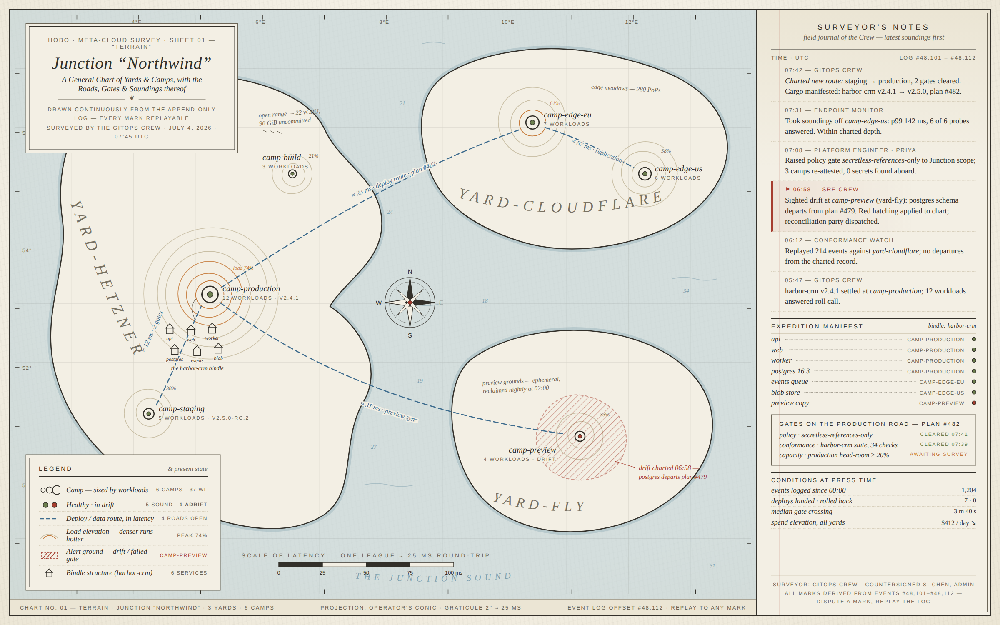

# 01 Terrain — Junction Survey Chart

**Thesis: a control plane is TERRITORY — a living map.** The Junction topology overview is drawn as a
hand-surveyed cartographic chart, not a dashboard.

## Philosophy

Operators already talk about infrastructure spatially — "over on Hetzner", "close to the edge",
"routes between regions". Terrain takes that speech literally. Yards are landmasses, Camps are
settlements sized by workload count, deploy/data routes are dashed travel lines measured in
latency, and load/cost is elevation drawn as contour lines: denser contours run hotter. Because
HoBo is built on an append-only event log, the map is a *survey*, not a screenshot — every mark is
derived from a numbered event (#48,101–#48,112) and can be replayed or disputed. The Surveyor's
Notes panel makes that explicit: the Crew (GitOps, SRE, Endpoint Monitor, Platform Engineer) keep
a field journal, and the chart is simply their journal rendered as geography.

## Design principles

1. **Everything is a survey mark.** No abstract widgets: each visual element (contour, hatch,
   route, settlement) maps 1:1 to a log-derived fact, and the footer names the log offset it was
   drawn from.
2. **The legend is the status page.** Symbols and live state share one table — "5 sound · 1
   adrift" sits beside the marker that means it, so learning the map *is* reading the system.
3. **Density encodes heat, distance encodes latency.** Contour spacing carries load (peak 74% at
   camp-production); the scale bar is a "scale of latency" (one league ≈ 25 ms) and every route is
   annotated in ms like a distance.
4. **Alerts are weather on the land, not popups over it.** Drift at camp-preview is madder-red
   hatched ground with a surveyor's leader note, cross-referenced to the 06:58 journal entry.
5. **Cartographic conventions do the UI's job.** Italic serif place names, graticule, compass
   rose, cartouche, depth soundings — inherited literacy replaces invented chrome.

## Design system

### Palette

| Token | Hex | Role |
|---|---|---|
| `--paper` | `#F3EFE4` | sheet ground, land fill, label halos |
| `--paper-deep` | `#EBE5D4` | panel wash, map footer |
| `--ink` | `#33302A` | coastlines, body text, frames (9.2:1 on paper) |
| `--ink-soft` | `#6B6455` | secondary text, graticule labels, inner rules |
| `--hairline` | `#D8D0BC` | dotted separators, leaders |
| `--contour` | `#C9BFA5` | normal load-elevation contours |
| `--water` | `#B9CFD6` | sea tint (52% wash over paper) |
| `--water-deep` | `#7FA0AE` | coastal halos, ripples, depth soundings |
| `--route` | `#3E6C8E` | deploy/data routes + latency annotations |
| `--ochre` | `#C67B3B` | hot contours, "awaiting survey" gate state |
| `--moss` | `#6C7F4E` | healthy settlement dots, cleared gates |
| `--madder` | `#A63D2F` | drift hatching, alert journal entry, compass pin |

### Type scale

| Use | Face | Size / treatment |
|---|---|---|
| Chart title | Georgia italic | 27px |
| Yard names | Georgia italic on `<textPath>` | 22–25px, letter-spacing 7–9 |
| Camp names | Georgia italic | 13.5px + paper halo (`paint-order: stroke`) |
| Journal body | Georgia | 12px / 1.42 |
| Category labels | Helvetica caps (`.cap`) | 8–12px, letter-spacing .14–.3em |
| Annotations / soundings | Georgia italic | 8.5–10px |

Two families total (serif + sans), 1 deduplicated `font-family` stack per lint.

### Spacing & structure

Sheet inset 14px with double rule (2px ink + 1px ink-soft at 4px). Map column flex, notes panel
fixed 374px with a red margin-line at 34px (notebook gutter). Boxes-over-map (cartouche, legend)
use `box-shadow` double-frame: 4px paper + 1px ink-soft. Graticule: 99×94px faint grid + margin
ticks with degree labels.

### Components

- **Cartouche** — title block with kicker, italic title, fleuron rule, provenance line.
- **Settlement marker** — ink circle sized by workloads, moss/madder core dot.
- **Contour stack** — one wobbly `<path id="ring">` reused via `<use>` at varied scale/rotation
  (`vector-effect: non-scaling-stroke` keeps line weight honest).
- **Route** — dashed blue path + rotated italic annotation with paper halo ("≈ 23 ms · deploy
  route · plan #482").
- **Alert ground** — 45° madder hatch pattern in a wobbly boundary, dashed edge, leader note.
- **Field journal entry** — caps timestamp + crew name, serif body; alert variant gets madder flag,
  left rule, and tint.
- **Manifest row** — italic service, dotted leader, caps location, status dot.
- **Gate ledger** — bordered box listing plan #482's gates with cleared/awaiting states.

## Look & feel

Warm paper with a two-angle CSS-gradient tooth (no images), a cool sea wash, ink linework, and
three accent earths (ochre, moss, madder). Organic coastlines with soft water halos; contours
wobble like plate-press lithography; text sits on paper halos the way engraved labels knock out
hatching. It should feel like a chart pinned in a harbourmaster's office that happens to be
updating in real time — the only "live" tells are the timestamps and the log offsets.

## Ideation log

1. **Isometric island view (rejected)** — 2.5D islands with extruded buildings read as a game map
   and collided head-on with loop 08 Metropolis; also broke the flat-survey honesty of "every mark
   is a log fact".
2. **Single continent with Yards as provinces (rejected)** — political-map subdivision implied the
   Yards share a substrate. They don't: providers are separate control planes, so separate
   landmasses with water (network) between them is the truthful geography.
3. **Choropleth load shading instead of contours (rejected)** — filled color ramps turned the land
   into a heatmap dashboard wearing beige, obscured settlement markers, and needed a color scale
   legend; contour density carries the same signal in pure linework.
4. **Notes as map-margin callouts (rejected)** — scattering journal excerpts around the map edges
   destroyed reading order and fought the graticule; a dedicated field-journal column keeps the
   chart clean and gives the event log a narrative spine.

## Hardening notes

- **Pass 1 → 2:** camp-build and its contours were buried under the cartouche — relocated to the
  northeast interior with its 21% index label. Bindle structure labels (worker/blob) collided
  between house rows — cluster respaced to two clear rows with centered labels. Featureless water
  fixed with nautical depth soundings (ms figures in water-deep italic). Dead interiors got
  surveyor annotations ("open range — 22 vCPU, 96 GiB uncommitted", "preview grounds — ephemeral,
  reclaimed nightly at 02:00"). Empty 200px gap in the notes panel filled with a "Conditions at
  press time" ledger (events, deploys, median gate crossing, spend elevation).
- **Pass 2 → 3:** YARD-HETZNER's horizontal arc ran straight through the harbor-crm structures —
  re-set diagonally along the landmass's long axis (proper practice for elongated regions). "Edge
  meadows" annotation crowded the 87 ms replication label — moved to Cloudflare's northeast
  interior. Contour percentage labels gained paper halos. Conditions heading shortened to stop an
  awkward wrap.
- **Pass 3 → final:** "open range" annotation was clipped by the cartouche's right edge — nudged
  east into clear ground. Verified no overflow at 1600×1000 and re-ran lint (PASS, 12 tokens, 1
  font stack).

## Distinctiveness check

- **02 Broadsheet** — Terrain is spatial geography on one sheet; Broadsheet is columnar editorial
  hierarchy with headlines and decks.
- **03 Mission Control** — Terrain is a calm survey of territory; Mission Control is a dense
  launch console of gauges, countdowns, and go/no-go states.
- **04 Quiet Garden** — Terrain informs through cartographic precision (graticule, scale, legend);
  Quiet Garden soothes through ambient abstraction and negative space.
- **05 Conversation** — Terrain shows Crew activity as journal excerpts beside a map; Conversation
  makes the Crew dialogue itself the entire interface.
- **06 Brutalist Terminal** — Terrain is drawn linework on textured paper; Brutalist Terminal is
  unstyled monospace text-file honesty with no imagery at all.
- **07 Organism** — Terrain's land is static territory that workloads inhabit; Organism renders
  the system as living cells that grow, divide, and die.
- **08 Metropolis** — Terrain is a flat 2D survey chart; Metropolis is an isometric 3D city of
  extruded buildings.
- **09 Timetable** — Terrain maps *where* things are in continuous space; Timetable boards *when*
  things depart in tabular Swiss rows.
- **10 Patchbay** — Terrain draws routes as geographic travel lines; Patchbay draws them as
  physical cables between rack-mounted jacks.
