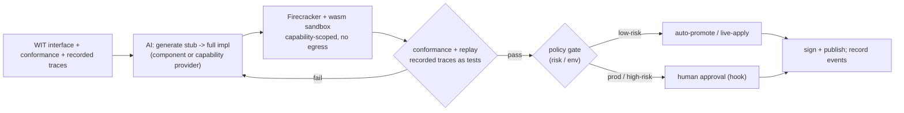
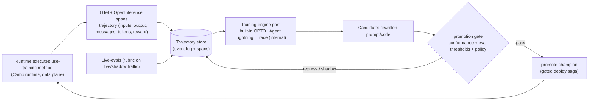
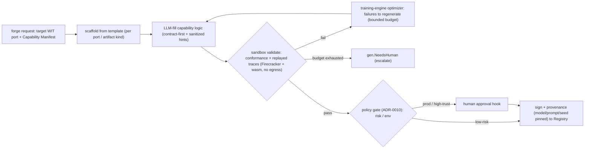
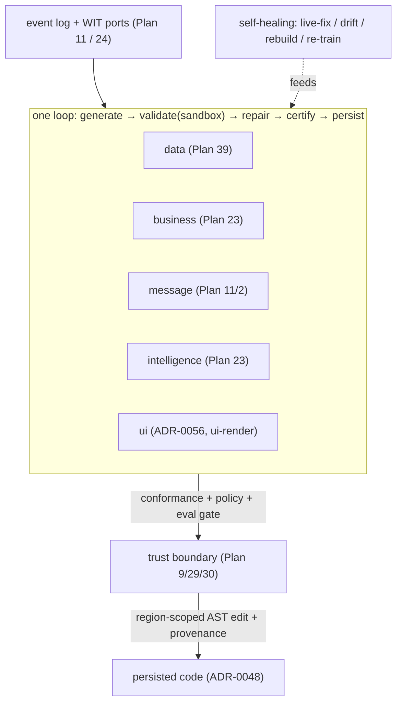

# AI Generation, the Generated Stack & Verification

This capability doc covers the AI generation loop, the trainable-method evolution loop they share, the five-layer generated stack, and how the platform itself stays patchable and extensible.

## Plan 23

> **Trainable methods.** A method the developer marks **`"use training"`** ([Plan 2](./sdk-api.md#plan-02)) is an **AI-rewritable semantic function**: HoBo continuously optimizes its prompt/code against a rubric. The optimizer is an **engine behind a WIT port** (`training-engine`, built-in default; **Microsoft [Agent Lightning](https://microsoft.github.io/agent-lightning/stable/) / [Trace](https://microsoft.github.io/Trace/) are optional *internal* providers, never exposed to SDK users** — same engines-behind-ports rule as [ADR-0015](./adr/index.md), see [ADR-0025](./adr/03-data-plane.md#adr-0025)). Runtime execution is captured as **OTel + [OpenInference](https://github.com/Arize-ai/openinference)** spans (the training data), and **live-evals** supply the reward/feedback signal and gate promotion.

> **Drivers & Resource Packs (Humanitec parity):** the same generation loop also generates **Resource Definitions** and **Resource Packs** ([Plan 25](./platform-engineering.md#plan-25)/[Plan 25](./platform-engineering.md#plan-25)) — given a backend's Capability Manifest + a target context, propose a definition, validate it sandboxed against conformance, and certify it into the Registry.

> **Contracts, policy & evals (gates):** a stubbed-then-AI-implemented port is a **semantic function**, governed by the four-lens taxonomy — **Contract = must never break · Eval = should improve · Policy = may/may not be allowed · Trace = what actually happened** ([Plan 29](./contracts-policy-flags.md#plan-29)/[Plan 29](./contracts-policy-flags.md#plan-29)). The promotion gate below is **conformance(contract) green AND eval thresholds met AND policy allows**.

### Contract vs eval vs policy (for a semantic function)
A semantic function carries three independent things, not one:
- **Contract** (must never break): I/O schema + invariants + forbidden outputs + negative cases. Verified by conformance + replayed traces; a failure **blocks**. *e.g. "summary must not contain PII"; "`critical` urgency requires explicit security/outage/production impact".*
- **Eval** (should improve): a **rubric** scored on quality/faithfulness/calibration/cost/latency, with **promotion thresholds**, **champion/challenger**, **shadow traffic**, and a **min-samples** floor. A candidate that regresses an eval **stays in shadow**, it doesn't block the champion.
- **Policy** (may/may not): whether *this* promotion is allowed here ([Plan 29](./contracts-policy-flags.md#plan-29)) — e.g. prod promotions require human approval.
```ts
classifyTicket.promotionGate({
  requireConformance: true,                 // contract — hard gate
  evalThresholds: { categoryCorrect: 0.92, urgencyCalibrated: 0.90, piiSafe: 1.0 },
  shadowTraffic: "10%", minSamples: 1000,   // observe before promote
  policy: "promote.semantic.prod",          // Plan 30 decision (may require approval)
});
```
Promotion = **all three** pass. Each `eval.Ran`/`eval.GatePassed|Failed` and the final promotion is an event ([Plan 11](./data-plane.md#plan-11)).

**How a promotion is persisted to source ([ADR-0048](./adr/03-data-plane.md#adr-0048)).** A promoted candidate is written back via **AST-aware, region-scoped** edits (a format-preserving codemod) confined to the `"use training"` method's **marked generated region** — never blind string patching, never touching hand-written code (the same generated-vs-authored boundary as `_generated/`, [ADR-0037](./adr/01-architecture-core.md#adr-0037)). The mutation carries **signed provenance** (model/prompt/seed/eval+conformance report) and lands as a **gated change**: low-risk → auto-apply to the region; prod/high-trust → **a PR/Delta for approval** (GitOps publisher + approval hook, [Plan 25](./platform-engineering.md#plan-25)/[Plan 6](./ai-native-agent-auth.md#plan-06)). It's idempotent + round-trippable (prior candidates live in the event log), so a promotion is reversible.

### `use training` — marking a method AI-rewritable
The SDK surface for "this method is owned by the training loop" mirrors the Vercel-style directives `"use workflow"` / `"use step"` ([Plan 2 §Layer 4](./sdk-api.md#plan-02)). A developer writes a **directive** (or the equivalent `training()` wrapper); the body is the **baseline** (which may be a `stub()` — see below), and HoBo's optimizer may rewrite the prompt/code to improve it:

```ts
import { training } from "@hobo/runtime";

/**
 * Classify a support ticket into a category + urgency.
 * @intent  Route tickets to the right queue; `critical` is ONLY for security,
 *          outage, or production-impact tickets — never billing or how-to.
 * @invariant output.category ∈ KnownCategories; `rationale` must not contain PII.
 */
export async function classifyTicket(t: Ticket): Promise<Classification> {
  "use training";                       // ← method is AI-rewritable (a semantic function)
  return llm.classify(t);               // baseline; the optimizer may rewrite this + its prompt
}

// Wrapper form (same semantics) — carries the metadata the optimizer needs:
export const classifyTicket = training(
  async (t: Ticket): Promise<Classification> => llm.classify(t),
  {
    intent: "Route tickets; `critical` only for security/outage/production impact.",
    contract: ClassificationContract,   // Zod I/O + invariants + forbidden outputs (Plan 29)
    rubric: { categoryCorrect: 0.92, urgencyCalibrated: 0.90, piiSafe: 1.0 }, // Plan 23 eval
  },
);
```

**Rewritability requires semantic grounding.** The optimizer rewrites *toward an intent*, so a `"use training"` method MUST carry, and HoBo lints for, the descriptions that make it optimizable (this is the input the engines below consume):
- **Intent / docstring** — what the method is for and the decision rules in prose (`@intent`, JSDoc). Captured into the trainable graph as the editable instruction.
- **Contract** — typed I/O + invariants + forbidden outputs + negative cases ([Plan 29](./contracts-policy-flags.md#plan-29)). The hard boundary the optimizer may never cross.
- **Rubric** — the scored quality signal ([eval](#contract-vs-eval-vs-policy-for-a-semantic-function) above) the optimizer climbs.
- **Examples / traces** — recorded executions (below) the optimizer learns from and regresses against.

A `"use training"` method **is** a semantic function: everything in [Contract vs eval vs policy](#contract-vs-eval-vs-policy-for-a-semantic-function) and the gated promotion applies unchanged. `"use training"` is just the marker that hands a method to the continuous-optimization loop instead of leaving it hand-maintained.

### Stubs: run before anything is implemented
Any WIT port can be backed by a **stub** the host links in place of a real provider/component:
- **Record** every call (args) and **return** typed/canned responses derived from the WIT types (and optionally an LLM given the interface + intent).
- Stubs satisfy the type system + the link table, so a whole app runs end-to-end with unimplemented pieces — the design-time analog of Lakebed's instant feel, but for *implementations*.
- Stub calls are events, so they double as a **specification by example**: the recorded traces become the inputs the real implementation must satisfy. A stub is also the natural **baseline of a `"use training"` method** — start stubbed, then let the training loop (below) grow it into a real implementation against those recorded traces.
```ts
service("payments").stub();        // links a stub for everything it exports/imports
service("payments").stub({ charge: () => ({ status: "ok" }) }); // partial canned behavior
```
**The stub is one of several boundary *modes*** ([ADR-0076](./adr/02-identity-security.md#adr-0076)): the host can serve any link as `live` · **`mock`** (this stub, auto-served from the boundary's PACT contract + recorded traces — no hand-written mocks) · `record`/`replay` · **`fork`** (route to an overriding impl) · **`shadow`** (duplicate traffic to a candidate, discard its response) · **`fault`** (chaos at the boundary). This is the substrate for low-friction testing, request-level isolation, preview environments, self-healing experiments, and non-destructive chaos — all baked into the existing stub/link/contract machinery ([Plan 9](#plan-09)/[Plan 25](./platform-engineering.md#plan-25)).

### The generation pipeline implementation loop (gated)
> **Generation vs evolution — same engine, two entry points.** The loop below is the *evolution / continuous-training* path for a live `"use training"` method. The **cold-start generation** of a brand-new artifact — and the generalization of this loop to **providers and Resource Definitions/Packs**, not just implementations — is the [generation pipeline](#the-generation-pipeline) below ([ADR-0010](./adr/03-data-plane.md#adr-0010)). Both share the `training-engine` optimizer ([ADR-0025](./adr/03-data-plane.md#adr-0025)), the conformance/sandbox trust boundary, and signed provenance.


1. **Generate** an implementation for a WIT interface from its interface + conformance + recorded traces (an entire service component or a backend capability provider).
2. **Validate** sandboxed (wasm capability sandbox + Firecracker, no egress, [Plan 12](./security-networking.md#plan-12)) against `@hobo/conformance` **and** by **replaying recorded traces** as regression tests.
3. **Gate** promotion by policy (below).
4. **Publish** signed with provenance; every step is an event ([Plan 11](./data-plane.md#plan-11)).

### Trace → implement → evolve
- **Trace:** each call across a WIT boundary is an event with inputs/outputs (encrypted per-run where sensitive). Replay reconstructs exact behavior — the ground truth for both implementing and detecting regressions.
- **Implement-to-trace:** AI implements against the recorded traces of a stub; "done" = passes conformance + reproduces observed outputs.
- **Auto-evolve:** on new traces (new inputs, perf data, error patterns), AI proposes an improved implementation; the old traces guard against regressions; SLO/cost signals ([Plan 5](./reliability-observability-cost.md#plan-05), [Plan 5](./reliability-observability-cost.md#plan-05)) drive optimization.

### The training pipeline (engines behind a `training-engine` port)
Implementing/evolving a `"use training"` method is a **continuous optimization loop**, modeled on two Microsoft frameworks but wrapped so SDK users never see them:

- **From [Microsoft Trace](https://microsoft.github.io/Trace/):** treat the graph of `"use training"` methods + their calls as an **optimizable computational graph**. Each method's instruction/prompt/code is a *trainable parameter*; feedback (eval scores, natural-language critiques, errors, SLO/cost signals) propagates back through the recorded execution graph and an LLM-based optimizer (OptoPrime/TextGrad/OPRO-style) rewrites the parameters *in place* — "backprop for prompts and code." HoBo's built-in `training-engine` is this OPTO-style optimizer.
- **From [Agent Lightning](https://microsoft.github.io/agent-lightning/stable/):** **decouple execution from training.** The running app (the agent/method) just executes and emits trajectories; a separate **trajectory store + trainer** consumes them and produces candidate improvements via RL (GRPO/PPO), automatic prompt optimization (APO), or SFT. This is exactly HoBo's control-plane/data-plane split — the Camp's runtime runs the method, the Yard's training-engine optimizes it offline/async. **HoBo may use Agent Lightning itself as the provider behind the port** to run the trainer.

**Engines behind a port (the load-bearing rule).** Following [ADR-0015](./adr/index.md), `training-engine` is a **WIT port** ([Plan 20](./wasm-runtime-wit.md#plan-20)) with a **built-in default**; **Agent Lightning** (`@hobo/provider-agent-lightning`) and **Trace** (`@hobo/provider-trace`) are **optional adapters selected per tenant/Camp and are NOT part of the SDK surface**. SDK users write `"use training"` + intent + rubric; they never import, configure, or even need to know which optimizer ran. Swapping optimizers is a config change, never an app-code change ([ADR-0025](./adr/03-data-plane.md#adr-0025)).



The candidate **reuses the existing gated promotion verbatim** — conformance (contract) green **AND** eval thresholds met **AND** policy allows, with champion/challenger + shadow traffic + min-samples ([above](#contract-vs-eval-vs-policy-for-a-semantic-function)). Training adds *no new trust path*: every candidate still passes the same sandbox + conformance + policy gates as a AI-generated impl, and every step (`training.*`, `eval.*`, `impl.Promoted`) is an event ([Plan 11](./data-plane.md#plan-11)).

### Runtime capture: OTel + OpenInference (the training data)
Training data is **real recorded execution, not synthetic** — the same principle as replay-as-test-oracle:
- Every `"use training"` invocation emits **OpenTelemetry spans following the [OpenInference](https://github.com/Arize-ai/openinference) semantic conventions** (LLM/chain/tool/agent/retriever spans with inputs, outputs, messages, token counts) layered on HoBo's existing OTel tracing ([Plan 5](./reliability-observability-cost.md#plan-05)). OpenInference is transport-agnostic and OTel-native, so it exports to the tenant's own backend *and* feeds HoBo's trajectory store — no separate, lock-in telemetry path.
- A **trajectory** = the OpenInference span tree for one invocation + its inputs/outputs + the **reward** attached by live-evals (below) + correlation to the run/agent. Sensitive payloads are per-run encrypted ([Plan 12](./security-networking.md#plan-12)); trajectories inherit trace retention/sampling policy.
- The data-flywheel privacy model is explicit in [ADR-0099](./adr/03-data-plane.md#adr-0099): classify before persistence; tokenized/encrypted PII and sealed secrets enter the trajectory store instead of raw sensitive values; cross-tenant store/consumer mismatch fails closed; opt-out and retention inherit trace policy; external optimizer/judge providers receive redacted trajectories only.
- Trajectories are the units the `training-engine` consumes (Trace's "trace feedback", Agent Lightning's "transitions"). Because they ride the event log, training is **replayable and auditable**: you can reconstruct exactly which trajectories produced which candidate.

### Live-evals as the training signal
Evals don't only run at promotion time — they run **continuously on live and shadow traffic** to (a) attach the **reward/feedback** each trajectory needs and (b) detect drift:
- A rubric ([Contract vs eval vs policy](#contract-vs-eval-vs-policy-for-a-semantic-function)) is scored online (LLM-judge / programmatic / human-label sampling) and written as `eval.Ran` + a reward on the trajectory. This *is* the optimizer's objective — the live-eval score is what Trace propagates and what Agent Lightning's RL maximizes.
- Live-evals double as **performance telemetry**: champion vs challenger quality/cost/latency/calibration land in the observability stream ([Plan 5](./reliability-observability-cost.md#plan-05)) and the dashboard, so a regression in production triggers an `eval.GateFailed` (challenger stays in shadow) or, for the champion, a drift alert that can open a [live-fix](#live-fix-gated-by-default).
- The same min-samples / shadow-traffic floors prevent the optimizer from chasing noise.

### Live-fix (gated by default)
> Live-fix is the **applier** of a remediation; the **classifier** that decides *which* fix (and whether to auto-fix, propose, or escalate) is the SRE operator's runtime+contract **failure-taxonomy** ([Plan 40](./operators-sre.md#plan-40)). A live-fix runs inside an **Incident** ([Plan 40](./operators-sre.md#plan-40)/[Plan 11](./data-plane.md#plan-11)).

On a failing trace or SLO/health breach in a running deployment:
1. AI captures the failing trace, forms a hypothesis, generates a fix.
2. Validates sandboxed + **replays the failing trace as a new test** (and the full conformance suite).
3. **Policy gate** decides application:
   - **low-risk** (e.g. non-prod, within budget, reversible, conformance-green) → **auto-apply** as a canary with auto-rollback on regression ([Plan 5](./reliability-observability-cost.md#plan-05)).
   - **prod / high-risk / spend / destructive** → **human approval** via a `createHook` surfaced in the dashboard/Slack ([Plan 6](./ai-native-agent-auth.md#plan-06)).
4. Apply as a normal gated deployment saga (blue/green or canary), fully event-sourced and reversible. The failing trace is retained as a permanent regression test.

```ts
// policy lives with the agent / tenant; example knobs
agent("ops", {
  policy: {
    liveFix: { auto: "low-risk", requireApprovalIn: ["prod"], maxBlastRadius: "1 resource" },
    spendCapUsd: 50,
  },
});
```

### Why this is safe(ish)
- **Conformance is the contract** — generated code can't claim a port it doesn't pass.
- **Capability sandbox** — generated/evolving code is deny-by-default; it can't reach anything it isn't linked to, and generation pipeline runs have no egress.
- **Replay is the test oracle** — real recorded behavior, not synthetic guesses, gates changes.
- **Everything is an event** — generation, validation, gate decisions, and applies are an immutable, replayable audit trail.

### The generation pipeline
> **What the generation pipeline generates.** One pipeline, four artifact kinds, all behind existing WIT ports and gated by `@hobo/conformance` (the trust boundary): **providers** (a backend's capability adapter), **implementations** (service components / semantic functions — whose live-training half is the loop above), **Resource Definitions / Packs** (platform-engineer config — [Plan 25](./platform-engineering.md#plan-25)/[Plan 25](./platform-engineering.md#plan-25)), and **ui** artifacts (the `ui-render` engines fill against design.md — [ADR-0056](./adr/03-data-plane.md#adr-0056)). "Generate a provider" is concrete: it is this loop. This is the **cold-start** counterpart to the continuous-evolution loop above; both are the same `training-engine` ([ADR-0025](./adr/03-data-plane.md#adr-0025)) and the same gate, only the entry point differs.

**Inputs are contract-first** — the generator separates **authoritative** spec (what the artifact must satisfy) from **material** (hints + behavioral oracle):
- **Authoritative:** the target **WIT port** ([Plan 20](./wasm-runtime-wit.md#plan-20)) + its **`@hobo/conformance` suite** + the backend's **Capability Manifest** (`capabilities/auth/cost.json`, [Plan 6](./ai-native-agent-auth.md#plan-06)). Generation succeeds only by satisfying these — the *same* gate that certifies it.
- **Material (hints/oracle):** provider docs / OpenAPI / Terraform (treated as **untrusted data**, sanitized + scrubbed per the prompt-injection rule, [ADR-0023](./adr/02-identity-security.md#adr-0023)) and recorded **stub/live traces** ([Plan 11](./data-plane.md#plan-11)/[stubs](#stubs-run-before-anything-is-implemented)) as the behavioral oracle to reproduce.

This is why HoBo can "generate providers without a community": the contract (WIT + conformance) bounds and validates the synthesis, so a wrong guess can't be certified.


1. **Scaffold** — start from a template for the artifact kind + target port (a provider skeleton, a component skeleton, a Resource-Definition skeleton, or a **migration importer** skeleton for [ADR-0041](./adr/07-portability-extensibility.md#adr-0041)), so structure/boilerplate is deterministic and only capability-specific logic is synthesized.
2. **LLM-fill** — synthesize the capability-specific logic from the **authoritative** spec, using **material** as hints. Inputs are sanitized; nothing in `material` can override the contract.
3. **Validate (sandboxed)** — run `@hobo/conformance` for the claimed port **and** replay recorded traces as regression tests, inside a **Firecracker + wasm sandbox with no egress** ([ADR-0012](./adr/index.md)/[ADR-0023](./adr/02-identity-security.md#adr-0023)).
4. **Repair (bounded)** — conformance assertion failures + trace diffs are the **feedback signal** fed to the **`training-engine`** optimizer (OPTO/Trace, [ADR-0025](./adr/03-data-plane.md#adr-0025)), which regenerates. A **repair budget** caps iterations; on exhaustion the run emits **`gen.NeedsHuman`** rather than looping forever.
5. **Certify** — on green: **sign** + attach **SLSA-style provenance** (the model, the frozen prompt, the seed, and the conformance report are pinned for reproducibility) → publish to the **Registry**. **Promotion reuses the existing policy gate** ([ADR-0010](./adr/index.md)): low-risk → auto-certify; prod / high-trust → human approval via a `createHook` ([Plan 6](./ai-native-agent-auth.md#plan-06)).

Events ([Plan 11](./data-plane.md#plan-11)): `gen.Requested` · `gen.CandidateGenerated` · `gen.Validated` / `gen.ValidationFailed` · `gen.SafetyRejected` (post-conformance backdoor, capability, dependency, or sandbox-escape finding) · `gen.Repaired` (iteration n, with the failing-assertion set) · `gen.NeedsHuman` · `gen.Certified` (extends `gen.PluginCertified` / `impl.*`) — so "why did the generation pipeline produce this, and is it trustworthy?" is answerable from the log. Trust rests on the same three pillars as the evolution loop: **conformance is the boundary** (a generated artifact may only claim a port it passes, identical to a human-written adapter, [Plan 9](#plan-09)); **no-egress synthesis** (generation + validation are sandboxed with no network); **post-conformance safety rejection** (a contract-green candidate that exfiltrates, hides a trigger, typosquats dependencies, or requests over-broad capabilities cannot certify); and **pinned provenance** (model + frozen prompt + seed + conformance report signed and recorded, so a certification is reproducible, [Plan 12](./security-networking.md#plan-12)).

**Verification ([Plan 9](#plan-09)).** Seed a known WIT port + its conformance suite + a backend's Capability Manifest → assert the loop produces a **certified** artifact that passes conformance **and** reproduces recorded traces; assert the repair loop **converges or escalates** within the budget (no infinite loop); assert the certification carries complete provenance. Reference run: generate a `database` provider for a known backend, end-to-end. HOBO-211 pins the correctness bar with `src/draft/technical-proofs/generateprovider-correctness-spike`: the default repair budget is two automated attempts, reference certification is tied to the actual validation report, production certification requires full local + real Camp provider-suite coverage, and pinned model/prompt/seed/input digests reproduce the artifact digest. Cold-start from docs/OpenAPI with no Capability Manifest is the riskiest input path and leans hardest on the sandbox + conformance gate. *(Marketplace economics / monetization is out of scope — [ADR-0064](./adr/07-portability-extensibility.md#adr-0064).)*

**Epic reference implementation.** The Generation Pipeline, Training & AI Safety rollup is now synthesized under `src/draft/epic-proofs/generation-pipeline-training-ai-safety/`. It combines the cold-start provider certification path, `use training` trajectory/eval promotion path, live-fix gating path, and five-layer generated-stack propagation path behind mocked service boundaries with Pact fixtures. The runnable simulation command is `npm.cmd --prefix src\draft\epic-proofs\generation-pipeline-training-ai-safety run simulate`; the Pact inventory and POC ledger live beside the reference implementation.

### The generated stack — one loop across five layers
> **The thesis.** The same generate→validate→repair→certify→persist loop, the same self-healing reflexes, and the same audit/replay apply to **every layer** of the application HoBo manages — from the data plane up to the UI. The operator agents ([Plan 40](./operators-sre.md#plan-40)) drive it: **SWE** owns business/message, **UX Designer** owns ui, **Platform Engineer** owns infra config, **SRE** drives self-healing.

HoBo generates the application from intent — data, business logic, messaging, intelligence, **and the UI** ([ADR-0055](./adr/03-data-plane.md#adr-0055)/[ADR-0056](./adr/03-data-plane.md#adr-0056)):

| Layer | What HoBo generates | Owned by | Self-heals via | Persisted by |
|---|---|---|---|---|
| **Data** | WIT-record schemas, projections + sink mappings, migrations | [Plan 32](./data-plane.md#plan-32)/[Plan 32](./data-plane.md#plan-32)/[ADR-0051](./adr/03-data-plane.md#adr-0051) | rebuild-from-zero (replay), gated migration | migration machinery + codegen |
| **Business** | service components + **semantic functions** (`"use training"`), providers, Resource Definitions | [Plan 23](#plan-23) | live-fix (trace-replay → gated canary) | [ADR-0048](./adr/03-data-plane.md#adr-0048) region-scoped edits |
| **Message** | event/command/saga handlers + choreography from the WIT-record event types | [Plan 11](./data-plane.md#plan-11)/[Plan 2](./sdk-api.md#plan-02)/[Plan 21](./authoring-resources-wiring.md#plan-21) | compensation + replay; contract gate ([Plan 29](./contracts-policy-flags.md#plan-29)) | codegen + [ADR-0048](./adr/03-data-plane.md#adr-0048) |
| **Intelligence** | prompts/policies/weights of trainable methods, continuously optimized | [Plan 23](#plan-23)/[ADR-0025](./adr/03-data-plane.md#adr-0025) | training-engine (trajectory + live-eval → re-optimize) | [ADR-0048](./adr/03-data-plane.md#adr-0048) + signed provenance |
| **UI** | app UI from intent + **design.md** via OpenUI / json-render / mcp-apps behind the **`ui-render`** port; typed from the domain, reactive to materializations | [ADR-0056](./adr/03-data-plane.md#adr-0056) ([Plan 40](./operators-sre.md#plan-40) UX Designer) | regenerate against design.md; design-system gate | [ADR-0048](./adr/03-data-plane.md#adr-0048) region-scoped edits |



> **The UI is a generated layer, not the dashboard.** The **ui** layer is the developer's *product* UI — generated from intent + the **design.md** design-system spec via OpenUI/json-render/mcp-apps behind the `ui-render` port, owned by the **UX Designer** operator ([Plan 40](./operators-sre.md#plan-40)), typed from the WIT-record domain ([ADR-0051](./adr/03-data-plane.md#adr-0051)) and bound to the data plane's reactive materializations ([ADR-0056](./adr/03-data-plane.md#adr-0056)). It is distinct from HoBo's own operator dashboard ([Plan 7](./developer-experience.md#plan-07)); design.md is its trust boundary (UI that violates it fails the gate).

**What makes it one stack (not five features):**
- **One source of truth.** Every layer reads/writes the **event log** ([Plan 11](./data-plane.md#plan-11)); generated code targets **WIT ports** ([Plan 20](./wasm-runtime-wit.md#plan-20)) and is typed from **WIT records** ([ADR-0051](./adr/03-data-plane.md#adr-0051)).
- **One generation loop.** The generation loop — **scaffold → LLM-fill → validate (sandboxed, no-egress) → repair → certify (sign + provenance)** ([above](#the-generation-pipeline)) — is the same shape for a provider, a projection, a saga handler, or a trained prompt; only the inputs/oracles differ.
- **One trust boundary.** Nothing is generated *and trusted* without passing **conformance + policy + eval** ([Plan 9](#plan-09)/[Plan 29](./contracts-policy-flags.md#plan-29)/[Plan 29](./contracts-policy-flags.md#plan-29)).
- **One persistence mechanism.** Promoted code lands via **region-scoped, format-preserving AST edits with provenance** ([ADR-0048](./adr/03-data-plane.md#adr-0048)) — generated regions are demarcated, hand-written code is never clobbered, and every change is round-trippable + gated (`hobo codegen --check`, [ADR-0037](./adr/01-architecture-core.md#adr-0037)).
- **One self-healing reflex.** A failing trace / SLO burn / drift / contract break triggers the same classify → propose-fix → validate → gated-apply loop ([live-fix](#live-fix-gated-by-default), [Plan 5](./reliability-observability-cost.md#plan-05) drift/auto-rollback), driven by the **SRE** and **SWE** operators ([Plan 40](./operators-sre.md#plan-40)).

**Self-healing & persistence, per layer (honest):**
- **Generated ≠ unowned.** Hand-written intent (the WIT record, `@intent`/`@invariant`, the design.md spec for ui) is authoritative; AI fills/optimizes the generated region against it. The intent is the thing a human edits.
- **Determinism gates persistence.** Deterministic codegen (data/message types, [ADR-0037](./adr/01-architecture-core.md#adr-0037)) is reproducible and safe to regenerate; *non-deterministic* promotions (trained methods, generated UI) need stronger region-isolation, signed provenance, and (in prod) a human-gated PR/Delta ([ADR-0048](./adr/03-data-plane.md#adr-0048)).
- **Not every layer self-heals equally.** Data heals by rebuild; business/intelligence by live-fix/re-train; message by compensation + contract gate; ui by regeneration against design.md. Where a layer can't auto-heal safely, it degrades to *propose* (human approval), never silent mutation.

**Verification.** A change to a WIT domain record propagates through the stack — data (migration + projection), message (regenerated handlers + contract gate), business/intelligence (impl re-validated), ui (components re-typed + design.md gate) — each gated, each persisted as a reviewable diff. A prod failure triggers one self-healing loop (classify → fix → sandbox-validate → policy-gate → canary/auto-rollback), fully event-sourced. `hobo codegen --check` fails on hand-edited drift in any layer's generated region.

### Patchability & extensibility
> **Why it's a distinct goal.** Portability protects the *user's app* from lock-in; patchability protects the *platform itself* from being a black box: every engine is swappable, every seam is an extension point, and every AI/human edit either persists as a reviewable, round-trippable, conformance-gated diff **or** overlays the running instance as an audited, GC'd ephemeral patch. Closed PaaS gives you neither; raw IaC gives you patchability but no portability. HoBo commits to both. **Portability = the same artifact on N backends; patchability = derive/extend/patch the platform itself, persisted OR ephemeral** ([ADR-0057](./adr/07-portability-extensibility.md#adr-0057)).

**Derivative implementations (fork & extend behind the same ports).** Every HoBo component is an **adapter behind a WIT port** — so you can ship your *own* implementation without forking the core: **providers / IaC / build** ([Plan 4](./control-plane.md#plan-04)), **runtimes** ([ADR-0026](./adr/01-architecture-core.md#adr-0026)), **capability providers** ([Plan 20](./wasm-runtime-wit.md#plan-20)/[Plan 20](./wasm-runtime-wit.md#plan-20)), **`component-host`** ([ADR-0031](./adr/01-architecture-core.md#adr-0031)), **projection sinks** ([Plan 32](./data-plane.md#plan-32)), and the `contract`/`policy`/`training`/operator-agent **engines behind ports** (each a built-in default + optional external providers; swap any without touching app code). Even **the Yard itself** is a Bindle ([Plan 4](./control-plane.md#plan-04)) — a derivative control plane is a HoBo deployment, not a hostile fork. Derivatives ship as **signed Resource Packs / plugins** ([Plan 25](./platform-engineering.md#plan-25)) **certified by the same `@hobo/conformance` trust boundary** ([Plan 9](#plan-09)) — one that passes conformance is a first-class citizen, human- or **AI-generated** ([above](#the-generation-pipeline)).

**The enumerated seams.** Patchability is only real if the seams are *named and stable*:
| Seam | Port / mechanism | Plan |
|---|---|---|
| Cloud / IaC / build adapters | `CloudProvider`/`IacProvider`/`BuildProvider` | [3](./control-plane.md#plan-04) |
| Capability providers | any `wasi:*`/`hobo:*` WIT export | [20](./wasm-runtime-wit.md#plan-20)/[24](./wasm-runtime-wit.md#plan-20) |
| Runtimes / `component-host` | `Runtime` / `component-host` ports | [ADR-0026](./adr/01-architecture-core.md#adr-0026)/[ADR-0031](./adr/01-architecture-core.md#adr-0031) |
| Durable-store `runtime` port | `EventStore`/`Queue`/`Streamer`/`ActorHost`/`Clock` (conformance: replay fidelity, exactly-once, lease/fencing, ordering) | [ADR-0026](./adr/01-architecture-core.md#adr-0026)/[9](#plan-09)/[11](./data-plane.md#plan-11) |
| Drivers | `terraform`/`template`/`echo`/`container`/`custom-webhook` | [27](./platform-engineering.md#plan-25) |
| Engines | `contract`/`policy`/`training`/operator engines | [29](./contracts-policy-flags.md#plan-29)/[30](./contracts-policy-flags.md#plan-29)/[ADR-0025](./adr/03-data-plane.md#adr-0025)/[40](./operators-sre.md#plan-40) |
| Resource Definitions / Packs / Profiles | platform-rule layer | [25](./platform-engineering.md#plan-25)/[27](./platform-engineering.md#plan-25) |
| Agent skills | `@hobo/agent-skills` (operator + external agents) | [1](./architecture.md#plan-10)/[40](./operators-sre.md#plan-40) |
| Projection sinks | `projection-sink` paradigms | [39](./data-plane.md#plan-32) |
| Projection-sink paradigm adapters | add a new paradigm (relational/document/kv/graph/vector/OLAP/…): author driver → certify (`@hobo/conformance`) → signed Pack → Matching-select | [39](./data-plane.md#plan-32)/[ADR-0052](./adr/03-data-plane.md#adr-0052)/[27](./platform-engineering.md#plan-25) |
Each seam: a typed contract (WIT/conformance), a registry entry (signed + provenance), and Matching/selection per Camp ([Plan 25](./platform-engineering.md#plan-25)). Adding a seam implementation never requires editing the core.

**Patches — two kinds** (`patch-package`-style: change behavior without editing upstream source outright). HoBo distinguishes *where the change lives* ([ADR-0057](./adr/07-portability-extensibility.md#adr-0057)):
- **Persisted patches** — captured into source/artifacts via **region-scoped, format-preserving AST mutation with signed provenance** ([ADR-0048](./adr/03-data-plane.md#adr-0048)): generated regions are demarcated, hand-written intent is never clobbered, every patch is a minimal reviewable diff, round-trippable, conformance-gated, and drift-gated (`hobo codegen --check`, [ADR-0037](./adr/01-architecture-core.md#adr-0037); low-risk → auto-commit, prod → PR/Delta for approval). Durable, version-controlled — the patch becomes part of the derivative, which is what makes "self-healing, persisted code" ([above](#the-generated-stack--one-loop-across-five-layers)) a *durable derivative*.
- **Ephemeral runtime-instance patches** — an agent overlays a change on the **running instance only**, **not** persisted to *source control* (the way `patch-package` overlays a dependency locally without committing upstream). Each is **scoped to that instance** and **garbage-collected** unless explicitly **promoted** to a persisted patch — which re-enters the [ADR-0048](./adr/03-data-plane.md#adr-0048) region/provenance + conformance path. **The full patch diff is captured as a durable `derivative.EphemeralPatchApplied` event, not merely audited by reference** ([ADR-0057](./adr/07-portability-extensibility.md#adr-0057)), so the instance's behavior remains **derivable from the log** — replaying the log reconstructs the patched instance, upholding the "everything writes via events / replay == live" invariant ([Architecture invariant #1](./architecture.md)). An ephemeral patch is thus *outside source control* but *inside the replayable log*: it never silently mutates source, and never silently escapes replay.

**Patchability vs portability** ride the same machinery: **portability** ([ADR-0024](./adr/07-portability-extensibility.md#adr-0024)) runs the *same* Bindle + `src/` byte-identical on N clouds, while **patchability** ([ADR-0057](./adr/07-portability-extensibility.md#adr-0057)) lets you *change* HoBo — swap any engine, add any adapter, fork the Yard, patch persisted OR ephemeral — and still ride the same conformance/signing/Matching path. **Conformance is the bridge:** it's what makes a swapped backend, a derived implementation, and a persisted patch safe to trust; an ephemeral patch is gated by instance-scope + audit and must pass conformance to be promoted.

```mermaid
flowchart LR
  CORE["HoBo core (ports + Yard)"]
  CORE -->|swap engine / add adapter| DERIV["derivative impls (signed Packs/plugins)"]
  CORE -->|extension seams| SEAMS["providers · drivers · runtimes · engines · skills · sinks"]
  GEN["AI/human edits"] -->|region-scoped AST + provenance (ADR-0048)| PATCH["persisted patches"]
  GEN -->|instance-scoped overlay + audit event| EPH["ephemeral runtime patches"]
  EPH -.promote.-> PATCH
  DERIV --> CONF["@hobo/conformance + signing (Plan 9/12)"]
  SEAMS --> CONF
  PATCH --> CONF
  EPH -->|GC unless promoted| GONE["discarded"]
  CONF --> TRUST["trusted, upgradable derivative"]
```

**Derivative upgrade paths ([ADR-0057](./adr/07-portability-extensibility.md#adr-0057)).** Patchability is only durable if long-lived derivatives can **track core upgrades** instead of rotting or forking permanently — so derivatives get a **versioned, conformance-gated upgrade path**:
- **Seams are independently semver-versioned.** Each extension seam (a WIT port: `policy-engine`, `contract-engine`, `component-host`, a provider/driver/runtime/projection-sink) carries a semver; a Yard pins the seam versions it requires, and the manifest IR records which seam versions a Bindle uses (proven by its conformance run).
- **A signed `derivative.json` descriptor** ([Plan 12](./security-networking.md#plan-12)): the **core version range** it targets (`core@^1.0.0 <1.1.0`), its **seam implementations + versions** (`policy-engine@2.3.0`, `custom-aws-driver@1.0.0`), and **pinned upcasters** for any persisted mutations ([ADR-0048](./adr/03-data-plane.md#adr-0048)) — codemods that repair the hand-written/generated regions on a core upgrade.
- **An `hobo derivative upgrade <from> <to>` ceremony.** In a derivative Yard it: **checks `derivative.json` compatibility** (warns on any seam/mutation incompatibility) → **runs the pinned upcasters** → **re-runs seam conformance** (proves the upgrade didn't regress a guarantee) → **emits an upgrade report**. Events: `derivative.UpgradeStarted` · `derivative.UpgradeSucceeded` · `derivative.UpgradeFailed`.
- **Core releases ship a breaking-change manifest** — the seam/port changes with upcaster hints (*"`policy-engine` gained decision field X — here's the migration"*), so a derivative author writes targeted upcasters instead of reverse-engineering the diff. A derivative that re-passes the suite post-upgrade is a trusted, upgradable first-class citizen.

**Verification.** A custom engine (e.g. a bespoke `policy-engine`) shipped as a signed plugin passes conformance and is selected per Camp via Matching — no core edit; portability of user apps is unaffected. A persisted patch to a generated region survives regeneration (round-trip), shows as a minimal diff, and `hobo codegen --check` distinguishes it from drift. A derivative Yard (forked control plane) deploys as a Bindle and self-hosts with the same control-plane features ([ADR-0024 §self-host=hosted](./adr/07-portability-extensibility.md#adr-0024)).

## Plan 09

> **Resource Definitions & Matching (Humanitec parity):** add **Driver** conformance suites ([Plan 25](./platform-engineering.md#plan-25)) and a **matching test** (given context + a set of Resource Definitions, assert the expected one wins and a `match.Decided` event records the score, [Plan 25](./platform-engineering.md#plan-25)) and a **Delta→Set** test (a delta applied yields the expected immutable Set, [Plan 25](./platform-engineering.md#plan-25)). The matching test also asserts **determinism** (same inputs → same winner on replay), the **stable tiebreak + `PlanWarning`** on a true tie, and a **`require`-miss → `deployment.PlanRejected`** ([ADR-0033](./adr/01-architecture-core.md#adr-0033)).

> **Contracts & policy (gates):** **conformance** here is the *provider* contract (does an impl satisfy a port); the *consumer-driven* compatibility check (`can-deploy`, [Plan 29](./contracts-policy-flags.md#plan-29)) is distinct — add a **compatibility test** (producer/consumer version skew → `compat.GateFailed`), a **policy-decision test** ([Plan 29](./contracts-policy-flags.md#plan-29): assert effect + obligations for a given request), and an **eval-gate test** ([Plan 23](#plan-23)). `hobo verify` composes all of these.

> **Runtime/IfC integration.** Conformance is now **per WIT interface** ([Plan 20](./wasm-runtime-wit.md#plan-20)) and is the gate for both human- and AI-generated **providers and implementations** ([Plan 23](#plan-23)). Add: a **stub/replay test** (run with stubs, then assert an AI-generated impl reproduces recorded traces + passes conformance) and an **IfC-collection test** (collected manifest matches a fixture).

### Testing strategy (the pyramid)
1. **Unit** — pure functions (the Planner, upcasters, capability negotiation) tested in isolation. The Planner being pure ([Plan 4](./control-plane.md#plan-04)) makes provider-resolution fully unit-testable without a cloud.
2. **Conformance (contract) tests** — `@hobo/conformance` is the centerpiece (below).
3. **Integration** — SDK + built-in runtime + a real-but-local provider (containers) exercise deploy→run→inspect.
4. **E2E** — full Yard + one real cloud provider, gated and periodic (cost-aware).
5. **Determinism/replay** — every durable run asserts `replay == live state`.
6. **Golden Suites** — the reproducible layer *over* the pyramid ([ADR-0082](./adr/02-identity-security.md#adr-0082)): a signed, versioned suite that **pins + orchestrates** the checks above (conformance + contracts + evals + benchmarks + chaos + SLO/availability assertions) **plus** a **golden-master primitive** (`golden.sample` — bless a reference output, then assert reproduction) for behaviors that lack a check. A **default suite is auto-derived** from what a Bindle already declares and runs as a `can-deploy` gate dimension ([Plan 29](./contracts-policy-flags.md#plan-29)) + continuously; it covers **HoBo's own infra and the customer's app, infra, and agents** (the latter via a *trajectory golden*), executes against a replay/fork **lane** ([ADR-0076](./adr/02-identity-security.md#adr-0076)) not live prod, and is disable/extensible per scope (a deny-ceiling can keep it mandatory in prod). Failure opens an Incident → Crew → A2H ([Plan 40](./operators-sre.md#plan-40)).

### `@hobo/conformance` — the trust boundary
A shared, executable contract test suite per **port** (runtime ports and Provider capability ports). It is what lets human- *and* AI-generated adapters be trusted ([Plan 6](./ai-native-agent-auth.md#plan-06)).
- The executable HOBO-5 harness proof is [`proofs/hobo-5-conformance-port-suite`](./proofs/hobo-5-conformance-port-suite/index.md) (historical evidence). HOBO-585 promotes that contract into [`packages/conformance/`](../../packages/conformance/README.md) (`@hobo/conformance`): suite definition, golden-IR capture/compare, replay regression detection, coverage manifests, seed determinism, provenance, claimed-port listing/blocking disposition, and SDK parity boundaries.
- **Per runtime port:** EventStore (append/read/optimistic-concurrency/idempotent-dedup), Queue (at-least-once + dedup), Streamer, ActorHost (lease + fencing under contention), Clock (durable timers, deterministic replay), **`component-host`** (deterministic-clock trace replay, `wasi:*` round-trip, link semantics, capability-handle isolation — the host-portability gate, [ADR-0031](./adr/01-architecture-core.md#adr-0031)).
- **Per Provider capability:** e.g. `database` must provision, accept connections via the agnostic client, honor `require`/`prefer`, `refresh()` report drift, and `destroy()` cleanly — same assertions whether AWS, Azure, or a AI-generated provider.
- **Per SDK idiom layer (`@hobo/conformance/sdk`, [ADR-0072](./adr/01-architecture-core.md#adr-0072)):** a per-language idiom layer over the `hobo:sdk` WIT package must add **no semantics** — identical inputs **lower to identical WIT calls + identical manifest IR** as the reference (golden-IR equivalence + replay). This is what makes "the SDK is provided through WIT" true rather than aspirational; it gates hand-authored **and** SWE-operator-generated ([Plan 40](./operators-sre.md#plan-40)) idiom layers alike.
- **Gate:** an adapter may only claim a port/capability it passes; CI blocks publishing otherwise; the generation pipeline runs this suite sandboxed before certifying.
- **`local` vs `camp` tag (local-dev fidelity, [ADR-0042](./adr/07-portability-extensibility.md#adr-0042)):** every conformance check is tagged `local` (passes offline on `runtime-local` — simulate/real behaviors) or `camp` (passes only against a real provider — IAM/mTLS/quotas/drift). `hobo dev` runs `local`; a Camp run runs `camp`; **`hobo verify` reports coverage = `local ∪ camp` and refuses a prod-ready claim while `camp` checks are unrun** — so a green local run is honest about what it didn't test.

### Boundary virtualization & the test sandbox — low-friction testing ([ADR-0076](./adr/02-identity-security.md#adr-0076))
The biggest DX lever is making it cheap to test a service *without* standing up the whole system or hand-writing mocks. Because every boundary is a **link** with a **PACT contract** ([Plan 29](./contracts-policy-flags.md#plan-29)/[Plan 20](./wasm-runtime-wit.md#plan-20)), the host can serve any boundary in a **mode** (the [stub](#plan-23) mechanism, generalized): `live` · `mock` (contract-conformant fake auto-served from the contract + recorded traces) · `record`/`replay` · `fork` · `shadow` · `fault`. No new subsystem — `mock`/`record`/`replay` are stubs, `shadow` is the eval/champion-challenger path, `fault` is `chaos` ([ADR-0047](./adr/02-identity-security.md#adr-0047)) scoped to a boundary.

Two ways to isolate a system-under-test, **request-level first**:
- **`hobo sandbox` / `hobo test` — auto-mocked SUT.** Run the service(s) under test with **every out-of-scope boundary auto-`mock`ed from its contract** (zero hand-written mocks; the mock exercises the real expected shape, and a contract change fails the test by construction). Pure-local, offline, deterministic.
- **`hobo dev --fork <service>` — request-level isolation (bridge-to-Kubernetes style).** Your local/branch build of one service **joins a shared baseline environment in your lane**; requests carrying your lane (a **signed, principal/tenant-bound lane token**, not a bare header) route to your fork, everything else stays baseline — the **real rest-of-system** serves it, no full clone. The token is **enforced fail-closed at every membrane hop and on the `EventEnvelope.lane` for async** ([ADR-0076](./adr/02-identity-security.md#adr-0076) R1/R2): a hop or subscriber that can't prove in-lane provenance **denies — never falls through to baseline**. A fork must **satisfy the boundary contract at lane join** (a runtime check, distinct from deploy-time `can-deploy`, [Plan 29](./contracts-policy-flags.md#plan-29)) so it can't break shared consumers; **baseline aggregates fork-on-touch** so a lane write never appends the real stream ([Plan 32](./data-plane.md#plan-32)); **real external side effects default to `mock`/`record` in-lane**; the lane runs under a **resource budget** so a bad fork can't degrade the baseline. The heavier **ephemeral-Camp clone** ([Plan 25](./platform-engineering.md#plan-25)) is the escape hatch for deep stateful isolation.

The same mechanism powers **preview environments** (per-PR lane or ephemeral Camp, [Plan 25](./platform-engineering.md#plan-25)), **AI self-healing experiments** (try a candidate fix on a strictly-isolated `shadow`/`fork` lane against shadowed real traffic, score via evals, promote only through the gated canary — [Plan 23](#plan-23)/[Plan 40](./operators-sre.md#plan-40)), and **non-destructive chaos** (`fault` bounded to a lane). **Honesty about what a sandbox proves** ([ADR-0042](./adr/07-portability-extensibility.md#adr-0042)): a `mock` is contract-conformant (*shape*), **not** behaviorally complete, so an all-mock run carries the `mock`/`simulate` fidelity label and **`hobo verify` refuses a prod-ready claim from it** (graded: declared < observed/promoted < replay-of-recorded) — the message is *"passed against mocks, not the real service."* A lane run is **replayable only with its baseline read-through recorded** (value + observed `seq`); the propagation guarantee is the **fail-closed signed token at runtime**, while `@hobo/conformance` only verifies each port adapter forwards the `lane` field.

### Per-plan verification
- **SDK ([2](./sdk-api.md#plan-02))** — `examples/hello-bindle` runs on `runtime-local`: a workflow + actor + saga execute; killing/restarting resumes; **replay reproduces identical state** (determinism test); types compile with provider options. **Codegen test** ([ADR-0037](./adr/01-architecture-core.md#adr-0037)): from a fixture bindle, the generated `_generated/` types compile, `ctx.bindings.db` is typed to the resolved client, a typed `useQuery` reflects the query shape, and **`hobo codegen --check` fails on a hand-edited drift**.
- **Providers/IaC ([3](./control-plane.md#plan-04))** — `examples/multi-cloud-shop` deploys the *same* Bindle to two providers via mapping rules; assert provider-specific `.with(...)` options only affect the resolved provider; Planner rejects an unsatisfiable `require` with a precise reason.
- **Control plane/HA ([4](./control-plane.md#plan-04),[5](./reliability-observability-cost.md#plan-05))** — kill the Yard mid-deploy → resumes from the log; inject a provisioning failure past the no-go threshold → saga compensation rolls back in reverse-dependency order; partition an actor owner → fencing rejects its stale writes; canary regression → auto-rollback.
- **Event model ([11](./data-plane.md#plan-11))** — rebuild every projection from zero == live projection (proves the log is authoritative); old events replay through upcasters.
- **Agent auth ([6](./ai-native-agent-auth.md#plan-06))** — an agent obtains a short-lived provider token via OIDC federation (no static secrets), provisions a resource, and the `token.*` events exist + the run is replayable; a high-risk action blocks on a policy gate.
- **End-user auth ([36](./ai-native-agent-auth.md#plan-06))** — a JWT from a fixture IdP is verified via JWKS → `ctx.user` carries the claims; an **expired/wrong-issuer/tampered** token is rejected; a **policy/`.allow()` rule keyed on user claims** gates a query/mutation (allow + deny); **revocation** (`session.Revoked`) blocks subsequent requests **and re-pushes affected reactive queries** ([32](./data-plane.md#plan-32)); the **thin built-in dev provider works offline** ([ADR-0036](./adr/07-portability-extensibility.md#adr-0036)).
- **Security ([12](./security-networking.md#plan-12))** — cross-tenant read attempts fail at the Gateway and the store; an Executor has no egress beyond its scoped target; an unsigned plugin is refused by the Registry.
- **Networking ([13](./security-networking.md#plan-12))** — cross-provider services connect over mTLS keyed by SVIDs; the topology graph reports the correct connectivity tier + egress.
- **Cost ([16](./reliability-observability-cost.md#plan-05))** — `hobo plan` estimate is within tolerance of a known fixture; a budget breach blocks or requires approval.
- **MCP/DX ([15](./developer-experience.md#plan-07))** — a real agent drives `plan`→`deploy`→`inspect_run` through `@hobo/mcp`; `hobo dev` runs the agnostic path with zero cloud.
- **WASM/WASI runtime ([20](./wasm-runtime-wit.md#plan-20),[24](./wasm-runtime-wit.md#plan-20))** — a TS service builds to a component via jco; conformance runs **per WIT interface**; swapping a provider behind a port is a link change (no recompile); deny-by-default holds (an un-linked capability call fails).
- **Resources/IfC ([21](./authoring-resources-wiring.md#plan-21),[22](./authoring-resources-wiring.md#plan-21))** — `hobo collect` emits a **manifest** matching a fixture; `.allow()` produces exactly the expected IAM + link + token-scope triple; a missing verb is denied on all three.
- **Stubbable/AI ([23](#plan-23))** — run with a `stub()` behind a port, record traces, then assert a AI-generated implementation **passes conformance and reproduces the recorded traces**; a simulated SLO regression drives a **gated** live-fix that auto-rolls-back on failure.

### CI/CD for HoBo itself
- Monorepo CI ([Plan 10](./architecture.md#plan-10)): typecheck, unit, conformance (built-in adapters), determinism; Changesets-driven publishing; SBOM + vuln scan gate ([Plan 12](./security-networking.md#plan-12)).
- A SessionStart hook ensures web sessions can run tests/linters (project setup).

### Open design questions

A short list of genuinely-open *design* choices — each has a designed capability behind it; what's open is a which-option / how-deep choice:

- **Capability Manifest standard:** open spec aligned with MCP-auth / OAuth-OBO / SPIFFE, or HoBo-proprietary first then standardize ([ADR-0046](./adr/02-identity-security.md#adr-0046)). ([6](./ai-native-agent-auth.md#plan-06))
- **Compiler magic:** depth of a build-time transform for `"use workflow"`/`"use step"` vs pure runtime wrappers. ([2](./sdk-api.md#plan-02))
- **Built-in engine scope:** how much of Temporal/Restate `runtime-local` reimplements vs recommending an external runtime in prod. ([2](./sdk-api.md#plan-02),[5](./reliability-observability-cost.md#plan-05))
- **Consensus / multi-region:** own Raft vs delegate; active-active vs active-passive log. ([5](./reliability-observability-cost.md#plan-05))
- **Overlay-mesh tech** for cross-provider connectivity (WireGuard / eBPF-Cilium / a SaaS like Tailscale). ([13](./security-networking.md#plan-12))
- **Policy language** for guardrails/ABAC (typed TS vs Rego/CEL). ([12](./security-networking.md#plan-12))
- **Governance/license** for OSS core + the hosted Yard business model. ([0](./vision.md#plan-00),[17](./vision.md#plan-17))
- **`hobo:*` WIT interface naming/versioning** and which `hobo:*` interfaces to upstream as `wasi:*` proposals. ([24](./wasm-runtime-wit.md#plan-20))
- **IfC-by-default fidelity for non-TS languages** — run-to-collect vs static analysis. ([21](./authoring-resources-wiring.md#plan-21))
- **"Low-risk auto" threshold** for AI live-fix — self-healing experiments on a `shadow`/`fork` sandbox lane before any prod change ([ADR-0076](./adr/02-identity-security.md#adr-0076)), so the threshold governs promotion lane→canary; the threshold value itself is a policy choice. ([23](#plan-23),[5](./reliability-observability-cost.md#plan-05),[12](./security-networking.md#plan-12))
