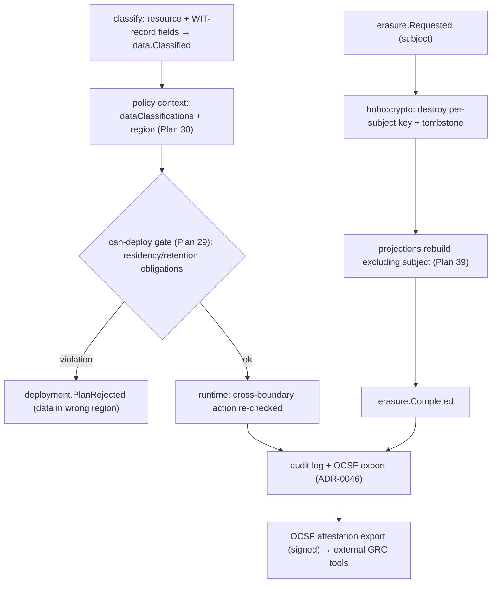
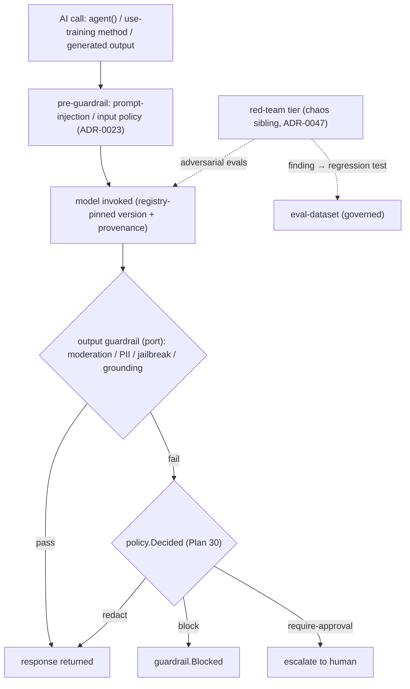

# Governance Planes: Compliance & AI Safety

This capability doc consolidates Plan 46, Plan 47 of the HoBo design suite.

## Plan 46

**Plan 46 — Compliance & data governance plane**

> **Why this exists.** Residency was a *hint* ([ADR-0040](./adr/05-config-matching-environments.md#adr-0040)/[ADR-0036](./adr/07-portability-extensibility.md#adr-0036)), retention had a *floor* ([ADR-0023](./adr/02-identity-security.md#adr-0023)), and audit/OCSF export existed ([ADR-0046](./adr/04-governance-verification.md#adr-0046)) — but there was **no plane that turns a data classification into an *enforced* residency/retention decision** and no **right-to-erasure** mechanism. The enforcement is the gap HoBo had the raw materials for but no plane to deliver; attestation evidence rides out as an OCSF export.

### Data classification — the input everything keys on
Resources and WIT-record fields carry a **classification label** (`public` / `internal` / `pii` / `phi` / `pci` / `secret`, extensible). Labels attach two ways:
- **On a resource** — `sql("patients").classify("phi")` — the coarse default for everything it holds.
- **On a WIT-record field** ([ADR-0051](./adr/03-data-plane.md#adr-0051)) — `email: pii`, `ssn: pii` — fine-grained, so a projection ([Plan 39](./data-plane.md#plan-39)) inherits classification per column and the schema *is* the data map.
Classification emits `data.Classified` ([Plan 11](./event-model.md#plan-11)) and becomes the `context.dataClassifications` the policy plane already accepts ([Plan 30](./contracts-policy-flags.md#plan-30) decision request). **Discovery** (scan a projection/field for likely PII) is an optional engine behind a port that *proposes* labels; humans/policy confirm.

### Residency & retention — enforced, not hinted
Classification + jurisdiction → **policy obligations** ([Plan 30](./contracts-policy-flags.md#plan-30)) enforced at two points:
- **`can-deploy`** ([Plan 29](./contracts-policy-flags.md#plan-29)) — a plan that would place `phi` data in a Camp outside its allowed region is a **gate failure**, not a runtime surprise. This reuses the deterministic Matching context (`region`/`provider`, [ADR-0033](./adr/05-config-matching-environments.md#adr-0033)) and cross-Camp residency ([ADR-0040](./adr/05-config-matching-environments.md#adr-0040)); sovereign mode ([ADR-0036](./adr/07-portability-extensibility.md#adr-0036)) is the strict ceiling.
- **Runtime** — a `notify`/replication/export action that would move classified data across a residency boundary is denied or mutated (e.g. region-pinned channel, [Plan 21](./authoring-resources-wiring.md#plan-21)).

**Retention** is the dual: each classification declares a retention window; the compaction/archival rules ([Plan 11](./event-model.md#plan-11)) honor it as a **floor and a ceiling** — audit streams are retained per policy, and data past its ceiling is a candidate for erasure. Retention rules ride the existing event-log compaction policy; no new store.

### Right-to-erasure on a forward-only log
The hard problem: HoBo's log is **append-only and never rewritten** ([Plan 11](./event-model.md#plan-11)) — so how do you "delete" a user? **Crypto-shredding**, not history rewrite:
1. PII payloads are encrypted with a **per-subject key** via `hobo:crypto` ([Plan 21](./authoring-resources-wiring.md#plan-21)/[Plan 31](./authoring-resources-wiring.md#plan-31)) — keys the app never holds.
2. An `erasure.Requested` opens a saga; **destroying the subject's key** renders every historical event carrying their PII permanently unreadable (the ciphertext stays, the plaintext is gone) and a **tombstone** event records the erasure.
3. **Projections rebuild excluding erased subjects** ([Plan 39](./data-plane.md#plan-39)) — the read side no longer surfaces the data; an `erasure.Completed` fact closes the saga.
This **honors the forward-only invariant** (no event is rewritten or removed) while delivering GDPR/CCPA deletion semantics — and it's auditable: the erasure itself is a replayable fact.

### OCSF attestation export — evidence from the log
HoBo standardizes the **enforcement**, not a compliance program. The audit facts it already records — the OCSF audit export ([Plan 12](./security-networking.md#plan-12)/[ADR-0046](./adr/04-governance-verification.md#adr-0046)), `policy.Decided` (every access/residency/retention decision), `data.Classified`/`erasure.*` (the data lifecycle) — are exportable as a signed, point-in-time **OCSF attestation export** that external GRC tools can consume to assemble whatever certification evidence (SOC2/GDPR/HIPAA) a buyer needs. HoBo produces the replayable facts; it does not run the attestation program itself.

### Events & ports
- **New:** `data.Classified`, `governance.*` (residency/retention obligation lifecycle), `erasure.Requested`/`erasure.Completed` ([Plan 11](./event-model.md#plan-11)). **Reused:** `policy.Decided`/obligations ([Plan 30](./contracts-policy-flags.md#plan-30)), `compat.Gate*` ([Plan 29](./contracts-policy-flags.md#plan-29)), `match.Decided` region context ([ADR-0033](./adr/05-config-matching-environments.md#adr-0033)), `hobo:crypto` ([Plan 21](./authoring-resources-wiring.md#plan-21)), OCSF audit export ([ADR-0046](./adr/04-governance-verification.md#adr-0046)), projection rebuild ([Plan 39](./data-plane.md#plan-39)).
- **Ports/engines behind ports:** a **classification/discovery** engine (built-in label rules; optional PII-discovery scanner) and a thin **OCSF attestation export** assembler (external GRC tools consume it). No new app-developer SDK surface beyond `.classify()` + `hobo attest`/`hobo erase`.

### Verification
- A plan placing a `phi`-classified `sql` in a non-permitted region is rejected at `can-deploy` with a precise residency violation; pinning to a permitted Camp passes.
- `hobo erase --subject <id>`: key destroyed, tombstone written, projections rebuilt excluding the subject, `erasure.Completed` — the subject's data is unreadable everywhere yet **no historical event was rewritten** (replay still works).
- `hobo attest` produces a signed OCSF attestation export whose every line traces to a source event (classification, residency/retention decision, access decision) for an external GRC tool to consume.
- A deploy routing `pii` to a Camp/provider outside its allowed region or classification fails the gate; pinning to a permitted target unblocks it (event-sourced) — the egress caveats for hosted embedders/models ([Plan 35](./data-plane.md#plan-35)) ride the same residency obligation.

### Scope (v1) & YAGNI
- **v1:** classification labels (resource + WIT-field) → enforced residency/retention obligations at `can-deploy` + runtime; crypto-shred erasure + projection purge; an OCSF attestation export over the audit facts for external GRC tools.
- **Deferred / out of scope:** the SOC2/GDPR/HIPAA attestation-program framing and a DPA/subprocessor registry as a product surface ([ADR-0064](./adr/08-scope-and-requirements.md#adr-0064)) — HoBo exports the facts, GRC tools run the program; auto-PII-discovery beyond a basic scanner (proposes, never auto-classifies); data-lineage graph beyond classification + projection read-sets.

### Iteration hooks
- Classification taxonomy + whether labels are a closed enum or an extensible lattice with inheritance.
- Where the per-subject key boundary sits (per-user vs per-record vs per-tenant) — the granularity/erasure-blast-radius tradeoff.
- Whether attestation packs are first-party only or community/Registry-distributed ([ADR-0062](./adr/07-portability-extensibility.md#adr-0062)).
- Coupling the suppression list (the `notify` port, [Plan 21](./authoring-resources-wiring.md#plan-21)) to erasure so an erased subject is auto-suppressed across channels.

## Plan 47

**Plan 47 — AI safety & model governance**

> **Why this exists.** HoBo is AI-native to its core — `"use training"` ([Plan 23](./forge-generated-stack.md#plan-23)), the Forge ([Plan 33](./forge-generated-stack.md#plan-33)), the Operator Crew ([Plan 40](./operators-sre.md#plan-40)), the generated stack ([Plan 41](./forge-generated-stack.md#plan-41)). It had **prompt-injection defenses** ([ADR-0023](./adr/02-identity-security.md#adr-0023)), **evals** ([Plan 23](./forge-generated-stack.md#plan-23)), and a **PII-not-trained** policy ([ADR-0025](./adr/06-ai-generation-operators.md#adr-0025)) — but **no governance of the models/prompts themselves**, no **output guardrails**, no **red-teaming**, and no **model cards**. A platform whose differentiator is "AI everywhere" must govern that AI, or the differentiator is also the biggest liability.

### A model registry (the Registry pattern, applied to models)
Models, prompts, and eval-datasets are **versioned, signed, provenance-bearing artifacts** in the existing **Registry** ([Plan 6](./ai-native-agent-auth.md#plan-06)/[Plan 27](./platform-engineering.md#plan-27)) — the same machinery that holds providers and Resource Packs:
- A **model entry** pins `{ id, version, provider, weights-or-endpoint ref, model card, eval results, signature }`. Local/in-boundary models and hosted endpoints are both entries (the latter with an egress caveat, like a subprocessor — [Plan 46](./governance-planes.md#plan-46)).
- A **prompt entry** is a versioned artifact too — because in HoBo a prompt *is* persisted code ([ADR-0048](./adr/06-ai-generation-operators.md#adr-0048)) when `"use training"` rewrites it. Promotion is gated.
- An **eval-dataset entry** carries its own provenance + classification ([Plan 46](./governance-planes.md#plan-46)) — so a PII-bearing dataset can't be used for training ([ADR-0025](./adr/06-ai-generation-operators.md#adr-0025)).
`model.Registered`/`model.Promoted` are events; promotion runs the four-lens gate below.

### Output guardrails — a gated step in every AI call
A **`guardrail` capability** ([Plan 21](./authoring-resources-wiring.md#plan-21)/[Plan 24](./wasm-runtime-wit.md#plan-24)) runs **moderation / PII-leak / jailbreak / grounding** checks as a **policy-gated step** ([Plan 30](./contracts-policy-flags.md#plan-30)) wrapped around any AI output — `agent()` responses ([Plan 6](./ai-native-agent-auth.md#plan-06)), `"use training"` method outputs ([Plan 23](./forge-generated-stack.md#plan-23)), and generated-stack artifacts ([Plan 41](./forge-generated-stack.md#plan-41)). Engines sit **behind a port** (built-in rules default; **Llama Guard** / hosted moderation / a local classifier as adapters — chosen per Camp by Matching, air-gap → local). A failed check emits `guardrail.Blocked` and the policy decides: block, redact (mutate), or require-approval. Because it's the policy plane, "why was this output blocked" is a replayable `policy.Decided`.

### Red-teaming as a chaos-tier sibling
Adversarial evaluation reuses the **chaos verification tier** pattern ([ADR-0047](./adr/04-governance-verification.md#adr-0047)): **hypothesis-driven, blast-radius-bounded, policy-gated** adversarial experiments against models/prompts/agents (jailbreak suites, prompt-injection corpora, harmful-content probes). A red-team run is event-sourced (`redteam.*`); a **discovered failure becomes a permanent regression test** in the governed eval-dataset — exactly as a chaos finding becomes a resilience regression test. Red-teaming runs in the same gated, replayable frame as every other HoBo verification tier.

### Eval-dataset governance
Eval-datasets are first-class governed artifacts (registry entries above): **versioned, classified, provenance-tracked**. This **extends the PII-not-trained policy** ([ADR-0025](./adr/06-ai-generation-operators.md#adr-0025)) into a full lifecycle — a dataset's classification ([Plan 46](./governance-planes.md#plan-46)) gates whether it may train or only evaluate; contamination checks (eval data leaking into training) are a policy rule; the `training-engine`'s reward signal ([Plan 23](./forge-generated-stack.md#plan-23) trajectories) is auditable against the dataset it was scored on.

### Model cards as facts
Every registered model carries a **model card** (intended use, training-data provenance class, eval results, known limitations, guardrail coverage) — a signed, replayable artifact assembled from the registry + `guardrail.*` + `redteam.*` + eval facts. Like compliance ([Plan 46](./governance-planes.md#plan-46)), HoBo exports these facts via the OCSF attestation export for an external GRC/responsible-AI tool to consume; it does **not** run a responsible-AI attestation *program* itself ([ADR-0064](./adr/08-scope-and-requirements.md#adr-0064)). Model cards are the AI analog of the conformance/provenance bridge that underpins portability.

### The four lenses, applied to model & prompt changes
A model/prompt promotion is governed by the same four-lens taxonomy as any change ([Plan 29](./contracts-policy-flags.md#plan-29)/[Plan 30](./contracts-policy-flags.md#plan-30)):
- **Contract** — the model's I/O schema + the guardrail floor *must never break* (a guardrail-coverage regression blocks promotion).
- **Eval** — the candidate *should improve* on the governed eval-dataset (champion/challenger + shadow, [Plan 23](./forge-generated-stack.md#plan-23)).
- **Policy** — *may/may not* be promoted (residency of weights, dataset classification, red-team clearance).
- **Trace** — *what actually happened* — every invocation is an OpenInference trajectory ([Plan 23](./forge-generated-stack.md#plan-23)) the registry links back to.

### Events & ports
- **New:** `model.Registered`/`model.Promoted`, `guardrail.Blocked`, `redteam.*` ([Plan 11](./event-model.md#plan-11)); a **`hobo:guardrail`** port + `guardrail` catalog row ([Plan 21](./authoring-resources-wiring.md#plan-21)/[Plan 24](./wasm-runtime-wit.md#plan-24)). **Reused:** the Registry + signing/provenance ([Plan 6](./ai-native-agent-auth.md#plan-06)/[Plan 27](./platform-engineering.md#plan-27)), `policy.Decided` ([Plan 30](./contracts-policy-flags.md#plan-30)), evals/trajectories/`training.*` ([Plan 23](./forge-generated-stack.md#plan-23)/[ADR-0025](./adr/06-ai-generation-operators.md#adr-0025)), the chaos tier ([ADR-0047](./adr/04-governance-verification.md#adr-0047)), persisted prompts ([ADR-0048](./adr/06-ai-generation-operators.md#adr-0048)), the OCSF attestation export ([Plan 46](./governance-planes.md#plan-46)).
- **Ports/engines behind ports:** the guardrail engine (built-in rules; Llama Guard/hosted/local adapters) and the red-team engine (built-in adversarial suites; external optional) — both certified by `@hobo/conformance` and air-gap-degradable.

### Verification
- A `"use training"` method whose candidate prompt regresses guardrail coverage is **blocked at promotion** (Contract lens) even if it improves the eval score (Eval lens) — replayable `policy.Decided`.
- A jailbreak that elicits disallowed content in a red-team run emits a `redteam.*` finding, becomes a regression test in the governed dataset, and fails future promotions until mitigated.
- An agent output containing PII is caught by the guardrail step → `guardrail.Blocked` (or redacted by policy); air-gap uses the local classifier with no egress.
- `hobo attest` produces a signed model-card export (via the OCSF attestation export) tracing to registry + guardrail + red-team + eval events, for an external responsible-AI/GRC tool to consume.

### Scope (v1) & YAGNI
- **v1:** model/prompt/eval-dataset registry entries (versioned, signed, provenance); the `guardrail` capability + one reference engine (built-in + Llama Guard adapter); red-teaming on the chaos-tier pattern; eval-dataset classification/contamination policy; model cards as exported facts; four-lens model-promotion gate.
- **Deferred / out of scope:** a responsible-AI attestation *program* framing ([ADR-0064](./adr/08-scope-and-requirements.md#adr-0064)) — HoBo exports the facts, a GRC tool runs the program; automated continuous red-teaming campaigns; a watermarking/output-provenance scheme for generated media; fine-grained per-token cost/safety budgets (rides the spend breaker); model distribution rides Registry distribution ([ADR-0062](./adr/07-portability-extensibility.md#adr-0062)).

### Iteration hooks
- Whether guardrails are one `hobo:guardrail` port with check-type discriminators or a port per check class.
- Where the guardrail step sits for streaming responses (post-hoc vs incremental) — latency/safety tradeoff.
- How model-card schema aligns to emerging standards (EU AI Act technical docs, NIST AI RMF, model-card-toolkit).
- Sharing the red-team finding → regression-test loop with the Operator Crew's SRE postmortem loop ([Plan 44](./operators-sre.md#plan-44)).
