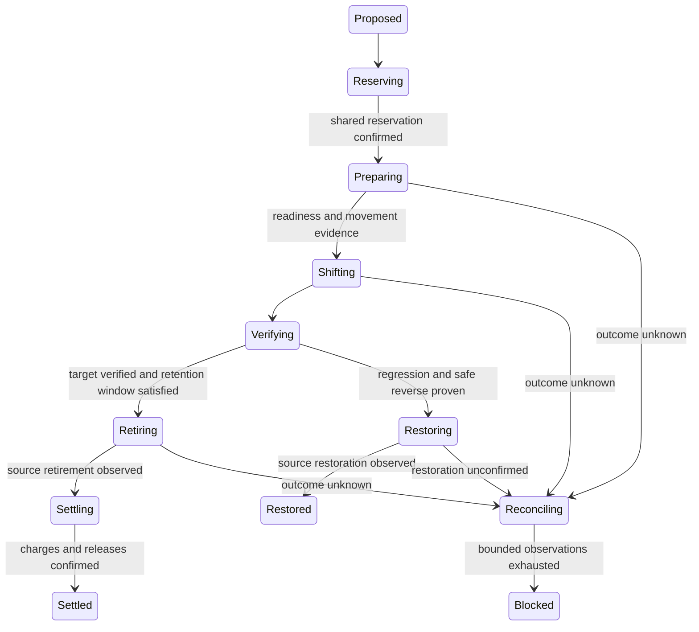

# Budgeted cloud hosting transitions

The [shared budget policy](./shared-budget-policy.md) extends authored financial
intent and the same admission authority to CI, with workload-specific execution
guarantees and required constraint measurements.

This contract closes the gap between the [FinOps decision pipeline](./finops-budget-routing-control-plane.md),
[Yard-first placement](./adr/yard-first-placement.md), and an executed cloud-hosting transition.
It applies to hosting platforms and their dependent resources. The design composes
[ADR-0136 effects and resilience](./adr/03-data-plane-effects-resiliency.md),
[ADR-0071 credit-aware selection](./adr/01-architecture-core.md#adr-0071), the
existing policy plane, core durable event store, and Trails' state-transfer evidence.

## Goals and explicit tradeoffs

The objective is to reduce the cost of an eligible hosting realization while keeping
its declared service guarantees. The order of decisions is deliberate: establish
tenant and workload authority, enforce capability and residency constraints, prove
financial feasibility, then rank the remaining choices. Recovery uses its own approved
funding and safety constraints. An optimization score never supplies that approval.

The budget guarantee covers obligations admitted through the shared authority under
the supplied enforceable bounds. A provider that can continue charging without a
bound cannot support a strict ceiling through polling alone. That workload must have
a provider-enforced limit, a conservative funded lifetime, or an explicit refusal.
External spend belongs in the same authority's exposure watermark.

The initial planner uses deterministic resource ordering and preserves matching
specificity and priority. It does not promise a globally cheapest combination of
resources. Shared credits can make greedy placement suboptimal or cause this pass to
refuse a request for which a different combination would fit. Such a refusal means
this pass could not construct a funded placement. Admission still enforces the whole
plan's ceilings. Global optimization can use the same commitment and reservation contract.

Strict execution intentionally requires more evidence than a legacy unbudgeted plan:
trusted financial snapshots, a durable authority, an adapter execution guarantee,
realized incumbent state, and positive health and settlement observations. Existing
unbudgeted planning remains available. An authored budget policy cannot be dropped
during manifest parsing to enter that path.

## Decision and authority

Pure planning compares compatible deployment groups using pinned, dated evidence.
It emits a proposed financial commitment and its digest; it cannot provision, reserve,
or move traffic. The authenticated gateway resolves financial evidence from the tenant's
authority rather than accepting caller-supplied balances. Before activating the plan,
it obtains an idempotent reservation against that shared authority.

Every proposal binds tenant, deployment group, source and destination, catalog hash,
quote identities, policy revision, budget and period, account-scoped entitlements,
currency, usage horizon, constraints, movement class, and declared effects. A changed
proposal cannot reuse an old approval or reservation identity.
The commitment must cover every resource in the pinned usage evidence exactly once;
hashing a partial allocation does not make the omitted resources funded.

The Yard selects provider context; resources remain within its permitted deployment
group. Registering a provider adds a candidate, not permission to bypass capability,
residency, write-ownership, or financial constraints. Exact placement remains exact.
Unsupported objectives and requested hard guarantees without an authority are refusals.

## Money and periods

Runtime money uses checked integer micro-units with an explicit currency. No arithmetic
may exceed the safe-integer range. Billing units are converted through an explicit
usage profile and duration; a calendar-month quote needs its actual billing period.
Unknown prices, malformed prices, stale observations, and verified zero prices are
different states. A zero hard cap is exhausted; unlimited is explicitly represented.

Expected cost ranks feasible alternatives. A conservative upper bound admits them:

```text
settled + active commitments + unresolved exposure + protected recovery allowance
        + proposed bounded commitment <= applicable ceiling
```

These buckets are disjoint. Each applicable parent and provider-account ceiling must
hold. A child authority may use an escrow already deducted by its parent; a threshold
event is not escrow. One transition stream's CAS does not make two budget streams
atomic. Reserve in the shared scope/period authority with a stable command ID, then
record the returned reservation. A crash between those steps is recovered by querying
that same reservation ID; it never creates a second hold.

Gateway admission and execution share that hold. The execution plan pins the original
financial plan hash and reservation ID. The authority atomically claims the reservation
for one execution digest; a second transition cannot spend it. A fresh execution without
gateway admission obtains and claims its own hold through the same protocol.
For adoption, the target plan reference must equal the admitted deployment artifact
hash. An adapter-specific deployment handle does not replace that artifact identity.

Quotes include fixed charges, bounded variable usage, applicable entitlements,
transition/egress/overlap/cleanup costs, and minimum obligations. Shared entitlement
buckets are consumed once across all selected resources. Expiry and account/SKU/unit
restrictions apply. A commitment beyond the covered financial period is refused until
future-period authority covers it. A free-tier reset cannot erase an outstanding bill.

Each non-usage charge identifies its payer account, cost class, expected amount and
bound. For example, provider A's egress remains a charge to A when the destination is
provider B. B's credits cannot offset it. Monetary credits require explicit cost-class
eligibility; usage allowances do not offset fixed, overlap, egress or cleanup charges.
The reservation debits all affected provider ceilings and entitlement buckets together.

Cancellation, a local timeout, lease expiry, and zero traffic do not release a provider
liability. Ambiguous work retains its hold until authoritative observation and settlement.
Actual charges exceeding a bound remain recorded; they trigger a breached state and
block further ordinary admissions rather than disappearing behind the estimate.

## Explicit effects and enforced resilience

Use existing `@hobo/contracts` contracts; no parallel effects runtime is introduced.

| Operation | EffectSpec | Enforced rule |
| --- | --- | --- |
| Normalize, filter, rank, fold | `pure` | No network, clock reads, or provider calls on replay |
| Reserve and settle financial authority | `transacts` with storage/metering/event domains | Shared-authority CAS and stable command identity |
| Provision, shift, restore, retire | `noRollback` with network/externalCall/IaC domains | Persist intent before I/O; one mutation attempt per operation identity |
| Observe provider state | `varies` with network/externalCall domains | Bounded read retries; fresh scoped evidence |
| Schedule reconciliation | durable timer/outbox | Deadline/backoff is persisted with the state change |

Mutation and observation boundaries carry a `ResilienceProfile`; effect compatibility
is checked and declarations/invocations are emitted as facts. Policy denies, terminal failures,
and cancellation never retry. Mutations are never hedged or transparently redirected
to another platform. A mutation can be attempted again only with proven provider-side
idempotency or authoritative evidence that it did not occur, under the same reservation.

`applyResilienceProfile` is a retry applicator; profile metadata alone does not enforce
timeouts, bulkheads, or timer delays. The coordinator enforces deadlines and bounded
observation through journaled timers. It uses core `DurableEventStore.commit` to stage
domain events and outbox/timer effects atomically. Network I/O runs outside that commit.

## Transition lifecycle



The durable record includes current operation ID, revision, owner fence, deadline,
next observation time, attempts, retained reservation, and latest accepted evidence.
Workers persist operation intent before calling an adapter. Restarting an in-flight
transition starts with observation; replay never calls a provider. Out-of-order,
foreign-tenant, wrong-operation, expired, or stale-revision observations cannot advance it.
Concurrent commands use conditional append; stale owners cannot perform a subsequent
transition. Duplicate operation deliveries use provider idempotency or reconciliation.

Cancellation stops new optimization operations and keeps observation and compensation
available. Read-only verification can finish after cancellation so recovery uses current
evidence. A definitive absence observation must prove there is no in-flight provider
operation and that the operation cannot apply later; it permits compensation rather
than a blind retry of the original mutation. Any
positive source-retirement evidence prevents restoration to that source, including
when the enclosing operation reports failure.

Retirement and settlement are separate from routing success. Request-metered costs can
fall with traffic; provisioned capacity charges require confirmed resource retirement.
The source remains funded during drain and the approved rollback window. Remaining
charges stay unresolved until metering confirms them.

## Constraints survive execution

Each prepared, intermediate, final, and recovery plan retains its availability,
residency, latency, replication, and effect constraints. No handoff may discard them.
An approved degradation is a new policy result bound to the transition; missing fields
cannot stand in for approval. Adapter realization and observed state must satisfy the
postcondition before success is emitted.

Required preconditions depend on adapter capability: DNS changes require validated
ownership and TTL evidence; weight-based adapters require verified weight support;
every production transition requires readiness and a scoped health gate. Canary steps
need fresh observations over the declared dwell window. Cooldown limits optional cost
optimization, while a hard-invalid incumbent follows the recovery policy. Serializing
commands and persisting pending operations prevents overlapping swaps and restart churn.
Every persisted checkpoint advances a separate CAS state version, including writes
that do not change the user-facing routing revision. Status and acknowledgements must
name the exact approved plan and adapter; active status for another plan is insufficient.

## State and write ownership

Movement declares `stateless`, `replicated`, or `single-writer` semantics. Cost routing
among replicas is legal only when the workload's declared effects and topology permit it.
A compatible endpoint is not replication evidence.

Single-writer movement requires a source fence, a quiescent source checkpoint,
independently observed target checkpoint equality, checksum verification, and a fresh
ownership epoch before write ownership transfers. These are the obligations already
demonstrated by Trails' tenant move ports. Once the target accepts writes, routing back
requires proven reverse synchronization and fencing. Otherwise the state remains
recovery-required. A compensating routing request is itself `noRollback`; `rolledBack`
is emitted only after the intended source state is observed active and fully realized.

## Infeasible decisions

Strict budget mode refuses new unfunded obligations. Availability-first operation needs
a separately authorized, bounded emergency allowance. Ordinary optimization cannot spend
protected recovery funds. When no lawful, capable, affordable realization satisfies the
availability floor, the result names the incompatible constraints and the permitted
degradation or approval path. No score can make an infeasible candidate eligible.

## Adversarial acceptance matrix

| Scenario | Required result | Owning implementation |
| --- | --- | --- |
| Credit objective reaches actual deployment planner | Pinned quotes/ledger affect selection; unsupported objective refuses | cloud Planner/gateway |
| Hourly vs monthly price, unknown vs free, expired quote | Common units/horizon and explicit evidence; unsafe comparison refuses | cloud planning quotes |
| Multiple resources share entitlement or budget | One bucket, bounded plan total, no duplicated allowance | cloud Planner/shared authority |
| All candidates over cap or invalid financial facts | Explicit infeasible result | Dispatcher/Broker |
| Concurrent reservations at same balance | CAS loser reranks; paid/free/capacity all reserved | Dispatcher/shared authority |
| Duplicate reservation ID or changed payload | Original result replay or identity-conflict refusal | reservation authority |
| Gateway reservation handed to execution | Adopt once, bind execution digest, retain one hold | authority bridge/coordinator |
| Destination credit alongside source egress | Attribute both payer accounts; enforce credit cost classes | cloud quotes/shared authority |
| Revised cap, period reset, delayed usage | Versioned period-scoped signals; retained liabilities | Broker budget fold |
| Tiny savings, dominance, irrelevant new candidate | Stable calibrated metrics and sustained improvement evidence | Dispatcher/FinOps proof |
| Health failure in cooldown; concurrent signals; restart | Recovery policy, one pending transition, persisted history | Station loop |
| Missing prerequisites or stale health evidence | Refuse before movement | cutover/coordinator |
| Availability constraints during final cutover | Retain and enforce original constraints | Station cutover |
| Provider applied but response lost | Reconcile without duplicate mutation or released hold | durable coordinator |
| Rollback partial/none/throws | Recovery remains unconfirmed; no false rollback fact | cutover/coordinator |
| Destination accepted writes | Reverse-transfer proof or recovery-required | movement evidence |
| Old host still billable after routing change | Retire/observe/settle before financial completion | coordinator/authority |
| Cancellation, stale owner, late observation, replay | Retained exposure, fencing and scoped evidence; zero replay I/O | durable journal |
| No safe affordable destination | Explicit refusal/degradation/approval result | policy/Planner |

## Evidence boundary

Offline tests exercise pure planning, actual durable SQLite journal/reopen behavior,
Pact-shaped provider boundaries, reservation races, timeouts, and compensation failures.
The [production provider design and evidence](./hosting-provider-production.md) describes
the concrete application, native drivers, credential and financial evidence, operating
liabilities and actual anonymous acceptance. Paid-provider charges, state transfer and
final billing require their configured native integration. Missing evidence fails closed;
a modeled API contract test never substitutes for live provider evidence.
